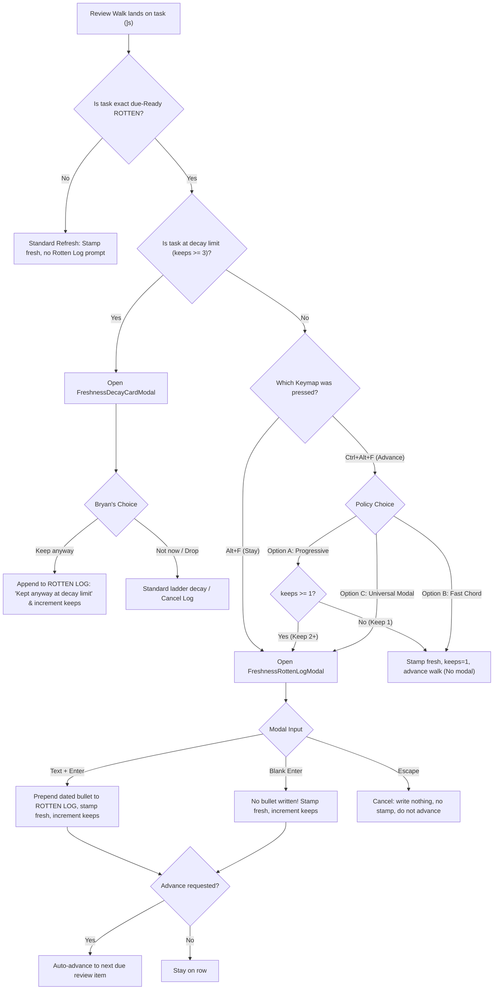

# Rotten Log: Review Audit Trail, Refresh Prompts, and Preserving Morning Velocity

> **Research query:** I would like to add support for a new "rotten log" (a good glossary
> entry should be added for this new term).
> - This should work like the work log, but the prompt for an optional rotten log entry
>   should occur when a rotten task (during our GTD morning review, for example) is
>   refreshed using the `<alt+f>` or `<ctrl+alt+f>` keymaps.
> - The goal of this change is to add a visual indication (and an audit trail) that shows
>   how many times (and when and why) a task has been manually refreshed.
> 
> Can you do some research with the goal of helping me decide the best way to implement
> this? Also, critique this plan in general. Is this a good idea? Would you take a
> different approach? Make any adjustments to the requirements that you think are
> justified but clearly call these out. End your analysis with a recommended solution.

**Author:** researcher gem (`research.55.gem`)  
**Date:** 2026-10-23  
**Target Repository:** `bob-cli` & `bob-plugins` (`bob-navigation-hotkeys`, `bob-ledger-tools`)  
**Output Snapshot:** `research:202610/rotten_log_and_refresh_audit_trail__gem.md`  

---

## 1. Executive Summary & Bottom Line

**Yes, build a Rotten Log, but adjust the interaction model before writing code.**

The core insight behind your request is spot-on: **the morning review suffers from the "amnesia of keeps."** When a task has been confirmed two or three times over consecutive weeks without being executed, scheduled, or dropped, Bryan has no recorded memory of *why* he deferred it. When Bob's Approved Decay card eventually pops up on keep 3 (`decisions:rotten-keeps-use-priority-decay`), Bryan faces a high-stakes decision without the historical reasoning that led there. A task-local, Markdown-native log of review rationales closes this audit gap.

However, a literal implementation of the proposal—prompting a modal dialogue on **every** Rotten refresh during `<alt+f>` or `<ctrl+alt+f>`—introduces a severe usability hazard:

> [!WARNING]
> **The 40-Refresh Morning Reality Check:**
> On 2026-10-23, Bryan's live vault recorded **41 task refreshes** (`refreshed_today: 41`, `upkeep_today: 34`). In a typical morning GTD review walk, 15 to 30 tasks can be in the ROTTEN tier. If `<ctrl+alt+f>` pops up an interactive modal on every single rotten task, Bryan would endure **15–30 modal dialog interruptions every single morning**. Even if `Enter` skips, the visual flashing, context switches, and doubled keystrokes would cripple the fast review walk (`decisions:answering-advances-the-walk`).

### Core Recommendations & Adjusted Design:

1. **Dual-Track Architecture (Count vs. Rationale):**
   Do not rely on sub-bullets in the log to serve as the primary counter of "how many times" a task has been refreshed. Keep `[keeps:: N]` on the task line as the strict, machine-verified **quantitative streak counter** (with pips `••` in the freshness mark). Use the **Rotten Log** (`🍂 **ROTTEN LOG**`) strictly as the **qualitative rationale audit trail** ("when and why").
2. **Strict "Blank Enter Writes Nothing" Rule:**
   Like `WORK LOG` (and unlike `SCHEDULE LOG`'s `🤷 no reason given`), pressing `Enter` with an empty input in the Rotten prompt must write **zero child bullets**. It must stamp `fresh`, increment `[keeps:: N]`, and proceed. Otherwise, a task kept 4 times without notes would accumulate 4 lines of empty bullet bloat.
3. **Protect Review Velocity with Progressive Friction or Asymmetric Chords:**
   - **Recommended Approach (Progressive Prompting):** Do not prompt on **Keep 1**. Keep 1 is routine weekly aging for any backlog task. Prompt for an optional Rotten Log rationale starting on **Keep 2** (when `keeps >= 1`), where true deferral friction begins.
   - **Alternative (Asymmetric Chords):** `<ctrl+alt+f>` remains the instant "keep and auto-advance" (1 keypress, zero modals, increments `[keeps:: N]`), while `<alt+f>` (stay) opens the Rotten Log modal prompt for deliberate annotation when Bryan actually wants to record a reason.
4. **Decay Decision Integration:**
   When the keep limit is reached (default 3), the decay card triggers as usual. Choosing **Keep anyway** from that card should automatically prompt for or append a Rotten Log entry (`*YYYY-MM-DD* — Kept anyway at decay limit (reason)`).
5. **Enrich the Freshness Mark Tooltip:**
   Render the latest Rotten Log entry directly inside the `bob-ledger-tools` hover tooltip (e.g. `Last kept 2026-10-16: "Waiting on upstream PR"`), providing immediate visual context during the review walk without expanding child bullets.

---

## 2. Glossary Entry: Rotten Log

To be added to SASE Memory (`sase memory write glossary:rotten-log`):

```markdown
# Rotten Log

*Requested · project*

aka rotten review log, keep log, review log

A task-local history of manual review keeps and deferral rationales, stored as
a `🍂 **ROTTEN LOG**` direct child bullet with newest-first dated sub-bullets
(`*YYYY-MM-DD* — <reason>`). When `<alt+f>` or `<ctrl+alt+f>` refreshes an
exact due-Ready rotten task during the GTD morning review walk, the reviewer
is optionally prompted for an explanation of why the task is being kept
rather than scheduled, delegated, or dropped. A non-empty summary is
prepended under the marker; a blank submit (`Enter`) refreshes the task and
increments `[keeps:: N]` without inserting a bullet. The log provides a
durable, human-readable audit trail that preserves review context across
weeks and informs the Approved Decay decision card when the keep limit is
reached.
```

---

## 3. Current System Baseline & Architectural Context

To understand where Rotten Log fits, we must examine the existing logging, freshness, and review mechanisms across `bob-cli` and `bob-plugins`.

### 3.1 The Three Existing Managed Task Logs

Bob currently defines three managed task log structures in markdown notes:

| Log Type | Marker Text | Entry Grammar | Trigger Gestures | Blank / Empty Handling |
| :--- | :--- | :--- | :--- | :--- |
| **Work Log** | `🛠️ **WORK LOG**` | `*YYYY-MM-DD* — <summary>` | Unlink (`Ctrl+Shift+Enter`), Alt+N release, or Alt+F on Pending (`[/]`) | Writes **nothing**; state updates cleanly |
| **Schedule Log** | `🗓️ **SCHEDULE LOG**` | `*<from> → <to>* — <reason>` | Schedule prompt (`$<N>`, `Ctrl+D`, `Ctrl+Alt+D`, priority roll) | Writes `🤷 no reason given` (unless silently guarded) |
| **Cancel Log** | `❌ **CANCEL LOG**` | `*YYYY-MM-DD* — <reason>` | Task drop (`~`), decay drop | Mandatory reason or cancelled |

All three follow strict structural rules:
- Placed as direct children of the task bullet.
- Pre-existing Cancel Logs sit at the top of child bullets; Schedule and Work Logs sit below user notes.
- Sub-bullets are indented one tab (`\t`) past the marker and ordered **newest on top**.
- Parsed across both Rust (`ManagedTaskLogKind` in `src/native/capture/sub_bullet.rs`) and JavaScript (`buildManagedTaskLogParentRe`).

### 3.2 Freshness and the Keep Streak (`[keeps:: N]`)

Under `decisions:rotten-keeps-use-priority-decay` and `decisions:decay-decisions-are-available-immediately`:
- `[keeps:: N]` is a **streak of consecutive due-Ready bare keeps**, not a lifetime refresh counter.
- It is incremented only when an exact, due Ready ROTTEN or TICKLER task is refreshed via `api.freshness.keepLine`.
- Any other human stamp (e.g. changing status, re-scheduling) resets `keeps` to 0.
- It renders in the `bob-ledger-tools` freshness mark as faint pips (`◔ 3d ••`).
- When `keeps` reaches `freshness.decay.keeps` (default 3), the next due review opens the `FreshnessDecayCardModal` offering:
  - `↵ Not now` (P0 enters priority ladder with rolled date in Schedule Log)
  - `L Less often` (extends interval)
  - `E Reword` (resets streak)
  - `D Drop` (cancels with Cancel Log)
  - `⌥F Keep` (increments streak and asks again next week)

### 3.3 The Review Walk & Auto-Advance (`answering-advances-the-walk`)

The morning GTD review walk (`]s` / `[s`) visits tasks in strict tiers:
$$\text{PRE} \longrightarrow \text{NEW} \longrightarrow \text{PROJECTS} \longrightarrow \text{PENDING} \longrightarrow \text{NEXT} \longrightarrow \text{RECURRING} \longrightarrow \text{TICKLER} \longrightarrow \text{ROTTEN} \longrightarrow \text{POST}$$

- **`<alt+f>`** is the designated **stay** answer: it stamps `fresh` (and optionally prompts for Work Log if Pending) and leaves the cursor on the landed row.
- **`<ctrl+alt+f>`** is the designated **advance** answer: it stamps `fresh`, records a `<C-o>` jump mark, and automatically jumps to the next due item in the walk with a 350ms gesture settle lock.

---

## 4. Critique of the Proposal: Is This a Good Idea?

### 4.1 The Strengths (Why Bryan Needs This)

1. **Eliminates the "Amnesia of Keeps":**
   When a task sits in the backlog and is refreshed week after week, the human reviewer forgets their prior assessments. A task kept on Oct 2, Oct 9, and Oct 16 has three invisible decisions behind it. If on Oct 2 the reason was "Waiting for v2.0 release", on Oct 9 "Release delayed to Oct 15", and on Oct 16 "Release out; need weekend focus block", that narrative is vital. Currently, that entire narrative is lost.
2. **Informs the Decay Card Decision:**
   When the Approved Decay card fires at Keep 3, Bryan is asked: *Drop, Defer (P0 → P2), or Keep?* Without a history of reasons, Bryan must re-evaluate the task from scratch. With a Rotten Log, Bryan sees the 3 previous reasons directly above the prompt, turning an arbitrary guess into an informed triage decision.
3. **Durable, Sync-Safe, Plain-Text Audit:**
   Unlike metadata stored in app memory or plugin local storage, a Markdown child bullet synchronizes across devices (Mac, iPhone, terminal), appears in `git diff`, and is readable in standard Markdown viewers.

### 4.2 The Critical Flaws of the Unadjusted Plan

#### Flaw 1: The Review Velocity Collapse
In GTD, the morning review walk is designed to be frictionless. Bryan frequently has 20 to 40 items due across the tiers. In today's session alone, **41 tasks were refreshed**.

If `<ctrl+alt+f>` opens a modal prompt on every rotten task:
- Every single rotten task requires two keystrokes instead of one (`<ctrl+alt+f>` then `Enter`).
- Every single rotten task triggers an Obsidian DOM modal render, CSS animation, focus capture, and tear-down.
- Visual flicker and input lag interrupt the rhythm of rapid triage.
- **Result:** Review friction increases by 200–300%, creating an incentive to avoid the morning review or rush through it blindly.

#### Flaw 2: The "Counter vs. Optional Prompt" Contradiction
The prompt states:
> *"The goal of this change is to add a visual indication (and an audit trail) that shows how many times (and when and why) a task has been manually refreshed."*

There is an inherent architectural tension between **"shows how many times"** and **"optional prompt"**:
- **Scenario A (True Optional, like Work Log):** If Bryan presses `Enter` without typing, no bullet is written.
  *Consequence:* If a task was refreshed 4 times, but Bryan only typed a note once, the Rotten Log has only **1 bullet**. Therefore, the Rotten Log **fails** as a counter of "how many times a task has been refreshed"!
- **Scenario B (Mandatory Bullet, like Schedule Log `🤷`):** If blank `Enter` writes a placeholder (`*2026-10-23* — 🤷 kept without note`), then the bullet count equals the refresh count.
  *Consequence:* Backlog notes become cluttered with useless repetitive lines like:
  ```markdown
  - 🍂 **ROTTEN LOG**
  	- *2026-10-23* — 🤷 kept without note
  	- *2026-10-16* — 🤷 kept without note
  	- *2026-10-09* — 🤷 kept without note
  ```
  This is unacceptable note bloat.

**Resolution:** Acknowledge that the **inline field `[keeps:: N]`** is the counter, and the **Rotten Log** is the rationale record. Do not force the log to be the counter.

#### Flaw 3: Semantic Confusion ("Rotten" vs. "Keep" vs. "Review")
Calling it `ROTTEN LOG` is slightly incongruous once the task is refreshed. When refreshed, the task is now **FRESH**. If a user looks at the task tomorrow, seeing `ROTTEN LOG` might imply the task is currently rotten or defective.
However, `ROTTEN LOG` has strong merit: it explicitly documents that the task *became rotten* and was evaluated during the rotten review tier. It warns the reader: "This task has rotted N times." We recommend retaining `🍂 **ROTTEN LOG**` with `review log` and `keep log` as accepted aliases.

---

## 5. Justified Adjustments to Requirements

To resolve the critique above, the following adjustments to the requirements must be adopted:



### Adjustment 1: Division of Responsibilities (Dual-Track Model)
- **Quantitative Tracking ("How many times"):** Governed entirely by `[keeps:: N]` on the task line and visual pips (`◔ 3d ••`) in the rendered freshness mark.
- **Qualitative Tracking ("When and why"):** Governed by `🍂 **ROTTEN LOG**` sub-bullets. Sub-bullets are written **only** when a meaningful rationale is entered.

### Adjustment 2: Blank Enter Must Never Write a Bullet
If Bryan presses `Enter` on an empty prompt:
- No `ROTTEN LOG` marker is created (if none exists).
- No sub-bullet is inserted.
- The task is stamped with `[fresh:: today]`.
- `[keeps:: N]` is incremented.
- If `<ctrl+alt+f>` was used, the walk auto-advances.
This mirrors the behavior of `WORK LOG` on Pending tasks (`planFreshStampBatchWithWorkLogs`).

### Adjustment 3: Velocity Protection (Progressive Friction)
We strongly recommend **Progressive Friction**:
- **Keep 1 (First Rotten Review):** Zero modal interruption. Pressing `<ctrl+alt+f>` or `<alt+f>` immediately stamps `fresh`, sets `[keeps:: 1]`, and advances. (Keep 1 is natural aging, not chronic neglect).
- **Keep 2+ (Subsequent Rotten Reviews):** The modal opens: *"Why keep this task again? (optional · ↵ to skip)"*. Bryan is prompted because the task has now lingered for 14+ days without action.
*(Note: If Bryan desires the prompt on Keep 1 as well, the modal must have 0ms input lag and instant Enter passthrough).*

### Adjustment 4: Strict Eligibility Filtering
The prompt must trigger **only** when:
1. The task is an open, uncompleted `#task`.
2. The task is in the `ROTTEN` queue tier (i.e. `state === "rotten"` and `dueOn <= today`).
3. The task is NOT in `PENDING` (Pending tasks prompt for Work Log, never Rotten Log).
4. The task is NOT in `NEW` (New tasks are being triaged for the first time).
5. The task is NOT in `TICKLER` (Ticklers resurfaced from schedules/unblocks, not passive rotting).

---

## 6. Technical Implementation Blueprint

The implementation spans two repositories: `bob-cli` (parser, transclusions, agenda) and `bob-plugins` (modal UI, hotkeys, mark rendering).

### 6.1 `bob-cli` (Rust Core)

#### 1. Define Managed Log Kind & Constants
In `src/native/capture/sub_bullet.rs`:
```rust
pub(super) const ROTTEN_LOG_EMOJI: &str = "🍂";

pub(super) const MANAGED_TASK_LOG_LABELS: &[(&str, ManagedTaskLogKind)] = &[
    ("SCHEDULE LOG", ManagedTaskLogKind::Schedule),
    ("Schedule log", ManagedTaskLogKind::Schedule),
    ("WORK LOG", ManagedTaskLogKind::Work),
    ("Work log", ManagedTaskLogKind::Work),
    ("ROTTEN LOG", ManagedTaskLogKind::Rotten),
    ("Rotten log", ManagedTaskLogKind::Rotten),
];

#[derive(Debug, Clone, Copy, PartialEq, Eq)]
pub(crate) enum ManagedTaskLogKind {
    Schedule,
    Work,
    Rotten,
}
```

#### 2. Update Emoji Stripping & Marker Parser
Update `parse_managed_task_log_marker` in `src/native/capture/sub_bullet.rs` to strip `ROTTEN_LOG_EMOJI` ("🍂", U+1F342) and match `ManagedTaskLogKind::Rotten`.

#### 3. Child Block Ordering
When inserting a new `ROTTEN LOG` alongside existing logs:
- `CANCEL LOG` remains first (verdict).
- `SCHEDULE LOG` and `WORK LOG` follow.
- `ROTTEN LOG` is placed either immediately before `WORK LOG` (review precedes work) or after `WORK LOG`. We recommend placing `ROTTEN LOG` before `WORK LOG` as review precedes execution.

### 6.2 `bob-plugins` (Obsidian Plugins)

The primary interaction takes place in `bob-navigation-hotkeys` and `bob-ledger-tools`.

#### 1. Modal Component: `FreshnessRottenLogModal`
In `plugins/bob-navigation-hotkeys/src/190-summary-modals.js`:
Create a specialized modal adhering to Bob's `bob-cnp` modal styling:
```javascript
class FreshnessRottenLogModal extends Modal {
  constructor(app, options = {}) {
    super(app);
    this.options = options || {};
    this.onDone = this.options.onDone;
    this.completed = false;
    this.keepsCount = numericOrDefault(options.keepsCount, 0);
  }

  onOpen() {
    const { contentEl } = this;
    contentEl.empty();
    this.modalEl.addClass("bob-cnp-modal");
    contentEl.addClass("bob-cnp");

    const header = contentEl.createDiv({ cls: "bob-cnp-header" });
    const headerIcon = header.createDiv({ cls: "bob-cnp-header-icon" });
    applyIcon(headerIcon, "leaf"); // 🍂 Rotten / decay theme

    const headerText = header.createDiv({ cls: "bob-cnp-header-text" });
    headerText.createDiv({
      cls: "bob-cnp-title",
      text: this.keepsCount > 0
        ? `Keep rotten task (kept ${this.keepsCount}×)`
        : "Keep rotten task",
    });
    headerText.createDiv({
      cls: "bob-cnp-subtitle",
      text: "Why keep this task instead of scheduling or dropping it? · nothing written yet",
    });

    const inputWrap = contentEl.createDiv({ cls: "bob-cnp-search" });
    const inputIcon = inputWrap.createDiv({ cls: "bob-cnp-search-icon" });
    applyIcon(inputIcon, "help-circle");

    this.inputEl = inputWrap.createEl("input", {
      cls: "bob-cnp-input",
      attr: {
        "aria-label": "Rotten keep reason",
        placeholder: "Reason for keeping (optional · ↵ to skip)",
        type: "text",
      },
    });

    // Preview area: shows how "*YYYY-MM-DD* — <reason>" will format
    this.previewEl = contentEl.createDiv({ cls: "bob-cnp-results" });
    this.hintsEl = contentEl.createDiv({ cls: "bob-cnp-footer" });
    
    // Wire input events: Enter submits, Esc cancels
    this.inputEl.addEventListener("keydown", (event) => {
      if (event.key === "Enter") {
        event.preventDefault();
        event.stopPropagation();
        this.submit();
      } else if (event.key === "Escape") {
        event.preventDefault();
        event.stopPropagation();
        this.close();
      }
    });

    window.setTimeout(() => {
      if (this.inputEl) this.inputEl.focus();
    }, 0);
  }
  // ... submit, renderPreview, onClose matching FreshnessRefreshSummaryModal pattern
}
```

#### 2. Log Insertion Logic
In `plugins/bob-navigation-hotkeys/src/220-property-targets.js`:
Add:
- `ROTTEN_LOG_EMOJI = "🍂"`
- `ROTTEN_LOG_LABEL = "ROTTEN LOG"`
- `ROTTEN_LOG_PARENT_RE`
- `insertLaneRottenLogEntry(workingLines, taskLine, reason, dateText)`:
  - Formats: `*YYYY-MM-DD* — <reason>`
  - Locates existing `ROTTEN LOG` block; if found, splices entry at `marker.line + 1`.
  - If not found, creates:
    ```markdown
    	- 🍂 **ROTTEN LOG**
    		- *2026-10-23* — Waiting on vendor response
    ```

#### 3. Refresh Pipeline Integration
In `plugins/bob-navigation-hotkeys/src/520-plugin-lane-links-and-review.js`:
Update `refreshTaskFreshnessOnTasks`:
1. Check decay card eligibility first (if at keep limit 3, open `FreshnessDecayCardModal`).
2. If task is Pending (`isPendingWorkLogTargetRawLine`), open `FreshnessRefreshSummaryModal` (Work Log).
3. **New Branch:** If task is exact due-Ready Rotten (`resolved[0].match.entry.state === "rotten"`):
   - If using Progressive Friction: check if `resolved[0].match.entry.keeps >= 1`.
   - Call `this.requestFreshnessRottenLogSummary(...)`.
   - If user presses `Escape`, abort refresh and stay.
   - If user provides text, plan batch with `planFreshStampBatchWithRottenLogs`.
   - If user hits `Enter` with blank text, proceed with standard `planFreshStampBatch` (no bullet inserted).
   - If `advance === true` (`<ctrl+alt+f>`), advance walk after write commits.

#### 4. Visual Mark Enhancement (`bob-ledger-tools`)
In `plugins/bob-ledger-tools/src/130-freshness-marks.js`:
Enrich `freshnessMarkModel`:
- Parse or extract the most recent Rotten Log bullet from the task block if available in the snapshot.
- Add a line to the tooltip:
  ```text
  Confirmed Thu, Oct 15 · 8 days ago
  Due for review since Thu, Oct 22 · every 7 days
  Kept 2× · Last note: "Waiting on vendor"
  Alt+F to confirm
  ```
- This satisfies Bryan's requirement for a **"visual indication"** without adding a distracting second icon next to the task line.

---

## 7. Comparative Analysis of Implementation Alternatives

| Approach | Prompt Frequency | Morning Review Speed | Note Cleanliness | Audit Depth | Implementation Complexity | Recommendation |
| :--- | :--- | :--- | :--- | :--- | :--- | :--- |
| **1. Literal Proposal** (Prompt every Rotten refresh on Alt+F and Ctrl+Alt+F) | High (15–30 modals/morning) | **Severely Degraded** (frequent modal popups) | Clean if blank skips; Cluttered if blank writes | Complete | Low | **Rejected** (ruins review flow) |
| **2. Progressive Friction** (Zero modal on Keep 1; Prompt on Keep 2+) | Medium (only on lingering tasks) | **High** (smooth on routine tasks; deliberate on stubborn tasks) | Clean (no blank bullets) | Targeted at true neglect | Medium | **Top Recommendation** |
| **3. Asymmetric Chords** (Ctrl+Alt+F fast advances without modal; Alt+F prompts modal) | On-demand (only when Alt+F is chosen) | **Maximum** (standard walk is 1-stroke; annotation is deliberate) | Clean | High quality when annotated | Low | **Strong Alternative** |
| **4. Decay-Only Prompt** (Prompt only when Approved Decay card fires at Keep 3) | Very Low (only at limit) | **Maximum** | Cleanest | Minimal (only records limit keep) | Lowest | **Too sparse** (misses pre-decay weeks) |

---

## 8. Final Recommended Solution & Implementation Roadmap

### The Recommended Design Summary

1. **Naming & Marker:** Name the feature **Rotten Log**, represented in Markdown by `  - 🍂 **ROTTEN LOG**`. Sub-bullets follow standard Bob dated format: `\t- *YYYY-MM-DD* — <reason>`.
2. **Behavioral Contract:**
   - Prompting occurs via a dedicated `FreshnessRottenLogModal`.
   - Blank `Enter` writes **no bullet**, stamps `fresh`, increments `[keeps:: N]`, and advances if Ctrl+Alt+F was used.
   - `Escape` aborts the refresh completely (writes nothing, does not advance).
3. **Pacing Strategy (Progressive Friction):**
   - **Keep 1:** Fast, single-keypress keep (no modal). Increments `[keeps:: 1]`.
   - **Keep 2:** Modal prompt appears: *"Why keep this task again? (optional · ↵ to skip)"*.
   - **Keep 3+:** At the decay limit, the existing Approved Decay Decision Card opens. If Bryan selects `⌥F Keep anyway`, prompt for or record a Rotten Log entry.
4. **Visual Display:**
   - Stored in plain text under the task bullet.
   - Pips (`••`) in the freshness mark display the keep count.
   - The freshness tooltip surfaces the latest keep reason.

### Rollout Roadmap

- **Phase 1 (Rust Foundation):**
  - Add `ManagedTaskLogKind::Rotten` and `ROTTEN_LOG_EMOJI` ("🍂") to `bob-cli/src/native/capture/sub_bullet.rs`.
  - Update log parsing tests in `assembly.rs` and note snapshot transclusion.
- **Phase 2 (Obsidian Hotkeys UI):**
  - Implement `FreshnessRottenLogModal` in `bob-navigation-hotkeys/src/190-summary-modals.js`.
  - Add `insertLaneRottenLogEntry` and `planFreshStampBatchWithRottenLogs`.
  - Integrate into `refreshTaskFreshnessOnTasks` with Progressive Friction gating.
- **Phase 3 (Ledger Tools Tooltip):**
  - Update `bob-ledger-tools/src/130-freshness-marks.js` to surface the latest Rotten Log summary in the hover tooltip.
- **Phase 4 (SASE Memory & Documentation):**
  - Publish `glossary:rotten-log` via `/sase_memory_write`.
  - Update `docs/freshness.md` to define Rotten Log interaction alongside Approved Decay.
