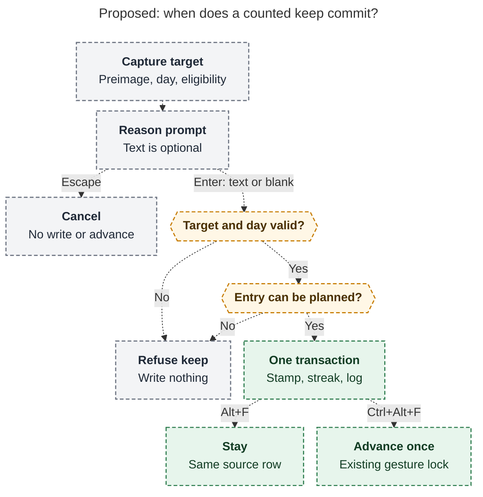

# Diagram proposals: Rotten Log: a task-local history of rotten keeps

Proposals for the swarm linker, not a report. Each diagram restates only what the source
report says.

```yaml
source: research:202610/rotten_log_keep_history/rotten_log_keep_history__final.md
producer: research.55.image
check: "mmdc 12.0.0 with the PDF-mirroring config rendered 1 of 1 Mermaid diagrams"
```

## keep-commit-safety

```yaml
anchor: |-
  Capture the preimage, local day, and eligibility before the async prompt.
question: |-
  How does a proposed keep avoid a stale or half-written result?
illustrates: |-
  For one counted keep that needs no decay decision, capturing and revalidating the preimage, local day, and eligibility before the combined write keeps cancellation and failed checks from committing a stamp without its entry.
caption: For an eligible keep without a decay decision, cancellation or failed checks write nothing; stamp, streak and log commit together before navigation.
review: "741.966x1002 px, fit 88.0%; question and visual checks passed; source trace passed; 0 revisions"
```


