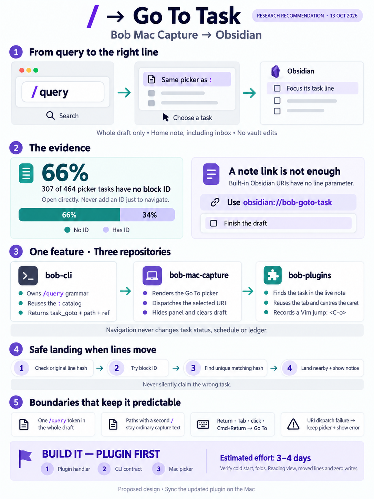

# `/` in Bob Mac Capture: search tasks like `:`, then go to the task in Obsidian

> **Research query:** How should the bob-mac-capture app support pressing `/` as the
> first key in the input box to start a new Obsidian task search that selects tasks just
> like `:`, but that opens the selected task's area note or project note in Obsidian and
> focuses the target task? Critique the plan (is it a good idea, would a different
> approach be better, which clearly called-out requirement adjustments are justified) and
> end with a recommended solution.

## Bottom line

**Build it. It is a good idea, but the request underestimates two parts.** Searching is
nearly free: the `:` catalog, ranking, and picker card already exist. What happens after
a task is picked has to change in two ways:

1. **Picking a task must never write to the vault.** Copying `:` literally would send
   **307 of the 464 tasks (66%)** that `:` lists today through the Add block ID prompt.
   That prompt writes a `^id` to the note, which is a vault edit just to *look* at a
   task. Every ID-less row must open directly.
2. **"Focus the task" cannot be done with Obsidian's built-in URIs.** `obsidian://open`
   has no line parameter, and its `#^block` form only covers the 34% of tasks that have
   an ID. A [small `obsidian://` handler](#bob-plugins-bob-goto-task-handler) in
   `bob-navigation-hotkeys` can do it. That plugin already contains the "open this note
   and put the cursor on this task" code that `]s` and Ctrl+Shift+M use.

**Recommended shape** (four of five researchers
[converged on it](#where-the-researchers-disagreed), and my checks back it):

- **bob-cli** learns a new whole-draft `/query` token. Its completion context is
  `task_goto`, it lists the same catalog as `:`, and its candidates add `note_path` and
  an absolute `target`. `bob capture` refuses the token with a teaching error.
- **bob-plugins** registers `obsidian://bob-goto-task`. The handler re-finds the task in
  the live note, puts the caret on it, centres it, and records a Vim jump. It writes
  nothing.
- **bob-mac-capture** adds a `.taskGoto` picker source. Accepting a row hides the panel,
  clears the draft, and opens the URI.

This adds up to [about 3–4 days](#rollout-order-and-compatibility) across three repos.
The [riskiest unknown](#risks-and-mac-acceptance-checks) is the Obsidian side, so build
and test the plugin handler first; it can be exercised from Terminal on the Mac before
any Swift changes.

## Is this a good idea

**Yes.** The capture panel is already summoned by a global hotkey from any app, and it
already has the best task finder in the system: it groups rows by queued Pomodoro, In
Progress, Next, and note, and it filters with AND terms. Obsidian's Quick Switcher finds
notes, not tasks, and `]s` walks tasks in review order rather than search order. `/` is
the usual "search" key in Vim, less, Slack, and GitHub, and it fits next to the panel's
existing sigils (`^ : ! & +`).

The real costs, and how the recommendation limits each one:

1. **Three repos, not one.** Under the thin-client rule, grammar belongs to bob, and
   only an Obsidian plugin can place a caret. Each piece is small and additive.
2. **The panel becomes a navigator too.** `:` *edits the draft*, while `/` *leaves the
   app*. A distinct caption ("Go To") and action line ("↩ Opens dev.md at line 42") make
   that clear. A muscle-memory slip costs little, because a wrong `/` only opens a note.
3. **Slash-leading prose can no longer be captured.** No task in the vault starts with
   `/`, so this costs almost nothing. Pasted paths stay prose under
   [rule R7](#requirement-adjustments) below.
4. **Copying `:`'s accept behaviour would be wrong.** Link & Start, Link & Capture, Add
   block ID, the "pulls it forward" warning, and the "Inserted …" announcements all
   assume the accept writes a token into the draft. `/` writes nothing.

The `idle-capture-shows-ledger-agenda` record reopens if agenda rows become navigable.
`/` does not do that: the agenda simply gives way to the picker, as it does for `:`.

## What exists today

Each fact below is verified; the Evidence column gives its source.

| Fact | Evidence |
| --- | --- |
| A whole-item `:` token is a picker query. `capture-parse` reports `needs: ["task_link"]`, and `bob capture` refuses it with a teaching error. | `task_link_query_token` in `src/native/capture_language/tokens.rs` is the one predicate shared by execution, the editor, and completion. Refusal is in `item.rs:428`. |
| The catalog covers open tasks (Ready, Blocked, Next, In Progress) in the inbox, area notes, and non-terminal project notes. ID-less rows are always listed. | `capture_link_tasks::discover` + `rank`; `docs/capture.md` "Picking any open task with ':'". |
| A live `:` snapshot has **464 rows**: 390 project, 73 area, 1 inbox. **307 rows (66.2%) have no block ID.** It takes about 20 ms and is about 206 KB of JSON. | `bob capture-complete -c 1 -f json -- ':'` (lead and cld agree; mus's "about a third" came from a fixture). |
| `:` candidates carry `route`, `line` (1-based), `ref` (`LINE:digest`), and `block_id`, but **no file path**. The `!` and `&` candidates already carry `note_path`. | `TaskLinkCandidate` in `src/native/capture_complete/model.rs`; live `!` probe. |
| The `!` and `:` catalogs are effectively the same today: 465 vs 464 rows, every `:` row is also in `!`, and all of them are vault-root notes. | Lead probe. Keeping `:` parity therefore loses no coverage. |
| `/` is free. `capture-parse -- '/'` returns `mode: task` with no needs, and `capture --dry-run -- '/fix'` would file an inbox task. **None of the 3,574 `#task` lines in the vault starts with `/`.** | Lead probes and a vault grep. |
| The Mac picker is anchored to the draft. `CapturePickerState` requires a `draftSnapshot` and bob's `replacementRange`. Pickers open automatically when `capture-parse` reports a need in `completionNeeds`, and the app then routes on the `capture-complete` context. | `CapturePickerState.swift`; `CapturePanelModel.swift:2029`, `:5980`. |
| The app opens Obsidian at file level only, with `obsidian://open?path=<absolute target>`, and ignores the result of `NSWorkspace.open`. | `ObsidianOpenURL.swift`; `targetOpener` at `CapturePanelModel.swift:232`. |
| Obsidian URIs have no line or column parameter. The block-navigation tip (`Note%23%5EBlock`) does not say which parameter it applies to. Without `paneType`, "the last active tab is replaced". | [Obsidian URI help](https://obsidian.md/help/uri). |
| **No bob plugin registers a protocol handler.** Advanced URI is not installed. The landing helpers do exist: `openMarkdownFileWithLeafReuse`, `findTaskLineByBlockId`, `setEditorCursorSafely`, `scrollEditorLineToCenter`/`scheduleOpenTaskJumpCenter`, `focusTaskMoveDestination`, and the Vim jump-context helpers. | A grep of `plugins/*/src`; `~/bob/.obsidian/community-plugins.json`. |
| Deployed plugin versions differ by machine. athena's vault runs bob-navigation-hotkeys **2.16.0**, while repo HEAD is **2.31.0**. | `~/bob/.obsidian/plugins/bob-navigation-hotkeys/manifest.json`. |

## Requirement adjustments

Each change to the request is called out below with its reason.

| # | As requested | Adjusted to | Why |
| --- | --- | --- | --- |
| **R1** | "`/` as the first key in the input box" | `/` is claimed only when the **whole draft** is one line holding one token that starts with `/`. Anywhere else, `/` is prose. | Going to a task leaves the app, so it cannot be batched. This also limits collisions. |
| **R2** | "work just like `:` as far as task selection goes" | The rows, grouping, ranking, and filter keys are the same, **but ID-less rows open directly.** There is no Add block ID prompt, no `plus.circle` suggestion, and no "pulls it forward" warning. A scheduled date is still shown as context. | 66% of rows have no ID. Navigation must never write. Opening must not retire a schedule. |
| **R3** | (implicit) | Return, Tab, click, and ⌘↩ **go to the task, hide the panel, and clear the draft**, which is not stashed. Shift-↩ does nothing. If the URI cannot be dispatched, the picker stays open and shows an error. | `/` has nothing to insert or capture. |
| **R4** | "focus the target Obsidian task" | Defined precisely: Obsidian comes to the front. The leaf already showing the note is reused, or else the active leaf. The caret goes to column 0 of the task line, the line is centred, and the editor gets focus. A Vim jump is recorded so `<C-o>` returns. The Task Card is not opened, the task is not completed, and the `]s` walk is neither advanced nor parked. | This matches how `]s` and Ctrl+Shift+M already land in a Vim-first vault. |
| **R5** | (implicit) | **Re-find the task safely if lines moved** ([see the handler](#bob-plugins-bob-goto-task-handler)). The handler never lands silently on a different task. If it cannot find the task, it lands nearby and shows a Notice. | The picker snapshot can be minutes old, and edits or vault sync shift lines. |
| **R6** | "area note / project note" | Use exactly the `:` scope, which **includes the inbox** (inbox files are area notes) and excludes daily-note, `^ref`, closed, and terminal-project tasks. A queued row opens its **home note** (the file holding the checkbox), never today's daily note. | One discovery function. Leaving out the inbox would hide tasks for no reason. |
| **R7** | — | A `/` token that contains a **second `/`** stays prose. This covers `/Users/…`, `/r/rust`, and `//`. | Pasted paths stay capturable. This follows bob's existing `!!`/`![` prose carve-outs in `claim_bang_item`. |
| **R8** | — | **Rollout must update bob-plugins on the Mac** (`bob plugins sync`). | The app cannot tell whether the handler is installed, and deployed versions already differ by machine. |

## Recommended solution

### bob-cli task goto contract

- **Claim.** Add a predicate such as `task_goto_query_token` next to
  `task_link_query_token`, used by execution, the editor parse, and completion alike. It
  matches only when the draft has **exactly one item**, that item is one physical line,
  the line holds one whitespace-delimited token starting with `/`, and the token
  contains **no other `/`** (R1, R7).
- **Parse.** Return mode `incomplete`, `needs: ["task_goto"]`, and one
  `interactive_placeholder` span over the token, with no diagnostics. Document where
  `task_goto` sits in the `needs` order, next to `task_link`.
- **Execute.** Refuse before any other item parser, as `:` does. Teaching error:
  `` `/dee` opens the Go To picker; pick a task to open it in Obsidian — it never
  captures ``.
- **Complete.** Return context `task_goto`. The replacement covers the whole token,
  sigil included, so Backspace on an empty filter removes it. The query is the text
  between the sigil and the cursor. Candidates come from
  `capture_link_tasks::discover` + `rank`, so ordering matches `:` exactly. Each row
  carries:
  - the `:` fields: `ref`, `route`, `note_kind`, `block_id`, `status_*`, `text`,
    `section`, `depth`, `line`, `group`, `scheduled`, and `pomodoro`;
  - **`note_path`**, as `!` and `&` already send;
  - **`target`**, the absolute path, as capture results already send;
  - `replacement: ""`, kept so the shared decoder still works. Clients never insert it.

  Drop `requires_block_id`, `block_id_suggestions`, and `pulls_forward`.
- **Docs, help, and tests.** Add a `/<query>` row and subsection to `docs/capture.md`,
  and extend the help prose for `capture-parse` and `capture-complete` (see
  `cli_rules.md`). No new subcommand is needed. Add goldens for:
  - `/`, `/fix`, and the teaching error;
  - `/Users/x`, `//`, `/a b`, and `Buy /x` staying prose;
  - a multi-item draft staying prose;
  - the JSON shape of a candidate.

### bob-plugins bob-goto-task handler

This is the `obsidian://bob-goto-task` handler. **Build and test it first.**

- **URI v1:** `obsidian://bob-goto-task?path=<absolute>&line=<1-based>&ref=<LINE:digest>[&block=<id>]`.
  Document it in the bob-plugins README as a stable contract. It is useful outside the
  Mac app too, from Terminal, Raycast, or zsh.
- **Registration.** Call `registerObsidianProtocolHandler("bob-goto-task", …)`
  synchronously in `onload`, in a new fragment (fragments are capped at 1,000 lines),
  then rebuild.
- **Handler steps:**
  1. Wait for `onLayoutReady`.
  2. Map `path` to a vault file by stripping `adapter.getBasePath()`. A path outside the
     vault or a missing file gets a Notice and does nothing else.
  3. Read the open editor buffer if the note is open, since it is fresher than disk.
     Otherwise use `cachedRead`.
  4. Re-find the line. Bob's digest is SHA-256 of `line.trim_end()`, first 8 hex
     characters (`line_digest` in `note_tasks.rs`). The plugin can compute it with
     Node's `crypto` on desktop or with `crypto.subtle`. Try, in order:
     1. the snapshot `line`, if its digest matches;
     2. the task line carrying `^block` (`findTaskLineByBlockId`);
     3. the **only** line in the note whose digest matches;
     4. otherwise, the clamped line plus a Notice: "Task changed since search — landed
        near line N".

     Add a shared fixture of lines with their expected digests (trailing whitespace,
     Unicode) to both the Rust and JS tests, so the two implementations cannot drift.
  5. Land through a **neutral** helper factored out of `focusTaskMoveDestination`. Its
     current failure notice says "Moved tasks, but could not open …", and it carries
     move context. The helper should reuse the leaf, place the caret with retries until
     the editor renders, centre the line, and record a Vim jump from the current cursor.
     If the leaf is in Reading view, switch it to an editing view first.
- **It never writes.** No freshness stamps, no lane changes, no ledger edits. It never
  calls walk park or advance. Opening a different file already runs `trackOpenedFile`,
  which clears any `]s` landing, exactly as manual navigation does today.
- **Tests and deploy.**
  - Cover each re-find path (planned line, block ID, unique digest, clamped).
  - Cover a path outside the vault and a missing file.
  - Cover leaf reuse when the note is already open.
  - Finish with `bob plugins sync` on the Mac.

### bob-mac-capture Go To source

This is the `.taskGoto` picker source.

- **CaptureCore.**
  - Add `CapturePickerSource.taskGoto` with trigger byte 47 (`/`), caption "Go To", and
    status "Pick a task to open — press Tab to browse".
  - Decode `note_path` and `target` with `decodeIfPresent`.
  - **Parameterise `TaskLinkPickerIndex`** with its sigil (`leadingSigil: "/"`) and an
    action mode; do not copy it. `+` already reuses this catalog, and a third copy
    would drift. In goto mode:
    - ID-less rows show `route.md:42` with no suggestion;
    - the detail strip reads "↩ Opens dev.md at ^fix-sync" or "↩ Opens dev.md at line
      42".
  - Add `ObsidianOpenURL.taskGotoURL(target:line:ref:blockID:)`, built with
    `URLComponents`.
- **Panel model.**
  - Add `task_goto` to `completionNeeds` and `pickerNeed`. Route the `task_goto`
    context to a `handleTaskGotoCompletion`, which mirrors `handleTaskLinkCompletion`
    including its `cursor > r.start + 1` refetch.
  - Accept goes through a separate branch, not the link-insertion routine:
    1. check the stale-draft guard;
    2. hide the panel;
    3. clear the draft without stashing it;
    4. open the URL with `NSWorkspace.OpenConfiguration(activates: true)`. A forum
       report says macOS URI dispatch does not always bring Obsidian forward.
  - Make the opener injectable and have it return a result, so tests can assert that
    no `capture` process ran and that a dispatch failure keeps the picker open.
  - Block a second accept while dispatch is in flight.
- **Keys.**
  - Return, Tab, click, and ⌘↩: Go To.
  - Shift-↩: consumed, does nothing.
  - Escape: clears the filter, then cancels to the chip.
  - Backspace on an empty filter: removes `/`, and the idle agenda returns.
- **README.** Add a "Go To Picker" section after Task Link Picker. Add requirement
  bullets for bob `task_goto` and the bob-plugins handler.

### Rollout order and compatibility

1. **bob-plugins handler.** Test it from Terminal on the Mac with
   `open 'obsidian://bob-goto-task?…'`. This settles cold start, Vim, folds, and Reading
   view before any Swift work.
2. **bob-cli grammar, candidates, docs, and goldens.** Then install `bob` on the Mac.
3. **bob-mac-capture source.** Gated by macOS CI.

Every step is additive:

- An **old bob with a new app**: `/fix` stays an ordinary task, which is today's
  behaviour.
- A **new bob with an old app**: `task_goto` is not in the app's `completionNeeds`, so
  no picker opens. The preview shows the teaching error and submit refuses, so no junk
  task is filed.
- A **new app with an old plugin**: the URI silently does nothing. The README
  requirement and step 1 coming first cover this. If it ever bites in practice, add a
  plugin-version check.

**Rough effort:** bob-cli 0.5–1 day; bob-plugins 0.5–1 day (including the digest
fixture); Mac app 1–1.5 days plus the macOS CI loop and a manual pass.

## Why this design

### Where the researchers disagreed

| Question | Positions | Resolution and why |
| --- | --- | --- |
| **Where the trigger lives** | cld, grk, mus, gem: a bob grammar token. cdx: an app keyboard mode that sends a synthetic `:` completion. | **A bob grammar token.** The thin-client record says the app "never decides syntax itself". The Mac picker machinery is driven by the draft and by parse needs, so a token reuses the `:` lifecycle as is: auto-open, chip, Escape/Backspace, refetch, stale-draft guard. A Swift mode would need a new picker session with no draft behind it. It would also leave `bob capture -- '/fix'` filing an inbox task for every other client. cdx's real concern (an unresolved `/query` must never become an inbox task) is solved by bob's refusal. |
| **ID-less tasks** | cld, grk, gem: open directly. cdx, mus: keep the explicit Add block ID prompt. | **Open directly; navigation never writes.** At 66% ID-less, the prompt would be the normal path rather than an exception. The plugin handler can land on ID-less rows without risk ([see the handler](#bob-plugins-bob-goto-task-handler)), so there is no reason to mint IDs. |
| **Focus transport** | cdx: the built-in `#^block` URI first, with the plugin only if it fails. Others: a plugin protocol handler. | **The plugin handler.** The built-in URI does nothing useful for 66% of rows, and putting `#^id` in `path` is undocumented. It also replaces the last active tab instead of reusing a leaf that already shows the note, and it records no Vim jump. See [the focus transport options](#focus-transport-options). |
| **Trigger scope** | cld, mus, cdx, gem: the whole draft. grk: each item, like `:`. | **The whole draft must be one `/query` token.** Accepting hides the panel and clears the draft, which makes no sense inside a batch where other items still need capturing. This scope also limits collisions. |
| **After accept** | cld, grk, gem: clear the draft. mus: restore the draft from before `/`. | **Clear it, and do not stash it as a canceled draft.** Under the whole-draft rule there is nothing from before `/` to restore. |
| **⌘↩** | cld: new tab. cdx, grk, gem: open. mus: no-op. | **Open, the same as Return.** Muscle memory from `:`'s ⌘↩ means "do it now". A new tab is a cheap follow-up because the handler can accept `pane=tab`. Shift-↩ does nothing. |
| **Re-finding the line** | cld: line, block ID, then text-contains. grk: block, `ref` digest, line+text. gem: block, then raw line. cdx: a bob resolver at accept time. | **Use bob's `ref` digest, checked in the plugin against the live buffer.** The lead check found **31 of 464 rows (6.7%)** whose `text` is not a substring of the raw line, because inline fields such as `[created::…]` are removed from the middle. cld's contains test would miss those. gem's raw-line fallback is blind to staleness. A bob resolver reads disk, but the plugin can read unsaved buffer content. |
| **Naming** | cld, grk: `task_open`. mus: `task_goto`. gem: `task_search`. | **Context `task_goto`, caption "Go To", URI action `bob-goto-task`.** "Open" already means *not done* on this card: the `:` caption is "Open Tasks" and the docs say "linkable open tasks". Accept-named contexts (`task_link`, `task_complete`) are the house pattern. |

### Focus transport options

| Option | Lands on ID-less rows? | Caret on the line, with Vim history? | Handles moved lines? | Dependency | Verdict |
| --- | --- | --- | --- | --- | --- |
| `obsidian://open?path=` (today) | Opens the note only | No | — | None | Not enough on its own |
| Built-in `#^block` in `file`/`path` | **No** (covers 34%) | Scrolls to the block; caret not guaranteed; no leaf reuse | Only by ID | None | Rejected as the primary transport |
| Advanced URI `line=`/`block=` | Yes | Caret yes, no Vim history | **No** (a bare line number) | Third-party, not installed | Rejected |
| **`obsidian://bob-goto-task` in bob-navigation-hotkeys** | **Yes** | **Yes**, reuses the leaf, centres, records `<C-o>` | **Yes** (digest, then block ID) | Bryan's own plugin | **Recommended** |
| `obsidian://search`, AppleScript, keystroke automation | Partly | No, or fragile | No | Accessibility permission | Rejected |
| Mint an ID on accept, then use `#^block` | Yes | As for the built-in URI | By ID | Writes to the vault | Rejected ([R2](#requirement-adjustments)) |

## Risks and Mac acceptance checks

- **Cold start.** It is undocumented whether a URI that launches Obsidian reaches a
  plugin handler registered in `onload`. One forum report has a custom handler that does
  not fire while Obsidian is *running* (Windows, 1.12.1). Test both cases on the Mac.
  - **If cold start fails:** when `md.obsidian` is not running, launch it, wait until it
    has finished launching plus a short settle, then dispatch.
  - **Do not** also send a plain `open?path=` URI "as insurance" while Obsidian is warm,
    as grk proposed. Without `paneType` it replaces the active tab and defeats leaf
    reuse.
- **Landing quality.** Check each of these:
  - Obsidian warm and cold;
  - the note already open in a split;
  - the task under a folded heading or list;
  - a Reading-view leaf;
  - the caret on the row in Vim normal mode, and `<C-o>` returning to where you were;
  - Unicode and spaces in paths.
- **Moved lines.** Edit above the task between searching and accepting, and check that
  the Notice appears when the task line itself changed.
- **Lifecycle.**
  - Escape during the fetch, a double Return, a dispatch failure, and a reopened panel
    must never launch Obsidian late or capture anything.
  - A retained canceled draft must never come back as a `/query`.
- **No writes.** Accepting an identified row and an ID-less row must leave the note and
  day files byte-identical.

## Open questions for Bryan

1. **⌘↩**: open the same way as Return (recommended), or open in a new Obsidian tab?
2. **R7**: is it acceptable that `/`-tokens containing a second slash stay prose, as the
   only way to type slash-leading text?
3. **Focus**: are caret, centring, and `<C-o>` enough, or do you also want a brief
   highlight of the line?

## Follow-ups not in v1

- An **⌥↩ "Go To"** action on `:`, `!`, `&`, and `+` rows that reuses the same URI. Each
  of those catalogs would add `target`. This lets a search started as a link turn into
  a jump.
- **⌘↩ after a capture** could land on the created line rather than the top of the note,
  once bob reports that line.
- An **Obsidian-side "Bob: Go to task"** command sharing the handler's re-find logic.
- Once shipped, a decisions strand: **"Task Go To never writes"**. It would record the
  whole-draft `/`, ID-less rows opening directly, and landing living in bob-plugins.
  Write it through `/sase_memory_write`.

## Corrections to individual reports

- **mus:** about a third of rows are ID-less in a fixture; the live vault is 66%.
- **cld:** the text-contains re-find misses 6.7% of live rows; use the `ref` digest
  instead.
- **gem:**
  - its `focusURL` sketch puts a vault-relative path into `path` and ignores `vaultPath`;
  - its handler sample calls `getAbstractFileByPath` with that path, with no
    absolute-to-vault mapping;
  - it says Escape leaves `/` "for normal capture", but a claimed `/query` cannot be
    captured.
- **cdx:** native `path=…#^id` is not documented. Obsidian's tip shows the encoded
  fragment without naming a parameter.
- **grk:** opening `open?path=` first "as insurance" conflicts with leaf reuse. grk also
  claims `/` per item, which leaves accepting inside a batch undefined.

## About this report

- Consolidated report, 2026-10-13.
- Revisions examined: bob-cli @ `1de9e03`, bob-mac-capture @ `eed300d`, bob-plugins @
  `4f0cc94`.
- Merges researchers cdx, cld, grk, mus, and gem, plus lead verification (live
  read-only probes against `~/bob` on athena).

## Sources

- Code: bob-cli `src/native/capture_language/{tokens,item,editor_parse,completion}.rs`,
  `src/native/capture_complete/{model,engine,candidates}.rs`,
  `src/native/capture_link_tasks.rs`, `src/native/note_tasks.rs` (`line_digest`),
  `docs/capture.md`.
- Code: bob-mac-capture `Sources/CaptureCore/{CapturePickerPresentation,
  TaskLinkPickerPresentation,ObsidianOpenURL}.swift`,
  `Sources/BobMacCapture/{CapturePanelModel,CapturePickerState,CanceledDraftStash}.swift`,
  `README.md` ("Task Link Picker"), and commit `a82a4ac` (typed `:` auto-open).
- Code: bob-plugins `plugins/bob-navigation-hotkeys/src/{170,180,250,480,536,650,670}-*.js`.
- Memory: `decisions:mac-capture-is-a-thin-client`,
  `decisions:idle-capture-shows-ledger-agenda`,
  `decisions:task-move-never-advances-the-walk`, `glossary:area-note`,
  `glossary:inbox-file`, `glossary:project-note`.
- External:
  - [Obsidian URI help](https://obsidian.md/help/uri)
  - [`registerObsidianProtocolHandler`](https://docs.obsidian.md/Reference/TypeScript+API/Plugin/registerObsidianProtocolHandler)
  - [Advanced URI navigation](https://publish.obsidian.md/advanced-uri-doc/Actions/Navigation)
  - [Forum: handler not firing while Obsidian is open](https://forum.obsidian.md/t/obsidian-open-and-web-clipper-works-only-when-obsidian-is-closed-no-response-when-obsidian-is-already-running-windows/111129)
  - [Forum: custom URI not registered / name collisions](https://forum.obsidian.md/t/custom-uri-protocoll-not-registered/35102)
  - [Forum: URI handler does not activate the window](https://forum.obsidian.md/t/the-obsidian-uri-handler-affects-the-app-but-no-longer-activates-the-app-window/90387)
- Researcher reports (in this directory): `__cdx`, `__cld`, `__grk`, `__mus`, `__gem`.
