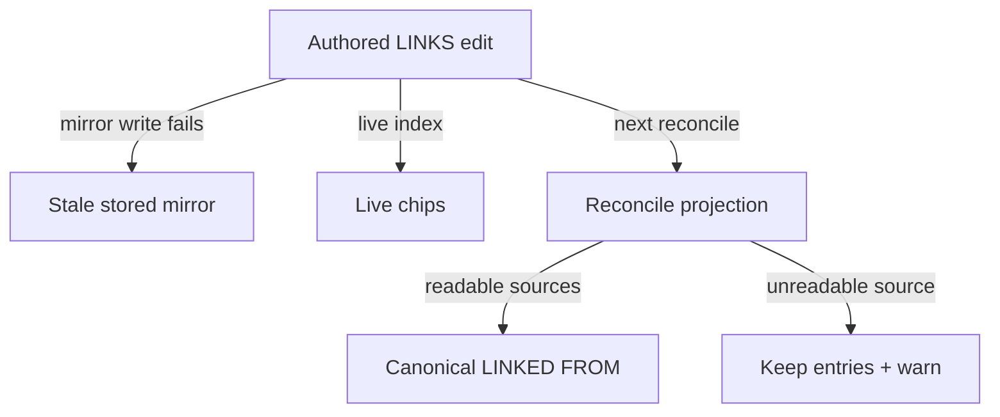
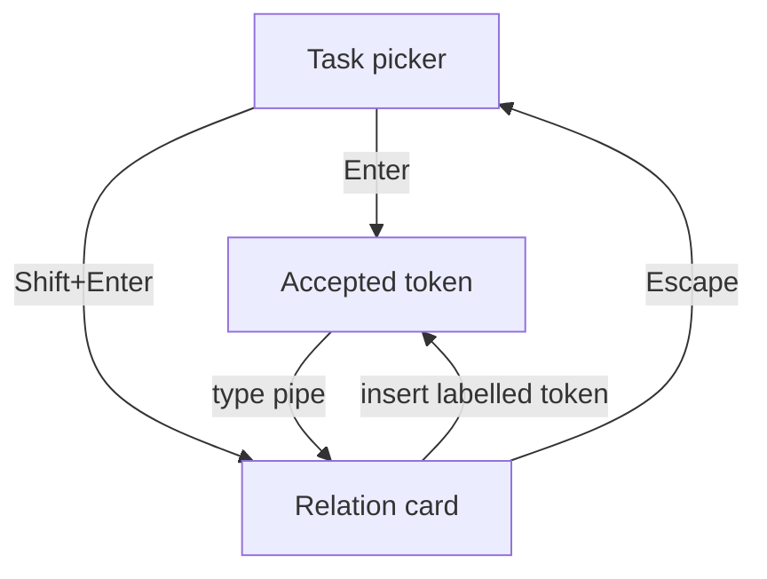
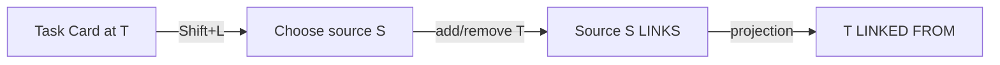

# Diagram proposals: Task relations: LINKS, LINKED FROM, and capture

Proposals for the swarm linker, not a report. Each diagram restates only what the source
report says. All three depict the recommended design, not implemented behaviour.

```yaml
source: research:202610/task_relation_links/task_relation_links__final.md
producer: research.53.image
check: "mmdc 12.0.0 rendered 3 of 3 Mermaid diagrams"
```

## missed-mirror-recovery

```yaml
anchor: |-
  A cross-note mirror write can fail after the authored edit succeeds
illustrates: |-
  A cross-note mirror write can fail after the authored edit succeeds, while chips render from the live index and reconcile preserves previous entries for an unreadable source.
caption: Proposed recovery preserves authored edges when a writable target's mirror update fails.
```



## capture-relation-card

```yaml
anchor: |-
  **⇧↩ opens the relation card,** which reuses the `TaskIDPromptCard` pattern
illustrates: |-
  In either picker direction, Shift+Enter opens the relation card, Escape returns to the picker, and typing `|` after an accepted token also opens the card.
caption: Proposed relation-card navigation supports direct acceptance, optional labels, pipe re-entry, and Escape.
```



## incoming-edit-ownership

```yaml
anchor: |-
  Toggling a row adds or removes *this* task on the
illustrates: |-
  The Linked-from stage adds or removes this task on the other task's LINKS line, leaving LINKED FROM as a generated projection.
caption: Proposed incoming edits change the selected source's LINKS; the target mirror follows.
```


