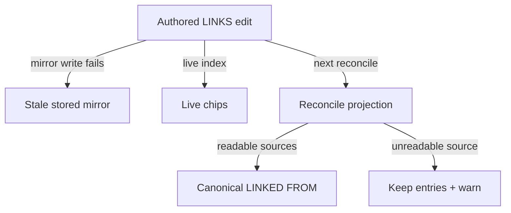
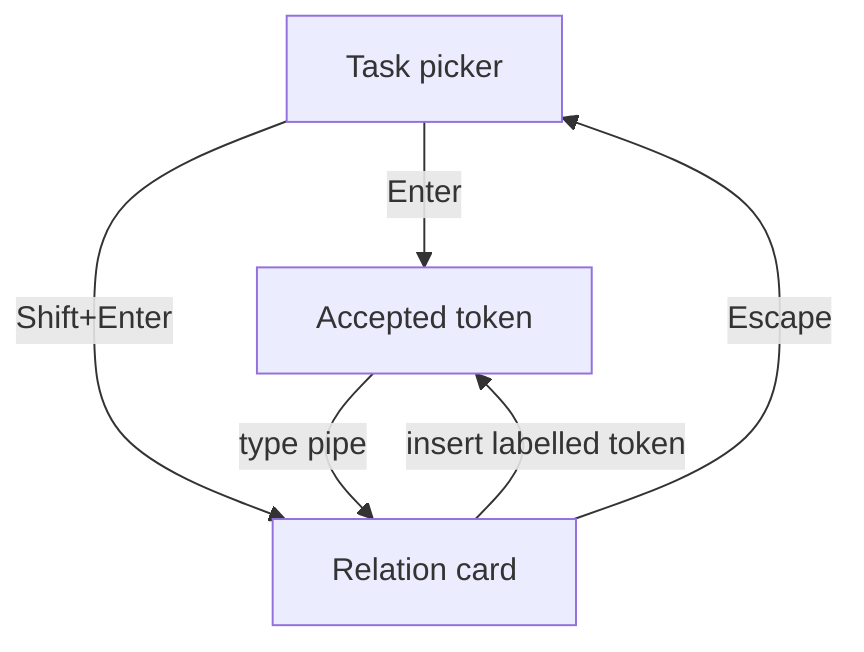
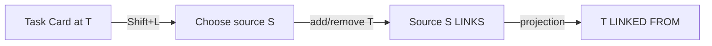

# Task relations: a `🪢 LINKS` line, a generated `🪢 LINKED FROM` mirror, and `~` / `~~` capture

> **Research query:** What is the best way to add directed links from one Obsidian task to another, shown in a
> `LINKS` sub-bullet, with an automatically maintained, always-correct `BACKLINKS` sub-bullet, a `~` syntax in
> bob-mac-capture that opens a task search, a way to make another task link to the current one (Ctrl+Shift+P in
> Obsidian, `~~` in capture), and an optional relation description? Is this a good idea, would a different approach
> be better, which requirement adjustments are justified, and what intuitive, reliable, and beautiful solution is
> recommended?


## Bottom line

**Build it.** Treat it as a second *edge kind* on the machinery that `⛓️ DEPENDS ON` / `🧱 BLOCKS` already proved,
not as a new subsystem. Give it one rule above all others: **a task relation does nothing except connect and
explain.** It never blocks, promotes, consumes, schedules, stamps freshness, or answers a review.

```markdown
- [ ] #task Fix flaky capture retries #bob ^fix-retries
	- 🪢 **LINKS:** follow-up of [[done/bob_done#^capture-star]] • [[sase#^retry-design]]

- [ ] #task Design a retry policy ^retry-design
	- 🪢 **LINKED FROM:** [[bob#^fix-retries]]
```

```text
Fix flaky capture retries ~bob_done:capture-star|"follow-up of" ~sase:retry-design     # this → those
Write the outline ~~sase_blog:prj|"next step"                                          # that → this
@bob+fix-retries ~sase:retry-design|see                                                # two existing tasks
```

In Obsidian, the Task Card (Ctrl+Shift+P) gains **`l` Links to…** and **`⇧L` Linked from…**, with direct chords
Ctrl+Shift+L and Ctrl+Shift+Alt+L that mirror Ctrl+Shift+B and Ctrl+Shift+Alt+B. In every picker, **↵ links**
and **⇧↵ links and asks for a relation**.

The shape of the request is right: lightweight, directed, optionally described, capture-first, and visible on both
ends. Five adjustments make it reliable and beautiful. Each is flagged **[ADJUSTED]** in
[the requirement adjustments](#requirement-adjustments):

1. **BACKLINKS becomes `LINKED FROM`, and it is generated, never authored.** The source task's LINKS line is the
   only truth. The mirror is a pure projection that every Bob writer updates at once and that `bob task reconcile`
   converges. Chips render both ends from a live index, so *what you see* is always correct.
2. **"Always consistent" is restated as a
   [testable guarantee](#how-the-linked-from-mirror-stays-correct).** The view is always live. The stored mirror is
   byte-identical to the projection after the next Bob write or reconcile (at most 15 minutes on the Mac).
3. **Relations are [inert](#what-relations-never-do)** (above). This is what separates them from dependencies, and
   it is recorded in the contract and a decision record so it cannot erode.
4. **Ctrl+Shift+P stays the Task Card.** Both directions get
   [Task Card rows](#task-card-stages-and-chips-in-obsidian), because outgoing links from Obsidian are the more
   common case and the request left them out.
5. **Relation labels are optional free text, phrased from the source's side**, with suggestions drawn from labels
   already in use. There is no type registry.

---

## Is this a good idea?

### Why yes

- **It fills a real hole.** `DEPENDS ON` means finish-to-start blocking, and nothing else can express "this is
  about that." Using a dependency for that turns the task `[?]`, keeps it out of Ready, consumes its Pomodoro
  Task Link, and warps the walk (`decisions:task-status-is-derived`, `decisions:capture-link-drops-blocking-deps`).
  Prose links avoid those effects, but they have no picker, no inverse, and no structure. All five researchers
  agree on this.
- **Bryan already maintains relations by hand.** I re-measured the vault read-only (6,427 notes). These are the
  bullets that are direct children of a `#task` line, by idiom:

  - **`See [[…]]`**
    - *Direct children of a task:* 53
    - *Note:* including `OBSOLETE: See [[…]]`
  - **`Merged into` / `Merged from`**
    - *Direct children of a task:* 28
    - *Note:* 12 are `Merged into [[link]]`, mostly in `done/`; the survivors' `Merged from:` back-references are
      plain **titles**, not links
  - **`RELATED:`**
    - *Direct children of a task:* 3
    - *Note:* one written bold

  The `Merged into` / `Merged from` pairs are the clearest evidence. Bryan writes the inverse by hand, and he
  writes it as text, because the other end has already been archived. cld counted about 120 ad-hoc task-to-task
  references outside dependency lines. I did not re-verify that number. cld's "28 bidirectional link pairs" is
  slightly overstated: the back side is a title, not a link.
- **Obsidian's backlinks pane can't answer "what points at this task?"** It works per note, not per task, and for
  task notes it is dominated by Pomodoro ledger links. cld counted 2,222 Pomodoro Task Links and 213 embeds.
- **The hard parts already exist.** A generated mirror that is never read back, courtesy writes in the same
  capture batch (`src/native/capture/blocks_mirror.rs`), the nav follow-up writer (`591-blocks-follow-ups.js`),
  reconcile as the authority, the chip DOM, direction-aware pickers in both clients, shared parser vectors, and a
  kill switch.
- **Mature trackers split *blocks* from *related*.** Linear, Jira, and GitHub all store one edge and show it at
  both ends (grk, cld, cdx).

### What could go wrong

- **Semantic creep**
  - *Why it matters:* Every recent decision record exists because authored and derived state got tangled.
  - *Answer in this design:* A written inertness contract ([What relations never do](#what-relations-never-do))
    plus a decision record. A link that needs to block is a dependency, and the stage offers to convert it.
- **Two sources of truth**
  - *Why it matters:* If both lines are authored, a disagreement is undecidable: was it a deletion, a
    half-finished edit, or a stale sync?
  - *Answer in this design:* One authored line plus a generated mirror that nothing reads
    ([How the LINKED FROM mirror stays correct](#how-the-linked-from-mirror-stays-correct)).
- **Recogniser sprawl**
  - *Why it matters:* Rust, nav, ledger-tools, the cycler, and block-id-prompt must all *ignore* the new lines as
    Task Links, Pomodoro links, R8 legacy children, section titles, and tree-close or strike targets. The BLOCKS
    research named this "where the bugs would actually come from".
  - *Answer in this design:* Guards ship and sync in every engine before any writer exists. New MC vectors pin
    them.
- **"Link" is an overloaded word**
  - *Why it matters:* In the glossary, a **Task Link** is *any* block link to a task, and under a Pomodoro it means
    "planned or logged". The capture footer's "Link" verb means the Pomodoro ledger.
  - *Answer in this design:* Call the concept a **task relation** in docs, JSON, and the glossary. The line labels
    stay `LINKS` / `LINKED FROM`, always shown with the 🪢 glyph; Pomodoro linking keeps 🍅.
- **`LINKS:` already exists in the vault** *(new finding)*
  - *Why it matters:* 660 `- LINKS: [[…]]` lines live in `ref/` notes (zorg-migrated and AI reference notes).
    **None** is a direct child of a `#task`.
  - *Answer in this design:* Recognise only `🪢 **LINKS:**` (bold label, plus a tolerated or missing glyph) as a
    **direct child of a `#task`**. Never adopt plain `LINKS:` prose. This also argues *for* the name: Bryan's own
    long-standing `LINKS:` idiom already means "related things".
- **`~` already means "drop"**
  - *Why it matters:* `=~2` and `x~1` drop Task Links, and the reference card teaches "`~` drops". `~~` reads as
    strikethrough.
  - *Answer in this design:* Probes show that a standalone `~` token is unclaimed
    ([Capture grammar](#capture-grammar)). Guards copied from `*` keep prose, paths, and strikethrough literal.
- **Label sprawl**
  - *Why it matters:* A Jira study found 75 link types across 15 repos that researchers had to regroup into 5 by
    hand (cld, citing Lüders et al., MSR '22).
  - *Answer in this design:* Labels are optional, suggestions are ranked by frequency, and a near-duplicate lint
    is planned. There is no registry.

### Verdict

It is a good idea, **provided it stays inert and single-sourced.** The danger is not the backlink line. It is a
feature that slowly acquires behaviour: links that promote, block, close, or get consumed.

---

## Requirement adjustments

- **A1 [ADJUSTED]**
  - *As requested:* `BACKLINKS` sub-bullet
  - *Adjusted to:* **`🪢 **LINKED FROM:**`**
  - *Why:* In Obsidian, "backlinks" means *every* inbound link. For a task, that is mostly Pomodoro ledger noise,
    which this line deliberately excludes. "S links to T; T is linked from S" mirrors the forward line the way
    BLOCKS mirrors DEPENDS ON. Readers accept a hand-typed `BACKLINKS` label and canonicalise it (cld, grk, mus).
- **A2 [ADJUSTED]**
  - *As requested:* BACKLINKS "must always stay consistent and correct"
  - *Adjusted to:* **Generated projection, never read as input.** The view is always live; the stored line
    converges by the next Bob write or reconcile. It is never written into `done/` or the previous daily note.
  - *Why:* Literal always-consistency of stored text is impossible with git sync across three machines, raw vim
    and agent edits, and read-only archives (cld, cdx). This is the strongest honest guarantee, and six invariants
    test it ([How the LINKED FROM mirror stays correct](#how-the-linked-from-mirror-stays-correct)).
- **A3**
  - *As requested:* `LINKS` sub-bullet
  - *Adjusted to:* **One managed line per task, ` • `-joined**, not one bullet per link
  - *Why:* Matches DEPENDS ON and BLOCKS. The decision record already rejected one bullet per item. Bare-link rows
    are exactly the shape the Task Link, tree-close, and strike recognisers claim (cld, grk, mus, gem; cdx
    dissented, [Where the researchers disagreed](#where-the-researchers-disagreed)).
- **A4 [ADJUSTED]**
  - *As requested:* Ctrl+Shift+P for "another task should link to this one"
  - *Adjusted to:* **Task Card `l` Links to… and `⇧L` Linked from…**, plus chords Ctrl+Shift+L /
    Ctrl+Shift+Alt+L. Ctrl+Shift+P *on a relation line* opens the owning task's stage.
  - *Why:* Ctrl+Shift+P is already the Task Card (`bob-navigation-hotkeys:set-bullet-property` in
    `hotkeys.json`). This mirrors the shipped `b` / `⇧B` pair exactly, and it adds the outgoing direction, which
    the request omitted.
- **A5**
  - *As requested:* Optional relation / link description
  - *Adjusted to:* **Optional free-text label (1–40 characters), phrased from the source's side** ("S *follow-up
    of* T"), with suggestions from labels already used. There is no taxonomy; display-only inverse phrases come in
    phase 2.
  - *Why:* Free text suits a single user, and suggestions prevent sprawl. A fixed perspective keeps both ends
    readable (cld, cdx, grk, mus). gem's ontology is rejected
    ([Where the researchers disagreed](#where-the-researchers-disagreed)).
- **A6 [ADDED]**
  - *As requested:* (unstated) semantics
  - *Adjusted to:* **Inert.** See [What relations never do](#what-relations-never-do).
  - *Why:* This is what makes the feature safe, and what separates it from DEPENDS ON. All five researchers agree.
- **A7 [ADDED]**
  - *As requested:* (unstated) targets
  - *Adjusted to:* **Any `#task` with a block ID, open or closed, including `^prj`, `^ref`, and `done/`
    archives.** Open tasks rank first.
  - *Why:* "Follow-up of", "duplicate of", and "merged into" usually point at closed tasks. The Depends-On
    picker's open-only pool would be wrong here.
- **A8**
  - *As requested:* `~` for "link the new task to another"
  - *Adjusted to:* **Kept**: `~note:block-id[|label]`, only as a whitespace-delimited modifier in the `&` / `*`
    leading and trailing runs.
  - *Why:* Verified free today. Session `=~` / `x~` drop lists are untouched.
- **A9**
  - *As requested:* `~~` for "another task links to the new one"
  - *Adjusted to:* **Kept**, with a strikethrough guard. In the Mac picker, typing a second `~` flips direction
    live.
  - *Why:* It is the cheapest thing to type, and the guard is the same kind as `*`'s `**bold**` guard. A reverse
    sigil *is* required: a new task has no ID to name as an owner, which is exactly why `*` exists (mus's "no
    reverse syntax" fails here).
- **A10 [ADDED]**
  - *As requested:* (implicit) storage
  - *Adjusted to:* **No inline `[links::]` field, and no `[id::]` minted for relations.** Only `^block-id`s are
    minted.
  - *Why:* `[dependsOn::]` / `[id::]` exist only for the Tasks plugin's `is blocked`, and `[id::]` means "is a
    prerequisite". The task line is already crowded.
- **A11 [ADDED]**
  - *As requested:* (implicit) CLI
  - *Adjusted to:* **No new write command.** `bob capture` owner mode is the CLI. A read-only report, if one is
    ever needed, is top-level (for example `bob relations`).
  - *Why:* One grammar, one planner (`cli_rules`: `bob task <verb>` is reserved for vault-wide rewrites, and
    read-only reports stay top-level). gem's `bob task links --inbound` would break that rule.

---

## Recommended design

### Vocabulary

- **Task relation:** A directed, optionally labelled, inert edge from a **source** task S to a **target** task T.
  It is stored as one entry on S's LINKS line.
- **LINKS line:** `🪢 **LINKS:**`, S's managed child line. It is the **only source of truth** for S's outgoing
  relations, and it is hand-editable.
- **LINKED FROM line:** `🪢 **LINKED FROM:**`, T's **generated** mirror. Nothing reads it back, and hand edits are
  restored.
- **Relation label:** Optional text that reads as "S ‹label› T", such as `follow-up of`, `see`, or `merged into`.

Each entry on a LINKS line *is* a Task Link in the glossary sense. The new glossary term `task-relation` and a
decision record ("Task Relations Are Inert, Authored On The Source, And Mirrored On The Target") should land with
the contract, written through `/sase_memory_write`.

### Vault grammar

```text
<indent>- 🪢 **LINKS:** <entry> • <entry> • …
<entry>        := [<label> ' ']<link>
<indent>- 🪢 **LINKED FROM:** <mirror-entry> • <mirror-entry> • …
<mirror-entry> := <link>[' (' <label> ')']
<link>         := [[#^id]] | [[basename#^id]] | [[dir/note#^id]]    (canonical_link form: no alias, embed, or strike)
```

- **Labels.** 1–40 characters after trimming and collapsing whitespace. A label may not contain `[[`, `]]`, `•`,
  `**`, `(`, `)`, or a line break; the writer replaces a typed `•` with `·`, and a trailing `:` is stripped. Case is
  preserved, and suggestions dedupe case-insensitively.
- **Parsing.** Use the shared `block_link_spans` scanner first. After each link, skip one separator (`•`, `·`, or
  `,`). Everything up to the next `[[` is that entry's label. Text after the last link makes the line
  **malformed**: it is left untouched, a `malformed_links_line` warning is raised, and no second line is inserted.
- **Reader tolerance.** Accept a missing glyph or 🔗; the labels `LINKS TO`, `RELATED`, and `SEE ALSO` on the
  authored line; `BACKLINKS` on the mirror; `·` or `,` separators; and struck links, whose strike is removed. An
  aliased link's alias becomes the label only when no label precedes it. The label must stay **bold**, and the line
  must be a **direct child of a `#task`**. Plain `- LINKS:` stays prose, which protects the 660 reference-note
  lines. Lowercase `links:` is prose.
- **Order.** LINKS keeps authored order: new entries append, and re-linking with a new label relabels in place.
  LINKED FROM sorts canonically (same-note first, then path, then block ID, case-folded with a raw tiebreak), so
  every machine and engine produces identical bytes.
- **Slot.** `❌ CANCEL LOG`, `⛓️ DEPENDS ON`, `🧱 BLOCKS`, `🧩 Sub-projects`, **`🪢 LINKS`**, **`🪢 LINKED FROM`**,
  then user children, `🗓️ SCHEDULE LOG`, and `🛠️ WORK LOG`. Placing the new lines after Sub-projects leaves
  `bob projects sync`'s anchor rule alone (cld). Existing lines are never moved. Extra LINKS lines are merged into
  the first, and extra LINKED FROM lines are deleted.
- **Registry.** Both lines join the closed managed-child registry (`docs/task-dependencies.md` §2.4 and
  `docs/reference/vault-format.md`). Every Task Link, Pomodoro, section-title, tree-close, strike/restore, R8, and
  managed-line parser must reject them, and new MC vectors pin that.

### Identity and minting

- **The target needs a `^id`.** In both pickers, an ID-less target shows `＋ id` and runs the existing new-block-ID
  step (`suggestPromptBlockId`, capture's `block_id_suggestions`). Completion, dry-run, and Escape mint nothing.
- **The source needs a `^id` only for the mirror.** It is minted silently, once, inside the same transaction or
  batch, the way `mintDependentBlockId` works for BLOCKS.
- **Edge identity is (S, T).** A source holds at most one entry per target. Repeats are idempotent; a new label
  reports `relabeled`. Self-links and non-task targets are refused. A → B and B → A are two independent edges, and
  cycles are allowed.
- **Identity is path plus block ID.** It survives supported moves, renames, and archives. It is not a global UUID,
  and a broken link is never rebound to another task by title or by a reused ID (cdx).

### What relations never do

Write this list into the contract. It is the main reliability lever.

- Block, unblock, promote, release, or consume anything. Flip a checkbox to `[?]`, or recover one.
- Count as a Pomodoro Task Link, a plan-budget item, a completable sighting, or a successor offer. Ctrl+Shift+Enter,
  `!`, `^^`, and tree-close never act on a relation line.
- Change a status, lane, `[fresh::]`, `[keeps::]`, `[unblocked::]`, schedule, priority, `[id::]`, or `[dependsOn::]`.
- Count as a review answer, advance the `]s` walk, become a walk tier, or trigger inbox routing.
- Disappear because either end closes, is cancelled, reopens, or is archived. Relations are history.

A mixed draft such as `Ask plumber &job:parts ~job:cleanup` previews both graphs, and only `&` blocks.

### How the LINKED FROM mirror stays correct

This section covers the mirror's projection, its authority, and its guarantees.

**Projection.** One pure function, implemented once in Rust and once in JS, pinned by shared LM vectors:

```text
sources   = #task lines with a LINKS line in: active notes (writable)
            ∪ the previous daily note (read-only) ∪ done/ archives (read-only)
edges     = { (S, T, label) : entry on S's LINKS resolves to #task T, T ≠ S }   (unresolved, non-task, self, malformed → warned, omitted)
mirror(T) = sort_canonical({ (S, label) : (S, T, label) ∈ edges })
T has a LINKED FROM line  ⇔  mirror(T) ≠ ∅  ∧  T is writable
```

Reading `done/` matters because most "merged into" sources are cancelled tasks that get archived. Without that
read, the survivor's "linked from" would vanish at the next `bob nightly`. The read is narrow: LINKS lines only,
29 archive files, and roughly 2,500 task lines today (cld). It sits beside the existing exact-`done/`-target
exception in `docs/task-status-hooks.md`.

**Authority.** A new `reconcile_relation_lines` pass in `bob task reconcile` runs after the BLOCKS pass and has the
same structure:

- missing → insert; different → rewrite in place; no longer wanted → delete; malformed → leave and warn;
  duplicates → keep the first;
- writes go through the guarded structural output (quiet interval, preimage checks, recovery snapshots);
- **never prune on uncertainty**: an unreadable source keeps its previous entries and raises a warning.

Outputs are additive: `relation_line_updates`, `linked_from_line_updates`, and `relation_warnings[]`, reusing the
`BlocksUpdateKind` shape.

**Immediate writers.** Every writer calls the projection for the union of old and new targets it touched:

- **Capture `~` / `~~` (CLI and Mac):** Writes S's LINKS entry, any minted IDs, and T's LINKED FROM **in the same
  staged batch** as a courtesy write, as in `blocks_mirror.rs`. A skip (read-only T, malformed line) is left for
  reconcile, and a mirror problem never fails a capture.
- **nav stages:** Same-note: one transaction, one Ctrl+Z. Cross-note: a follow-up write through the open editor
  or a preimage-checked `vault.process`, reusing `591-blocks-follow-ups.js`. On failure:
  `· 🪢 LINKED FROM not updated`.
- **Chip `×`, Ctrl+D on a LINKS entry:** Removes the entry and its mirror entry. Ctrl+D on LINKED FROM is
  **refused**, with `🪢 LINKED FROM is generated from other tasks' LINKS lines · ⇧L to change it` (cld).
- **Hand edit of LINKS:** Mirrored after the existing 400 ms debounce once the cursor leaves the line (the
  `600-plugin-dependency-mirror.js` pattern). Undo re-arms it.
- **Hand edit of LINKED FROM:** Never changes an edge. Reconcile restores the line.
- **`bob task reconcile`:** The authority: whole vault and idempotent. It runs on the Mac at :10, :25, :40, and
  :55 (`docs/vault-git-sync.md`).

**Guarantees, as tested invariants:**

1. **Single source.** Delete every LINKED FROM line and run reconcile: the lines come back byte-identical, and a
   second run changes nothing.
2. **Inertness.** Adding, removing, or relabelling any relation leaves every status, lane, field, schedule,
   Pomodoro section, and DEPENDS ON / BLOCKS line byte-identical, apart from a minted `^id`.
3. **Engine agreement.** Rust and JS agree on every LK (parse), LW (write), and LM (mirror) vector, malformed cases
   included.
4. **Live view.** Chips render from the live index, never from the stored mirror. A stale stored entry renders
   dashed, and a live edge missing from the text is still drawn. What Bryan sees is right before reconcile runs.
5. **Convergence.** Canonical sorting means two machines produce the same bytes, so a git merge of mirror-only
   changes cannot conflict semantically, and the next reconcile heals any textual conflict.
6. **Read-only respect.** No relation write touches `done/` or the previous daily note.

**State the limits honestly (cdx).** Capture's multi-file commit stages edits and checks preimages, but it is not
cross-process locking. A cross-note mirror write can fail after the authored edit succeeds, and an offline machine
sees only its own graph until it syncs. The design survives all of this because the authored line is the only
truth, and the mirror is disposable.
[The missed-mirror recovery diagram](#figure-missed-mirror-recovery) traces a failed mirror write: chips still
render from the live index, while the next reconcile rebuilds LINKED FROM or keeps an unreadable source's entries
and warns.

<div id="figure-missed-mirror-recovery">



_Proposed recovery preserves authored edges when a writable target's mirror update fails._

</div>

**Kill switch.** `links.linked_from_lines` (default `true`), parallel to `dependencies.blocks_lines`. Setting it
to `false` removes every mirror on writable tasks and leaves LINKS untouched, so it is lossless. That falls back to
render-only, which is the cdx/gem design.

### Lifecycle

- **S or T closed or cancelled, still in an active note:** Both lines stay. Chips show ✓ or ✕, dimmed, never
  struck.
- **S archived (`bob task archive`):** LINKS moves with S. Archive link repair qualifies T's mirror entry to
  `[[done/x_done#^s]]`, and reconcile keeps it because it reads `done/` LINKS lines. "Merged from" survives.
- **T archived:** T's LINKED FROM moves with T and freezes. New links to T get no stored mirror. Chips still render
  inbound links, and the Mac preview says *archived target · LINKED FROM shown live only*.
- **Ctrl+Shift+M / `bob task move`:** `rewriteTaskMoveBlockLinks` already rewrites every `[[source#^id]]`, these
  lines included. Reconcile re-sorts the mirror.
- **Note rename:** Obsidian's link updater rewrites both lines. Labels sit outside the link, so they survive.
- **T deleted:** S's chip shows a dashed `⚠ ^id not found`, and reconcile warns `unresolved_relation_link`. The
  entry is **never** auto-deleted from LINKS, because it is authored data.
- **S deleted:** Its mirror entries disappear at the next reconcile. Chips hide the lag.
- **Duplicate block IDs in a note:** The write is refused with repair guidance.
- **Raw cut-and-paste that bypasses a supported move:** The link is reported as dangling. It is never retargeted
  by title.

### Capture grammar

```text
~<note>:<block-id>[|<label>]     this item's task links to <note>:<block-id>
~~<note>:<block-id>[|<label>]    <note>:<block-id> links to this item's task
<note>  := as for & and *  (route, nested route, or "quoted name")
<label> := a run of non-space characters without "|", or "<text>" (\" and \\ are the only escapes)
```

The current behaviour, verified with `bob capture-parse` (all read-only):

- `Fix it ~work:foo`, `Fix it ~~work:foo`, `~work:foo Fix it`, `Plan trip ~5m`, `Clean ~/Downloads`,
  `Read ~~old~~ notes`, a trailing bare `~` or `~~`, `~work:foo|see`, and `~work:foo|"follow up of"` all parse as
  `mode: task` with an unchanged body and no spans.
- `=~2` and `x~1` parse as `pomodoro_start` / `pomodoro_close` with `*_drop` spans.
- `Fix it &` needs `task_dependency`.

So the new grammar reclaims only shapes that are prose today. These rules are modelled on the shipped `*` rules
(`docs/capture.md` and `src/native/capture_language/dependencies.rs`):

1. **Placement.** The same leading and trailing modifier runs as `&` / `*`, skipping `is_trailing_transparent`
   shapes. A `~foo:bar` in the middle of a line stays body text.
2. **Next byte.** The byte after the sigil may not be whitespace or `/` (so `~/path` stays literal), and may not be
   a digit when the token has no `:` (so `~5m`, `~2h`, and `~5pm` stay literal).
3. **Strike guard.** A token that starts *and* ends with `~~` and has text between is strikethrough body. A `~~`
   token must contain no further `~`. Inside session tokens, `x~~1` and `=~~2` are errors ("use one `~` list"),
   never relations.
4. **Bare sigil.** A bare `~` or `~~` opens the picker when it is the last token of a line with other text, or the
   first token of a parent line (as `&` allows). From the CLI, an unresolved bare sigil is refused with ``"`~`
   needs a task; choose one, or write `\~` for a literal tilde"``.
5. **Escapes and exclusions.** `\~` consumes only the backslash, and only where the token would otherwise be a
   directive. `[[…]]` and backtick spans are never scanned.
6. **Coexistence.** An item may carry several `~` / `~~` modifiers alongside `&` / `*`, but a relation after `x`
   is refused (`operator_relation_error`). Each bulk-capture item is judged on its own.
7. **Owners.** These are exactly the `&` / `*` spellings: task text creates the owner, `@route+id` names an
   existing owner, `@@route+id` is inherited, and bare `@route:id` / `^route:id` aliases without linking. `~~` also
   lets an *unroutable* new task (a reference, daily-note, or terminal-project task) be the target of a routable
   one.

Example drafts and their results:

- **`Fix flaky capture retries ~bob_done:capture-star|"follow-up of"`:** New task with
  `🪢 **LINKS:** follow-up of [[done/bob_done#^capture-star]]`. The archived target gets no stored mirror.
- **`Write the outline ~~sase_blog:prj|"next step"`:** `sase_blog`'s `^prj` LINKS gains
  `next step [[mac_inbox#^write-the-outline]]`. The new task gets `LINKED FROM: [[sase_blog#^prj]] (next step)`.
- **`@bob+fix-retries ~sase:retry-design|see`:** Relation-only edit of an existing owner. A re-run reports
  `unchanged`, or `relabeled` with a new label.
- **`Plan the trip ~5pm` · `Clean ~/Downloads` · `Read ~~old~~ notes` · `=~2`:** Unchanged literal text and drop
  list.

**Teaching.** Add rows to the "Overloaded markers" table: `~` glued to `=` / `x` drops Task Links; `~` as a
task-item modifier relates; `~~word~~` is strikethrough; `~~` as a task-item modifier relates in reverse.
Mnemonic: **"`~` on its own ties two tasks; `~` inside `x` / `=` drops."** Shell users must single-quote drafts,
as they already do for `*` and `!`.

### Capture JSON contract

The contract is additive only (`decisions:mac-capture-is-a-thin-client`), and `schema_version` stays 1.

- **`capture-parse`.** Spans `relation_sigil`, `relation_note`, `relation_block_id`, `relation_label_separator`,
  and `relation_label`. Per-item `relations[] { raw, direction: "to"|"from", note, block_id, quoted, label,
  label_range, range }`. Needs `relation_target` (partial target) and `relation_label` (open quote), plus a
  `relation_owner` need while the item has no owner. Relations never appear on `dependencies[]` or
  `blocked_tasks[]`.
- **`capture-complete`.**
  - Contexts `relation_to` and `relation_from` return `DependencyCandidate`-shaped rows plus `group:
    open|closed|archived`, `already_linked`, `existing_label`, and `also_prerequisite` (an information badge; the
    row stays selectable).
  - Context `relation_label` returns `suggestions[] { label, count, last_used }`, built from every LINKS line,
    `done/` included.
  - The replacement range covers the whole modifier, sigil included, so typing a second `~` switches the context
    to `relation_from`.
- **`capture` / `--dry-run`.** `relation_updates[] { role, direction, source{path,block_id,text}, target{…}, label,
  action: added|relabeled|unchanged }`, `linked_from_line_updates[]`, minted IDs, and `mirror_skipped_reason`
  (`archived_target`, `previous_daily_target`, `malformed_line`).
- **Capability signal (cdx).** Advertise a `relations` capability. An older `bob` parses `~x:y` as plain prose,
  so the app must warn before submitting a draft that contains `~` modifiers to a `bob` that lacks the capability.
  Otherwise muscle memory silently produces literal text.

### Bob Mac Capture

The app decodes and presents. It never decides syntax. The natural extension point is
`DependencyPickerDirection` (`Sources/CaptureCore/DependencyPickerPresentation.swift`), which today has the cases
`prerequisite` and `blocks` and a `leadingSigil: Character`. Grow it into a relation enum (`dependsOn` &, `blocks`
*, `linksTo` ~, `linkedFrom` ~~) whose sigil is a **`String`**, because `~~` is two bytes. `removePickerTrigger`,
`completionNeeds`, the span palette, and the relationship copy also need updating (cld lists the call sites).

```text
┌──────────────────────────────────────────────────────────────────────────┐
│ Fix flaky capture retries ~capture st▏                                   │
├──────────────────────────────────────────────────────────────────────────┤
│ 🪢 "Fix flaky capture retries" links to…                                 │
│   ✓  Capture * blocks existing tasks              bob_done:capture-star  │
│   ○  Capture star picker polish                   bob:star-polish        │
│ CLOSED                                                                   │
│   ✓  Capture star spike                           bob:star-spike         │
│ ↩ link · ⇧↩ link with a relation · type ~ to flip direction              │
└──────────────────────────────────────────────────────────────────────────┘
```

- **Flip.** Typing `~` as the first filter character changes the header to *🪢 Choose a task that will link to "Fix
  flaky capture retries"*. Today's agenda and linked tasks rank first for `~~`, because the reverse thought is
  "I'm looking at T" (grk).
- **⇧↩ opens the relation card,** which reuses the `TaskIDPromptCard` pattern: one field, suggestion chips with
  counts, and a live sentence such as *Fix flaky capture retries — follow-up of → Capture * blocks existing tasks*.
  Below it, *Inserts `~bob_done:capture-star|"follow-up of"`*. Escape returns to the picker. Typing `|` right after
  an accepted token also opens the card.
- **Preview rows** come from `relation_updates`, alongside the ⛓ / 🧱 rows. They name both notes and both lines.
  A relation preview never shows red consumption; if it does, that is a bug.
- **Palette.** A new knot accent for `relation_sigil`, the route accent for the note, and muted italics for the
  label, so a relation `~` looks different from the grey Pomodoro drop `~`.
- Every new field uses `decodeIfPresent`. Verify with `just portable-check` and then macOS CI, because agent
  hosts have no Swift toolchain.

[The relation-card navigation diagram](#figure-capture-relation-card) maps the picker's paths: ↩ accepts a token,
⇧↩ or a `|` typed after an accepted token opens the relation card, and Escape returns to the picker.

<div id="figure-capture-relation-card">



_Proposed relation-card navigation supports direct acceptance, optional labels, pipe re-entry, and Escape._

</div>

### Task Card stages and chips in Obsidian

**Task Card.** Verified: the card's rows are schedule, depends-on, blocks, review-every, cancel, and lane, and its
action keys are `0-9 b f x ⇧B`, Ctrl+Enter, Ctrl+R, Ctrl+D, and Alt+N. `l` and `⇧L` are free; `⇧L` means "Less
often" only on the separate decay card. Slot the new rows after Blocks:

```text
 Fix flaky capture retries · bob · Ready · P2 · every 7d
 ──────────────────────────────────────────────────────
 ↵   Schedule        in 3 days
 b   Depends on      —
 ⇧B  Blocks          —
 l   Links to        2 · follow-up of Capture *… +1
 ⇧L  Linked from     1 · Design a retry policy
 f   Review every    7d
 x   Cancel…
```

- **Chords.** Ctrl+Shift+L (`task-card-links`) and Ctrl+Shift+Alt+L (`task-card-linked-from`). Neither is bound in
  the vault's `hotkeys.json` (Ctrl+L is jump-to-link) or in any Bob plugin's defaults. Confirm Obsidian core's
  defaults before shipping.
- **Owner rule.** Ctrl+Shift+P or a chord on a LINKS or LINKED FROM line opens the **owning** task's stage. The
  task under the chip is never treated as the owner (the BLOCKS rule). The `actionKey` repeat-guard regex in `310`
  must learn `l` / `L`.
- **Links stage.** It reuses the Depends-On stage's pool, the `capture_link_tasks.rs::rank` port, and the
  CURRENT / RESULTS / CLOSED grouping. The pool includes **open and closed** tasks; closed ones rank below, and
  `done/` comes last. The usual exclusions still apply (templates, `_generated`, `_conflicts`, dot-directories).
  The keys:
  - ↵ links with no label in a single keystroke.
  - ⇧↵ opens the relation field, with suggestion chips and a live sentence preview.
  - On a CURRENT row, ↵ unlinks and ⇧↵ relabels.
  - Footer: `does not block`.
  - A row badge `already a prerequisite`, plus a row action **Make this a prerequisite**, which moves the edge to
    DEPENDS ON (mus).
- **Linked-from stage.** This is the reverse writer, like ⇧B. Toggling a row adds or removes *this* task on the
  other task's LINKS line. The label prompt is phrased from the other side: *Design a retry policy — ‹label› → Fix
  flaky capture retries*.
- **Counted gestures.** `3 Ctrl+Shift+L` links this task and the next three to one target with one label (cld).

[The incoming-edit ownership diagram](#figure-incoming-edit-ownership) follows a ⇧L edit from T's Task Card to the
chosen source's LINKS line, with T's LINKED FROM line regenerated from it as a projection.

<div id="figure-incoming-edit-ownership">



_Proposed incoming edits change the selected source's LINKS; the target mirror follows._

</div>

**Chips.** These live in bob-ledger-tools and reuse the `.bob-dep-chip` DOM, its truncation, and its `↗ note`
labels:

```text
○ Fix flaky capture retries   #bob
   🪢 links to     follow-up of → ✓ Capture * blocks existing tasks  ↗ bob_done
                   → ○ Design a retry policy  ↗ sase                          ＋
○ Design a retry policy
   🪢 linked from  ○ Fix flaky capture retries  ↗ bob                         ＋
```

- **Colour carries state, never direction or priority.** The mini checkbox uses the existing `--task-status-*`
  tokens, and the row accent stays neutral. Do not tint chip backgrounds (gem), and add no `frees N` or `waiting
  on` badges. Closed targets are dimmed, never struck, because a strike would read as a cancelled dependency.
  Broken links are dashed.
- **Labels render as a muted small-caps pill on the arrow side,** so each end reads as a sentence. An unlabelled
  link is just the chip. With labels present, entries wrap one per visual row. Three or more ✓ chips collapse to
  `✓×N`.
- **Reading view** decorates the existing `<li>` (the `280-plugin-dependency-render.js` pattern), with `×` and `＋`
  on LINKS and only `＋` on LINKED FROM (`＋` opens ⇧L). `toggle-dependency-chips` covers both new lines. Without the
  plugin, the raw Markdown still reads as English.
- **Phase 2: display-only inverse phrases.** A small table renders target-side wording without touching storage:
  `merged into` → `merged from`, `duplicate of` → `duplicated by`, `follow-up of` → `followed up by`, `superseded
  by` → `supersedes`, `split from` → `split into`. Unknown labels render as `‹label› → this`.

### Spike the live index first

BLOCKS chips are a projection of the **Tasks plugin's memo of `id` / `dependsOn` fields** (the header of
`141-blocks-model.js`). Relations have no fields, so the Tasks cache cannot see them. grk and mus both called this
the largest unknown. ledger-tools already keeps per-file caches current through `metadataCache.on("changed", (file,
data))` (`170-plugin-lifecycle.js`), so a relation index can follow the same pattern:

1. a startup scan with a cheap `🪢` / `**LINKS:**` prefilter;
2. a per-file reparse on `changed`, `deleted`, and `rename`;
3. the active editor's unsaved text overlaid on top (cdx);
4. forward and reverse maps published together, so a count and its rows never disagree.

Measure the cold scan over the 6,427 notes and the warm chip latency before building anything heavier. A disk
cache must never be needed to recover authored data.

---

## Where the researchers disagreed

- **Store the reverse line, or render it only?**
  - *Positions:* Stored projection plus live chips: cld, grk, mus. Virtual only: cdx, gem.
  - *Resolution:* **Stored projection plus live chips**, with a kill switch that falls back to render-only.
  - *Deciding evidence:* (1) Bryan asked for a sub-bullet. (2) The accepted Depends-On decision rejected "fields
    only with a virtual line — nothing readable or hand-editable in the note". (3) Two weeks ago, the BLOCKS swarm
    made exactly this call and shipped it
    (`research:202610/prerequisite_blocks_line/prerequisite_blocks_line.md`). (4) Vim, `rg`, git, and SASE agents
    read notes as text. (5) gem's costs are overstated for this vault: sync is **git with line-level merges**, not
    Syncthing or iCloud, and supported conflicts land in `_conflicts/`, which holds no conflict copies today. Reconcile runs on a cron every 15 minutes on the Mac, not "on every CLI
    execution". cdx's strongest point, that stored text can lag, is answered by chips that never trust the stored
    line.
- **Line names**
  - *Positions:* LINKS / LINKED FROM: cld, mus. RELATED / LINKED FROM: grk. LINKS / BACKLINKS: cdx. LINKS /
    virtual: gem.
  - *Resolution:* **LINKS / LINKED FROM.**
  - *Deciding evidence:* `LINKS` is Bryan's word and his existing zorg idiom for "related". With strict
    recognition there is no collision with the 660 reference-note lines. `RELATED` reads as undirected, which is
    wrong for a directed, labelled edge.
- **Glyph**
  - *Positions:* 🔗: grk, mus, gem. 🪢: cld.
  - *Resolution:* **🪢 (U+1FAA2) on both lines.** Readers tolerate 🔗 or a missing glyph, but only with the bold
    `LINKS` label.
  - *Deciding evidence:* Verified: all four Depends-On parsers tolerate 🔗 as a *legacy Depends-On* glyph, though
    only alongside the `DEPENDS ON` label, so it is not a parse collision (cld overstated this). At chip size,
    though, ⛓️ and 🔗 look alike, and blocking and non-blocking must be distinguishable at a glance. 🪢 is one code
    point with no VS16, like 🧱. grk's `↩️` needs a VS16.
- **Format**
  - *Positions:* One line: cld, grk, mus, gem. One row per edge: cdx.
  - *Resolution:* **One line.** Reopen if labels routinely grow into sentences.
  - *Deciding evidence:* The decision record rejected per-item bullets. Bare-link rows invite Task Link and
    tree-close claims in four engines. One unlabelled link, the common case, stays compact.
- **Label carrier on LINKS**
  - *Positions:* Label first, `follow-up of [[x]]`: cld. Suffix, `[[x]] (caption)`: grk, gem. Alias,
    `[[x|label]]`: mus. Row suffix, ` — label`: cdx.
  - *Resolution:* **Label first on LINKS; `[[S]] (label)` on LINKED FROM.**
  - *Deciding evidence:* Both lines then read subject-first: "*(this)* follow-up of X" and "S *(follow-up of)* →
    this". It matches Bryan's hand idiom ("Merged into [[x]]", "See [[x]]", "Duplicate of …"). An alias hides the
    target without the plugin, and every writer canonicalises aliases away. A hand-typed alias is still *adopted*
    as the label when no label precedes it.
- **Reverse capture syntax**
  - *Positions:* `~~`: cld, grk, and the user. `~>` / `~<`: cdx. `~^` or a picker toggle: gem. None: mus.
  - *Resolution:* **`~~`**, with guards. Typing a second `~` flips the Mac picker. `~<` is the fallback if the
    pilot shows direction confusion.
  - *Deciding evidence:* Verified: `~~word:id` is body text today, and so is `~~old~~`. A guard ("a token that
    both starts and ends with `~~` is strikethrough") removes the grammar ambiguity. Capture consumes the token,
    so it never reaches the vault as Markdown. `~^` would collide with `^route:id` owner naming. mus's
    owner-naming answer cannot express "existing → **new**".
- **Label syntax in capture**
  - *Positions:* `|label` / `|"multi word"`: cld, grk, mus. `("…")`: cdx. `(relation)`: gem.
  - *Resolution:* **`|label` or `|"multi word label"`**, with the same `\"` / `\\` escapes as quoted notes.
  - *Deciding evidence:* `|` is unused in capture grammar and echoes the wikilink alias ("pipe = label"). Quoting
    reuses `&"Shopping List":bar`. The Mac relation card writes it, so nobody has to memorise it.
- **Typed ontology**
  - *Positions:* Free text: cdx, cld, grk, mus. A curated ontology with inverses and a default `relates`: gem.
  - *Resolution:* **Free text with suggestions.** Display-only inverse phrases come in phase 2.
  - *Deciding evidence:* gem's `parent` ↔ `subtask` collides with Bob's real nesting (`+parent`, `🧩 Sub-projects`).
    A default `relates` contradicts "optional". cld's display-only inverse table keeps storage verbatim and still
    lets chips read "merged from".
- **Closed endpoints**
  - *Positions:* Everyone: relations are history.
  - *Resolution:* **Closed sources and targets stay listed.** The mirror keeps updating on closed targets in active
    notes, unlike BLOCKS, which freezes. It never writes into `done/` or the previous daily note.
  - *Deciding evidence:* BLOCKS drops closed dependents because "blocks" is a live claim. "Linked from" is a
    historical fact. There is no vault-wide ban on writing under closed tasks; the freeze is BLOCKS-specific
    (`docs/task-dependencies.md` §14).
- **Inbox routing and the review walk**
  - *Positions:* grk: a relation gesture on an inbox task still asks for a destination. cdx: never route.
  - *Resolution:* **Never route, never count as an answer, never advance the walk.**
  - *Deciding evidence:* This follows from inertness, and it matches
    `decisions:task-move-never-advances-the-walk`.

**Factual corrections found during verification:**

- mus says Ctrl+Shift+P "opens the command palette". In this vault it opens the Task Card.
- gem's "Syncthing/iCloud" sync model and its "R1–R10 reconcile on every CLI execution" are both wrong for this
  vault.
- cld's 🔗 collision is a *legacy-meaning* overlap, not a parse collision.
- cld's "28 hand-kept bidirectional link pairs" mixes 12 links with roughly 16 plain-text back-references.

---

## Alternatives rejected

- **Authoring both LINKS and BACKLINKS:** Two sources of truth. Jira's inverted-link bugs, Obsidian Tasks renaming
  `blockedBy` to `dependsOn`, org-super-links drift, and Wikidata's manual inverses all show the same failure.
- **Render-only backlinks as the primary design (cdx, gem):** Invisible to vim, `rg`, git, and agents. The
  decision record already rejected the "virtual line" shape. **Kept as the kill-switch fallback and as the
  rendering layer.**
- **Soft dependencies inside DEPENDS ON:** DEPENDS ON drives Blocked derivation, `[dependsOn::]`, and Pomodoro
  consumption. Mixing in inert edges reopens settled decisions.
- **One edge table with kinds, replacing DEPENDS ON:** Elegant, but it is a flag-day migration across four
  vector-pinned engines. Share helpers (`block_link_spans`, the edit planner, the projection skeleton) instead.
- **One bullet per link (cdx):** Already rejected for dependencies, and it needs new subtree guards in four
  engines. Reopen if labels routinely become sentences.
- **Label as a wikilink alias (mus):** Without chips, the alias hides the target, and writers canonicalise aliases
  away. Hand-typed aliases are still adopted as labels.
- **Typed ontology with defined inverses (gem):** Ceremony and sprawl for a single user, and `parent` / `subtask`
  collides with real nesting. Display-only inverses cover the benefit.
- **`~>` / `~<` (cdx), `~^` (gem), or no reverse sigil (mus):** Two shifted keys on the common path; a clash with
  `^route:id`; and no way to point an existing task at a *new* one. `~<` remains the fallback.
- **An inline `[links::]` field:** No Tasks or Dataview consumer, and the task line is already crowded.
- **Auto-relating from mentions (Linear-style):** Implicit edges are exactly the inference the Depends-On redesign
  removed. Offer an opt-in, dry-run adoption instead (phase 7).
- **`bob task links` (gem):** Breaks `cli_rules`. A future read-only report would be top-level.

---

## Rollout

Guards come before writers, and bob-cli comes before the Mac app. That is the order the Depends-On and BLOCKS epics
used.

0. **P0 Contract**
   - *Repo:* bob-cli
   - *Deliverable:* `docs/task-relations.md`: grammar, registry rows, projection, the inertness list, invariants,
     and vector tables LK, LW, LM, and LC (chips), plus new MC rows. Capture-syntax and overloaded-marker rows. A
     glossary strand and a decision record (through `/sase_memory_write`).
1. **P1 Guards**
   - *Repo:* bob-cli + bob-plugins
   - *Deliverable:* Every recogniser in Rust, nav, ledger-tools, the cycler, and block-id-prompt rejects both
     lines. Ship and `bob plugins sync` before any writer exists.
2. **P2 Core**
   - *Repo:* bob-cli
   - *Deliverable:* Parser and canonicaliser; the relation index (active notes writable; previous daily and
     `done/` read-only); `reconcile_relation_lines`; the kill switch; JSON outputs; archive, move, and rename
     tests; warnings.
3. **P3 Live index + chips**
   - *Repo:* bob-plugins (ledger-tools)
   - *Deliverable:* The [live index spike](#spike-the-live-index-first), then Live Preview and Reading chips,
     label pills, `✓×N`, and CSS. They are useful on hand-written lines before any writer ships.
4. **P4 Capture**
   - *Repo:* bob-cli
   - *Deliverable:* The `~` / `~~` lexer and guards; parse spans and needs; completion contexts (open, closed, and
     archived pools, plus label suggestions); the staged writer with same-batch mirror and minted IDs; dry-run and
     human output; the capability flag.
5. **P5 Gestures**
   - *Repo:* bob-plugins (nav, cycler, bip)
   - *Deliverable:* Task Card rows, chords, both stages, the relation field, counted batches, chip `×`, the
     hand-edit mirror, and refusals.
6. **P6 Mac**
   - *Repo:* bob-mac-capture
   - *Deliverable:* The relation enum with `String` sigils, both pickers, the flip, the relation card, the
     palette, preview rows, `decodeIfPresent`, and the capability warning.
7. **P7 Polish**
   - *Repo:* all
   - *Deliverable:* **Cancel as duplicate of / merged into / superseded by…** in the Task Card `x` stage: one
     gesture writes the CANCEL LOG reason and the labelled relation, replacing the hand-kept Merged-into /
     Merged-from pairs (cld). Also the inverse display table, and an opt-in, dry-run adoption of existing
     `Merged into` / `See [[…]]` / `RELATED:` bullets.

**Effort.** Roughly capture-star (parse, complete, and the Mac picker) plus a slimmer BLOCKS (a projection with no
status engine). Estimates: bob-cli M–L, plugins M, Mac S–M (grk, cld).

**Pilot script** (grk, cdx):

1. Add a same-note relation from capture, then undo it.
2. Add a labelled cross-note `~`, then a `~~`.
3. Remove a relation from the *incoming* side, and check that Bryan can predict which note changes.
4. Hand-delete a LINKED FROM entry and wait for reconcile.
5. Mix `~` with `&`, and confirm that only `&` blocks.
6. Type `~~old~~` in a title, `=~2`, and `Clean ~/Downloads`, and confirm that all three are unchanged.

If the direction copy confuses, fix the wording before optimising rendering, and consider `~<`.

---

## Risks and reopen triggers

- **One engine claims the new lines as Task Links**
  - *Mitigation:* P1 guards plus MC vectors
  - *Reopen if…:* …guard rollout keeps slipping. Then ship LINKS with chips and no stored mirror first.
- **Mirror churn or git conflicts**
  - *Mitigation:* Canonical sort, writes only to touched targets, reconcile heals
  - *Reopen if…:* …`_conflicts/` starts collecting LINKED FROM lines, or relation warnings appear on most
    reconcile runs for two weeks. Then turn the kill switch off (render-only).
- **Fan-in walls (closed sources never drop off)**
  - *Mitigation:* `✓×N` collapse, wrapping, measured fan-in
  - *Reopen if…:* …any LINKED FROM line routinely exceeds about 8 entries.
- **Label sprawl**
  - *Mitigation:* Suggestions, a near-duplicate lint, a one-shot relabel
  - *Reopen if…:* …more than about 30 distinct labels exist after a month. Then seed a curated starter list.
- **`~` prose collisions**
  - *Mitigation:* The `/`, digit, and strike guards, `\~`, and a teaching error
  - *Reopen if…:* …refusals annoy Bryan. Then require a `:` before a token counts.
- **Feature creep (links that *do* something)**
  - *Mitigation:* [What relations never do](#what-relations-never-do) in the contract and the decision record
  - *Reopen if…:* …a concrete need appears. That is a new decision, never an amendment.

---

## Questions for Bryan

1. **Names and glyph.** `🪢 LINKS` / `🪢 LINKED FROM` instead of BACKLINKS (recommended), or keep `BACKLINKS`, or
   use 🔗 despite its legacy Depends-On meaning?
2. **Stored mirror.** Is a stored LINKED FROM line (recommended, like BLOCKS) worth the cross-note writes, or do you
   prefer render-only chips with nothing written on the target?
3. **Archived targets.** Is "no stored mirror in `done/`, live chips only" acceptable?
4. **Cancel integration.** Should Duplicate of / Merged into / Superseded by ship in v1 rather than P7?
5. **Inverse wording.** Do you want target-side phrasing on chips ("merged from"), and should the table be
   configurable?
6. **Adoption.** Should the existing hand-written `Merged into` / `See [[…]]` / `RELATED:` bullets be offered for
   conversion (dry-run first), or left as prose?

---

## Recommended solution

1. **Model.** A *task relation* is a directed, optionally labelled, **inert** edge. It is authored only on the
   source task's `🪢 **LINKS:**` line, as ` • `-joined `label [[link]]` entries. Targets are any `#task` with a
   block ID, open or closed, archived included. Relations never touch status, lanes, freshness, Pomodoros,
   schedules, reviews, or dependency fields.
2. **Backlinks.** `🪢 **LINKED FROM:**` on the target is a generated, canonically sorted projection of every LINKS
   line (active, previous-daily, and `done/` read-only), shaped `[[link]] (label)`. Nothing reads it back, and it
   is never written into read-only notes. Capture and nav update it at once, and `bob task reconcile` is the
   authority. Chips render both ends from a live index, so the view is always correct, and six invariants test
   that. A lossless kill switch falls back to render-only.
3. **Capture.** `~note:id[|label]` means this links to that, and `~~note:id[|label]` means that links to this. Both
   use the `&` / `*` modifier runs and owner spellings, with `/`, digit, strike, and `\~` guards. The JSON contract
   grows additively and advertises a capability. Bob Mac Capture extends its direction-aware picker: `~` opens
   *Links to…*, a second `~` flips to *Linked from…*, ⇧↩ opens a relation card with suggestions and a live
   sentence, and the preview names both notes.
4. **Obsidian.** Task Card `l` *Links to…* and `⇧L` *Linked from…*, chords Ctrl+Shift+L and Ctrl+Shift+Alt+L, and
   Ctrl+Shift+P on a relation line opening the owner's stage. The pool includes open and closed tasks. ↵ links,
   ⇧↵ links with a relation, and chip `×` removes. Chips are quiet: a neutral row, a status mini-checkbox, a muted
   label pill, and arrows that read as a sentence from either end.
5. **Process.** Contract and vectors, then guards everywhere, then the Rust core and reconcile, then the
   live-index spike and chips, then capture, gestures, and the Mac app. Polish follows, led by **Cancel as
   duplicate of / merged into / superseded by**. Record the inertness rule in a decision record so it cannot erode.

This design is **intuitive**: it uses the same dual Bryan already types (`&` / `*` becomes `~` / `~~`) and the same
card rows (`b` / `⇧B` becomes `l` / `⇧L`). It is **reliable**: one store, a self-healing and disposable inverse,
and no new semantics. It is **beautiful**: one line that reads as English in raw Markdown, and live chips that read
as a sentence from either end.

---

## About this report

*Consolidated report · research swarm 53 · 2026-10-20 · merges the cdx, cld, grk, mus, and gem reports with the
lead researcher's own verification.*

> **Request.** Add directed links from one Obsidian task to another: a `LINKS` sub-bullet, an automatically
> maintained and always-correct `BACKLINKS` sub-bullet, `~` capture in Bob Mac Capture with a picker over other
> tasks, a reverse gesture ("that task should link to this one") through Ctrl+Shift+P in Obsidian and `~~` in
> capture, and an optional relation description. Critique the plan, adjust the requirements where that is
> justified, and recommend a design that is intuitive, reliable, and beautiful.

## Sources

**Swarm reports** (in this directory): `task_relation_links__cdx.md`, `__cld.md`, `__grk.md`, `__mus.md`,
`__gem.md`.

**Lead verification (read-only, 2026-10-20).**

- `bob capture-parse -f json` probes, as listed in [Capture grammar](#capture-grammar).
- bob-cli `src/native/task_dependencies/parse.rs` (`CHAIN_EMOJI_TOLERATED` includes 🔗, and the label must be
  `DEPENDS ON` / `DEPENDENCIES`); `docs/task-dependencies.md` §§2.2, 2.4, 14; `docs/reference/capture-syntax.md`
  ("Overloaded markers"; `@@` and `++` are scope and shift, not reversal); `docs/vault-git-sync.md` (line-level
  merges, the `_conflicts/` policy, reconcile cron at `10,25,40,55`); `docs/task-status-hooks.md` (the narrow
  `done/` read and the read-only previous daily note).
- bob-plugins at `ff36987`:
  - `bob-navigation-hotkeys/src/310-task-card-previews.js` (Task Card rows and the `actionKey` router);
  - `060-decay-card-modal.js` and related files (`⇧L` = Less often);
  - `490-plugin-lifecycle.js` (default chords Ctrl+Shift+B / M and Ctrl+Shift+Alt+B);
  - the 🔗 tolerance in `010`, `020`, ledger-tools `140`, cycler `050`, and block-id-prompt `060`;
  - ledger-tools `141-blocks-model.js` (chips built from the Tasks memo) and `170-plugin-lifecycle.js` (per-file
    `metadataCache.on("changed")` refreshers).
- bob-mac-capture at `48c871a`: `Sources/CaptureCore/DependencyPickerPresentation.swift` (`leadingSigil:
  Character`).
- Vault (`~/bob`):
  - `.obsidian/hotkeys.json`: Ctrl+Shift+P → `bob-navigation-hotkeys:set-bullet-property`; Ctrl+L →
    `mrj-jump-to-link`; Ctrl+Shift+L unbound.
  - 85 DEPENDS ON and 42 BLOCKS lines.
  - 660 `LINKS:` lines, none under a `#task`.
  - Idiom counts as in [Why yes](#why-yes).
  - `_conflicts/` holds no conflict copies.
- SASE memory: `decisions:task-deps-are-depends-on-links`, `decisions:mac-capture-is-a-thin-client`,
  `glossary:task-link`, `sase/memory/obsidian.md`, `sase/memory/cli_rules.md`.
- Prior research: `research:202610/prerequisite_blocks_line/prerequisite_blocks_line.md` (stored projection versus
  render-only, the measured cost, and the reopen trigger).

**External prior art** (as cited by the swarm reports): Jira issue linking and its inverted-link KB; Lüders et al.,
MSR '22; Linear issue relations; GitHub issue dependencies; Obsidian Tasks dependencies and the
`blockedBy` → `dependsOn` rename; Obsidian internal links, backlinks, and the Vault API (`Vault.process`);
Breadcrumbs, Juggl, and Relation Sync; org-super-links and org-roam; Taskwarrior virtual tags; Wikidata inverse
properties; the W3C combobox pattern.

*Not verified:* Obsidian core's default binding (if any) for Ctrl+Shift+L, and cld's count of about 120 ad-hoc task
references.
