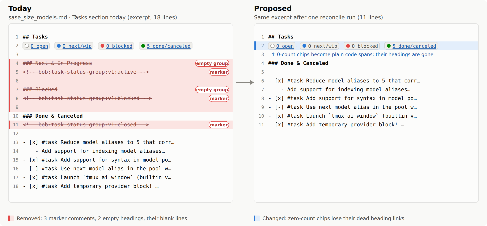
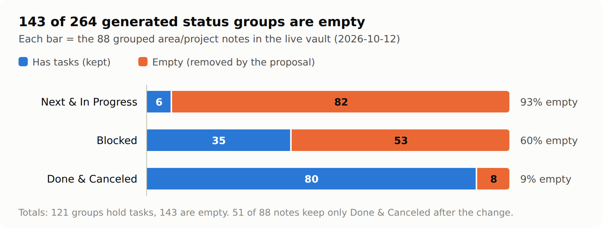
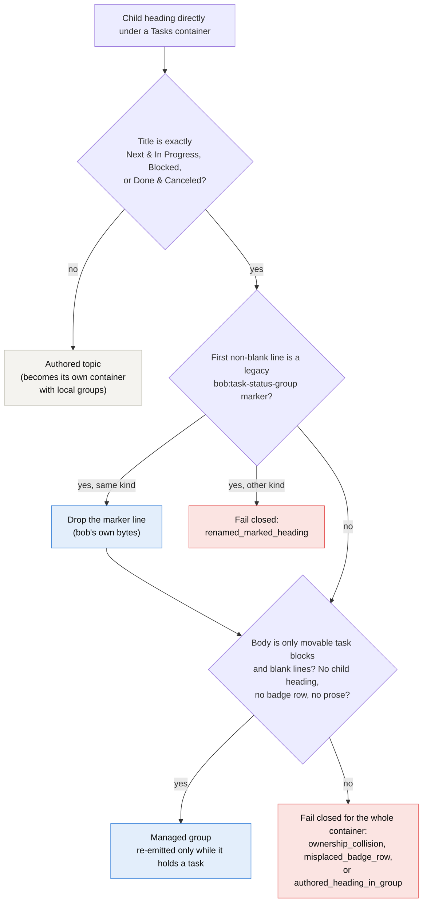
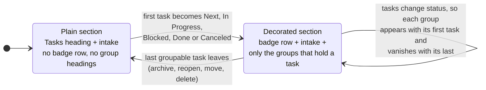
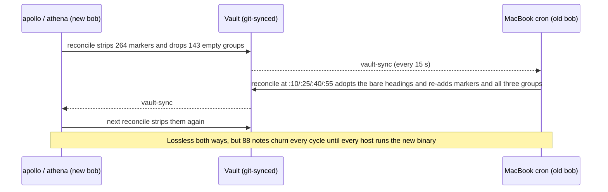

# Marker-free, self-pruning status groups for `bob task reconcile`

Researched **2026-10-12** against bob-cli master `a55a22e`, bob-plugins, and the live
`~/bob` vault (read-only; all writes went to a disposable copy).

The question: can `bob task reconcile` stop writing the
`<!-- bob:task-status-group:v1:{active,blocked,closed} -->` comments under its generated
`Tasks` sub-headings, and also drop sub-sections that hold no tasks, without making
grouping less reliable or less robust?

## TL;DR

**Yes. Let the heading be the marker, and let a group exist only while it holds a
task.**

1. **Ownership by title and shape, not by comment.** A heading directly under a `Tasks`
   container belongs to bob when its title is exactly `Next & In Progress`, `Blocked`, or
   `Done & Canceled` **and** its body holds only movable task blocks and blank lines.
   Anything else under one of those titles fails closed for that container, exactly as
   today. This rule is not new. It is the existing "safe adoption" rule for unmarked
   headings (`adoptable_group_body`), promoted to be the only rule.
2. **A group exists only while it holds a task.** Empty groups are not emitted. Under
   rule 1 a group body can contain nothing but tasks and blank lines, so deleting an
   empty group can only delete bob's own heading line and blank lines.
3. **The layout becomes a pure function of the note's content.** A container is
   decorated (badge row plus groups) if and only if it holds at least one Next, In
   Progress, Blocked, Done, or Canceled task. Nothing is remembered between runs, and
   nothing hidden is stored in the note, on disk, or per machine.
4. **Badge chips for empty buckets become unlinked code spans**, because their headings
   no longer exist. The badge-row grammar already accepts mixed linked and unlinked
   chips, so `bob capture` placement is unaffected.

**The evidence:**

- **Prototype.** 3 files, 12 lines changed.
- **Unit tests.** 34 of the 42 grouping tests pass unchanged. The 8 that fail assert
  exactly the behavior being changed: marker text, or the retention of empty groups.
- **Full suite.** Otherwise green. The only other failures are 2 grouping CLI tests with
  the same marker assertions, 1 reroll fixture, and 2 pre-existing `percent_listen`
  failures that also fail on clean master (`bob-cli-6m`).
- **Sandbox run.** On a copy of the live vault, one reconcile run rewrote exactly the 88
  marker-bearing notes, with **0 warnings and 0 task moves**. It removed only bob's own
  bytes: 264 marker lines, 143 empty headings, and their blank lines (550 lines in
  total). A second run changed nothing.
- **Robustness.** The change is *more* robust than today. The marker is what currently
  lets bob rewrite group bodies that contain non-task lines, and that rewrite **silently
  deletes any line sitting between two tasks**. I reproduced this and filed it as
  **`bob-cli-6r`**. Under the proposal, such a body fails closed and nothing is written.



---

## 1. Why the comments exist

The original design (`plan:202609/task_status_groups.md`, epic `bob-cli-1y`, commits
`f7cf10f` / `2744266`) introduced the comment as "source ownership metadata". In its
words: "The marker owns the heading and group slot, not arbitrary neighboring user
text." Unmarked headings with the canonical titles were already adoptable when their
body was only tasks and whitespace. The marker added one thing: bob keeps owning a group
**after you add prose inside it**.

The badge-row comment (`<!-- bob:task-status-badges:v1 -->`) was removed on 2026-10-06
(`279de51`, `plan:202610/marker_free_status_badges.md`) on the principle that "the row
can be its own identifier". That plan explicitly left the group markers for later:

> They carry real ownership information … Removing them would need its own design.

This report is that design. The table below lists everything the marker does in today's
code.

| Job | Where | Depends on the marker? |
| --- | --- | --- |
| Own a canonical-title heading whose body has prose | `classify_children` (`src/native/task_status_groups/mod.rs:638`), `MarkerState::Valid` | **Yes.** This is the only real power. |
| Flag a renamed generated heading (`renamed_marked_heading`) | same | Yes, but only if you rename the heading *and* keep the comment under it |
| Flag a stray or malformed marker (`malformed_ownership`) | `stray_marker_in_exclusive` (`parse.rs:134`) | Only exists because markers exist |
| Adopt an unmarked canonical heading holding only tasks | `adoptable_group_body` (`parse.rs:159`) | No. Title and shape already suffice. |
| Detect duplicate group headings | `classify_children` | No (by title) |
| Fail closed on an authored child heading inside a group | `classify_children` | No (by title and tree shape) |
| Keep all three groups once created ("heading links and fold targets") | `should_decorate = has_groupable() \|\| has_groups()` (`mod.rs:500`) | No. This is a separate retention rule. |
| Badge row recognition and capture placement | `is_badge_row`, `tasks_heading_end_after_badge_row` (`capture/sections.rs:441`) | No (badge grammar) |

So removing the comments costs exactly one capability: prose inside a generated group.
Section 3 shows that this capability is unused in your vault and lossy as implemented.

## 2. What the live vault says



| Group | Holds tasks | Empty | Empty share |
| --- | ---: | ---: | ---: |
| Next & In Progress | 6 | 82 | 93% |
| Blocked | 35 | 53 | 60% |
| Done & Canceled | 80 | 8 | 9% |
| **All** | **121** | **143** | **54%** |

- **264 marker comments in 88 notes**, exactly three per note. No variant or malformed
  markers exist, and no legacy badge markers remain.
- **0 of 264 groups contain anything but tasks and blank lines.** Nobody uses the one
  capability the marker adds.
- **0 grouping warnings and 0 pending grouping changes**: `bob task reconcile --dry-run
  --format json` reports `grouping_warnings: []` and `grouped_task_sections: []`.
- **No links into group headings** anywhere in the vault, other than the badge chips
  themselves.
- **59 of 88 notes have exactly one non-empty group** (51 are Done-only), 25 have two,
  and 4 have three. For the typical note the proposal removes about 6 scaffolding lines
  (550 lines across 88 notes).
- **No consumer outside bob-cli reads the markers.** bob-plugins has no reference to
  `task-status-group`, the badge row, or the group titles as headings. The move-task
  gesture inserts into the intake before the first child heading. Bob Mac Capture is a
  thin client of `bob` (decision `mac-capture-is-a-thin-client`).
- 117 notes have a `## Tasks` heading; the 29 that are not decorated hold only Ready
  tasks and are unaffected.

## 3. The finding that settles it: the marker licenses a lossy rewrite

`split_group_prose` (`parse.rs:296`) keeps only the non-task text **before the first**
task and **after the last** task of a marked group. `grouping_plan` and `emit_group` then
rebuild the group from `leading + tasks + trailing`. Anything **between** two tasks is
dropped, with no warning, even when no task changes status:

```markdown
### Done & Canceled
<!-- bob:task-status-group:v1:closed -->

- [x] #task a
- remember to email Alice          ← deleted on the next reconcile (changed=true, warnings=[])
- [x] #task b
```

The same applies to a prose paragraph between tasks, and to a stray marker left between
tasks after a heading was deleted. That last case also means the documented
`malformed_ownership` guard never fires for markers inside a group body.
`bob task reconcile` runs unattended every 15 minutes on the MacBook, so this is silent
loss in background maintenance. It has not happened yet, because no group contains
interior content today.

I filed this as **`bob-cli-6r`** (bug, small). The proposal fixes it by construction:
under title-and-shape ownership, a group body with any non-task line is not owned, so
the container fails closed with `ownership_collision` and bob writes nothing.

## 4. Options considered

| | A. **Heading is the marker** *(recommended)* | B. Badge row owns the container | C. Ownership in a state file outside the vault | D. Fingerprinted headings (`### 🔴 Blocked`) | E. Obsidian `%% %%` comments | F. Keep markers; only drop empty groups |
| --- | --- | --- | --- | --- | --- | --- |
| No hidden lines in notes | ✅ | ✅ | ✅ | ✅ | ❌ still a line | ❌ |
| Empty groups removed | ✅ | ✅ | ✅ | ✅ | ✅ | ✅ |
| Prose inside a group | ❌ fails closed | ✅ | ✅ | ⚠️ same as A unless combined with B | ✅ | ✅ |
| Silent-loss risk (`bob-cli-6r`) | ✅ gone by construction | ⚠️ must fix interior pieces first | ⚠️ same as B | ✅ if shape rule kept | ⚠️ unchanged | ❌ unchanged |
| Works across Mac, apollo, and athena with no extra state | ✅ | ✅ | ❌ per-host state; breaks on git sync, renames, restores | ✅ | ✅ | ✅ |
| Layout is a pure function of note content | ✅ | ⚠️ depends on whether a badge row exists | ❌ | ✅ | ❌ | ❌ |
| Change size | ~12 core lines + tests and docs | medium | large | medium; renames 121+ headings and every anchor | small | small |
| Migration | automatic, one run | automatic | needs bootstrap | rewrites headings; breaks the "plain headings" rule of the original plan | rewrites 264 lines | automatic |

**Why not B?** B treats a container as managed when bob's badge row is present, and
then owns its canonical-title children even when they contain prose. That keeps the
prose capability, but the interior-content question has no good answer: when tasks move
out of a group, which task does a middle paragraph belong to? The original plan already
forbids attaching standalone prose to a neighbouring task. B also complicates empty-group
removal: a group holding only prose cannot be removed, so it pins the container in a
decorated state. B is the upgrade path if you ever want prose in groups, but nobody uses
that today.

**Why not C?** The vault is git-synced between the MacBook (whose cron runs reconcile)
and apollo or athena (where agents and manual runs happen). Per-host state would
disagree between machines, would not survive note renames or restores from backup, and
would reintroduce the "hidden state" you are trying to remove, just in a different place.

**Why not D?** Emoji or suffix titles make an accidental collision with a hand-written
heading less likely. Rule A already makes such a collision fail closed or harmless,
though. D costs a rename of every group heading and every badge anchor, and contradicts
the original plan's "keep headings plain" rule.

**Why not F?** It meets the second request but not the first, and it keeps the
`bob-cli-6r` hazard. Shipping both changes together also means one migration rewrite of
the 88 notes instead of two.

## 5. Recommended design

### 5.1 The heading is the marker



The marker branch exists only to migrate old notes and backups. A marker is dropped
**only** in the slot bob itself wrote it to: the first non-blank line under a heading
with the matching title. A marker anywhere else means somebody edited around it, so the
container fails closed rather than guessing:

- a marker in the intake, or a malformed marker: `malformed_ownership`;
- a marker under the wrong title: `renamed_marked_heading`;
- a marker inside a group body: `ownership_collision`.

The live vault has 0 of these cases.

### 5.2 A group exists only while it holds a task



- `should_decorate = parsed.has_groupable()`. History (`has_groups()`) no longer keeps a
  container decorated.
- When the groups exist but none is needed, the section is rewritten **plain**: the
  badge row and the empty headings go, and any Ready tasks inside the old groups move
  back to the intake. This uses the existing `recovered` path.
- Group order stays fixed (Next & In Progress, Blocked, Done & Canceled), so a returning
  group always lands in the same place.
- **No extra write churn.** A group appears or disappears only in a run that is already
  moving a task into or out of it, or in a run that follows `bob task archive`. Both
  write the note today anyway, because the badge counts change. The one-time migration is
  the only additional write.

The documented layout after the change (compare `docs/task-status-hooks.md`):

```markdown
## Tasks
[`⚪ 1 open`](#Project#Tasks) · [`🔵 2 next/wip`](#Project#Tasks#Next%20&%20In%20Progress) · [`🔴 1 blocked`](#Project#Tasks#Blocked) · [`🟢 2 done/canceled`](#Project#Tasks#Done%20&%20Canceled)

Project context.

- [ ] #task Later idea ^idea

### Next & In Progress

- [/] #task Finish implementation ^finish
- [*] #task Review ^review

### Blocked

- [?] #task Wait for dependency ^wait

### Done & Canceled

- [x] #task Agreed scope ^scope
- [-] #task Superseded option
```

The same note after its Blocked task is unblocked and the done tasks are archived:

```markdown
## Tasks
[`⚪ 2 open`](#Project#Tasks) · [`🔵 2 next/wip`](#Project#Tasks#Next%20&%20In%20Progress) · `🔴 0 blocked` · `🟢 0 done/canceled`

Project context.

- [ ] #task Later idea ^idea
- [ ] #task Wait for dependency ^wait

### Next & In Progress

- [/] #task Finish implementation ^finish
- [*] #task Review ^review
```

### 5.3 Badge row

- The four chips stay in their fixed order, so `is_badge_row` and capture's
  `tasks_heading_end_after_badge_row` keep working unchanged.
- A **zero-count group chip renders unlinked**, as plain `` `🔴 0 blocked` ``, because
  its heading no longer exists. The `open` chip always links to the container heading.
- This matters because the original reason to retain empty groups was "preserving
  Obsidian heading links and fold targets". The badge chips are the only such links in
  the vault, and a zero chip has nothing to jump to.

### 5.4 Warning codes

The codes stay stable and no new code is needed. Only the triggers change:

| Code | Today | Proposed |
| --- | --- | --- |
| `ownership_collision` | Unmarked canonical heading with non-task content | **Any** canonical heading with non-task content (prose, plain bullet, comment, stray marker) |
| `malformed_ownership` | Malformed marker, or a marker in the intake | Same triggers, legacy markers only |
| `renamed_marked_heading` | Marker under a wrong or non-canonical title | Same, legacy markers only |
| `misplaced_badge_row` | Badge row inside a group | Same. Keep it taking precedence over `ownership_collision` (the prototype let the generic code win). |
| `duplicate_group_heading`, `authored_heading_in_group`, `h6_container`, `ambiguous_boundary`, `nested_under_ordinary_item`, `unsupported_ordered_list` | — | Unchanged |

### 5.5 Behavior changes you will notice

| Situation | Today | Proposed |
| --- | --- | --- |
| A group's last task leaves | Heading and comment stay forever | Heading disappears on the next run |
| Last groupable task in a section leaves (for example, nightly `task archive`) | Badge row and three empty groups stay | Section returns to plain |
| Badge chip for an empty bucket | Links to an empty heading | Unlinked code span |
| A line between two tasks in a group | **Silently deleted** (`bob-cli-6r`) | Container fails closed; nothing written |
| Prose above or below the tasks in a group | Kept inside the group | Container fails closed until the prose moves to the intake or an authored topic |
| You rename `### Blocked` to `### Waiting` | Fails closed only if you kept the comment line under it | `### Waiting` becomes an authored topic with its own `#### Blocked` (lossless, but it restructures) |
| You type an empty `### Blocked` under `Tasks` | Adopted; comment added | Removed on the next run (after the 2-second quiet period) |
| Copy a grouped section into another note | Comments travel along | Nothing hidden travels |
| Folding a group in Obsidian | Fold target persists while empty | A vanished group's fold state is gone when it returns |

### 5.6 What does not change

- `bob capture`, the move-task gesture, and the Ctrl+Shift+P picker insert into the
  intake as before.
- `bob task reroll` composes the same transform, so it inherits the behavior
  automatically (`randomize_plan.rs:561`).
- The guarded-write path (lock, read-set re-check, 2-second quiet period, recovery
  records) still covers every structural grouping write.
- Ready tasks stay in the unheaded intake, and authored topic headings still get local
  groups.

## 6. Prototype evidence

The prototype is saved next to this report as [`prototype.patch`](prototype.patch)
(against `a55a22e`). It was applied temporarily and then reverted; nothing was committed
to bob-cli.

```diff
 // mod.rs: decoration is a pure function of current content
-    let should_decorate = parsed.has_groupable() || classified.has_groups();
-    let should_rewrite = should_decorate || parsed.has_badges;
+    let should_decorate = parsed.has_groupable();
+    let should_rewrite =
+        should_decorate || parsed.has_badges || classified.has_groups();

 // mod.rs: a marker in the canonical slot no longer grants ownership on its own
                 MarkerState::Valid(found) if found == kind => {
-                    if seen_groups.insert(kind, child.heading_line).is_some() {
+                    if !adoptable_group_body(child, ctx) {
+                        fail = Some(GroupingSkipCode::OwnershipCollision);
+                    } else if seen_groups.insert(kind, child.heading_line).is_some() {

 // parse.rs: the shape check skips a legacy marker in the canonical slot
-        node.body_span.clone(),
+        group_body_start(node, ctx.lines)..node.body_span.end,

 // emit.rs: no marker line, no empty groups, no dead chip links
+            if plan.groups.get(&kind).is_none_or(Vec::is_empty) {
+                continue;
+            }
-        "{hashes} {title}{newline}{marker}{newline}",
+    let mut buf = format!("{hashes} {title}{newline}", title = kind.title());
-            if !linked {
+            if !linked || (group.is_some() && *count == 0) {
```

| Check | Result |
| --- | --- |
| `cargo test --lib task_status_groups` | 34 pass, 8 fail. All 8 assert marker text or empty-group retention: `golden_layout…`, `empty_groups_are_retained_once_created`, `prose_inside_managed_groups_is_preserved`, `safe_legacy_adoption…`, `heading_only_first_setup…`, `nested_children_travel…` (expects an empty Done heading), `authored_child_containers…` (expects a linked zero chip), `misplaced_badge_rows_fail_closed` (code precedence) |
| Full `cargo test --no-fail-fast` | lib 2351 pass / 9 fail (the 8 above + the `randomize_plan` byte-exact fixture); cli 1362 pass / 4 fail (2 grouping fixtures with markers; 2 `percent_listen` tests that fail identically on clean master, `bob-cli-6m`, +1 recorded) |
| Dry-run on the live vault (copy) | `grouped_task_sections`: 88 notes, `grouping_warnings`: 0, `moved_blocks`: 0, no other reconcile changes |
| Live run on a vault copy | `applied_files`: 88; 6,104 → 5,554 lines in those notes |
| Conservation (multiset of non-blank lines, excluding the badge row) | Only removals: 264 marker lines and 143 empty headings. Nothing added; no other line lost. |
| Second live run | `applied_files`: 0 (idempotent on real data) |

Edge-case probes through the prototype (all idempotent on a second pass):

| Input | Result |
| --- | --- |
| Last groupable task archived; only Ready left | Badge row and group removed; section plain |
| Ready task left inside a Done group | Task moved to intake; section plain |
| Task becomes Blocked in a Done-only note | `### Blocked` appears above `### Done & Canceled`; chip relinked |
| Hand-typed empty `### Blocked` | Removed |
| Prose inside a group | `ownership_collision`, unchanged bytes |
| Plain bullet between two tasks in a group | `ownership_collision`, unchanged bytes (fixes `bob-cli-6r`) |
| Legacy marker between tasks | `ownership_collision`, unchanged bytes |
| Legacy marker under the wrong title | `renamed_marked_heading`, unchanged bytes |

Two polish items surfaced:

1. When the removed group was the last thing in the file, one extra blank line is left at
   EOF. It is stable, but it should be trimmed.
2. A rewrite that *un-decorates* a section is not listed in `grouped_task_sections`,
   because the prototype reports only decorated rewrites. It should be reported, for
   example with zero counts, so the human summary never says "already in sync" after a
   structural write.

## 7. Rollout: install everywhere before the first live run

The MacBook runs `~/.cargo/bin/bob task reconcile` from cron at :10/:25/:40/:55. An
**old** binary reading a new-style note sees bare canonical headings holding only tasks,
adopts them, and writes the comments and all three groups back. The new binary then
strips them again on its next run:



Both directions are lossless, because adoption accepts task-only bodies, but the churn
would flood vault-sync commits. To avoid it:

1. Land the change and install it on **every** host that runs `bob task reconcile` or
   `bob task reroll`. The MacBook cron is the one that matters; alternatively, comment
   out its cron line until the Mac is updated.
2. Preview: `bob task reconcile --dry-run --format json`. Expect about 88 entries in
   `grouped_task_sections` and an empty `grouping_warnings`.
3. Run once live. Then confirm `rg -c 'bob:task-status-group' ~/bob` finds nothing and a
   second dry run reports no grouping changes.

## 8. Implementation checklist

The work fits one agent; I would size it `medium`.

- **Code** (`src/native/task_status_groups/`)
  - Apply the prototype.
  - Turn `MARKER_*` into a legacy recognizer only: keep `parse_group_marker`, and drop
    `GroupKind::marker()` from emission.
  - Keep `misplaced_badge_row` ahead of `ownership_collision`.
  - Trim the EOF blank line.
  - Report un-decoration in `GroupedSection`.
- **Rewrite tests**: the 8 grouping unit tests above, the
  `tests/fixtures/task_status_groups/layout.grouped.md` golden, the `randomize_plan`
  byte-exact postimage, `tests/cli/task_status_hooks/sync.rs` (the ordered-text assertion
  and the `badges.md` warning fixture), and the `GROUP` constant in
  `capture/tests/placement.rs`.
- **New tests**:
  1. Marker-free golden output.
  2. Legacy migration (LF and CRLF), idempotent.
  3. A group vanishes with its last task and reappears with its first.
  4. A section un-decorates when nothing groupable remains, and its Ready tasks are
     recovered.
  5. Zero chips are unlinked, and `is_badge_row` and capture placement still accept the
     row.
  6. Interior prose, a plain bullet, or a comment fails closed (`bob-cli-6r`).
  7. Legacy markers out of slot or under the wrong title fail closed.
  8. A hand-typed empty canonical heading is removed.
  9. A renamed heading becomes an authored topic.
- **Docs and help**:
  - `docs/task-status-hooks.md` § Status Grouping: delete "hidden ownership comments",
    replace "all three headings are retained even when one is empty" with the
    appear/vanish rule, and describe ownership by title and shape.
  - `docs/randomize.md`: the "After" example.
  - `README.md` around line 596.
  - The `bob task reconcile` long help (`src/native/task_status_hooks/mod.rs:134`,
    "generated groups use hidden ownership comments").
- **Memory**: consider a `decisions:` record such as "Status groups are owned by title
  and shape and exist only while they hold a task". It would record the reversal of the
  original "retain empty groups" choice and why prose-in-groups was dropped. Create it
  through `/sase_memory_write` after you accept the design.

## 9. Decisions for you

The recommended default is listed first in each item.

1. **Prose inside a generated group**: fail closed (recommended; 0 uses, and the current
   support is lossy), or keep it through option B.
2. **A section with only Ready tasks left**: drop the badge row too (recommended; pure
   function, least noise), or keep a "sticky" badge row once it exists.
3. **Zero-count chips**: unlinked code span (recommended; grammar-compatible), drop the
   chip (needs a recognizer and grammar change), or link to the `Tasks` heading
   (misleading).
4. **Legacy markers outside their slot**: fail closed (recommended; 0 in the vault), or
   strip them anywhere in a container.
5. **Ship both requests together** (recommended; one migration and one doc rewrite), or
   remove empty groups first and the comments later.

## Appendix: method

- Code reading: `src/native/task_status_groups/{mod,parse,emit}.rs`,
  `task_status_hooks/compose.rs`, `capture/sections.rs`, `randomize_plan.rs`, docs, git
  history; `plan:202609/task_status_groups.md`, `plan:202610/marker_free_status_badges.md`,
  bead `bob-cli-1y`; decisions `task-status-is-derived`, `task-lanes-are-sticky`.
- Consumers: grep of bob-plugins (opened with `sase repo open`) for marker, badge, and
  group-title usage.
- Vault statistics: read-only Python scans of `~/bob` (skipping hidden, `done/`,
  `_generated/`, `_templates/`) and a read-only `bob task reconcile --dry-run --format
  json`. One task moved during the session (a sync from the Mac), so the counts are a
  2026-10-12 morning snapshot: empty groups went from 144 to 143 between scans.
- Probes and prototype: temporary unit tests and patch, applied in a scratch working tree
  and reverted. The live run used a copy of the vault's Markdown files and `.obsidian`
  config, with isolated `BOB_DIR`, `XDG_STATE_HOME`, `XDG_CACHE_HOME`, and
  `BOB_VAULT_SYNC_LOCK_FILE`.
- Filed or updated: `bob-cli-6r` (new bug: interior group content deleted), `bob-cli-6m`
  (+1: `percent_listen` CLI tests fail on clean master).
