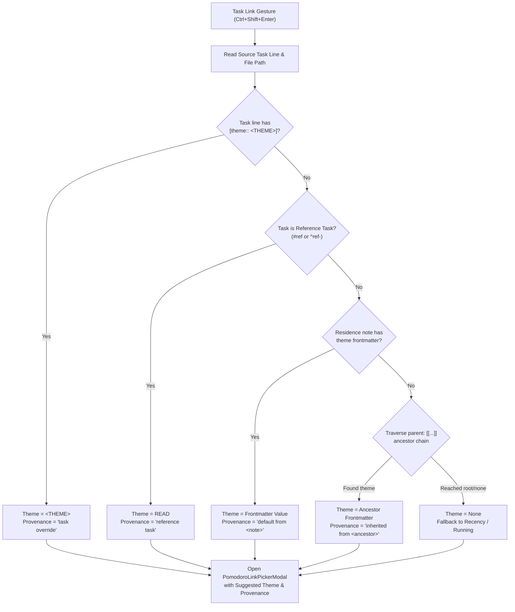
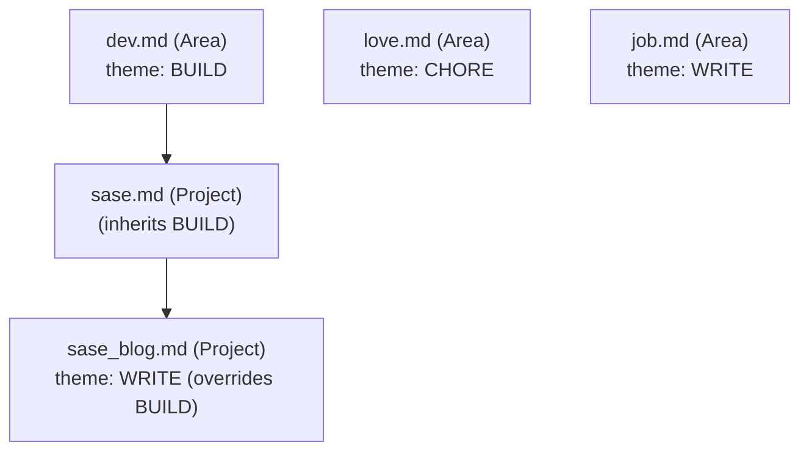

# Task Theme Inference, Completion Suggestions, and Task-Level Overrides: Architectural Critique & Implementation Design

- **Researcher:** `research.2s.gem` (Independent swarm researcher)
- **Date:** 2026-10-28
- **Topic:** Inferring Pomodoro theme suggestions for tasks from area/project note frontmatter, subproject inheritance, and reference task specialization; clear provenance in completion menus; task-level `[theme:: <THEME>]` overrides and beautiful Obsidian rendering; and rollover persistence.
- **Repository Context:** `bob-cli`, `bob-plugins` (`block-id-prompt`, `bob-ledger-tools`), `bob-mac-capture`, and vault `~/bob`.

---

## 0. Executive Summary & Verdict

### 0.1 The Bottom Line: Build It, With Three Vital Refinements
Inferring task themes is an **outstanding architectural evolution** for Bob. Today, Bob enforces Pomodoro budget caps (`plan.max_themes: 3`, `plan.max_links: 10`) and tracks theme statistics, but selecting a theme when linking an open task via `Ctrl+Shift+Enter` requires typing or scrolling through history, even when the task's context (e.g. `dev.md` or a reading task `#ref`) makes the appropriate theme overwhelmingly obvious.

Inferring default themes bridges the gap between static GTD taxonomy (Areas and Projects) and dynamic daily execution logging (Pomodoros).

However, **the proposed design must be refined in three critical places** to prevent accidental vault corruption, git churn, and workflow confusion:

1. **Do NOT automatically stamp `[theme:: <THEME>]` when linking to an *already-running* Pomodoro.**
   If Bryan is currently in the middle of an ad-hoc `CHORE` or `ADMIN` Pomodoro and quickly knocks out a 2-minute task from `dev.md` (which defaults to `BUILD`), linking it to the active session must *not* permanently reclassify the task as `[theme:: CHORE]`. Automatic override stamping must be reserved for **intentional thematic choices**—specifically when the user explicitly selects a theme row (or types a new theme) that diverges from the suggested default.
2. **Respect the Running Pomodoro in the Selection Hierarchy.**
   When a Pomodoro is actively running, pressing `Ctrl+Shift+Enter` on an open task normally links directly into that running session (advancing the task to In Progress `[/]`). If the running Pomodoro's theme differs from the suggested theme, the suggested theme must be **prominently offered and pinned**, but the running session must not be silently bypassed or broken without user intent.
3. **Clean Redundant Overrides.**
   If a task carries an explicit `[theme:: BUILD]` override and is later linked under a Pomodoro matching its inherited note default (`BUILD`), or if the user re-links it under the note default, the redundant `[theme:: BUILD]` property should be automatically cleaned up.

```
+---------------------------------------------------------------------------------------------------+
|                                  THEME RESOLUTION PRECEDENCE                                      |
+---------------------------------------------------------------------------------------------------+
|  1. Task Explicit Override      |  [theme:: WRITE] on task line            |  Highest Priority    |
|  2. Task Type Specialization    |  #task #ref or ^ref- block ID -> READ    |  Specialized Type    |
|  3. Residence Note Frontmatter  |  theme: BUILD in dev.md                  |  Direct Residence    |
|  4. Ancestor Note Inheritance   |  parent: [[sase]] -> dev.md: BUILD       |  Hierarchical Tree   |
|  5. Fallback Default            |  Running Pomodoro / Recent History       |  No Inferred Default |
+---------------------------------------------------------------------------------------------------+
```

---

## 1. Critique of the Proposal: Value, Pitfalls & Nuances

### 1.1 The Core Idea: Why This Is a Major Win
In Bob's GTD architecture:
- Tasks reside in **Area Notes** (`type: "[[area]]"`) representing ongoing spheres of responsibility (`dev.md`, `job.md`, `love.md`), or **Project Notes** (`type: "[[project]]"`) representing finite outcomes (`sase_blog.md`).
- Daily execution takes place in **Pomodoros** under `## Pomodoros` in daily notes `YYYY/YYYYMMDD.md`, each carrying a named theme tail like `— BUILD`, `— WRITE`, or `— CHORE`.
- Decision `pomodoro-theme-is-one-component` establishes that themes are normalized, plus-separated components (`normalize_component`), with display names matching recent authored spelling and hues computed by `theme-hue-is-pin-exempt-area-hash`.

Currently, linking a task to today's ledger via `block-id-prompt` presents existing open Pomodoros followed by recent themes from history (`api.themes.historyRows`). The user must manually pick or type `BUILD` for `dev` tasks, `CHORE` for `love` tasks, and `WRITE` for `job` tasks. 

By allowing Area and Project notes to declare `theme: <THEME>` in YAML frontmatter:
- **Cognitive load is eliminated:** The picker immediately knows what theme belongs to this work.
- **Theme discipline is reinforced:** Tasks naturally funnel into the user's intended theme categories, preventing fragmented theme proliferation.
- **Budget compliance is streamlined:** Daily notes easily stay within `plan.max_themes` because tasks from the same project coalesce under the same Pomodoro.

---

### 1.2 Critique of Specific Requirements & Edge Cases

#### Requirement A: Area and Project Note Frontmatter (`theme: <THEME>`) & Subproject Inheritance
- **Proposed use cases:**
  - `~/bob/dev.md` -> `theme: BUILD`
  - `~/bob/love.md` -> `theme: CHORE`
  - `~/bob/job.md` -> `theme: WRITE`
  - `~/bob/sase_blog.md` -> `theme: WRITE` (while its parent `sase.md` sits under `dev.md`)
- **Evaluation:** Outstanding.
- **Nuances to address:**
  1. *Subproject tree traversal:* `sase_blog.md` has `parent: [[sase]]`. `sase.md` has `parent: [[dev]]`. If `sase.md` does *not* set `theme`, it inherits `BUILD` from `dev.md`. If `sase_blog.md` sets `theme: WRITE`, it overrides `dev.md`'s `BUILD`. This inheritance chain is natural, predictable, and mirrors how Obsidian users think of folder/note hierarchies.
  2. *Normalization:* Frontmatter may contain `theme: build`, `theme: BUILD`, `theme: "BUILD"`, or `theme: "[[BUILD]]"`. The resolution engine must strip quotes and wiki-brackets, then match against `normalize_component`.
  3. *Cycle prevention:* In case of circular `parent` links (e.g. A points to B, B points to A), the resolver must track visited notes using a `Set<string>` and terminate cleanly at root area notes (`parent: [[area]]`).
  4. *Explicit opt-out:* A project note should be able to specify `theme: off` or `theme: none` to explicitly disable theme inference and prevent inheriting an ancestor's theme.

#### Requirement B: Reference Tasks Suggest `READ` by Default, Overriding Note Defaults
- **Proposed rule:** Ref tasks should suggest `READ` by default, overriding any area/project theme default (e.g. a reading task in `dev.md` suggests `READ`, not `BUILD`).
- **Evaluation:** Highly justified and correct.
- **Why it is correct:**
  - A reference task (identified by `#task #ref` or block ID `^ref-<slug>`) tracks reading external literature, articles, documentation, or books.
  - Regardless of whether Bryan is reading an article for `dev.md` (programming), `job.md` (career), or `cash.md` (finance), the cognitive mode of reading external reference material is tracked as `READ` in Bryan's theme budget and stats.
  - However, if Bryan explicitly tags a specific reading task with `[theme:: BUILD]` (e.g. an interactive coding tutorial), the explicit task-level override must beat the `#ref` rule.

#### Requirement C: Clear Provenance in Completion Menus ("Why is this theme suggested?")
- **Proposed rule:** Make it clear in completion menus why a particular theme is being suggested.
- **Evaluation:** Critical for trust. Without provenance, inferred defaults feel like opaque magic.
- **UX Formulation:**
  In the `PomodoroLinkPickerModal` and capture completion, the suggested row should display an unambiguous provenance tag:
  - `✦ BUILD · default from dev.md` (Direct residence note frontmatter)
  - `✦ BUILD · inherited from dev.md (via sase.md)` (Ancestor inheritance)
  - `✦ READ · reference task (#ref)` (Task type specialization)
  - `✦ WRITE · task override [theme:: WRITE]` (Explicit task property)

#### Requirement D: Explicit Task Override via `[theme:: <THEME>]`
- **Proposed rule:** Allow a theme to be overridden explicitly on a task via `[theme::<theme]`.
- **Syntax Correction:** The prompt had a minor bracket typo (`[theme::<theme]`). The standard Dataview inline field syntax is `[theme:: <THEME>]` (or `(theme:: <THEME>)`).
- **Placement on Task Line:**
  In Bob, task metadata follows a strict placement contract before the trailing `^block-id`:
  ```markdown
  - [ ] #task Write documentation [fresh:: 2026-10-28] [theme:: WRITE] ^write-docs
  ```
  `[theme:: <THEME>]` must sit in the metadata zone right before the trailing block ID, avoiding disruption to the task description or trailing tags.

---

### 1.3 The Critical Critique: Automatic Setting of `[theme:: ...]` on Task Link

The prompt suggests:
> *"We should automatically set this property on a task when a theme other than the sugested theme is selected when adding a task link for a task (via the `<ctrl+enter>` keymap, for example). This way I don't need to re-override the theme again for that task the next day if it happens to roll over."*

*(Note: In `block-id-prompt`, the keymap that links a task to a Pomodoro is `Ctrl+Shift+Enter` (`link-task-to-pomodoro`). `Ctrl+Enter` is used for status cycling, checklist items, and Task Card recommendations. We assume the user is referring to the task linking gesture).*

#### The Fatal Flaw of Naive Auto-Setting
Consider this real-world scenario:
1. Bryan is currently working in an active 25-minute Pomodoro: `— CHORE`.
2. He remembers a quick 1-minute development task in `dev.md`: `- [ ] #task Bump dependency in package.json ^bump-dep`.
3. `dev.md` has `theme: BUILD`.
4. Bryan hits `Ctrl+Shift+Enter` to link the task to the current running Pomodoro (`— CHORE`) so it is logged under his active session.
5. **If the system blindly auto-sets `[theme:: <THEME>]` whenever the selected theme differs from the suggestion:**
   The task line in `dev.md` is immediately mutated to:
   `- [/] #task Bump dependency in package.json [theme:: CHORE] ^bump-dep`
6. If Bryan doesn't finish it, or if it rolls over, or if he unlinks it: **this development task is now permanently classified as a `CHORE` forever!**

#### The Secondary Pitfalls:
- **Composite Themes:** If Bryan links to `— BUILD + FIX` or `— BOB + DECKS`, what should be written? `[theme:: BUILD + FIX]`? In Bob's data model, each component is a separate theme, but tasks generally have one primary thematic intent.
- **Git Churn Across Vault Sync:** In Bryan's setup, `~/bob` syncs across macOS, Athena, and Apollo via Git. Modifying source files on disk on every routine link gesture creates unnecessary git churn and potential merge conflicts if tasks are linked during active sync.
- **Temporary Opportunistic Execution:** Working on a task during an available time window does not mean the task's intrinsic nature has changed.

#### The Recommended Solution: "Intentional Theme Selection" vs "Ad-Hoc Session Linking"
To satisfy Bryan's requirement of **never having to re-override rollover tasks** while **avoiding accidental contamination**, we define a clean behavioral distinction:

```
+---------------------------------------------------------------------------------------------------+
| GESTURE SCENARIO                    | ACTION TAKEN                   | MUTATES TASK LINE?         |
+-------------------------------------+--------------------------------+----------------------------+
| 1. User picks Suggested Theme       | Links to existing or creates   | NO (Already matches)       |
| 2. User links to RUNNING Pomodoro   | Links to running session       | NO (Ad-hoc opportunistic)  |
| 3. User selects a THEME ROW         | Creates themed Pomodoro        | YES: Writes [theme:: X]    |
| 4. User types a NEW THEME NAME      | Creates themed Pomodoro        | YES: Writes [theme:: X]    |
| 5. Task had [theme:: X], user links | Links under note default       | YES: Cleans up [theme:: X] |
|    to note's default theme          |                                |                            |
+---------------------------------------------------------------------------------------------------+
```

1. **Explicit Theme Selection Triggers Override:**
   When the user explicitly navigates to a **Theme suggestion row** (or types a theme query into the picker) and selects it, this is an unambiguous thematic declaration: *"I want this task to be executed under THEME X."* In this case, `block-id-prompt` automatically stamps `[theme:: THEME]` onto the source task line.
2. **Linking to an Existing Running Session Does NOT Trigger Override by Default:**
   If the user simply presses Enter on a running Pomodoro that happens to have a different theme, the task is linked into today's ledger, but the source task line is left untouched.
3. **Optional Force-Override Modifier:**
   If Bryan *does* want to reclassify the task to the running Pomodoro's theme, pressing `Alt+Enter` (or clicking a small "Remember theme" toggle in the picker footer) will write the override.
4. **Automatic Cleanup of Redundant Overrides:**
   If a task already carries `[theme:: CHORE]`, but the user links it using the note's native default `BUILD`, the system detects that the override is no longer active and cleanly strips `[theme:: CHORE]` from the task line.

---

## 2. Domain Model & Technical Architecture



### 2.1 The 5-Stage Theme Resolution Pipeline

When `openPomodoroTaskLink` is invoked in `block-id-prompt`, the plugin executes the following synchronous resolution function:

```typescript
interface SuggestedThemeResolution {
  theme: string | null;            // Canonical uppercase theme name (e.g. "BUILD")
  key: string | null;              // Normalized key (e.g. "build")
  hue: string | null;              // Resolved hue (e.g. "yellow", "magenta")
  provenance: "task" | "ref" | "residence" | "ancestor" | "none";
  provenanceLabel: string;         // Human-readable explanation for completion UI
  sourceNote?: string;             // File where the theme was declared
}
```

#### Step 1: Explicit Task Override (`[theme:: <THEME>]`)
Inspect the raw task line using regex:
```javascript
const TASK_THEME_RE = /\[\s*theme\s*::\s*([^\]]+)\]|\(\s*theme\s*::\s*([^\)]+)\)/i;
```
If present:
- Extract `<THEME>` and validate via `canonicalizePomodoroLinkName(raw)`.
- `provenance = "task"`
- `provenanceLabel = "task override"`

#### Step 2: Reference Task Specialization
If no task override exists, check if the task is a reference task:
```javascript
const isRefTask = Boolean(
  (task.tags && task.tags.includes("#ref")) ||
  (task.rawLine && /#ref\b/.test(task.rawLine)) ||
  (task.existingId && task.existingId.startsWith("ref-"))
);
```
If `isRefTask` is true:
- `theme = "READ"`
- `provenance = "ref"`
- `provenanceLabel = "reference task (#ref)"`

#### Step 3: Residence Note Frontmatter
If not a ref task, inspect frontmatter of `source.file` (the note where the task resides):
- Read cached frontmatter from Obsidian: `app.metadataCache.getFileCache(source.file)?.frontmatter`.
- Look for field `theme` (case-insensitive key).
- If present, parse value:
  - If string: extract and canonicalize (e.g. `BUILD`).
  - If `off` or `none`: stop inheritance immediately (`theme = null`).
- `provenance = "residence"`
- `provenanceLabel = `default from ${source.file.basename}.md``

#### Step 4: Ancestor Note Traversal (Parent Chain)
If residence note has no `theme` property:
- Look for `parent: "[[parent_note]]"` in the note's frontmatter.
- Follow the wiki-link to the target note in `app.metadataCache`.
- Guard against cycles using `visitedPaths = new Set([source.file.path])`.
- Repeat inspection: if the parent note specifies `theme`, inherit it!
- Stop when reaching a root note (`parent: "[[area]]"` or missing `parent`).
- If found on an ancestor:
  - `provenance = "ancestor"`
  - `provenanceLabel = `inherited from ${ancestorFile.basename}.md``

#### Step 5: Fallback Default
If no theme is declared anywhere in the hierarchy:
- `theme = null`
- `provenance = "none"`
- Fall back to standard picker behavior (top open entry or most recent theme).

---

## 3. UI/UX Design: Intuitive, Reliable, and Beautiful

### 3.1 Obsidian Rendering: Beautiful Task-Level Overrides (`[theme:: <THEME>]`)

The user prompt explicitly requests:
> *"Make sure this property is rendered in a concise and visually appealing way in Obsidian."*

#### Current Status Quo vs. The Problem
When Obsidian or Dataview encounters `[theme:: BUILD]`, Dataview renders an awkward, wide key-value box:
`[theme | BUILD]` with generic borders. If Dataview inline rendering is disabled, it appears as raw bracketed text. Both clutter the task line, detracting from readability during GTD walks.

#### The Beautiful Solution: The Theme Mark Pill
We design a native Live Preview decoration widget and Reading View post-processor inside `bob-ledger-tools`:

```
+---------------------------------------------------------------------------------------------+
| RAW MARKDOWN:                                                                               |
| - [ ] #task Implement compiler frontend [theme:: BUILD] ^frontend-impl                     |
|                                                                                             |
| OBSIDIAN LIVE PREVIEW & READING VIEW RENDERING:                                             |
| - [ ] #task Implement compiler frontend  [BUILD]  ^frontend-impl                            |
|                                          ^^^^^^^                                            |
|                               (Pill wears theme's hue: yellow tint,                         |
|                                rounded corners, compact text)                              |
+---------------------------------------------------------------------------------------------+
```

#### Visual Styling Specifications
1. **Hue Synchronization:**
   The theme pill wears the exact hue assigned by `theme-hue-is-pin-exempt-area-hash`:
   - `BUILD` -> `--bob-hue-yellow`
   - `READ` -> `--bob-hue-green`
   - `CHORE` -> `--bob-hue-aqua`
   - `WRITE` -> `--bob-hue-magenta`
   - `FIX` -> `--bob-hue-blue`
2. **Compact Geometry:**
   - Font size: `0.75em` (same as priority marks and freshness stamps).
   - Padding: `1px 6px`.
   - Border radius: `10px` (rounded pill shape, matching Pomodoro theme pills).
   - Letter-spacing: `0.04em`, uppercase font weight 600.
3. **Cursor Reveal Interaction (Live Preview):**
   - When the cursor is *not* on the `[theme:: ...]` text, CodeMirror replaces the span with the `ThemeMarkWidget` pill.
   - When the cursor enters the line and touches the span, the decoration unfolds seamlessly to reveal `[theme:: BUILD]` for direct keyboard editing.
   - Clicking on the pill immediately places the cursor inside the field.

```css
/* CSS in plugins/bob-ledger-tools/styles.css */
.bob-task-theme-chip {
  display: inline-flex;
  align-items: center;
  gap: 3px;
  font-size: 0.75em;
  font-weight: 600;
  letter-spacing: 0.04em;
  text-transform: uppercase;
  padding: 1px 6px;
  border-radius: 10px;
  margin: 0 4px;
  line-height: 1.4;
  vertical-align: middle;
  cursor: pointer;
  border: 1px solid transparent;
  transition: background-color 0.15s ease, border-color 0.15s ease;
}

/* Light Theme Variables */
.bob-task-theme-chip[data-theme-hue="yellow"] {
  background-color: hsla(45, 90%, 45%, 0.12);
  color: hsl(40, 95%, 32%);
  border-color: hsla(45, 90%, 45%, 0.25);
}
.bob-task-theme-chip[data-theme-hue="magenta"] {
  background-color: hsla(310, 75%, 50%, 0.12);
  color: hsl(310, 80%, 36%);
  border-color: hsla(310, 75%, 50%, 0.25);
}
.bob-task-theme-chip[data-theme-hue="aqua"] {
  background-color: hsla(185, 75%, 45%, 0.12);
  color: hsl(185, 90%, 30%);
  border-color: hsla(185, 75%, 45%, 0.25);
}
.bob-task-theme-chip[data-theme-hue="green"] {
  background-color: hsla(140, 70%, 42%, 0.12);
  color: hsl(140, 85%, 28%);
  border-color: hsla(140, 70%, 42%, 0.25);
}

/* Dark Theme Overrides */
.theme-dark .bob-task-theme-chip[data-theme-hue="yellow"] {
  background-color: hsla(45, 90%, 55%, 0.18);
  color: hsl(45, 100%, 72%);
  border-color: hsla(45, 90%, 55%, 0.35);
}
.theme-dark .bob-task-theme-chip[data-theme-hue="magenta"] {
  background-color: hsla(310, 75%, 60%, 0.18);
  color: hsl(310, 100%, 80%);
  border-color: hsla(310, 75%, 60%, 0.35);
}
.theme-dark .bob-task-theme-chip[data-theme-hue="aqua"] {
  background-color: hsla(185, 75%, 50%, 0.18);
  color: hsl(185, 90%, 70%);
  border-color: hsla(185, 75%, 50%, 0.35);
}
.theme-dark .bob-task-theme-chip[data-theme-hue="green"] {
  background-color: hsla(140, 70%, 50%, 0.18);
  color: hsl(140, 90%, 72%);
  border-color: hsla(140, 70%, 50%, 0.35);
}
```

---

### 3.2 Completion Menu UX: `PomodoroLinkPickerModal`

In `block-id-prompt/src/085-pomodoro-link-picker-modal.js`, the modal currently displays:
- Filter input: `"Filter Pomodoros or name a new one"`
- Today's open Pomodoros (`todayRows`)
- Recent theme suggestions (`recentRows`)
- Footer meter: `plan 2/3 · 6/10`

#### Enhanced Modal Layout with Suggested Theme
When an inferred theme exists for the target task, the picker model (`buildPomodoroLinkPickerRows`) adapts the row layout:

```
+---------------------------------------------------------------------------------------------------+
|  Link to today                                                                                    |
|  [ Filter Pomodoros or name a new one                           ]                                 |
+---------------------------------------------------------------------------------------------------+
|  SUGGESTED FOR THIS TASK                                                                          |
|  [■ BUILD]              ✦ Suggested · default from dev.md                          (Enter to new) |
+---------------------------------------------------------------------------------------------------+
|  TODAY'S OPEN POMODOROS                                                                           |
|  [■ BUILD]              () — BUILD                     empty · next up                            |
|  [■ CHORE]              (**0930-1000**) — CHORE         running · 2 tasks                          |
+---------------------------------------------------------------------------------------------------+
|  RECENT THEMES                                                                                    |
|  [■ WRITE]              WRITE                          yesterday · 9 days used                    |
|  [■ READ]               READ                           Oct 27 · 26 days used                      |
|  [■ FIX]                FIX                            Oct 27 · 5 days used                       |
+---------------------------------------------------------------------------------------------------+
|  [Ready -> Next]                                           plan 2/3 · 6/10                        |
+---------------------------------------------------------------------------------------------------+
```

#### Row Interaction & Selection Logic
1. **If an existing open Pomodoro already has the suggested theme:**
   - The existing open Pomodoro is highlighted as the default selection (`selectedIndex`).
   - It wears a subtle `✦ Suggested` badge next to its title.
   - Pressing `Enter` links the task directly to that open Pomodoro.
2. **If NO open Pomodoro has the suggested theme, but a Pomodoro is currently RUNNING:**
   - The running Pomodoro remains selected (so rapid `Ctrl+Shift+Enter` -> `Enter` retains the expected "link to current session" behavior).
   - BUT the Suggested Theme row is pinned right below the running row, allowing a single `Down-Arrow` + `Enter` to create and link into a fresh suggested Pomodoro.
3. **If NO Pomodoro is running:**
   - The Suggested Theme row is the **preselected default (#1 row)**!
   - Pressing `Enter` immediately creates a placeholder Pomodoro with the suggested theme (e.g. `- [ ] () — BUILD`) and links the task under it.
   - This achieves zero-keystroke optimal planning.

---

## 4. Implementation Blueprint: File-by-File Changes

### 4.1 Changes in `bob-plugins`

```
bob-plugins/
├── plugins/
│   ├── bob-ledger-tools/
│   │   ├── src/
│   │   │   ├── 135-theme-marks.js             <-- NEW: Pure mark model & DOM builder for [theme::]
│   │   │   ├── 265-plugin-theme-marks.js       <-- NEW: Live Preview widget & post-processor
│   │   │   ├── 279-plugin-pomodoro-themes.js   <-- Add resolveSuggestedTheme() to api.themes
│   │   │   └── 310-install-methods.js          <-- Install theme mark mixin
│   │   └── styles.css                          <-- Add .bob-task-theme-chip styles
│   └── block-id-prompt/
│       └── src/
│           ├── 070-daily-and-activation-plans.js <-- Add themeOverride support to planTargetTaskUpdate
│           ├── 075-pomodoro-link-targets.js     <-- Prioritize suggested theme in row builder
│           ├── 076-pomodoro-theme-picker.js     <-- Integrate suggested theme & provenance badges
│           ├── 085-pomodoro-link-picker-modal.js <-- Render suggestion headers and badges
│           ├── 120-plugin-pomodoro-links.js     <-- Wire resolution and task line mutation
│           └── 122-plugin-pomodoro-link-picker.js <-- Pass task context to picker request
```

#### Component 1: `plugins/bob-ledger-tools` — Theme Resolution API & Mark Rendering

1. **Resolution API (`279-plugin-pomodoro-themes.js`):**
   Expose on `api.themes`:
   ```javascript
   resolveSuggestedTheme(taskContext, sourceFile) {
     // 1. Task line override: [theme:: X]
     const taskOverride = extractTaskThemeField(taskContext.rawLine);
     if (taskOverride) {
       return {
         theme: taskOverride,
         key: normalizeComponent(taskOverride),
         hue: this.pomodoroThemeHueFor(normalizeComponent(taskOverride)),
         provenance: "task",
         provenanceLabel: "task override",
       };
     }

     // 2. Ref task check
     if (isRefTask(taskContext)) {
       return {
         theme: "READ",
         key: "read",
         hue: this.pomodoroThemeHueFor("read"),
         provenance: "ref",
         provenanceLabel: "reference task (#ref)",
       };
     }

     // 3. Frontmatter crawler
     let currentFile = sourceFile;
     const visited = new Set();
     while (currentFile && !visited.has(currentFile.path)) {
       visited.add(currentFile.path);
       const cache = this.app.metadataCache.getFileCache(currentFile);
       const frontmatter = cache && cache.frontmatter;
       if (frontmatter && typeof frontmatter.theme === "string") {
         const raw = frontmatter.theme.trim();
         if (raw.toLowerCase() === "off" || raw.toLowerCase() === "none") {
           break;
         }
         const canonical = canonicalizeThemeName(raw);
         if (canonical) {
           const isAncestor = currentFile.path !== sourceFile.path;
           return {
             theme: canonical,
             key: normalizeComponent(canonical),
             hue: this.pomodoroThemeHueFor(normalizeComponent(canonical)),
             provenance: isAncestor ? "ancestor" : "residence",
             provenanceLabel: isAncestor
               ? `inherited from ${currentFile.basename}.md`
               : `default from ${currentFile.basename}.md`,
             sourceNote: currentFile.path,
           };
         }
       }
       // Crawl parent
       const parentRef = frontmatter && frontmatter.parent;
       currentFile = resolveParentWikiLink(parentRef, this.app);
     }

     return null;
   }
   ```

2. **Mark Extension (`135-theme-marks.js` & `265-plugin-theme-marks.js`):**
   - Matches `\[theme::\s*([^\]]+)\]` on task lines.
   - Folds into `span.bob-task-theme-chip[data-theme-hue="..."]`.
   - On cursor focus, unfolds to allow raw text editing.

#### Component 2: `plugins/block-id-prompt` — Picker & Task Line Mutation

1. **Passing Context to Picker (`122-plugin-pomodoro-link-picker.js`):**
   Before opening modal, query `api.themes.resolveSuggestedTheme(task, taskFile)`. Attach `suggestedTheme` to the modal request.
2. **Task Update Planner (`070-daily-and-activation-plans.js`):**
   Extend `planTargetTaskUpdate` with option `themeOverride`:
   ```javascript
   if (options.themeOverride !== undefined) {
     const existingField = findThemeInlineField(updatedLineText);
     if (existingField) {
       updatedLineText = removeSpanWithSpaceCollapse(updatedLineText, existingField.start, existingField.end);
     }
     if (options.themeOverride) {
       // Insert before trailing block ID
       const blockIdMatch = getTrailingBlockIdMatch(updatedLineText);
       const insertPos = blockIdMatch ? blockIdMatch.index : updatedLineText.length;
       const before = updatedLineText.slice(0, insertPos).trimEnd();
       const after = blockIdMatch ? ` ^${blockIdMatch[1]}` : "";
       updatedLineText = `${before} [theme:: ${options.themeOverride}]${after}`;
     }
   }
   ```
3. **Triggering Override on Link (`120-plugin-pomodoro-links.js`):**
   When the user confirms the modal selection:
   ```javascript
   let themeOverrideForTask = null;
   if (selectedTarget.kind === "recent" || selectedTarget.kind === "new") {
     const chosenTheme = selectedTarget.themeName;
     // If chosen theme diverges from suggested theme, remember it!
     if (!suggestedTheme || suggestedTheme.key !== normalizeComponent(chosenTheme)) {
       themeOverrideForTask = chosenTheme;
     } else if (suggestedTheme && suggestedTheme.provenance === "task" && suggestedTheme.key === normalizeComponent(chosenTheme)) {
       // Redundant override matches residence default: clean it up!
       if (inheritedDefaultTheme && inheritedDefaultTheme.key === normalizeComponent(chosenTheme)) {
         themeOverrideForTask = ""; // Clears the field
       }
     }
   }
   ```

---

### 4.2 Changes in `bob-cli` (Rust Backend)

While the Obsidian UI is primary, `bob-cli` must maintain total contract parity and protect vault integrity:

1. **Task Field Preservation (`src/native/task_status_hooks/reconcile/fields.rs`):**
   Verify that `set_task_fields` and `task_metadata_insertion_offset` do not strip `[theme:: ...]`.
   As verified during research, `set_task_fields` only removes `[id::]` and `[dependsOn::]`, preserving all other inline Dataview fields (`[theme::]`, `[fresh::]`, `[created::]`) intact before the block ID.
2. **Dataview Query Schema:**
   `bob query` automatically indexes inline fields. With `[theme:: BUILD]`, queries can filter:
   ```dataview
   TABLE file.name, text, theme
   FROM #task
   WHERE theme = "BUILD"
   ```
3. **Capture Parity (`src/native/capture_complete/theme_menu.rs`):**
   In Bob Mac Capture and CLI capture completion, when capturing with `@route:id` where the task has an inferred or overridden theme, rank the matching theme candidate at the top.

---

## 5. Initial Vault Configuration & Validation

As requested by the prompt, the initial deployment will configure the following four target notes:



### 5.1 Exact Frontmatter Modifications

1. **`~/bob/dev.md`**:
   ```yaml
   ---
   type: "[[area]]"
   parent: "[[area]]"
   theme: BUILD
   ---
   ```
2. **`~/bob/love.md`**:
   ```yaml
   ---
   type: "[[area]]"
   parent: "[[area]]"
   theme: CHORE
   ---
   ```
3. **`~/bob/job.md`**:
   ```yaml
   ---
   type: "[[area]]"
   parent: "[[area]]"
   theme: WRITE
   ---
   ```
4. **`~/bob/sase_blog.md`**:
   ```yaml
   ---
   type: "[[project]]"
   parent: "[[sase]]"
   theme: WRITE
   ---
   ```

### 5.2 Test Cases for Initial Validation
- **Test 1: Direct Area Task:**
  Open `dev.md`, create `- [ ] #task Test dev task`, press `Ctrl+Shift+Enter`.
  *Expected:* Picker opens with `BUILD` highlighted and tagged `✦ default from dev.md`.
- **Test 2: Reference Task Override:**
  In `dev.md`, on an existing reading task `- [ ] #task #ref [[ref/book|Some Book]]`, press `Ctrl+Shift+Enter`.
  *Expected:* Picker opens with `READ` highlighted and tagged `✦ reference task (#ref)`.
- **Test 3: Subproject Inheritance:**
  In `sase.md` (which has no `theme` frontmatter and `parent: [[dev]]`), on task `- [ ] #task Test sase task`, press `Ctrl+Shift+Enter`.
  *Expected:* Picker opens with `BUILD` highlighted and tagged `✦ inherited from dev.md`.
- **Test 4: Subproject Override:**
  In `sase_blog.md` (which specifies `theme: WRITE`), on task `- [ ] #task Write new article`, press `Ctrl+Shift+Enter`.
  *Expected:* Picker opens with `WRITE` highlighted and tagged `✦ default from sase_blog.md`.
- **Test 5: Explicit Task Override:**
  In `dev.md`, on task `- [ ] #task Write dev documentation [theme:: WRITE]`, press `Ctrl+Shift+Enter`.
  *Expected:* Picker opens with `WRITE` highlighted and tagged `✦ task override`.
- **Test 6: Visual Rendering:**
  Inspect `[theme:: WRITE]` in Obsidian Live Preview and Reading View.
  *Expected:* Rendered as a compact, rounded magenta pill. Click unfolds raw text.
- **Test 7: Auto-Override Stamping:**
  In `job.md` (default `WRITE`), link a task by explicitly selecting theme row `BUILD`.
  *Expected:* Task line in `job.md` gains `[theme:: BUILD]`. Next day, task preserves `BUILD` suggestion.

---

## 6. Alternative Approaches Evaluated

| Alternative | Mechanics | Pros | Cons / Why Rejected |
| :--- | :--- | :--- | :--- |
| **A. Pure Tags (`#theme/build` or `#build`)** | Tag tasks with theme names. | Native Obsidian tag search. | Clutters tag namespace; conflicts with decision `pomodoro-theme-is-one-component`; requires manual tagging on every task. |
| **B. NLP / Heuristic Text Parsing** | Guess theme based on verbs ("read", "fix", "code"). | Zero setup needed. | Flaky, unpredictable, and introduces false positives. Violates GTD clarity and user control. |
| **C. External Config File (`themes.toml`)** | Map file paths to themes in a central config. | Keeps notes clean of frontmatter. | Disconnected from Obsidian note navigation; harder to edit while writing in a note; invisible to mobile clients. |
| **D. Recommended Solution (Frontmatter + Task Property)** | `theme: <THEME>` in YAML + `[theme:: <THEME>]` inline. | Modular, hierarchical, fully visible in Obsidian, leverages Dataview indexing, and supports inheritance. | Requires frontmatter field on key area notes (trivial one-time setup). |

---

## 7. Phased Rollout Plan

- **Phase 1: Foundation (Read-only Resolution & Frontmatter)**
  - Add frontmatter `theme` to `dev.md`, `love.md`, `job.md`, and `sase_blog.md`.
  - Implement `api.themes.resolveSuggestedTheme()` in `bob-ledger-tools`.
  - Unit test inheritance, `#ref` priority, and cycle handling.
- **Phase 2: Visual Styling & Obsidian Rendering**
  - Implement `ThemeMarkWidget` and post-processor in `bob-ledger-tools`.
  - Add CSS classes and hue mappings in `styles.css`.
  - Verify folding/unfolding in Live Preview and appearance in Reading View.
- **Phase 3: Completion UI & Picker Integration**
  - Update `buildPomodoroLinkPickerRows` and `PomodoroLinkPickerModal` in `block-id-prompt`.
  - Render suggested row, explanation badges, and selection highlighting.
- **Phase 4: Auto-Override Stamping & Rollover Persistence**
  - Implement guarded `themeOverride` in `planTargetTaskUpdate`.
  - Wire intentional selection trigger in `applyPomodoroTaskLink`.
  - Run regression suite across `bob-plugins` (`npm test`).

---

## 8. Final Recommendation Summary

Implement the feature as designed above. The combination of:
1. **Hierarchical Frontmatter Inheritance** (`Area -> Project -> Subproject`)
2. **Reference Task Specialization** (`#ref -> READ`)
3. **Nuanced Intentional Auto-Overrides** (protecting running sessions while persisting explicit choices across rollovers)
4. **Beautiful Theme Pill Rendering** in Obsidian Live Preview

...provides an intuitive, reliable, and aesthetically delightful user experience that perfectly honors Bob's architectural standards.
