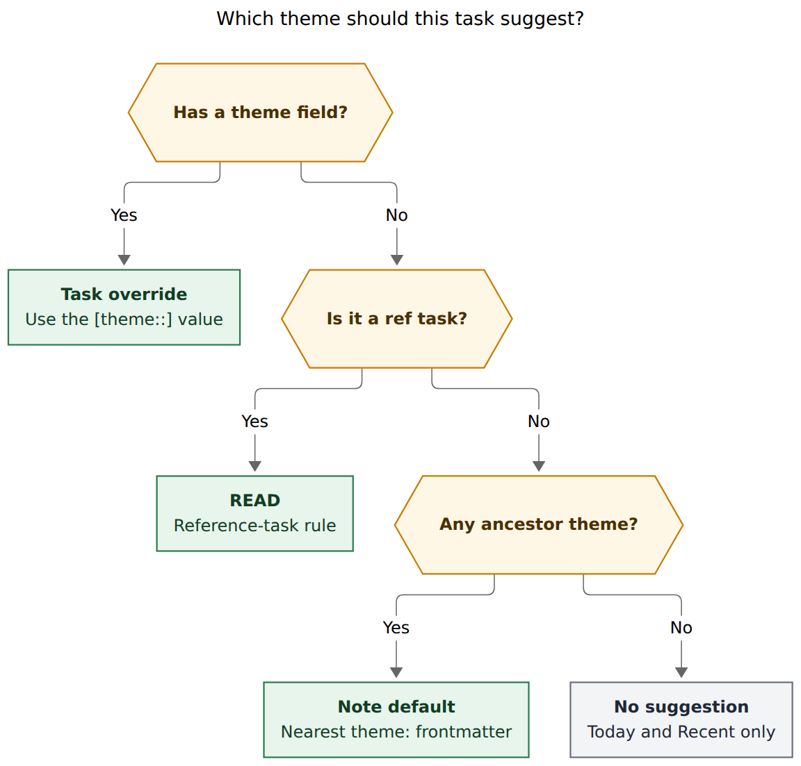
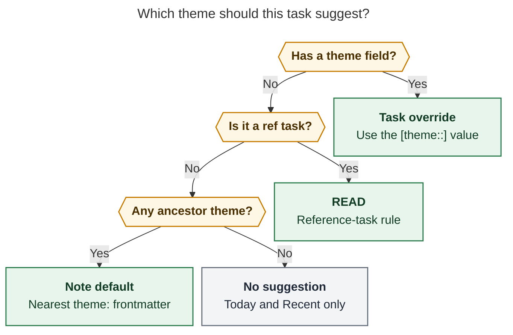
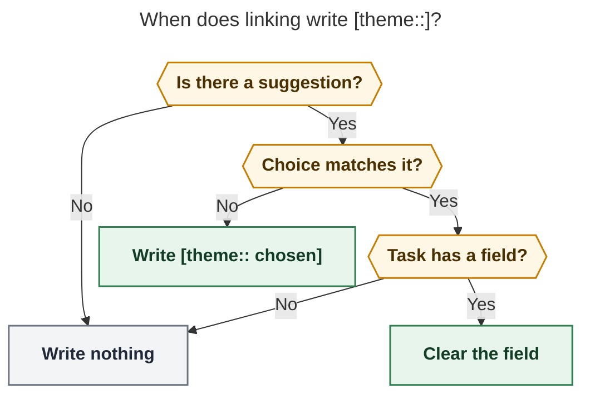

# Suggest a Pomodoro theme from the task, and remember overrides

> **Research query:** Infer which theme to suggest for a task (as the default
> completion choice) from the task itself. Area and project notes should declare
> a default via frontmatter `theme:`; ref tasks should suggest `READ`; menus
> should say why a theme is suggested; a task-level `[theme::<theme>]` field
> should override that default and be written automatically when a linking
> gesture picks a different theme, so a rollover does not have to re-override
> tomorrow. First use-cases: `theme: BUILD` on `dev.md`, `theme: CHORE` on
> `love.md`, `theme: WRITE` on `job.md` and `sase_blog.md`. Lead the design.
> Critique the plan. Call out justified requirement changes. End with a
> recommended solution.

**Researcher:** `research.2s.grk` · **Date:** 2026-10-28 · **Kind:** design
research, no vault or code writes

This report does not consult the other swarm reports. Evidence is the live
bob-cli / bob-plugins / bob-mac-capture trees, the Pomodoro-themes contract,
the work-kind theme-set consolidation (`research:202610/work_kind_pomodoro_theme_set/work_kind_pomodoro_theme_set__final.md`),
and live `bob query` of `dev.md`, `love.md`, `job.md`, and `sase_blog.md`.

## Bottom line

Do it. The six work-kind themes (PLAN, BUILD, FIX, READ, WRITE, CHORE) only
pay rent if linking a task usually lands in the right kind. Today the Link to
today picker and capture name menus default to *the running session* and
*recent history*. That is a "what am I doing now" default, and it will keep
dumping BUILD work into FIX (and WRITE work into READ) for as long as the
current Pomodoro happens to be open. A cheap, visible, sticky suggestion is
the missing piece.

Keep the user's three sources, in this order:

1. `[theme:: BUILD]` on the task (explicit override)
2. `#task #ref` → `READ` (kind rule; beats area/project)
3. Nearest ancestor area/project `theme:` frontmatter (inherited default)

Do **not** infer from task titles, and do **not** scan the ledger for
"last linked under" in v1. The override field *is* the rollover memory, and
it is written only when the user picks something other than the suggestion.

Two corrections to the request are load-bearing:

- The linking keymap is **Ctrl+Shift+Enter** (`link-task-to-pomodoro`), not
  Ctrl+Enter. Ctrl+Enter completes a task or takes a recommended roll.
- Change the empty-query default **only** in task-aware menus (Link to today,
  capture `@note:id#name` / `^note:id#name`). Leave `=` start-name menus on
  today's running / next-up row. Starting a session is "what am I doing now";
  linking a task is "what kind of work is this."

## Verdict

This is a good idea, and I would take this approach rather than a
smarter-looking one.

The tempting alternatives fail the existing theme contract:

| Alternative | Why it loses |
| --- | --- |
| Infer the catalog from tasks or homes | Already rejected by `decisions:pomodoro-theme-is-one-component`. History stays ledger-only. A *suggestion* is a default for a menu, not a new identity rule. |
| Keyword-guess FIX from "Fix …" / BUILD from "Add …" | Magical, wrong often enough to train distrust, and it fights the same decision. |
| Remember last-linked theme from daily notes | Solves rollover without a field, but it is a per-task ledger scan, it cannot tell an accidental dump from an intent, and it makes "undo the override" mean "rewrite history." Keep it as v2, after the field exists. |
| Tag `#theme/BUILD` instead of `[theme::]` | Tags already have a mark language (`#task`, `#ref`, `#gtd`). A Dataview field matches priority/scheduled, folds the same way, and is what the user asked for. |
| Plugin-only resolution | Breaks `decisions:mac-capture-is-a-thin-client`. Bob owns the meaning; clients render JSON. |

The design below is deliberately *less* clever than it could be: one
component, one nearest `theme:`, one stamp rule, one "why" string. That is
how the rest of Bob's marks and menus stay beautiful.

## Justified requirement changes

Call-outs. Everything else in the request stands.

1. **Correct the keymap.** Auto-stamp on **Ctrl+Shift+Enter** and on capture
   links that choose a named Pomodoro (`@route:id#NAME`, `@route:id=NAME`,
   `^route:id#NAME`). Do not stamp on Ctrl+Enter close, Alt+P roll, or a
   bare `=` start.
2. **Task-aware menus only.** PT7 (Today → Recent → create → substring)
   stays the ranking for `=` / `pomodoro_start_name`. Suggested-theme
   preselection is a new rule on top of PT7 for menus that already know
   which task is being linked.
3. **Clear the field when the user returns to the suggestion.** If the task
   has `[theme:: FIX]` and the suggestion is BUILD, picking BUILD deletes
   the field so the task follows the note again. Picking FIX keeps it.
   Symmetric with "stamp on override."
4. **Store one component.** `[theme:: BUILD + FIX]` is not a theme; a theme
   is one `+` component (`decisions:pomodoro-theme-is-one-component`).
   Frontmatter `theme: BUILD + FIX` warns and uses the first non-exempt
   component. A chosen composite *matches* the suggestion when any
   component equals the suggested key; the stamp, if any, is the first
   non-exempt component of the choice.
5. **Cap-aware preselection.** If the suggested create row would push
   `plan.max_themes` over the cap, do not preselect it. Prefer a matching
   open Today row; if none, fall back to running / next-up and say why
   (`BUILD would make 4/3 themes`).
6. **Rename rewrites the new stores.** `bob themes rename` already rewrites
   ledger tails. It must also rewrite matching `[theme::]` fields (open
   notes *and* `done/`) and `theme:` frontmatter, in the same previewed
   transaction. Otherwise overrides and note defaults go stale the first
   time a name changes.
7. **No last-linked scan in v1.** The stamp rule is the rollover memory.
   Inbox captures that name a Pomodoro before the task is routed will still
   need one pick after the move. Accept that. A later "last linked under"
   source can sit between the ref rule and note frontmatter without changing
   the field.
8. **Do not keyword-classify.** `dev.md` is full of "Fix …" and "Restart …"
   tasks that should become FIX or CHORE by an explicit pick, not by a
   title regex.
9. **First use-cases stay as specified**, with the expectation that some
   open tasks on those notes will need an override on first link. That is
   the design working, not a misfire. Details in [First use-cases](#first-use-cases-live-vault).

## How it works today

A Pomodoro **theme** is one `+`-separated component of a named ledger
entry's ` — NAME` tail. The catalog is derived from canonical daily notes
plus `.bob/themes/<host>.jsonl`. Clients never invent hues or history
(`docs/pomodoro-themes.md` PT1–PT11).

**Link to today** (`block-id-prompt`, Ctrl+Shift+Enter) builds an empty-query
model whose `defaultIndex` is: the single open timed entry (`defaultReason:
"running"`), else the first of several timed opens (`"ambiguous"`), else the
first open placeholder (`"next"`). Recent catalog themes are then spliced
under Today using PT7. Enter therefore means *current session*, not *this
task's kind*.

**Capture completion** (`bob capture-complete`) uses the same PT7 groups for
`pomodoro_name` and `pomodoro_start_name`. Recent rows carry
`origin: "history"`, `last_used`, `days_used`. Mac Capture renders that as
`Oct 21 · 3 days` with a hue swatch. There is no task-aware default.

**Task fields** are `[key:: value]` / `(key:: value)` via
`src/native/task_fields.rs`. Authored fields today: `scheduled`, `priority`,
`fresh` / `refresh` / `keeps` / `unblocked`, `repeat`, `created`. Derived:
`id`, `dependsOn`. There is no `theme` field. Capture formats a new task as
`#task {body} [created::{date}]` then appends priority and scheduled
(`src/native/capture/plan.rs` `format_task_line`).

**Note frontmatter** already has optional scalars that change derived
behavior without becoming catalog identity: `color:` (area hue),
`ready_cap:`, `task_refresh:`, `root: true`, `project_name_aliases`.
`theme:` fits that family. Area/project parent walking is the R1 chain in
`docs/pomodoro-homes.md` (scalar `parent:` wikilinks, stop after 16, walk
through archive and ref notes).

**Ref tasks** are already a first-class kind: `note_tasks::is_ref_task_kind`
requires `#task` immediately followed by `#ref`. Capture, Highlights sync,
and the reading board all use it. A hard `READ` suggestion has a reliable
predicate.

**Rendering precedent.** `[priority:: high]` folds to a 4-bar mark.
`[created::]` / `[scheduled::]` fold to `+ Aug 31` / `⧗ Sep 4`. Pomodoro
names wear PT6 pills (soft tint, 4 px radius, hue never the text color).
Derived `[id::]` is hidden; `[dependsOn::]` is a muted glyph. A new
`[theme::]` mark should join the *pill* family, not the date-glyph family,
because it *is* a theme name.

## First use-cases (live vault)

Queried 2026-10-28. Frontmatter today:

| Note | Type | Parent | Color | Proposed `theme:` |
| --- | --- | --- | --- | --- |
| `dev.md` | area | `[[area]]` | blue | BUILD |
| `love.md` | area | `[[area]]` | yellow | CHORE |
| `job.md` | area | `[[area]]` | aqua | WRITE |
| `sase_blog.md` | project, `root: true` | `[[sase]]` → `[[dev]]` | (none) | WRITE |
| `sase.md` | project | `[[dev]]` | (none) | inherits BUILD |

Open-task mix, which is why inheritance plus the ref rule matter:

**`job.md` — 5 open, 4 of them `#ref`.** The four reading tasks (Stripe
HackerRank lookup, two recruiter-research refs, gog reauth) get **READ**
from the ref rule and never see WRITE. The remaining task, "Finish Stripe
assessment (due today)!", is a coding assessment. WRITE would be the wrong
prior; the first link should pick BUILD (or a future PRACTICE) and stamp
`[theme:: BUILD]`. WRITE on `job.md` is still the right *note* default: it
is the prior for cover letters, the CV, LinkedIn, and application prose,
which is exactly the JOB-shaped gap the work-kind research asked WRITE to
fill.

**`sase_blog.md` — 16 open, 3 `#ref`.** The drafting cluster (S0 spike,
zero-drafts, v1 draft, intro, release, GasTown links) is WRITE, and that
is most of the note. The three `#ref` rows get READ. Two rows will want an
override on first link: "Wave 1 review: snapshot + annotate the draft
**(1 🍅 READ)**" is explicitly a READ block, and "Review all post-blog
tasks…" is closer to PLAN. Inheritance is why the note needs its own
`theme: WRITE`: without it, `sase_blog` would inherit BUILD from `dev.md`.

**`dev.md` — 18 open.** A coarse BUILD prior. Several open rows are host
repair ("Fix issue where athena loses internet", "Restart athena") or
household-adjacent chore ("Dust #athena Tower", "Change your phone screen
protector"), plus a few `#ref` rows that become READ. FIX/CHORE overrides
will accumulate here. That is expected: `dev` is a top-level area, not a
kind of work.

**`love.md` — 24 open.** Pet care, errands, downloads, movies with Kelly.
CHORE is the closest of the six. There is no PLAY/LEISURE theme, and the
work-kind set should not grow one for this. Leisure tasks can keep CHORE
or pick something else once; the stamp remembers.

**`sase.md` / `bob.md` get BUILD for free** via the parent walk. Do not
expand the first use-cases to every project under `dev`.

## Suggested theme: the resolver

Bob owns the function. One component in, one component out. Display name
is the catalog spelling when known, else the authored spelling
ASCII-uppercased.

**Match** a chosen Pomodoro name against a suggestion: any
`split_components` entry, `normalize_component`, equals the suggested key.
When several Today rows match, prefer an exact single-component name, then
the running session if it matches, then ledger order.



**Caption:** A task-level `[theme::]` field wins; a `#task #ref` row
suggests READ even inside a WRITE note; otherwise the nearest area or
project `theme:` on the parent walk is the default; with none of those,
menus stay on Today and Recent.

Rendered size: 767.8 × 736 px; fit scale: 85.0%. Mermaid CLI 12.0.0,
neutral theme, DejaVu Sans.



### 1. Task override

Canonical field: exactly one `[theme:: VALUE]` or `(theme:: VALUE)` on the
line, key `theme` touching `::`, padding spaces only, VALUE a valid
Pomodoro-name *component* (same grammar as PT1, no `+`). Multiple or
malformed fields are ignored for suggestion (do not guess) and get no
mark. Writers replace the set with one canonical field.

This is the only source that can beat READ. A reference you are *writing
about* rather than reading can carry `[theme:: WRITE]`.

### 2. Reference-task rule

`task_kind == "ref"` (`#task` then `#ref`). Legacy in-note `^ref` trackers
that bob still classifies as ref tasks count. Follow-up tasks without
`#ref` take the note default. This is why WRITE on `job.md` / `sase_blog.md`
is safe.

### 3. Note default, inherited

Walk the R1 parent chain from the task's residence. The first area or
project with a scalar `theme:` wins (nearest to the task). Ignore the key
on daily notes, ref notes, articles, and inboxes unless we later choose to
set one; do not set `theme:` on `mac_inbox.md` or `gkeep_inbox.md`. Empty,
list, or unparsable values are skipped with a verbose warning
(`bob capture-targets -v`, `bob projects list`), same quiet style as
`root: true`.

Unknown names are allowed (create-on-use). The menu can still create them.

### 4. None

Inbox tasks, untyped notes, and areas that have not opted in. Menus keep
today's running / next-up default. No stamp.

### Why string

Every suggestion carries a short reason, shown as the row's secondary text
(the slot Recent already uses for `Oct 21 · 3 days`):

| Source | Reason copy |
| --- | --- |
| override | `this task · [theme:: BUILD]` |
| ref | `ref task` |
| note, residence | `from [[dev]]` |
| note, inherited | `from [[dev]] via [[sase]]` |
| cap fallback | `BUILD would make 4/3 themes` |
| none | (omit) |

Color is never the only signal. The reason text, a `Suggested` badge, and
the theme pill all carry the meaning under `NO_COLOR` and for
screen readers (`Pomodoro, BUILD, from [[dev]], Suggested`).

## Menu composition (task-aware only)

Empty query, task known:

1. **Suggested.** Either the matching open Today row (pill, running/next
   badges unchanged, plus `Suggested · from [[dev]]`) or a create/again
   row for the suggested name (`Suggested · new BUILD` /
   `Suggested · BUILD is done — starts a fresh BUILD`). Hidden catalog
   state does **not** remove this row (`decisions:theme-hide-is-recent-only`).
2. **Today.** Remaining open entries, current PT7 group A, including the
   running session even when it is not the suggestion.
3. **Recent / create / substring / utilities.** Unchanged PT7 B–E, still
   excluding Today components and hidden keys from *Recent*.

Preselection:

- Matching Today row, preferring running-if-match, else first match.
- Else the Suggested create/again row, if creation is allowed and under
  the theme cap.
- Else today's `defaultReason` (`running` / `next` / `ambiguous`).

Non-empty query: PT7 ranking is untouched. A matching suggested name gets
the badge and reason; it does not steal prefix rank from a better Today
hit. Return still accepts the highlighted row.

`=` start-name (`pomodoro_start_name`, Mac `=#`, Obsidian session start)
does **not** use this rule. Next-up and running stay the default. Mixing
the two would make `=` create BUILD because the last task you looked at
lived in `dev.md`.

Counted / batch Link to today: one chosen Pomodoro, per-task stamp. Each
task whose suggestion does not match the choice gets (or keeps) its own
`[theme::]`.

## Stamp rule

Writers: Ctrl+Shift+Enter (and the `api.pomodoroLinkPicker` successor
retarget), capture items that link or create a task under a named
Pomodoro, Mac Capture (because it is `bob capture`). Unlink does not
touch the field. Inbox routing does not touch the field in v1.

![When does linking write [theme::]?](task_theme_suggestion_defaults__grk_stamp.png)

**Caption:** Linking writes a theme field only when a suggestion exists
and the chosen Pomodoro does not match it. Matching a suggestion clears a
stale override so the task follows the note again; with no suggestion,
the session name stays a session name.

Rendered size: 561.3 × 712 px; fit scale: 100.0%.



"Chosen" for a composite is the first non-exempt component (PLAN is
exempt by default). Choosing today's `BUILD + FIX` while the suggestion
is BUILD **matches**; no stamp. Choosing `FIX` while the suggestion is
BUILD writes `[theme:: FIX]`.

Placement on the line, so marks cluster with other authored fields:

```text
- [*] #task Finish Stripe assessment [created::2026-10-28] [theme:: BUILD] [priority:: high] ^stripe-assessment
```

Insert after `[created::]` when present, else before `[priority::]` /
`[scheduled::]`, else before `^blockid`. Never after derived `id` /
`dependsOn`. Capture's `format_task_line` grows an optional theme
argument in the same slot.

Hand-editing the field is allowed. A later Task Card "Theme" row (More)
should set, change, and clear it without linking; that can ship in the
same epic as a last slice. Until then, the picker *is* the editor: pick
the suggestion to clear, pick something else to set.

## Rendering: a theme pill, not a Dataview chip

Dataview will otherwise paint `THEME | BUILD` as the loudest object on
the line (`hide_deterministic_task_fields` already documented this for
`dependsOn` / `id`). Fold it the way dates and priority fold.

**What you see**

```text
before:  - [ ] Spike S0: write the promise sentence  THEME│WRITE
after:   - [ ] Spike S0: write the promise sentence  WRITE
```

The folded widget is the same PT6 pill already used on Pomodoro name
tails: 16 % / 24 % tint, 4 px radius, ~0.3 em pad, no border, hue never
the text color, muted pill if the value is exempt. Unknown names stay
neutral until the catalog knows them (PT6 typing rule). The field exists
only as an override, so the tooltip names what it is beating:

```text
Theme override · BUILD
Would have been WRITE from [[job]]
Ctrl+Shift+Enter to link · pick WRITE to follow the note again
```

Cursor into the mark, or click, reveals `[theme:: BUILD]` for editing.
Source mode shows the raw field. A session toggle **Toggle task theme
marks** restores the Dataview pill, matching date/priority/today marks.
Without bob-ledger-tools the vault looks as it does today (a Dataview
pill). Tasks query rows get the same pill so a `#task` search does not
scream `THEME`.

Do **not** invent a new silhouette. Priority already owns bars; dates
own `+ ⧗ ✓ ⊘`; tags own the teal hash and the open book. Theme identity
is already a tinted name. Reusing it makes a task's override rhyme with
the session it wants to join.

Frontmatter `theme: WRITE` in the Properties panel can stay a plain YAML
scalar. A Properties restyle is out of scope.

## Who computes it

Rust owns the meaning. JSON grows additively at `schema_version` 1.
Clients render. This is the themes contract's standing rule, and it is
also `decisions:mac-capture-is-a-thin-client`.

| Surface | How it learns the suggestion |
| --- | --- |
| `bob themes suggest NOTE:ID` (new, read-only) | Direct. For tests, debug, and a one-shot plugin fetch. |
| `bob capture-complete` | Additive `theme_suggestion` on the result when the name field belongs to a resolvable task; matching candidates get `suggested: true`, `suggestion_reason`, `origin: "suggested"` (Today rows keep `ref`/`line`; create rows still omit them). Older clients ignore the fields. |
| `bob capture` | Same resolver; applies the stamp/clear rule inside the existing all-or-nothing transaction. |
| `bob themes rename` | Rewrites `[theme::]` and `theme:` in the same previewed commit. |
| Bob Ledger Tools `api.themes` v1 (additive) | `suggestForTask({ path, line, text? })` spawns bob **once per picker open**, never per keystroke. `hueFor` stays the JS mirror. Fallback if bob is old: `available` without `suggestForTask` → today's picker. |
| Block ID Prompt picker | Consumes `suggestForTask`. Does not walk `parent:` itself. |
| Bob Mac Capture | Renders `origin: "suggested"` / `suggestion_reason` in the slot that currently shows `Oct 21 · 3 days`. No Swift parent walk, no vault read. |
| Conformance vectors | `scripts/fixtures/pomodoro_themes/suggest.json` (or a sibling), copied byte-for-byte into bob-plugins, same pattern as hue/PT7 vectors. |

Do not have the plugin reimplement the parent walk "because metadataCache
is faster." One spawn on picker open is the same cost class as
`api.themes.fetch()`, and it is the only way Mac Capture, CLI, and
Obsidian cannot drift.

## Contract and docs

This is a behavior change plus a design choice:

- **Decision record** (new): *Task theme suggestions are derived defaults;
  the ledger remains the catalog.* Explicitly does not reopen
  `pomodoro-theme-is-one-component`. Cite this research and PT12.
- **`docs/pomodoro-themes.md` PT12** — suggestion sources, match rule,
  task-aware menu composition, stamp/clear, cap fallback, rename
  coverage, hide-does-not-apply. PT7 stays the generic ranking.
- **`docs/reference/vault-format.md`** — `theme:` on area/project notes;
  `[theme::]` as an authored field; placement.
- **`docs/capture.md` / capture-complete JSON** — additive fields,
  stamp on named-Pomodoro task items.
- **Plugin references** — block-id-prompt picker, ledger-tools marks and
  `api.themes`, Mac Capture protocol (older bob omits the fields and
  keeps running/next-up).
- **Help** — `bob themes suggest` under `bob themes`, sorted with the
  other subcommands; every public long option gets a short alias
  (`cli_rules.md`).

## Implementation slices

One epic, several PRs, bob-cli first so JSON exists before any client
depends on it.

1. **Resolver + vectors + `bob themes suggest`.** Pure function, parent
   walk, ref predicate, field parser. No writers.
2. **Vault-format + first use-cases.** Add `theme:` to the four notes
   (vault commit, not bob-cli). Docs PT12 + vault-format. Decision
   record.
3. **capture-complete JSON + capture stamp/clear.** Additive. Tests for
   new task, existing link, composite match, cap fallback, no-suggestion
   skip, clear-on-match.
4. **`bob themes rename`** covers fields and frontmatter, including
   `done/`.
5. **Ledger-tools mark + `api.themes.suggestForTask`.** Pill, tooltip,
   Live Preview / reading / Tasks rows, toggle.
6. **Block-id-prompt picker.** Suggested row, reason, preselection,
   stamp/clear through the existing task-line rewrite, counted batch.
7. **Mac Capture.** Secondary text + badge + preselect in task-aware
   `pomodoro_name` only; `pomodoro_start_name` unchanged.
8. **Task Card Theme row** (can slip to a follow-up if the picker ships
   first; the picker is a complete editor).

CLI JSON is additive; this is not a `!` contract break if old clients
ignore unknown keys (they already do for `origin`, `themes`,
`plan_themes_after`). Mark the capture-complete and themes-list
additions in the changelog as `feat`, not `feat!`, unless a client is
forced to understand them to keep linking.

## Risks

- **Muscle memory on Enter.** Ctrl+Shift+Enter, Enter currently dumps
  into the running Pomodoro. After this, Enter on a `dev.md` task
  creates or selects BUILD even during a FIX session. That is the
  point of work-kind themes, and Today rows remain one j/k away. If it
  hurts in the first week, the escape hatch is: empty-query preselect
  stays running when running *matches*, which is the mixed-session case
  where you are already in the right kind.
- **Theme cap.** Preselecting a create at 3/3 would fail under
  `plan.strict` and nag otherwise. Cap-aware fallback is mandatory.
- **FIX gravity under `dev`.** Many `dev.md` tasks are repair. The
  first week will write a lot of `[theme:: FIX]`. That is the feature.
  Resist adding title heuristics when that happens.
- **Inbox then route.** A capture `=FIX` into `mac_inbox` does not
  stamp (no suggestion). After Ctrl+Shift+M to `job.md`, the next link
  suggests WRITE. One extra pick. Document it; do not special-case
  inbox in v1.
- **Two writers.** Plugin stamp and `bob capture` stamp must use the
  same placement helper semantics. Put the byte-level insert in Rust
  tests; have the plugin match those fixtures, the way theme pills
  match hue vectors.
- **Properties panel `theme:`.** Harmless. Not an Obsidian appearance
  theme (PT1 already distinguishes those).

## Recommended solution

Ship **derived task-theme suggestions** as PT12 of the Pomodoro-themes
contract, with bob as the only resolver.

**Defaults.** `theme:` on area and project notes, inherited by nearest
ancestor on the R1 parent walk. First values: `dev.md` BUILD, `love.md`
CHORE, `job.md` WRITE, `sase_blog.md` WRITE. `#task #ref` suggests READ
and beats the walk. `[theme:: COMPONENT]` on the task beats both.

**Menus.** In Link to today and capture name-completion for a known
task, pin the suggested theme as the empty-query default, with a
`Suggested · <reason>` caption and a PT6 pill. Leave `=` start-name
menus on running / next-up. Do not let hide, recency, or title text
change the suggestion.

**Memory.** When that menu accepts a Pomodoro whose components do not
include the suggestion, write `[theme:: CHOSEN]` (one component, catalog
spelling). When it accepts a match, clear a stale field. Fold the field
to the same pill the ledger already uses. Rename rewrites it.

**Non-goals for v1.** Last-linked ledger inference, title classifiers,
composites as stored values, inbox auto-stamp, Properties restyle,
changing PT7 for session start.

That is intuitive (the reason is on the row), reliable (one function, one
stamp rule, cap-aware, rename-safe), and beautiful (no new glyph family,
no Dataview scream, empty lines stay empty until you actually disagree
with the default).
