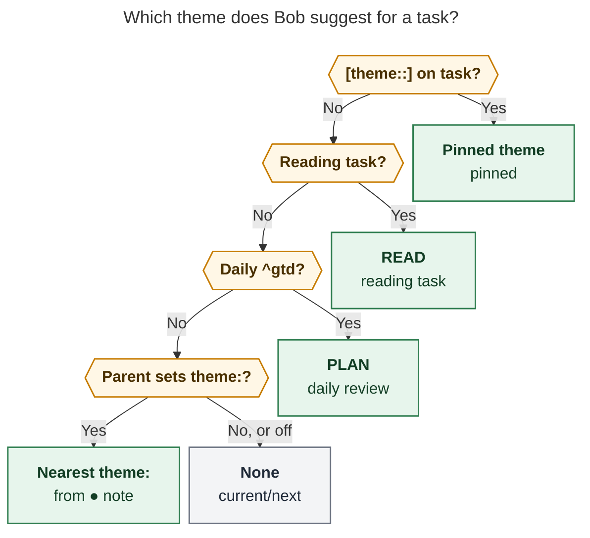
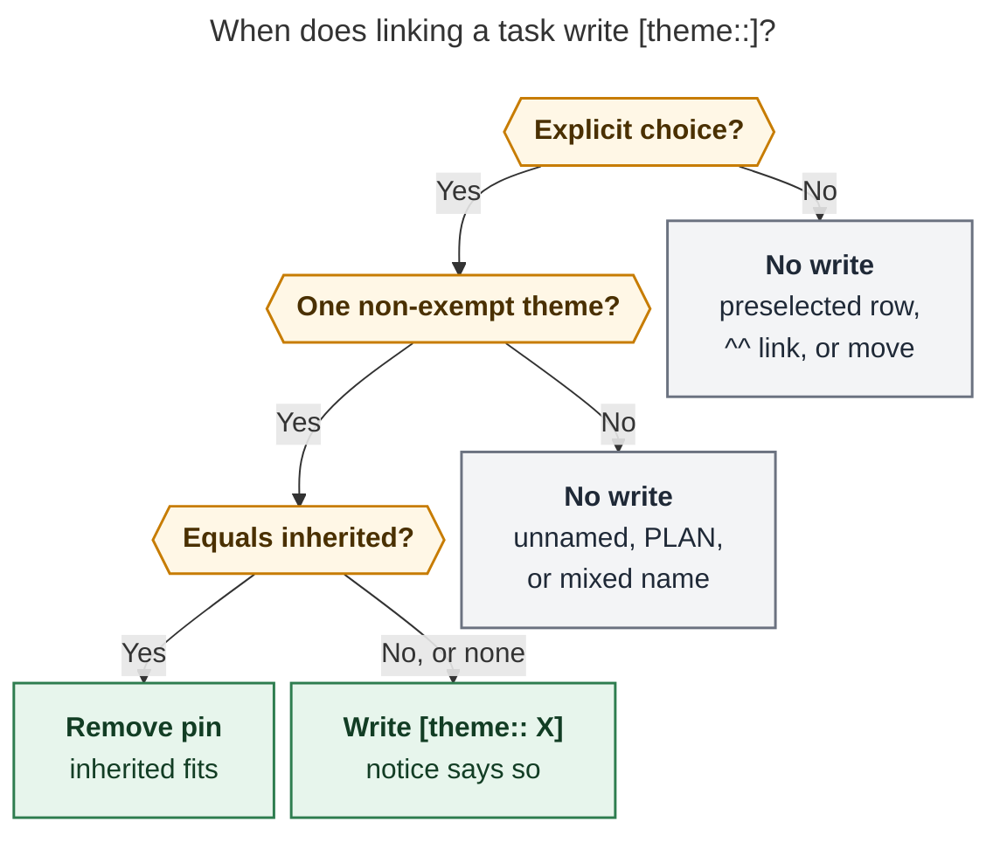

# Task theme suggestions: inherit a default, explain it, and remember the exceptions

> **Research query:** Start inferring which Pomodoro theme to suggest for a task, as the
> default choice in completion menus. Area and project notes get a `theme` frontmatter
> field (`dev` → BUILD, `love` → CHORE, `job` and `sase_blog` → WRITE). Reference tasks
> suggest READ, overriding the note default. Menus say why a theme is suggested. A new
> `[theme::<theme>]` task property overrides the theme for one task; it renders concisely
> in Obsidian, and Bob sets it automatically when a link picks a theme other than the
> suggestion, so a task that rolls over keeps its theme. Critique the plan, adjust the
> requirements where justified, and recommend a solution.

*Researcher cld · 2026-10-28 · Sources: bob-cli at `50f6c91b`, bob-plugins and
bob-mac-capture at `origin/master` today, the Bob vault ledger (read-only), `bob themes
list`, `~/.config/bob/config.yml`, and the prior
[work-kind theme research](work_kind_pomodoro_theme_set/work_kind_pomodoro_theme_set__final.md).
Nothing in the vault, config, or any repo was changed.*

## Bottom line

- **Build it. It is a good idea, and the timing is right.** Since Oct 26 the ledger runs
  on six work-kind themes (PLAN, BUILD, FIX, READ, WRITE, CHORE), and every day now
  holds open theme buckets such as `() — BUILD`, `() — FIX`, and `() — CHORE`. Linking a
  task is the moment its theme is decided. Today the Link to today picker preselects
  whatever Pomodoro is *running or next*, which ignores what kind of work the task is.
- **The ledger supports the shape of your plan, not every default in it.** On the clean
  work-kind days (Oct 26–28), your four defaults plus "references suggest READ" would
  have picked the theme you actually used for 71% of the links they covered. Over the
  longer history (Aug 26–Oct 28, renamed themes), `bob` → BUILD is right 76% of the time
  and references → READ 76%, but **`job` → WRITE is right only 15%** of its non-reading links (all job-area
  links ran CHORE 43, READ 18, WRITE 11).
- **The auto-pin is the best part of the plan.** For tasks linked again on a later day,
  a static default matched the theme used 61% of the time. Static default plus "pin when
  you deviate" matched **88%**, nearly as well as a full ledger memory (89%), while
  staying visible and editable on the task line.
- **My adjustments (called out in [Requirement changes](#requirement-changes)):**
  pin only on an *explicit* choice and never from PLAN-only, unnamed, or mixed
  Pomodoros; treat a pin as a *difference* from the inherited theme, so choosing the
  inherited theme again removes it; have the daily `^gtd` task suggest PLAN (82 of 83
  links); add `theme: off`; make the reading theme a config value; extend
  `bob themes rename` to rewrite pins and defaults; and don't set `job` → WRITE yet.
- **Ctrl+Enter vs Ctrl+Shift+Enter.** In the vault, Ctrl+Enter *closes* a linked task.
  The gesture that *adds* a Task Link is Ctrl+Shift+Enter (`link-task-to-pomodoro`),
  which opens the Link to today picker. I designed for every surface that adds a link
  with a visible choice: that picker (also reached from the review walk and the
  Ctrl+Enter successor picker), capture's `#name` completion (Mac and zsh), and the Refs
  Link to Today card.
- **Recommended solution:** one suggestion rule owned by Rust and mirrored in JavaScript
  under shared vectors: a pin first, then reading task → READ, then daily `^gtd` →
  PLAN, then the nearest `theme:` up the `parent:` chain. Menus preselect the matching
  open bucket, or else a "New BUILD Pomodoro" row, and show a short reason
  ("From ● dev", "Reading task", "Pinned"). A pinned theme renders as a hue-tinted theme
  pill on the task line. Details are in [Recommended solution](#recommended-solution).

## What exists today

### Themes are names, decided in the ledger

- A **theme** is one `+`-separated component of a Pomodoro's ` — NAME` tail
  (`docs/pomodoro-themes.md` PT1). Bob derives the catalog only from canonical daily
  notes (PT2). Hide, pin-color, and rename events live in `.bob/themes/<host>.jsonl`
  (PT4). Hue is pin, then exempt, then a top-level area stem, then a hash (PT5). Names
  wear a tint; places wear a dot (PT6).
- Decision `pomodoro-theme-is-one-component` rejected "inferring themes from tasks or
  homes", because the ledger would stop being the source of truth. That rule is about
  the **catalog and history**. A suggestion made at link time is different: the user
  still picks a Pomodoro, and the ledger still records the name. The prior work-kind
  research reached the same conclusion: write the theme into the ledger at capture or
  start time; don't infer it at read time.
- Live state: `bob themes list` shows six visible themes, all pinned except PLAN:
  PLAN (exempt), BUILD (yellow), READ (green), CHORE (aqua), WRITE (magenta), and FIX
  (blue). 71 older themes are hidden. `plan.max_themes` is 5, `plan.strict` is false, and
  `plan.exempt` is `[PLAN]`.

### Where a task gets linked, and what the default is now

| Surface | Code | Default today | Can it carry a suggestion? |
| --- | --- | --- | --- |
| **Obsidian Link to today** (Ctrl+Shift+Enter, also from `]s` walk landings) | bob-plugins `block-id-prompt/src/075-pomodoro-link-targets.js` (`buildPomodoroLinkPickerModel`), `076-pomodoro-theme-picker.js` | The single running timed entry, else the first open entry (`defaultReason` `running` / `next`); Recent theme rows come after Today rows | Yes: the picker knows the task line and its note |
| **Successor picker** after a Ctrl+Enter close | nav `api.successors`; retarget through `api.pomodoroLinkPicker` v1 | The source Pomodoro's name | Yes, per row; today it passes a generic task |
| **Capture `#name` completion** (`@route:id#…`, `^route:id#…`) | bob-cli `src/native/capture_complete/theme_menu.rs` (`compose`, PT7 groups A–E) | A matching named open Pomodoro, else Today rows, then Recent | Yes: the completer sees the marker's route and id |
| **Capture without `#name`** | `docs/capture.md` "Pomodoro-linked tasks" | Implicit current/next entry | Only by changing grammar semantics (not recommended in v1) |
| **Refs Link to Today** (Mac) / `bob ref today` | `docs/ref.md`; dry-run `pomodoros[].default` | Capture's implicit current/next | Yes: bob already marks the `default` row |
| **`^^` link typed under a Pomodoro** | block-id-prompt | You placed it by hand | No; there is no menu |
| **Ctrl+Shift+M move** of a Task Link | nav | You picked the destination | No; it moves a session's content, not a task's kind |

### Building blocks that already exist

- **The parent walk.** `docs/pomodoro-homes.md` R1 already walks scalar `parent:` links
  from a task's note, through archive (`done/*_done.md`) and reference notes, for up to
  16 notes. In Rust, `src/native/pomodoro_homes/resolve.rs` has a `DiskHomeSource` that
  reads frontmatter only for notes on the chain, and `facts.rs` parses `NoteFacts
  {kind, parent, color, root}`. Adding `theme` there is a small change. R1 also already
  maps a daily `^gtd` link to `@review:<first exempt name>`, which is PLAN.
- **A JS mirror under shared vectors.** Ledger Tools `api.themes` mirrors the hue,
  fold, and rank rules, with `tests/fixtures/pomodoro_themes/vectors.json` as the single
  source of truth. It fetches the catalog with `bob themes list -a -f json`
  (`279-plugin-pomodoro-themes.js`). JS code in nav and ledger-tools already resolves
  `parent:` chains for home chips and sub-projects.
- **A display-only inline-field pattern.** Date marks (`docs/date-marks.md`) render
  `[scheduled:: …]` as a quiet mark. The cursor or a click reveals the raw field, source
  mode shows raw text, and without the plugin the vault looks unchanged. Theme pills
  (PT6) already tint Pomodoro names in Live Preview and in the Mac app.
- **The Task Card** (Ctrl+Shift+P) is where task properties get edited. Its letter
  keys are `b`, `⇧B`, `l`, `⇧L`, `f`, and `x`, so `t` is free.
- **Your own backlog.** `bob#^theme-on-task` (this request) is linked from
  `bob#^decide-stable-themes`, and `bob#^configure-themes` ("all themes need to be
  configured, or a warning shows") is in Next. The two should share validation.

## Evidence: would these defaults have picked the right theme?

I replayed the ledger. For every Task Link under a named Pomodoro, I resolved the linked
task (following `done/` archives to their parent), computed what each rule would have
suggested, and checked whether the suggestion was one of the entry's theme components.
Scripts and method are in the [Appendix](#appendix-method).

**Two windows, two caveats.**

- **A: Oct 26–28** (51 link occurrences). These are the only days named with work-kind
  themes from the start. The sample is clean but tiny.
- **B: Aug 26–Oct 28** (546 link occurrences, counting only entries whose names are all
  among the six). Older names reached these themes through renames (BOB and VIBE →
  BUILD, PYPI → READ, HACK → HOME → CHORE), so a project-era BOB session counts as BUILD
  whatever its kind. That flatters `dev` → BUILD. The job-area labels are different:
  they come from the per-entry `bob themes split JOB` on Oct 27, so they are real
  classifications.

### Precision by configuration

"When it fires" counts only links that got a suggestion. "Overall" counts every link,
with no suggestion counted as a miss.

| Configuration | A: when it fires | A: overall | B: when it fires | B: overall |
| --- | ---: | ---: | ---: | ---: |
| Your proposal as written | 32/45 (71%) | 63% | 263/458 (57%) | 48% |
| … plus `^gtd` → PLAN | 38/51 (75%) | 75% | 345/541 (64%) | 63% |
| **Adjusted** (below) | 40/50 (80%) | 78% | 383/523 (73%) | 70% |

*Adjusted* means your proposal plus `^gtd` → PLAN, no `theme` on `job`, and
`theme: CHORE` on `dev_plex_hack_patch` and `job_2026_apply_29`.

### Precision by source (window B, your proposal plus `^gtd`)

| Source | Hit / total | Note |
| --- | ---: | --- |
| Daily `^gtd` → PLAN | 82/83 (99%) | The largest single win, and Bob's homes rule already models it |
| Reading task → READ | 102/135 (76%) | 93–95% in `sase_pypi_releases` and `sase_blog`; misses are "read and act" tasks (a battery swap filed as a ref, a job-application wave) |
| `dev` → BUILD | 146/249 (59%) | `bob` residents 76% BUILD; `sase` only 32% (READ 16, PLAN 16, FIX 10 of 65) |
| `sase_blog` → WRITE | 6/20 (30%) | Non-ref blog tasks ran READ 7, WRITE 6, PLAN 5; the ref rule already catches the 40 reading links |
| `job` → WRITE | 8/53 (15%) | `job_2026_apply_29` ran CHORE 29 of 35 (submitting applications); `job.md` residents ran WRITE 3, CHORE 3, READ 2, PLAN 2 |
| `love` → CHORE | 1/1 | Too little data to judge |

Two notes are nearly single-kind and currently unconfigured: `dev_plex_hack_patch` was
CHORE on 17 of 17 links (selling stocks, external backup), and `job_2026_apply_29` was
CHORE on 29 of 35.

### Does a task keep its theme across days?

There are 83 link occurrences of a task that had already been linked on an earlier day
(window B). For each one, I asked how well three predictors would have done:

| Predictor | Matched the theme used |
| --- | ---: |
| Static default only (your proposal) | 51/83 (61%) |
| **Static default + pin on deviation** (your auto-pin) | **73/83 (88%)** |
| The theme the task had the last time it was linked (full ledger memory) | 74/83 (89%) |

The pin captures almost everything a ledger memory would. It does so with state you can
see on the task line, edit, and grep, and that JavaScript can read without scanning old
daily notes.

**How many tasks end up pinned:** 93 of the 282 tasks linked in window B (33%) under
your proposal, or 73 (26%) under the adjusted set. `sase` residents account for 26 of
those pins under either configuration. That is the cost of a mixed project inheriting
BUILD from `dev`. It is acceptable, because each pin records a real exception.

### Rejected: guessing from the task's leading verb

The prior research suggested mapping a task's first verb to a theme. A 34-verb table
(Fix → FIX, Read → READ, Apply → CHORE, Add → BUILD, …) fired on 36% of links and was
right 70% of the time. That is no better than the adjusted note defaults. It is also
opaque ("why BUILD? because the title starts with *Make*"), and "Fix" titles matched FIX
only 3 times in 17. Leave it out of v1.

## Critique of the plan

**What is right**

1. **The theme is decided where the task lives, then overridden per task.** That is the
   right granularity. Area and project notes already own residence, the Ready cap, root
   parent, and hue. A theme default fits beside them, and frontmatter travels with the
   note through moves and renames.
2. **References → READ is the single best-evidenced rule.** It belongs above the note
   default, because the same project mixes reading tasks and building tasks.
3. **The auto-pin solves the real cost**, which is re-deciding the same exception every
   morning. The data above says it captures roughly 88% of what a full memory would.
4. **Explaining the suggestion is required, not optional.** Without a reason, a
   preselected BUILD row looks like a bug the first time a FIX task lands on it.

**Risks the plan does not yet address**

1. **Enter changes meaning.** For months, Ctrl+Shift+Enter → Enter has meant "the
   running or next Pomodoro". With suggestions it means "this task's theme bucket". I
   think that is the right change: buckets are how you use the ledger now. But it needs
   a visible reason on the row and a safe fallback whenever there is no confident
   suggestion.
2. **False pins.** Linking a BUILD task under a running FIX session because you are
   batching, or dispatching implementation tasks from a PLAN session (window B has 23
   `bob` links under PLAN), would pin the wrong theme forever. Pins must come only from
   deliberate choices, and PLAN-only, unnamed, and mixed destinations must never pin.
3. **Pins and defaults would go stale on rename.** `bob themes rename WRITE PROSE`
   today rewrites ledger tails and `_templates/daily.md`, but nothing else. Every
   `[theme:: WRITE]` pin and every `theme: WRITE` default would silently keep naming a
   theme that no longer exists, and new `— WRITE` buckets would keep getting created.
4. **A hard-coded READ** breaks the same way a hard-coded GTD would have broken before
   `plan.exempt`.
5. **Weak defaults pay twice.** `job` → WRITE would preselect the wrong bucket for about
   85% of job links, and each correction would write a pin.
6. **Typos create themes.** `theme: BIULD` would preselect a "New BIULD Pomodoro" row,
   which is how near-duplicate themes are born.
7. **Two implementations of one rule.** Obsidian must not spawn `bob` on every
   Ctrl+Shift+Enter (and cannot on mobile), so JS must mirror the rule. Drift is
   prevented the same way the hue rule prevents it: shared vectors.

**Alternatives I considered**

| Alternative | Verdict |
| --- | --- |
| A theme map in `~/.config/bob/config.yml` (`dev: BUILD`) instead of frontmatter | **Rejected.** Config is chezmoi, not vault-synced, and does not follow a note that moves or gets renamed. Frontmatter is visible in Obsidian Properties and sits beside `color:` and `ready_cap:` |
| A ledger memory ("last theme this task was linked under") instead of pins | **Rejected for v1.** 89% vs 88% for pins, but invisible, impossible to edit, and it needs a history scan in JS. Revisit only if pins turn out to be noisy |
| A leading-verb table | **Rejected for v1** (70% precision when it fires, opaque) |
| Changing capture's implicit destination (bare `@route:id`) to the suggested bucket | **Deferred.** It changes documented grammar, and the result is invisible until preview. Completion menus get the suggestion now; revisit after living with it |
| Showing an inherited "ghost" theme pill on every task line | **Rejected.** That is about 3,400 lines of noise. Show a theme on the line only when it is pinned; show the inherited theme in the Task Card and in pickers |

## Requirement changes

These are my changes to your requirements. Each one is deliberate. Keep or drop them
individually.

1. **Keymap.** The link gesture is **Ctrl+Shift+Enter**, not Ctrl+Enter, which closes
   tasks. The feature covers every *menu* that adds a Task Link: Link to today (also
   from the review walk and the successor picker's retarget), capture `#name`
   completion in Mac Capture and zsh, and the Refs Link to Today card / `bob ref today`.
2. **Pin only on an explicit choice.** A choice is explicit when you pick a row other
   than the one Bob preselected for an empty query (by arrow, mouse, or typing), or when
   you type `#NAME` on a capture link. Enter on the preselected row, a typed `^^` link,
   and Ctrl+Shift+M moves never pin. In short, Bob pins only when it showed you its
   suggestion, or you named a theme yourself, and you chose differently.
3. **Never pin from a PLAN-only, unnamed, or mixed destination.** Exempt sessions
   describe the session, not the task (planning sessions dispatch other tasks). A
   composite such as `BUILD + FIX` is ambiguous unless it contains the suggestion, in
   which case nothing changes.
4. **A pin is a difference from the inherited theme.** Choosing the theme the task
   would inherit anyway removes an existing pin. `[theme::]` exists only on genuine
   exceptions, and a task returns to normal by itself.
5. **The daily `^gtd` task suggests PLAN** (the first `plan.exempt` name, matching the
   homes rule `@review:<first exempt name>`). It was right on 82 of 83 links.
6. **`theme: off`** stops inheritance for a note and everything below it. It mirrors
   `ready_cap: off`. An absent field means "inherit".
7. **The reading theme is configurable:** `plan.reading_theme`, defaulting to `READ`.
   Rename refuses it with `config_reference`, exactly like `plan.exempt`.
8. **`bob themes rename` also rewrites `theme:` frontmatter values and `[theme::]` pins**
   (open tasks and `done/` archives) in the same previewed, single-commit transaction.
   `split` leaves them alone, and its preview warns when they still name OLD.
9. **Unknown names are never preselected.** A `theme:` or pin naming a theme the catalog
   doesn't know (or, once `^configure-themes` lands, one outside the configured set)
   still appears with an "unknown theme" mark, but the time-based default stays, and
   `bob themes list` raises a `theme_default_unknown` hint. Hidden themes are still
   suggested, because hiding only affects Recent.
10. **Don't put `theme: WRITE` on `job.md` yet.** Add `theme: CHORE` to
    `job_2026_apply_29` and `dev_plex_hack_patch`. Keep `sase_blog: WRITE`. Its non-ref
    tasks are mixed, but WRITE is the project's purpose, the ref rule already handles
    its reading, and the default nudges drafting, which the prior research found keeps
    getting pushed aside. If you want `job` → WRITE anyway, it works; expect pins on
    most job tasks.
11. **No new grammar for capture in v1.** Capture gains suggestion-aware completion and
    pin writes on explicit `#NAME`, but bare `@route:id` keeps its current/next
    destination.

## Recommended solution

### 1. Storage

**Note default:** a scalar `theme:` in area or project frontmatter.

```yaml
---
parent: "[[area]]"
type: "[[area]]"
color: blue
theme: BUILD       # tasks here and in sub-projects suggest BUILD
---
```

Values are a single theme name (no `+`), or `off`. Bob reads it from any note on the R1
chain, including sub-areas and untyped wrappers, but the field is meant for area and
project notes.

**Task pin:** a Dataview inline field on the task line.

```markdown
- [*] #task Make gates more reliable [theme:: FIX] [fresh:: 2026-10-27] [created::2026-10-20] ^gates-more-reliable
```

- **Canonical placement:** the writer inserts it before the first existing inline field,
  or before the trailing `^id` when there are none. It therefore sits right after the
  title, which is where its pill reads best. The parser accepts it anywhere on the line.
- **Value:** the theme's display name, as the catalog spells it. Matching uses
  `normalize_component`.
- `[theme::]` on a closed task is history; it is never read for a suggestion.

### 2. The suggestion rule

<div id="figure-theme-suggestion">



_Ask the questions in order and stop at the first yes. A pin beats everything. A reading
task (`#ref` tag or a `^ref-…` id) suggests `plan.reading_theme`, and the daily `^gtd`
task suggests the first exempt name. Otherwise the nearest `theme:` found walking up
`parent:` from the task's note wins, and `theme: off` ends the walk with no suggestion.
With no suggestion, menus keep today's running/next default._

</div>

Rendered size: 731 × 934 px; fit scale: 89.3% (Mermaid CLI 12.0.0, PDF-mirroring
config).

The walk is exactly R1's: start at the note holding the task's checkbox (a `done/`
archive maps to its `parent:`), walk scalar `parent:` links, pass through archive and
reference notes, and stop after 16 notes or on a repeat. The *inherited* theme is the
same rule with step 1 skipped. Pins are compared against it.

**Reason vocabulary.** Every surface uses these labels, and color is never the only
signal:

| `source` (JSON) | Label | Tooltip / detail |
| --- | --- | --- |
| `pinned` | **Pinned** | `Pinned on this task · dev suggests BUILD` |
| `reading` | **Reading task** | `Reading tasks suggest READ (plan.reading_theme)` |
| `review` | **Daily review** | `The ^gtd task suggests PLAN (plan.exempt)` |
| `note` | **From ● dev** (the note's home chip) | `sase_pre_blog → sase_blog: theme WRITE`, naming the chain when inherited from more than one note up |

### 3. What the menus preselect

When there is a suggestion S and the query is empty:

1. **A matching bucket.** If an open Pomodoro has S among its components, preselect it:
   the running entry if it matches, else the first matching open entry in ledger order.
   Today rows keep their ledger order; only the highlight moves.
2. **Otherwise, a create row.** Put a **New S Pomodoro** row at the top and preselect
   it, with the usual `after/cap` badge when it would exceed `plan.max_themes`.
3. **Fall back to today's default** (running, else next) when S is unknown, when
   creation is blocked (several timed entries open), or when `plan.strict` would refuse
   the creation. The suggestion row still shows with its reason, but it is not
   preselected.

With a non-empty query, PT7 filtering and ranking are unchanged. The suggested row just
keeps its badge wherever it lands. Accepting a suggestion never touches the theme
journal, and Ctrl+D still means Hide (Recent only).

### 4. When a link writes a pin

<div id="figure-theme-pin">



_A link changes `[theme::]` only after an explicit choice of a Pomodoro whose name has
exactly one non-exempt theme X. If X is what the task would inherit without a pin, any
pin is removed. Otherwise the pin becomes X, including when nothing is inherited (an
inbox task). "Explicit" means you moved off Bob's preselected row, typed a query, or
wrote `#NAME` in capture._

</div>

Rendered size: 696 × 762 px; fit scale: 93.8% (Mermaid CLI 12.0.0, PDF-mirroring
config).

**Reliability rules for the write:**

- The pin edit joins the link's existing write. The Link to today picker already
  rewrites the task line for lane changes and the `[fresh::]` stamp, so the pin rides
  in that same edit: one Ctrl+Z, never a second transaction. Capture plans it into the
  staged snapshot that also creates the link, so it is all or nothing.
- The link's notice names the pin, so the write is never silent: `Linked under FIX ·
  pinned FIX (dev suggests BUILD)` or `Linked under BUILD · pin removed`. Capture's
  JSON reports `theme_pin`, and human output prints a `theme` line.
- Inbox routing: when a link from an inbox note also moves the task, the inherited
  theme is computed at the **destination**, so a pin is never written only to fight the
  new home's default.
- A guarded link (`link_guard`) writes no pin, because nothing got linked.

### 5. How it looks

The rendering principles follow date marks: store the plain field, display it quietly,
reveal the raw text on demand, and use one visual language everywhere. Mockups are
approximate; `[BUILD]` stands for a PT6 pill (a soft tint of the theme's hue behind
normal text, 4 px radius).

**Obsidian Link to today (Ctrl+Shift+Enter), with a matching bucket open:**

```text
Link to today · Make gates more reliable
 ─────────────────────────────────────────────────────────
 ▸ ○ ()          [FIX]               Pinned
   ◐ 0905–0930   [BUILD]             Running
   ○ ()          [CHORE]
   ○ ()          [PLAN]
 RECENT
   [READ]        Oct 27 · 26 days
   [WRITE]       Oct 27 · 9 days
 ─────────────────────────────────────────────────────────
 ↵ link · ↑↓ choose · type to filter or name · ⇧↵ new · ^D hide
```

**No matching bucket.** A create row leads, with its reason and cap meter:

```text
 ▸ ＋ New [READ] Pomodoro            Reading task · 4/5
   ◐ 0905–0930   [BUILD]             Running
```

The reason sits in the row's right-hand meta slot, where Recent rows already show
`Oct 27 · 26 days`. It uses muted text and the same home chip (`●` in the area's color)
that Pomodoro homes use, so the *name* (tinted pill) and the *place it came from* (dot)
read as one sentence: "BUILD, from ● dev".

**A pinned task line** (Live Preview and reading view, beside the existing marks):

```text
source:  - [*] #task Make gates more reliable [theme:: FIX] [fresh:: 2026-10-27] [created::2026-10-20] ^gates-more-reliable
render:  - [*] ⌗ Make gates more reliable  [FIX]  + Oct 20
```

- **Just the pill.** No glyph, no `theme:` label, no extra ink. Uppercase work-kind
  names never look like tags, and only pinned tasks carry one, so the pill is the
  signal.
- **Hover:** `Theme pinned: FIX · dev suggests BUILD · Ctrl+Shift+P t to change`.
- **Cursor or click** reveals `[theme:: FIX]` for editing, and source mode shows the
  raw text. A session toggle shares the date-marks switch. Without bob-ledger-tools,
  the plain Dataview field remains.
- An unknown name wears a neutral pill with a dotted underline, and its tooltip says
  `Unknown theme`.
- **The same renderer runs everywhere**, including Tasks/Dataview results in
  `dash.md` and the daily note's link rows. Exempt themes use the muted pill.

**Task Card (Ctrl+Shift+P)** gets a theme line in its header and a `t` stage:

```text
Make gates more reliable · sase · Next · P1
Theme  [FIX] pinned · dev suggests BUILD                 t change · ^D unpin
```

The `t` stage reuses the Pomodoro theme menu, with the inherited theme first and
labeled with its reason. Enter pins, and choosing the inherited theme removes the pin,
by the same delta rule as linking. Ctrl+D removes the pin, matching the card's existing
"Delete the selected property".

**Mac Capture `#` completion** for `^sase:gates-more-reliable#`:

```text
 ▸ [FIX]    ()                  Suggested · Pinned
   [BUILD]  ()
   [CHORE]  ()
   RECENT
   [READ]   Oct 27 · 26 days
```

The live preview of `^sase:gates-more-reliable#build` adds one line:
`Theme  pin removed · back to BUILD from ● dev`. The **Refs Link to Today** card
preselects the READ bucket, captioned `Reading task`.

**Terminal:** zsh descriptions read `fix  -- suggested · pinned`. Capture's human
output adds `theme  pinned FIX (dev suggests BUILD)`. A new read-only
`bob themes suggest ROUTE:ID` explains one task:

```text
FIX    pinned on task                    sase.md:31
       without the pin: BUILD from ● dev  (dev.md theme: BUILD; sase.md inherits)
```

### 6. Ownership and contracts

Rust owns the meaning. JavaScript mirrors it under shared vectors, and Swift renders
what Bob reports. This is the PT5 arrangement, and it keeps decision
`mac-capture-is-a-thin-client` intact.

| Layer | Work |
| --- | --- |
| **bob-cli** | Add `NoteFacts.theme` (`Name` or `Off`) to `pomodoro_homes/facts.rs`, and a `pomodoro_themes::suggest` resolver over `HomeSource` (the existing lazy, chain-only frontmatter reads). Parse and write `[theme::]` with canonical placement. In `capture_complete::theme_menu::compose`, add a leading suggestion group and mark the row (`suggested: true`) plus a top-level `suggestion`. In the capture planner, add pin set/clear on explicit `#NAME` (JSON `theme_pin`). Have `bob ref today` mark the suggested `pomodoros[].default` and add the suggestion to its envelope. Extend `bob themes rename` to frontmatter and pins. Add hints `theme_default_unknown` (and later `theme_default_drift`). Add `bob themes suggest`. Add a `suggest` section to `tests/fixtures/pomodoro_themes/vectors.json` |
| **bob-plugins** | Add `api.themes.suggestFor({path, line})` in Ledger Tools. It reads `metadataCache` frontmatter, the task line, and the plan config, with no spawn, so it works on mobile, and it runs the shared vectors. Add the `[theme::]` pill renderer (Live Preview plus reading view). In block-id-prompt, preselect, show the reason meta, and write the pin inside the existing link edit. Make `api.pomodoroLinkPicker.pick` accept the task, so successor retargets get suggestions. Add the Task Card theme line and `t` stage in nav |
| **bob-mac-capture** | Decode `suggested`, `suggestion`, and `theme_pin` with `decodeIfPresent`. Render the reason meta and the preview line. Refs Link to Today follows bob's `default` |

**JSON (additive, `schema_version` stays 1):**

```json
"suggestion": {
  "theme": {"key": "build", "name": "BUILD", "hue": "yellow", "hue_source": "pin"},
  "source": "note",
  "label": "From dev",
  "from": {"path": "dev.md", "stem": "dev", "kind": "area", "chain": ["sase.md", "dev.md"]},
  "inherited": null
}
```

`inherited` is filled only when `source` is `pinned`, and it carries the same shape
without the pin. Rows add `suggested: true`. Capture items add
`"theme_pin": {"action": "set" | "cleared", "theme": ThemeRef, "previous": ThemeRef | null}`.

**An older client with a newer bob** sees the suggested row first. It treats that row
as the default and simply shows no badge. **A newer client with an older bob** finds no
`suggestion` and keeps today's behavior.

**Performance:** resolution is one task-line parse plus at most 16 frontmatter reads
along an already-cached chain. It stays inside PT3's +5 ms p95 budget for warm
`capture-complete`.

**Docs and records:**

- New sections in `docs/pomodoro-themes.md`: PT12 Suggestion, PT13 Pins, and PT14 Note
  defaults.
- A row in `docs/reference/vault-format.md` for `theme:` and `[theme::]`.
- Glossary terms *Theme Default* and *Theme Pin*, through `/sase_memory_write`.
- A new decision record, "Task themes are suggested from pin, reading, review, then
  note; pins record explicit exceptions". It should state that it leaves
  `pomodoro-theme-is-one-component` untouched, because suggestions never feed the
  catalog or history.

### 7. Rollout

1. **bob-cli first:** the resolver, vectors, `bob themes suggest`, capture completion
   and pins, `ref today`, rename scope, docs, and the decision record. The vault can
   adopt `theme:` fields the same day; nothing reads them yet besides the CLI.
2. **bob-plugins:** the JS mirror and pill renderer first (display-only, no risk). Then
   the picker preselect and pins. Then the Task Card stage and successor retargets. Then
   `bob plugins sync`.
3. **bob-mac-capture:** decode and present the new fields. This is gated by macOS CI.
4. **After two weeks:** run the replay above against fresh data. Add
   `theme_default_drift`, a hint that flags a note whose default was right under about
   two thirds of the time in the last 30 days, or an unconfigured note with a clear
   majority (≥ ⅔ over ≥ 10 links). Retune the frontmatter.

### 8. Vault changes to make with phase 1

| Note | Set | Evidence |
| --- | --- | --- |
| `dev.md` | `theme: BUILD` | `bob` residents 76% BUILD. `sase` is mixed, and pins will absorb it |
| `love.md` | `theme: CHORE` | Your call; too little data to judge |
| `sase_blog.md` | `theme: WRITE` | It is the project's purpose; reading is covered by the ref rule (38/40 READ) |
| `dev_plex_hack_patch.md` | `theme: CHORE` | 17/17 CHORE, and it otherwise inherits BUILD from `dev` |
| `job_2026_apply_29.md` | `theme: CHORE` | 29/35 CHORE |
| `job.md` | *(leave unset)* | 15% for WRITE; its open tasks are mostly reading tasks, which get READ anyway |
| `_templates/daily.md` | *(nothing)* | The `^gtd` rule covers the daily note without frontmatter |

## Open questions for Bryan

1. **Enter in Link to today.** Should it go to the theme bucket (my recommendation) or
   stay on the running Pomodoro while showing the suggestion second? The bucket version
   is what makes the feature worth having, but it changes muscle memory.
2. **`job` → WRITE.** Is that a deliberate nudge toward the writing you want to do
   (accepting pins on most job tasks), or should the note stay unset?
3. **Pinning inbox tasks.** With nothing inherited, should an explicit choice pin
   (my recommendation, which helps roll-over), or should pins require a suggestion to
   have been shown?
4. **`love` → CHORE.** It has almost no linked history. Do relationship tasks really
   feel like chores, or should `love` stay unset until a TALK-style theme exists?

## Recommended solution

Ship **suggest → explain → pin** as one rule with one owner:

- **Suggest:** a `[theme::]` pin, then reading tasks → `plan.reading_theme` (READ),
  then the daily `^gtd` → PLAN, then the nearest `theme:` frontmatter up the `parent:`
  chain (`theme: off` stops it). Otherwise there is no suggestion and today's default
  stands.
- **Preselect:** the matching open bucket, else a **New S Pomodoro** row. Fall back to
  running/next when the suggestion is unknown, blocked, or refused by strict mode.
- **Explain:** every menu row and tooltip carries a short reason: **Pinned**, **Reading
  task**, **Daily review**, or **From ● dev**. The name is a tinted pill and the place
  is a dot, so the reason reads as one phrase.
- **Pin:** only an explicit choice of a single non-exempt theme writes. A pin is a
  difference from the inherited theme, so choosing the inherited theme removes it. The
  write joins the link's own edit and is named in the notice.
- **Render:** a pinned theme shows on the task line as the PT6 theme pill and nothing
  more. The Task Card shows and edits it (`t`, with Ctrl+D to unpin).
- **Keep it reliable:** Rust owns the rule, JS mirrors it with shared vectors, Swift
  renders bob's JSON. Renames rewrite pins and defaults. Unknown names are flagged and
  never preselected. A drift hint retunes the defaults from ledger evidence.

On the evidence available, this would have picked your actual theme for about 78–80% of
links on the work-kind days (up from 63% for the proposal as written), and about 88%
for tasks you return to on a later day, while keeping `[theme::]` to the roughly one
task in four that is a real exception.

## Appendix: method

- **Ledger replay:** a read-only Python parser over `~/bob/YYYY/YYYYMMDD.md`. It reads
  column-0 entries in `## Pomodoros`, splits names on `+`, and collects child Task Links
  (`[[note#^id]]`; an empty target is the daily note itself). Each linked note is
  resolved by vault path or basename, and `done/*_done.md` maps to its `parent:`. The
  task line was found by its trailing `^id`. A reading task is `#ref` or `^ref-…`. The
  parent walk stops at a top-level area or after 20 notes.
- **Precision:** a hit means the suggested theme is one of the entry's components.
  Window B keeps only entries whose components are all among the six kinds.
- **Stickiness:** for each link to a task already linked on an earlier date, the
  prediction was compared with the themes used that day. The pin model wrote a pin
  whenever the earlier day's single non-PLAN theme differed from the static suggestion.
- **Pin count:** the explicit-choice rule cannot be replayed (the ledger doesn't record
  which row was preselected), so every link under a single non-PLAN theme was treated as
  explicit. The pin counts are therefore an upper bound.
- **Not run:** no `bob` writer, no vault edit, no rename preview.
- **Figures:** Mermaid CLI 12.0.0 with the PDF-mirroring configuration. I checked both
  PNGs visually.
