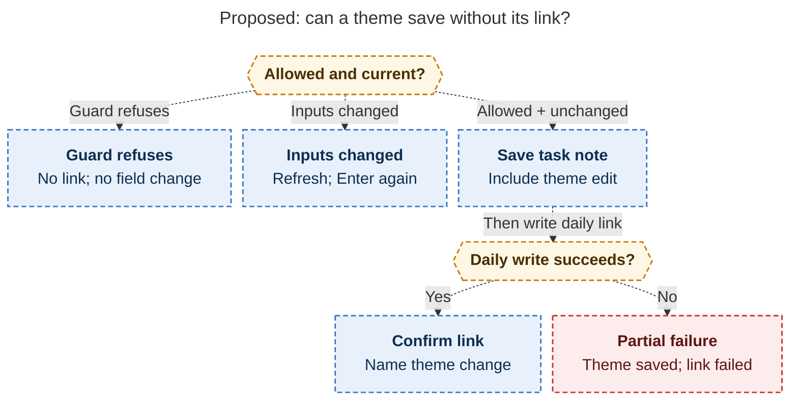

# Diagram proposals: Task theme suggestions: inherit a default, explain it, remember the exceptions

Proposals for the swarm linker, not a report. Each diagram restates only what the source
report says.

```yaml
source: research:202610/task_theme_suggestions_and_overrides/task_theme_suggestions_and_overrides__final.md
producer: research.2s.image
check: "mmdc 12.0.0 with --no-sandbox and the PDF-mirroring config rendered 1 of 1 Mermaid diagrams"
```

## cross-note-link-failure

```yaml
anchor: |-
  Cross-note links keep the existing order
question: |-
  How does a cross-note link prevent stale writes and expose partial failure?
illustrates: |-
  Cross-note links keep the task-note-first order, while guards, changed inputs, and failed daily-note writes lead to different visible outcomes.
caption: "For an eligible theme change, guards and stale inputs stop writes; a failed daily-note write must explicitly report the saved theme."
review: "844.867x714 px, fit 77.3%; question, source tracing, arrowheads, labels, reading direction, and visual checks passed; 1 spacing/label revision; 1 visual look round"
```


