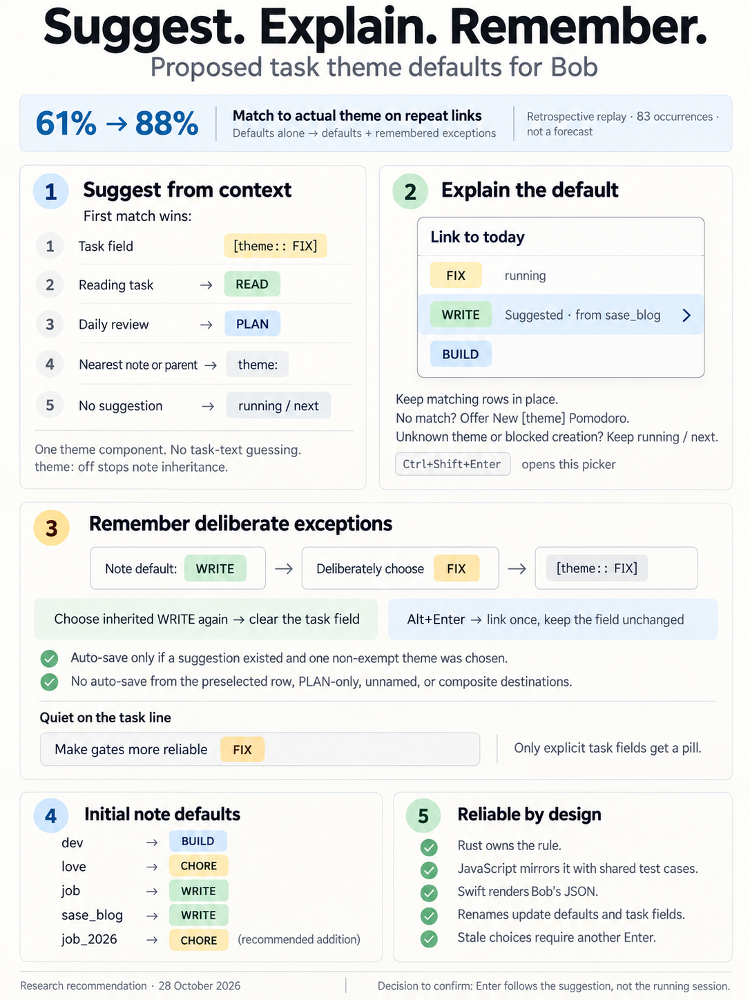
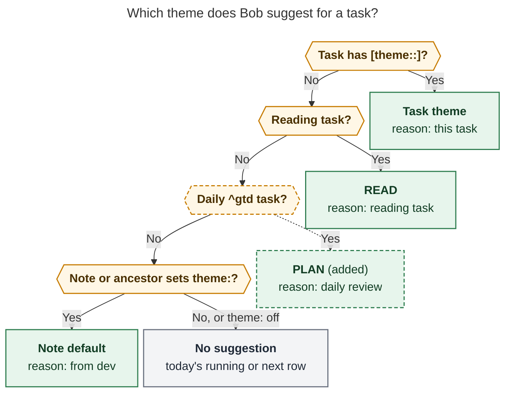
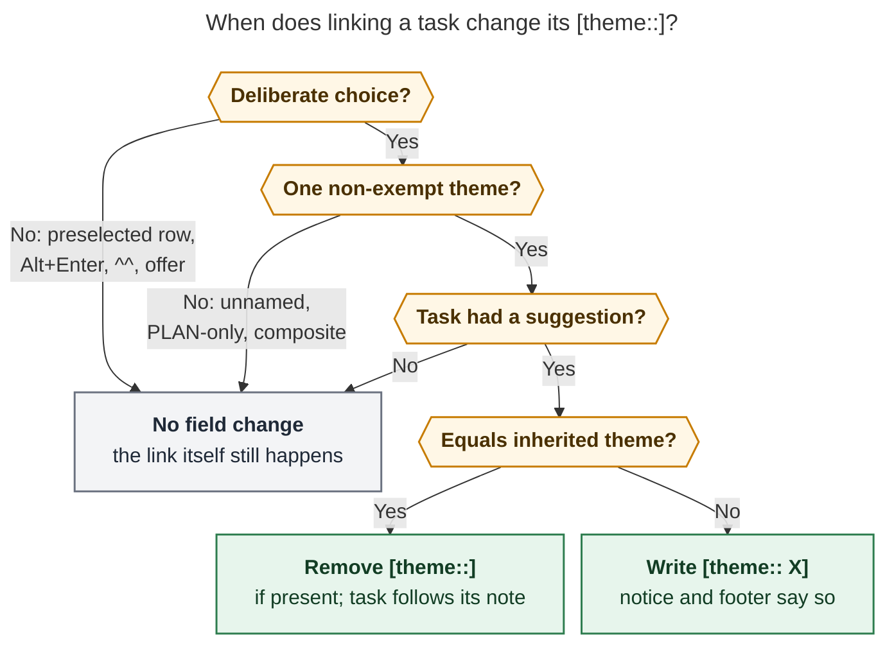
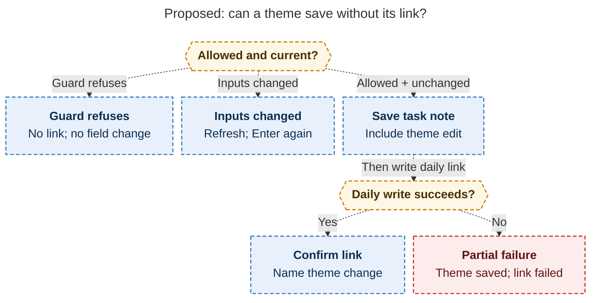

# Task theme suggestions: inherit a default, explain it, remember the exceptions

> **Research query:** How should Bob infer which theme to suggest for a task, as the
> default choice in completion menus: a new `theme` frontmatter field on area and project
> notes (BUILD for `dev.md`, CHORE for `love.md`, WRITE for `job.md` and `sase_blog.md`),
> READ for ref tasks overriding any area or project default, menus that make clear why a
> theme is suggested, and a per-task `[theme::<theme>]` override that renders concisely
> in Obsidian and is set automatically when a task link (for example via `<ctrl+enter>`)
> picks a theme other than the suggested one, so a rolled-over task keeps it? Is this a
> good idea, would you take a different approach, which requirement adjustments are
> justified, and what solution do you recommend for an intuitive, reliable, and beautiful
> design?



## Bottom line

**Build it.** The plan is sound, and the timing is good. Since Oct 26 the ledger has run
on six work-kind themes (PLAN, BUILD, FIX, READ, WRITE, CHORE), and each day keeps open
buckets such as `() — BUILD` and `() — CHORE`. A task's theme is decided at the moment
it is linked. Today the Link to today picker preselects whatever Pomodoro is *running or
next*, which says nothing about what kind of work the task is. All five researchers
[reached the same verdict independently](#where-the-reports-agreed).

The shape of the request is right: one deterministic rule, no guessing from task text.
An explicit task field wins. A reading task suggests READ. Otherwise the nearest
`theme:` up the `parent:` chain applies. The menu shows the reason. The field is written
only when you deliberately choose something else. The ledger evidence supports this:

- **The remembered field is the most valuable part.** cld
  [replayed the ledger](#evidence-from-the-ledger-replay). For tasks linked again on a
  later day, a static default matched the theme actually used 61% of the time. A static
  default plus "write the field when you deviate" matched **88%**. A full ledger memory
  reached 89%, but it is invisible and can't be edited.
- **The four seeds are mostly good.** One needs a companion. Daily `^gtd` → PLAN was
  right 81 of 83 times in October (my replay). Refs → READ ran 76% (cld, Aug 26–Oct 28),
  and `bob` residents → BUILD 76%. But the job area's links were mostly **CHORE**
  (submitting applications): 36 CHORE against 8 WRITE in October. So `job: WRITE` needs
  a `job_2026: CHORE` beside it.

My main adjustments, each called out in [Requirement changes](#requirement-changes):

- The link gesture is **Ctrl+Shift+Enter**, not Ctrl+Enter.
- The field is written only on a *deliberate* choice of a single non-exempt theme, with
  **Alt+Enter = link once** as a visible escape.
- Choosing the inherited theme again **removes** the field.
- The daily `^gtd` task suggests PLAN.
- New options: `theme: off` and a configurable reading theme.
- `bob themes rename` also rewrites `theme:` defaults and `[theme::]` fields.
- Unknown names are never preselected.
- Add `job_2026: CHORE` (and optionally `dev_plex_hack_patch: CHORE`).

One vocabulary rule matters for intuitiveness. Call the field the **task theme** and the
frontmatter value the **note default**. Never call either a "pin". Bob already uses
*pin* for theme colors (`bob themes color BLOG red`, `hue_source: "pin"`).

## Evidence from the ledger replay

Would these rules pick the theme you actually used? cld replayed every Task Link under a
named Pomodoro. For each link it resolved the task (including `done/` archives), computed
each rule's suggestion, and counted a hit when the suggestion was one of the entry's
components. I re-ran a lighter version for October to check the contested numbers. Both
scripts are read-only.

- **Daily `^gtd` → PLAN**
  - *Evidence:* 82/83 (cld, Aug 26–Oct 28); 81/83 in October (mine)
  - *Verdict:* Add it. It is the single most reliable rule, and the homes contract
    already maps `^gtd` to `@review:<first exempt name>`
- **Reading task → READ**
  - *Evidence:* 102/135 = 76% (cld); 7/10 on Oct 26–28
  - *Verdict:* Keep it. Misses are "read and act" tasks, which get one deliberate pick
    and then remember it
- **`dev` → BUILD**
  - *Evidence:* `bob` residents 76% (cld); 15/16 on Oct 26–28 (mine). `sase` is mixed:
    BUILD 5, FIX 4
  - *Verdict:* Keep it. FIX choices under `sase` will accumulate as task themes, and
    each one records a real exception
- **`sase_blog` → WRITE**
  - *Evidence:* non-ref tasks 6/20 (cld); 3/3 on Oct 26–28
  - *Verdict:* Keep it. WRITE is the project's purpose, and the reading rule already
    catches its 40 reading links
- **`job` → WRITE**
  - *Evidence:* 8/53 = 15% (cld); in October, `job_2026_apply_29` ran CHORE 29/35,
    `job_2026` CHORE 4/6, and `job_update_cv` WRITE 2/2
  - *Verdict:* Keep `job: WRITE` as you asked, since it fits CVs and cover letters, but
    add `job_2026: CHORE` for the application pipeline
- **`love` → CHORE**
  - *Evidence:* 1/1
  - *Verdict:* Your call. `fun.md` (child of `love`) would inherit CHORE; use
    `theme: off` there if that feels wrong
- **`dev_plex_hack_patch` (unconfigured; inherits BUILD)**
  - *Evidence:* CHORE 17/17 (cld); 3/3 (mine)
  - *Verdict:* Optionally add `theme: CHORE`

**Re-linked tasks (cld, 83 occurrences):** static default 61%, default plus remembered
field 88%, last-linked ledger memory 89%. **Field count:** at most 26–33% of linked tasks
would ever carry a field, and that figure is an upper bound because the replay can't see
which row was preselected. About 26 of those fields would land on `sase` residents.

Caveats: windows are small, and the long window includes renamed themes (BOB, VIBE →
BUILD), which flatters `dev`. The job-area labels come from the Oct 27 `bob themes
split JOB`, so they are real classifications.

## Critique of the plan

**What is right**

- **Decide where the task lives, and override per task.** That is the right
  granularity. Area and project notes already own residence, `ready_cap:`, `root:`, and
  hue (`color:`). `theme:` fits that family and travels with the note through moves.
- **Reading tasks → READ belongs above the note default**, because the same project
  mixes reading and building.
- **The automatic write solves the real cost**, which is re-deciding the same exception
  every morning after rollover. The
  [61% → 88% result above](#evidence-from-the-ledger-replay) shows how much it buys.
- **Explaining the suggestion is mandatory.** Without a reason, a preselected BUILD row
  looks like a bug the first time a FIX task lands on it.

**What the plan doesn't yet address**

1. **Enter changes meaning.** For months, Ctrl+Shift+Enter → Enter has meant "running
   or next". The modal deliberately makes a *double tap* of Ctrl+Shift+Enter commit
   like Enter (`085-pomodoro-link-picker-modal.js`). After this change, both go to the
   suggestion. That is the right change, but it needs the visible reason, safe
   fallbacks, and an explicit decision from you
   ([open question 1](#risks-and-open-questions)).
2. **False remembers.** Batching a BUILD task under a running FIX session, or
   dispatching tasks from a PLAN session, must not quietly reclassify the task. That is
   why the write needs a deliberate choice, the PLAN exemption, a footer preview, and
   Alt+Enter.
3. **Rename staleness.** `bob themes rename` today rewrites ledger tails and
   `_templates/daily.md` only. Every `theme: WRITE` and `[theme:: WRITE]` would keep
   naming a dead theme and would re-create `— WRITE` buckets.
4. **A hard-coded READ** would break the same way a hard-coded GTD would have broken
   before `plan.exempt` existed. Renaming READ would resurrect it.
5. **Weak defaults cost twice.** A wrong preselection costs a correction and a field.
   `job → WRITE` over the application pipeline is the live example.
6. **Typos create themes** if an unknown default can be preselected as "New BIULD".
7. **Two implementations of one rule** (Rust and JS) will drift unless shared vectors
   pin them, as the hue rule already does.

**Alternatives considered and rejected**

- **A theme map in `config.yml`:** Config is chezmoi-managed, not vault-synced, and
  doesn't follow a moved or renamed note. Frontmatter is visible in Properties next to
  `color:`
- **A ledger "last linked under" memory instead of the field:** 89% vs 88%, but
  invisible, uneditable, and needs a history scan in JS. It can't tell a one-off from
  intent
- **Tags (`#theme/build`):** They clutter the tag namespace and break the mark language.
  A Dataview field matches `priority`/`scheduled` and folds the same way
- **A verb table or text classifier:** Opaque, no more accurate, and it trains distrust
- **Changing bare `@route:id` capture to target the suggested bucket:** It changes
  documented grammar invisibly. Completion menus get the suggestion; the grammar stays
- **Inherited ghost pills on every task:** Thousands of lines of noise. Show inherited
  themes in pickers and the Task Card only

## Requirement changes

These are deliberate departures from, or additions to, your requirements. Keep or drop
each one individually.

1. **Keymap.** Write the field on the **Ctrl+Shift+Enter** Link to today picker, which
   is also reached from `]s` landings and the successor picker's retarget. Also write
   it on capture `#NAME` links (`@route:id#NAME`, `^route:id#NAME`) in Mac Capture and
   zsh. Never write it on Ctrl+Enter closes, Alt+P rolls, typed `^^` links, Ctrl+Shift+M
   moves, successor offers placed under the closed task's Pomodoro, or rollover.
2. **Deliberate choices only.** A choice is deliberate when you move off the
   preselected row, type a query, or name a theme in capture. Enter on the preselected
   row never writes. **Alt+Enter links once without changing the field.** It is free in
   the picker today: Shift+Enter is "new NAME", and Ctrl+Shift+Enter is the double tap.
3. **No writes from PLAN-only (exempt), unnamed, or composite destinations.** Exempt
   sessions describe the session, not the task.
4. **The field records a difference from the inherited theme.** A deliberate choice
   equal to what the task would inherit without the field removes the field. Otherwise
   it sets it. No passive cleanup, ever.
5. **No write when there was no suggestion** in v1.
6. **The daily `^gtd` task suggests PLAN**, the first `plan.exempt` name.
7. **`theme: off`** stops inheritance for a note and its descendants, mirroring
   `ready_cap: off`. An absent or blank value means inherit.
8. **The reading theme is configurable:** `plan.reading_theme`, default `READ`. Rename
   refuses it with the same config-reference guard `plan.exempt` gets.
9. **`bob themes rename` also rewrites `theme:` frontmatter and `[theme::]` fields**
   (open notes and `done/`) in the same previewed, single-commit transaction. The
   preview counts sessions, defaults, and task themes separately. `split` leaves them
   alone and warns.
10. **Unknown names are never preselected.** Hidden names still are.
11. **Syntax.** Normalize `[theme::<theme]` to `[theme:: WRITE]`. Values are one
    component, stored in catalog spelling and compared with `normalize_component`.
12. **Task-aware menus only.** `=` start-name menus and bare `@route:id` capture keep
    today's semantics.
13. **Add a Task Card theme row and a `t` stage** (`t` is free), so the field can be
    seen, changed, and cleared without linking.
14. **Seeds.** Keep your four. Add `job_2026: CHORE`, and optionally
    `dev_plex_hack_patch: CHORE`.

## Where the reports agreed

Treat these as settled. Every report converged on them independently, and the code
supports them.

1. **Precedence:** explicit task field → reading task → nearest area/project `theme:`
   (residence first, then the `parent:` chain) → no suggestion. The explicit field beats
   READ, which corrects the request's literal wording ("READ overrides any default").
   Without that, a coding-tutorial ref task could never keep BUILD.
2. **No task-text inference** (no verb tables, embeddings, or LLM classifier) in v1. cld
   measured a 34-verb table: it was right 70% of the time when it fired and fired on
   only 36% of links. That is no better than note defaults, and it is opaque.
3. **One component only.** `theme:` and `[theme::]` hold one theme component, never a
   `+` composite (`decisions:pomodoro-theme-is-one-component`). Suggestions never feed
   the catalog, history, Stats, or hue. That decision is untouched, because the ledger
   still records what you chose.
4. **Bob (Rust) owns the rule.** Clients render it, and Mac Capture stays a thin client
   (`decisions:mac-capture-is-a-thin-client`).
5. **Render only explicit fields**, as the existing PT6 theme pill. Never show an
   inherited "ghost" pill on every task line.
6. **Task-aware menus only.** `=` start-name menus keep running/next. Starting a session
   asks "what am I doing now", while linking a task asks "what kind of work is this".
7. **Hidden themes are still suggested**, because hiding affects Recent only
   (`decisions:theme-hide-is-recent-only`).
8. **Overrides live on the task line, not in `.bob/themes/<host>.jsonl`.** The journal
   holds per-host catalog preferences, while a task theme is a fact about a task that
   must travel with it.
9. **Don't materialize defaults** into tasks. Note changes take effect at the next
   lookup, with no migration.

## Where they disagreed, and how I resolved it

### Design decisions

- **Does linking under a *running* session of another theme write the field?**
  - *Positions:* gem: never; grk, cld, mus: yes when deliberate; cdx: yes, with a
    default-on "Remember" checkbox
  - *Resolution and why:* **Yes, if deliberate, but never for PLAN-only (exempt),
    unnamed, or composite destinations, and Alt+Enter links once.** gem's "batching
    under the running session" case is real. cld found 23 `bob` links under PLAN
    sessions, which the exempt rule covers. For the rest, a visible footer line plus
    Alt+Enter is lighter than a checkbox and keeps the requested default
- **Does choosing the inherited theme clear an existing field?**
  - *Positions:* grk, cld, gem: yes; mus: no (churn); cdx: only through an explicit
    "Use default"
  - *Resolution and why:* **Yes, but only on a deliberate picker choice.** Picking the
    inherited theme over the preselected field *is* the "use default" gesture. Nothing
    ever removes a field passively
- **Write the field when the task had no suggestion (inbox, un-themed note)?**
  - *Positions:* cld: yes; grk: no; cdx: offer it
  - *Resolution and why:* **No in v1.** The request says "other than the suggested
    theme". Writing everywhere would scatter fields across un-themed areas. The remedy is
    a `theme:` on that note. [Open question 3](#risks-and-open-questions)
- **Preselect the suggestion even while a different session is running?**
  - *Positions:* gem: keep running preselected; the other four: preselect the suggestion
  - *Resolution and why:* **Preselect the suggestion**, with explicit fallbacks. This is
    the point of work-kind buckets, and the running row stays one keystroke away. Call
    out the double-tap change (see [Risks](#risks-and-open-questions))
- **Reorder the menu around the suggestion?**
  - *Positions:* grk, cdx: a Suggested group on top (deduplicated); cld, mus: highlight
    in place
  - *Resolution and why:* **Highlight a matching Today row in place.** Insert a "New S
    Pomodoro" row on top only when no bucket matches. Today rows keep ledger order
    (spatial stability), and PT7 is untouched
- **Where does the Obsidian picker get the suggestion?**
  - *Positions:* grk: spawn `bob` once per picker open; cld, cdx: a JS mirror under
    shared vectors; gem: a plugin-only resolver
  - *Resolution and why:* **A JS mirror in Ledger Tools `api.themes`, checked against
    shared vectors.** It must see the unsaved editor buffer (cdx), it avoids spawn
    latency on every Ctrl+Shift+Enter, and it follows the PT5 hue-mirror precedent. gem's
    plugin-only resolver would let Mac Capture and the CLI drift
- **What counts as a reading task?**
  - *Positions:* grk, cdx: `#task #ref` (`is_ref_task_kind`); cld, gem: `#ref` or a
    `^ref-…` id
  - *Resolution and why:* **Reuse bob's reading-task classifier, and invent no new
    regex.** The glossary identifies a modern reading task by its trailing
    `^ref-<slug>[-vN]` block ID. New lines also carry `#ref`, and the legacy `^ref`
    tracker is still recognized. Today all 15 open `^ref-` task lines also carry `#ref`,
    so the difference only matters for legacy lines. Follow-up tasks are not reading
    tasks
- **Where does the writer put the field?**
  - *Positions:* grk: after `[created::]`; cld: before the first inline field; gem, cdx:
    before `^id`
  - *Resolution and why:* **Before the first existing inline field** (else before
    `^id`). That puts the pill beside the title, where it reads as a qualifier of the
    work. The parser accepts the field anywhere
- **Unknown names (`theme: BIULD`)**
  - *Positions:* grk: allowed and created on use; cld: never preselected
  - *Resolution and why:* **Never preselected.** Show an "unknown theme" mark, keep the
    time-based default, and raise a `theme_default_unknown` hint in `bob themes list`. A
    preselected typo creates near-duplicate themes
- **Composite destinations (`BUILD + FIX`)**
  - *Positions:* cdx: ask which component to remember; the rest: never write
  - *Resolution and why:* **Never write.** A component chooser adds a stage to a
    two-keystroke gesture for a rare case
- **Obsidian write atomicity**
  - *Positions:* cdx: a new transaction coordinator is a release blocker; cld: the field
    rides the existing edit
  - *Resolution and why:* **Ride the existing task-note edit.** It already carries the
    lane change, `[fresh::]` stamp, and block ID. The field has the same partial-failure
    exposure those writes have today, and the partial-failure notice must name it. Add a
    fault-injection test. A new coordinator is not required
- **Theme pill styling**
  - *Positions:* gem: 10 px radius, border, colored text; the rest: PT6
  - *Resolution and why:* **PT6:** 4 px radius, 16%/24% tint, normal text color, no
    border. gem's CSS contradicts the shipped theme contract

### Factual corrections

- **The keymap.** `Ctrl+Shift+Enter` (`link-task-to-pomodoro`) opens Link to today.
  `Ctrl+Enter` *closes* a linked task and then may open the successor picker. On the
  Task Card it applies the recommended priority roll. The request's "Ctrl+Enter, for
  example" most likely means Ctrl+Shift+Enter. The successor picker's per-row retarget
  goes through `api.pomodoroLinkPicker` v1, so it inherits this feature for free.
- **The plan budget.** The live config is `plan.max_themes: 5`, `max_links: 15`,
  `strict: false`, `exempt: [PLAN]`. gem's `3/10` is the documentation default, not the
  live setting.
- **Inbox routing already asks first.** On an inbox note, Ctrl+Shift+Enter asks where
  the task goes *before* linking (`docs/block-id-prompt.md`, "Inbox routing"). So the
  suggestion and the write can use the destination's default without new sequencing.
  cdx's concern is already handled.
- **Shared vectors** live at `tests/fixtures/pomodoro_themes/vectors.json`, not under
  `scripts/fixtures/` (grk).
- **Dataview queries.** mus and gem say `WHERE theme = "WRITE"` "works for free" for
  overrides. It doesn't. Dataview lets tasks inherit page fields (cdx, citing the
  Dataview docs), so every task in a note with `theme: WRITE` matches. Ancestors and
  the reading rule are ignored. Use `bob themes suggest` or JSON for the effective
  theme.

## Recommended design

### Storage

**Note default:** a scalar in area or project frontmatter.

```yaml
---
parent: "[[area]]"
type: "[[area]]"
color: blue
theme: BUILD
---
```

Bob reads it from any note on the R1 parent walk (`docs/pomodoro-homes.md`): the
residence note first, then scalar `parent:` links through archive and reference
wrappers, stopping after 16 notes or on a cycle. The nearest declaration wins. `off`
ends the walk. Lists, composites, and malformed values are skipped with one quiet
warning. A `done/*_done.md` archive maps to its `parent:`. Area hue (`color:`) and
`theme:` are independent: `dev` stays a blue place while suggesting the yellow BUILD.

**Task theme:** a Dataview inline field on the task line.

```markdown
- [*] #task Make gates more reliable [theme:: FIX] [fresh:: 2026-10-27] [created::2026-10-20] ^gates-more-reliable
```

- Exactly one valid field counts. Duplicate or malformed fields are ignored for
  suggestion (no guessing), get a "needs repair" mark, and are replaced by the next
  writer.
- It is an **authored** field in `docs/reference/vault-format.md`. Its only writers are
  link gestures, capture, the Task Card, and hand edits. Reconcile never invents or
  strips it. Moves, archive and reopen, and reading-task regeneration must preserve it,
  so add a round-trip test for each.
- On a closed task it is history and is never read for a suggestion.

### The suggestion rule



*Ask in order and stop at the first yes. A task's own `[theme::]` beats everything. A
reading task (bob's existing classifier) suggests `plan.reading_theme`. The daily `^gtd`
task suggests the first exempt name; this step is the dashed addition to your
requirements. Otherwise the nearest `theme:` walking up `parent:` from the task's note
wins, and `theme: off` ends the walk. With no suggestion, menus keep today's running/next
default. The **inherited theme** is the same rule with step 1 skipped. The write rule
compares against it.*

Rendered size: 864.7 × 958 px; fit scale: 75.5% (Mermaid CLI 12.0.0, PDF-mirroring
config; PNG checked visually).

**Reason vocabulary.** Every surface uses the same words, and color is never the only
signal:

- **`task`**
  - *Menu reason:* **this task**
  - *Tooltip or detail:* `Set on this task · without it: BUILD from dev`
- **`reading`**
  - *Menu reason:* **reading task**
  - *Tooltip or detail:* `Reading tasks suggest READ (plan.reading_theme)`
- **`review`**
  - *Menu reason:* **daily review**
  - *Tooltip or detail:* `The daily ^gtd task suggests PLAN (plan.exempt)`
- **`note`**
  - *Menu reason:* **from ● dev**
  - *Tooltip or detail:* `dev.md theme: BUILD · sase inherits` (names the chain when
    it is more than one note up)

The `●` is the existing Pomodoro home chip in the root area's hue. The theme is a tinted
pill, and the place it came from is a dot. Together the row reads as one phrase, "BUILD,
from ● dev", and it respects PT6 (themes wear tints, places wear dots).

### What the menus preselect

**Surfaces:**

- Link to today: Ctrl+Shift+Enter, including `]s` landings and inbox route-first.
- The successor picker's per-row retarget.
- Capture `#` completion after `@route:id` / `^route:id` (Mac Capture, zsh). For a
  *new* task, the suggestion comes from the destination note.
- The Mac Refs Link to Today card / `bob ref today`, through an additive `suggested`
  marker. Leave the existing `default` field's meaning alone.

**With a suggestion S and an empty query:**

1. **A matching bucket.** If an open entry has S as its *only* non-exempt component,
   highlight it in place: the running entry if it matches, else the first in ledger
   order. If not, highlight the first open composite *containing* S, shown with its
   full name.
2. **Otherwise, a create row.** Insert **New [S] Pomodoro** at the top and preselect
   it, with the existing `after/cap` meter when it would exceed `plan.max_themes`.
3. **Fall back to running/next, and show the suggestion without preselecting it,** when
   S is unknown to the catalog, when creation is blocked (several timed entries open),
   or when `plan.strict` would refuse the creation.

With a non-empty query, PT7 ranking is unchanged. A matching suggested row keeps its
reason but doesn't steal prefix rank. Selection is kept by candidate identity across
refreshes (cdx), so a late async result never moves the highlight just before Enter.
Counted or batch links preselect a shared suggestion only when every task agrees, and
otherwise show "Mixed" with today's default. Any writes happen per task.

**What it looks like** (approximate; `[X]` is a PT6 pill):

```text
Link to today · Spike S0: write the promise sentence
 ──────────────────────────────────────────────────────────────
   ◐ 0905–0930  [FIX]                                  running
 ▸ ○ ()         [WRITE]           Suggested · from ● sase_blog
   ○ ()         [BUILD]
   ○ ()         [PLAN]
 RECENT
   [READ]                                     Oct 27 · 26 days
 ──────────────────────────────────────────────────────────────
 ↑↓ select  ↵ link  ⌃D hide  ⇧↵ new NAME  esc       plan 4/5 · 9/15
```

Move to the running FIX row, and the footer states the consequence *before* Enter:

```text
 ↵ link · this task becomes FIX (sase_blog suggests WRITE)   ⌥↵ link once
```

With no matching bucket, the create row leads:

```text
 ▸ ＋ New [READ] Pomodoro                Suggested · reading task · 5/5
   ◐ 0905–0930  [BUILD]                                running
```

Mac Capture puts the reason in the secondary-text slot that today shows
`Oct 21 · 3 days`. zsh descriptions read `write -- suggested · from sase_blog`.
Accessible label: `Pomodoro WRITE, suggested, from sase_blog`.

### When a link changes the task theme



*Any "no" leaves the field alone, though the link is still made. A field changes only
after a deliberate choice of a destination whose name has exactly one non-exempt theme
X, for a task that had a suggestion. A deliberate choice means moving off the
preselected row, typing a query, or naming `#NAME` in capture. If X equals the theme the
task would inherit without its field, any field is removed. Otherwise the field becomes
X.*

Rendered size: 796.5 × 958 px; fit scale: 82.0% (Mermaid CLI 12.0.0, PDF-mirroring
config; PNG checked visually).

**Reliability rules:**

- **One edit.** In Obsidian, the field rides in the task-note edit the link already
  makes: the lane change, the `[fresh::]` stamp, and a new block ID. Same-note links stay
  one editor transaction and one Ctrl+Z. Cross-note links keep the existing order (task
  note first, then daily note, guarded, with exact partial-failure reporting in
  `applyPomodoroTaskLink`). If the daily-note write fails, the notice must say the task
  theme was saved, never claim success. In `bob capture`, the edit joins the staged batch
  and is all-or-nothing, and `--dry-run` shows it.
- **Never silent.** The notice names the change: `Linked under FIX · task theme FIX
  (sase_blog suggests WRITE)` or `Linked under WRITE · task theme cleared`. Capture JSON
  reports `task_theme: {action: "set" | "cleared", theme, previous}`, and human output
  prints a `theme` line. Mac Capture's live preview shows the same line before submit.
- **Compare against what was shown.** If the task, its note chain, or the destination
  changed while the picker was open, refresh and require another Enter. Never write
  against a stale suggestion.
- **Guards win.** A guarded link (`link_guard`, blocked task, refused `^prj`) writes no
  field, because nothing was linked.

[The cross-note failure diagram](#figure-cross-note-link-failure) follows the theme edit
through the existing task-note-first order, showing how guards, changed inputs, and a
failed daily-note write each lead to a different visible outcome.

<div id="figure-cross-note-link-failure">



_For an eligible theme change, guards and stale inputs stop writes; a failed daily-note write must explicitly report the saved theme._

</div>

### How it looks on the task line and in the Task Card

The rendering follows the date-mark and priority-mark pattern: store a plain field,
display it quietly, reveal the raw text on demand, and use one visual language
everywhere.

```text
source:  - [*] #task Make gates more reliable [theme:: FIX] [created::2026-10-20] ^gates-more-reliable
render:  - [*] ⌗ Make gates more reliable [FIX]  + Oct 20
```

- **Just the PT6 pill:** the theme's hue as a 16% light / 24% dark tint, 4 px radius,
  normal text, no border, muted when exempt. No glyph and no `theme` label. Only
  explicit fields render, so the pill itself is the signal. Uppercase work-kind names
  never read as tags. Reading tasks already wear the open-book ref mark, so READ needs
  no pill.
- **Hover:** `Task theme FIX · sase_blog suggests WRITE · Ctrl+Shift+P t to change`.
- **Cursor or click** reveals `[theme:: FIX]` for editing, and source mode always shows
  it. A session toggle joins the existing mark toggles. Without bob-ledger-tools, the
  plain Dataview field remains.
- **Unknown or malformed values** get a neutral pill with a dotted underline, labelled
  `Unknown theme` or `Needs repair`. Don't hide them with blanket CSS.
- **The same renderer runs everywhere:** Live Preview, Reading view, Tasks/Dataview rows
  in `dash.md`, and popouts. It replaces Dataview's loud `theme | FIX` chip, the way
  priority marks replace `priority | high`.

**Task Card** (Ctrl+Shift+P) gains a header line and a `t` stage:

```text
Theme  [FIX] this task · sase_blog suggests WRITE        t change · ⌃D use default
Theme  [WRITE] from ● sase_blog                          t change
```

The `t` stage reuses the Pomodoro theme menu, with the inherited theme first and
labelled with its reason. Enter applies the same delta rule as linking. Ctrl+D removes
the field, matching the card's existing "delete the selected property".

### Ownership and contracts

**Rust owns the meaning, JavaScript mirrors it under shared vectors, and Swift renders
bob's JSON.** This is the PT5 arrangement.

- **bob-cli:** Add `theme` (a name or `Off`) to the homes `NoteFacts`. Add a pure
  `pomodoro_themes::suggest` resolver over the existing chain-only `HomeSource`, the
  task line, and the reading-task classifier. Parse and write `[theme::]` with canonical
  placement. In `capture_complete::theme_menu`, add the suggestion row and preselection
  on top of PT7. In the capture planner, add set/clear on `#NAME`. Have `bob ref today`
  add a `suggested` marker. Extend `bob themes rename` to frontmatter and fields. Add
  the `plan.reading_theme` config and the `theme_default_unknown` hint. Add a new
  read-only `bob themes suggest ROUTE:ID`, following `cli_rules.md` (short aliases,
  sorted help). Add a `suggest` section to `tests/fixtures/pomodoro_themes/vectors.json`
- **bob-plugins:** Ledger Tools: add `api.themes.suggestFor({path, line, text})`. It
  reads `metadataCache` frontmatter plus the live editor line, needs no spawn, and
  passes the shared vectors. Add the `[theme::]` pill renderer. block-id-prompt:
  suggestion preselection, reason meta, footer consequence line, Alt+Enter, and the
  field edit inside `planTargetTaskUpdate`. `api.pomodoroLinkPicker.pick` gains the
  task, so retargets get suggestions. nav: Task Card theme line and `t` stage. Then
  `bob plugins sync`
- **bob-mac-capture:** Decode the new optional fields with `decodeIfPresent`, render the
  reason and preview line, and let Refs Link to Today preselect bob's `suggested` row.
  No frontmatter parsing and no parent walk in Swift

**JSON (additive, `schema_version` stays 1):**

```json
"theme_suggestion": {
  "theme": {"key": "write", "name": "WRITE", "hue": "magenta", "hue_source": "pin"},
  "source": "note",
  "label": "from sase_blog",
  "from": {"path": "sase_blog.md", "stem": "sase_blog", "kind": "project", "chain": ["sase_blog.md"]},
  "inherited": null
}
```

`inherited` is filled only when `source` is `task`, and it has the same shape minus the
field. Candidate rows gain `suggested: true` and `suggestion_reason`. Don't overload
`origin: "history"` (catalog provenance) or `default`/`next_up` (no-name semantics). An
older client with a newer bob just sees no badge. A newer client with an older bob finds
no suggestion and keeps today's behavior. This is a `feat`, not a `feat!`.

**Performance:** one task-line parse plus at most 16 cached frontmatter reads, inside
PT3's +5 ms warm p95 completion budget. Measure it rather than assume it.

**Docs and records:**

- `docs/pomodoro-themes.md`: new PT12 covering suggestion sources, the menu rule, the
  write rule, rename coverage, and that hide doesn't apply.
- `docs/reference/vault-format.md`: rows for `theme:` and `[theme::]`.
- Updates to `docs/capture.md` and the plugin references.
- A new decision record, *Task themes are suggested from the task, reading, review,
  then note; the field records deliberate exceptions*. It should state that it leaves
  `pomodoro-theme-is-one-component` untouched.
- Glossary terms *Note Default* and *Task Theme*, through `/sase_memory_write`.

### Seed values

- **`dev.md`**
  - *Set:* `theme: BUILD`
  - *Why:* `bob` residents 76% BUILD. `sase` (inherits) is mixed, and task themes absorb
    that
- **`love.md`**
  - *Set:* `theme: CHORE`
  - *Why:* Your call; too little data to judge. Consider `theme: off` on `fun.md`
- **`job.md`**
  - *Set:* `theme: WRITE`
  - *Why:* As you requested. It covers CVs, cover letters, and LinkedIn
    (`job_update_cv` ran WRITE 2/2). Most of its open tasks are reading tasks and get
    READ
- **`sase_blog.md`**
  - *Set:* `theme: WRITE`
  - *Why:* The project's purpose. Its sub-notes (`sase_pre_blog`, `why_sase`, …) inherit
    it
- **`job_2026.md` (added)**
  - *Set:* `theme: CHORE`
  - *Why:* Application-pipeline parent of `job_2026_apply_29` (CHORE 29/35)
- **`dev_plex_hack_patch.md` (optional)**
  - *Set:* `theme: CHORE`
  - *Why:* CHORE 17/17; otherwise inherits BUILD

Apply them as one exact-path frontmatter commit when the feature ships. Then nothing
reads `theme:` before its explanation exists. Never backfill fields into tasks, and
never create fake theme history.

## Rollout

One epic, with bob-cli first so the JSON exists before any client depends on it.

1. **Resolver, vectors, and `bob themes suggest`.** Read-only, so it is risk-free. Add
   the decision record and PT12.
2. **`capture-complete` suggestion plus capture set/clear and dry-run preview.** Add
   `bob ref today`'s `suggested` marker.
3. **Rename coverage and `plan.reading_theme`.** Ship these before any field can exist
   in the vault.
4. **Ledger Tools: the JS mirror and the pill renderer.** Display only.
5. **block-id-prompt: preselection, reason, footer, Alt+Enter, and the field write.**
   Include fault-injection tests for the cross-note write.
6. **Task Card theme line and `t` stage; successor retarget.** This can trail slice 5,
   because the picker is already a complete editor.
7. **Mac Capture presentation**, gated by macOS CI.
8. **Seed the frontmatter.** After two weeks, re-run the replay against fresh data and
   retune. A later `theme_default_drift` hint could flag notes whose default is right
   less than about two-thirds of the time.

## Risks and open questions

**Risks**

- **Muscle memory.** Enter and the Ctrl+Shift+Enter double tap now follow the
  suggestion. If that hurts in week one, the escape hatch is to keep running preselected
  only when the running session *matches*. Don't revert the whole feature.
- **FIX gravity under `dev`/`sase`.** Expect many `[theme:: FIX]` fields in the first
  week. That is the feature working. Resist adding title heuristics.
- **Two writers.** The Obsidian and Rust insertion paths must produce identical bytes.
  Pin them with fixtures, the way hue vectors pin pills.
- **Dataview `task.theme`** conflates page defaults with task fields, as covered under
  [Factual corrections](#factual-corrections). Document it once.
- **Partial cross-note failures** can leave a field without a link. The impact is
  limited to a visible, editable preference, and it is the same exposure the lane and
  `[fresh::]` writes already have.

**Open questions for you**

1. **Enter in Link to today:** should it go to the suggested bucket (recommended), or
   stay on running and show the suggestion second?
2. **`job` → WRITE:** is it a deliberate nudge toward writing? With `job_2026: CHORE`
   beside it, the cost is small.
3. **Tasks with no suggestion:** should a deliberate choice write the field anyway
   (cld), or only when a suggestion was shown (recommended for v1)?
4. **`love` → CHORE:** do relationship and leisure tasks really feel like CHORE, or
   should `love` stay unset?

## Request and inputs

> Suggest a Pomodoro theme for each task by making it the default choice in completion
> menus. Area and project notes declare a default with a new `theme:` frontmatter field
> (`dev` → BUILD, `love` → CHORE, `job` and `sase_blog` → WRITE). Ref tasks suggest
> READ, overriding any note default. Menus say why a theme is suggested. A
> `[theme::<theme>]` task property overrides the theme for one task. It renders concisely
> in Obsidian, and Bob sets it automatically when a link picks a theme other than the
> suggestion, so a rolled-over task keeps its theme. Lead the design, critique the plan,
> call out requirement changes, and end with a recommendation.

*Lead researcher's consolidated report, 2026-10-28. It merges five independent reports
([cdx](task_theme_suggestions_and_overrides__cdx.md),
[cld](task_theme_suggestions_and_overrides__cld.md),
[grk](task_theme_suggestions_and_overrides__grk.md),
[mus](task_theme_suggestions_and_overrides__mus.md),
[gem](task_theme_suggestions_and_overrides__gem.md)) with my own verification against
bob-cli `9849b7cb`, bob-plugins `e25d16b`, the live `~/.config/bob/config.yml`, vault
frontmatter, and a read-only ledger replay. Nothing in the vault, the config, or any
product repo was changed.*

## Sources

- **Researcher reports** (this directory): cdx (persistence trap, Dataview inheritance,
  destination mapping, selection stability); cld (ledger replay, `^gtd` rule,
  `theme: off`, reading-theme config, Task Card stage); grk (stamp/clear symmetry,
  task-aware-only menus, cap-aware fallback, rename scope); mus (ownership table and
  narrow writer set); gem (running-session false-positive scenario, test cases).
- **bob-cli `9849b7cb`:** `docs/pomodoro-themes.md` (PT1–PT11),
  `docs/pomodoro-homes.md` (R1 walk; `^gtd` → `@review:<first exempt name>`),
  `docs/capture.md` ("Pomodoro-linked tasks", `#name` selector),
  `docs/reference/vault-format.md` ("Authored and derived fields"),
  `src/native/note_tasks.rs` (`is_ref_task_kind`), `src/native/ref_tasks/line.rs`
  (`has_ref_token`, `has_caret_ref`), `tests/fixtures/pomodoro_themes/vectors.json`.
- **bob-plugins `e25d16b`:** `docs/block-id-prompt.md` (Link to today, inbox routing,
  `api.pomodoroLinkPicker` v1); `plugins/block-id-prompt/src/075-pomodoro-link-targets.js`
  (`buildPomodoroLinkPickerModel` default rule);
  `085-pomodoro-link-picker-modal.js` (Enter / Shift+Enter / double-tap handling,
  footer hints); `120-plugin-pomodoro-links.js` (`applyPomodoroTaskLink` write order and
  partial-failure contract); `docs/task-card.md` (letter keys; Ctrl+Enter applies a
  roll); `docs/task-status-cycler.md` (Ctrl+Enter closes a linked task; successor
  picker); `docs/bob-ledger-tools.md` (open-book ref mark, theme pills, Today mark).
- **SASE memory:** glossary *Reference Task*, *Root Parent*, *Pomodoro Theme*;
  decisions `pomodoro-theme-is-one-component`, `theme-hide-is-recent-only`,
  `theme-hue-is-pin-exempt-area-hash`, `mac-capture-is-a-thin-client`,
  `unblocked-tasks-are-offered`.
- **Live state (read-only):** `~/.config/bob/config.yml` plan block; frontmatter of
  `dev`, `love`, `job`, `job_2026`, `job_2026_apply_29`, `sase`, `sase_blog`, `bob`,
  `dev_plex_hack_patch`, and the child notes of `job`, `love`, and `sase_blog`. A grep
  confirmed that no `theme:` frontmatter or `[theme::]` field exists in the vault today.
- **Ledger replay (mine):** a read-only parser over `~/bob/2026/202610DD.md` that
  tallies the theme components of each `## Pomodoros` entry per linked note (refs
  identified by `^ref-` ids). Run for Oct 1–28 and Oct 26–28. It does not apply theme
  renames, so it was used only for the job-area, daily, and clean-window figures.
- **External (via cdx):** Dataview, "Metadata on Tasks and Lists" (tasks inherit page
  fields); Obsidian Properties docs; Nielsen Norman Group on visibility of system status
  and user control.

## Recommended solution

Ship **suggest → explain → remember** as one rule with one owner.

- **[Suggest](#the-suggestion-rule):** the task's `[theme::]`, then reading task →
  `plan.reading_theme` (READ), then daily `^gtd` → PLAN, then the nearest `theme:` up the
  `parent:` chain (`off` stops it). With no suggestion, today's running/next default
  stands.
- **[Preselect](#what-the-menus-preselect)** the matching open bucket in place, else a
  **New [S] Pomodoro** row on top. Fall back to running/next when S is unknown, creation
  is blocked, or strict mode would refuse it. Only task-aware menus change.
- **Explain** with one short reason on every row and tooltip: *this task*, *reading
  task*, *daily review*, or *from ● dev*. The name is a tinted pill and the place is a
  dot.
- **[Remember](#when-a-link-changes-the-task-theme)** only deliberate choices of a
  single non-exempt theme. Choosing the inherited theme clears the field. Alt+Enter
  links once. The footer previews the change, the notice confirms it, and the write
  rides the link's own edit.
- **[Render](#how-it-looks-on-the-task-line-and-in-the-task-card)** an explicit task
  theme as the PT6 pill and nothing more. The Task Card shows and edits it (`t`, with
  Ctrl+D for use default).
- **[Keep it reliable](#ownership-and-contracts):** Rust owns the rule, JS mirrors it
  under shared vectors, and Swift renders bob's JSON. Renames rewrite defaults and
  fields. Unknown names are flagged and never preselected.
- **[Seed](#seed-values)** `dev: BUILD`, `love: CHORE`, `job: WRITE`, `sase_blog: WRITE`,
  plus `job_2026: CHORE`, and optionally `dev_plex_hack_patch: CHORE`.

On the available evidence, a closely related set measured by cld (your plan plus `^gtd`
→ PLAN, with CHORE on the two application and patch projects) picked the theme you
actually used for roughly 78–80% of links on the work-kind days, up from 63% for the
plan as written, and about 88% for tasks you return to. At most about one linked task in
four would carry a field, and each one marks a real exception.
