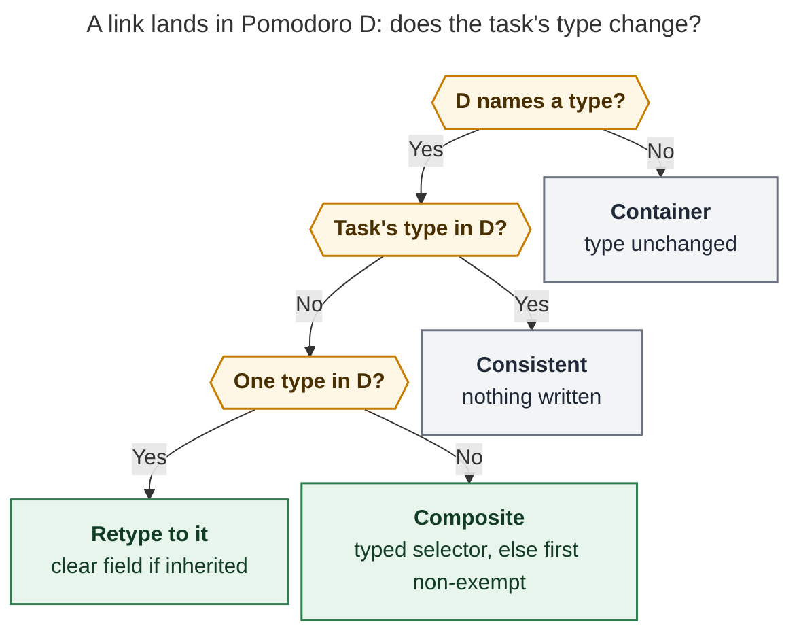
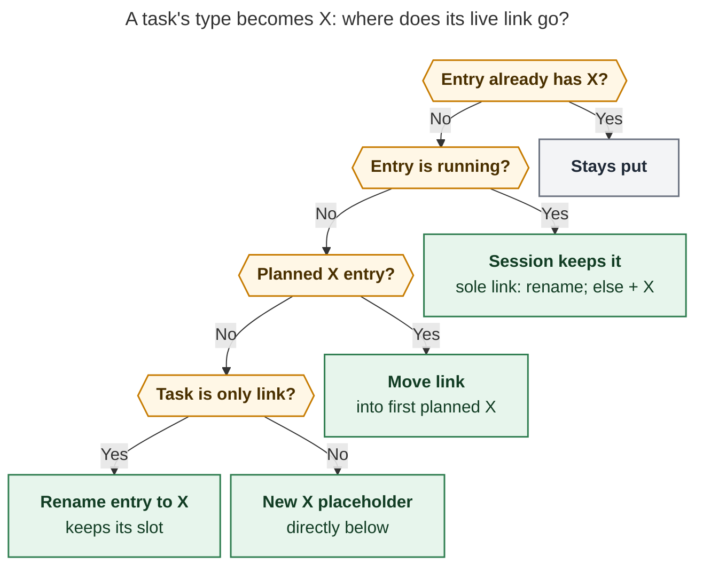

# Pomodoro themes are task types: one type per task, and links that always agree

> **Research query:** Rename the "pomodoro theme" glossary entry to "task type", and
> make types explicit and automatic. Every task gets a type by default (configurable;
> CHORE for Bryan). A task's type, explicit or implicit, must always agree with its
> current and future Task Links. A Task Card type edit moves the task's links to a
> Pomodoro of that type, creating one if needed. Moving a link to a Pomodoro of another
> type (Ctrl+Shift+M or Bob Mac Capture) updates the task's `type`. New capture links go
> to the suggested type's Pomodoro instead of the current/next one, and a `#NAME` suffix
> updates the task's type. Exempt types such as PLAN become legal task types. `#task`
> renders as a colored `#<type>` instead of the type chip. Is this a good idea, would I
> take a different approach, which requirement changes are justified, and what solution
> do I recommend?

## Bottom line

**Do it.** The rename names what the feature already is. The consistency rule is the
real improvement, and it simplifies the system rather than complicating it. Since
Oct 26 the ledger has run on a fixed set of work-kind names: BUILD, CHORE, FIX, MEET,
PLAN, READ, and WRITE (the `themes:` block in chezmoi `home/dot_config/bob/config.yml`).
Tasks already carry `[theme:: X]` fields. Area and project notes already declare
`theme:` defaults. Rust already resolves one suggested theme per task
(`src/native/pomodoro_themes/suggest.rs`). The "theme" is already a per-task type; only
the word and the missing consistency rule hide that.

The live vault shows the gap the request is aimed at:

- **Today's ledger already disagrees with itself.** `job#^reply-email-dan` carries
  `[theme:: MEET]` but sits under `() — WRITE`. `sase_pypi_releases#^fix-sase-1n6`
  inherits BUILD (from `dev`) but sits under `() — FIX`. So 2 of today's 8 live links
  disagree with their task's type.
- **Over Oct 26–29, 28 of 85 Task Links (33%) sat under a Pomodoro that does not
  contain the task's current effective type.** That comes from a read-only replay
  ([evidence](#evidence-from-the-vault)). Today nothing notices or repairs that.
- **Shipped rules forbid the behavior you want.** The Task Card contract says a
  theme-only edit causes no Task Link change (`docs/reference/plugins/task-card.md`).
  PT13 lists *move* as a never-writer (`docs/pomodoro-themes.md`). The write rule
  refuses exempt destinations (`plan_theme_change` in `src/native/task_theme.rs`).
  These rules were sensible for an optional "theme memory". They are wrong once a type
  is a fact about every task.

My recommendation keeps your intent and states it as **one invariant with one tie-break
rule**:

> **Every live Task Link sits under a Pomodoro whose name includes its task's type.
> When a deliberate gesture changes one side, Bob updates the other side in the same
> write.**

A *live* Task Link is one under an open, typed Pomodoro in today's daily note.

- A type edit moves the link.
- A link move changes the type.
- A new link is placed by type.
- Anything that breaks the agreement without a gesture (hand edits, frontmatter edits,
  sync) is **flagged, never silently repaired**.

These are the most important adjustments; each is called out in
[Requirement adjustments](#requirement-adjustments):

1. **The note-level default can't be named `type:`**, because `type: "[[area]]"` and
   `type: "[[project]]"` already identify area and project notes. Use `task_type:` in
   frontmatter and keep `[type:: X]` on task lines.
2. **Unnamed Pomodoros, inventory labels (LATER, MISC), and ad-hoc names outside your
   vocabulary are containers**, not types. Moving a task into one never changes its
   type. This is how ad-hoc and "productivity research" session themes stay
   first-class.
3. **A running session is never emptied by a type edit.** The session keeps the link
   and is renamed or gains the type (`FIX` → `FIX + BUILD`).
4. **"Link once" (Alt+Enter) is retired**, because it is exactly the inconsistent
   option. Alt+Enter becomes the second consistent answer: *keep the task's type and add
   it to this Pomodoro's name*. That answers your own bead note ("Prompt when moving a
   task link (new type or merge?)") without a modal.
5. **Rename the words, not the wire.** Docs, help, menus, the glossary, the CLI
   (`bob types`, with `bob themes` as a permanent hidden alias), and config
   (`types:`, `plan.default_type`) all change. JSON keys, Rust/Swift/CSS identifiers,
   and the `.bob/themes/` journal keep their names.
6. **`#TYPE` renders only for an explicit field.** Inherited types appear in the
   tooltip, the Task Card, and pickers, never as text on every line. The tag uses
   contrast-checked per-hue ink: raw yellow, aqua, and green text on white measure
   only 2.1–2.6:1.

## Evidence from the vault

All checks were read-only. I ran the installed `bob 0.4.0` against `~/bob` on
2026-10-29, plus two throwaway scripts outside the vault.

**What already exists (shipped):**

- **Task field:** `[theme:: X]` / `(theme:: X)`, one valid field, with repair states
  for duplicate or invalid fields. Placement goes before the trailing inline-field run
  (`set_task_theme`), so Obsidian Tasks still parses `[created::]`, `[id::]`, and the
  other trailing fields.
- **Note defaults:** `theme:` scalar frontmatter on area and project notes, inherited
  along the R1 residence chain; `[root:: X]` starts the walk at X. Seven notes set one:
  `dev: BUILD`, `job: WRITE`, `job_2026: CHORE`, `love: CHORE`, `sase_blog: WRITE`,
  `dev_plex_hack_patch: CHORE`, `gtd_daily: PLAN`.
- **Precedence:** task field, then reading task (`plan.reading_theme`, default READ),
  then daily review, then note default, then none. `bob themes suggest` explains it.
- **Menus:** the shared preselect rule `choose()` in
  `src/native/pomodoro_themes/preselect.rs` picks a running exact entry, else the first
  exact entry, else the first entry containing the type, else creates one (subject to
  the theme cap). Capture completion, Link to today, `bob ref today`, and the successor
  picker use it.
- **Writes:** capture `#NAME` links and the Link to today picker write the field only
  on a *deliberate* choice of a single non-exempt component, and only when a suggestion
  was shown. Alt+Enter "links once" without writing
  (`block-id-prompt/src/085-pomodoro-link-picker-modal.js`).
- **Task Card:** a Theme row and a `t` stage that write only the field
  (`bob-navigation-hotkeys/src/352-picker-task-card-theme-stage.js`).
- **Rendering:** an explicit field renders in place as a PT6 tint pill
  (`bob-ledger-tools/src/279-plugin-task-theme-marks.js`). `#task` renders as a
  constant teal hash glyph (`138-task-tag-marks.js`, `docs/task-tag-marks.md`).

**Usage:**

- Only **4 open tasks carry a real field** (`[theme:: FIX]` ×3, `[theme:: MEET]` ×1).
  Migrating storage is therefore trivial.
- **Open tasks by inherited default** (527 open `#task` lines outside daily notes and
  `done/`): BUILD 385 (73%, almost all through `dev`), WRITE 49, CHORE 37, PLAN 10,
  and **no default 46 (9%)**. That 9% would become implicit CHORE: `cash` 24,
  `needs_attn_tasks` 8, `body` 4, `recur` 3, the three inboxes 6, and `project` 1.
  These counts use each note's default only; reading tasks in those notes resolve to
  READ instead.
- **Ledger replay, Oct 26–29** (85 Task Links under named Pomodoros, `^gtd`
  self-links excluded): 57 consistent (67%), 26 under a different single type, and 2
  under PLAN. There were no composite or ad-hoc destinations in that window.
  - **By source:** note defaults matched 40/62 and reading tasks 14/19. Reading
    tasks under BUILD, WRITE, or CHORE are "read and act" work.
  - **Caveat:** the replay uses each task's *current* field and defaults, not their
    state at link time. The window is four days.

**Hazards found:**

- **Dataview copies page fields into tasks.** The installed Dataview's `executeTask`
  copies every page field into each task unless the task has a field of the same key:
  `for (let [key, value] of Object.entries(pageData)) { if (key in tcopy) continue; tcopy[key] = value; }`.
  So in a TASK query on an area note, an untyped task's `type` is `[[area]]`, and a
  `[type:: BUILD]` task's `type` is `"BUILD"`.
  - Today no vault query depends on task-level `type`. Only Bases filters use
    `note.type == link(...)`, which is the note namespace.
  - A frontmatter `type: BUILD` default, however, would be a hard collision.
- **The vocabulary collides with SASE.** Agents in this project already see a
  "Task Bead Types (`task_types`)" memory web (bug, ci, feature, flake, memory). A
  glossary term "Task Type" must say it is not that.
- **The plan budget is already over.** `plan.max_themes: 3`, but today has four open
  types. Defaulting every task to a type makes CHORE buckets common, so the badge will
  read "over" more often. Your bead `^count-open-poms-not-themes` already proposes
  counting Pomodoros instead. Schedule it right after this work.

## Critique: is this a good idea?

### What is right

- **"Type" is the accurate word.** Issue trackers converged on the same shape. GitHub
  issue types are org-defined, default to Bug, Feature, and Task, and are mutually
  exclusive: an issue has one type, while labels are many
  ([GitHub docs](https://docs.github.com/en/issues/tracking-your-work-with-issues/using-issues/managing-issue-types-in-an-organization),
  [Willison](https://simonwillison.net/2025/Jan/16/evolving-github-issues/)). Your
  BUILD, FIX, and CHORE also echo Conventional Commits types. One type per task,
  chosen from a small vocabulary, is exactly what the ledger already does.
- **Grouping same-type work into one session is the point, and the research supports
  it.** Switching tasks leaves "attention residue" that hurts the next task
  ([Leroy, UW Bothell](https://www.uwb.edu/business/faculty/sleroy/attention-residue)).
  Batching similar work reduces those switches. A type that always agrees with its
  bucket makes the batching automatic instead of something you police by hand.
- **The invariant removes rules instead of adding them.** Today's write rule needs four
  guards (deliberate, suggestion shown, single non-exempt component, not Alt+Enter)
  because a link was allowed to disagree with the type. Once disagreement is never a
  valid end state, "deliberate" stops mattering: every pick has a consistent outcome,
  and the preview names it.
- **Bidirectional "latest gesture wins" matches intent.** Retyping in the Task Card
  answers "what kind of work is this?" Moving a link answers "where do I want it?" Each
  gesture is the authority for its own side.
- **The project-session story works without project themes.** You put a project's
  tasks in their type Pomodoros and merge them. The Pomodoro home chip then shows the
  project on the session line, and each task keeps its type.

### Where the plan is under-specified or risky

1. **Name collision (blocking).** `type:` frontmatter already means note kind, and
   Dataview inheritance mixes the two. See adjustment 1.
2. **Non-type Pomodoros.** Unnamed entries, `LATER` / `MISC` inventory labels, and
   ad-hoc session themes ("DEEP WORK") would turn into task types if a move always
   retypes. A task parked in LATER would become `[type:: LATER]`, which is nonsense.
   See adjustment 2.
3. **Composite destinations.** When a CHORE task is moved into `BUILD + FIX`, which
   type wins? The request doesn't say.
4. **The running session.** A Task Card retype of a task in the *running* session
   would pull it out of the work you are doing now. If it is the session's only link,
   the existing "emptied entry is deleted" behavior would delete a running session.
5. **Changes that are not gestures.** A task moved to another note, a routed inbox
   task, a `parent:` change, a `task_type:` edit, or a hand-typed link can all change a
   type without touching the ledger. The plan has to say who restores agreement in
   each case.
6. **More field writes.** At the replay's 33% mismatch rate, roughly one link in three
   will write or clear a field at first. Prior research measured this kind of memory as
   valuable (static default 61% → default plus remembered field 88% on re-linked
   tasks, `research:202610/task_theme_suggestions_and_overrides/…md`). It also means
   more `#TYPE` tags and more git churn.
7. **Bare capture changes meaning.** "Link it to what I'm doing now" becomes "link it
   to its type's bucket". The prior design rejected this as an invisible grammar
   change. It is now justified, because every capture preview already shows a
   destination row (`→ GOALS · next up`,
   `docs/reference/mac-capture/capture-previews.md`). But it is still a behavior change
   for zsh capture too, and it needs a `!` commit under the release-train rule.
8. **Color.** Four of the seven type hues (yellow BUILD, red FIX, green READ, blue
   MEET) are also lane tints (In Progress, Blocked, Next, Ready). That is why the task
   glyph was deliberately made teal. Raw hue text also fails contrast on white:
   yellow 2.1:1, aqua 2.3:1, green 2.6:1 (Obsidian default palette).

### Alternatives considered

- **Derive Pomodoro names from their tasks**, as homes are derived: the session name
  would be the union of its links' types. This is elegant, but it reopens
  `decisions:pomodoro-theme-is-one-component`: the ledger name is history and Stats'
  source of truth. Planned placeholders also need names before they have tasks.
  **Rejected** for now. The Alt+Enter merge gives the same result on demand.
- **Store the type as a tag** (`#task #fix`). It would render natively and Tasks could
  filter it, but it collides with capture's `#name` Pomodoro selector, can't spell
  `NEW FEATURES`, crowds the tag namespace (`#ref`, `#gtd`, `#prj`, `#hide` already
  carry meaning), and discards the shipped field machinery. **Rejected.**
- **One direction only** (type is the master, and link moves into another type are
  refused). This is predictable but hostile: moving a link is the most natural way to
  say "this is actually FIX". **Rejected** in favor of latest-gesture-wins.
- **Auto-repair drift on reconcile.** When a hand edit breaks agreement, Bob can't know
  which side you meant. **Rejected:** flag it, and let the normal gestures fix it.
- **Keep "theme" for Pomodoro names and use "type" only for tasks.** Two words for one
  concept is the confusion you are trying to remove. Instead: a *task type* is the
  concept, a *Pomodoro name* lists types, and non-type components are *labels*.

## Requirement adjustments

Keep or drop each one individually.

1. **Storage names.**
   - **Task line:** `[type:: X]` (or `(type:: X)`).
   - **Note default:** `task_type: X` in frontmatter, never `type:`.
   - **Reading:** Bob reads legacy `[theme::]` and `theme:` for one release.
   - **Writing:** writers always write the new form and replace the legacy form
     whenever they touch a line.
   - **Migration:** a one-commit `bob types migrate [-d]` rewrites the 4 fields and 7
     defaults.
2. **Config.**
   - **`types:` vocabulary:** replaces `themes:`, which is accepted as an alias; both
     present is an error.
   - **`plan.default_type`:** new. Unset means no global default (today's behavior);
     Bryan's chezmoi sets `CHORE`. It must be in the vocabulary when one is configured.
   - **`plan.reading_type`:** replaces `plan.reading_theme`, which stays an alias.
   - **`task_type: off`:** still ends inheritance, but now falls back to
     `plan.default_type` instead of "no type".
3. **Containers.** A Pomodoro's *type set* is its components that are configured types.
   Exempt types count as types; inventory labels never do; with no vocabulary
   configured, every component is a type.
   - An entry with an empty type set (unnamed, inventory, or ad-hoc) is a container.
   - Links into a container never retype their tasks, and the invariant does not apply
     to them.
   - Ad-hoc names keep the existing `theme_not_configured` warning, now worded "SNACK
     isn't one of your types; tasks here keep their own types".
4. **Exempt types are ordinary task types.** `[type:: PLAN]` is legal, PLAN Pomodoros
   retype like any other, and "exempt" now means only "not counted by the plan budget,
   muted hue". In a composite such as `PLAN + BUILD`, a retype that has to choose a
   component prefers the non-exempt one.
5. **Composites.**
   - If the task's type is already a component, nothing changes.
   - Otherwise capture uses the component the typed selector names (`#build` →
     BUILD), else the first non-exempt type component. The preview shows the choice.
   - Obsidian pickers show the chosen component in the footer, and Tab cycles it.
6. **Alt+Enter means "keep the type, add it here".** It moves or links, and appends
   the task's type to the destination name (`BUILD` → `BUILD + CHORE`, using the
   existing merge spelling). It replaces "link once" in the Link to today picker and is
   new in the Ctrl+Shift+M Pomodoro picker.
7. **Running-session protection.** A type edit never moves a link out of the running
   (timed) entry.
   - If the task is the session's only link, the session's type components are renamed
     in place.
   - Otherwise the session gains ` + X`.
   - Placeholders follow the [relocation rule](#relocation-rule-the-type-changed).
8. **Note moves count as type edits.** A Ctrl+Shift+M task move or inbox routing that
   changes a linked task's *inherited* type relocates its live link, and the toast says
   so. An explicit field travels with the task, so nothing moves.
9. **Renaming a Pomodoro entry that has links retypes those tasks** (it is a ledger-side
   gesture). The rename footer previews it ("3 tasks become FIX"). Merges (Ctrl+X) only
   ever add types, so they never retype.
10. **Bob decides where bare links go, for every capture client.**
    - **Which forms:** bare `@route:id`, `<text> @route:id`, `@route+id`, `^route:id`,
      the project-note `:id` bullet, `bob ref today`, and successor picks.
    - **Where they go:** to `choose(effective type)`. The Mac app only renders the
      result (`decisions:mac-capture-is-a-thin-client`), so zsh capture gets the same
      behavior.
    - **Already queued:** a task that is already queued keeps its queue.
    - **Strict cap:** under `plan.strict`, a capture that would need a new Pomodoro past
      the cap is refused with a teaching error instead of silently falling back to
      current/next.
11. **Fields record exceptions only.** A retype to the inherited type clears the field
    (this rule ships today). A deliberate pick to the inherited bucket therefore never
    leaves a redundant `[type:: BUILD]` in a `dev` note.
12. **Rendering.**
    - `#TYPE` replaces the hash glyph only when the task has a valid explicit field,
      and the field itself is folded away. Inherited types show in the tooltip
      (`#task · BUILD from dev`), never as line text.
    - Reading and checklist glyphs (book, sunrise, flag) keep their slot, and an
      explicit type adds its name after the glyph.
    - The hue is used as text ink here, as a deliberate, scoped exception to PT6's "hue
      is never the text color". It uses per-slot ink tokens that are contrast-tested
      (≥ 4.5:1).
13. **Drift is surfaced, never auto-repaired.**
    - `bob plan` gains a `type_mismatch` lint.
    - The ledger renders a mismatch mark on the offending link row.
    - The fix is the ordinary gestures, which now restore agreement.
14. **Vocabulary only, not the wire.** User-facing words change; JSON keys
    (`theme_suggestion`, `task_theme`, `ThemeRef`, `hue_source`), internal identifiers,
    and the `.bob/themes/` journal stay. The glossary records "aka theme" for the
    historical code name.
15. **Disambiguate in the glossary:** "Not a sase bead `task_type`, and not a note's
    `type:`".

## Recommended design

### Vocabulary and the glossary entry

Rename the glossary strand `pomodoro-theme` to `task-type`. Repoint the `[[pomodoro-theme]]`
links in `day-strip` and `stats-dash`. Any memory edit must go through
`/sase_memory_write`. Proposed text:

> **Task Type** — *aka type, theme, pomodoro theme (former name)*
>
> The kind of work a task is, one ALL-CAPS word such as BUILD, FIX, READ, WRITE, CHORE,
> MEET, or PLAN. Every open `#task` has exactly one effective type. It is the task's own
> `[type:: X]` field if it has one. Otherwise it is READ for a reading task, PLAN for the
> daily `^gtd` task, the nearest `task_type:` up the residence chain, or else
> `plan.default_type`. Only the field is stored. Inherited types are computed when read
> and never written. A [[pomodoro]]'s ` — NAME` tail is a `+`-separated list of
> components keyed by `normalize_component`. A component that names a configured type
> makes a typed Pomodoro (`— BUILD + FIX` serves two types). Unnamed entries, inventory
> labels, and ad-hoc names are labels whose links keep their tasks' types. Bob keeps
> types and links in agreement: every live [[task-link]] sits under a Pomodoro naming its
> task's type, and whichever side a deliberate gesture changes, Bob updates the other in
> the same write. `plan.exempt` types (default PLAN) are valid types that the plan
> budget does not count. `bob types` lists, hides, colors, renames, and explains them.
> Not a sase bead `task_type`, a note's `type:` frontmatter, or an Obsidian appearance
> theme. See `docs/task-types.md`.

The words change everywhere a person reads them:

- **Docs:** `docs/pomodoro-themes.md` becomes `docs/task-types.md`, with a redirect.
  Read the `docs.md` reference memory first.
- **Copy:** CLI help, Task Card ("Type", and the `t` key now reads as *type*), picker
  footers, toasts, the Day strip ("type lane"), and Stats ("by type").
- **CLI:** the canonical group is `bob types` (list, hide, unhide, color, rename,
  split, suggest, plus the new `migrate`). `bob themes` is a permanent hidden alias with
  identical behavior, per the CLI rules.

New decision records, which are immutable and therefore written as new ones:

- **"Task Types And Task Links Always Agree"** (the invariant and the who-follows
  table).
- **"Every Task Has A Type; Fields Hold Only Exceptions"**.
- **"Labels Hold Tasks Without Typing Them"**.

The existing records on component identity, hide-recent-only, hue order, and the
journal remain true unchanged.

### Effective type

First match wins. This is today's resolver plus one final step and the renames:

1. **Task field** `[type:: X]`. Source `task`, label `this task`.
2. **Reading task** → `plan.reading_type` (READ). Source `reading`.
3. **Daily `^gtd`** → PLAN. Source `review`.
4. **Nearest `task_type:`** on the residence chain (`[root::]` starts the walk). Source
   `note`, label `from <stem>`.
5. **`plan.default_type`** (CHORE). Source `default`, label `default type`. *(New.)*
6. With no default configured: none, which is today's behavior.

The serialized suggestion is unchanged except for the new source value, an additive
JSON change. The copy reads `suggested · default type`.

### The agreement rule: who follows whom

| Gesture | What it changes | How Bob restores agreement |
| --- | --- | --- |
| Task Card `t` stage, Use default, Ctrl+D on Type | the task's type | relocates its live link ([relocation rule](#relocation-rule-the-type-changed)) |
| Task move to another note, inbox routing | the inherited type, when no field is set | relocates its live link |
| Ctrl+Shift+M on a Pomodoro sub-bullet (`N<…>`, `=`, `=NAME` peel) | the link's Pomodoro | retypes the task ([retype rule](#retype-rule-the-link-moved)) |
| Link to today pick (Ctrl+Shift+Enter, `]s` landings, successor retarget) | the link's Pomodoro | retypes the task |
| Capture `@route:id#NAME`, `^route:id#NAME`, `@route+id#NAME`, `=name` | the link's Pomodoro | retypes the task (already ships, with fewer guards now) |
| Bare capture, project `:id` bullet, `bob ref today`, successor pick | Bob chooses the Pomodoro | places the link by type, so no retype is needed |
| Pomodoro entry rename with links | the Pomodoro's types | retypes its tasks (previewed count) |
| Pomodoro merge (Ctrl+X), Alt+Enter "keep type" | adds types | nothing to retype |
| Close, Alt+P roll, rollover, reconcile, lane toggles | neither side | nothing |
| Hand edits, `task_type:`/`parent:`/config edits, sync merges | either side, no gesture | `type_mismatch` lint plus a ledger mark; you fix it with a gesture |

Closed Pomodoros are history: no rule ever edits them, and Stats keeps attributing past
sessions to the names they had.

### Retype rule: the link moved



*Figure 1. A link move or named capture changes the task's type only when the
destination names types and the task's type is not among them. Containers and
already-consistent destinations write nothing. In Obsidian, Alt+Enter is the
alternative answer: keep the type and add it to D's name.*

The picker footer always states the consequence before you commit:

- `→ FIX · task becomes FIX · dev suggests BUILD · ⌥↵ keep BUILD (FIX + BUILD)`
- `→ BUILD · type cleared · dev suggests BUILD`
- `→ LATER · keeps BUILD`

Capture previews add the same line Bob already reports (`task theme → FIX · …`, renamed
to `type → FIX · …`).

### Relocation rule: the type changed



*Figure 2. A type edit keeps the task's place in the day. The running session is never
emptied. Planned links move to an existing planned bucket of the new type. Otherwise the
placeholder is renamed, or a new one is created directly below it.*

Details:

- **Scope:** the one live link in today's daily note. More than one movable link is
  already a write-free invariant error.
- **What moves:** the link's whole subtree moves, using the same primitive as
  `N<Ctrl+Shift+M>` (`bob-navigation-hotkeys/src/150-pomodoro-capture.js`).
- **Matching entries:** a "planned X entry" means an open untimed entry whose type set
  contains X, exact names first, then composites, in ledger order. It is the shared
  `choose()` with running entries skipped, so a planned task never jumps into the
  session you're in.
- **Emptied entries:** an emptied *placeholder* is deleted by the existing cleanup rule.
  Timed entries never are.
- **Plan budget:** a new placeholder respects the budget. With `strict: false` it warns;
  with `strict: true` the Task Card shows the refusal and writes nothing.
- **Write order in Obsidian:** the task field is written first, as the user's stated
  intent. The daily-note relocation follows as a checked cross-note step, reusing the
  pattern the Depends-On and "newly Blocked removes live links" writers already use.
  On a partial failure the notice says
  `type set to BUILD · link not moved — Ctrl+Shift+M to move it`, and the lint marks
  the row. Capture does the same in one Rust transaction, as it already does for
  `#NAME` writes.
- **Task Card preview:** the Type stage shows the consequence under the selected row:
  `link moves FIX → BUILD (planned)`, `running FIX becomes FIX + BUILD`, or
  `new BUILD Pomodoro below FIX`.

### Capture: place new links by type

- **Bare forms.** Bare `@route:id`, `<text> @route:id`, `@route+id`, `^route:id`, and
  the project-note `- text :id` bullet target `choose(effective type)`. That means
  running exact, else first exact, else first containing, else create
  `- [ ] () — TYPE` using capture's existing new-entry placement. New tasks use their
  destination note's suggestion, which with a default is never empty.
- **`=<X>` starts.** These use the same choice. "No-name without Q creates an unnamed
  started entry" becomes "creates a `— TYPE` started entry".
- **Named forms.** `#NAME` keeps its selection grammar and now retypes by
  [Figure 1](#retype-rule-the-link-moved). Two guards are dropped ("no suggestion
  shown" and "exempt destination"); the container and composite rules are added.
- **Mac Capture changes copy only.** The destination row already exists:
  `→ BUILD · suggested · from dev`, or `→ new Pomodoro CHORE · default type`.
  `CaptureTaskThemePresentation.swift` changes "task theme" to "type" and learns the
  `default` source phrase.
- **`bob ref today` and successor picks.** These place each task in its own type bucket.
  Successor rows today default to the closed task's Pomodoro, which would now retype
  them. Defaulting each row to its own type keeps the offer honest
  (`task-status-cycler/src/085c-successor-theme-write.js`).

### Exempt types

Remove the `single_non_exempt_component` refusal from the write path. Keep it only as
the composite tie-break, which prefers non-exempt components. PLAN keeps its budget
exemption and muted hue, and the `^gtd` row keeps its review-time attribution, which is
already decoupled from the PLAN name (`65413bd5`). A mid-day planning task can now carry
`[type:: PLAN]`, and bare capture puts it in a PLAN placeholder that the budget doesn't
count.

### Rendering: `#BUILD`, quietly beautiful

The task identity slot becomes **glyph plus type**: the glyph says what kind of line it
is, and the name says what kind of work.

```text
- [ ] ⌗ Rename the queue input                     inherited BUILD from dev: hash only; tooltip "#task · BUILD from dev"
- [/] #FIX Significantly speed up sase commits     explicit field: hash glyph + FIX in FIX ink; [type:: FIX] folded away
- [*] #PLAN Break the epic into phases             exempt: muted ink
- [ ] 📖 Harness Engineering                        reading task, inherited READ: book glyph unchanged
- [ ] 📖BUILD Port the harness idea to bob          reading task with explicit BUILD: book + name
- [ ] #SNACK Buy oat milk                           unconfigured: muted ink, dashed warning underline
- [ ] #? Fix the gate                               duplicate/invalid fields: repair mark; raw fields stay visible
```

Spec:

- **Typography.** The existing slanted hash mask and box metrics. The name is set in
  `var(--font-interface)` at about 0.78em, weight 600, letter-spacing 0.02em, on the
  text baseline. There is no background at rest, so it is not a chip. Hovering shows
  the existing 14% capsule.
- **Ink.** Use per-slot tokens `--bob-type-ink-<slot>`, not the raw hue.
  - **Light theme:** a 60% mix of the hue with `--text-normal` measures 4.8–8.2:1 on
    white for every slot except yellow, which needs about 55%. Raw yellow is 2.1:1,
    aqua 2.3:1, and green 2.6:1.
  - **Dark theme:** raw hues already pass (4.2–11.8:1); blue and red mix lightly
    toward text.
  - **Tests:** a contrast vector asserts ≥ 4.5:1 for 8 slots × {background, Blocked
    red tint, In Progress yellow tint, Next green tint} × {light, dark}. Because
    `#BUILD` names its type in text, a yellow BUILD on a yellow In Progress line never
    reads as a status.
- **States.**
  - **Closed tasks:** the existing resting rule (40% toward faint, opacity 0.75).
  - **Unknown names:** neutral ink with a dotted underline.
  - **Unconfigured names:** the PT6 dashed warning treatment.
  - **Repair:** an orange `#?` mark with "Needs repair: 2 type fields". The raw fields
    are never hidden.
- **Interaction.**
  - **Cursor:** touching the mark reveals `#task`, and touching the folded field
    reveals `[type:: X]`. Clicking places the cursor and never writes.
  - **Tooltip:** `#task · FIX task` / `dev suggests BUILD` / `Ctrl+Shift+P t to change`.
    It never contains `::`, because Dataview rescans tooltips.
  - **Rendered views:** the class and a `data-bob-type` attribute go on the existing
    `a.tag`, and the name is drawn with `::after { content: attr(data-bob-type) }`, so
    the post-processor still never creates nodes. Dataview's inline-field span for
    `type` is hidden, as the `theme` span is today.
- **Pills stay where names are session names:** the ledger, pickers, the Task Card,
  the Day strip, and Stats. The in-line task pill
  (`279-plugin-task-theme-marks.js`) is replaced by the tag.
- **The ledger gets a quiet consistency mark.** A Task Link whose task's type is not in
  its Pomodoro shows `#BUILD` with a dashed orange underline before the link, with the
  tooltip "BUILD task under FIX · Ctrl+Shift+M to move · Ctrl+Shift+P t to retype". As
  an optional follow-up from your `^same-type-pom-dups` notes, links inside composites
  and containers get a plain `#TYPE` before them.

### Drift detection

`bob plan` adds `type_mismatch`, one lint per live link:
`{code, link: {route, block_id}, entry, task_type, entry_types}`. The ledger mirror
renders the mark described above. Nothing repairs drift automatically. At rollout the
lint will immediately flag today's two real cases: `reply-email-dan` (MEET under WRITE)
and `fix-sase-1n6` (BUILD under FIX).

## Implementation plan

The phases are serial where they share contracts. Rust owns every rule. JavaScript
mirrors only what must see unsaved editor buffers, checked against shared vectors, which
is the existing hue and menu precedent.

1. **Vocabulary (bob-cli docs, glossary, help; no behavior change).**
   `docs/task-types.md`, the `bob types` canonical path with the `themes` alias, and UI
   copy in all three repos. Glossary and decision records go through
   `/sase_memory_write`.
2. **Storage and config (bob-cli).**
   - `task_fields`/`task_theme.rs` read `type` and legacy `theme`, and write `type`.
   - `pomodoro_homes` reads the `task_type:` default plus legacy `theme:`.
   - `config/plan.rs` adds `default_type` and `reading_type` (aliases kept), and the
     `types:` block replaces `themes:`.
   - `suggest.rs` adds source `default`.
   - Add `bob types migrate [-d]`, reusing the `vault_rewrite` transaction.
   - Update shared vectors (`tests/fixtures/pomodoro_themes/vectors.json`, copied
     byte-for-byte into bob-plugins).
3. **Invariant core (bob-cli).**
   - Pure `retype()` and `relocate()` planners next to `preselect::choose`, with new
     `retype` and `relocate` vector sections.
   - The `type_mismatch` lint.
   - Capture targeting by type for bare forms, the relaxed `#NAME` write rule,
     `bob ref today`, and the strict-cap refusal.
   - Commit as `feat(capture)!:` per the release-train rule.
4. **Obsidian behavior (bob-plugins).**
   - Task Card Type stage: relocation plus the consequence line (nav 313/352).
   - Ctrl+Shift+M Pomodoro move: retype plus Alt+Enter keep-type (nav 150/165).
   - Link to today: Alt+Enter changes from link-once to keep-type (block-id-prompt
     077/078/085).
   - Successor default placement (cycler 085c/087).
   - Note-move relocation (nav 250).
   - Ledger Tools `api.themes` gains the JS mirrors of `retype` and `relocate`.
5. **Rendering (bob-plugins Ledger Tools).**
   - The `#TYPE` identity tag in 138/264 and field folding.
   - Retire the in-line pill (279-marks).
   - Ink tokens and contrast tests.
   - The ledger mismatch mark.
   - Update `docs/task-tag-marks.md` (the "ink never encodes" principle now carves out
     type).
6. **Mac Capture (copy only)** and **chezmoi**:

   ```yaml
   types:            # was themes:
     BUILD: yellow
     CHORE: magenta
     FIX: red
     MEET: blue
     PLAN: auto
     READ: green
     WRITE: violet
   plan:
     default_type: CHORE   # new: every task without a note default is a CHORE
     # existing keys unchanged; reading_type defaults to READ
   ```

   Then run `bob types migrate` once on the vault.

**Out of scope, in order:**

- **`^count-open-poms-not-themes`:** the budget should count Pomodoros, or rename
  `max_themes` to `max_types`. Do this next, because defaults make "over" common.
- **`^same-type-pom-dups`:** duplicate type buckets for project sessions.
- **Stats by task type:** time attributed through links rather than session names.
- **Tasks-query rows:** showing `#TYPE` in Tasks query results.

## Risks and open questions

1. **Containers versus ad-hoc types.** I recommend that ad-hoc names hold tasks without
   retyping them. If you want `— SNACK` to become a real type for its tasks, invert
   adjustment 3 and keep the warning. The cost is that LATER and MISC must still be
   carved out.
2. **The running session.** Do you want a type edit to merge the running session
   (`FIX + BUILD`)? The alternative is to pull the task out to a planned BUILD
   placeholder.
3. **Entry renames.** Should renaming a Pomodoro that holds links retype them
   (recommended, previewed), or only raise the lint?
4. **Note moves.** Should a move that changes an *inherited* type relocate the link
   (recommended), or pin the old type as a field so the link stays?
5. **Bare-capture muscle memory.** "Do it in this session" now requires
   `#<running name>`, which retypes, or Alt+Enter-style merging in Obsidian. If that
   proves common, consider a capture spelling for "running session, keep type". I
   would wait for evidence first.
6. **Field churn.** Expect writes on about a third of links at first, falling as
   fields accumulate. Watch the count with `bob types list`; if fields cluster in one
   note (as FIX does in `sase`), the fix is a better `task_type:` default there, not
   more fields.
7. **Wire names.** Renaming JSON keys later is a coordinated three-repo break with no
   user-visible benefit. I would leave them.

## Recommended solution

Adopt the rename and the automation as one feature built on a single rule.

- **Words.** "Task type" everywhere a person reads it. `[type:: X]` on task lines and
  `task_type:` in note frontmatter. `bob types`, with `bob themes` kept as a hidden
  alias. JSON keys and internals keep their historical names.
- **Every task has a type.**
  - **Resolution:** its field, else READ for a reading task, else PLAN for the review
    task, else the nearest `task_type:`, else `plan.default_type`, which is CHORE in
    your chezmoi config.
  - **Storage:** only exceptions are stored. A retype to the inherited type clears the
    field.
  - **Exempt types:** PLAN is a normal type that the budget doesn't count.
- **Types and links always agree; the latest deliberate gesture wins.**
  - **Type edits** (the Task Card, a note move) relocate the link
    ([Figure 2](#relocation-rule-the-type-changed)). They never empty the running
    session, and they keep the task's place in the day.
  - **Link moves** (Ctrl+Shift+M, Link to today, capture `#NAME`) retype the task
    ([Figure 1](#retype-rule-the-link-moved)). Unnamed, inventory, and ad-hoc
    Pomodoros are containers that never retype, and composites never retype a task
    whose type they already include.
  - **Alt+Enter** is the other consistent answer: keep the type and add it to the
    Pomodoro's name. "Link once" goes away.
  - **Placement:** bare capture, `bob ref today`, and successor picks put each link in
    its type's bucket. The existing destination previews make that visible.
  - **Drift:** a `type_mismatch` lint and a quiet ledger mark, never silent repair.
- **Beautiful.**
  - **Line tag:** `#task` becomes a compact, contrast-tested `#BUILD` (glyph plus
    name in the type's ink) only where the task's type is an explicit exception.
  - **Inherited types:** they live in tooltips, the Task Card, and pickers, so calm
    notes stay calm.
  - **Consequence lines:** every picker footer and preview says what will happen
    before you press Enter.

## Sources

- bob-cli code and docs:
  - `docs/pomodoro-themes.md` (PT1–PT13)
  - `docs/capture.md` (link targeting and the `#NAME` write rule)
  - `docs/task-tag-marks.md`
  - `docs/reference/plugins/task-card.md`
  - `docs/reference/mac-capture/capture-previews.md`
  - `docs/plan.md`
  - `src/native/task_theme.rs`
  - `src/native/pomodoro_themes/{suggest,preselect}.rs`
- bob-plugins:
  - `bob-ledger-tools/src/{138-task-tag-marks,264-plugin-task-tag-marks,279-plugin-task-theme-marks}.js`
  - `bob-navigation-hotkeys/src/{150-pomodoro-capture,352-picker-task-card-theme-stage}.js`
  - `block-id-prompt/src/085-pomodoro-link-picker-modal.js`
  - `task-status-cycler/src/085c-successor-theme-write.js`
- bob-mac-capture: `Sources/CaptureCore/CaptureTaskThemePresentation.swift`
- chezmoi: `home/dot_config/bob/config.yml`
- Memory:
  - Decisions: `pomodoro-theme-is-one-component`, `theme-hide-is-recent-only`,
    `theme-hue-is-config-pin-exempt-area-hash`, `theme-prefs-live-in-per-host-journal`,
    `mac-capture-is-a-thin-client`
  - Glossary: `pomodoro-theme`
  - CLI rules: commands are never hard-renamed
- Prior research and plans:
  - `research:202610/task_theme_suggestions_and_overrides/task_theme_suggestions_and_overrides.md`
  - `plan:202610/task_card_successor_themes.md`
- Vault evidence (read-only, 2026-10-29):
  - `bob themes suggest` on today's live links
  - The Oct 26–29 ledger replay
  - Counts of open tasks by default
  - The installed Dataview `executeTask` page-field copy
  - The `bob.md` beads `^task-types`, `^count-open-poms-not-themes`, and
    `^same-type-pom-dups`
- Web:
  - [GitHub Docs — Managing issue types in an organization](https://docs.github.com/en/issues/tracking-your-work-with-issues/using-issues/managing-issue-types-in-an-organization)
  - [Simon Willison — Evolving GitHub Issues (2025)](https://simonwillison.net/2025/Jan/16/evolving-github-issues/)
  - [Sophie Leroy — Attention residue (UW Bothell)](https://www.uwb.edu/business/faculty/sleroy/attention-residue)
  - [Obsidian forum — Dataview metadata inheritance to tasks](https://forum.obsidian.md/t/dataview-metadata-inheritance-to-tasks-from-page/54928)
    (superseded by reading the installed `executeTask` source)

*Figure note:* both figures were rendered with `@mermaid-js/mermaid-cli` 12.0.0 under
the PDF-mirroring config. The measured SVGs are 687×760 px (95% fit) and 810×936 px
(81% fit). PNG export could not launch a browser on this host, so I checked the figures
by measured size and against the sources, not by viewing the image.
