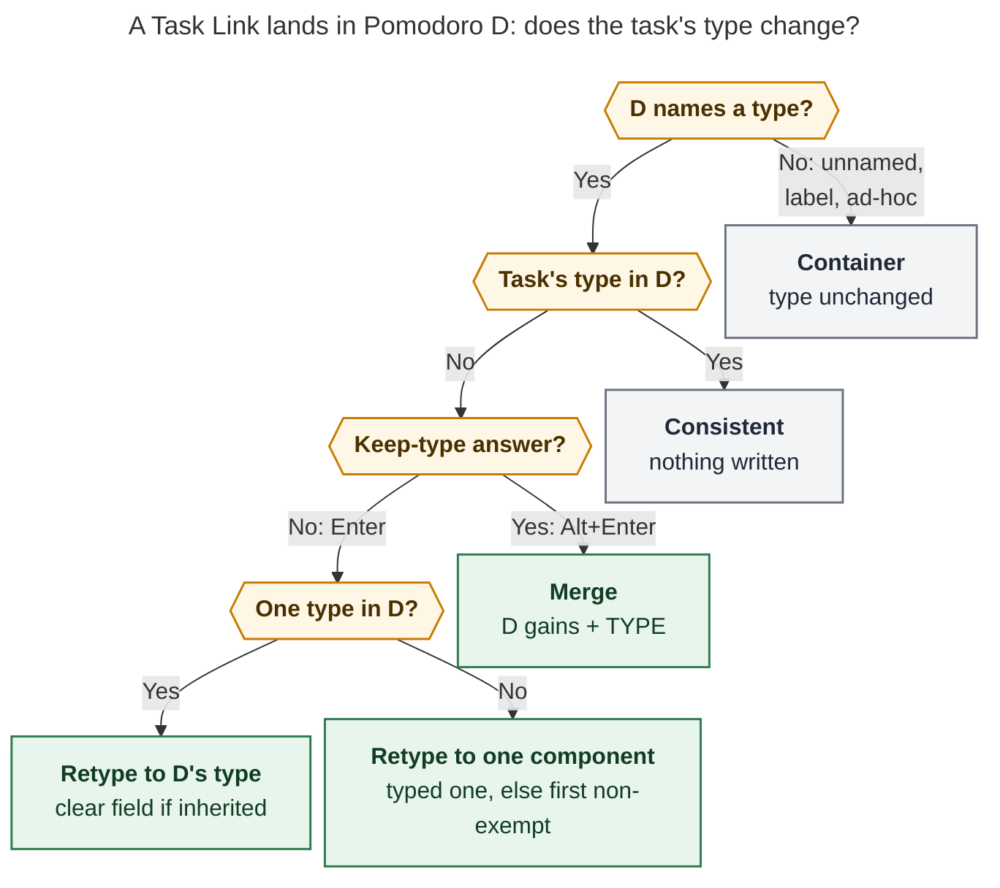
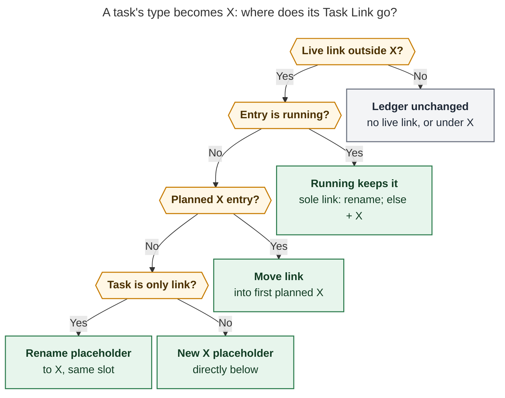

# Pomodoro themes are task types: one type per task, and links that always agree

> **Research request.** Rename the "Pomodoro Theme" glossary entry to "Task Type" and make
> types explicit and automatic. Every task gets a configurable default type (CHORE for
> Bryan). A task's type must always agree with its current and future Task Links. A Task
> Card type edit moves the task's links to a Pomodoro of that type, creating one if
> needed. Moving a link into a differently typed Pomodoro (Ctrl+Shift+M or Bob Mac
> Capture) updates the task's `type`. Bare capture links go to the suggested type instead
> of the current/next Pomodoro, and a `#NAME` suffix updates the task's type. Exempt types
> such as PLAN become legal task types. `#task` renders as a colored `#<TYPE>` instead of
> the type chip. Is this a good idea, what would I change, and what should we build?

Consolidated report by the lead researcher, 2026-10-29. It merges five independent
reports (`__cdx`, `__cld`, `__grk`, `__mus`, `__gem` in this directory) with my own
verification against bob-cli `48253b7f`, bob-plugins `68db3fbe`, the live `~/bob` vault,
and `~/.config/bob/config.yml`. Everything here was read-only; no product code, vault
note, memory file, or dotfile changed.

## Bottom line

**Build it.** The rename names what the feature already is, and the consistency rule is
the real improvement. Bryan's configured vocabulary (BUILD, CHORE, FIX, MEET, PLAN, READ,
WRITE) is a set of work kinds. Tasks already carry `[theme:: X]` fields, area and project
notes already declare `theme:` defaults, and Rust already resolves one suggested theme
per task. Only the word and the missing agreement rule hide that the theme is a per-task
type.

The gap is visible in today's ledger. Two of the eight live Task Links disagree with
their task's type: `job#^reply-email-dan` (`[theme:: MEET]`) sits under `() — WRITE`,
and `sase_pypi_releases#^fix-sase-1n6` (inherits BUILD) sits under `() — FIX`. In both
cases **the Pomodoro was the better classification**. Replying to an email is writing,
and "Fix sase-1n6 once and for all" is a fix. That supports the request's
"move retypes the task" direction. Over Oct 26–29, cld's ledger replay found 28 of 85
links (33%) under a Pomodoro that does not contain the task's current effective type.
Nothing notices or repairs that today.

The design reduces to **one invariant with one tie-break rule**:

> **Every live Task Link sits under a Pomodoro whose name includes its task's type.
> Whichever side a deliberate gesture changes, Bob updates the other side in the same
> write.**

- A type edit moves the link.
- A link move changes the type.
- A new link is placed by type.
- Drift that no gesture caused (hand edits, frontmatter edits, sync) is **flagged, never
  silently repaired**.

A *live* Task Link is a dedicated Task Link under an open Pomodoro in today's daily note.
Capture already treats more than one movable link as a write-free invariant error
(`docs/capture.md`), so each task has at most one live link.

The request is right in spirit, but several parts need sharpening. The adjustments
that matter most:

1. **Compute the default type; never stamp it** onto task lines. All five researchers
   agree.
2. **The note-level default cannot be called `type:`.** `type: "[[area]]"` and
   `type: "[[project]]"` already identify note kinds. Use `task_type:` in frontmatter
   and keep `[type:: X]` on task lines.
3. **A Task Card retype moves only an existing live link.** A backlog task with no link
   changes type only. Otherwise every reclassification would put the task into Today.
4. **Unnamed Pomodoros, inventory labels, and ad-hoc names are containers, not types.**
   Moving a task into LATER never makes it `[type:: LATER]`. This keeps ad-hoc and
   research-recommended session names working without turning them into types.
5. **Every move into another type offers two consistent answers.** Enter retypes the
   task. Alt+Enter keeps the type and merges it into the destination's name. This retires
   "link once", which is exactly the inconsistent option. It is also what Bryan's own
   `^task-types` bead asks for: "Prompt when moving a task link (new type or merge?)".
6. **`#TYPE` shows explicit types in contrast-tested ink, not raw hue and not a chip.**
   Inherited types live in the tooltip, so a note where every task inherits BUILD stays
   calm.

## What exists today

| Fact (verified unless noted) | Consequence |
| --- | --- |
| Task field `[theme:: X]` / `(theme:: X)`. **Four open tasks carry one**: `job` MEET and three `sase` FIX. grk's "zero fields" was wrong. | Moving to `[type::]` storage is a four-line migration. |
| Seven notes declare `theme:` (`dev` BUILD, `job` WRITE, `job_2026` CHORE, `love` CHORE, `sase_blog` WRITE, `dev_plex_hack_patch` CHORE, `gtd_daily` PLAN). None uses `theme: off`. | Renaming the note key is cheap. Changing what `off` means affects no current note. |
| Suggestion precedence is task field, then reading task (`plan.reading_theme`, default READ), then the nearest note default on the residence chain, then none (`SuggestionSource` = Task, Reading, Note). The `^gtd` row gets PLAN through `[root:: gtd_daily]`, not through a separate step. | Add one final step for the global default. cld's separate "daily review" step does not exist. |
| A JS mirror of the cascade and of `plan:` config parsing lives in Ledger Tools (`279-plugin-task-theme-suggest.js`, `050-plan-budget.js`), backed by shared vectors. | A new cascade step or config key lands in Rust **and** JS, with vectors. |
| Write rule (`plan_theme_change`): write only on a deliberate choice of a destination with exactly one non-exempt component, after a suggestion was shown. Choosing the inherited value clears the field. Alt+Enter is "link once". Move, close, roll, rollover, reconcile, successor placement, and `ref today` never write. | The guard set exists because disagreement was allowed. Under the invariant, most of those guards go away. |
| The Task Card Theme stage writes only the field, follows the single non-exempt rule (so choosing PLAN does nothing), and "never moves Task Links". | Both the PLAN request and the relocation request contradict shipped contracts on purpose. |
| Bare capture (`@route:id`, `- text :id`, `@route+id`) links under the "implicit current/next" Pomodoro. An already-queued task keeps its queue. | Placing links by type changes capture behavior and needs a `!` commit under the release train. |
| `#task` is the Tasks `globalFilter`, and the vault has about 3,400 `#task` lines. Ledger Tools draws one teal hash in ink `color-mix(cyan 72%, text-normal)`. The `#ref` book and the `#gtd #pre`/`#post` sunrise and flag share that slot. | The stored tag must stay `#task`. `#TYPE` is a display projection, and a mixed-ink precedent already exists. |
| `plan.max_themes: 3`, `strict: false`, `exempt: [PLAN]`, `inventory_labels: [LATER, MISC, NEW FEATURES]`. Today already has four open non-exempt types. | Placing links by type will create more type placeholders. The `^count-open-poms-not-themes` bead becomes urgent. |
| Dataview copies page fields into tasks that lack the same key (cld read the installed `executeTask`). An untyped task's `task.type` in an area note is `[[area]]`. | Raw `task.type` is not an effective-type API. No vault query uses it today, and Bob's resolver is the authority. |
| Bryan's beads: `^task-types` (this work), plus `^count-open-poms-not-themes` and `^same-type-pom-dups`, which are blocked on it. `^bug-task-card-themes` closed as "just needed a more informative toast". | Every type-changing gesture needs an explicit consequence line or toast. Silence was the bug. |
| No daily note exists after today's (`2026/20261029.md`). | "Current/future links" means today's live link plus every future link-creating gesture. A multi-date relocation (cdx) has nothing to act on. |

## Is this a good idea?

### What is right

- **"Type" is the accurate word, and issue trackers agree.** GitHub issue types are
  defined per organization and mutually exclusive (one type per issue, many labels).
  Jira calls them "work types". BUILD, FIX, and CHORE also echo Conventional Commits.
  One type per task, from a small colored vocabulary, is what the ledger already does.
- **The invariant removes rules instead of adding them.** Today's write rule needs four
  guards because a link was allowed to disagree with its type. Once disagreement is never
  a valid end state, every pick has a consistent outcome, and the preview names it.
- **"Latest deliberate gesture wins" matches intent.** A Task Card retype answers "what
  kind of work is this?" A link move answers "where am I doing it?" Today's two
  mismatches show the second answer is often the more accurate one.
- **Project sessions still work without project themes.** Tasks keep BUILD or FIX, and
  a merged session reads `BUILD + FIX`. The Pomodoro home chip already shows the project
  on the session line.

### What needs restraint

- **The productivity claim.** Attention-residue research (Leroy; Leroy & Glomb 2018)
  supports reducing switches. It does not show that batching BUILD work across unrelated
  projects beats staying inside one project. Present type routing as a sensible default,
  not as validated science. Project continuity stays available through merges and homes.
- **Not every relocation is a reclassification.** Some moves only rearrange the day. That
  is why containers never retype, the preview always states the consequence, and
  Alt+Enter offers "keep the type".
- **Field churn.** At the replay's 33% mismatch rate, about one link in three will write
  or clear a field at first. Prior research found remembered fields predict later links
  much better than static defaults (88% versus 61%), so the churn buys accuracy. If
  fields cluster in one note, the fix is a better `task_type:` default there.
- **Budget pressure.** Defaults make CHORE buckets common, and auto-created placeholders
  will push past `max_themes: 3` more often.

### Alternatives considered and rejected

| Alternative | Why not |
| --- | --- |
| Rename the labels and change the chip only | Pleasant, but leaves the central inconsistency untouched. |
| Stamp `[type:: CHORE]` onto every untyped task | It writes thousands of lines, freezes CHORE onto tasks that later move into `dev` (BUILD), and erases the "no opinion" signal. |
| Keep "Pomodoro Theme" and add "Task Type" as a sibling (grk) | Two nouns for one vocabulary is the confusion the request removes. Composites, unnamed entries, and inventory are covered by *Pomodoro name*, *component*, and *label*. |
| Derive Pomodoro names from their tasks, the way homes are derived | Elegant, but it reopens `decisions:pomodoro-theme-is-one-component`: the ledger name is history and the source of truth for Stats. |
| Store the type as a tag (`#task #fix`) | Collides with capture's `#name` selector, can't spell multiword names, crowds a tag space where `#ref`, `#gtd`, `#prj`, and `#hide` already mean something, and discards the field machinery. |
| One direction only: type is master, and moves into another type are refused | Predictable but hostile: moving a link is the most natural way to say "this is actually FIX". |
| Silent auto-repair of drift | After a hand edit, Bob can't know which side was meant. |
| Let task type and session mode differ freely | It fails the requested invariant unless per-link override state is added. That would be a different feature. |

## Where the five reports disagreed, and how I resolved it

| Question | Positions | Resolution |
| --- | --- | --- |
| Rename, or add a sibling term? | Rename with aliases: cdx, cld, gem. Display alias for the single-type subset: mus. Keep both terms: grk. | **Rename**, and keep "theme" and "Pomodoro theme" as aliases. |
| Stored task field | `[type::]`: cdx, cld, gem. Dual-read, prefer `type` later: mus. Keep `[theme::]`: grk, because of Dataview `task.type`. | **`[type::]`, reading legacy `[theme::]`.** Bryan asked for it, only four fields exist, and no query depends on `task.type`. Bob's resolver is already the only complete authority, because reading tasks and the global default are invisible to Dataview either way. |
| Note-default key | `task_type:`: cdx, cld. gem's glossary draft allows frontmatter `type:`. Keep `theme:`: grk, mus. | **`task_type:`, reading legacy `theme:`.** gem's `type:` would collide with `type: "[[area]]"` on every area and project note. |
| Default config key | `tasks.default_type` (cdx), `plan.default_type` (cld, mus), `plan.default_theme` (grk), `plan.default_task_type` (gem). | **`plan.default_type`**, next to `plan.reading_theme`. Unset means no global default, which is today's behavior. |
| Card retype → links | Automatic for live links: cdx, cld, gem, grk. Opt-in offer: mus. | **Automatic**, with a consequence line in the stage before Enter and one undo. `^bug-task-card-themes` showed that silence, not automation, is what hurts. |
| Which links move | Today's live link: cld, gem, grk. Today plus future daily notes: cdx. | **Today's live link.** No future daily notes exist. If they ever do, apply the same rule per date. |
| Moving into PLAN | Retype: cdx, cld, gem. "Park" without retyping: grk, citing `plan_theme_exemption`. | **Retype.** Bryan explicitly wants `[type:: PLAN]`, and Park would leave a permanent mismatch. Alt+Enter is the "plan this BUILD task but keep it BUILD" answer. |
| Composite destination | Explicit modal choice: cdx. Typed selector, else first non-exempt: cld, gem. Never write: mus. | **cld's rule, with Tab cycling the component in Obsidian pickers.** No modal. |
| Alt+Enter "link once" | Retire: cdx. Repurpose as keep-type merge: cld. Keep: grk. | **Repurpose.** It matches Bryan's bead note. |
| Which tasks show `#TYPE` | Explicit only: cld, and Bryan's wording. Effective type: cdx, grk, mus. Explicit plus inherited non-default: gem. | **Explicit only by default,** plus an optional toggle that shows inherited types in quiet ink. |
| Tag styling | Ink text: cdx, cld. Tinted pill with normal text: grk, gem, mus. | **Ink text.** A tinted pill is the chip Bryan asked to remove. |
| Strict cap on auto-create | Refuse: cdx, cld. Fall back to current/next with a code: grk, mus. | **Refuse.** A silent fallback creates exactly the mismatch the feature prevents. With Bryan's `strict: false`, Bob warns and proceeds. |
| Write guarantees | Full transaction plus durable recovery journal: cdx. Field first, then a checked cross-note step, with the lint as the net: cld. | **cld's shape plus cdx's preimage and open-buffer checks.** A crash-recovery journal is out of proportion while the lint catches residual drift. |
| Ship order | Display first: grk. Model, writers, render: mus. Vocabulary, storage, core, Obsidian, render: cld. | **Resolver and lint first** (this measures drift), then display, then routing, then Task Card relocation. |

**Other factual corrections:**

- **grk's "before" picture.** It shows inherited `theme | BUILD` and `type | area`
  Dataview chips on every `dev.md` row. That contradicts the plugin contract, which
  renders only explicit fields (`docs/develop/plugins/plugin-apis.md`). Treat it as
  unconfirmed.
- **cld's contrast numbers.** They used Obsidian's default palette, but Bob paints with
  its own `--bob-area-*` palette (see [Rendering](#7-rendering-bold-quiet-and-honest)).

## Requirement adjustments

Each item below is a deliberate change to the request. Keep or drop each one
individually.

| # | Request | Adjustment | Why |
| --- | --- | --- | --- |
| R1 | Every task gets a type by default | Every **open** `#task` has an **effective** type, resolved when read. Nothing is backfilled, and closed tasks keep their history. | Avoids thousands of writes and keeps note defaults meaningful (all five reports agree). |
| R2 | `[type:: X]` property | Keep `[type:: X]` on task lines. The note default is **`task_type:`**, never `type:`. | Note `type:` already names the note kind. |
| R3 | Card retype moves links, else creates a Pomodoro and adds the task | Relocate only an **existing live link**. A task with no live link changes type only: no link, no Pomodoro. | Creating links on reclassification would turn backlog grooming into Today membership and break `decisions:today-is-read-from-the-ledger`. |
| R4 | (implicit) | **A running session is never emptied by a retype.** If the task is the session's sole link, the session is renamed. Otherwise it gains ` + X`. | Pulling the task you're working on out of the session you're in would be wrong. The existing cleanup rule would even delete a running entry it emptied. |
| R5 | Moves into a differently typed Pomodoro update `type` | **Containers never retype.** Unnamed entries, `inventory_labels`, and names outside the configured vocabulary hold tasks without typing them. With no vocabulary configured, every component is a type. | `[type:: LATER]` is nonsense. Ad-hoc names keep working with the existing warning, reworded as "SNACK isn't one of your types; tasks here keep their own types". |
| R6 | (implicit) | **Composites:** if the task's type is already a component, nothing changes. Otherwise retype to the typed component (`#build` → BUILD), else the first non-exempt one. Tab cycles the choice in Obsidian. | A merged Pomodoro has no single type to infer. |
| R7 | (Bryan's bead: "new type or merge?") | **Enter retypes; Alt+Enter keeps the type and adds it to the destination's name** (`FIX` → `FIX + BUILD`). "Link once" is retired from the Link to today picker, and Alt+Enter is new in the Ctrl+Shift+M picker. | Both answers are consistent, and the inconsistent option disappears. |
| R8 | Capture always uses the suggested type | Place by `choose(effective type)`: a running exact match, else the first exact planned entry, else the first containing entry, else create a `— TYPE` placeholder. An already-queued task keeps its queue. | "Always suggested" must not pull a BUILD task out of a running BUILD session. Preferring a running match keeps "work this now" intact. |
| R9 | `#type` suffix updates "the `task` property" | Read this as updating the task's **`type`** property. Drop the "suggestion shown" and "exempt destination" guards, and add the container and composite rules. | The wording looks like a typo. Under the invariant, every explicit pick is deliberate. |
| R10 | Allow explicit exempt types | PLAN is an ordinary type in fields, defaults, menus, routing, and moves. "Exempt" means only "not counted by the plan budget, muted hue". | "Not counted" must not mean "invalid category". |
| R11 | `#<type>` when the task has the property | Render `#TYPE` for **explicit** fields, in contrast-tested **ink** with no resting background. Inherited types appear in the tooltip and Task Card, with an optional "show inherited types" toggle. | This follows the request's own wording and keeps a note where every task inherits BUILD calm. Raw hues fail contrast as text. |
| R12 | Always consistent | Managed gestures keep the invariant. Hand edits, sync merges, and frontmatter or config edits produce a **`type_mismatch` lint and a ledger mark**, never a silent repair. | An editable, synced vault cannot guarantee instantaneous invariants, and Bob can't guess which side a hand edit meant. |
| R13 | (implicit) | **Note moves and Pomodoro entry renames are gestures.** A note move that changes an inherited type relocates the live link (an explicit field travels with the task). Renaming an entry that holds links retypes them, with the count previewed. Ctrl+X merges only add types, so they never retype. | These change one side of the invariant without touching the other. |
| R14 | Rename | **Rename the words, not the wire.** Docs, help, menus, the glossary, and the CLI change. JSON keys (`task_theme`, `theme_suggestion`, `ThemeRef`), Rust/JS/Swift/CSS identifiers, and the `.bob/themes/<host>.jsonl` journal keep their names. | A wire rename is a coordinated three-repo break with no visible benefit. |

## Recommended design

### 1. Vocabulary and the glossary

Rename the glossary strand `pomodoro-theme` to `task-type`, keeping `pomodoro-theme`,
`theme`, and `pomodoro theme` as aliases. Immutable decision records (`theme-hide-is-recent-only`,
`theme-hue-*`, `theme-prefs-live-in-per-host-journal`, `pomodoro-theme-is-one-component`)
and the `day-strip`, `stats-dash`, and `root-parent` strands link `[[pomodoro-theme]]`.
The old keyword must keep resolving. All memory edits go through `/sase_memory_write`.

Proposed glossary text:

> **Task Type** — *aka type, theme, Pomodoro theme (former name)*
>
> The kind of work a task is: one ALL-CAPS name such as BUILD, FIX, READ, WRITE, CHORE,
> MEET, or PLAN. Every open `#task` has exactly one effective type, chosen in this order:
>
> 1. its own `[type:: X]` field;
> 2. READ for a reading task;
> 3. the nearest `task_type:` default on its residence chain (a `[root:: X]` field
>    starts the walk);
> 4. `plan.default_type`.
>
> Only the field is stored; inherited types are computed when read. A [[pomodoro]]'s
> ` — NAME` tail is a `+`-separated list of components keyed by `normalize_component`.
> A component that names a configured type makes a typed Pomodoro (`— BUILD + FIX`
> accepts both). Unnamed entries, inventory labels, and ad-hoc names are labels: they
> hold tasks without typing them. Bob keeps types and live [[task-link]]s in agreement;
> whichever side a deliberate gesture changes, Bob updates the other in the same write.
> `plan.exempt` types (default PLAN) are ordinary types that the plan budget does not
> count. Not a SASE bead `task_type`, a note's `type:` frontmatter, a Pomodoro home, or
> an Obsidian appearance theme. See `docs/task-types.md`.

The words change everywhere a person reads them:

- `docs/pomodoro-themes.md` becomes `docs/task-types.md`, with a redirect (read the
  `docs.md` reference memory first).
- The Task Card row and stage become "Type", and the `t` key stays.
- Picker footers, toasts, the Day strip, Stats ("by type"), and the Mac preview copy
  (`CaptureTaskThemePresentation.swift`) say "type".
- `bob types` becomes canonical. `bob themes` stays a permanent hidden alias with
  byte-identical behavior, as `cli_rules.md` requires. Add `bob types migrate [-d]`.
  Do not nest under `bob task`, which is reserved for whole-vault task-line rewrites.

New decision records (records are immutable, so these are new ones, not edits):

- **Task Types And Live Task Links Always Agree**: the invariant, the who-follows table,
  and drift is flagged, not repaired.
- **Every Open Task Has A Type; Fields Hold Only Exceptions**: read-time default; choosing
  the inherited type clears the field.
- **Labels Hold Tasks Without Typing Them**: containers and the composite rule.
- **Exempt Is A Budget Attribute, Not A Type Restriction**.

### 2. Storage and config

- **Task lines:** canonical `[type:: X]` / `(type:: X)`. Readers accept legacy
  `[theme::]`. Writers emit `type` and replace a legacy field whenever they touch the
  line. Placement stays before the trailing inline-field run (`set_task_theme`), and
  the repair states (duplicate, invalid, conflicting `type` + `theme`) are kept, now
  with `type`/`theme` mixes as a repair case.
- **Note defaults:** `task_type: X`, reading legacy `theme:`. `task_type: off` still
  stops the walk but now falls back to `plan.default_type`. No current note uses `off`.
- **Config:** add `plan.default_type` (a single name or `off`; it must be in the
  vocabulary when one is configured) to both the Rust parser and the JS mirror. Optional,
  in the vocabulary phase: accept `types:` and `plan.reading_type` as canonical, keep
  `themes:` and `plan.reading_theme` as aliases, and make "both present" an error. That
  touches Rust plus the Ledger Tools config readers. Leave `plan.max_themes` alone: its
  meaning changes in `^count-open-poms-not-themes`.
- **Migration:** `bob types migrate` rewrites the four fields and seven defaults in one
  previewed `vault_rewrite` commit. Closed tasks may keep legacy spelling, read through
  the compatibility path.
- **Dataview:** hide Dataview's `type` inline-field span, as the `theme` span is hidden
  today. Document that raw `task.type` is not the effective type. For dashboards,
  expose `api.themes.effectiveType(...)` (v1-additive) instead of encouraging
  `WHERE type = ...`.

Bryan's chezmoi change, in `home/dot_config/bob/config.yml`, applied only once a Bob that
reads the key ships:

```yaml
plan:
  default_type: CHORE   # new: tasks with no field, reading rule, or note default are CHORE
```

### 3. Effective type

One cascade; first match wins. Rust is the authority, the JS mirror serves unsaved
editor buffers, and shared vectors keep them equal.

1. **Task field** `[type:: X]`. Source `task`, label `this task`.
2. **Reading task:** `plan.reading_theme` (READ). Source `reading`.
3. **Nearest `task_type:`** on the residence chain. `[root::]` starts the walk, which
   is how `^gtd` gets PLAN. Source `note`, label `from <stem>`.
4. **`plan.default_type`** (CHORE). Source `default`, label `default type`. *(New. The
   enum value is additive JSON.)*
5. None, only when no default is configured. This is today's behavior.

Resolve new captures from the **staged** task after parsing, so a new reading task or
explicit field resolves the same way as the identical task a moment later. Choosing the
inherited type in any picker clears the field; this rule already ships. "Use default" in
the Task Card always clears. With nothing configured beyond the four steps above, 46 open
tasks (9%) become CHORE. These are mostly in `cash`, `needs_attn_tasks`, `body`,
`recur`, and the inboxes (cld's count).

### 4. Who follows whom

| Gesture | What it changes | How Bob restores agreement |
| --- | --- | --- |
| Task Card `t` stage, Use default, Ctrl+D on Type | the task's type | relocates its live link ([Figure 2](#6-relocation-rule-the-type-changed)) |
| Task move to another note, inbox routing, `parent:` change through a Bob gesture | the inherited type, when the task has no field | relocates its live link; the toast says so |
| Ctrl+Shift+M on a Pomodoro sub-bullet | the link's Pomodoro | retypes the task ([Figure 1](#5-retype-rule-the-link-moved)) |
| Link to today (Ctrl+Shift+Enter, `]s` landings, successor retarget) | the link's Pomodoro | retypes the task |
| Capture `@route:id#NAME`, `^route:id#NAME`, `@route+id#NAME`, `=name` (also from the Mac app) | the link's Pomodoro | retypes the task |
| Bare capture, project `:id` bullet, `bob ref today`, successor picks | Bob chooses the Pomodoro | places the link by type, so no retype is needed |
| Renaming a Pomodoro entry that holds links | the Pomodoro's types | retypes its tasks, with the count previewed |
| Ctrl+X merge, Alt+Enter "keep type" | adds types | nothing to retype |
| Close, Alt+P roll, rollover, reconcile, lane toggles, freshness stamps | neither side | nothing |
| Hand edits; `task_type:`, `parent:`, or config edits; sync merges | either side, with no gesture | `type_mismatch` lint plus a ledger mark; Bryan fixes it with a gesture |

Closed Pomodoros are history. No rule edits them, and Stats keeps attributing past
sessions to the names they had. Type-only edits never stamp freshness, change lanes,
consume dependency guards, or advance the review walk. Existing link guards (Blocked
tasks, `capture-link-drops-blocking-deps`, explicit successor selection) keep their
meaning.

### 5. Retype rule: the link moved



*Figure 1. A link move or named capture changes the task's type only when the
destination names types and the task's type is not among them. In Obsidian pickers,
Alt+Enter is the other consistent answer: it adds the task's type to the destination's
name. Capture `#NAME` has no Alt+Enter and always takes the Enter path.*

The picker footer states the consequence before commit:

- `→ FIX · task becomes FIX · dev suggests BUILD · ⌥↵ keep BUILD (FIX + BUILD) · ⇥ component`
- `→ BUILD · type cleared · from dev`
- `→ LATER · keeps BUILD`

Capture previews rename the existing `task theme → FIX` row to `type → FIX · …`.

### 6. Relocation rule: the type changed



*Figure 2. A type edit keeps the task's place in the day. No live link means no ledger
change. The running session is never emptied. A planned link moves into an existing
planned Pomodoro of the new type before Bob renames or creates one.*

Details:

- **What moves:** the link's whole subtree (work-log children included), using the same
  primitive as `N<Ctrl+Shift+M>`.
- **Choosing the destination:** "planned X entry" is the shared `preselect::choose`
  with running entries skipped, so a planned task never jumps into the session in
  progress. Exact names come first, then composites, in ledger order. Among existing
  duplicates the order is deterministic. Full duplicate-type support stays out of scope
  (`^same-type-pom-dups`).
- **Cleanup:** an emptied *placeholder* is deleted by the existing cleanup rule. A timed
  entry never is.
- **Budget:** a new placeholder respects the budget. With `strict: false` Bob warns and
  proceeds. With `strict: true` the stage shows the refusal and writes nothing, neither
  the field nor the link.
- **Task Card preview,** shown under the selected row before Enter:
  - `link moves FIX → BUILD (planned)`
  - `running FIX becomes FIX + BUILD`
  - `new BUILD Pomodoro below FIX`
  - `BUILD · no live link`

### 7. Rendering: bold, quiet, and honest

The stored first line keeps `#task` and its optional `[type:: X]`. Ledger Tools turns
the identity slot into **glyph plus type**: the glyph says what kind of line it is, and
the name says what kind of work.

```text
- [ ] ⌗ Restart athena!                         inherited BUILD from dev: hash only; tooltip "BUILD · from dev"
- [/] #FIX Significantly speed up sase commits  explicit field: FIX in FIX ink; [type:: FIX] folded away
- [*] #PLAN Break the epic into phases          exempt: muted gray ink
- [ ] 📖 Harness Engineering                     reading task (READ): book unchanged
- [ ] 📖BUILD Port the harness idea to bob       reading task with explicit BUILD: book plus name
- [ ] #SNACK Buy oat milk                        ad-hoc: neutral ink, dotted underline, "isn't one of your types"
- [ ] #? Fix the gate                            repair (two type fields): orange mark; raw fields stay visible
```

**Ink, measured.** Raw hue fails as text. I computed WCAG contrast for Bob's actual
`--bob-area-*` slots against `#ffffff` (with `--text-normal` `#222`) and `#1e1e1e` (with
`#dadada`):

| Slot (type) | Light, raw hue | Light, 72% mix (today's teal ratio) | Light, 55% mix | Dark, raw hue | Dark, 55% mix |
| --- | --- | --- | --- | --- | --- |
| yellow (BUILD) | 2.2 | 3.6 | 5.0 | 5.4 | 7.7 |
| magenta (CHORE) | 2.7 | 4.3 | 5.8 | 4.2 | 6.7 |
| aqua | 2.8 | 4.4 | 6.0 | 4.9 | 7.2 |
| orange | 3.2 | 5.0 | 6.6 | 4.3 | 6.7 |
| red (FIX) | 4.0 | 5.9 | 7.7 | 5.2 | 7.4 |
| blue (MEET) | 4.4 | 6.4 | 8.1 | 4.6 | 7.1 |
| green (READ) | 4.9 | 7.0 | 8.7 | 3.4 | 5.9 |
| violet (WRITE) | 5.8 | 7.8 | 9.4 | 5.3 | 7.8 |

- **Ink tokens.** Use `--bob-type-ink-<slot>` = `color-mix(in srgb, var(--bob-hue-<slot>)
  55%, var(--text-normal))`. One ratio clears 4.5:1 for every slot in both themes on the
  plain background (lowest: 5.0 light, 5.9 dark). Today's 72% teal ratio would fail for
  yellow, magenta, and aqua. Add a contrast vector over 8 slots × {plain, Blocked
  tint, In Progress tint, Next tint} × {light, dark}. Because `#BUILD` names its type in
  text, yellow BUILD on a yellow In Progress row never reads as a status.
- **Typography.** Keep the existing hash geometry. Set the name in
  `var(--font-interface)` at about 0.8em, weight 600, letter-spacing 0.02em, on the text
  baseline. No resting background (no chip). Hover and focus show the existing faint
  capsule.
- **States.**
  - Closed tasks use the existing resting fade.
  - PLAN and `auto` hues use muted ink.
  - Unconfigured names get neutral ink and a dotted underline.
  - Repair state gets the orange `#?`.
- **Interaction.** Touching the mark reveals `#task`, and touching the folded field
  reveals `[type:: X]`. Clicking never writes. Tooltip:
  `FIX · set on this task · dev suggests BUILD · Ctrl+Shift+P t to change`. Never put
  `::` in tooltip or aria text, because Dataview rescans them. The accessible label is
  `#task · type FIX`. In rendered views, put `data-bob-type` on the existing `a.tag` and
  draw the name with `::after`, so the post-processor still creates no nodes.
- **What it replaces.** The trailing explicit-field pill (`279-plugin-task-theme-marks`)
  retires. Pills stay where names are *session* names: the ledger, pickers, the Task
  Card, the Day strip, and Stats.
- **Ledger consistency mark.** A Task Link whose task's type is not in its Pomodoro shows
  `#BUILD` with a dashed orange underline before the link. Its tooltip reads
  `BUILD task under FIX · Ctrl+Shift+M to move · Ctrl+Shift+P t to retype`. The same
  mark, without the underline, is the cheap path to `^same-type-pom-dups`'s "show
  `#<type>` in front of task links in merged Pomodoros".
- **Optional toggle.** `Toggle inherited task types` renders inherited types as
  `#BUILD` at about 60% of the explicit ink weight. This is for Bryan to try if
  explicit-only feels too hidden. Tasks query rows keep hiding the hash. A type mark
  there is a later polish item.
- **Performance.** Rendering uses cached resolver results with batched invalidation. It
  never spawns one `bob` process per row, and with stale data it shows the generic hash
  rather than a confidently wrong type.

### 8. Capture: place new links by type

- **Bare forms** target `choose(effective type)`. These are `@route:id`,
  `<text> @route:id`, `@route+id`, `^route:id`, the project-note `- text :id` bullet,
  and `=` starts without a name; an unnamed `=` start now creates a `— TYPE` started
  entry. An already-queued task keeps its queue; if that queue mismatches, the lint
  shows it.
- **Previews** already show a destination row. They now read `→ BUILD · from dev` or
  `→ new CHORE Pomodoro · default type`.
- **The Mac app** changes copy only (`decisions:mac-capture-is-a-thin-client`). Bob
  computes the destination, so zsh capture and the Mac app cannot disagree.
- **`bob ref today` and successor picks** place each task in its own type's Pomodoro.
  Successor rows currently default to the closed task's Pomodoro, which would now retype
  them (`task-status-cycler/src/085c-successor-theme-write.js`).
- **Muscle-memory cost.** "Link this to what I'm doing now" becomes
  `#<running name>`, which retypes the task. Watch for a week before adding a "running
  session, keep type" spelling. Bryan's `^same-type-pom-dups` notes already reserve
  `@file:id##foo` for related grammar.
- **Release marker.** This is a capture behavior break, so commit it as
  `feat(capture)!:` under the release train.

### 9. PLAN and other exempt types

- **Write path.** Remove the `single_non_exempt_component` refusal from the write path.
  Keep exemption only as the composite tie-break, which prefers non-exempt components
  when the task's type is not already present.
- **What `[type:: PLAN]` means.** It routes to a PLAN Pomodoro, counts toward Today, and
  stays outside the theme budget.
- **Known side effect (prior research `plan_theme_exemption`):** all-PLAN sessions do
  not count their links toward `max_links`, and Stats charges them to `@review:PLAN`.
  A mid-day planning task worked under PLAN therefore lands in review time. That is a
  pre-existing Stats issue, and the fix that report proposes (let the `^gtd` link decide
  what counts as review) becomes more valuable after this change.

### 10. Drift detection

`bob plan` adds one `type_mismatch` lint per live link:
`{code, link: {route, block_id}, entry, task_type, entry_types}`. The ledger mirror
renders the mark from §7, and nothing repairs drift automatically. At rollout the lint
will flag today's two real cases. Ship the lint **first**, read-only, so Bryan sees the
drift rate before any automation changes it.

### 11. The write path

- **Planners in Rust.** Pure `retype()` and `relocate()` planners sit next to
  `preselect::choose`, with new `retype` and `relocate` vector sections that the JS
  mirror must pass. Plugins and the Mac app never invent destinations.
- **Capture** commits the field, the task line, and the ledger edits in its existing
  single staged Rust transaction, as it already does for `#NAME` writes. A batch sees
  earlier staged creations, so two captures that both need CHORE create one placeholder.
- **Obsidian** applies the field through the Ledger Tools setters (guarded identity,
  revalidated default), then the ledger edit as a checked cross-note step. This reuses
  the pattern the Depends-On writer and the "newly Blocked removes live links" writer
  already use.
  - Files open in an editor go through the Editor API, and closed ones through
    `vault.process`.
  - Preimages are rechecked immediately before each write. If a buffer changed, the
    step replans or refuses; it never overwrites.
  - On partial failure the notice says
    `type set to BUILD · link not moved — Ctrl+Shift+M to move it`, and the lint marks
    the row.
  - One undo covers both edits.
- **Idempotent retries:** a repeated gesture that finds the post-state already satisfied
  is a no-op.
- **Proportionality:** cdx's durable recovery journal is deferred. The lint catches any
  residual drift, and these are single-user, two-file edits.

## Delivery

Serialize the phases where they share contracts.

1. **Name and measure** (bob-cli, memory, docs; no routing change):
   - the resolver step `plan.default_type` with source `default`, in Rust, JS, and
     vectors;
   - dual-read `[type::]`/`[theme::]` and `task_type:`/`theme:`; new writes use `type`;
   - `bob types` with the `bob themes` alias, and `bob types migrate`;
   - the read-only `type_mismatch` lint;
   - `docs/task-types.md`;
   - the glossary rename and decision records via `/sase_memory_write`;
   - Bryan's chezmoi `plan.default_type: CHORE`.
2. **Make it visible** (bob-plugins Ledger Tools): the `#TYPE` identity, field folding,
   pill retirement, ink tokens with contrast tests, provenance tooltips, the ledger
   mismatch mark, and an update to `docs/task-tag-marks.md`. Its "ink never encodes"
   rule now carves out type.
3. **Route by type** (bob-cli capture plus pickers): bare-capture placement, the
   relaxed `#NAME` rule with containers and composites, Ctrl+Shift+M and Link to today
   retyping with Enter, Alt+Enter, and Tab, `bob ref today`, successor defaults, and the
   strict refusal. Commit as `feat(capture)!:`.
4. **Retypes move links** (bob-plugins navigation, Rust planner): Task Card relocation
   with the consequence line, note-move relocation, and entry-rename retyping.

Then do `^count-open-poms-not-themes` next, because defaults and auto-placement make
"over budget" routine.

Out of scope, as requested or by judgment:

- full duplicate-type Pomodoro management (`^same-type-pom-dups`);
- Stats by task type (time through links rather than session names);
- AI classification;
- per-project type registries;
- per-link work-mode overrides;
- renaming JSON or wire names.

### Acceptance cases

| Case | Required result |
| --- | --- |
| Enabling `plan.default_type` | Zero vault bytes change. |
| Inbox task, no note default, BUILD running; bare capture | Links into a CHORE placeholder (created if needed). BUILD's timer is untouched. Preview says `→ new CHORE Pomodoro · default type`. |
| BUILD task (from `dev`), BUILD running; bare capture | Links into the running BUILD. |
| New reading task captured | Resolves to READ through the staged-task rule. |
| Unlinked backlog task retyped CHORE → FIX in the Task Card | Field only. No link, Pomodoro, lane, freshness, or walk change. |
| Linked task retyped while its link is in a planned FIX entry, with a planned BUILD entry present | The link subtree moves to BUILD. FIX is deleted if it was an emptied placeholder. One undo. |
| Linked task retyped while it is the running session's sole link | The session is renamed in place and keeps its timespan. |
| WRITE task moved into `BUILD + FIX` with Enter, then Alt+Enter | Enter retypes to BUILD (Tab offers FIX). Alt+Enter makes the destination `BUILD + FIX + WRITE` and leaves the field alone. |
| BUILD task moved into LATER or an unnamed entry | Type unchanged; the footer says `keeps BUILD`. |
| BUILD task moved into PLAN with Enter | Writes `[type:: PLAN]`. Choosing the inherited type later clears it. |
| `@route:id#FIX` on an inherited-BUILD task | Writes `[type:: FIX]`. `#build` on a task with a field clears it. |
| `strict: true` and a placement needs a fourth type | Refused before any write, with a teaching error. |
| Conflicting `[type:: FIX] [theme:: BUILD]` | Repair state (`#?`); no automatic guess. |
| Hand edit puts a BUILD link under WRITE | Lint plus ledger mark; no silent change. |
| Rendering in light and dark, on Blocked, In Progress, and Next rows; with the `#ref` and `#pre`/`#post` glyphs; with the plugin disabled | Readable (≥ 4.5:1), no duplicated type identity, and raw `#task` usable. |
| Obsidian buffer edited between preview and commit | Replan or refuse; never overwrite. |

## Risks and open questions for Bryan

1. **Explicit-only `#TYPE`.** It follows the request's wording, but nearly every line in
   `dev`, `sase`, and `bob` will still show `⌗`. Try the inherited-types toggle for a
   week before deciding.
2. **The running session.** I recommend that a retype absorbs the type into the running
   session (`FIX + BUILD`). The alternative is to pull the task out to a planned
   placeholder.
3. **PLAN retypes.** Moving a BUILD task into PLAN with Enter makes it PLAN until a later
   move. Alt+Enter keeps it BUILD but makes the session `PLAN + BUILD`, which is no
   longer budget-exempt. If that feels wrong in practice, grk's "Park" rule is the
   fallback, at the cost of a permanent, intended mismatch.
4. **Bare-capture muscle memory.** There is no capture spelling yet for "running session,
   keep type". Wait for evidence before adding one.
5. **Field churn and budget.** Expect field writes on about a third of links at first,
   and more over-budget days until `^count-open-poms-not-themes` lands.
6. **Dataview `task.type`.** It is ambiguous by design: an explicit type or the note
   kind. Steer dashboards to Bob's resolver.

## Recommended solution

- **Words.** Call it *task type* wherever a person reads it. Store `[type:: X]` on task
  lines and `task_type:` in note frontmatter, reading the legacy `theme` spellings.
  Make `bob types` canonical and keep `bob themes` as a permanent alias. JSON keys,
  identifiers, and the journal keep their historical names. Rename the glossary strand
  with aliases and record the new policy in new decision records.
- **Every open task has a type.** It is its field, else READ for a reading task, else
  the nearest `task_type:`, else `plan.default_type` (CHORE in Bryan's chezmoi). It is
  computed, never stamped. Fields hold only exceptions. PLAN is an ordinary type that the
  budget doesn't count.
- **Types and live links always agree; the latest deliberate gesture wins.**
  - Task Card retypes and note moves relocate an *existing* live link. They never create
    one, never empty a running session, and keep the task's place in the day.
  - Link moves, Link to today, and capture `#NAME` retype the task. Containers never
    retype. Composites only retype a task whose type is missing from them.
  - Alt+Enter is the second consistent answer: keep the type and merge it into the
    Pomodoro's name. "Link once" goes away.
  - Bare capture, `bob ref today`, and successor picks place each link in its type's
    Pomodoro, preferring a running match, behind previews that say so.
  - Drift gets a lint and a quiet ledger mark, never a silent repair.
- **Beautiful.**
  - `#task` becomes a compact `#FIX` in contrast-tested type ink, with no chip, only
    where a task is an explicit exception.
  - Inherited types live in tooltips, the Task Card, and pickers, with an optional
    toggle to show them.
  - Every picker footer, preview, and toast says what will happen before Enter.
- **Order.** Ship the resolver and the read-only lint first, then the display, then
  type-based routing, then Task Card relocation, then the budget bead.

## Sources

**Researcher reports** (this directory):

- `__cdx`: routing contract, transactions, acceptance matrix
- `__cld`: vault replay, invariant, figures
- `__grk`: external models, Park dissent
- `__mus`: scoping critique, opt-in dissent
- `__gem`: backlog-pollution hazard, quiet-default rendering

**bob-cli at `48253b7f`:**

- `docs/pomodoro-themes.md`: PT1–PT13, precedence, write rule, never-writers
- `docs/capture.md`: bare current/next targeting, the single movable link rule, and the
  `#NAME` writer
- `docs/reference/plugins/task-card.md`
- `docs/develop/plugins/plugin-apis.md`
- `docs/task-tag-marks.md`
- `src/native/pomodoro_themes/suggest.rs`: `SuggestionSource`
- `src/native/task_theme.rs`: `single_non_exempt_component`
- `src/native/config/plan.rs`

**bob-plugins at `68db3fbe`:**

- `bob-ledger-tools/styles.css`: `--bob-area-*` palette, task tag ink, PT6 pills
- `bob-ledger-tools/src/279-plugin-task-theme-*.js` and `050-plan-budget.js`: the JS
  mirrors
- `block-id-prompt/src/077-pomodoro-picker-intent.js` and `085-…-modal.js`: link-once
- `bob-navigation-hotkeys/src/165-pomodoro-theme-picker.js`

**Vault, read-only, 2026-10-29:**

- today's `## Pomodoros` ledger
- `[theme::]` field and `theme:` default inventory
- the `bob.md` beads `^task-types`, `^count-open-poms-not-themes`, and
  `^same-type-pom-dups`
- `sase.md` `^bug-task-card-themes`
- `~/.config/bob/config.yml`

**Memory:**

- `glossary:pomodoro-theme`
- `decisions:pomodoro-theme-is-one-component`, `mac-capture-is-a-thin-client`,
  `today-is-read-from-the-ledger`, and `theme-hue-is-config-pin-exempt-area-hash`
- `cli_rules.md`

**Prior research:**

- `research:202610/plan_theme_exemption.md`
- `task_theme_suggestions_and_overrides` (88% versus 61%), via cld and grk
- `work_kind_pomodoro_theme_set`, via grk

**Web, as cited by the researchers:**

- [GitHub: managing issue types](https://docs.github.com/en/issues/tracking-your-work-with-issues/using-issues/managing-issue-types-in-an-organization)
- [Atlassian: work types](https://support.atlassian.com/jira-cloud-administration/docs/what-are-issue-types/)
- [Leroy & Glomb 2018](https://experts.umn.edu/en/publications/tasks-interrupted-how-anticipating-time-pressure-on-resumption-of/)
- [Dataview task metadata](https://blacksmithgu.github.io/obsidian-dataview/annotation/metadata-tasks/)
- [WCAG 2.2 contrast minimum](https://www.w3.org/WAI/WCAG22/Understanding/contrast-minimum)

*Figure note:* both figures were rendered with `@mermaid-js/mermaid-cli` 12.0.0 under
the PDF-mirroring config and checked visually from PNG. Figure 1 measures 818 × 1006 px
(79.8% fit), and Figure 2 measures 855 × 986 px (76.4% fit).
