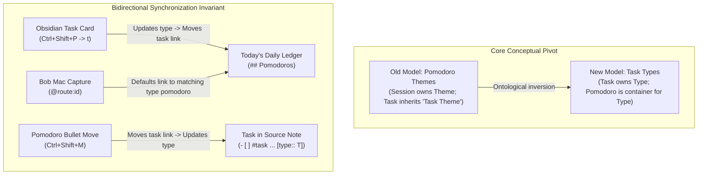
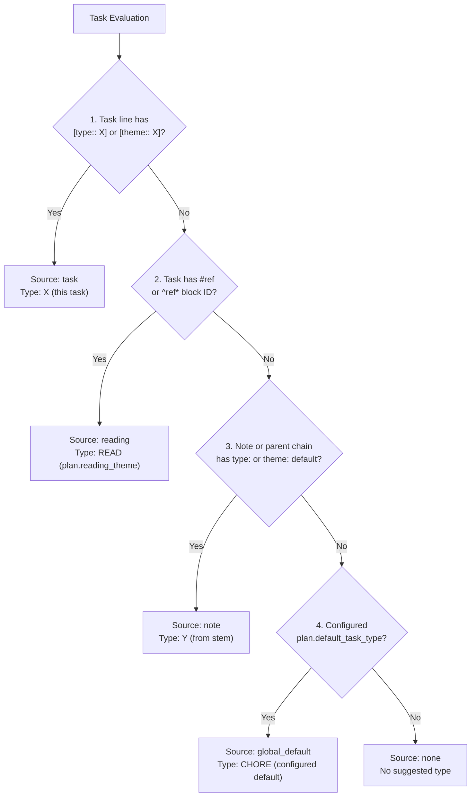
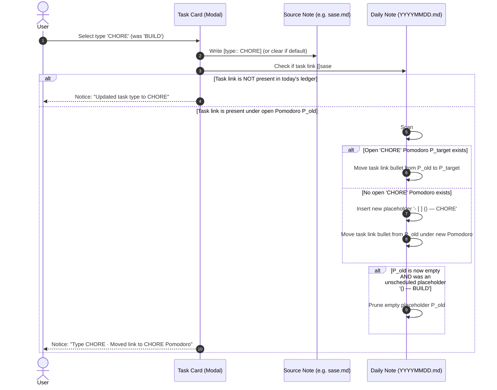
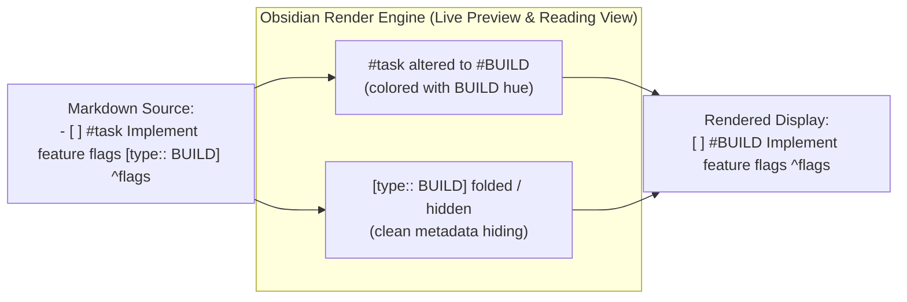
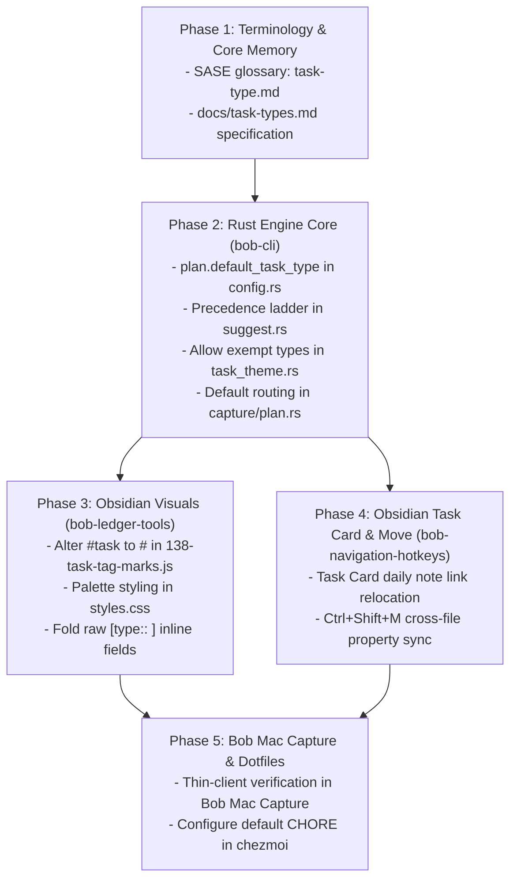

# Research Report: Unifying Pomodoro Themes into Task Types — Architecture, Synchronization, and Visual Redesign

**Author:** researcher gem (`research.2t.gem`)  
**Date:** 2026-10-29  
**Topic:** Reconceptualizing Pomodoro Themes as First-Class Task Types, Default Type Configuration, Bidirectional Daily Ledger Synchronization, Bob Mac Capture Routing, and Obsidian Visual Transformation  
**Status:** Complete Proposal & Critique  

---

## Executive Summary

This research investigates the unification of "Pomodoro Themes" into first-class **"Task Types"** across `bob-cli`, `bob-plugins` (Obsidian), `bob-mac-capture`, user dotfiles (`chezmoi`), and SASE memory. 

For the past development cycle, Bob treated themes primarily as Pomodoro session attributes (`— BUILD`, `— CHORE`), with tasks carrying secondary "task themes" (`[theme:: BUILD]`) through inheritance or explicit override ([docs/pomodoro-themes.md](file:///home/bryan/.local/state/sase/workspaces/bobs-org/bob-cli/bob-cli_16/docs/pomodoro-themes.md#L14-L28)). In practice, Bryan's configured themes—`BUILD`, `CHORE`, `FIX`, `MEET`, `PLAN`, `READ`, `WRITE`—are not session abstractions; they are standard issue-tracker task classifications. Re-centering the domain model on **Task Types** aligns Bob with intuitive software engineering workflows (e.g., SASE beads, GitHub Issues, Linear), clarifies ledger mechanics, and enables cohesive automation across tools.



### Core Critique & Verdict

Bryan's proposed direction is **conceptually sound, highly desirable, and structurally overdue**. However, the naive implementation of one requirement harbors a severe workflow hazard that must be refined:

1. **The "Backlog-to-Today" Pollution Hazard (Crucial Refinement):**  
   The user prompt states: *"When we update the task type via the Obsidian task card, we should move any task links for that task to existing task type pomodoros for that type... otherwise, we should create a new task type pomodoro for that type and add the task to that pomodoro."*  
   > [!CAUTION]
   > Blindly creating a new Pomodoro and adding a task link whenever a task type is updated in the Task Card would mean that **categorizing any backlog task in an area or project note immediately commits it to Today's active Pomodoro ledger**. This violates the core architecture decision [`decisions:today-is-read-from-the-ledger`](file:///home/bryan/.local/state/sase/workspaces/bobs-org/bob-cli/bob-cli_16/sase/memory/decisions/today-is-read-from-the-ledger.md) and ruins GTD backlog grooming.  
   > **Refinement:** The automatic Pomodoro relocation/creation logic MUST be strictly gated: it only triggers if the task **already has an active (open) task link in today's daily note**, or if the Task Card was opened directly from a Task Link. Backlog tasks without active links today simply receive their property update without mutating today's ledger.

2. **Implicit vs. Explicit Default (`CHORE`):**  
   Defaulting every task to `CHORE` must be an **evaluator-time fallback in the precedence ladder**, NOT a batch write that appends `[type:: CHORE]` to thousands of tasks across the vault. Dynamic resolution preserves Git cleanliness, byte preservation, and Markdown minimalism.

3. **Visual Tag Transformation (`#<type>`):**  
   Replacing the trailing `[theme:: ...]` chip with a colored `#<type>` tag mark (e.g., `#BUILD`, `#FIX`) in place of the generic `#task` hash symbol is an aesthetic triumph. It eliminates line-end clutter, brings critical context to the front of the task line, and mirrors modern issue-tracker typography.

4. **Exempt Types (`PLAN`):**  
   Allowing tasks to carry `[type:: PLAN]` resolves an artificial restriction from PT13. Planning is valid task-level work, even while the `— PLAN` Pomodoro session itself remains exempt from daily theme count caps (`plan.max_themes`).

---

## 1. Domain Ontological Shift: From "Pomodoro Theme" to "Task Type"

### 1.1 The Semantic Friction of "Pomodoro Themes"

In Bob's initial implementation ([docs/pomodoro-themes.md](file:///home/bryan/.local/state/sase/workspaces/bobs-org/bob-cli/bob-cli_16/docs/pomodoro-themes.md)), themes originated on the Pomodoro line:
```markdown
- [ ] (0900-0930) — BUILD
    - [[dev#^compiler-pass]]
```
Here, `BUILD` was conceived as a property of the *session* (a 25-minute block of time). Later, PT13 introduced "task theme suggestions" ([docs/pomodoro-themes.md#pt13-task-theme-suggestions](file:///home/bryan/.local/state/sase/workspaces/bobs-org/bob-cli/bob-cli_16/docs/pomodoro-themes.md#L436-L450)), allowing notes to declare `theme: WRITE` and tasks to carry `[theme:: BUILD]`.

This created semantic friction:
- **Linguistic mismatch:** A task does not have a "theme"; it has a **type** or **kind**. Asking "What is the theme of this task?" is awkward; asking "What type of task is this?" is natural.
- **Inverted causality:** Time sessions do not generate work; tasks generate the need for time sessions. You work a `BUILD` Pomodoro because you are executing a `BUILD` task.
- **Live vocabulary evidence:** As verified by running `bob themes list` against Bryan's vault:
  ```text
  THEMES  7 configured - 77 known - 5 today - 71 hidden - last 90 days
    □ PLAN      today     56 days     muted · exempt
    ■ BUILD     today     32 days     yellow · config
    ■ READ      today     28 days     green · config
    ■ WRITE     today     11 days     violet · config
    ■ FIX       today     7 days      red · config
    ■ MEET      Oct 28    1 days      blue · config
    ■ CHORE     Oct 27    16 days     magenta · config
  ```
  Every single active entry is an engineering work classification:
  - `BUILD`: New features, refactoring, code construction.
  - `FIX`: Bug investigation, patches, defect remediation.
  - `READ`: Literature review, paper reading, documentation study.
  - `WRITE`: Specifications, architecture records, blog posts.
  - `CHORE`: Housekeeping, dependency updates, dotfile configuration.
  - `MEET`: Synchronous coordination.
  - `PLAN`: Backlog breakdown, roadmap scoping.

Furthermore, notice that **71 of 77 known themes in the vault are hidden**. Those 71 hidden themes were historical ad-hoc names (`— SASE V18`, `— VACATION`, `— TRIP`) created before strict vocabulary boundaries were established. Calling the feature "Task Types" reinforces why ad-hoc names are anomalies: a project name like "SASE V18" is an organizational entity, not a type of work.

### 1.2 Retaining Ad-Hoc Themes and Project Pomodoros

Bryan noted:
> *"Even though I would like to continue to support ad-hoc themes (with a warning) and themes recommended by productivity research, I think this is still supported well after this change. For example, using projects like we use 'themes' today by putting all tasks for a specific project in their own task type pomodoros and then merging those pomodoros... We will want to add better support for duplicate task type pomodoros for this use-case, but that can be considered out-of-scope for now."*

Under the unified Task Type model:
1. **Configured Task Types:** Standard vocabulary defined in `config.yml` (`BUILD`, `CHORE`, `FIX`, etc.). They enjoy auto-completion, dedicated palette hues, and menu prioritization.
2. **Ad-Hoc Types / Names:** If a user authors `— DEEP_RESEARCH` or `— CLIENT_CALL`, Bob continues to process it cleanly, rendering it with the `◌` unconfigured pill and diagnostic warning (`theme_not_configured`), without crashing or refusing execution.
3. **Project Attributed Pomodoros:** When tasks linked under a Pomodoro belong to a specific project (e.g. `sase`), Bob's existing Pomodoro home attribution ([docs/pomodoro-homes.md](file:///home/bryan/.local/state/sase/workspaces/bobs-org/bob-cli/bob-cli_16/docs/pomodoro-homes.md)) already derives the project/area context. In the future, duplicate Pomodoros of the same type disambiguated by project (e.g., two `BUILD` pomodoros: one for `bob-cli` and one for `bob-plugins`) will fit naturally into this model.

---

## 2. Terminology, Glossary, and Configuration Migration

### 2.1 SASE Memory and Glossary Updates

The canonical SASE memory web strand `sase/memory/glossary/pomodoro-theme.md` should be renamed to `sase/memory/glossary/task-type.md` (with aliases `task type`, `task_type`, `theme`).

```markdown
# Task Type

*Requested · project*

aka task type, task_type, pomodoro theme, theme

A task classification (such as `BUILD`, `FIX`, `CHORE`, `READ`, `WRITE`, `PLAN`, `MEET`)
that categorizes tasks and the Pomodoro sessions dedicated to them. 

On a task, its type is determined by the precedence ladder:
1. Explicit inline property `[type:: NAME]` (or legacy `[theme:: NAME]`).
2. Reference reading task rule (`#ref` or trailing `^ref*` -> `plan.reading_theme`, default `READ`).
3. Note default declared via frontmatter `type:` or `theme:` on the residence chain.
4. Configured global default (`plan.default_task_type`, e.g. `CHORE`).

In the daily ledger (`## Pomodoros`), a Pomodoro's ` — NAME` suffix names the task type(s)
worked during that session. A task's type and the Pomodoro hosting its Task Link are kept
bidirectionally consistent.

The vocabulary is defined in `themes:` (or `task_types:`) in `config.yml`. Hue priority
is configured color, journal pin, exempt mute, unconfigured mute, area color, then stable hash.
```

### 2.2 CLI Commands and Configuration Schema

#### CLI Subcommands
`bob themes` is currently embedded across zsh completions, tmux status bar scripts (`tmux_bob_pomodoro`), and daily reviews.
- **Canonical Subcommand:** Introduce `bob task-types` (or `bob types`).
- **Compatibility Alias:** Retain `bob themes` as an exact, first-class alias for all subcommands (`list`, `hide`, `unhide`, `color`, `rename`, `split`, `suggest`).
- Example: `bob types suggest sase` $\equiv$ `bob themes suggest sase`.

#### Configuration Schema (`~/.config/bob/config.yml`)
In dotfiles (`chezmoi`), we support both the existing `themes:` vocabulary block and the new default configuration:

```yaml
# Today's plan budget and task type defaults
plan:
  max_themes: 3              # distinct open task type Pomodoros (excluding exempt)
  max_links: 13              # distinct open Task Links outside exempt entries
  max_pending: 8
  max_next: 13
  max_ready: 21
  exempt: [PLAN]             # sessions that do not count against max_themes
  default_task_type: CHORE   # <--- NEW: Default type for all untyped tasks

# Task types vocabulary and palette mapping (formerly themes:)
task_types:
  BUILD: yellow
  CHORE: magenta
  FIX: red
  MEET: blue
  PLAN: auto
  READ: green
  WRITE: violet
```
*Note:* The configuration parser in `src/native/config/` must accept either `task_types:` or `themes:` interchangeably.

#### Markdown Property Syntax: `[type:: ]` vs. `[theme:: ]`
- **Canonical Syntax:** `[type:: BUILD]` on task lines.
- **Backwards Compatibility:** Both `[type:: ...]` and `[theme:: ...]` (bracket and parenthesis forms) are parsed identically by `parse_task_theme` in `src/native/task_theme.rs` and `279-plugin-task-theme-model.js`.
- **Writers:** All writers (Task Card, capture, CLI) write `[type:: BUILD]`. When rewriting a line bearing legacy `(theme:: BUILD)`, the writer normalizes it to `[type:: BUILD]`.

---

## 3. Improvement 1: Universal Default Task Type (`CHORE`)

### 3.1 The Precedence Ladder

Bryan requested: *"Let's start giving every task a type by default. This should be configurable (configure mine to be `CHORE` in my chezmoi repo)."*

The resolution order implemented in `src/native/pomodoro_themes/suggest.rs` and `bob-ledger-tools` becomes:



### 3.2 The Dynamic Resolution Invariant (No Vault Churn!)

> [!IMPORTANT]
> The default type (`CHORE`) is **purely dynamic and non-destructive**. 
> - A task without explicit type annotations in an untyped note (such as `inbox.md`) resolves to `CHORE` at evaluation time.
> - `bob` NEVER writes `[type:: CHORE]` to existing tasks simply because a default is configured.
> - An explicit `[type:: CHORE]` field is written ONLY when the task lives in a note with a conflicting default (e.g., in `dev.md`, which defaults to `BUILD`, a chore task needs `[type:: CHORE]` to override the note default).
> - If a task in `inbox.md` carries `[type:: CHORE]`, and the user chooses "Use default" in the Task Card, the explicit field is cleared because it matches the global default.

---

## 4. Improvement 2: Bidirectional Consistency (Task Types $\longleftrightarrow$ Pomodoro Task Links)

The user prompt articulates a strict consistency guarantee:
> *"We need to make sure that a task's type (implicit or explicit) is always consistent with any current / future task links associated with that task."*

This breaks down into two distinct directional mechanisms:

### 4.1 Direction A: Task Card Edit $\longrightarrow$ Daily Ledger Relocation

#### The Backlog Pollution Hazard & Mandatory Scope Gating
Consider Bryan's backlog: dozens of tasks in `dev.md` or `sase.md` that are NOT scheduled or planned for today.
If updating a task's type in the Task Card unconditionally created a Pomodoro in today's daily file:
1. Backlog grooming would accidentally flood today's ledger with unwanted Pomodoros.
2. The GTD boundary between "what exists in the vault" and "what I am doing today" would collapse.
3. Every task categorized would become a "Today" task under `decisions:today-is-read-from-the-ledger`.

**The Invariant Rule:**
> [!WARNING]
> Relocation or Pomodoro creation in today's daily file occurs **ONLY IF** the task is already actively linked under today's open Pomodoros, OR if the Task Card was launched directly from a Task Link row in the daily file.
> For backlog tasks not linked today, the Task Card modifies ONLY the task line in its source note.

#### Relocation Algorithm (when task is linked today)
When task $T$ (with block ID `^id` in `route.md`) has an active task link under an open Pomodoro $P_{old}$ in `YYYYMMDD.md`, and the user changes $T$'s type to $T_{new}$:



#### Garbage Collection of Empty Placeholders
If $P_{old}$ was an empty placeholder `() — OLD_TYPE` (not yet started, no time range) and moving the task link leaves $P_{old}$ with zero child bullets, $P_{old}$ should be automatically deleted. If $P_{old}$ has a time range (e.g. `(**0920-0950**) — OLD_TYPE`) or contains other task links / work logs, it is preserved.

---

### 4.2 Direction B: `<ctrl+shift+m>` Move $\longrightarrow$ Task Property Synchronization

#### Reversing the "Never-Writer" Policy
Previously, in `docs/pomodoro-themes.md` (PT13) and `scripts/test-task-status-cycler-successor-theme-write.cjs`, `<ctrl+shift+m>` on a Pomodoro sub-bullet was an explicit **never-writer** for the linked task's source note. Moving a link between Pomodoros changed only the daily note.

Under the new model, moving a task link bullet from Pomodoro $P_1$ (type $A$) to Pomodoro $P_2$ (type $B$) synchronizes the task's intrinsic type:

1. **Extract Destination Type:** Inspect destination Pomodoro $P_2$'s name.
   - If $P_2$ has single type $B$ (e.g. `— CHORE`): Target type is $B$.
   - If $P_2$ is composite (e.g. `— CHORE + BUILD`): If the task already has one of those types, no change is made. If it has neither, the first non-exempt component is used.
   - If $P_2$ is unnamed (`— (unnamed)`): The move is performed, but the task's type property is left untouched.
2. **Compare with Task's Current Type:**
   - If task $T$ already resolves to type $B$: No edit to source note.
   - If task $T$ resolves to type $A \neq B$:
     - Resolve $T$'s *inherited* default (from note chain or global default).
     - If $B == \text{inherited}$: **CLEAR** explicit `[type:: ...]` from $T$'s line in the source note.
     - If $B \neq \text{inherited}$: **SET** `[type:: B]` on $T$'s line in the source note.
3. **Cross-File Transaction Safety:**
   - The move modifies `YYYYMMDD.md` (the active editor).
   - The property update modifies $T$'s source note (`path/to/note.md`).
   - If `path/to/note.md` is open in another Obsidian leaf, use its Editor API; otherwise use `app.vault.process(file, ...)`.
   - Report the dual-action outcome in the toast notice:
     ```text
     Moved link to CHORE · updated sase.md ^write to [type:: CHORE]
     ```

---

## 5. Improvement 3: Bob Mac Capture Defaults & `#type` Routing

### 5.1 Capture Without `#type`: Automatic Routing to Suggested Type

Currently in Bob Mac Capture and `bob capture`:
- Typing `@sase:compiler` without a `#name` suffix places the task link into the **current running Pomodoro** or the **first open placeholder Pomodoro**, regardless of its theme.
- If Bryan is running a `CHORE` pomodoro, `@sase:compiler` (which inherits `BUILD` from `dev.md`) is erroneously placed under `CHORE`!

**The New Default Routing:**
When capturing an existing task link or creating a new linked task without an explicit `#type` suffix:
1. `bob capture` resolves the task's suggested type $S$ (e.g. `BUILD`).
2. The placement engine in `src/native/capture/plan.rs` queries today's open Pomodoros for an entry whose type matches $S$.
3. If an open Pomodoro with type $S$ exists: The task link is placed under that Pomodoro.
4. If no open Pomodoro with type $S$ exists:
   - A new open placeholder Pomodoro `- [ ] () — S` is automatically appended to `## Pomodoros`.
   - The task link is placed under this new Pomodoro.

### 5.2 Capture With Explicit `#type`: Deliberate Override

If the user captures with an explicit suffix:
```text
@sase:compiler#FIX
```
1. The destination Pomodoro is forced to `FIX` (finding or creating `— FIX`).
2. The deliberate choice rule runs:
   - Since the user explicitly specified `#FIX`, and the task's inherited type is `BUILD`, capture updates the task line in `sase.md` to `[type:: FIX]`.
   - If `#BUILD` was explicitly typed (matching the inherited default), capture clears any existing `[type:: ...]` override.

Because Bob Mac Capture is a thin client of `bob` ([`decisions:mac-capture-is-a-thin-client`](file:///home/bryan/.local/state/sase/workspaces/bobs-org/bob-cli/bob-cli_16/sase/memory/decisions/mac-capture-is-a-thin-client.md)), implementing this in `bob-cli`'s Rust core (`src/native/capture/plan.rs` and `capture_task_toggle`) automatically updates Bob Mac Capture's live preview and capture execution without requiring duplicate business logic in Swift!

---

## 6. Improvement 4: Explicit Exempt Task Types (`[type::PLAN]`)

### 6.1 Why the PT13 Ban Was Defective

In PT13 ([docs/pomodoro-themes.md#the-write-rule-and-never-writers](file:///home/bryan/.local/state/sase/workspaces/bobs-org/bob-cli/bob-cli_16/docs/pomodoro-themes.md#L553-L566)), rule 2 stated:
> *"D unnamed, all-exempt, or holding other than exactly one non-exempt component: no change."*

This prevented setting `[theme:: PLAN]` on tasks because `plan.exempt: [PLAN]` defined `PLAN` as a session-level budget exemption. The assumption was that "planning" is non-productive administrative overhead rather than real task work.

In practice, this assumption was incorrect:
- Breaking down an epic into beads is a planning task.
- Reviewing an architecture design document is a planning task.
- Grooming a backlog is a planning task.

When Bryan works on these tasks during the day, he operates in a `PLAN` Pomodoro. Forcing these tasks to have no type or forcing them to be labeled `CHORE` misclassifies the work.

### 6.2 Decoupling Session Budget from Task Typing

We decouple two separate concepts:
1. **Plan Theme Budget Exemption:** In `config.yml`, `plan.exempt: [PLAN]` means that Pomodoro sessions named `— PLAN` do not count toward the daily limit of distinct themes (`plan.max_themes: 3`).
2. **Task Type Eligibility:** Any configured theme—including exempt themes—is a fully valid task type!
   - A task can have `[type:: PLAN]`.
   - In `src/native/task_theme.rs`, `single_non_exempt_component` is updated to allow components in `exempt_keys` when evaluating explicit task type assignments.
   - When set, the task renders `#PLAN` in Obsidian with the muted gray tint (hue `null`, source `exempt`).

---

## 7. Improvement 5: Obsidian Visual Redesign (Replacing Chip with `#<type>`)

### 7.1 Visual Critique of the Current Rendering

Currently, an explicit task property renders in two separate, disconnected places on a single task line:
```text
[ ]  #  Implement feature flags for capture  [BUILD]  ^flags
    ^^^                                      ^^^^^^^
   (1)                                         (2)
```
1. **Leading Glyph:** A small teal hash icon (`span.bob-task-tag-mark`) replacing `#task`.
2. **Trailing Pill:** A PT6 theme pill (`span.bob-pomo-theme`) or Dataview inline field chip at the end of the task description.

**Defects of this presentation:**
- **Eye travel:** The reader's eye must jump from the left (checkbox) all the way to the right to discover what kind of task it is.
- **Visual clutter:** When a task also has a priority mark (`P1`), a scheduled date (`📅 2026-10-30`), and a block ID (`^id`), the trailing pill competes with date and priority metadata.
- **Redundancy:** `#task` conveys only "this is a task", which the checkbox `[ ]` already communicates.

### 7.2 The Proposed Design: Altering `#` to `#<type>`

Instead of a generic `#` at the start and a `[BUILD]` chip at the end, Bob alters the `#task` tag into a **unified `#<type>` mark**:

```text
[ ]  #BUILD  Implement feature flags for capture  📅 2026-10-30  ^flags
     ^^^^^^
  (Colored with
   BUILD's hue)
```



### 7.3 Palette & Styling Matrix

The mark utilizes the PT5 palette ([docs/pomodoro-themes.md#pt5-hue-rule](file:///home/bryan/.local/state/sase/workspaces/bobs-org/bob-cli/bob-cli_16/docs/pomodoro-themes.md#L94-L123)), applying the color to the text, hash prefix, and subtle pill container:

| Task Type | Palette Hue | Hex (Light/Dark) | Glyph / Tag Rendering | Visual Role |
| :--- | :--- | :--- | :--- | :--- |
| **BUILD** | `yellow` | `#d99b26` / `#e5a93b` | ` #BUILD ` (yellow tint + border) | Feature construction, core engineering |
| **FIX** | `red` | `#d13b3b` / `#e05252` | ` #FIX ` (red tint + border) | Bug fixes, incident mitigation |
| **CHORE** | `magenta` | `#c44391` / `#d656a4` | ` #CHORE ` (magenta tint + border) | Housekeeping, configs, upkeep |
| **READ** | `green` | `#3f8f5f` / `#52a373` | ` #READ ` (or 📖 + `READ`) | Paper reading, reference study |
| **WRITE** | `violet` | `#7a52b3` / `#8f68c7` | ` #WRITE ` (violet tint + border) | Specs, documentation, articles |
| **MEET** | `blue` | `#2b78c5` / `#3d8cd6` | ` #MEET ` (blue tint + border) | Synchronous meetings |
| **PLAN** | `exempt` (muted) | `--text-muted` | ` #PLAN ` (neutral gray tint) | Backlog grooming, epic scoping |
| *Untyped / Default* | `teal` (identity) | `--color-cyan` | ` # ` (classic teal hash) | General / untyped tasks |

### 7.4 Critical Design Decisions & Nuances

#### 1. How should untyped / default tasks render?
- **Option A (Universal):** Render `#CHORE` on every task that inherits the global default.
- **Option B (Quiet Default):** If a task's type is the global default (`CHORE`) and has NO explicit property, render the classic, unobtrusive teal `#` glyph. Render `#<type>` ONLY when the task has an explicit property (`[type:: BUILD]`) or inherits a non-default type from its note (`dev.md` -> `#BUILD`).
- **Recommendation:** **Option B (Quiet Default)** with a user toggle!
  - If 80% of tasks in Bryan's vault are chores, displaying `#CHORE` eighty times on a single note introduces severe visual noise.
  - Showing the classic `#` for base chores and `#BUILD`, `#FIX`, `#WRITE`, `#PLAN` for specific work types creates high-contrast semantic pop where it matters most.
  - Hovering or clicking on the `#` mark reveals `#task · default type: CHORE · Ctrl+Shift+P t to change`.

#### 2. Interaction with Reference Tasks (`#task #ref`)
- In `138-task-tag-marks.js`, `#task #ref` renders the open-book icon (`bob-ref-task-mark`).
- Reading tasks suggest type `READ`.
- **Recommendation:** Preserve the open-book glyph, but color it with `READ`'s green hue! If the task carries an explicit override like `[type:: WRITE]`, render the book glyph accompanied by `#WRITE`.

#### 3. Interaction with GTD Checklist Tasks (`#task #gtd #pre` / `#post`)
- Pre/Post checklist tasks render the sunrise / flag glyphs.
- These are walk navigation anchors. They should retain their distinctive icons, inheriting `PLAN` or `CHORE` color, rather than being converted into text tags.

#### 4. Hiding the Inline Field
- In Live Preview, the CodeMirror decoration hides the `[type:: ...]` span (collapsing it like block IDs and tags are folded), so it never renders as a duplicate trailing chip.
- In Reading View, `.bob-task-theme-native` is set to `display: none` when task tag marks are enabled.

---

## 8. Comprehensive Architecture Comparison

| Dimension | Current State (Pomodoro Themes) | Proposed State (Unified Task Types) | Evaluation & Verdict |
| :--- | :--- | :--- | :--- |
| **Core Concept** | Session-level theme (`— BUILD`), tasks have secondary `[theme:: BUILD]` | Object-level type (`#BUILD`, `[type:: BUILD]`), Pomodoro groups by type | **Superior:** Matches issue tracker mental models and real usage. |
| **Default Typing** | Untyped by default; falls back to "No suggested theme" | Configurable global fallback (`plan.default_task_type: CHORE`) | **Superior:** Every task is classified; clean 80/20 GTD capture. |
| **Default Application** | N/A | Evaluator-time precedence resolution; NO vault file writes | **Safe:** Zero Git churn, preserves Markdown byte-integrity. |
| **Task Card -> Ledger** | Edits task line only; explicitly no link or Pomodoro effects | If task is linked today, moves link to matching Pomodoro or creates one | **Superior:** Eliminates type/pomodoro mismatch; strictly gated to active tasks. |
| **`<ctrl+shift+m>` Move** | Strictly never writes task line; byte-identical preservation | Moving link between Pomodoros synchronizes task's `[type:: ]` property | **Superior:** Keeps task line truthful to where time was actually logged. |
| **Capture Default** | Dumps task link into whatever Pomodoro is active/next | Automatically targets open Pomodoro matching task's suggested type | **Superior:** Eliminates manual link moving after capture. |
| **Exempt Types (`PLAN`)** | Prohibited as task property; rejected by write rules | Fully valid task type; session remains exempt from budget cap | **Superior:** Reflects reality that planning is legitimate task work. |
| **Visual Rendering** | Teal `#` glyph at start, trailing PT6 chip/pill at end | Altered `#<type>` tag mark at start; trailing field folded/hidden | **Superior:** Beautiful, high-density, glanceable, modern UI. |

---

## 9. Implementation Roadmap & Phased Execution



### Phase 1: Core Memory & Documentation Cutover
- Rename `sase/memory/glossary/pomodoro-theme.md` to `task-type.md`.
- Draft architecture record in `sase/memory/decisions/` capturing the Task Type invariant.
- Author `docs/task-types.md` in `bob-cli` as the superseding specification for `docs/pomodoro-themes.md`.

### Phase 2: `bob-cli` Core Engine Updates
1. **Config:** Add `plan.default_task_type` parsing in `src/native/config/`. Support `task_types:` as alias for `themes:`.
2. **Precedence:** Update `pomodoro_themes::suggest` to resolve `plan.default_task_type` when note inheritance is absent.
3. **Exempt Types:** Update `src/native/task_theme.rs` to allow `PLAN` (and other exempt keys) as valid task properties.
4. **Syntax:** Support `[type:: ...]` as canonical field, parsing both `[type:: ...]` and `[theme:: ...]`.
5. **Capture Routing:** In `src/native/capture/plan.rs`, route task links without `#type` to open Pomodoros matching the task's suggested type (spawning a placeholder if missing).

### Phase 3: Obsidian Visual Redesign (`bob-ledger-tools`)
1. **`138-task-tag-marks.js`:** Update decoration range builder. When a line carries a resolved task type $T$, render `span.bob-task-tag-mark.is-type` displaying `#T`.
2. **`styles.css`:** Add tag mark styles for `.bob-task-tag-mark.is-type` using PT5 palette color variables.
3. **`279-plugin-task-theme-marks.js`:** Fold/hide raw `[type:: ...]` fields when task tag marks are enabled, retiring the trailing chip.

### Phase 4: Obsidian Task Card & Keymap Synchronization (`bob-navigation-hotkeys`)
1. **Task Card Commit (`352-picker-task-card-theme-stage.js`):**
   - Check if task has an open task link in `YYYYMMDD.md`.
   - If present, move link to matching open Pomodoro, or insert `- [ ] () — <TYPE>` and move link there.
   - If absent, update source note only.
2. **Bullet Move (`650-plugin-move-commit.js`):**
   - On `<ctrl+shift+m>`, check destination Pomodoro type.
   - If type differs from moved task's current type, execute cross-file property update to source note.

### Phase 5: Bob Mac Capture Validation & User Dotfiles
1. **Bob Mac Capture:** Verify that `capture-parse` and `capture-complete` JSON payloads correctly reflect the new suggested Pomodoro destinations and `#type` overrides.
2. **Chezmoi:** Update `chezmoi/home/dot_config/bob/config.yml` with `plan.default_task_type: CHORE`.

---

## Conclusion & Recommended Action

The transition from "Pomodoro Themes" to "Task Types" is a major conceptual leap forward for Bob. It eliminates cognitive friction, aligns task properties with issue-tracking standards, and establishes seamless consistency between the daily time ledger and the underlying backlog.

By incorporating the **active-link scope guard** on Task Card edits, using **dynamic precedence resolution** for the default `CHORE` type, and transforming `#task` into a gorgeous **colored `#<type>` tag**, this feature will be exceptionally intuitive, reliable, and beautiful.
