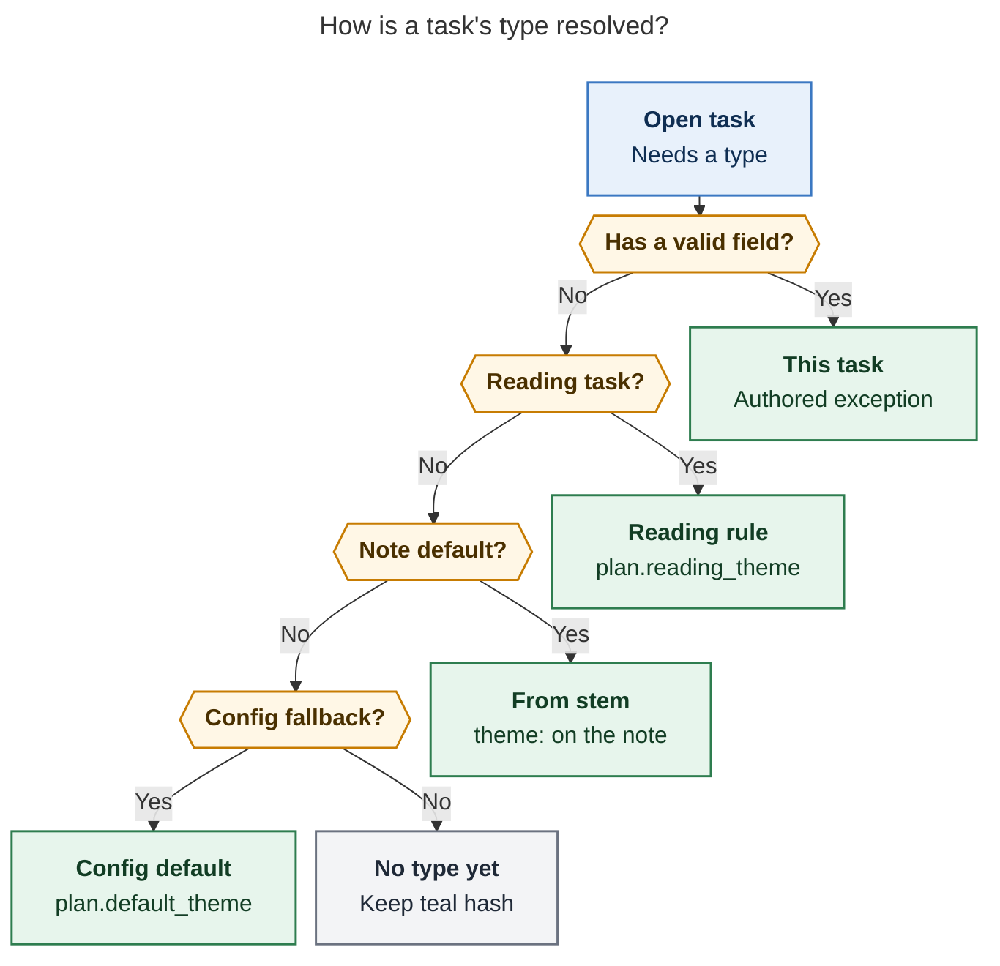
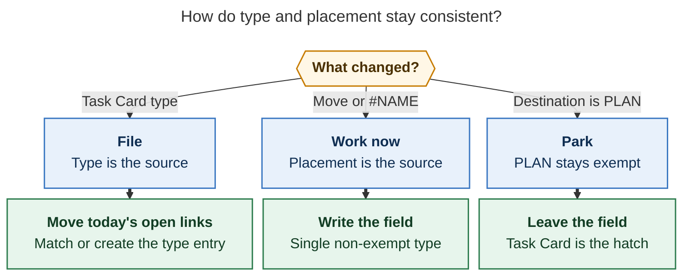

# Task types share the theme vocabulary

> Independent swarm report (`grk`). 2026-10-29.
> Query: treat Pomodoro themes as task types, give every task a type, keep type
> and Task Links consistent, render `#BUILD` in the identity slot, and design
> the feature so it is intuitive, reliable, and beautiful.

## Bottom line

**Build it, with the type living on the task and the theme remaining a session
name.** Bryan's configured vocabulary is already a work-kind set
(BUILD / FIX / READ / WRITE / CHORE / PLAN / MEET). Calling that set a *task
type* matches how GitHub, Jira, Linear, and Conventional Commits name the
same idea, and it matches the six-month audit that retired purpose names
(JOB, HOME, GTD) in favor of kinds of work.

The original plan collapses two objects that still need different shapes.
A **task type** is one kind per task. A **Pomodoro theme** is one
`+`-separated component of a session's ` — NAME` tail: it can be composite
(`BUILD + FIX`), unnamed, inventory, ad-hoc, or exempt. Keep both words.
Share one vocabulary. Couple them through one bob-owned planner.

**Recommended solution.** Resolve a type for every open task (field, then
reading rule, then note `theme:`, then `plan.default_theme: CHORE`). Render
that resolved type in the `#task` identity slot as a PT6-tinted `#BUILD`.
Write `[theme::]` only for exceptions. File today's open links when the Task
Card changes type. Update the field when a move or `#NAME` lands on a single
non-exempt type. Park under PLAN without rewriting the field, unless the
user named PLAN on the Task Card or with `#PLAN`.

## Verdict

The insight is right for *this* vault. The current themes were chosen as
kinds of work, the Task Card already has a Theme stage, capture already
writes `[theme::]` on a deliberate named destination, and Mac Capture
already preselects a suggested row. The missing product is the last mile:
every task *looks* typed, today's links *follow* a type change, and a move
into FIX *remembers* FIX.

A hard rename of "Pomodoro theme" into "task type" would be the wrong
shape. Session names, the plan budget, Stats, hide/color/rename, and
composite tails are theme machinery. Issue trackers keep type as one
single-select field and keep other grouping (labels, projects, epics) as
separate objects. Bob already has those other objects: homes (`root_parent`)
answer *what for*; themes/types answer *what kind*.

## Requirement adjustments

Each change below is a justified edit to the original request. The rest of
the request stands.

| ID | Original request | Adjustment | Why |
| --- | --- | --- | --- |
| A1 | Rename the glossary entry "Pomodoro Theme" to "Task Type" | Keep **Pomodoro Theme**. Add **Task Type** as a sibling, cross-linked, sharing the vocabulary | A theme is a session-name component (PT1). A type is a per-task classification. Composites, unnamed entries, inventory labels, and `bob themes` need the session word |
| A2 | Store `[type:: PLAN]` | Keep storing `[theme:: NAME]` and note frontmatter `theme:` | Area/project notes already use `type: "[[area]]"` / `type: "[[project]]"`. Dataview `task.type` inherits that page field. A live query of `dev.md` shows every task as `theme: BUILD` and `type: [[area.md\|area]]` with no inline field. `[type::]` would make "type" mean note kind on most rows |
| A3 | Give every task a type by writing a default onto the line | Resolve a type for display and menus. Write a field only when the type differs from inheritance | Zero tasks currently carry `[theme::]` or `[type::]`. Backfilling CHORE onto inbox tasks would freeze CHORE after the task moves to `dev` (which defaults to BUILD). Prior suggestion research: a remembered exception matched later links 88% of the time; a static default matched 61% |
| A4 | Configure the default as a chezmoi `CHORE` | Add `plan.default_theme: CHORE` as cascade step 4, after the note default | Note defaults already cover the important homes (`dev` BUILD, `sase_blog` WRITE, `gtd_daily` PLAN, `job_2026` CHORE). A global write would fight those |
| A5 | Mac Capture always adds the new Task Link to the suggested-type Pomodoro | **Match-running-else-suggested.** If the running or next single-type entry already is the resolved type, link there. Otherwise the first exact type entry, else create | PT13 already specifies this menu. Always-suggested would yank a BUILD task out of a running BUILD session the moment a leftover CHORE suggestion appeared, and it would fight "work this now" |
| A6 | Any move into a differently typed Pomodoro updates the task field | Update on a **single non-exempt** destination. A move into PLAN parks the link and leaves the field | PLAN exemption exists so planning does not spend a theme slot and does not stamp every parked task as a planning task (`research:202610/plan_theme_exemption.md`). Task Card `t` and explicit `#PLAN` remain the write hatch |
| A7 | Render `#<type>` when the task has the `type` property | Render `#BUILD` from the **resolved** type, including inherited and the config default. Keep stored `#task`. Hide Dataview inherited `theme \| NAME` and `type \| area` chips | With zero explicit fields, "only when the property exists" would leave the identity slot teal and the chip noise untouched. The chip people see today is Dataview inheriting page `theme:` / `type:` |
| A8 | Duplicate type Pomodoros and project-name-on-merge | Stay out of scope, as requested | Today's `duplicate_open_pomodoro_name` lint and Ctrl+X ` + ` merge already define the interim behavior. File-mode uses PT13 order: running exact, else first exact in ledger order, else create |
| A9 | Rename `bob themes` to a types command | Keep `bob themes`. User-facing copy may say "type" | CLI rule: never hard-rename; the old spelling becomes a hidden alias. JSON keeps `task_theme` additively |

## What exists today

### Two objects, one vocabulary

A **Pomodoro theme** is one `+`-separated component of a named ledger
entry's ` — NAME` tail, keyed by `normalize_component`
([glossary:theme](glossary:theme), `docs/pomodoro-themes.md` PT1).
`plan.max_themes` counts distinct non-exempt components. `plan.exempt`
defaults to `[PLAN]`. The catalog is canonical daily notes plus
`.bob/themes/<host>.jsonl`. Hue is config, then pin, then exempt mute,
then unconfigured mute, then top-level area, then hash
(`decisions:theme-hue-is-config-pin-exempt-area-hash`).

A **task theme field** is the exception store. PT13 resolves a suggestion
in this order:

1. Valid `[theme:: X]` / `(theme:: X)` — source `task`, label `this task`
2. Reading task (`#ref` or `^ref` / `^ref-*`) — `plan.reading_theme` (default READ)
3. First valid `theme:` on the area/project residence chain (`theme: off` stops)
4. None

`plan.rs` has no `default_theme` today. Closed tasks keep the field as
history and have no suggestion.

### The write rule

`plan_theme_change` in `src/native/task_theme.rs` writes only when the
choice is deliberate and the destination has exactly one non-exempt
component. Unnamed, all-exempt (`PLAN`), and composites (`BUILD + FIX`)
are no-ops. Choosing the inherited name clears the field. Capture applies
this only when `destination_name` is present (`src/native/capture/task_theme.rs`):
an implicit `@route:id` still links under the current or next timed open
entry (`docs/capture.md`) and never writes the field.

PT13 names the Task Card as the escape hatch for the "suggestion was
shown" guard. The shipped Task Card does **not** escape the
single-non-exempt rule: `bob-plugins/docs/task-card.md` says a theme-only
edit follows that rule, writes only `[theme::]`, and **never moves Task
Links**. Selecting PLAN in the Theme stage is therefore a no-op today.
That is the bug the "explicit PLAN" request is pointing at.

### Display

`#task` is the Tasks `globalFilter`. About 3,400 lines start with it.
bob-ledger-tools replaces the accent pill with one teal identity hash
(`docs/task-tag-marks.md`). The mark is display-only, one constant
identity ink, and it never encodes status. Specialized partners occupy
the same slot: `#task #ref` becomes a book; `#task #gtd #pre` / `#post`
become a sunrise or flag.

Explicit `[theme::]` fields get PT6 pills (tint behind normal-colored
text; hue is never the text color). Inherited values are forbidden from
becoming ghost pills. A Dataview `theme | NAME` chip is replaced only
when it is an explicit task-line field; page-default `task.theme` is
left alone (`docs/develop/plugins/plugin-apis.md`). That leftover chip
is the visual complaint: people see a BUILD chip on every `dev.md` task
even though the line has no field.

### Clients

Mac Capture is a thin client of bob (`decisions:mac-capture-is-a-thin-client`).
In `pomodoro_name` context it preselects Bob's `theme_suggestion` row
(`bob-mac-capture/docs/task-pickers.md`) and never writes a field itself.
Idle capture still links a bare task to current/next. Ctrl+Shift+M on a
Pomodoro sub-bullet moves bullets into another open entry or a new named
one (`docs/reference/plugins/bob-navigation-hotkeys.md`) and is a
PT13 never-writer for the theme field.

Chezmoi `home/dot_config/bob/config.yml` already has the vocabulary and
the exemption:

```yaml
plan:
  max_themes: 3
  exempt: [PLAN]
themes:
  BUILD: yellow
  CHORE: magenta
  FIX: red
  MEET: blue
  PLAN: auto
  READ: green
  WRITE: violet
```

`reading_theme` is unset, so the default READ rule applies.

## Live vault evidence (2026-10-29)

Read-only `bob query` against the default vault:

- **Seven notes declare `theme:`.** `dev.md` BUILD (area),
  `dev_plex_hack_patch.md` CHORE (project), `gtd_daily.md` PLAN (area),
  `job.md` WRITE (area), `job_2026.md` CHORE (project), `love.md` CHORE
  (area), `sase_blog.md` WRITE (project).
- **Zero task lines contain `theme::` or `type::`.** The exception store
  is unused. Suggestion is doing all the work, silently.
- **Dataview inheritance is live.** Flattening `dev.md` tasks yields
  `theme: BUILD` and `type: [[area.md|area]]` on rows such as
  `#task Restart athena!` with no inline field.

Those three facts together are the design constraint. A default that
writes CHORE onto every line would fight the seven note defaults. A
stored `[type::]` key would collide with note `type:`. A display that
waits for an explicit property would change nothing on 3,400 lines.

## External models

Issue trackers converged on a **single-select type**, distinct from
multi-select labels, with a small org-wide vocabulary.

- **GitHub** shipped issue types as an organization-level field in 2025
  (defaults Task, Bug, Feature; max 25; one type per issue; color and
  description; search `type:"Bug"`). Labels remain many-valued. Issue
  fields can be pinned per type. Types show on the issue itself and in
  lists. See [Managing issue types in an organization](https://docs.github.com/en/issues/tracking-your-work-with-issues/using-issues/managing-issue-types-in-an-organization)
  and the Issues quickstart "Adding issue types" sidebar.
- **Jira** (now "work types") uses Epic / Story / Task / Bug / Sub-task
  as hierarchy *and* kind. Story vs Task is user-facing value vs enabling
  work. Bob already has hierarchy as area/project notes and `^prj`.
  Mapping Jira's Task onto Bob's CHORE, Bug onto FIX, and Story onto
  BUILD/WRITE is close; Epic stays a project note.
- **Linear** has no first-class issue type. Teams emulate it with a
  single-select **label group** named Type. That is the closest cousin
  of Bob's `themes:` block plus one field.
- **Conventional Commits** requires a type noun (`feat`, `fix`, plus
  community `docs`, `chore`, `ci`, …). Angular dropped `chore` in 2017
  because it was "overused by everyone on the team"
  ([conventionalcommits.org#303](https://github.com/conventional-commits/conventionalcommits.org/issues/303)).
  Bryan's mapping is BUILD≈feat, FIX≈fix, WRITE≈docs, CHORE≈chore, with
  READ / PLAN / MEET as vault-specific extras. A global CHORE default
  has the Angular failure mode only if note defaults stop winning.
  They should keep winning.
- **Cal Newport** deep vs shallow is an *attention* axis. Work-kind is a
  *content* axis. Keep them apart: a BUILD session can be deep or
  shallow; PLAN is already the exempt shallow/meta bucket.

GitHub's lesson for Bob: type is required-looking, single-select, colored,
and distinct from the project (home) and from labels (relations, `#prj`,
priority). Bob already has the vocabulary. It does not yet *look*
required, and the two write directions (type→link, link→type) are
incomplete.

## Prior Bob research this report builds on

- `research:202610/work_kind_pomodoro_theme_set/work_kind_pomodoro_theme_set.md`
  — six kinds PLAN/BUILD/FIX/READ/WRITE/CHORE; CHORE is about 1% of
  recorded time; BUILD is about half. A junk-drawer default is honest
  for unclassified inbox rows.
- `research:202610/task_theme_suggestions_and_overrides/task_theme_suggestions_and_overrides.md`
  — inherit, explain, remember exceptions. Remembered field 88% vs
  static default 61% on later-day links. Never call the field a "pin".
- `research:202610/plan_theme_exemption.md`
  — keep PLAN exempt from the budget; placement under PLAN should not
  stamp `[theme:: PLAN]`; Task Card / note default remain the PLAN
  writers.

## Recommended solution

### 1. Two glossary entries, one vocabulary

**Pomodoro Theme** (keep). Session-name component. Catalog, hue, hide,
rename, Stats, plan budget, composites.

**Task Type** (add). The kind of work a task is. Resolved by the cascade
below. User-facing word in the Task Card, capture notices, hover text,
and this report: **type**. Stored key: `theme`. CLI noun: `bob themes`.
JSON: `task_theme`.

Cross-link: a type name is a theme name. Creating an ad-hoc type creates
an ad-hoc theme and still warns `theme_not_configured`. Productivity
research themes (the configured seven) stay first-class because they
are the `themes:` block.

The Task Card stage currently labeled Theme becomes **Type**. The header
line `Theme [X] from note` becomes `Type [X] from note`. Keyboard `t`
stays.

### 2. Resolution cascade

Add one step to PT13. First match wins:

1. Valid task field — authored exception
2. Reading task — `plan.reading_theme` (default READ, `off` disables)
3. Note default — `theme:` up the residence chain
4. **Config default — `plan.default_theme`** (chezmoi: `CHORE`; `off` or
   absent keeps today's "none")
5. None — identity slot stays the teal `#task` hash

Closed tasks keep history and skip the cascade.



*A task's type is the first match among an explicit field, a reading-task
rule, a note default, and `plan.default_theme`. With no match, the teal
hash stays. Measured SVG 776×1046 px, fit 84.1%. PNG export failed in
this environment after a Puppeteer connection drop; the SVG was checked
against the source.*



Inbox rows with no note default display as CHORE without a field. After
Ctrl+Shift+M into `dev.md`, the same line displays as BUILD from the
note default. That is the whole point of step 4 being resolved, not
written.

### 3. Three modes keep type and placement consistent

One bob-owned planner, called from the Task Card, capture, Mac Capture
(via bob), and the Pomodoro-bullet move. Name it in docs as the **type
sync planner**. Modes:

| Mode | Trigger | Source of truth | Effect |
| --- | --- | --- | --- |
| **File** | Task Card type commit | The new type | Move this task's **today, open** Task Links to the matching type Pomodoro (running exact, else first exact in ledger order). If none exists and the Pomodoros section plus `plan.max_themes` / `strict` allow it, create `- [ ] () — NAME` and link there. History and closed 🍅 lines stay. Notice: `Type BUILD · moved to BUILD` |
| **Work now** | Ctrl+Shift+M onto another open entry; capture `#NAME` / `=NAME`; Mac Capture accepting a named row | The destination, when it has exactly one **non-exempt** component | Set or clear `[theme::]` with today's `plan_theme_change` (clear when the destination equals the inherited type). Composites and unnamed destinations leave the field |
| **Park** | Destination is all-exempt (PLAN) and the user did not name PLAN as a type | The existing field | Link moves. Field stays. Planning a BUILD task under PLAN at 14:00 does not turn it into a planning task |

**Hatch for PLAN as a real type.** Task Card `t` → PLAN, and capture
`#PLAN` / `=PLAN`, *are* File/Work-now for an exempt name: they write
`[theme:: PLAN]` and File will move today's open links onto a PLAN
entry. That is the product the current Theme stage promised and did
not ship.



*File moves today's open links to a matching type Pomodoro. Work now
writes the field when the destination has one non-exempt type. Park
under PLAN leaves the field unless the Task Card or `#PLAN` named it.
Measured SVG 800×476 px, fit 81.6%.*



Guards that already exist stay: link guards for blocked tasks, timed
ambiguity for implicit create, `strict` theme cap, and preservation of
distinctive field bytes on archive/move/hooks.

### 4. Mac Capture and implicit destination

Mac Capture stays a thin client. Bob changes the **implicit**
destination for a task-link item to the PT13 shared menu:

1. Running exact match for the resolved type
2. Else first exact open match in ledger order
3. Else first containing match
4. Else create `New NAME Pomodoro` when the daily note, a single timed
   open entry, and the theme cap allow it
5. Else keep current/next and report `creation_blocked` / `strict_cap`
   / `unknown_theme` in the preview

Preview copy names the choice: `→ running BUILD 0945–1015` vs
`→ BUILD · suggested from dev`. Explicit `#NAME` always wins. A
nonempty picker query keeps PT7 ranking.

Bare CLI `bob capture '@route:id'` should use the same planner so the
Mac and the terminal cannot disagree. Scripted "link to whatever is
running" remains available as `@route:id#` with the running name, or as
a later `--now` flag if a caller needs it; do not add that flag in this
phase unless a real caller appears.

### 5. Display: `#BUILD` in the identity slot

This is the beauty pass. Today a task line can show a teal hash, a
Dataview `theme | BUILD` chip, a Dataview `type | area` chip, and an
explicit PT13 pill. After:

```text
before:  - [ ] ⌗ Restart athena!   theme | BUILD   type | area
after:   - [ ] #BUILD Restart athena!
```

Rules:

- The stored token stays `#task`. Tasks `globalFilter`, bob parsers,
  capture, and plugins keep matching it. Cursor and click still reveal
  `#task` for editing. Source mode is unchanged. Session toggle restores
  today's marks.
- The identity slot renders `#` plus the catalog spelling of the
  **resolved** type (`#BUILD`, `#CHORE`, `#PLAN`). PT6 visual language:
  soft hue tint, corner radius 4 px, **normal-colored text**. Hue is
  never the text color, so FIX stays readable on a Blocked row and
  BUILD stays readable on In Progress.
- PLAN uses the muted PT6 pill (gray tint, muted text) so exemption is
  visible in the slot.
- Unconfigured names keep the dashed warning outline.
- Specialized partners still win the slot: `#ref` book, `#gtd #pre`
  sunrise, `#gtd #post` flag. Hover then includes the type as a
  secondary clause (`#task #ref · READ · reading task`).
- When the cascade returns none, the teal hash stays. Truthful, never
  guessing.
- Hide Dataview inherited `theme | NAME` chips **and** inherited
  `type | area/project` chips on task rows. Replace only the identity
  slot. Drop the separate explicit theme pill; `#BUILD` in the slot
  *is* that pill.
- Hover: `#task · BUILD · from dev` or `#task · FIX · this task`. Color
  is never the only signal.
- Tasks query results currently hide `#task`. Keep that. A type swatch
  in results is optional later; a column of `#BUILD` words there would
  be as noisy as the old tag pill.

Identity ink still does not encode **status**. Type is the kind of
work, the same way GitHub colors Bug/Feature on the issue title. Status
stays on the checkbox, the freshness marks, and the 🍅 Today mark.

Width cost: `#BUILD` is about four characters plus tint padding, versus
one teal hash. That is the price of making type first-class. It is a
net reduction once the inherited chips disappear.

### 6. Ad-hoc names and the project-as-type habit

Ad-hoc names keep working. Capture, Name-it, and the Task Card accept a
typed new name. `theme_not_configured` warns. Menus stop suggesting it
until it is added under `themes:`. That is already PT12.

The "put a project's tasks in type Pomodoros, then merge so the project
name renders" habit is a session-naming trick, not a type model. Homes
already render on unnamed sessions and as ● dots. After this design:

- Filing every `sase_blog` task under WRITE is the type-correct move.
- Merging two WRITE entries still collapses to WRITE (duplicate
  components). Getting a project word onto the tail is a **future**
  duplicate-type / merge-label feature, correctly out of scope.
- Using the project stem as an ad-hoc theme (`— SASE BLOG`) remains
  allowed and warned. Do not automate it.

### 7. Config, CLI, JSON, docs

Chezmoi:

```yaml
plan:
  default_theme: CHORE
  exempt: [PLAN]
  reading_theme: READ   # optional; already the code default
```

`plan.default_theme` is a single valid theme name or `off`. Invalid
values warn and fall back to none, matching `reading_theme`.

CLI: keep `bob themes suggest/list/hide/color/rename`. Help one-liners
may say "Pomodoro themes (task types)". Do not add `bob task type` in
this phase; `bob task` is reserved for whole-vault task-line rewrites
(`cli_rules.md`).

JSON: additive `schema_version` 1. Keep `task_theme` on capture results.
`ThemeRef` gains nothing required. `bob themes suggest` may add
`source: "default"` when step 4 fires (today's sources are
`task` / `reading` / `note`). That is an additive enum value; document
it as a `!` only if a client would mis-parse an unknown source — the
existing clients already ignore unknown optional fields.

Docs route (`docs.md`): behavior lives in `docs/pomodoro-themes.md`
(new PT14 for type sync and display) and a short glossary pair. Task
Card, capture, Mac picker, and navigation hotkeys get contract patches
for the gestures they own. A decision record is required: types share
the theme vocabulary; storage key stays `theme`; File / Work now / Park
are the sync modes.

### 8. Implementation sketch

One planner in Rust, exposed through the existing `api.themes` v1
additions:

- `resolvedType({ path, line, text? })` — cascade including
  `default_theme`
- `planThemeChange` — extend so Task Card and `#PLAN` may pass
  `allowExempt: true` for a single component
- `planTypeSync({ mode, task, destinationName?, newType? })` — returns
  ledger edits (move/create) plus the field edit
- Plugins and Mac Capture consume JSON; they do not invent destinations

Surfaces, in ship order:

1. **Look like a type.** Identity-slot `#BUILD`, hide inherited
   Dataview chips, Task Card copy "Type", glossary pair. No vault
   writes beyond existing Theme-stage field edits.
2. **Default exists.** `plan.default_theme`, chezmoi `CHORE`,
   `source: default` on suggest. Inbox rows show `#CHORE` without a
   field.
3. **File.** Task Card type commit moves today's open links; PLAN is
   writable from the card.
4. **Work now.** Pomodoro-bullet move and `#NAME` / Mac named accept
   update the field. Implicit capture destination uses the shared
   preselect.

Do not ship 3–4 without 1–2. Display is how the feature teaches itself.
Sync without the identity slot would move links for a type nobody can
see.

Tests to add, not a complete list: cascade step 4 vs note default vs
`theme: off`; File moves only open today links; File respects
`strict` / missing Pomodoros section; Park leaves `[theme:: BUILD]`
under PLAN; `#PLAN` writes PLAN; Task Card PLAN writes PLAN; implicit
link prefers running BUILD; Dataview inherited chips gone; `#ref`
still wins the slot; stored `#task` unchanged; `bob themes rename`
still rewrites fields and note defaults.

## What would make this a bad idea

- **Writing CHORE onto 3,400 lines.** It would freeze the junk drawer
  onto tasks whose homes already know better.
- **Storing `[type::]`. ** It collides with note `type:` and with
  Dataview inheritance that is already live.
- **Always linking to the suggested type.** It fights the running
  session, which is the point of a Pomodoro.
- **Stamping PLAN from every park.** It would turn mid-day planning
  into a type rewrite and spend the exemption.
- **Deleting "Pomodoro theme".** Stats, the budget, composites, and
  `bob themes` would lose their noun.

Those are the original plan's failure modes. The adjustments above
avoid them.

## Risks and limits

- **`#BUILD` is wider than a hash.** Dash rows and narrow panes will
  wrap earlier. If that hurts, fall back to a tinted hash plus the
  name in hover; the rest of the design survives.
- **File can create a fourth open theme** and trip `max_themes: 3`.
  Follow existing `strict` / lint behavior; the notice must say so
  before the write.
- **Multiple open BUILD entries** are out of scope. File picks by PT13
  order. If Bryan starts splitting BUILD by project, that is the
  duplicate-type project, not this one.
- **Implicit destination change** will surprise muscle memory for
  "link to the running tomato." Preview copy has to be loud
  (`→ running BUILD` vs `→ CHORE · suggested`). Alt+Enter link-once
  without a field write stays.
- **Dataview will keep inheriting `task.theme`.** Queries that meant
  "the line field" already could not say that (PT13 caveat).
  `bob themes suggest` remains the authority. Hide the chip; do not
  pretend Dataview is fixed.

## Recommended solution (short)

1. Add glossary **Task Type**; keep **Pomodoro Theme**. User-facing
   "type"; stored `theme`; CLI `bob themes`.
2. Resolve type as field → reading → note default →
   `plan.default_theme` (chezmoi `CHORE`). Never backfill.
3. Render resolved type as PT6-tinted `#BUILD` in the `#task` identity
   slot; hide inherited Dataview chips; keep stored `#task`; keep
   `#ref` / `#pre` / `#post`.
4. Sync with File / Work now / Park. Task Card and `#PLAN` write PLAN.
   Moves into PLAN do not. Implicit capture uses match-running-else-
   suggested.
5. Ship display and default first, then File, then Work now.
6. Leave duplicate type Pomodoros and project-name-on-merge for later.

That is the intuitive version (the line shows its kind), the reliable
version (one planner, inheritance instead of 3,400 writes, PLAN stays
a park), and the beautiful version (one colored `#BUILD` instead of a
teal hash plus two Dataview chips).

## Sources

### Bob contracts and code

- `docs/pomodoro-themes.md` PT1–PT13 (vocabulary, hue, write rule,
  Dataview caveat)
- `docs/task-tag-marks.md` (identity slot, stored `#task`, rejected
  alternatives)
- `docs/capture.md` implicit current/next vs `#<pomodoro>`
- `docs/plan.md` exempt PLAN, `max_themes`, duplicate-name lint
- `docs/develop/plugins/plugin-apis.md` `api.themes` v1, inherited
  Dataview chips
- `src/native/task_theme.rs` `plan_theme_change`
- `src/native/capture/task_theme.rs` destination_name gate
- `src/native/pomodoro_themes/suggest.rs` cascade
- `src/native/config/plan.rs` (no `default_theme` today)
- `bob-plugins/docs/task-card.md` Theme stage; no Task Link change
- `bob-mac-capture/docs/task-pickers.md` `theme_suggestion` preselect
- chezmoi `home/dot_config/bob/config.yml` `plan` + `themes`
- glossary: theme, pomodoro, task-link, capture, area-note, project-note
- decisions: `pomodoro-theme-is-one-component`,
  `theme-hue-is-config-pin-exempt-area-hash`,
  `theme-prefs-live-in-per-host-journal`,
  `mac-capture-is-a-thin-client`,
  `today-is-read-from-the-ledger`,
  `task-move-never-advances-the-walk`

### Prior research

- `research:202610/work_kind_pomodoro_theme_set/work_kind_pomodoro_theme_set.md`
- `research:202610/task_theme_suggestions_and_overrides/task_theme_suggestions_and_overrides.md`
- `research:202610/plan_theme_exemption.md`

### External

- GitHub Docs, [Managing issue types in an organization](https://docs.github.com/en/issues/tracking-your-work-with-issues/using-issues/managing-issue-types-in-an-organization)
- GitHub Docs, [Quickstart for GitHub Issues](https://docs.github.com/en/issues/tracking-your-work-with-issues/configuring-issues/quickstart) (Adding issue types)
- Simon Willison, [Evolving GitHub Issues](https://simonwillison.net/2025/Jan/16/evolving-github-issues/) (one type per issue, org-level)
- Linear Docs, [Issue properties — label groups](https://linear.app/docs/issue-property) (single-select Type group)
- Jira work types: Epic / Story / Task / Bug as hierarchy plus kind
- [Conventional Commits 1.0.0](https://www.conventionalcommits.org/en/v1.0.0/)
- Angular dropped `chore` as overused: [conventionalcommits.org#303](https://github.com/conventional-commits/conventionalcommits.org/issues/303)

### Live queries

```dataview
TABLE WITHOUT ID file.path AS path, theme, type
WHERE theme
SORT file.path ASC
```

```dataview
TABLE WITHOUT ID t.text AS text, t.theme AS theme, t.type AS type
FROM "dev.md"
FLATTEN file.tasks as t
LIMIT 3
```

```dataview
TASK
WHERE contains(text, "[theme::") OR contains(text, "(theme::")
   OR contains(text, "[type::") OR contains(text, "(type::")
LIMIT 15
```

Renderer: `@mermaid-js/mermaid-cli` 12.0.0, PDF-mirroring config,
DejaVu Sans. SVG fit 84.1% and 81.6%. PNG export hit
`ConnectionClosedError` / timeout on retry and was dropped.
