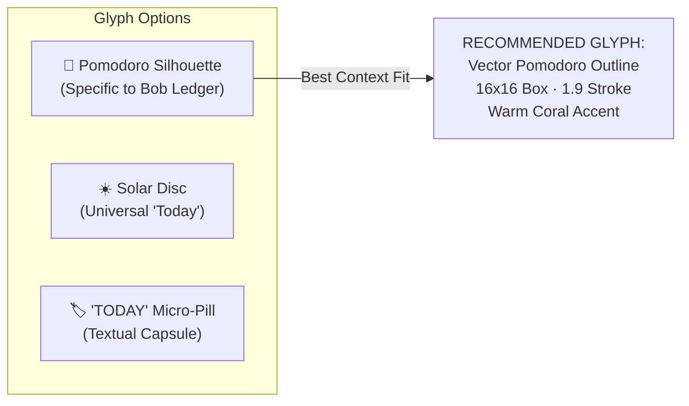
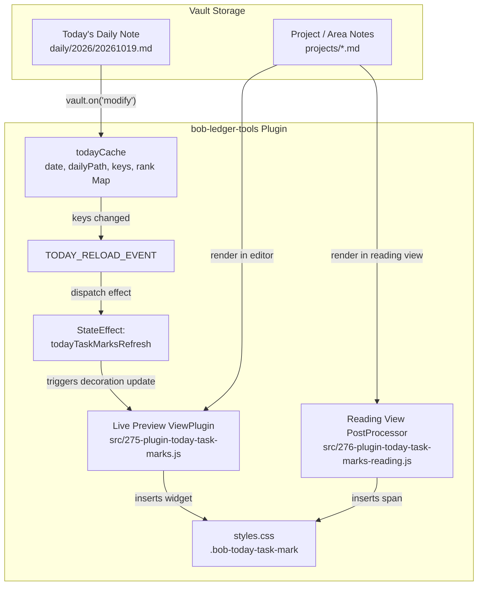
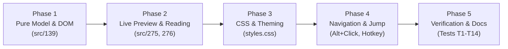

# Designing Today Task Markers for Obsidian: Ambient Ledger Awareness Across Vault Backlogs

**Researcher:** researcher gem (`research.gem`)  
**Date:** Monday, October 19, 2026  
**Context:** Vault Task Rendering, `bob-plugins` (`bob-ledger-tools`), `bob-cli`  
**Governing Decisions:** `decisions:today-is-read-from-the-ledger`, `decisions:task-lanes-are-sticky`, `decisions:mac-capture-is-a-thin-client`  
**Related Plans:** `plan:202610/in_progress_task_link_marks.md` (bob-cli-56), `plan:202610/successor_links.md` (bob-cli-5w)

---

## 1. Executive Summary & Verdict

### 1.1 The Proposal
The user proposes rendering a visual marker on tasks that appear in today's daily file when those tasks are viewed in Obsidian. This serves as the natural counterpart to the recently deployed task link markers, which render state on Pomodoro Task Links in today's daily note (showing which linked targets are `[/]` In Progress via an amber half-ring `◐`, and which targets were unblocked today via a faint `🔓` glyph).

### 1.2 Verdict: Strong Endorsement with Architectural Refinements
**This is an outstanding idea and a high-leverage UX enhancement**, resolving a long-standing "visibility asymmetry" in Bob's GTD workflow. Currently, Bryan can see which tasks are planned for today when looking at today's daily file, but when navigating project notes, area notes, or inbox files, there is **zero ambient visual feedback** indicating whether a task is already committed to today's Pomodoro ledger.

However, to remain **intuitive, reliable, and beautiful**, the feature must strictly honor Bob's architectural invariants:
1. **Zero Text Mutation:** The marker must be 100% display-only (CodeMirror 6 Live Preview widget + Reading view post-processor in `bob-ledger-tools`). It must never write a `#today` tag or inline field to the task line, upholding `decisions:today-is-read-from-the-ledger`.
2. **Context Gating:** The marker must be **suppressed inside today's daily note itself**. Displaying a "Today" marker on tasks or task links inside today's daily file is redundant visual noise. Its value lies entirely when viewing tasks *outside* the daily note (in project/area backlogs, inbox notes, and query views).
3. **Exact Ledger Semantics:** "In today's daily file" must align strictly with `todayCache` (tasks with dedicated plain Task Links under today's **open** Pomodoro sessions). A secondary, distinct muted indicator may optionally signify tasks worked earlier in closed sessions.
4. **Visual Restraint & Placement:** Task lines in Obsidian are already information-dense (checkbox, text, priority mark, date marks, freshness marks, block ID). To avoid "Christmas tree" visual clutter, the marker should be a compact, bespoke **16×16 vector glyph** placed immediately after the task checkbox (`[ ] [marker] Task description`), styled in Bob's warm Ledger Accent (`--color-orange` / `--bob-stats-orange`).

```
┌────────────────────────────────────────────────────────────────────────────────────────┐
│                                 VISUAL SYMMETRY                                        │
│                                                                                        │
│  Daily Note (Pomodoro Ledger)             Project / Area Backlog Note                  │
│  ────────────────────────────             ───────────────────────────                  │
│  ## Pomodoros                             ## Tasks                                     │
│  - [ ] (**0940-1010**)                    - [ ] 🍅 Fix parser crash ⏫ 📅 today ^t39a  │
│      - ◐ [[projects/cli#^t39a]] ─────────────► [TODAY LEDGER GLYPH]                   │
│      ▲                                          Informs Bryan during backlog review    │
│      │                                          that this task is already scheduled    │
│      Informs Bryan during session               on today's running/planned ledger.     │
│      that target task is In Progress.                                                  │
└────────────────────────────────────────────────────────────────────────────────────────┘
```

---

## 2. Architectural Context & Precedents

### 2.1 The Bob Ledger Philosophy (`today-is-read-from-the-ledger`)
In earlier versions of Bob, tasks carried explicit `#now` or `#today` tags. This approach was decisively rejected and retired:
> *"Today means dedicated Task Links under today's **open** Pomodoros only; closed 🍅 lines are history... A file-path filter selects tasks that live in the daily note (1 result against 7 live links), and a hooks-managed `#today` tag is a second copy of the ledger rewritten on task lines every 15 minutes, with churn, races, and staleness."* (`decisions:today-is-read-from-the-ledger`)

Under this rule:
- Tasks live in their canonical residence: `projects/*.md`, `areas/*.md`, or `inbox.md`.
- Committing to a task today creates a dedicated plain Task Link (`- [[target#^blockId]]`) under an open Pomodoro bullet in `daily/YYYY/YYYYMMDD.md`.
- `bob-ledger-tools` maintains an in-memory `todayCache` by parsing today's daily note on vault events, indexing `path#blockId` to rank order (`Map<string, number>`).
- Consequently, the task line in `projects/foo.md` contains **no textual hint** of its presence on today's ledger.

### 2.2 Precedent 1: In Progress Task Link Marks (`plan:202610/in_progress_task_link_marks.md`)
Implemented in `bob-ledger-tools` (phase `bob-cli-56`), this feature decorates Task Links in today's daily note:
- **Widget:** Amber half-ring icon `◐` (`.bob-progress-mark`).
- **Placement:** Immediately before the link token (`side: -1`).
- **Condition:** Link is in today's daily note under an open Pomodoro, pointing to a task whose current checkbox status is `[/]`.
- **Key design rule:** Purely display-only via CM6 `Decoration.widget` and Reading view Markdown post-processor. Never writes to disk.

### 2.3 Precedent 2: Unblocked Hand-off Glyph (`plan:202610/successor_links.md`)
Implemented in `bob-ledger-tools` (phase `bob-cli-5w`), this feature decorates Task Links whose prerequisites were completed today:
- **Widget:** Faint read-time `🔓` lock (`.bob-unblocked-glyph`).
- **Placement:** Immediately after the link token (`side: 1`).
- **Condition:** Derived from the Tasks cache on every build; tooltip identifies the prerequisite completed today.

### 2.4 Existing Task-Level Mark Decorators in `bob-ledger-tools`
`bob-ledger-tools` already has a mature decoration pipeline for task lines in Obsidian:
- **Freshness Marks (`.bob-fresh-mark`):** Replaces `[fresh:: YYYY-MM-DD]` with a 16×16 circular SVG glyph (`✓` track, refresh arc, or leaf for active decay decisions).
- **Date Marks (`.bob-date-mark`):** Replaces `📅`, `⏳`, `🛫` date fields with compact calendar tokens.
- **Priority Marks (`.bob-priority-mark`):** Replaces priority emojis with styled chevron indicators.
- **Dependency Chips (`.bob-dep-chip`):** Renders interactive prerequisite chips on `DEPENDS ON:` lines.

### 2.5 The Visibility Asymmetry Problem
While the daily note has gained rich, real-time indicators regarding the state of linked tasks, the inverse is completely missing. When Bryan is:
1. Conducting the morning GTD review walk (`]s` walk through project notes),
2. Editing code or notes within a specific project note, or
3. Viewing a long list of tasks in an area backlog,

he cannot tell which tasks are already on today's Pomodoro agenda. He must either remember his ledger selections, switch editor tabs to the daily note, or trigger Mac Capture to view the idle agenda. 

Adding a marker on tasks that are in today's daily file bridges this gap with zero markdown churn.

---

## 3. Critique of the Proposed Plan: Is This a Good Idea?

### 3.1 Core Workflow Benefits
1. **Immediate Context Without Tab Switching:** Bryan can scan a project note of 15 tasks and instantly spot the 2 tasks committed to today's sessions.
2. **Elimination of Duplicate Scheduling:** When capturing or planning work during the day, visual confirmation prevents adding the same task into another Pomodoro unnecessarily.
3. **Purity of GTD Execution:** Encourages single-tasking and deep work. When reviewing a project note during an active session, the marker acts as an anchor: *"Focus on the marked task; ignore the others for now."*
4. **Architectural Elegance:** It honors `today-is-read-from-the-ledger` to the letter. Instead of resurrecting a fragile `#today` tag, it leverages the live memory cache (`todayCache`) to project the ledger's state into the editor UI dynamically.

### 3.2 Potential Pitfalls & Edge Cases
1. **Visual Crowding ("Christmas Tree Effect"):**
   A task line with multiple features enabled might look like:
   `- [ ] [TODAY] Fix parser bug ⏫ 📅 2026-10-19 [fresh:: 2026-10-15] ⛓️ ^t39a`
   If the marker is too loud, large, or brightly colored, it will overpower the task description itself.
2. **Ambiguity of "In Today's Daily File":**
   What exact condition triggers the mark?
   - Is a task "in today's daily file" if it was worked on in a Pomodoro from 9:00 AM that is now **closed** (`- [x] (**0900-0930** [t:: 30m]) - 🍅 [[note#^task]]`)?
   - Is it marked if it is in an **open** Pomodoro (`- [ ] (**1400-1430**) - [[note#^task]]`)?
   - What if a task was checked off as done (`- [x] Done task ^t39a`) earlier today?
3. **Editor Performance & Keystroke Latency:**
   Obsidian Live Preview parses CM6 editor viewports on every transaction. Scanning task lines, extracting block IDs, and performing lookups must take less than 1ms per frame, never stalling typing or cursor movement.
4. **Cache Invalidation Latency:**
   When Bryan adds a task link to today's daily note (via Mac Capture or keyboard shortcut), how quickly does an already-open project note tab update its decorations? It must re-render without requiring a manual reload or editor restart.

### 3.3 Strategic Alignment
| Metric | Assessment | Rationale |
| :--- | :---: | :--- |
| **Workflow Utility** | **High** | Eliminates frequent context switching between project notes and daily note. |
| **System Coherence** | **High** | Symmetrical with task-link progress marks (`bob-cli-56`). |
| **Data Integrity** | **Perfect** | Read-only rendering; zero disk writes, zero merge conflicts, zero vault churn. |
| **Implementation Complexity** | **Low-Medium** | Reuses existing `todayCache` and CodeMirror 6 ViewPlugin patterns in `bob-ledger-tools`. |

---

## 4. Requirements Adjustments & Precise Scoping

To ensure implementation success, we must make four explicit requirement adjustments to the initial prompt:

### Adjustment 1: Context Gating (Location Suppression)
> **Rule:** The marker MUST NOT render inside today's daily note itself.

- **Rationale:** Inside `daily/YYYY/YYYYMMDD.md`, sub-bullets under `## Pomodoros` are *already* dedicated Task Links. Rendering a "Today" mark on task links or tasks inside today's daily note creates redundant clutter.
- **Scope:** The marker should render in:
  - Project notes (`projects/*.md`)
  - Area notes (`areas/*.md`)
  - Inbox notes (`inbox.md`, `capture.md`)
  - Reference notes (`ref/*.md`)
  - Past/future daily notes (if viewing a past daily note containing a task that is also scheduled today)
  - Reading Board views and Dataview/Tasks query blocks across the vault.

### Adjustment 2: Definition of "In Today's Daily File"
> **Rule:** The primary mark denotes **Active/Committed Today** (open Pomodoro entries). An optional secondary treatment denotes **Logged Today** (closed Pomodoro history).

In Bob's ledger, Pomodoros have three states:
1. **Running / Planned (Open):** `- [ ] (**0940-1010**)` or `- [ ] ()`. Links here represent today's committed queue.
2. **Closed (Past Sessions):** `- [x] (**0900-0930** [t:: 30m])`. Links here represent completed work history.
3. **Cancelled:** `- [-] (...)`. Links here were abandoned.

Under `today-is-read-from-the-ledger`, `todayCache` only tracks links under **open** Pomodoros (`state === "open"`).
- **Recommendation:** The Today Task Marker should strictly track tasks currently in `todayCache.rank` (i.e., open Pomodoro links).
- **Completed Tasks:** If a task on today's ledger is marked done (`[x]`), its link remains under the Pomodoro until closed, but the task itself is complete. Once the Pomodoro closes with `=x`, the task leaves `todayCache` unless linked in a subsequent open Pomodoro.
- **Edge Case:** If Bryan worked on a task in Pomodoro 1 (now closed) and has no further sessions planned today, the task is no longer on today's *active* agenda. Giving it an active "Today" marker would falsely suggest it still needs attention today. Therefore, restricting the primary marker to `todayCache.rank.has(key)` is semantically correct.

### Adjustment 3: Purely Display-Only
> **Rule:** Under no circumstances should the marker write markdown, tags, or frontmatter.

The mark is a virtual CodeMirror 6 widget in Live Preview and an injected HTML element in Reading View, mirroring `ProgressMarkWidget`.

### Adjustment 4: User Controls & Accessibility
> **Rule:** Provide an explicit toggle command, body class, and reduced-motion styling.
- Command: `Toggle today task marks` (toggles `bob-today-task-marks` on `document.body`).
- Tooltip: Informative 2-line tooltip displaying the session time/name and today's ledger rank.
- Interaction: Non-intrusive cursor placement on click; optional keyboard gesture (`Alt+Shift+T`) or modifier click to jump directly to today's daily file.

---

## 5. Visual Design: "Intuitive, Reliable, and Beautiful"

### 5.1 Placement Study
Where should the marker live on a task line? We evaluate three spatial candidates:

```
Candidate A (Leading Slot - After Checkbox):
- [ ] 🍅 Fix parser crash in compiler ⏫ 📅 2026-10-19 [fresh:: 2026-10-15] ^t39a
      ▲
      Immediate visibility; establishes "Today" context before reading description.

Candidate B (Trailing Metadata Slot - Before Block ID):
- [ ] Fix parser crash in compiler ⏫ 📅 2026-10-19 [fresh:: 2026-10-15] 🍅 ^t39a
                                                                         ▲
                                                                         Aligned with metadata; description remains unshifted.

Candidate C (Left Gutter / Checkbox Halo):
  ● - [ ] Fix parser crash in compiler ⏫ 📅 2026-10-19 [fresh:: 2026-10-15] ^t39a
  ▲
  Subtle gutter pip; zero inline text disruption.
```

#### Detailed Placement Trade-Offs

| Placement | Pros | Cons | Recommendation |
| :--- | :--- | :--- | :---: |
| **Candidate A: Leading Slot (After Checkbox)** | • High immediate scannability.<br>• Bryan sees "This is for today" before reading the text.<br>• Matches standard task list affordances. | • Shifts text of marked tasks rightward by ~1.3em, causing minor raggedness if mixed with unmarked tasks. | **RECOMMENDED (Primary)** |
| **Candidate B: Trailing Slot (Before Block ID)** | • Keeps task descriptions perfectly column-aligned.<br>• Cleanly groups with other metadata (dates, priority, freshness). | • For long, wrapped task descriptions, the mark is pushed off to the right margin or onto the second line, losing immediate scannability. | **Viable Alternative** |
| **Candidate C: Checkbox Halo / Border Accent** | • Completely zero layout shift.<br>• Modern, sleek appearance. | • Live Preview CM6 line decoration is fragile with list folding.<br>• Violates rule: *"Shape carries meaning and mark never relies on color alone."* | **Rejected** |

**Verdict on Placement:** **Candidate A (Leading Slot)** is the most intuitive and useful during review walks and project work. By setting `display: inline-flex; width: 1.15em; margin-inline-end: 0.3em;`, the offset is harmonious and visually feels like an integrated status badge rather than an indentation defect.

---

### 5.2 Iconography & Glyph Morphology
What symbol should represent "in today's daily file"?

1. **Option 1: The Classic Pomodoro Tomato (🍅 Silhouette)**
   - *Design:* A clean 16×16 vector outline of a rounded tomato fruit with a subtle 3-lobed calyx at the stem.
   - *Meaning:* Directly represents Bob's Pomodoro ledger. Bryan instantly associates it with `## Pomodoros`.
   - *Stroke:* 1.9 unit stroke, matching Bob's icon house style (established in `styles.css` line 1621 for freshness and progress marks).

2. **Option 2: The Today Sun (☀️ / ☼ Radiant Disc)**
   - *Design:* A small central disc surrounded by 8 micro rays, or a glowing half-sun horizon.
   - *Meaning:* Universally recognized symbol for "Today" (familiar from Things 3, Todoist).
   - *Risk:* Can be confused with scheduled date marks (`📅 today`).

3. **Option 3: The "Ledger Disc" (Hybrid Sun-Tomato)**
   - *Design:* A solid/hollow circular token with a small notch or leaf-crown at 12 o'clock, symbolizing a timeboxed pomodoro session scheduled for the current day.



**Recommendation:** The **Vector Pomodoro Outline (Option 1)** is by far the most cohesive choice. It directly symbolizes the ledger where the task resides. Furthermore, by using an outline rather than a solid blob, it remains delicate and un-distracting.

---

### 5.3 Color Palette & Theming
The color must be distinct from existing task statuses:
- `[/]` In Progress uses amber/yellow (`--color-yellow`, `#c69026`).
- `[*]` Next uses green/accent (`--color-green`, `#3f8f5f`).
- `[?]` Blocked uses red/crimson (`--color-red`, `#c65367`).
- Plain Todo `[ ]` uses neutral text (`--text-normal`).

To represent **Today's Ledger**, we draw upon Bob's established **Work Tone / Stats Orange**:
```css
/* Light Theme */
--bob-today-mark-ink: var(--bob-stats-orange, #eb6834);
--bob-today-mark-bg: color-mix(in srgb, var(--bob-today-mark-ink) 12%, transparent);

/* Dark Theme */
.theme-dark {
  --bob-today-mark-ink: var(--bob-stats-orange, #d95926);
  --bob-today-mark-bg: color-mix(in srgb, var(--bob-today-mark-ink) 14%, transparent);
}
```
This warm coral/orange hue stands out gracefully against both dark and light backgrounds, harmonizes with Bob's dashboard stats, and does not conflict with the yellow In-Progress amber or green Next tones.

---

### 5.4 CSS Specifications & Animation
Following the exact pattern in `bob-ledger-tools/styles.css` (lines 1634–1686):

```css
/* --- Today Task Mark: Task line decorator for tasks on today's ledger --- */

body {
  --bob-today-glyph: url("data:image/svg+xml,%3Csvg xmlns='http://www.w3.org/2000/svg' viewBox='0 0 16 16'%3E%3Cpath d='M8 2.2c-.8-1-2.2-1.2-2.8-.8.3.7.8 1.4 1.4 1.8-1.5.1-4.1 1.2-4.1 5.3 0 4 2.8 5.5 5.5 5.5s5.5-1.5 5.5-5.5c0-4.1-2.6-5.2-4.1-5.3.6-.4 1.1-1.1 1.4-1.8-.6-.4-2-.2-2.8.8Z' fill='none' stroke='black' stroke-width='1.8' stroke-linejoin='round'/%3E%3C/svg%3E");
}

.bob-today-task-mark {
  --bob-today-ink: var(--bob-today-mark-color, var(--bob-stats-orange, #eb6834));
  display: inline-flex;
  align-items: center;
  justify-content: center;
  width: 1.15em;
  height: 1.15em;
  margin-inline-end: 0.32em;
  border-radius: 999px;
  color: var(--bob-today-ink);
  line-height: 1;
  vertical-align: -0.16em;
  opacity: 0.88;
  user-select: none;
  cursor: pointer;
  transition:
    opacity 120ms ease,
    background-color 120ms ease,
    transform 120ms ease;
  animation: bob-today-mark-in 150ms cubic-bezier(0.16, 1, 0.3, 1);
}

.bob-today-task-mark::before {
  content: "";
  width: 1em;
  height: 1em;
  background-color: var(--bob-today-ink);
  -webkit-mask-image: var(--bob-today-glyph);
  mask-image: var(--bob-today-glyph);
  -webkit-mask-size: contain;
  mask-size: contain;
  -webkit-mask-repeat: no-repeat;
  mask-repeat: no-repeat;
}

.bob-today-task-mark:hover {
  opacity: 1;
  transform: scale(1.08);
  background-color: color-mix(in srgb, currentColor 14%, transparent);
}

body:not(.bob-today-task-marks) .bob-today-task-mark {
  display: none;
}

@keyframes bob-today-mark-in {
  from {
    opacity: 0;
    transform: scale(0.6);
  }
  to {
    opacity: 0.88;
    transform: scale(1);
  }
}

@media (prefers-reduced-motion: reduce) {
  .bob-today-task-mark {
    animation: none;
    transition: none;
  }
}
```

---

### 5.5 Tooltip & Interaction Design
Hovering over the mark must provide instant context without requiring Bryan to leave the note:

```
┌──────────────────────────────────────────────────┐
│  🍅 On Today's Ledger · Rank #2                  │
│  Session: (0940-1010) — CLI REFACTOR             │
│  Alt+Click → Jump to daily ledger                │
└──────────────────────────────────────────────────┘
```

- **Attribute:** `aria-label` with standard Obsidian `data-tooltip-position="top"`.
- **Content:**
  - Line 1: `On Today's Ledger` plus rank index in today's open queue (`Rank #1`, `Rank #2`, etc., read directly from `todayCache.rank.get(key) + 1`).
  - Line 2: The Pomodoro session timespan or name holding the link.
  - Line 3: Shortcut hint (`Alt+Click → Open daily file`).
- **Click Behavior:**
  - *Plain Click:* Sets editor cursor at the beginning of the task text (never disrupts editing).
  - *Alt+Click (or hotkey `Alt+Shift+T`):* Opens today's daily file in a split pane or active tab, navigating directly to the specific task link line!

---

## 6. Technical Implementation Architecture

### 6.1 Component Topology in `bob-ledger-tools`
The entire feature integrates cleanly into `bob-ledger-tools` without modifying `bob-cli` (Rust) or `bob-mac-capture`.



### 6.2 File Breakdown in `plugins/bob-ledger-tools/src/`

1. **`139-today-task-marks.js` (Pure Model & Helpers):**
   - Pure, non-throwing functions:
     - `parseTaskLineBlockId(lineText)`: Extract trailing `^([A-Za-z0-9-]+)` from markdown task lines.
     - `todayTaskMarkModel(filePath, blockId, todayCache)`: Resolve task key `${filePath}#${blockId}` against `todayCache.rank`.
     - `todayTaskMarkTooltip(rank, sessionInfo)`: Format the 2-line tooltip.
     - `buildTodayTaskMarkElement(doc, model)`: Pure DOM builder producing `span.bob-today-task-mark`.
     - `TodayTaskMarkWidget extends WidgetType`: CodeMirror 6 widget with `toDOM()` and `eq()` comparing `${key}|${rank}`.

2. **`275-plugin-today-task-marks.js` (Live Preview Mixin & Extension):**
   - `BobLedgerToolsTodayTaskMarksMixin`:
     - `setupTodayTaskMarks()`: Register editor extension, command (`Toggle today task marks`), body class toggle.
     - `createTodayTaskMarksExtension()`: ViewPlugin inspecting visible line ranges (`view.visibleRanges`).
     - Gating: If `sameVaultPath(currentFilePath, todayDailyPath)`, return `Decoration.none`.
     - Line matcher: Scans visible lines for task patterns (`/^\s*[-*+]\s+\[[^\]]\]/`). If trailing `^blockId` matches an entry in `this.todayCache.rank`, emit `Decoration.widget({ widget: new TodayTaskMarkWidget(...), side: 1 })` placed immediately after the checkbox.
     - Rebuild trigger: Rebuilds on `docChanged`, `viewportChanged`, or `todayTaskMarksRefresh` StateEffect.

3. **`276-plugin-today-task-marks-reading.js` (Reading View Mixin):**
   - `renderTodayTaskMarksIn(el, ctx)`:
     - Gating: If `sameVaultPath(ctx.sourcePath, todayDailyPath)`, return early.
     - Scans `li.task-list-item`.
     - Resolves block ID from child text/attributes.
     - Checks `this.todayCache.rank`.
     - Injects `.bob-today-task-mark` before task text.
     - Sets `data-bob-today-processed="1"`.

4. **Wiring into `290-plugin-today-and-location.js` & `310-install-methods.js`:**
   - In `rebuildTodayCache(...)`: Whenever `todayCache` updates, call `this.refreshTodayTaskMarksEditors()`.
   - Dispatches `todayTaskMarksRefreshEffect` to all active Markdown editor views.
   - On midnight rollover (`refreshTodayCacheForRollover`), refreshes all open views.

---

### 6.3 Conformance Vectors (Test Specification T1–T14)
To ensure the feature meets Bob's strict quality standards, the implementation should satisfy the following test suite:

- **T1 (Detection):** An open task in a project note with `^id` matching an open Pomodoro Task Link renders exactly one `.bob-today-task-mark`.
- **T2 (Daily Note Gating):** Today's daily note never renders `.bob-today-task-mark` on any task or link.
- **T3 (Closed Pomodoro):** A task linked *only* under a closed Pomodoro does not receive the active Today mark.
- **T4 (Unlinked Task):** An open task in a project note without a link in today's daily note renders no mark.
- **T5 (Rank Accuracy):** The mark's tooltip correctly displays `Rank #1`, `Rank #2` reflecting ledger sequence.
- **T6 (Live Preview Editing):** Editing text on the task line does not destroy or duplicate the widget.
- **T7 (Cursor Placement):** Clicking the mark places the cursor at the start of the task description without triggering link navigation.
- **T8 (Alt+Click Navigation):** Alt+clicking the mark opens today's daily file focused on the corresponding link.
- **T9 (Dynamic Add):** Adding a Task Link to today's daily note instantly causes the mark to appear in open project note tabs.
- **T10 (Dynamic Remove):** Deleting a Task Link from today's daily note instantly removes the mark from open project note tabs.
- **T11 (Midnight Rollover):** Rolling past midnight clears all yesterday's marks and loads the new day's cache.
- **T12 (Toggle Command):** Running `Toggle today task marks` hides all marks via CSS class and restores them on re-toggle.
- **T13 (Reading View Parity):** Reading view renders the same glyph, styling, and tooltip as Live Preview.
- **T14 (Cold Cache Resilience):** If `todayCache` is uninitialized or empty, all methods fail gracefully with zero thrown exceptions.

---

## 7. Alternative Approaches Evaluated

```
┌────────────────────────────────────────────────────────────────────────────────────────┐
│                              ALTERNATIVES EVALUATION                                   │
├──────────────────────────────┬──────────────────┬──────────────────────────────────────┤
│ Approach                     │ Feasibility      │ Trade-off / Verdict                  │
├──────────────────────────────┼──────────────────┼──────────────────────────────────────┤
│ 1. Written `#today` Tag      │ Trivial          │ ❌ REJECTED: Violates core decision;  │
│                              │                  │ write churn, sync races, staleness.  │
├──────────────────────────────┼──────────────────┼──────────────────────────────────────┤
│ 2. Checkbox Tint / Halo      │ Moderate         │ ❌ REJECTED: Low scannability; theme  │
│                              │                  │ fragility; relies on color alone.    │
├──────────────────────────────┼──────────────────┼──────────────────────────────────────┤
│ 3. Dataview-only Query Block │ Simple           │ ❌ REJECTED: Doesn't solve problem in │
│                              │                  │ native project note markdown editors.│
├──────────────────────────────┼──────────────────┼──────────────────────────────────────┤
│ 4. Gutter / Margin Indicator │ Complex          │ ❌ REJECTED: Unreliable with folding; │
│                              │                  │ misaligns with Obsidian line gutter. │
├──────────────────────────────┼──────────────────┼──────────────────────────────────────┤
│ 5. Display-only Prefix Glyph │ Moderate         │ ✅ RECOMMENDED: Zero churn, beautiful,│
│    in `bob-ledger-tools`     │                  │ high scannability, matches precedent.│
└──────────────────────────────┴──────────────────┴──────────────────────────────────────┘
```

1. **Alternative 1: Writing a `#today` tag or `[today:: true]` field into markdown.**
   - *Why tempting:* Trivial to implement via reconcile hooks.
   - *Why rejected:* This was tried and explicitly abolished in `decisions:today-is-read-from-the-ledger`. It causes constant git churn, races across multiple machines (e.g. Athena, Apollo, Mac), and leaves stale tags on tasks when daily notes roll over.
2. **Alternative 2: Checkbox Border Tint or Glow.**
   - *Why tempting:* No inline text displacement.
   - *Why rejected:* Obsidian themes heavily customize checkbox styling (SVG checkmarks, custom pseudoelements). Injecting CSS borders or box-shadows onto checkboxes breaks across themes and is imperceptible in bright sunlight or low-contrast monitors.
3. **Alternative 3: Restricting to Dataview/Reading Board Blocks.**
   - *Why tempting:* Already exists in `.bob-reading-board-today`.
   - *Why rejected:* Bryan spends significant time editing project notes directly in Live Preview. Limiting the indicator to read-only query blocks fails to support the active editing workflow.

---

## 8. Recommended Solution & Phased Implementation Plan

### 8.1 The Recommended Solution: The "Pomodoro Sun" Ledger Mark
We recommend implementing a **display-only Pomodoro outline glyph** in `bob-ledger-tools`:
- **Placement:** Immediately after the checkbox on task lines (`[ ] [🍅] Task description`).
- **Target Notes:** Rendered in all notes *except* today's daily file.
- **Source of Truth:** Real-time lookup against `this.todayCache.rank`.
- **Aesthetic:** Crisp 16×16 vector outline with warm Ledger Accent (`--bob-stats-orange`).
- **Interaction:**
  - Standard click places cursor.
  - Hover reveals 2-line tooltip (`On Today's Ledger · Rank #N · Alt+Click → Jump to daily ledger`).
  - Alt+Click jumps directly to the daily note's Pomodoro link.
  - Toggle command and body class (`bob-today-task-marks`) for complete user control.

### 8.2 Proposed Phased Rollout



- **Phase 1: Pure Model & DOM Helpers (`src/139-today-task-marks.js`)**
  Implement line block ID parsing, key generation (`${path}#${blockId}`), tooltip generator, listener-free DOM element builder, and `TodayTaskMarkWidget`.
- **Phase 2: Live Preview & Reading View Extensions (`src/275`, `src/276`)**
  Build CodeMirror 6 `ViewPlugin` with viewport-bounded widget decoration. Implement Reading View `MarkdownPostProcessor`. Wire into `BobLedgerToolsTodayLocationMixin` to dispatch refresh effects when `todayCache` updates.
- **Phase 3: CSS Styles, Tokens & Toggle Command (`styles.css`)**
  Add `.bob-today-task-mark` rules, SVG mask, hover micro-interactions, dark/light theme tokens, reduced-motion overrides, and register `toggle-today-task-marks` command.
- **Phase 4: Navigation Affordance (`bob-navigation-hotkeys`)**
  Add Alt+Click handler on the widget and optional command `Jump to task in today's ledger` (`Alt+Shift+T`), focusing the active Pomodoro line in the daily note.
- **Phase 5: Conformance Testing & Documentation**
  Execute conformance suite T1–T14 against test vaults. Update `bob-cli/docs/plan.md` and plugin READMEs.

---

## 9. Conclusion
Rendering a display-only Today Task Marker in Obsidian provides immediate, high-value visual feedback during project backlog reviews without compromising the integrity of Bob's ledger architecture. By grounding the feature in `todayCache`, positioning it gracefully beside the task checkbox, and utilizing Bob's established line-art design language, this feature will feel completely native, reliable, and beautiful.
