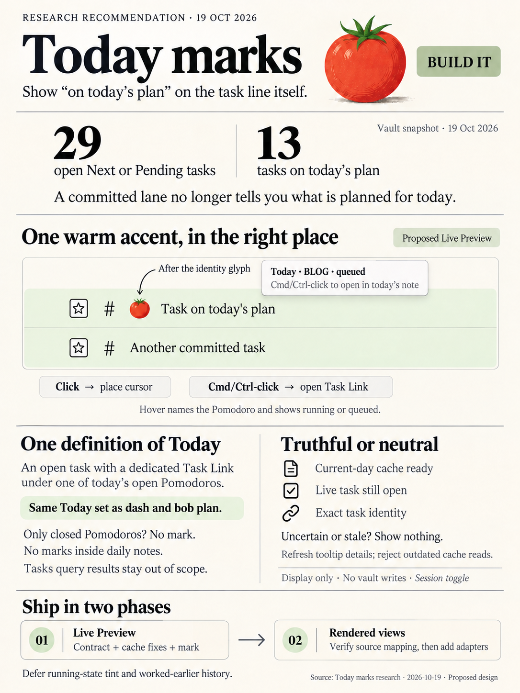
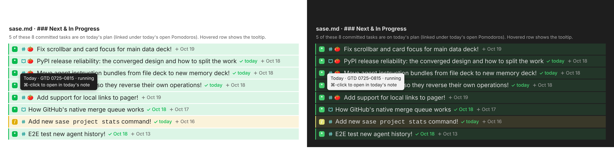
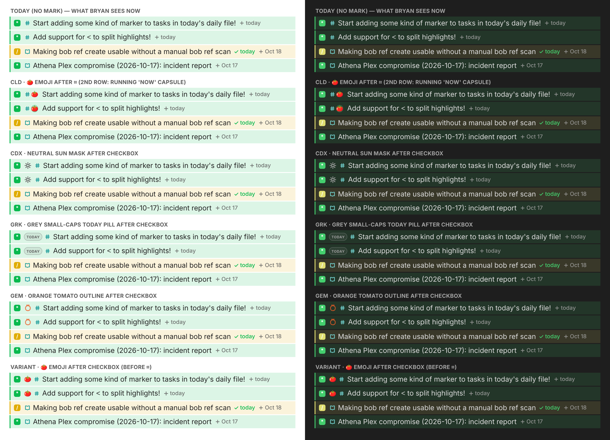

# Today marks: showing "on today's plan" on the task line itself

> **Research query:** What is the best way to render a marker on tasks that are in
> today's daily file when those tasks are viewed in Obsidian, like the existing Task Link
> marks for in-progress and unblocked-today tasks, designed to be intuitive, reliable, and
> beautiful? Is this a good idea, would a different approach be better, and which
> requirement adjustments are justified, ending with a recommended solution?



## Bottom line

- **Build it.** The gap is real, and it is measurable. Since sticky lanes
  (`decisions:task-lanes-are-sticky`), a `[*]` or `[/]` checkbox means "committed", not
  "on today's plan".
  - Today the vault has **29** open Next or Pending tasks, and **13** tasks are on
    today's plan.
  - In `sase.md`'s `### Next & In Progress`, 5 of 8 rows are on today's plan. In
    `bob.md`, 2 of 4 are.
  - The rows look identical either way. Nothing on a task's own line answers "is this on
    today's plan?".
- **Mark the [Today set](#which-tasks-get-the-mark), not the literal file contents.** The
  mark means exactly *Today*: open `#task` lines that have a dedicated Task Link under one
  of today's **open** Pomodoros (`docs/plan.md` §Today). That is the same set as the dash
  TODAY section, `bob plan`, and the `x` lineup. It is computed from the Today cache that
  bob-ledger-tools already keeps. It is display-only, so nothing is ever written.
- **Glyph: 🍅 after the `#task` identity glyph, before the title.**
  [The mockups](#glyph-candidates-rendered-side-by-side) settled this. The tomato is the
  only candidate that is both immediately legible and already means "linked under today's
  Pomodoro" on a Bob task row: the Blocks-stage picker shows `🍅` or `🍅 running`. Placing
  it after the hash keeps the identity column straight.
- **[Reliability rule](#reliability-and-architecture): truthful or neutral.**
  - The mark shows only when the Today cache is ready for the current day, the live line
    is an open `#task`, and its identity is exact.
  - Otherwise the line shows nothing. It never shows a guessed or stale mark.
  - Live Preview, which is where Bryan works, is exact and cheap.
  - Reading view identity is the one real unknown. It gets a [spike](#rendered-views) and
    ships second.
- **[Phasing](#recommended-solution).** Ship v1 as Live Preview plus the contract.
  Rendered views come second. Pickers, the Task Card, dependency chips, Mac Capture, a
  "running now" tone, and a "worked earlier" tone are
  [later options](#deliberately-deferred-with-triggers), each to be decided after Bryan
  has lived with v1.



*Figure 1. The recommended design on the real `sase.md` `### Next & In Progress` rows,
with the vault's task-status tints and the real mark-family glyphs. Five of the eight
committed tasks are on today's plan. The hovered row shows the tooltip.*

## Which tasks get the mark

What should "in today's daily file" mean? This is
[requirement adjustment 1](#requirement-adjustments).

The phrase allows four readings. Four reports (cdx, cld, grk, gem) chose ledger Today;
mus chose residence. The data decides it:

- **Residence**: the task line lives in today's `YYYY/YYYYMMDD.md` (mus)
  - *What it selects:* daily-note task lines
  - *Measured size:* **exactly 1 `#task` line in each of the 19 October daily notes: the
    `^gtd` row**
  - *Verdict:* Reject. It marks one task a day, and Bryan sees that task only inside the
    daily note.
- **Mentioned anywhere** in today's note
  - *What it selects:* prose, Work Log references, struck links, move-only `#` links
  - *Measured size:* unbounded
  - *Verdict:* Reject. It is noise, and it disagrees with every other Today surface.
- **History**: linked only under today's *closed* Pomodoros (🍅)
  - *What it selects:* work done earlier today
  - *Measured size:* 0–9 a day (cld)
  - *Verdict:* Not in v1. It answers a different question ("did I touch this?").
- **Today (ledger)**: a dedicated Task Link under today's *open* Pomodoros
  - *What it selects:* today's remaining plan
  - *Measured size:* **5–15 links a day across 3–8 notes, at most 1–6 per note** (Oct
    1–19)
  - *Verdict:* **Use this.**

The governing decision is `decisions:today-is-read-from-the-ledger`. It explicitly
rejects a path filter ("it measures residence, not work") and any second copy of Today.
A mark built on any other set would disagree with dash, `bob plan`, the `x` lineup, and
the freshness exemptions. That disagreement is the "two Todays" problem the decision
exists to prevent.

Bryan's own framing points the same way. He compared the feature to the Task Link marks,
which are ledger decorations, and the task he linked into today's GTD session reads
"marker to tasks that are in today's daily file". The tasks he puts in the daily file
are his ledger links.

**The invariant to ship and test:** *a task line shows the Today mark if and only if
that task is a row in dash's TODAY section* (where the line is visible and identifiable).

The October counts are end-of-day states, so they are a lower bound on midday Today size.
I computed them with the Today link rule over `~/bob/2026/202610*.md`.

## Critique of the idea

Is this a good idea? **Yes. It is cheap, coherent, and it restores a signal that sticky
lanes removed without undoing them.**

Why it is worth building:

1. **It separates "committed" from "today" without a stored status.** Before epic
   `bob-cli-2y`, hooks derived `[*]` from today's links. Now Next and Pending are sticky,
   and removing a link never lowers them. The mark restores the "today" half of the old
   meaning as a read-time view, with no `#today` tag, no `#now`, and no derived lane.
2. **It makes Ctrl+Shift+Enter legible.** On a task line the gesture *toggles* link
   presence (`pomodoroTaskLinkPresence`, block-id-prompt `120-plugin-pomodoro-links.js`),
   so its effect depends on hidden state. The mark shows that state before the action.
   Ctrl+Shift+Enter link → the 🍅 appears. Ctrl+Shift+Enter again → it disappears.
3. **It is mostly built already.** The Today parser (`computeTodayLinks`), the key
   resolver, the cache, the change events, the midnight rollover, and the readiness gate
   (`isTodayCacheReady`) all exist and are tested. The feature is a new *view* of a fact
   Bob already trusts.

What can go wrong, and how the design answers it:

- **Semantic surprise.** A task worked this morning loses the mark once its Pomodoro
  closes, even though it is still `[/]`. A task scheduled for today has no mark. (cdx)
  - *Mitigation:* That is correct for "on today's plan". The tooltip says *Today · BLOG ·
    queued*, not "worked" or "due". A "worked earlier" tone stays a later option (see
    [Deliberately deferred](#deliberately-deferred-with-triggers)).
- **Clutter** on lines that already carry a tint, a hash, priority, dates, and freshness
  - *Mitigation:* The mark is rare (5–15 lines a day). It is one glyph, with no text, in a
    slot no other mark uses.
- **A third "today"** (`⧗ today` scheduled, `✓ today` fresh or completed)
  - *Mitigation:* The line never gets the word "today". The tooltip uses the established
    concept name *Today*.
- **🍅 tense.** On ledger links, 🍅 means "worked in a past session" (`docs/plan.md`: "one
  marker slot, two tenses")
  - *Mitigation:* A task row is a different slot. The Blocks-stage picker already uses 🍅
    on task rows for "linked under today's open Pomodoro". The tooltip says queued or
    running.
- **Wrong identity in rendered views**
  - *Mitigation:* Live Preview is exact. Rendered views use exact source mapping, or stay
    neutral (see [Reliability and architecture](#reliability-and-architecture)).
- **Stale marks** at startup, at midnight, or after a sync
  - *Mitigation:* The readiness gate plus the existing rebuild triggers, plus
    [three small cache fixes](#three-gaps-in-the-shared-today-cache-to-close-first).
- **Redundancy with dash**
  - *Mitigation:* Dash answers "what is today?". The mark answers "which of *these* rows
    is today?" in the note being edited. These are different questions.

What I would *not* do:

- **Write anything.** A `#today` tag, `[today::]` field, or emoji prefix was already
  rejected (churn, races, staleness, broken dedicated-link parsers).
- **Add a `### Today` group in area notes.** That writes headings and splits a lane group
  the hooks own by title.
- **Recolor the checkbox, hash, or line tint.** Each of those channels already encodes
  another fact.
- **Use a CSS-only `li::before`.** Membership lives in another file, which CSS cannot see.

## Requirement adjustments

Each adjustment is explicitly called out.

1. **"In today's daily file" becomes "on today's plan" (Today)**, using the exact
   `docs/plan.md` definition (see [Which tasks get the mark](#which-tasks-get-the-mark)).
   *Why:* there is one truth shared with dash, `bob plan`, and the `x` lineup, and
   residence would mark only `^gtd`.
2. **History is not marked in v1.** Tasks linked only under closed Pomodoros get no mark.
   *Why:* the decision calls those lines history. "Worked today" is a different question
   (see [Deliberately deferred](#deliberately-deferred-with-triggers)).
3. **No marks inside canonical daily notes**, including task embeds rendered inside them.
   *Why:* the daily note is the ledger and already has ◐, 🔓, and home chips. A 🍅 on a
   transclusion inside an old ledger would also collide with that ledger's history 🍅.
4. **Tasks query results are out of scope.** I verified that every dash query is
   Today-exclusive: TODAY uses `isToday === true`, and PENDING, NEXT, and READY use
   `!== true`. NEW, ROTTEN, and blocked results cannot hold Today tasks in practice,
   because Today tasks are outside the freshness scopes (`¬Today(t)` in
   `docs/freshness.md:337,361`) and Blocked tasks lose their links. A mark there would
   carry no information.
5. **The line never gets the word "today"** (see
   [Critique of the idea](#critique-of-the-idea)).
6. **Mod+click jumps to the Task Link.** *Why:* the mark becomes the visible far end of
   the ledger edge, the reverse of clicking a Task Link in the daily note. Plain click
   stays a cursor placement, following the family rule.
7. **Surfaces are phased.** Live Preview comes first. Rendered views follow after a spike.
   Pickers, the Task Card, chips, and Mac come later.

## Visual design

### Glyph candidates rendered side by side



*Figure 2. Every researcher's proposal, rendered on the same four `bob.md` rows. The first
two rows are on today's plan; the other two are not. Approximation: Obsidian default theme
colors, the vault's `task-statuses.css` tints, the real `⌗`, 📖, `+`, and `✓` mask glyphs
from bob-ledger-tools, Inter, and Noto Color Emoji. On the Mac, Apple's emoji will render
instead.*

- **🍅 emoji after `⌗` (cld)**
  - *What the render shows:* Instantly legible and warm. It forms a clean second column,
    because the identity column stays straight. It stands out on both green Next and
    amber Pending tints.
  - *Verdict:* **Recommended**
- **🍅 emoji before `⌗` (variant)**
  - *What the render shows:* Equally legible, but it shifts the hash and 📖 column on
    marked rows only, so the identity column looks ragged.
  - *Verdict:* Second choice
- **Neutral sun mask (cdx)**
  - *What the render shows:* Refined and on-family, but at this size it reads as a
    brightness or settings icon. The "today" meaning has to be learned, and nothing in Bob
    uses a sun.
  - *Verdict:* Rejected
- **Grey small-caps `TODAY` pill (grk)**
  - *What the render shows:* Explicit, but the 0.72em caps are tiny and the pill is wide.
    Row 1 reads `TODAY … + today`, putting two different "todays" on one line.
  - *Verdict:* Rejected for task lines. It stays on Reading Board cards.
- **Orange tomato outline mask (gem)**
  - *What the render shows:* It reads as a stopwatch or an apple. Orange is reserved for
    attention (`docs/task-tag-marks.md` §Ink: due freshness, ROTTEN, repair flags, the
    Pending chip).
  - *Verdict:* Rejected
- **Grey calendar-page mask (mus)**
  - *What the render shows:* A residence mark for a set that is only ever `^gtd`, and a
    calendar collides with the date marks.
  - *Verdict:* Rejected with the residence reading

Why an emoji, when the date marks and the hash replaced emoji with monochrome masks: those
marks repeat on thousands of lines and have to be quiet. This one appears on about a dozen
lines vault-wide and is meant to be noticed. The vault already uses emoji labels (🛠️
WORK LOG, 🗓️ SCHEDULE LOG, 🧱 BLOCKS), and the 🔓 unblocked glyph set the precedent of an
emoji read-time mark. The glyph is drawn from a CSS variable, so a theme snippet can swap
in a mask later without a code change.

### Placement

- **Lines with `#task` (or the `#task #ref` pair):** at the first non-space character
  after the identity slot, before the title. On `#task #prj` lines it goes between the
  hash and the `#prj` pill.
- **Other lines:** at the body start (rare).
- **Live Preview:** a zero-width `Decoration.widget` at that position with `side: -1`, so
  the caret at title start draws after the mark. The widget occupies no document
  positions, so vim motions (`0`, `^`, `I`, `w`) are unaffected. It covers no source
  text, so it stays visible with the cursor on the line, and it never rebuilds on
  `selectionSet`.
- **No reserved blank space on unmarked rows.** Only the title of a marked row shifts,
  about 1.3em.

Rejected positions:

- **Trailing chip:** ragged, and it wraps into the metadata tail.
- **Gutter pin:** clipped in embeds and popovers, and it fights the fold arrows.
- **Checkbox halo:** fights `task-statuses.css`.
- **Line treatment:** the tint and stripe channel already belongs to lane status.

### Anatomy

These are starting values; tune them in live Obsidian.

```css
.bob-today-mark {                      /* empty span; role="img", aria-label */
  display: inline-flex; align-items: center; justify-content: center;
  width: 1.2em; height: 1.2em;         /* never changes line height */
  margin-inline: 0.16em 0.32em;
  font-size: 0.85em; line-height: 1; vertical-align: -0.14em;
  border-radius: 999px; user-select: none; cursor: default;
  transition: opacity 120ms ease, background-color 120ms ease;
  print-color-adjust: exact;
}
.bob-today-mark::before { content: var(--bob-today-mark-glyph, "🍅"); }
.bob-today-mark:hover {
  background-color: color-mix(in srgb, var(--task-status-accent, var(--text-muted)) 12%, transparent);
}
.bob-today-mark.is-entering { animation: bob-today-mark-in 160ms ease; } /* only when the key just joined Today */
body:not(.bob-today-marks) .bob-today-mark,
.bob-daily-note-view .bob-today-mark { display: none; }
@media (prefers-reduced-motion: reduce) { .bob-today-mark { animation: none; transition: none; } }
```

- **Copy safety.** The glyph lives in `::before`, so copying a line in Reading view never
  picks up 🍅.
- **Dataview safety.** The span is listener-free and events are delegated, so Dataview's
  `innerHTML` round trip cannot strip handlers.
- **Entrance animation.** It plays only when a key has joined Today within about the last
  600 ms, so it never replays on scroll or rerender. This is the same 160 ms scale-in as
  ◐.
- **Forced colors.** The hover capsule becomes `Canvas` with a `CanvasText` ring.

### Tooltip and accessibility

The tooltip is two lines joined with `\n`. It never contains `::`, because Dataview
re-scans `innerHTML`. `aria-label` uses the same text.

- **Line 1:**
  - `Today · GTD 0725–0815 · running` for the unique open timed entry (the Blocks-stage
    rule).
  - `Today · BLOG · queued` for a placeholder.
  - For unnamed entries, the derived home label (as the Mac indicator shows it), falling
    back to `unnamed Pomodoro`.
  - `… +1 more` when several open entries link the task.
- **Line 2:** `⌘-click to open in today's note` on macOS, `Ctrl-click …` elsewhere.

The mark adds no tab stop and no live-region announcement on refresh.

### Interaction

- **Click** places the cursor at the title start. It never writes and never navigates
  (the family rule). This prevents accidental jumps when Bryan clicks near the start of a
  title.
- **Mod+click** opens today's daily note at the Task Link line (`ledgerLine`, first
  occurrence), or focuses the leaf if the note is already open. Mod is Obsidian's
  "open link" convention. cld proposed Mod+click and I adopted it over plain-click jump
  (grk), Alt+click (gem), and fully passive (cdx).
- **Toggle Today marks** (`toggle-today-marks`) is a session toggle, default on, that
  flips `body.bob-today-marks`, like the other marks.

## The semantic contract

A task line shows the mark only when **all** of the following hold:

1. **The cache is ready:** `isTodayCacheReady(now)` is true for today's date and daily
   path.
2. **The line is a task line with an open status**, read from the *live* line in Live
   Preview and from `li[data-task]` in rendered views. Open means ` `, `*`, `/`, or `?`.
   This is Today rule 5, and it means completing a task removes the mark on the same
   frame.
   - **Gap I found:** the JavaScript cache is a resolved *link-key set*. Unlike Rust
     `today_tasks`, `isTodayTask` does **not** check that the target is an open `#task`
     (`180-plugin-plan-and-ready.js:85–91`). The mark must apply rule 5 itself.
3. **The line has an exact `#task` tag** (the same token rule as task-tag marks) and a
   standalone trailing `^id`.
4. **The key `"<host path>.md#<id>"` is in `todayCache.rank`.** If an id is duplicated in
   a note, only the first line Obsidian resolves gets the mark.
5. **The host is not a canonical daily note** and is not rendered inside one.
6. **The toggle is on.**

### Conformance vectors

Conformance vectors merge the vectors proposed by cld (TM), grk (M), and cdx. `T` is an
area note with `- [s] #task Fix ^fix`; `D` is today's daily note.

- **V1**
  - *Setup:* `\t- [[T#^fix]]` under an open timed entry, `s=*`
  - *Mark on T?* yes. Tooltip: `· running`
- **V2**
  - *Setup:* same link under a placeholder `- [ ] () — BLOG`, `s=/`
  - *Mark on T?* yes. Tooltip: `Today · BLOG · queued`
- **V3**
  - *Setup:* `s=*` or `/`, no link in `D` (sticky lane)
  - *Mark on T?* **no**
- **V4**
  - *Setup:* only `\t- 🍅 [[T#^fix]]` under a closed `- [x]` entry
  - *Mark on T?* no
- **V5**
  - *Setup:* V4 plus a placeholder link
  - *Mark on T?* yes
- **V6**
  - *Setup:* `🍅 [[T#^fix]]` under an *open* entry (Today rule 3 strips 🍅)
  - *Mark on T?* yes
- **V7**
  - *Setup:* embedded `\t- ![[T#^fix]]` under an open entry
  - *Mark on T?* yes, on T's line
- **V8**
  - *Setup:* struck, nested, mixed-text, trailing `#` move-only, fenced, or outside
    `## Pomodoros`
  - *Mark on T?* no
- **V9**
  - *Setup:* `s` is `x`, `X`, or `-`, link still present
  - *Mark on T?* no, and it flips on the same frame
- **V10**
  - *Setup:* `s=?` or `s=" "`, link still present (reconcile lag)
  - *Mark on T?* yes (follows the ledger)
- **V11**
  - *Setup:* no `#task` tag, or no `^id`
  - *Mark on T?* no
- **V12**
  - *Setup:* linked under two open entries; one link removed
  - *Mark on T?* one mark throughout; tooltip `+1 more`, then none
- **V13**
  - *Setup:* `^gtd` in `D`, or T embedded inside any daily note
  - *Mark on T?* no (daily-note suppression)
- **V14**
  - *Setup:* cache not ready (startup), or the date has rolled over
  - *Mark on T?* no
- **V15**
  - *Setup:* same `^fix` twice in T
  - *Mark on T?* first resolved line only
- **V16**
  - *Setup:* ambiguous basename target
  - *Mark on T?* no (unresolved, as in Today)
- **V17**
  - *Setup:* `#task #ref` / `#task #prj` lines
  - *Mark on T?* after the 📖 pair / between the hash and `#prj`
- **V18**
  - *Setup:* cursor at the title start; cursor inside `#task`
  - *Mark on T?* mark shown, caret after it; hash revealed, mark stays
- **V19**
  - *Setup:* Ctrl+Shift+Enter link, then unlink, from T
  - *Mark on T?* appears (entering), then disappears
- **V20**
  - *Setup:* rendered view where identity cannot be proven
  - *Mark on T?* no (neutral)
- **V21**
  - *Setup:* toggle off, then on
  - *Mark on T?* hidden everywhere at once, then restored; source unchanged

## Reliability and architecture

### Ownership

**bob-ledger-tools only.** No Rust, capture grammar, CLI, or Mac change is needed for v1,
and `cli_rules.md` is untouched. The work follows the progress-marks split:

- `src/143-today-marks.js`, pure core:
  - `todayMarkInsertOffset(line)`
  - `todayMarkEligibleLine(line)`
  - `todayMarkModel(...)`
  - `todayMarkTooltip(...)`
  - a listener-free DOM builder
  - `TodayMarkWidget`, whose `eq` compares key, label, and entering state
- `src/275-plugin-today-marks.js`: the ViewPlugin, refresh effect, toggle command,
  daily-view class, and delegated click handling. Rendered views go in a separate
  `276-…-reading.js` (fragments stay ≤1000 lines).
- `060-today.js` / `290-plugin-today-and-location.js`: additive cache details only.
- `styles.css`: one block after the unblocked glyph.
- The contract, `## Today marks` with the vectors, lives in bob-cli `docs/plan.md` right
  after "In Progress marks", because Rust owns the Today meaning there.

### Three gaps in the shared Today cache to close first

I found these in `290-plugin-today-and-location.js`. Each is small, but the mark makes
them visible.

1. **Detail-only changes do not fan out.** `rebuildTodayCache` notifies consumers only
   when the *key list* changes. Starting a Pomodoro, renaming an entry, or moving a link
   between open entries leaves keys unchanged, so tooltips would go stale.
   - Fix: keep a `details` map (key → `{entryName, label, range, running, ledgerLine}`)
     and a details signature. `computeTodayLinks` already returns `entryLine`,
     `entryName`, and `ledgerLine`.
   - On a details-only change, dispatch only `scheduleTodayMarksRefresh()`. Tasks queries
     are not re-queried.
2. **There is no request-generation guard.** `refreshTodayCacheFromDaily` reads
   asynchronously, so a slow read can land after a newer synchronous rebuild from the
   `changed` event and overwrite it (cdx).
   - Fix: add a monotonically increasing generation number, plus a `(date, dailyPath)`
     check, before committing an async result. Add a test of out-of-order completion.
3. **A read failure becomes an empty but ready Today.** `readPlanBlockContent` returns
   `null` for both a missing file and a read error, and both rebuild as `""`.
   - For a positive-only mark this degrades to *no marks*, which is acceptable.
   - Diagnostics can distinguish the two later. No per-row warnings.

### Live Preview

This is v1, and it is exact.

- **Scope:** visible ranges only.
- **Cheap prefilter:** the line contains `#task` and ends in `^id`, where the id is in
  this host's Today id set (at most about 6 per note).
- **Lookup:** O(1) against the cache. No vault reads, subprocesses, or daily-note parsing
  per frame.
- **Rebuild on:** `docChanged`, `viewportChanged`, a Live Preview toggle, a file switch,
  and the refresh effect.
- **Latency:**
  - Ctrl+Shift+Enter from a project note writes the daily note with `vault.modify`
    (block-id-prompt `140-…:102`, `150-…:294`). The metadata `changed` event then
    rebuilds the cache.
  - Mac capture and `bob vault-sync` writes arrive as vault events.
  - The only editor-buffer write path (`150-…:283`) is the case where the task lives in
    the daily note, which is suppressed.
  - So no `api.todayMarks.expect` optimistic hint is needed up front. Add one, modelled
    on `api.progressMarks.expect` (whose 2 s autosave lag is documented in
    `plan:202610/in_progress_task_link_marks.md` D9), only if live verification shows
    visible lag. This follows the "no api without a consumer" rule.
- **Daily-view suppression:** on `file-open` and `layout-change`, ledger-tools adds
  `bob-daily-note-view` to the container of every leaf showing a canonical daily note,
  and updates it at rollover. A CSS rule hides marks inside that container, which also
  covers embeds whose `ctx.sourcePath` is the embedded note.

### Rendered views

These are phase 2, and they are the only real unknown.

Reading view does not render `^id`, so identity has to come from the source. The reports
disagree here:

- cld proposes matching row title text, marking only on a unique match.
- cdx forbids title matching.
- The progress-marks Reading fragment claims "full-note reading views … carry no section
  info" (`269-plugin-progress-marks-reading.js:12–16`).

That claim was written in the initial implementation commit (`7ea2dc8`, bob-cli-56.1)
with no recorded evidence. The plan it implemented had specified section mapping
(`in_progress_task_link_marks.md` §4). Meanwhile the dependency-chip and BLOCKS renderers
already map rendered rows to source lines through `ctx.getSectionInfo(el)`, with a
row-count agreement check, and stay neutral otherwise (`280-…:283–300`, `281-…:297–316`).

Resolution:

1. **Spike first, in live Obsidian.** Log `ctx.getSectionInfo(el)` and `li[data-line]`
   for a full-note Reading view, a block embed, a hover popover, and a Canvas card.
2. **Primary path: exact source mapping.** Use section info plus the row's `data-line`
   (or the existing row-index-with-count-agreement pattern), then confirm the line
   against `metadataCache.getFileCache(file).listItems` (task character and `id`).
   - **Block embeds and hover popovers:** identity comes from the embed or link target
     (`T#^id`) when the block is a single task.
3. **Fallback, only if the spike shows section info really is missing:** cld's restrained
   signature match. Compare the row's text, with tags, fields, and the id stripped,
   against *only that note's* Today lines. Mark only when exactly one Today line and
   exactly one rendered row match. That fallback can produce false negatives but never a
   false positive on duplicate text, because duplicates become ambiguous and stay
   neutral.
4. **Sweep on refresh.** Stamp `data-bob-task-key` on identified rows. On every Today
   change, re-evaluate stamped rows in all windows (main and popouts) to add or remove
   marks without a rerender.

Rendered views are phase 2 because Bryan works in Live Preview: all four open markdown
leaves in the vault's `workspace.json` are Live Preview.

### Midnight, sleep, and other machines

- **Midnight:** the existing rollover rebuild plus the readiness gate clear yesterday's
  marks without a reload. Before the new daily note exists, Today is empty.
- **Sleep and wake:** add a focus/visibility revalidation as cheap insurance against
  delayed timers (cdx).
- **Other machines:** `bob vault-sync` pulls of the daily note arrive as vault events,
  which already rebuild the cache.

### Tests

- **New suite:** `scripts/test-ledger-tools-today-marks.cjs` runs V1–V21 verbatim, plus
  widget `eq`, toggle, the daily-view class, a details-only refresh, and the generation
  guard.
- **Inject the clock.** cdx's baseline run of the related suites was 85 of 89 passing.
  The 4 failures are in `test-ledger-tools-unblocked-glyph.cjs`, which mixes a wall-clock
  `DAILY` with fixed October 9 dates. That is the already-tracked `bob-cli-6v`, and it is
  a warning against wall-clock fixtures.
- **Then:** `npm run build`, `npm test`, `bob plugins sync`.

## Surfaces

Each surface, with the phase in which it gets the mark (v1, later, or never):

- **Live Preview of area, project, reference, and inbox notes**
  - *v1:* ✅ exact
- **Reading view, block embeds, hover popovers**
  - *Later:* ✅ phase 2, after the spike
- **Canonical daily notes, and anything rendered inside one**
  - *Never:* ✅ suppressed
- **dash, `freshness`, `rotten`, `blocked`, and `crowded` Tasks results**
  - *Later:* Only if Bryan adds a *mixed* query. cdx's adapter notes for Tasks 8.4.0 (the
    installed version) are ready: path from the render context, id from
    `.task-block-link`, never `data-line`.
- **Source mode**
  - *Never:* ✅ raw text by design
- **Depends-On and BLOCKS dependency chips**
  - *Later:* 🍅 on a chip whose target is Today (it answers "is my prerequisite on today's
    plan?")
- **Task Card (Ctrl+Shift+P), nav pickers**
  - *Later:* Via an additive `api.today` read namespace, once a consumer lands
- **Mac Capture completion candidates**
  - *Later:* Rust adds `today: true` to candidate JSON from `today_tasks`, and the app
    renders 🍅 (`decisions:mac-capture-is-a-thin-client`; coordinate both repos)
- **Mac idle agenda**
  - *Never:* ✅ already *is* the ledger

## Where the reports disagreed and the resolution

- **Membership**
  - *Positions:* Today: cdx, cld, grk, gem · Residence: mus
  - *Resolution and why:* **Today.** Residence is exactly one `^gtd` line a day (19 of 19
    October notes).
- **Glyph**
  - *Positions:* sun (cdx) · 🍅 emoji (cld) · `TODAY` pill (grk) · calendar (mus) · orange
    tomato outline (gem)
  - *Resolution and why:* **🍅 emoji**, judged on the mockups (see
    [Glyph candidates](#glyph-candidates-rendered-side-by-side)). It is legible, warm, and
    already means this on task rows. Orange and amber hues are reserved.
- **Placement**
  - *Positions:* after the checkbox (cdx, grk, gem) · after `⌗` (cld, mus)
  - *Resolution and why:* **After `⌗`.** It keeps the identity column straight (Figure 2,
    rows 2 vs 6).
- **Click**
  - *Positions:* passive (cdx) · plain-click jump (grk) · cursor + Mod-click (cld) ·
    Alt-click (gem)
  - *Resolution and why:* **Cursor on click, jump on Mod+click.** That is the family rule
    plus Obsidian's link convention.
- **Tasks results**
  - *Positions:* in (cdx, mus, gem) · out (cld, grk)
  - *Resolution and why:* **Out.** All dash queries are verified Today-exclusive.
- **Daily notes**
  - *Positions:* suppress all (cld) · suppress today's (gem) · mark `^gtd` (grk)
  - *Resolution and why:* **Suppress all canonical daily notes.** It is simplest, and it
    avoids 🍅 on transclusions inside history ledgers.
- **Reading view identity**
  - *Positions:* title signature (cld) · no title matching (cdx)
  - *Resolution and why:* **Exact section mapping first. A unique-signature fallback only
    if the spike requires it.** Neutral otherwise.
- **"Running now" capsule**
  - *Positions:* cld only
  - *Resolution and why:* **Deferred.** The tooltip carries running or queued in v1 (see
    [Deliberately deferred](#deliberately-deferred-with-triggers)).
- **History tone**
  - *Positions:* v2 option (cld, grk, gem)
  - *Resolution and why:* **Deferred.** It is a different question.
- **Contract home**
  - *Positions:* `docs/plan.md` (cld) · new `docs/today-marks.md` (grk)
  - *Resolution and why:* **`docs/plan.md`**, next to Today and In Progress marks. Either
    is fine.
- **`api.todayMarks`**
  - *Positions:* v1 (grk) · only if needed (cld)
  - *Resolution and why:* **Only if needed** (no api without a consumer).

## Deliberately deferred with triggers

- **"Running now" tone.** A soft capsule tinted with the line's status accent, for tasks
  in the running Pomodoro (cld). It is cheap, because `running` is already in the cache
  details. Add it if Bryan finds himself hovering to tell "now" from "later today". In
  `sase.md` today, 2 of the 5 marked tasks are in the running GTD session.
- **"Worked earlier today" ghost tone.** A faint 🍅 for open tasks linked only under
  today's closed Pomodoros, behind a setting. Add it only if Bryan misses that signal.
- **"Go to today's Task Link" command,** the keyboard twin of Mod+click, for a vim-first
  workflow.
- **Narrowing Ctrl+Shift+Enter's presence test** to Today's dedicated-link rule. Today
  the toggle also matches mixed-text and nested references under open Pomodoros (cld).
  This is rare in practice, and I recommend leaving it.
- **A decision record.** Once Bryan accepts the design, record "the Today mark shows the
  ledger Today on task lines, as display-only 🍅" with its rejected alternatives
  (residence, history, `TODAY` pill, sun) through the memory-write flow.

## Open questions for Bryan

1. **Glyph.** Use the 🍅 emoji (recommended), or a custom tomato mask? The CSS variable
   allows a swap later.
2. **Running tone.** Should "now" vs "later today" stay tooltip-only in v1
   (recommended), or get the capsule right away?
3. **Click.** Should plain click place the cursor and Mod+click jump (recommended), or
   should plain click jump?
4. **History.** Is a "worked earlier today" ghost tone ever wanted?

## Recommended solution

Ship **Today marks** in bob-ledger-tools as a two-phase epic.

**Phase 1: contract, core, and Live Preview.** This delivers most of the value.

- **Contract:** add `## Today marks` with [vectors V1–V21](#conformance-vectors) to
  bob-cli `docs/plan.md`.
- **[Cache fixes](#three-gaps-in-the-shared-today-cache-to-close-first) in `290`:** add
  the details map and its signature, a details-only refresh that touches only the marks,
  and the async generation guard.
- **The mark:** a display-only **🍅 after the `#task` identity glyph** on every open
  `#task` line whose `path#id` is in Today.
  - It is gated on `isTodayCacheReady` and on the live line's open status.
  - It is suppressed in canonical daily notes.
  - The tooltip names the Pomodoro and running or queued.
  - Click places the cursor; Mod+click jumps to the Task Link.
  - It has a session toggle, with no writes and no Rust changes.
- **Ship:** `npm test`, then `bob plugins sync`.

**Phase 2: rendered views.**

- **Spike** `getSectionInfo` and `data-line` in live Obsidian.
- **Then** add the Reading view, block embed, and hover popover adapters, using exact
  source mapping (or the unique-signature fallback), with a refresh sweep. They stay
  neutral whenever identity is unproven.

**Live verification (Bryan, in Obsidian, both phases).**

- In `sase.md`, exactly the 5 linked Next rows show 🍅; the merge-queue ref, project
  stats, and E2E rows do not.
- Ctrl+Shift+Enter link and unlink make the mark appear and vanish within about a
  quarter second, with the daily note both open and closed in another pane.
- Completing a marked task removes its mark on the same frame.
- Light and dark themes look right on green and amber tints and beside a violet `#prj`
  pill, with Apple emoji on the Mac.
- vim `j`/`k` does not jitter, and the caret sits after the mark at title start.
- Midnight clears the marks without a reload. The toggle hides and restores them
  everywhere.
- Daily notes and `dash.md` never show a mark.

This is the smallest design that is:

- **intuitive:** Bryan's own Pomodoro symbol, placed where the eye starts reading, and it
  explains itself on hover;
- **reliable:** one Today definition, a readiness gate, exact-or-neutral identity, three
  small cache fixes, and no stored state to go stale;
- **beautiful:** one rare warm accent in a clean column on otherwise quiet lines, using
  the family's metrics and motion.

## About this report

*Consolidated report · lead researcher · 2026-10-19*

**Sources.** This report merges five independent researcher reports, `__cdx`, `__cld`,
`__grk`, `__mus`, and `__gem` in this directory, with my own research. I checked their
disagreements against code and data at bob-cli `9217a475` and bob-plugins `5ef8cbe4`, and
against the live vault (`~/bob`, October daily notes, `bob.md`, `sase.md`, `dash.md`). I
also rendered visual mockups of every proposed glyph (`./today_task_line_marks__final_assets/`).
Nothing was implemented or deployed.

**Request.** Bryan wants a marker, visible in Obsidian, on tasks that are "in today's daily
file", like the existing Task Link marks (◐ In Progress, 🔓 unblocked today). He asked for
a lead design that is intuitive, reliable, and beautiful. He also asked for a critique of
the idea, any justified requirement changes clearly called out, and a recommendation.

## Sources

**Researcher reports (this directory):** `today_task_line_marks__cdx.md`,
`today_task_line_marks__cld.md`, `today_task_line_marks__grk.md`,
`today_task_line_marks__mus.md`, `today_task_line_marks__gem.md`.

**bob-cli `9217a475`:**

- `docs/plan.md`: §Today (rules 1–6), §"In Progress marks and the Task Link lane toggle",
  §Today conformance examples
- `docs/task-tag-marks.md`: §Ink hue table
- `plan:202610/in_progress_task_link_marks.md`: D9 instant feedback, §4 Reading-view
  mapping

**bob-plugins `5ef8cbe4`, `plugins/bob-ledger-tools/`:**

- `src/060-today.js`: `todayLinkFromBody`, `computeTodayLinks`, `resolveTodayKeys`
- `src/180-plugin-plan-and-ready.js`: `isTodayTask`, `isTodayCacheReady`,
  `readPlanBlockContent`
- `src/290-plugin-today-and-location.js`: `rebuildTodayCache`,
  `refreshTodayCacheFromDaily`
- `src/269-plugin-progress-marks-reading.js:12–16`
- `src/280-plugin-dependency-render.js:283–300, 541–600`
- `src/281-plugin-blocks-render.js:40–150, 297–316`
- `styles.css`: task-tag hash, progress mark, unblocked glyph, Reading Board `TODAY`, and
  `--bob-stats-orange`
- Commit `7ea2dc8` (bob-cli-56.1)

**bob-plugins, other plugins:**

- `plugins/bob-navigation-hotkeys/src/410-picker-filter-and-render.js:439–449`: 🍅 and
  `🍅 running` badges on task rows
- `plugins/block-id-prompt/src/120-plugin-pomodoro-links.js:154–178`
- `plugins/block-id-prompt/src/140-plugin-target-plans-and-rewrites.js:69–102`
- `plugins/block-id-prompt/src/150-plugin-reference-files.js:222–294`

**Vault (`~/bob`):**

- `2026/20261019.md` and October daily notes: Today link counts and residence counts
- `bob.md` and `sase.md`: Next & In Progress rows
- `dash.md` and `crowded.md`: Tasks query filters
- `.obsidian/snippets/task-statuses.css`
- `.obsidian/workspace.json`: editor modes
- `.obsidian/plugins/obsidian-tasks-plugin/manifest.json`: version 8.4.0

**Memory:** `decisions:today-is-read-from-the-ledger`, `decisions:task-lanes-are-sticky`,
`glossary:task-link`, `glossary:pomodoro`, `obsidian.md`.

**External (via the researcher reports):**

- Microsoft To Do / Outlook "My Day": a daily selection kept separate from home lists,
  cleared at midnight. This is a conceptual precedent only.
- Obsidian and CodeMirror decoration docs: widget `side`; widgets occupy no document
  positions.
- W3C WCAG 2.2 *Use of Color* and *Non-text Contrast*.

**Mockups:** `today_task_line_marks__final_assets/candidates.png` and `recommended.png`,
rendered with headless Chromium from a generated HTML approximation of the vault's
default theme and the real mark-family glyphs. They show arrangement and tone, not exact
Obsidian pixels.
