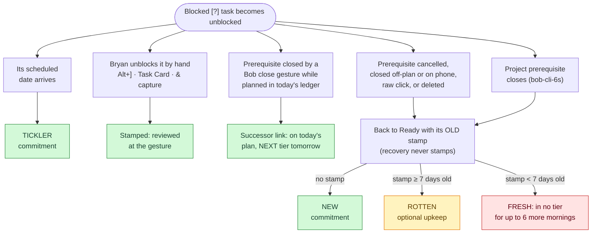
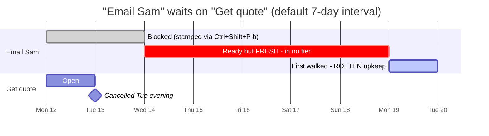
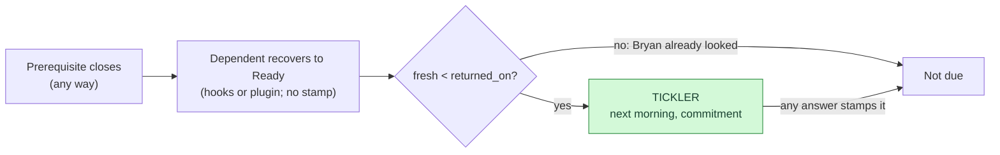

# Does an unblocked task always reach the next morning review?

Checked **Monday, October 12, 2026**, against bob-cli `2eb2581`, bob-plugins `4193a19`,
the live `~/bob` vault, and `~/.config/bob/config.yml` (`interval: 7`,
`next_interval: 1`, `pending_interval: 1`, no ROTTEN budget).

**Requirement:** whenever a Blocked `[?]` task becomes unblocked, for any reason, it is
reviewed **no later than the next morning GTD review**.

## Verdict: only partly

| Unblock reason | Guaranteed by next morning? |
| --- | --- |
| Its `scheduled` date arrives (a deferral returns) | ✅ **Yes**: TICKLER tier, a commitment |
| Bryan unblocks it with a gesture (Alt+], Task Card, `&` capture) | ✅ **Yes**: the gesture stamps it, so he reviewed it then |
| A prerequisite **closes through a Bob close gesture while it is planned in today's ledger** | ✅ **Yes**: linked as a successor today, then NEXT tier tomorrow |
| A prerequisite closes **any other way**: cancel, closed off-plan, phone or raw checkbox click, more than 5 successors | ❌ **No**: only if its stamp happens to be due |
| A **project** prerequisite closes (epic `bob-cli-6s`, in flight) | ❌ **No**: same gap, and many tasks at once |

**The root cause:** the review walk doesn't remember that a task was ever blocked.
Freshness is computed when the walk is read, from three inputs: the `[fresh::]` stamp,
the `scheduled` date, and the interval. Automatic Blocked → Ready recovery never stamps.
A deferral leaves a trace (`scheduled`), so it comes back as TICKLER. Closing a
dependency leaves no trace on the dependent itself.

## How each unblock path reaches (or misses) the walk



Two ways the task can miss the next review:

1. **FRESH (❌).** Blocking a task through a gesture (Ctrl+Shift+P `b`, `&` capture)
   stamps it. If its prerequisite then closes within 7 days, the task returns to Ready
   with a stamp that is still current, so it is in no tier. It stays out of the walk
   until the stamp expires.
2. **ROTTEN (⚠️).** A task whose stamp is 7 or more days old does reach the walk, but in
   ROTTEN. ROTTEN comes after the "Commitments done" boundary and is "optional upkeep
   until 0, the budget, or you stop" (`docs/freshness.md` §6). It is not a guarantee.

### Example of the miss



"Email Sam" is unblocked Tuesday evening. The Wednesday through Sunday reviews (five of
them) never show it. It first appears on Monday the 19th, in the optional tier.

## Exposure in the vault today

| Blocked `[?]` tasks (405) | Count | If unblocked today |
| --- | ---: | --- |
| Future `scheduled` only, or `scheduled` plus a dependency | 376 | ✅ All return as TICKLER (each has no stamp, or a stamp older than its date) |
| Dependency only, no stamp | 1 | ✅ NEW |
| Dependency only, stamp 7 or more days old | 11 | ⚠️ ROTTEN (optional upkeep) |
| **Dependency only, stamp under 7 days old** | **19** | ❌ **Skipped unless the close goes through the successor-link path** |

- Nothing is slipping right now. No open Ready task has a prerequisite that closed after
  its last stamp, and the queue shows 0 TICKLER and 0 ROTTEN.
- The risk is latent: **19 of the 31 dependency-blocked tasks** would miss the next
  review if their prerequisite were cancelled or closed off-plan today. Nine of them were
  stamped today.
- **It gets worse with `bob-cli-6s`.** Under project-inherited Blocked, residents recover
  "recover-only, never linked" when a project's prerequisite closes
  (`plan:202610/prj_task_dep_links.md`, phase `cli-close`). A whole project's tasks would
  come back to Ready at once, with no successor link and no TICKLER. Project `scheduled`
  dates stay covered only while `bob projects sync` keeps copying the date onto each
  task's inline `scheduled`.

## Recommendation: treat an unblock like a returned deferral

Extend the existing TICKLER rule, which already means "came back after your last look,"
so that a closed prerequisite counts as a return date, the same way an arrived
`scheduled` date does:

```text
today:    RESURFACED  if  fresh < scheduled ≤ today

proposed: returned_on(t) = max( scheduled(t)                        if ≤ today,
                                latest completion/cancelled date of
                                t's prerequisites (own + project) )
          RESURFACED  if  fresh < returned_on(t) ≤ today
```



**Why this fits the current design**

- **No writes.** It is still computed when the walk is read. Nothing new is stored, and
  automation still never stamps.
- **Closes both gaps.** TICKLER is a commitment tier, and RESURFACED already beats ROTTEN,
  so the FRESH miss and the ROTTEN-upkeep miss are fixed together.
- **It clears itself.** Any answer (Ctrl+Alt+F, roll, link, drop) stamps the task, which
  makes `fresh ≥ returned_on`, and the task drops out.
- **The data already exists.** Closed prerequisites stay on the Depends-On line as
  history (`docs/task-dependencies.md` §5), and both closed targets in the vault carry
  `[completion::]` dates.

**Remaining edge cases, to be decided in the plan**

- A prerequisite that was deleted or became unresolvable leaves no date.
- A prerequisite archived to `done/` before the next review would need the archive path
  resolved.
- Should a keep on an unblock-TICKLER count toward the keep streak? Probably not. A newly
  unblocked task is not evidence of procrastination.

**Rejected alternatives**

- **Clearing `fresh` on unblock, so the task shows as NEW.** NEW means "never
  confirmed", and automation must not touch stamps.
- **Writing `scheduled:: today` on recovery.** Hooks and freshness never change
  schedules, and it would add noise to the Schedule Log.
- **Always recovering to Next.** It contradicts the sticky-lane and derived-rank
  decisions and would grow the lanes.

**Cost:** both evaluators (`src/native/freshness/state.rs` and bob-ledger-tools
`100-freshness-evaluate.js`) plus new shared vectors. Under the decision-record rules it
needs a new record that partly supersedes `review-walk-is-tiered`. Sequence it after
`bob-cli-6s`, so that "project prerequisites" has a settled definition.

**Precondition, true either way:** the walk only sees a task once its checkbox has
flipped from `[?]`. That flip comes from `bob task reconcile` (unattended, every 15
minutes on the MacBook) or from immediate plugin recovery. If reconcile has not run since
midnight, a `scheduled` date that arrived overnight is not visible yet.

## Sources

- `docs/freshness.md` §4 (the `state` and `tier` rules, RESURFACED beats ROTTEN), §5
  ("Automatic Blocked → Ready returns through the hooks never stamp"; who stamps), §6
  (ROTTEN is optional upkeep)
- `src/native/freshness/state.rs` (`resurfaced_on` uses only `scheduled`); the same
  logic is mirrored in bob-ledger-tools `100-freshness-evaluate.js`
- `docs/task-status-hooks.md`, "Derived Blocked Status" (recovery rank) and "Ctrl+Enter
  recovery"
- `docs/task-dependencies.md` §5 (closed prerequisites kept as history), §12.1–12.4
  (successor-link triggers and exclusions; "Freshness. Never touched")
- `plan:202610/prj_task_dep_links.md` (epic `bob-cli-6s`, phase `cli-close`:
  `Recover("project_member")`, recover-only, never linked)
- Vault scan of `~/bob` (read-only) and `bob freshness list -f json` on 2026-10-12
