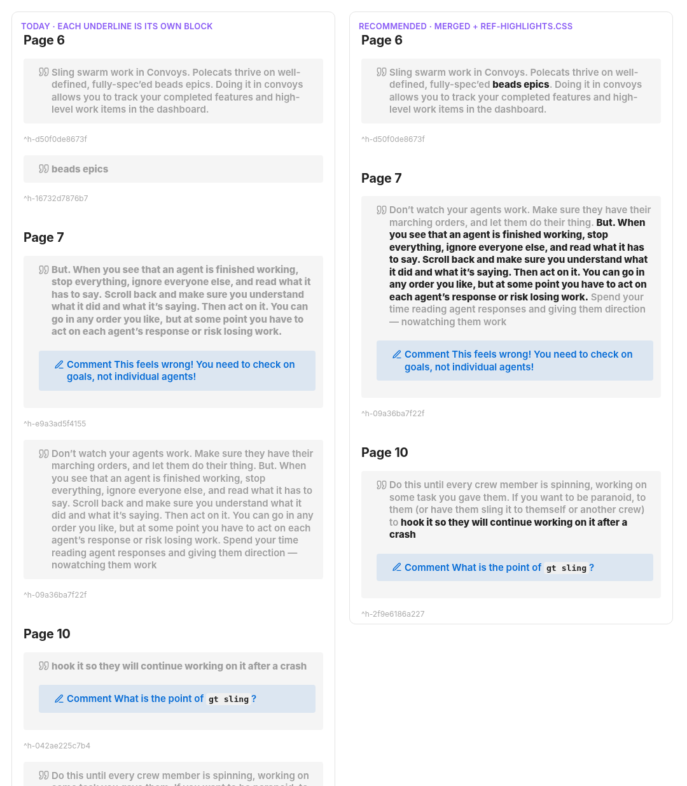
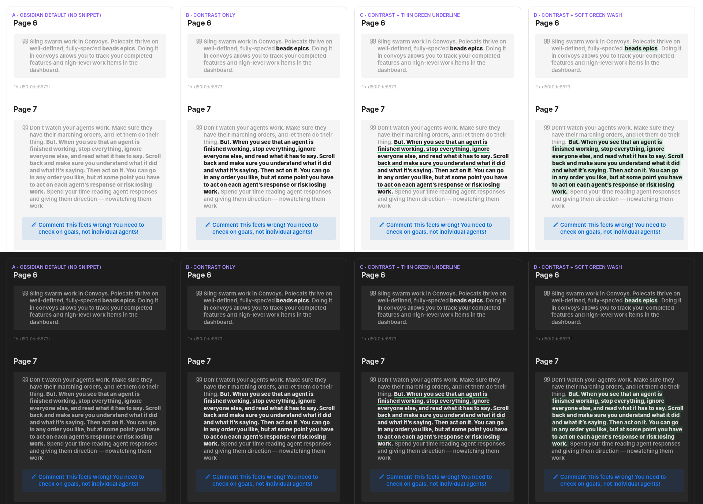

# Underlines inside highlights: fold them into the highlight as emphasis

> **Research query:** I use Highlights-app underlines mainly to add extra emphasis to part of a larger highlight, but my ref notes and the bob-mac-capture ref panel's preview pane show them as separate, bold highlights. How should Bob merge them, when possible, in a visually appealing way that is intuitive, reliable, and beautiful? Critique the plan (is it a good idea, would you take a different approach), clearly call out any justified requirement adjustments, and end with a recommended solution.


## Bottom line

**Yes, build it.** All five researchers agree, and the evidence is stronger than any one of them had.

- The underline is already *typed*: Highlights exports it as a fully bold quote.
- The relationship is structural: the underline's words sit inside one highlight on the same page.
- In your library the text signal and the PDF geometry agree on **every** exported underline ([19 of 19](#evidence-of-how-you-actually-underline)).

The feature is an automatic, [render-time fold in bob-cli](#design):

- The underlined words become a `**bold**` run inside the host highlight's quote.
- The underline's comment, tasks, and image notes join the host block.
- Nothing is written to the PDF or the sidecar.

Two companion pieces make it *beautiful*, not just deduplicated:

- **Obsidian:** a [3-line vault CSS snippet](#visual-design). Without it, the merged bold is nearly invisible in Obsidian.
- **Mac preview:** a small follow-up so emphasis deep inside a long quote is not cut off by the 4-line limit.

The full recommendation is in [Recommended solution](#recommended-solution).

## About this report

- **Type:** consolidated report (lead researcher)
- **Date:** 2026-10-19
- **Inputs:** five independent reports (`__cdx`, `__cld`, `__grk`, `__mus`, `__gem` in this directory) plus my own checks of the code, the vault, and every library PDF
- **Baselines:** bob-cli `8c10a820`, bob-mac-capture `b2f24d0`, Obsidian default theme (the vault has no community theme, only 3 snippets)
- **Question:** You use Highlights underlines almost only to add extra emphasis to part of a larger highlight. Ref notes and the Bob Refs preview pane instead show each underline as its own bold highlight. How should Bob merge them so the result is intuitive, reliable, and beautiful? Is it a good idea, and what would I change?

## Verified behavior today

1. **Highlights writes an underline as its own bold quote.** An underline is a separate PDF annotation (`/Subtype /Underline`, green in your PDFs). Highlights exports it as `> **…**` and wraps *each physical line* separately. Its changelog says: "Underlined text is turned into bold text when extracting" (v1.2.3). From `lib/blogs/karpathy_llm_wiki.md`:

   ```md
   > **This works surprisingly well at moderate scale
   (~100 sources,**
   > **~hundreds of pages) and avoids the need for embedding-
   based RAG**
   > **infrastructure**
   ```

2. **bob renders it as a second block.**
   - `parse_sidecar_chunk` classifies every `>` chunk as `SidecarAnnotationKind::Highlight`. There is no underline kind and no geometry.
   - `render_sidecar_highlights` (`sidecar_render.rs:4–285`) gives each chunk its own `[!quote]` callout and `^h-` ID.
   - The per-line wrapping survives reflow as `**a** **b** **c**` seams.

3. **In Obsidian the bold barely shows.**
   - `push_callout_block` (`sidecar_render.rs:554`) writes the quote's first paragraph on the `> [!quote]` line, so Obsidian treats it as the callout **title**.
   - In the default theme the title is grey (`--callout-quote: #9e9e9e`) and semibold. Bold inside it goes from weight 600 to 800 but stays grey.
   - The result is almost no contrast, especially in dark mode (Figure 2, column A).
   - Your vault uses the default theme, so cld's renders, made with Obsidian 1.14.4's own `app.css`, are representative.

4. **The Mac preview reads the note, not the sidecar.**
   - The inspector loads `bob ref show -f json`, and `RefsQuoteEmphasis` paints balanced `**` runs as strong.
   - **Update from today's `b2f24d0`:** the inspector is now one HIGHLIGHTS list in note order. Each entry is the quote, followed by any comment as a pale-yellow note card beneath it.
   - The quote uses the callout font, primary color, a 2 pt yellow rule, a **4-line limit** with tail truncation, and a raw `.help(quote)` tooltip.
   - Three reports discuss italic "YOUR NOTES" quotes. That analysis is now obsolete. The new layout (quote with a note card below) is exactly the right shape for a merged underline that carries a comment.

5. **A latent continuation bug.** `plan_continuations` (`continuation.rs:103–150`) treats every text highlight as the "previous" candidate, underlines included. Suppose an underline sorts after its host at the bottom of page 11, and a `<` sits on page 12. Today the `<` joins the *underline*, not the highlight around it.

## Evidence of how you actually underline

cld and grk surveyed the vault independently. I re-ran the survey with my own scripts and added the one check none of them ran: **PDF geometry across the whole library** (`mutool`, all 492 PDFs).

- **`[!quote]` callouts in `ref/`**
  - *Value:* 351
  - *Source:* grk, lead
- **Underline rows (fully bold quotes)**
  - *Value:* 19, in 7 notes
  - *Source:* cld, grk, lead
- **Text inside *exactly one* same-page highlight**
  - *Value:* **19 / 19**
  - *Source:* cld, grk, lead (3 independent scripts)
- **`/Underline` annotations in all library PDFs**
  - *Value:* 22
  - *Source:* lead
- **…whose quads sit inside exactly one `/Highlight`**
  - *Value:* **19**: the same 19 rows, one host each
  - *Source:* lead
- **…inside no highlight at all**
  - *Value:* 3 single words on `log_is_the_agent` p. 7 ("proves", "runtime", "that"). Highlights **never exported them** to the sidecar.
  - *Source:* lead
- **Sidecar order**
  - *Value:* 16 after the host, 3 before it; all 19 directly adjacent
  - *Source:* cld, lead
- **Underlines with their own comment**
  - *Value:* **8 / 19 (42%)**
  - *Source:* cld, grk
- **Underlines with a `#task`**
  - *Value:* 1 (`gastown_readme` p. 2, routed to `sase.md`)
  - *Source:* cld
- **Underline `^h-` IDs linked from anywhere in the vault**
  - *Value:* **1 / 19** (that task's 🔖 link)
  - *Source:* cld, lead
- **Multiple hosts / repeated text / 2+ underlines in one host**
  - *Value:* 0 / 0 / 0
  - *Source:* cld, lead
- **Bold run starting >150 chars into the merged quote**
  - *Value:* 7 / 19 (3 start >220 chars)
  - *Source:* cld, lead
- **Shortest underline**
  - *Value:* "beads epics" (2 words)
  - *Source:* lead

What this settles:

- **Text containment is a sound v1 trigger.**
  - cdx argued that sidecar text is evidence but not proof, and proposed a real-export experiment before trusting it.
  - The PDF scan *is* that experiment, run on your real library. Geometry and text agree on every exported underline.
- **Standalone underlines are real.** 3 of 22 PDF underlines (14%) are lone single words. The fallback is not hypothetical.
  - Why Highlights left them out of the sidecar is unknown. Its old changelog treats underlined words as tag suggestions, but I could not confirm current behavior.
  - This matters for the false-merge risk in [Risks and open questions](#risks-and-open-questions).
- **The comment usually lives on the underline.** Carrying it to the host is the main value, not an edge case.
  - Gas Town p. 7: "This feels wrong!" is attached to the fragment.
  - The goals paper: two of its notes are on bold cards.
- **Sidecar order cannot be trusted.** 3 underlines sort *before* their host, so any "previous highlight" rule fails.
  - grk said most hosts come *after* the underline. gem said "~50%". The measured split is 16 after, 3 before.

## Is this a good idea

**Yes.** It is better founded than the `<` continuation marker.

- `<` needed an explicit gesture because its inputs were two indistinguishable plain highlights, and automatic joining was only about 50% precise.
- Here Highlights has already labeled the child, and containment can be checked.
- It fixes every surface at once: Obsidian, `bob ref show`, agents, the Mac inspector, and the Copy card all read the managed region. That follows `decisions:mac-capture-is-a-thin-client`.

Where the request needs tightening (what I would change):

1. **"Merge" must mean a reversible render-time fold.** Never write to the PDF or the sidecar: Highlights owns both and overwrites the sidecar on save. Deleting either annotation and rescanning must undo the fold.
2. **"When possible" needs a predicate you can explain** ([Finding the host](#finding-the-host)). A visible miss (the underline stays a separate bold block) beats a silent wrong merge.
3. **The comment is the point.** mus proposed never merging an underline that has a comment, task, or image note. That would skip 8 of 19, exactly the cases where a thought is stranded on a fragment. **Rejected.**
4. **Merging alone does not make Obsidian beautiful.** Inline bold in a grey semibold title is nearly invisible (Figure 2, A). The CSS snippet belongs to v1, not to polish.
5. **Merging can hide emphasis in the Mac preview.** Today the underline is visible as its own card. Folded into a long quote, its bold run starts past the 4-line clip in 3 to 7 of 19 cases. Without a small follow-up, the most important words would vanish from the preview.
6. **Underlines are "generally" emphasis, not always.** Standalone underlines must stay first-class, and look better than today: one clean bold run, not `** **` fragments.

What I would **not** do:

- a new gesture, marker, config flag, or frontmatter opt-out;
- a merge implemented in Swift;
- `<u>`, `==mark==`, italics, or colored accents as the stored syntax;
- fuzzy or LLM matching;
- PDF geometry in v1;
- nested sub-callouts;
- rewriting the PDF or the sidecar.

## Requirement adjustments called out explicitly

- **A1. Merge "somehow"**
  - *Adjusted to:* An **automatic** render-time fold in bob-cli: no gesture, marker, flag, or config key. Undo = delete either annotation and rescan.
  - *Why:* The underline *is* the instruction. A flag would let a bad merge hide instead of being fixed.
- **A2. "When possible"**
  - *Adjusted to:* A **fully bold quote** whose text occurs **exactly once** inside **exactly one** other text highlight on the **same page**. Anything else stays separate and is counted in the scan report.
  - *Why:* Simple to explain, fails closed, and holds for 19 of 19 today.
- **A3. (unstated) comments, tasks, image notes**
  - *Adjusted to:* They travel into the host block. A task keeps its own identity but links to the host.
  - *Why:* 42% of underlines carry the thought.
- **A4. "Visually appealing"**
  - *Adjusted to:* Stored as `**bold**`, plus one vault CSS snippet ([Visual design](#visual-design)) that brings emphasized words to full ink.
  - *Why:* Every surface already understands `**`. The snippet fixes the real Obsidian problem.
- **A5. Both surfaces**
  - *Adjusted to:* bob-cli alone fixes both. A separate **presentation-only** Mac follow-up keeps late emphasis visible.
  - *Why:* The thin-client decision. The 4-line clip.
- **A6. (unstated) identity**
  - *Adjusted to:* Host `^h-` unchanged. An absorbed ID is never tombstoned, and gets a redirect stub **only if something links to it**.
  - *Why:* 1 stub on rollout instead of 19 ([Identity and reversal](#identity-and-reversal)).
- **A7. (unstated) leftovers**
  - *Adjusted to:* A standalone underline renders as **one** healed `**…**` run.
  - *Why:* Today's `**a** **b**` seams look broken.
- **A8. (bug) `<` interplay**
  - *Adjusted to:* Absorbed underlines are invisible to the continuation "previous" search.
  - *Why:* The latent bug in item 5 of [Verified behavior today](#verified-behavior-today).
- **A9. (scope)**
  - *Adjusted to:* Underlines only. Build the classifier so strikethrough (`~~…~~`) could be added later.
  - *Why:* You have no strikethroughs. Don't paint it into a corner.
- **A10. (scope) existing notes**
  - *Adjusted to:* Retroactive on the next scan. Preview it with `--dry-run`.
  - *Why:* It is a stateless fold.
- **A11. (edge case) underline covering the whole highlight**
  - *Adjusted to:* It still merges, and the whole quote renders bold.
  - *Why:* "I marked it twice" still means one card.

## Design

### Where it runs

Add a planner (`underline.rs`) beside `continuation.rs`:

1. **Parse the sidecar (unchanged).** Leave `SidecarAnnotation.text` byte-identical, so every `^h-` ID stays stable.
2. **`plan_underlines`** over all annotations. It produces `absorbed: underline order → host order`, plus the standalone underlines with a reason for each.
3. **`plan_continuations`** over the annotations **minus absorbed underlines**. This fixes [A8](#requirement-adjustments-called-out-explicitly).
   - The *same filtered plan* must be used in `render_sidecar_highlights` and in `annotation_task_candidates`. The latter calls `plan_continuations` on its own at `annotation_tasks.rs:15`.
4. **Render.**
   - Skip absorbed underlines.
   - Give each host its runs, comments, image notes, and task contributors.
   - Map each underline's order to the host's ID in `block_ids_by_annotation_order`.

The plan is recomputed from the sidecar on every scan, so no new state is stored. That is the same model as continuations.

### Classifier: what is an underline row

A row is an underline when all of these hold:

- its kind is `Highlight` and it is not a marker mirror;
- every non-whitespace character of the quote sits inside `**…**` pairs, checked over the raw `>` lines and their hard-wrapped continuations, before reflow;
- no other `**` appears;
- the inner text is non-empty.

Build `inner` by removing the per-line delimiters **before** `beautify_annotation_text`, so reflow and hyphen healing see clean text.

A row whose note carries a `<` marker is **not** absorbed. The explicit gesture wins, and the row behaves as it does today.

### Finding the host

Match on a **key** of the text:

- Apply NFKC normalization.
- Drop whitespace, `**`, and hyphen-like characters (U+002D, U+00AD, U+2010, U+2011).
- Keep case and punctuation.
- Apply the same render-only cleanup to both sides, such as return-link glyph stripping when that option is on.

Hyphens are dropped because the host and the underline wrap at different points. One side can keep `embedding-based` mid-line while the other heals `embedding-⏎based`.

Host candidates are the text highlights on the **same page**:

- use `page_index` when both rows have one, otherwise `page_label`;
- exclude other underline rows.

Then decide:

- **No host contains the key:** standalone (`no_host`)
- **2 or more hosts contain it:** standalone (`ambiguous_host`)
- **The key occurs 2+ times inside the one host:** standalone (`repeated_in_host`)
- **Otherwise:** absorbed

Deliberately left out:

- **No proximity window and no "previous" logic.** The whole page is searched in both directions.
- **No fuzzy fallbacks.** grk's "drop the last token and retry" is rejected. Word snapping ([Drawing the emphasis](#drawing-the-emphasis)) already handles the truncated `what didn’` case.

### Drawing the emphasis

Work on the host's **final** beautified quote. For a host inside a continuation group, use the assembled group quote, searching only the window of the member that matched.

1. Map the key match back to character offsets `[a, b)`.
2. **Snap to whole words** (letters, digits, `’`, `'`). This turns `what didn’` into `what didn’t`.
3. Trim whitespace. Make sure `**` is CommonMark left- or right-flanking, widening to whitespace if needed. On the real data no widening was needed.
4. Never cross a paragraph break: emit one run per paragraph.
5. Merge overlapping or touching runs. Never produce `****`, and never double-wrap text that is already strong.
6. Insert the `**` delimiters.

Real example, Gas Town p. 6. Today:

```md
> [!quote] Sling swarm work in Convoys. Polecats thrive on well-defined, fully-spec’ed beads epics. Doing it in convoys allows you to track your completed features and high-level work items in the dashboard.

^h-d50f0de8673f

> [!quote] **beads epics**

^h-16732d7876b7
```

After:

```md
> [!quote] Sling swarm work in Convoys. Polecats thrive on well-defined, fully-spec’ed **beads epics**. Doing it in convoys allows you to track your completed features and high-level work items in the dashboard.

^h-d50f0de8673f
```

### Comments, tasks, and image notes

The host keeps its single `[!note] Comment` callout, with paragraphs in this order:

1. the host's own comment (or each continuation member's, in order);
2. each absorbed underline's comment, in the order its run appears in the quote.

That is the shape continuations already produce, so `region.rs`, the `bob ref show` JSON, and the Mac decoder need no change. Strip labels and list markers per piece, as continuations do.

**Anchor rule.** Prefix an underline's comment with `“<first ≤6 words of its run>…” — ` only when the block shows two or more comment sources or two or more runs. With one run and one comment, they explain each other. This never triggers in today's vault.

Gas Town p. 10 after the fold. The underline sorts before its host and carries the comment:

```md
> [!quote] Do this until every crew member is spinning, working on some task you gave them. If you want to be paranoid, to them (or have them sling it to themself or another crew) to **hook it so they will continue working on it after a crash**
>
> > [!note] Comment What is the point of `gt sling`?

^h-2f9e6186a227
```

**Image notes** embed under the host quote, as they do for continuation members.

**Tasks:**

- `[h::]` keeps the **underline's own** identity ID, so toggling the merge never duplicates a task. Do not bump `HIGHLIGHT_TASK_ID_VERSION`.
- The 🔖 link points at the **host** block, via `block_ids_by_annotation_order`. `annotation_tasks.rs` already separates the identity ID from the link ID.

### Identity and reversal

- **Host ID:** unchanged. The hash uses the raw text and the ordinal, and the emphasis exists only at render time.
- **Absorbed underline ID:** computed as today. Excluded from `removed_ids` by extending `absorbed_ids`, so it is never tombstoned.
- **Redirect stub.** Emit one only if the absorbed ID was already published **and** either:
  - it already has a stub, or
  - something in the vault links to it (`#^<id>`, task 🔖 links included).

  Reuse the vault-wide block-link scanning in `collect_done/link_repair.rs`. It only needs to run when a published ID is newly absorbed, which is rare.

  The stub looks like this:

  ```md
  > [!info] Merged emphasis
  > Now emphasized in [[#^h-cdd7eb850000|the Page 2 highlight]].

  ^h-476bb727cc72
  ```

  - Use the title **"Merged emphasis"** (mus's suggestion), not "Merged highlight". It keeps `### Removed highlights` readable once it holds both continuation and emphasis entries.
  - The title is safe to change: the region parser keys on the heading (`region.rs:63`), not on the title.

- **Why not stub every published ID, as continuations do?** (grk, gem, mus)
  - On rollout that adds 19 stubs across 7 notes, and 18 of them protect nothing.
  - You often draw the underline first, and the Mac runs `bob ref scan` from cron every 15 minutes. Any scan that lands between the two strokes publishes the underline on its own, and that rule would then leave a permanent stub.
  - The link-aware rule yields exactly 1 stub today: `gastown_readme` `^h-476bb727cc72`.
  - If the link scan proves awkward to wire in, fall back to cld's simpler predicate: "published and has a task".

Each change in Highlights, with its result on the next scan:

- **Add an underline inside a highlight:** The highlight gains a bold run, and no duplicate card appears
- **Delete that underline:** Only its run disappears
- **Delete the host but keep the underline:** The underline comes back as a standalone block under its **original** ID. Old links resolve again and the stub drops.
- **Change the underline's extent:** Recomputed from scratch; no formatting accumulates
- **The match becomes ambiguous:** Separate blocks again, reported in the dry run

### Visibility and diagnostics

Modeled on the continuation counters. No new subcommands or flags.

- **`bob ref sync --dry-run`:** `underlines: N merged · M standalone`, then one line per standalone underline, e.g. `underline_standalone: Page 7 (no_host)`.
- **Concise `bob ref scan`:** `N underlines merged`, and `M standalone underlines` when non-zero.
- **Scan JSON:** `notes[].underlines_merged` and `notes[].underlines_standalone`, present only when non-zero. `schema_version` stays `1`.
- **`highlights_count`:** counts rendered blocks, so it drops (Gas Town goes from 15 to 10).
- **Docs:** add an "Underline emphasis" section to `docs/highlights-ref-sync.md` under Generated Body Contract, next to continuations.
- **The one rule to learn:** *a bold run inside a quote is an underline that merged; a whole quote in bold is an underline that found no surrounding highlight.*

### Visual design

**Obsidian: keep the title-line layout and add one vault snippet** (cld's treatment B).

Create `.obsidian/snippets/ref-highlights.css` and add `"ref-highlights"` to `enabledCssSnippets` in `appearance.json`.

- Both files are git-tracked and travel with vault sync.
- `inline-code.css` and `task-statuses.css` set the precedent.
- This is a vault change, not bob-cli code.

```css
/* bob ref: an underline drawn inside a highlight renders as **bold** inside
   that highlight's [!quote] callout. Bring those words into full ink against
   the quote's muted text. Nested Comment callouts are not affected. */
.callout[data-callout="quote"] > .callout-title strong,
.callout[data-callout="quote"] > .callout-content > p strong {
  color: var(--text-normal);
}
```

The underlined words come into focus: full ink against the grey quote. The `>` combinators keep the rule off bold text inside nested Comment callouts.



*Figure 1 (cld). Gas Town pp. 6, 7, 10, rendered with Obsidian 1.14.4's own `app.css`. Left: today. Right: merged, with the snippet.*



*Figure 2 (cld). A: Obsidian default. B: contrast only (recommended). C: plus a thin green underline. D: plus a soft green wash.*

Treatments rejected:

- **A (default):** loses the emphasis, worst in dark mode.
- **C, and gem's accent underline:** underlines read as links, and a long run looks like a row of them.
- **D:** heavy on runs over 200 characters.
- **`==mark==`** (a highlight inside a highlight) and **`<u>`:** both show as raw markup in the Mac app and in copied text.

**Why not move the quote into the callout body** (cdx, grk)?

- It rewrites all 351 blocks.
- With an empty title, Obsidian draws a "❝ Quote" title row on every highlight unless *more* CSS hides it. CSS is needed either way, so take the route with no churn.
- Revisit if multi-paragraph quotes start to bother you. Today their first paragraph is the grey title and the rest is body text.
- If you later want the context even quieter, the same snippet can drop the quote title to regular weight. That is a global look change, so try it deliberately.

**Mac (phase 2, presentation only, after bob-cli ships):**

1. **Emphasis-aware excerpt.** If a quote's first strong run starts past about 140 characters, render `… ` plus about 8 words of lead-in (from a word boundary), then the run and the rest, still under the 4-line limit.
   - Make it a pure `RefsCore` function so it can be tested without a Mac.
   - The tooltip and Copy keep the full quote.
   - Without this, the Karpathy, goals-paper, and sase-launch emphases (starting at characters 366, 315, and 274) would be clipped out of the preview.
2. **Plain tooltip.** `.help(quote)` shows raw `**` today. Use the stripped text that `RefsCore` already builds for accessibility (`RefsInspector.swift:390`).

No accent underline or extra color: the yellow rule already says "highlight", and strong weight against primary body text says "emphasis". gem's orange underline is rejected for the same reason as treatment C.

**Optional terminal polish:** `bob ref show` (`show.rs` `quote_lines`) prints `**` raw. Render the runs as ANSI bold when styling is on.

## Risks and open questions

**False merge from a standalone underline.**

- The scenario: a standalone underline whose words happen to appear once in a highlight on the same page. That would bold the wrong words and move the underline's comment.
- It has not happened, but your three standalone underlines were single words, where a coincidence is most plausible. Highlights did not export them, which lowers the risk today.
- Mitigations: the fail-closed gates, and dry-run reasons you can read.
- **Escalation, built only on evidence:** a page-level geometry check through lopdf, which scans already use to read markers.
  - Per page, count the `/Underline` annotations whose quads sit inside some `/Highlight` (G) and those that don't (S).
  - If S > 0 and the text-matched rows outnumber G, keep that page's underlines separate.
  - This catches cdx's counterexample (an underlined caption repeating text from a highlighted paragraph) without a character-to-quad text map.

**Ordinal ID churn, bead `bob-cli-9o`.**

- `ordinal_on_page` counts every annotation on the page, underlines included (`sidecar.rs:285–289`).
- An underline that sorts *before* an already-published highlight (3 of 19 do, e.g. Gas Town p. 4, where the underline starts at the host's first word) re-mints the host's ID and every later ID on the page. Those show up as "Removed highlight" tombstones.
- This feature inherits the problem and makes the trigger more common: going back to underline a phrase in a highlight you already made.
- Prefer landing the `bob-cli-9o` fix first or together. Do not quietly change the ordinal scheme inside this feature: that would re-mint IDs once across these 7 notes.

**Smaller risks:**

- **Literal `**` in source text** (`**kwargs`) confuses every renderer today. This feature does not make it worse.
- **Existing text artifacts** become more visible inside merged quotes: `embeddingbased`, `pagesthen`, `nowatching`. They come from dehyphenation and the web-clip text; out of scope.
- **The Copy picker loses the short underline row.** The copied quote is the full sentence with `**`. Flag it to the Ctrl+Y copy-menu work rather than solving it here.
- **Theme dependence.** The snippet uses only `--text-normal`. A future community theme that restyles callout titles could weaken it.
- **Highlights is a closed app.** If its export format changes, only the classifier needs to change.

## Delivery and validation

1. **Phase 1, bob-cli (one change; delivers the feature on every surface).**
   - Planner, rendering, the shared filtered continuation plan, task linking, link-aware stubs, diagnostics, and the docs section.
   - Tests, next to `tests/cli/highlights/continuations.rs`:
     - **Matching:** whitespace and fragment seams; a hyphen across a `>` line; mid-word snapping at both ends; flanking; paragraph split; merging runs; repeated text → standalone; two hosts → standalone; underline before and after its host.
     - **Identity:** host ID unchanged; the absorbed ID is neither tombstoned nor stubbed; a linked ID gets a stub that then persists and turns into a tombstone when the underline is deleted; task 🔖 points at the host; `[h::]` stays stable across merge toggles.
     - **Continuations:** H on p. 11, U inside H sorted after it, `<`H′ on p. 12. H′ must join H.
     - **Round trip:** `bob ref show` JSON keeps one `**span**`; region parse round-trips.
     - **Fixtures:** synthetic, modeled on the 7 real shapes.
2. **Rollout.**
   - `bob ref scan --dry-run` should report **7 notes, 19 merged, 0 standalone, 1 stub**.
   - Then scan for real. A second scan must produce no diff.
3. **Phase 1b, vault.** Add and enable `ref-highlights.css`. Review Gas Town and the goals paper in Obsidian, light and dark. **This visual check is the beauty gate; don't skip it.**
4. **Phase 2, bob-mac-capture.** Excerpt and tooltip. Compile on the Mac per its `AGENTS.md` (`just portable-check`, `just typecheck-tests`); `RefsCore` tests run in CI.
5. **After you accept the design,** record a decision in the decisions web, e.g. "Underlines Inside A Highlight Render As Its Emphasis", via `/sase_memory_write`.

**Acceptance criteria:**

- Every absorbed underline has exactly one host and an exact, word-snapped span.
- Ambiguous cases stay separate and are reported.
- Comments, tasks, and image notes all survive, with the task identity unchanged.
- Existing links resolve.
- Obsidian and the Mac show one quote with the same emphasis.
- An unchanged rescan is byte-stable.
- Deleting either annotation restores the independent blocks.

## Where the researchers disagreed and how I resolved it

- **Text match vs PDF geometry**
  - *Positions:* cdx: verified geometry before auto-merge. cld, grk, mus, gem: text is enough for v1.
  - *Resolution:* **Text in v1.** Geometry is the designed escalation ([Risks and open questions](#risks-and-open-questions)).
  - *Deciding evidence:* My PDF scan: geometry and text agree 19/19, so cdx's experiment has been run.
- **Underlines with comments, tasks, or images**
  - *Positions:* mus: never merge them. Others: carry them over.
  - *Resolution:* **Carry them over.**
  - *Deciding evidence:* 8 of 19 have comments, and stranded comments are the main harm today.
- **Redirect stubs**
  - *Positions:* grk, gem, mus: every published ID (continuation rule). cld: published + has a task. cdx: redirect generally.
  - *Resolution:* **Published + linked anywhere in the vault.** cld's rule is the fallback.
  - *Deciding evidence:* Only 1 of 19 IDs is linked. Underline-first drawing plus the 15-minute scan would otherwise create permanent useless stubs.
- **Quote in the callout title or the body**
  - *Positions:* cdx, grk: move to the body. cld: keep the title and add CSS. mus, gem: nothing needed.
  - *Resolution:* **Keep the title and add the CSS snippet.**
  - *Deciding evidence:* mus and gem missed the title problem. Moving to the body rewrites 351 blocks and still needs CSS.
- **Several hosts contain the text**
  - *Positions:* cld: nearest. grk: shortest. gem: proximity. cdx, mus: refuse.
  - *Resolution:* **Refuse (standalone, reported).**
  - *Deciding evidence:* 0 cases today. Refusing is the only rule that never misattributes.
- **Order relative to continuations**
  - *Positions:* grk: after grouping. cld: before, and exclude absorbed rows. cdx: exclude continuation members.
  - *Resolution:* **Plan underlines first, then group the rest.** Rows with a `<` marker are never absorbed.
  - *Deciding evidence:* Fixes the latent `<` bug, and explicit gestures win.
- **Mac changes**
  - *Positions:* mus, grk: none. cld: excerpt. gem: accent underline. cdx: expand affordance.
  - *Resolution:* **None for correctness. Phase 2 excerpt and tooltip for beauty.**
  - *Deciding evidence:* 3 to 7 of 19 runs fall past the 4-line clip. Today's inspector redesign (`b2f24d0`) moved comments to a card below the quote.
- **"Phase 0" golden exports first**
  - *Positions:* mus: required before writing code.
  - *Resolution:* **Already satisfied** by the real sidecars and PDFs.
  - *Deciding evidence:* 7 real sidecars plus the geometry scan. Write fixtures synthetically, modeled on the real shapes; don't copy third-party text.
- **Order of underline vs host**
  - *Positions:* grk: underline first for most. gem: ~50%. cld: 16 after, 3 before.
  - *Resolution:* **cld is right** (16 after, 3 before, all adjacent).
  - *Deciding evidence:* Measured independently.
- **Matching fuzz**
  - *Positions:* grk: hyphen-strip retry plus drop-last-token. gem: ≥4 chars. mus: ±2 window, smart-quote folding.
  - *Resolution:* **One key** (whitespace and hyphens dropped) **plus word snapping.** No windows, no length floor, no token dropping.
  - *Deciding evidence:* Covers every real case, including `didn’` and `sub-wisps`, with fewer knobs.

## Recommended solution

**Ship an automatic underline-into-highlight fold in bob-cli's renderer, with a vault CSS snippet and a small Mac follow-up.**

1. **Trigger.**
   - A sidecar quote that is entirely `**`-wrapped is an underline.
   - It folds into the host when its text, compared with whitespace and hyphens ignored, occurs **exactly once** inside **exactly one** other text highlight on the **same page**.
   - Otherwise it stays one clean, healed `**bold**` block, and [the scan report says why](#visibility-and-diagnostics).
   - No marker, flag, or config.
2. **Rendering.**
   - The underlined words become a word-snapped, CommonMark-safe `**run**` inside the host's existing `[!quote]`.
   - The underline's comment, image notes, and task links join the host block. A short quoted anchor appears only when two comments or two runs would otherwise be ambiguous.
3. **Identity.**
   - The host keeps its `^h-` ID, and an absorbed ID is never tombstoned.
   - A `[!info] Merged emphasis` redirect stub appears only for a published ID that something links to: 1 stub on rollout.
   - Tasks keep their identity and link to the host.
4. **Correctness extras.**
   - Absorbed underlines are invisible to `<` continuation lookups, which fixes a [latent bug](#verified-behavior-today).
   - Nothing is written to the PDF or the sidecar, so the fold is fully reversible.
5. **Beauty.**
   - **Obsidian:** a 3-line `ref-highlights.css` snippet brings the emphasized words to full ink against the muted quote.
   - **Mac phase 2:** a presentation-only excerpt keeps emphasis visible past the 4-line clip, and the tooltip drops raw `**`.
6. **Validation.**
   - The dry run on your vault should show 7 notes, 19 merged, 0 standalone, 1 stub.
   - Then check visually in light and dark.
   - Coordinate with `bob-cli-9o` so going back to underline an existing highlight does not re-mint its ID ([Risks and open questions](#risks-and-open-questions)).

**Result:**

- 7 notes get shorter and 19 duplicate cards disappear.
- 8 stranded comments move next to the passages they discuss, and the one task link stays valid.
- The words you underlined come into focus in Obsidian and in the Mac preview.
