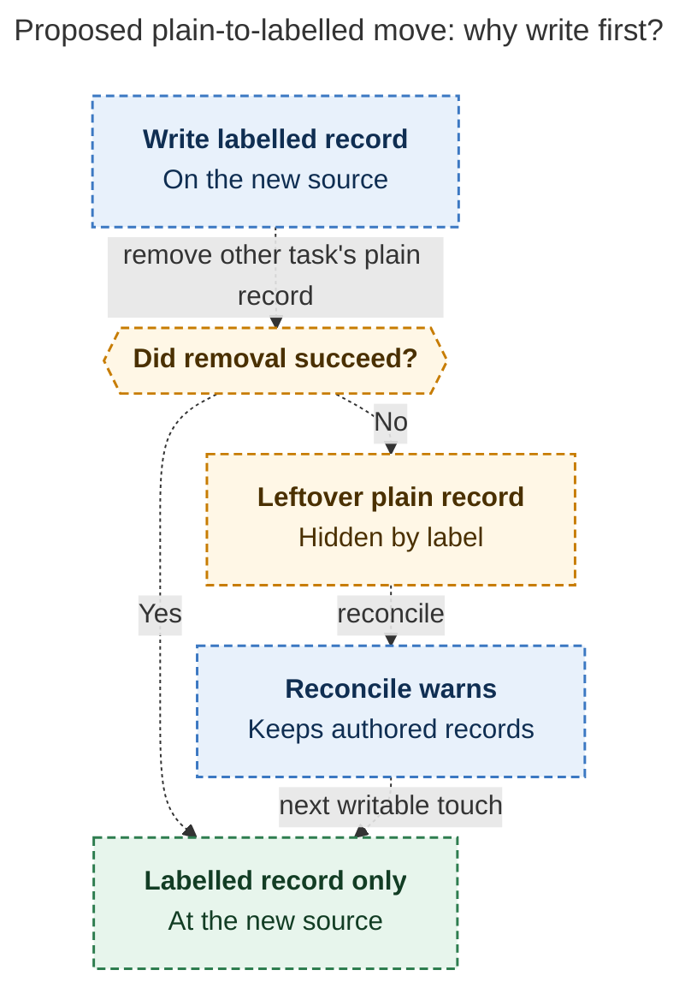
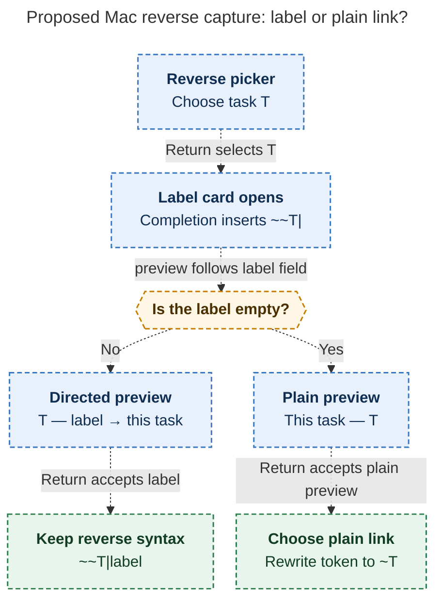

# Diagram proposals: Undirected task relations: a plain link has no direction; a label gives it one

Proposals for the swarm linker, not a report. Each diagram restates only what the source
report says.

```yaml
source: research:202610/undirected_task_relations/undirected_task_relations__final.md
producer: research.29.image
check: "mmdc 12.0.0 with the PDF-mirroring config and Puppeteer no-sandbox rendered 2 of 2 Mermaid diagrams"
```

## plain-to-labelled-move

```yaml
anchor: |-
  labelled record first. If the follow-up removal fails, the leftover plain record is subsumed
question: |-
  Why does a failed plain-to-labelled move still display the correct relation?
illustrates: |-
  In the plugin, a cross-note move writes the new labelled record first, so a leftover plain record is subsumed if removal fails and the next writable touch cleans it up.
caption: "For Obsidian plain-to-labelled moves, subsumption preserves the display after failed removal; either removal or a later writable edit completes cleanup."
review: "456.891x892 px, fit 100.0%; question, visual, and source checks passed; 1 revision; 2 look rounds"
```



## reverse-capture-card

```yaml
anchor: |-
  Return with an empty label on a `~~` token
question: |-
  How does Mac reverse capture require a label yet offer a plain link?
illustrates: |-
  The Mac reverse picker opens the label card, whose live sentence previews either a labelled statement by the other task or the visible empty-label choice of a plain link.
caption: "The Mac card previews both choices: Return keeps a labelled reverse statement or explicitly converts an empty label to a plain link."
review: "468.672x916 px, fit 97.5%; question, visual, and source checks passed; 0 revisions; 1 look round"
```


