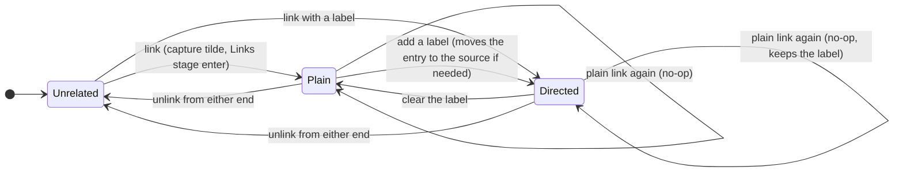

# Undirected task relations: a plain link has no direction, a label gives it one

_Researcher cld · 2026-10-21 · spans bob-cli, bob-plugins, and bob-mac-capture_

> **Question.** Today every task relation is directed. Should a relation **without** a label become **undirected**
> (shown as `links`), with only labelled relations directed, and `~~` meaningful only with a label? What is the best
> way to build it, and what would I change?

## Bottom line

**Build it.** The idea is right. For an unlabelled relation, direction carries no meaning, yet Bob makes you pick
one (`~` vs `~~`, `Links to…` vs `Linked from…`) and shows it everywhere (`links to →` / `linked from`). Dropping
it:

- removes a choice that carries no information;
- halves the relation UI;
- matches how Bryan has always written "related to" by hand;
- matches how Jira ("relates to") and Linear ("Related") model the same idea.

**Showing `links` instead of `links to` / `linked from` is not enough on its own.** For the change to be
reliable, direction has to become a property of the *label*, not of where the entry is stored. That needs four
rules the request doesn't state:

1. **Storage does not change.** Every relation, plain or labelled, is still written once on one task's
   `🪢 **LINKS:**` line and mirrored on the other task's generated `🪢 **LINKED FROM:**` line. For a plain link,
   which task holds the entry becomes an implementation detail. No migration is needed, and there is still only
   one source of truth.
2. **Identity changes to one relation per pair of tasks.** Two tasks are either unrelated, plainly linked, or
   linked by **one** label read from one side. A plain `~T` never adds a second edge and never strips a label.
   Adding a label upgrades the plain link, moving the entry to the labelled source if needed.
3. **Direction moves from the row to the entry.** Both relation rows read `🪢 links`, and only a labelled entry
   draws a pill and an arrow. The Task Card's two rows and two stages merge into one `Links…` row and stage, and
   the label field gets a ⇄ swap.
4. **`~~` requires a label.** A bare `~~T` is reported as an incomplete draft (a `relation_label` need), with a
   teaching error on submit. It is not silently rewritten to `~T`.

**Vocabulary.**

- Keep the word **label**. "Description" already means a task's text in Bob.
- Update *Task Relation*, and add *Undirected Relation* (aka plain link) and *Directed Relation* (aka labelled
  relation).
- Record the choice in a decision record.

**This is the cheapest moment to do it.** The vault holds exactly one relation (`~/bob/sase.md:289`), and it is
plain. The work spans three repos and is moderate in size.

---

## 1. What exists today

These facts come from the contract, the code, and the vault. I read the plugin and Mac code through `sase repo
open`.

**The contract is directed by definition.** `docs/task-relations.md` §1 defines a relation as "a directed,
optionally labelled, inert edge from a **source** task S to a **target** task T". §5 adds: "Edge identity is (S, T)
… A → B and B → A are independent edges."

**Storage is single-source.**

- The authored `🪢 **LINKS:**` line sits on S. It is the source of truth.
- The generated `🪢 **LINKED FROM:**` line sits on T. Reconcile owns it, and nothing reads it back (§§6–7).
- Prior research explicitly rejected authoring both ends ("Two sources of truth", in
  `research:202610/task_relation_links/task_relation_links.md`).

**Direction is shown everywhere:**

| Surface | Today | Where |
| --- | --- | --- |
| Live Preview chip row label | `🪢 links to` / `🪢 linked from`; unlabelled LINKS rows lead with `→` | `bob-ledger-tools/src/146-relation-chip-model.js:313, 545-548` |
| Chip remove (×) | `Unlink ‹name›` vs `Remove the link from ‹name›` | `146-relation-chip-model.js:160-162` |
| Task Card | two rows: `Links to…` (`l`) and `Linked from…` (`⇧L`), two stages, two commands | `bob-navigation-hotkeys/src/310-task-card-previews.js:521, 532`; `490-plugin-lifecycle.js:154, 161` |
| Stage live sentence | `S — ‹label› → T`, or `S → T` when unlabelled | `305-relation-stage-copy.js:74-79` |
| `bob capture` output | `🪢 links to "X"` / `🪢 "X" now links here` | `src/native/capture/output.rs:2368-2412` |
| Shell completion groups | `links to` / `linked from` | `src/native/capture_complete/shell.rs:447-449` |
| Mac picker | captions `Links To` / `Linked From`, header `🪢 “Owner” links to…`, subtitle `any task · ~ flips direction` | `CapturePickerPresentation.swift:267-269`; `CaptureRelationshipCopy.swift:214-235` |
| Mac relation card | sentence `“S” → “T”` or `“S” — label → “T”`; no direction toggle | `CapturePanelModel.swift:6417-6426` |
| Mac preview and notifications | `🪢 links to “X”`, `🪢 “X” now links here`, `🪢 Owner now links to “X”` | `CaptureRelationshipPresentation.swift:165-172, 299-309` |

**Behaviours that matter for this change:**

- **A plain re-add strips a label.** `plan_links_edit` treats re-adding a target with a different label as a
  relabel, and "no label" counts as different (`src/native/task_relations/plan.rs:117`). So `@N+n ~T` quietly
  turns `follow-up of [[T]]` into a plain entry. Once labels mean direction, that becomes a silent loss of
  meaning.
- **`already_linked` looks one way only.** It checks the typed direction
  (`src/native/capture_complete/candidates.rs:1309`). If T already links to the owner, `~T` offers T as unlinked
  and creates a reciprocal edge.
- **Nothing dedupes reciprocal pairs.** The relation index, the chips, and the Task Card counts all keep both
  edges. The plugin survey found no symmetric, undirected, or reciprocal concept anywhere.
- **The inverse-phrase table exists twice, and the copies disagree.** The ledger copy returns `null` for an
  unknown label (`146-relation-chip-model.js:19-38`). The nav copy returns `‹label› → this`
  (`304-relation-stage-view.js:348-360`).

**The product already leans undirected:**

- The Mac Similar Tasks band names the action **Relate**, shows a capsule reading **Related**, and only ever
  inserts `~` (`SimilarTasksBandEdits.swift:34, 69-70, 115`; `SimilarTasksBandPresentation.swift:75`).
- Every relation icon in the Mac app is `arrow.left.arrow.right` (⇄), which is a two-way symbol.
- The nav label field already says "leave it empty for a **plain link**" and offers "Plain link (no relation)"
  (`426-picker-relation-stage.js:620-631, 694`).
- Prior research chose the word `LINKS` because it is "Bryan's word and his existing zorg idiom for 'related'". It
  rejected `RELATED` because it "reads as undirected, which is wrong for a directed, labelled edge". The new
  design reverses that premise, which makes `links` the right word now.

## 2. Evidence that the rule "a label gives a direction" fits

### How the vault is used

- **Relations in use.** There is exactly one LINKS line. It is unlabelled: *Which athena/apollo audit findings are
  worth fixing?* → *SASE operational log audit* (`~/bob/sase.md:286-289`). Nothing needs migrating.
- **Hand-written idioms from before relations existed.** They split cleanly by whether they carry a phrase:
  - *Undirected, no phrase.* About a dozen "related to [[…]]" mentions, plus `**RELATED:** [[sase_better_plans]]`
    (`sase_gate.md:11`).
  - *Directed, always phrased.* Twelve "Merged into [[…]]" lines in `done/sase_done.md:1490-1522`.

  Nobody wrote an unlabelled arrow. When Bryan meant a direction, he wrote a phrase. That is exactly the proposed
  rule.

### Precedents

- **Jira.** Every link type has an outward and an inward description. "Relates" uses the same phrase on both ends,
  so it is symmetric. "Blocks" / "is blocked by" is directional, and its direction is "only interpretable at the
  user interface level". Atlassian practitioners also note that "Relates" conveys little information. That
  supports keeping plain links cheap and letting labels carry meaning.
- **Linear.** "Related" is symmetric. "Blocked by" / "Blocking" and "Duplicate of" are directed.
- **OWL 2.** A property is either *symmetric* (`SymmetricObjectProperty`) or has an *inverse*
  (`InverseObjectProperties`). The proposed rule maps the empty label to "symmetric" and a label to "has an
  inverse". Bob's display-only inverse table already plays the inverse role.
- **org-super-links.** It writes a link and a backlink into a drawer, so there are two sources of truth, and that
  is known to drift. This is the failure mode Rule 1 avoids.

The common thread: mature systems make "related" symmetric, store each link **once**, and derive symmetry from the
*relation type* (here, the label), never from storage.

## 3. Critique: is this a good idea?

### What's right

- **It removes a meaningless choice.** With no label, `~T` and `~~T` record the same fact, yet today they produce
  different bytes, different copy ("links to" / "now links here"), and different Task Card rows. Every surface
  makes you think about something that doesn't matter.
- **It makes labels earn their keep.** A label becomes the *only* way to say "this way round", so the label prompt
  turns into a meaningful step ("say how they relate") rather than an optional decoration.
- **It simplifies the UI.** One `Links…` row, one stage, one chip-row label, and one notice style for plain links.
- **It is cheap now.** There is one relation in the vault, it is plain, and nothing downstream (stats, plan,
  review) reads relations.

### What's underspecified or risky

1. **Changing only the rendering leaves wrong identity.** If only the copy changes, three things go wrong:
   - Plain A→B plus plain B→A shows each task **twice**: once on LINKS and once on LINKED FROM.
   - `~T` against an existing `T —follow-up of→ N` adds a redundant second edge.
   - `@N+n ~T` **strips** an existing label (`plan.rs:117`).

   Making plain links undirected means changing *identity* (unordered pair) and *writer rules*, not just copy.
2. **Tying the label to direction penalises symmetric labels.** `see also`, `related to`, and `conflicts with`
   become directed relations that render a little oddly from the far end (`(A) · see also → this`). Today's own
   examples use them:
   - `docs/capture.md` uses `~sase:retry-design|see`.
   - `docs/guides/link-related-tasks.md` uses `|"related to"`.
   - The nav label-field placeholder is `e.g. see also` (`305-relation-stage-copy.js:106-115`).

   These become anti-patterns and should be changed.
3. **Raw Markdown still shows where an entry is stored.** The far end of a plain link still reads
   `🪢 **LINKED FROM:** [[…]]` in vim, git, and agent reads. I think this is right (§5.6), but it should be a
   deliberate choice.
4. **The `~~` and flip UX loses its meaning for plain links.** The Mac picker's "`~` flips direction" and the
   `Linked from…` stage only matter for labelled relations, so they need redesigning, not just recopying.
5. **"Description" is the wrong word.** Bob's contract, JSON, and docs call it a **label** (`relation_label`,
   `label`). "Description" already means a task's text (for example `mint_block_id(description, …)` and
   `task.description`). The nav field calls it a "Relation", which also clashes, because "relation" is the whole
   edge. Three names for one thing.
6. **The storage side can leak.** If a plain link is stored on an archived task, it can't be edited from the live
   end, because `done/` is read-only. That is rare, and it is acceptable as long as the refusal explains it.

### Would I take a different approach?

**Not for the core.** "No label means undirected; a label means directed" is the right rule. It is crisper than
the alternatives in §6:

- an explicit direction flag;
- a third "symmetric label" class;
- a typed ontology.

**I would widen the scope** from a display change to a *model* change: pair identity, writer rules, and one
merged UI. **I would narrow `~~`** to "labelled reverse relation".

## 4. Requirement adjustments (called out)

| # | As requested | Adjusted to | Why |
| --- | --- | --- | --- |
| **A1** | Show `links` instead of `links to` / `links from` for unlabelled relations | **Adopted and extended.** Every relation row reads `🪢 links`. Direction is drawn **per entry**, only for labelled entries: `‹follow-up of› → (T)` going out, `‹followed up by› (S)` coming in. | If the row label stays directional, a mixed row still says "links to". Moving direction onto the entry makes the row label constant and the meaning local. |
| **A2** | A relation with a "description" is directed | **Adopted, with the word *label*.** A label is phrased from its source (`S ‹label› T`). Writers add a gentle hint (never a refusal) when the typed label means "related" (`related to`, `related`, `see also`, `see`, `relates to`): "‘see also’ adds a direction · leave it empty for a plain link". | "Description" collides with task text. The hint keeps the rule crisp without forbidding anything. |
| **A3** | `~~` only makes sense with a label | **Adopted as a parse need, not a rewrite.** `~~note:id` with no label is *incomplete* (`needs: relation_label`). Submit refuses with a teaching error. In the Mac `~~` picker, ↩ inserts `~~note:id\|` and opens the relation card. | Silently rewriting `~~` to `~` would leave a misleading spelling in drafts and break the "teaching error, never junk" culture. The Mac flow makes the requirement invisible in practice. |
| **A4** *(added)* | Storage was not discussed | **Storage is unchanged:** single-authored LINKS plus generated LINKED FROM, the same grammar, and the same raw line names. | No migration, no second source of truth, and LR11 (rebuilding LINKED FROM from scratch is byte-identical) still holds. Raw names describe *where to edit*; chips describe *meaning*. |
| **A5** *(added)* | Identity was not discussed | **One relation per unordered pair.** A plain add is satisfied by any existing relation. A label upgrades a plain link, moving it to the labelled source if needed. A plain add never downgrades a label. | Without this, the new display shows tasks twice and a casual `~T` erases meaning. |
| **A6** *(added)* | Two Task Card rows and two stages remain | **One `Links…` row (`l`) and one stage.** CURRENT lists every related task. `⇧↵` opens the label field with a live sentence and a **⇄ swap**. `⇧L` / Ctrl+Shift+Alt+L become shortcuts into the same stage with the swap pre-set to "that → this". | Two rows only make sense if direction always matters. |
| **A7** *(added)* | Reconcile was not discussed | **The LINKED FROM projection skips a source the owner already names on its own LINKS line.** A new `duplicate_pair_relation` warning covers this. Reconcile still never edits LINKS. | Each task shows a pair exactly once, even after hand edits, and the result is deterministic across machines. |
| **A8** *(added)* | Update the glossary term and add two terms | **Adopted:** *Task Relation* updated; *Undirected Relation* (aka plain link, plain relation) and *Directed Relation* (aka labelled relation) added. **Plus a decision record**, `relations-undirected-unless-labelled`. | This changes a rule that affects behaviour, and the decisions web is where such rules live. Drafts are in §5.8. |
| **A9** *(added)* | Contract was not discussed | **JSON stays `schema_version` 1, additive only:** `directed: bool` on `relations[]`, `relation_updates[]`, and completion rows, and `existing_direction` on candidates. **No new enum values.** Refusing a bare `~~` is a CLI behaviour change, so its commit takes `!`. | The Mac app decodes Bob's JSON, and an unknown enum case can fail a strict Swift decode. The release-train decision requires `!` on CLI breaks. |

## 5. Recommended design

### 5.1 The model

| | Undirected relation ("plain link") | Directed relation ("labelled relation") |
| --- | --- | --- |
| Label | none | 1–40 characters, phrased from the source: `S ‹label› T` |
| Meaning | "these tasks belong together" | "S is ‹label› T" |
| Identity | the unordered pair {A, B} | the pair, plus which end is the source |
| Stored | as one LINKS entry on either end (writers choose; §5.3) | as one LINKS entry on S |
| Shown at each end | `links (other)`, the same at both ends | at S: `‹label› → (T)`; at T: `‹inverse› (S)` for a known label, otherwise `(S) · ‹label› → this` |
| Capture | `~T` | `~T\|label` (captured task is S) or `~~T\|label` (T is S) |
| Obsidian | Links stage ↵ | Links stage ⇧↵, with ⇄ swap |

**The pair rule.** Two tasks have **at most one** relation. It is plain, or it is labelled and read from one side.
Writers keep this true; reconcile warns when hand edits break it.



### 5.2 Storage and raw text (unchanged grammar)

```markdown
- [ ] #task Fix flaky capture retries ^fix-retries
	- 🪢 **LINKS:** [[#^retry-design]] • follow-up of [[done/bob_done#^capture-star]]
	- 🪢 **LINKED FROM:** [[#^audit-triage]] • [[old#^retry-bug]] (merged into)
```

That one task has four relations:

- a plain link with *Retry design* (stored here);
- a directed *follow-up of* → *Capture star* (stored here);
- a plain link with *Audit triage* (stored there);
- a directed *Old retry bug* —merged into→ this (stored there).

**Keep `LINKS` / `LINKED FROM` as raw names.** They tell a vim user, a `git diff` reader, or an agent the one
thing raw text must say: *where to edit*. A LINKED FROM line is generated; its notice already reads "change it
with Ctrl+Shift+Alt+L". Renaming the generated line to something neutral (`LINKED:`) would cost:

- five parsers and their vectors;
- the Mac task-card filter (`CaptureTaskBlockPresentation.swift:136-140`);
- one more tolerated legacy spelling.

All of that for text that chips replace in Obsidian anyway.

### 5.3 Writer rules (shared by capture and nav)

Let **P** be the existing relation between owner N and other task T, found in **both** LINKS lines (N's and T's).

| Request | P before | Result | Reported `action` |
| --- | --- | --- | --- |
| plain (`~T`, ↵) | none | add `[[T]]` to N's LINKS | `added`, `directed: false` |
| plain | plain, either side | nothing | `unchanged` ("already linked") |
| plain | labelled, either direction | nothing; **the label is kept** | `unchanged` ("already linked · follow-up of") |
| `~T\|x` (N —x→ T) | none | add `x [[T]]` to N | `added`, `directed: true` |
| `~T\|x` | plain stored on N | relabel in place | `relabeled` (`previous_label: null`) |
| `~T\|x` | plain stored on T | **move**: add `x [[T]]` to N, remove `[[N]]` from T | `relabeled`, plus additive `moved_from` |
| `~T\|x` | N —y→ T | relabel in place | `relabeled` |
| `~T\|x` | T —y→ N | **capture refuses**: "“T” already says ‘y’ about this task; change it with `~~T\|x` or swap it in Obsidian". The GUI swaps explicitly, because there the user can see the sentence. | — |
| `~~T\|x` (T —x→ N) | the mirror image of the four rows above | the same rules, with T as the source; T's LINKS must be editable (today's `*` refusal set) | — |
| `~~T` (no label) | any | **incomplete**: `needs: ["relation_label"]`; submit refuses | — |
| clear the label (nav ⇧↵ with an empty field) | labelled | keep the entry where it is and drop its label | `relabeled` (`label: null`) |
| unlink (↵ on CURRENT, chip ×) | any | remove every entry naming the pair, on either side | — |

The rules underneath the table:

- **A plain add never downgrades.** Clearing a label is always an explicit act in the label field. This fixes
  today's `plan.rs:117` behaviour for plain re-adds (LW4 keeps its meaning for labelled re-adds).
- **Writers choose where a plain link is stored.**
  - Store it on the owner when the owner is writable. That is always true for capture, because the owner is a
    new task or a routable `@N+id`.
  - In nav, *optionally* fall back to storing it on the other task when the current task is read-only (`done/`, or
    the previous daily note). Then a plain link can be made from an archived task's view. This is small and
    optional, so it is phase 3.
- **Moves add before they remove.** Capture stages both edits in one batch, so they are atomic. Nav writes the new
  source's LINKS line first, then removes the old entry. If that second write fails, the result is a harmless
  duplicate (warned), never a lost relation. If the old entry sits in a read-only note, the move is refused:
  "the plain link is stored on an archived task".
- **Within one capture item, one pair takes one token.** `N ~T ~~T|x` and `N ~T ~T|x` are refused with a teaching
  error ("pick one: a plain link or a labelled relation"). This extends LX14's duplicate-label refusal. LX15
  (`N ~T ~~T` → "two independent edges") is retired.
- **Completion follows the same rules.** `already_linked` checks both directions and both lines. Candidates gain
  `existing_direction` (`"to"` / `"from"`) and `directed`. `relation_from` (`~~`) replacements end in `|`
  (`~~note:id|`), so accepting a `~~` candidate opens the label step in every client.

### 5.4 Obsidian gestures (bob-navigation-hotkeys)

**One Task Card row.**

- It reads `Links…  l  3 · Retry design +2`. The count is the number of **related tasks** (pairs), drawn from the
  live index, with the stored LINKS line as a fallback while the index loads.
- `⇧L` and Ctrl+Shift+Alt+L are kept as "link with a label, the other task first". They open the same stage with
  the swap pre-set.

**One stage**, `🪢 Links · ‹task›`:

```text
🪢 Links · Fix flaky capture retries
Links 4 · searching 412 tasks · ⇥ to mark several · does not block
CURRENT
  (○ Retry design)
  (○ Audit triage)
  ‹follow-up of› → (✓ Capture star)            ↗ bob_done
  ‹merged from›    (✕ Old retry bug)            ↗ old
RESULTS
  …open tasks not yet related (excluding both directions)…
↵ link · ⇧↵ with a label · ⇥ mark several
```

**The label field** (`⇧↵`) shows a live sentence and a swap:

```text
🪢 Link with a label
  This task ↔ Retry design                       (empty → plain link · no direction)
  This task — [follow-up of ▏] → Retry design    ⇄ swap
  follow-up of · 3    merged into · 2    next step · 1
```

- **Swap:** a clickable ⇄ plus a key. I suggest Alt+R ("reverse"), because Tab and ⇧Tab already cycle
  suggestions.
- **↵ on CURRENT** unlinks the pair from whichever side stores it. The notice reads `🪢 Unlinked “X”`.
- **⇧↵ on CURRENT** relabels, swaps, or clears the label (which makes it plain).
- **Counted batches** keep working: `N<Ctrl+Shift+L>` links each of N+1 tasks with T, plain or labelled.

### 5.5 Reconcile (bob-cli `reconcile_relation_lines`)

One rule changes the projection. The rest of §6 of the contract stands.

```text
mirror(T) = sort_canonical({ (S, label) : (S, T, label) ∈ edges  ∧  T's own LINKS does not name S })
```

If both ends name each other, each task already shows the pair on its own LINKS line. Neither gets a mirror entry,
and reconcile emits `duplicate_pair_relation` (a new `relation_warnings[].kind`; additive). The JS chip model
applies the same rule, so LC7 ("a live edge missing from the text is appended") does not fight it. One Rust/JS
vector pins this. Reconcile still **never edits LINKS**.

### 5.6 Presentation

**Chips (bob-ledger-tools), Live Preview.** Before and after, for the task in §5.2:

```text
Before
  🪢 links to     → (○ Retry design)   ‹follow-up of› → (✓ Capture star)
  🪢 linked from    (○ Audit triage)   ‹merged from› (✕ Old retry bug)

After
  🪢 links   (○ Retry design)   ‹follow-up of› → (✓ Capture star)
             (○ Audit triage)   ‹merged from›    (✕ Old retry bug)
```

- **The row label is always `🪢 links`.** A LINKED FROM row directly under a LINKS row becomes a **continuation
  row**: no label, with chips aligned to the row above, so the two lines read as one list. A LINKED FROM row on
  its own keeps the `🪢 links` label.
- **Plain chips get no arrow.** The leading `→` on unlabelled LINKS rows goes away
  (`146-relation-chip-model.js:545-548`).
- **Directed entries keep today's grammar.** That is `‹label› →` on the source side, and on the target side either
  the inverse pill or `(S) · ‹label› → this`.
- **One ＋ per task** ("Link another task") on the first relation row. The × reads `Unlink ‹name›` on every plain
  chip, from either end.
- **Tooltips:** `Related tasks · live from the relation index` on the row. Continuation rows add `· stored on the
  other tasks`.
- **Colour still carries status, never direction.** Nothing in the palette changes.
- **One inverse table.** Make the nav stage import the ledger's table and its `null`-for-unknown behaviour, so the
  two copies cannot drift.

**`bob capture` output.** Plain links get "links", and directed relations read like chips:

```text
✓ captured  mac_inbox.md
  - [ ] #task Investigate retry handling [created::2026-10-21]
  🪢 links "Design a retry policy"   sase.md ^retry-design
  🪢 follow-up of → "Capture * blocks existing tasks"   done/bob_done.md ^capture-star · archived
  🪢 "Ship the sase blog" — next step → this   sase_blog.md ^prj
```

- **Dry runs:** `would link "…"` / `would add follow-up of → "…"`.
- **Already linked:** `🪢 already linked "…" · follow-up of`.
- **Relabels:** `🪢 relabeled "…" · next`. A move adds `(moved from sase.md)`.

**Mac Capture.** The app stays a thin client: Bob emits `directed` and the app picks the copy.

- **`~` picker.** Header `🪢 Link “Owner” with…`, caption `Links`, subtitle `any task · ~ for a labelled reverse
  link`. ↩ inserts a plain link; ⇧↩ opens the card.
- **`~~` picker.** Header `🪢 Link from… to “Owner”`, caption `Reverse · needs a label`. ↩ inserts `~~note:id|`,
  and Bob's `relation_label` context opens the card. Backspace on an empty `~~` filter flips back to `~`, as it
  does today.
- **Relation card.** The empty label shows `“A” ↔ “B”` with the caption `plain link · no direction`. Typing turns
  the sentence into `“A” — follow-up of → “B”`. A ⇄ swap rewrites the token's `~` / `~~` through Bob's
  `relation_to_replacement` / `relation_from_replacement`, so the app never re-lexes.
- **Icons.** Plain rows keep ⇄ (`arrow.left.arrow.right`). Directed rows use `arrow.right`.
- **Preview rows and notifications** mirror the CLI. Plain wording is symmetric: `🪢 Linked “A” and “B”`.

**Shell completion.** The groups become `links` (for `~`) and `linked from · needs a label` (for `~~`).

### 5.7 Contract and JSON (schema_version stays 1)

- **`capture-parse`:**
  - `relations[]` gains `directed`.
  - A bare `~~note:id` reports `needs: ["relation_label"]` with the diagnostic `relation_label_required`.
  - `direction` stays and keeps meaning *which line authors it*.
- **`capture-complete`:**
  - `relation_to` / `relation_from` rows gain `directed` and `existing_direction`.
  - `already_linked` covers both directions.
  - The typed `relation_label` row may carry a `hint` for "related"-style labels.
- **`capture`:**
  - `relation_updates[]` gains `directed`, plus `moved_from` on moves.
  - **No new `action` values**, because an unknown case can fail a strict Swift `Decodable` enum.
- **`bob task reconcile`:** `relation_warnings[].kind` gains `duplicate_pair_relation`.
- **Compatibility:**
  - *New app with an old bob:* `directed` is missing, so treat `label == null` as plain.
  - *Old app with a new bob:* plain links show the old "links to" copy, which is harmless. `~~` candidates arrive
    as `~~note:id|`, and the app's existing `|` flow opens the card.

### 5.8 Vocabulary drafts (write through `/sase_memory_write`; `just docs-gen` regenerates `docs/reference/glossary.md`)

**Task Relation** *(updated; aka relation, LINKS line, LINKED FROM line)*

> An inert, optionally labelled link between two tasks. Each relation is authored once as an entry on one task's
> 🪢 **LINKS:** line and mirrored on the other's generated 🪢 **LINKED FROM:** line. Two tasks have at most one.
> Without a label it is an [[undirected-relation]]; a label makes it a [[directed-relation]]. Add one with Capture
> `~` (plain or labelled) or `~~` (labelled, read from the named task), or the Task Card `l` gesture. A relation is
> distinct from a Pomodoro [[task-link]] and a [[task-dependency-link]]. It never blocks a task, counts as a
> Pomodoro Task Link, or changes status, schedule, priority, or freshness.

**Undirected Relation** *(new; aka plain link, plain relation)*

> A [[task-relation]] with no label. It says only that two tasks belong together, reads the same from both ends,
> and shows as `links` on each. Which task's LINKS line stores it is an implementation detail. A plain link to a
> task that is already related changes nothing, and adding a label turns it into a [[directed-relation]].

**Directed Relation** *(new; aka labelled relation)*

> A [[task-relation]] whose label, phrased from its source, gives it a direction: `S ‹label› T` (`follow-up of`,
> `merged into`). It lives on S's LINKS line. T shows Bob's built-in inverse phrase (`followed up by`) when there
> is one, and otherwise `S · ‹label› → this`. Capture `~T|label` makes the captured task the source, and
> `~~T|label` makes T the source. Clearing the label makes it an [[undirected-relation]].

**Decision record** *(new)*: `relations-undirected-unless-labelled`, "Relations Are Undirected Unless Labelled".

- **Where:** capture `~` / `~~`, nav stages and chips, Mac pickers and card, and the reconcile projection.
- **Claim:** an unlabelled relation has no direction. A label gives it one. Two tasks hold at most one relation.
  Storage stays single-authored.
- **Why:** the vault idioms (§2); Jira, Linear, and OWL; and the removal of a choice that carries no information.
- **Cost:** pair-aware writers; `~~` needs a label; symmetric labels render directionally.
- **Reopen if:**
  - Bryan needs two different labels between one pair;
  - symmetric labels (`conflicts with`) become common;
  - the storage side starts to matter to users.
- **Evidence to cite:** this report, `research:202610/task_relation_links/task_relation_links.md`, and the
  implementing commits.

### 5.9 Contract vectors to add or change (`docs/task-relations.md` §15; the JS twins copy them)

| Vector | Situation | Outcome |
| --- | --- | --- |
| LW4 *(narrowed)* | re-add T with a **new non-empty** label | relabeled in place |
| LW15 | plain add of T; T's LINKS already names N, plain | `unchanged` |
| LW16 | plain add of T; N's LINKS has `follow-up of [[T]]` | `unchanged`; the label is kept |
| LW17 | labelled add N —x→ T; T's LINKS has plain `[[N]]` | T's entry removed, N gains `x [[T]]`; nav orders add-before-remove |
| LW18 | clear the label | the entry stays where it is, without its label |
| LR19 *(changed)* | A names B and B names A | no LINKED FROM on either; `duplicate_pair_relation` |
| LX15 *(retired)* / LX17 | `N ~T ~~T\|x` | refused: one token per pair |
| LX18 | `@N+n ~T` where T —y→ N | `unchanged` ("already linked · ‹inverse›") |
| LX19 | `@N+n ~T\|x` where T —y→ N | refused with the swap hint |
| LP19 | `Fix it ~~work:foo` | needs `relation_label`; submit refuses with the teaching error |
| LC15 | LINKS and LINKED FROM rows, plain entries | both read `🪢 links`; the second row is a continuation; no arrows |
| LC16 | the same pair on both LINKS lines | each side shows the other once |
| LG16 | ⇧↵, label, ⇄, ↵ | stored on the other task; a same-note write is one Ctrl+Z |
| LG17 | × on a plain chip at the stored-on-other end | the pair is unlinked; notice `🪢 Unlinked “X”` |

## 6. Alternatives considered and rejected

- **Change rendering only (the literal request).** It is cheap, but it double-counts reciprocal pairs, lets `~T`
  strip labels, and keeps two Task Card rows that no longer mean anything. It is fine as a *first ship* (§8, P1),
  but not as the design.
- **Author both ends of a plain link** (LINKS on A and on B). There are two sources of truth, and when one side is
  deleted it is unclear which way to resolve it. `done/` can't be written, and this is the org-super-links drift
  problem. It was already rejected by the original research.
- **Rename the generated line** (`LINKED FROM` → `LINKED` or `BACKLINKS`). This churns five parsers and the vectors
  for raw text that chips hide anyway, and it loses the raw-text hint about *where to edit*.
- **An explicit direction flag that doesn't depend on the label** (`~>T`, or an arrow in storage). An arrow with no
  label says "something points somewhere" with no meaning, which is the exact problem being removed.
- **Silently rewrite a bare `~~T` to `~T`.** It is forgiving, but it leaves a misleading spelling in drafts and
  history. A parse need gives the same smooth Mac flow without hiding anything.
- **A strict "one *labelled* relation per direction"** (A —x→ B and B —y→ A both allowed). Both directions
  labelled almost always say one fact twice (`merged into` / `split from`), and allowing it brings back
  double-listing. Reopen if a real case appears.
- **A third class for symmetric labels.** This would map labels such as `see also` and `conflicts with` to
  *undirected* through the inverse table. It is clever, but the glossary rule stops being one sentence. If
  symmetric labels turn out to be common, add **self-inverse rows** to the display-only inverse table
  (`conflicts with ↔ conflicts with`). They would render identically at both ends without changing identity. Defer
  this until it is needed.
- **Auto-convert "related"-style labels to plain.** That silently discards authored text. A hint is enough.

## 7. Risks and reopen triggers

- **Moves across notes in nav are not atomic.** Ordering add-before-remove means the worst case is a duplicate,
  which `duplicate_pair_relation` reports, never a lost relation.
- **Pair lookups cost more.** Writers must read the other task's LINKS line. Capture already stages the target note
  to write mirrors, and nav already has the live index's forward and reverse maps, so the extra cost is small.
- **Muscle memory for `⇧L` and `~~`.** The feature is days old (commit `8755ffc8` and its follow-ups), so little
  habit has formed. Keeping `⇧L` as a shortcut into reverse-label mode softens the change.
- **Contract break.** Refusing a bare `~~` is a behaviour change: ship it as `feat(capture)!:` per
  `bob-cli-releases-ride-a-daily-train`.
- **Reopen triggers.**
  - Labels that are really symmetric become a sizeable share of labels (watch `labelSuggestions` counts).
  - Users ask "which side is it on?"; if so, expose the storage side in a tooltip.
  - A second label per pair becomes necessary.

## 8. Rollout

The order is the same as the original relations rollout: contract first, bob-cli before the clients, and display
before semantics.

0. **P0 — Contract and vocabulary** (bob-cli; memory changes go through `/sase_memory_write`).
   - Revise `docs/task-relations.md`: §1 vocabulary, §5 identity, §6 projection, §10 chips, and §15 vectors.
   - Revise `docs/capture.md` (linking-tasks section) and `docs/guides/link-related-tasks.md`. Replace the
     `|see` / `|"related to"` examples with directed labels or plain links.
   - Write the glossary strands and the decision record.
1. **P1 — Display only, with no semantic change** (all three repos; small; ships the visible win quickly).
   - The `🪢 links` row label and continuation row.
   - No arrow on plain chips.
   - Plain copy in `bob capture` output, Mac previews and notifications, and shell groups.
   - Task Card copy `Links…`.
2. **P2 — Pair semantics in bob-cli.**
   - Pair-aware writers (§5.3).
   - `already_linked` in both directions, plus `existing_direction` and `directed`.
   - Plain adds never downgrade.
   - A bare `~~` needs a label.
   - Moves done in one batch.
   - Reconcile suppression and `duplicate_pair_relation`.
   - Ship as `feat(capture)!:`.
3. **P3 — Unify the gestures** (bob-plugins, then `bob plugins sync`).
   - One Links stage with ⇄ swap; `⇧L` re-pointed.
   - Pair-aware `applyRelationEdit` and `removeLink`.
   - The chip model applies the same suppression rule.
   - One inverse table.
   - Plugin docs.
   - Optionally, the read-only-owner fallback.
4. **P4 — Mac.**
   - `~~` ↩ opens the card.
   - The card shows the ↔ / → sentence and ⇄ swap.
   - The app reads `directed`.
   - Icons are split.
   - Fix the stale docs from §9.

## 9. Found in passing (not part of this change)

- **Mac relation card may delete draft text (unverified; found by reading code).**
  `insertRelationLabelReplacement` replaces the bytes from the token's end **to the end of the draft snapshot**
  with Bob's `|label` replacement (`bob-mac-capture/Sources/BobMacCapture/CapturePanelModel.swift:6691-6700`). Bob's
  `relation_label` replacement covers only the label field (`src/native/capture_language/completion.rs:320-388`).
  So if a relation token is not last in the draft, any text after it would be lost. Two examples:
  - `~sase:x Fix it` is a valid leading-run token (LP1).
  - In `Fix it ~a:b &c:d`, the relation token is followed by another modifier.

  I couldn't run the Mac app here, so this needs a repro.
- **Stale Mac docs.**
  - `docs/relationship-pickers.md:108-110, 126` still says Shift-Return is "consumed" and the relation card "is a
    later phase".
  - `docs/keyboard.md:64` says the same.
  - So does the code comment at `CapturePickerPresentation.swift:587-588`.

  The card shipped.
- **Stale plugin comments.** These still describe `api.relations` as v0, or reverse `openStage` as unavailable:
  - `bob-plugins/docs/develop/plugin-apis.md:164-166`
  - `480-review-jump-and-nav-api.js:910-912`
  - `278-plugin-relation-model.js:2-5`
  - `427-relation-stage-plugin.js:528-529`

## 10. Recommended solution

Adopt the rule **"a relation is undirected unless it has a label"**, and implement it as a *model* change on top of
unchanged storage:

1. **Keep the storage contract byte-for-byte.** That means:
   - one authored `🪢 LINKS` entry and one generated `🪢 LINKED FROM` mirror;
   - the same grammar, slots, kill switch, and LR11 single-source guarantee;
   - nothing to migrate.
2. **Make identity pair-based.** Two tasks have at most one relation:
   - A plain link is satisfied by any existing relation and never strips a label.
   - A label upgrades a plain link, moving the entry to the labelled source in one capture batch, or
     add-before-remove in nav.
   - Reconcile skips a mirror entry the owner already shows and warns `duplicate_pair_relation`.
3. **Move direction from rows to entries.**
   - Both relation rows read `🪢 links`, with the LINKED FROM row as a continuation.
   - Plain chips draw no arrow; labelled entries keep `‹label› →` / `‹inverse›`.
   - The CLI, Mac, and shell copy says `links` for plain links.
4. **Merge the gestures.** One Task Card `Links…` row and one stage. ⇧↵ opens a label field with a live
   `A ↔ B` → `A — label → B` sentence and a ⇄ swap. `⇧L` becomes a shortcut into reverse-label mode.
5. **Make `~~` mean "labelled reverse relation".** A bare `~~` is an incomplete draft (`relation_label` need) with a
   teaching error on submit. In the Mac `~~` picker, ↩ goes straight to the label card.
6. **Name things once.**
   - The user-facing word is **label**, never "description".
   - Add the *Undirected Relation* (plain link) and *Directed Relation* (labelled relation) glossary terms, and
     update *Task Relation*.
   - Record `relations-undirected-unless-labelled` as a decision.
   - Keep the JSON additive (`directed`, `existing_direction`, `moved_from`; no new enum values).
   - Mark the `~~` change with `!`.
7. **Ship in four steps:**
   - display copy first, which is safe and shows the win immediately;
   - then bob-cli pair semantics;
   - then the unified Obsidian stage;
   - then the Mac card swap.

The result:

- **Intuitive:** you only think about direction when you can say what it means.
- **Reliable:** still one source of truth, idempotent pair writes, no silent downgrades, and failures that leave
  duplicates rather than losses.
- **Beautiful:** one `🪢 links` list per task, where only meaningful entries carry an arrow.

---

## Sources

**External**

- [Atlassian: Jira issue linking model](https://developer.atlassian.com/cloud/jira/platform/issue-linking-model/):
  outward and inward descriptions, and that direction is a UI-level concept.
- [easeSolutions: Configure Jira links to support traceability](https://easesolutions.atlassian.net/wiki/spaces/R4JC/pages/3522330706):
  "Relates" is a bidirectional link type with identical descriptions, and it conveys little information.
- [Atlassian REST: issue link types](https://developer.atlassian.com/cloud/jira/platform/rest/v3/api-group-issue-link-types/)
- [Linear docs: Issue relations](https://linear.app/docs/issue-relations): Related, Blocked by / Blocking, and
  Duplicate.
- [W3C: OWL 2 Web Ontology Language Primer](https://www.w3.org/TR/owl2-primer/): symmetric and inverse object
  properties.
- [EmacsConf 2022: org-super-links](https://git.emacsconf.org/emacsconf-wiki/tree/2022/talks/orgsuperlinks.md):
  writes a link and a drawer backlink.
- [Org-roam discourse: org-super-links with org-roam](https://org-roam.discourse.group/t/org-super-links-with-org-roam/2016)

**Internal**

- bob-cli:
  - `docs/task-relations.md` (§§1, 5–7, 10, 15)
  - `docs/capture.md` (linking-tasks section)
  - `docs/guides/link-related-tasks.md`
  - `src/native/task_relations/plan.rs:117`
  - `src/native/capture/relations.rs`
  - `src/native/capture/output.rs:2368-2412`
  - `src/native/capture_complete/candidates.rs:1309-1327`
  - `src/native/capture_complete/shell.rs:447-449`
  - `src/native/task_status_hooks/relations.rs` (`desired_entries`)
- bob-plugins:
  - `plugins/bob-ledger-tools/src/146-relation-chip-model.js`
  - `171-relation-index-lifecycle.js`
  - `plugins/bob-navigation-hotkeys/src/304-relation-stage-view.js`
  - `305-relation-stage-copy.js`
  - `310-task-card-previews.js`
  - `312-task-card-relations.js`
  - `426-picker-relation-stage.js`
  - `594-plugin-relation-edit.js`
- bob-mac-capture:
  - `Sources/CaptureCore/CaptureRelationshipCopy.swift`
  - `CapturePickerPresentation.swift`
  - `CaptureRelationshipPresentation.swift`
  - `Sources/BobMacCapture/CapturePanelModel.swift`
  - `SimilarTasksBandEdits.swift`
- Vault (read-only):
  - `~/bob/sase.md:286-289`, the only relation
  - hand-written "related to" and "Merged into" idioms (`done/sase_done.md:1490-1522`, `sase_gate.md:11`)
- Prior research: `research:202610/task_relation_links/task_relation_links.md` (the directed design, its choice of
  `LINKS`, and its rejection of two-sided authoring).
- Memory: `glossary:task-relation`, `glossary:task-link`, `glossary:task-dependency-link`, and the decisions
  roster (`mac-capture-is-a-thin-client`, `bob-cli-releases-ride-a-daily-train`).
