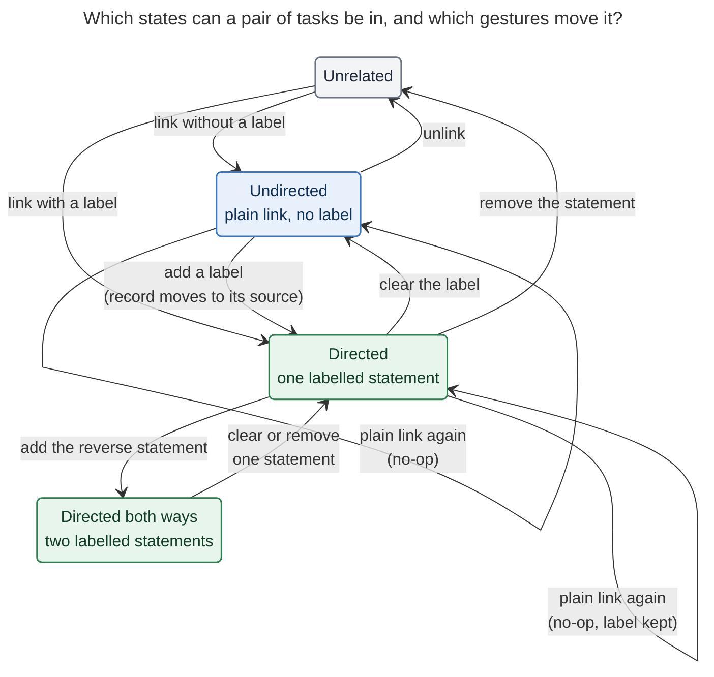

# Undirected task relations: a plain link has no direction; a label gives it one

*Consolidated report · research swarm 29 · 2026-10-21 · merges the cdx, cld, grk, mus, and gem reports with the
lead researcher's own verification across bob-cli (`bcc201fe`), bob-plugins (`ee16031`), bob-mac-capture
(`bf30f9e`), and the live vault.*

> **Request.** Task relations are always directed today. Make a relation **without** a description undirected,
> shown as `links` rather than `links to` / `links from`. A relation **with** a description becomes directed.
> Update the Task Relation glossary term and add terms for directed and undirected relations. Reverse linking
> (`~~`) then only makes sense with a description, because without one it equals `~`. Lead the design, critique
> the plan, adjust the requirements where justified, and recommend a solution that is intuitive, reliable, and
> beautiful.

---

## Bottom line

**Build it.** All five researchers agree, and so do I. For an unlabelled relation, direction carries no meaning,
yet today Bob makes you choose one (`~` vs `~~`, `l` vs `⇧L`) and then displays it everywhere (`🪢 links to →` /
`🪢 linked from`). The rule **"a link has no direction until you say what it means"** removes that choice and
gives labels a real job.

The new rule is easy to say, but it is a **model change, not a copy change**. Relabelling the rows alone would
leave three verified defects:

- A bare re-add silently **strips a label**: `plan_links_edit` treats "no label" as a different label
  (`src/native/task_relations/plan.rs`, the `entry.1 == label` branch).
- `already_linked` looks **one way only** (`src/native/capture_complete/candidates.rs:1309-1325`), so `~T`
  against a task that already links here creates a reciprocal duplicate.
- Reciprocal plain records would show the same task **twice**.

The recommended design keeps everything that already works and changes only what the rule requires:

1. **Storage does not change.** Each relation is still one entry on one task's `🪢 **LINKS:**` line, mirrored
   on the other task's generated `🪢 **LINKED FROM:**` line, with the same grammar, the same line names, and the
   same single-source guarantee (LR11). For a plain link, which task stores the entry carries no meaning.
2. **Meaning is computed per pair of tasks.** No records means unrelated. Only plain records means one
   **undirected relation**. Each labelled record is a **directed relation** read "source ‹label› target", and it
   *subsumes* any plain record between the same two tasks. A plain add never removes a label, and nothing is
   ever erased by omission.
3. **Direction lives on the entry, not on the row.** Every task shows one calm `🪢 links` block. Plain neighbours
   are arrow-free chips. Only labelled entries carry a pill and an arrow (or Bob's inverse phrase).
4. **`~~` means "the other task makes a labelled statement about this one".** A bare `~~T` is an incomplete
   draft that asks for a label. It is never silently rewritten, and in Mac Capture you never notice, because
   picking a `~~` row goes straight to the label card.

```markdown
- [ ] #task Fix flaky capture retries ^fix-retries
	- 🪢 **LINKS:** [[#^retry-design]] • follow-up of [[done/bob_done#^capture-star]]
	- 🪢 **LINKED FROM:** [[#^audit-triage]] • [[old#^retry-bug]] (merged into)
```

```text
🪢 links   (○ Audit triage)  (○ Retry design)
           ‹follow-up of› → (✓ Capture star)  ↗ bob_done
           ‹merged from›    (✕ Old retry bug)  ↗ old
```

```text
Fix retries ~sase:retry-design                      # plain link (undirected)
Fix retries ~bob_done:capture-star|"follow-up of"   # this —follow-up of→ that
Write the note ~~sase_blog:prj|"next step"          # that —next step→ this
Write the note ~~sase_blog:prj                      # incomplete: add a label, or use ~
```

This is the cheapest moment to make the change. A read-only scan of `~/bob` found **exactly one relation**
(`sase.md:287-289`), and it is plain. Nothing needs migrating.

---

## 1. Is this a good idea?

### 1.1 Why yes

- **It removes a choice that carries no information.** With no label, `A ~B` and `B ~~A` record the same fact,
  yet today they produce different bytes, different notices ("links to" / "now links here"), and different Task
  Card rows.
- **It makes labels earn their keep.** A label becomes the *only* way to say "this way round", so the label
  prompt asks a meaningful question ("how do they relate?") instead of offering decoration.
- **It matches how Bryan already writes.** Hand-written idioms from before relations existed split exactly
  along this line (cld's vault survey). About a dozen phrase-less "related to [[…]]" mentions and a
  `**RELATED:**` bullet are undirected. Twelve "Merged into [[…]]" lines are directed and always phrased. Nobody
  wrote an unlabelled arrow.
- **The product already leans this way.** The Mac Similar Tasks band names its action **Relate** and its capsule
  **Related**, and it only ever inserts `~` (`SimilarTasksBandEdits.swift:34, 115`). Every Mac relation icon is
  the two-way `arrow.left.arrow.right`. The nav label field already says "leave it empty for a **plain link**"
  (`426-picker-relation-stage.js:628, 694`).
- **Mature tools model it the same way** (precedents cited by cld, cdx, and grk). Jira's "relates to" uses the
  same phrase in both directions, while "blocks" / "is blocked by" is directional. Linear's "Related" is
  symmetric, while "Blocked by" and "Duplicate of" are directed. Zotero's Related Items appear at both ends and
  are not transitive. OWL 2 separates symmetric properties from properties that have an inverse. In each case
  the link is **stored once** and its symmetry comes from its *type*, never from its storage. Here, the type
  is "has a label or not".

### 1.2 What could go wrong

1. **Copy-only changes leave wrong identity.** This means double-listed reciprocal pairs, plain re-adds that
   strip labels, and one-way duplicate checks (all three verified above). The rule has to reach the planner,
   completion, reconcile, the index, and every writer.
2. **Label presence encodes two axes with one bit** (grk's 2×2). A *symmetric* label such as `see also`,
   `related to`, or `conflicts with` becomes a directed relation that reads a little oddly from the far end
   (`(A) · see also → this`). Bob's own docs and UI currently teach exactly these labels: the guide uses
   `|"related to"` (`docs/guides/link-related-tasks.md:37`), capture docs use `|see`, and the nav label
   placeholder is `e.g. see also` (`305-relation-stage-copy.js:109`). These become anti-patterns and must change.
   That is acceptable for v1, and it is a named reopen trigger (§7).
3. **Raw Markdown still shows where a relation is stored.** The far end of a plain link reads
   `🪢 **LINKED FROM:** [[…]]` in vim, git, and agent reads. This is deliberate (§4.3): raw line names say *where
   to edit*, and chips say *what it means*.
4. **Direction changes now move data.** Labelling a plain link stored on the other task, in this task's
   direction, must move the record. That is a cross-note write. Capture already writes all-or-nothing, but
   the Obsidian plugin does not. §4.4 makes a partial failure in the plugin harmless by construction.
5. **"Description" is the wrong word.** In Bob, a task's description is its text (`mint_block_id(description, …)`,
   `REPLACE WITH TASK DESCRIPTION` in `docs/capture.md:4035`). The relations swarm already renamed the request's
   "relation description" to **label** (its A5). Today the same field has three names: *label* in the contract
   and JSON, *Relation* in the nav field, and *relation* in Mac copy ("Shift Return links with a relation").

### 1.3 Would I take a different approach?

**Not for the core rule.** "No label means undirected; a label means directed" is crisper than every alternative
in §5: an explicit direction flag, a third sigil, a symmetric-label class, or a typed ontology. I would
**widen** the scope from display to model (pair rules, writer rules, one merged UI) and **narrow** `~~` to "a
labelled statement made by the other task". I would also take the rule one step further than the request
in the chips: drop the `links to` / `linked from` *headings* entirely, because a labelled entry already shows its
own direction (A2).

---

## 2. Requirement adjustments

| # | As requested | Adjusted to | Why |
| --- | --- | --- | --- |
| **A1 [ADJUSTED]** | "description" | **label**, the one user-facing word everywhere. Rename the nav field from "Relation" to "Label", and Mac's "link with a relation" to "link with a label". JSON keeps `label`. | "Description" already means task text in Bob. The previous swarm resolved this same word to "label". cld, mus, grk, and gem agree; cdx wanted UI "Description" over wire `label`, which would keep two names. |
| **A2 [ADJUSTED]** | Show `links` instead of `links to` / `links from` for plain relations | **One `🪢 links` heading for every relation.** Plain neighbours are arrow-free chips. A labelled entry carries its own direction: `‹follow-up of› → (T)` going out, and `‹followed up by› (S)` or `(S) · ‹label› → this` coming in. | Once direction lives on the entry, a `links to` heading over `‹label› → (T)` says the same thing twice. One heading per task reads as "this task's links" and is calmer. The plain-only case, which is the common one, looks the same either way. |
| **A3** | A relation with a description is directed | **Adopted.** A label is phrased from its source ("S ‹label› T"). When the typed label means "related" (`related`, `related to`, `see`, `see also`, `relates to`), the label field shows a gentle hint, never a refusal: `‘see also’ makes this directed · leave it empty for a plain link`. Replace the `\|"related to"`, `\|see`, and `e.g. see also` examples. | This keeps the rule a single sentence and steers users away from the one known misfit. A hint only teaches; it never forbids. |
| **A4 [ADJUSTED]** | `~~` only makes sense with a description | **A bare `~~T` is an incomplete draft** (`needs: ["relation_label"]`, diagnostic `relation_label_required`). Submitting it refuses with a teaching error. It is never silently rewritten to `~`. The `relation_from` completion replacement ends in `\|` (`~~note:id\|`), so every client lands in the label step. The Mac card turns an empty-label `~~` into a plain `~` link only as a visible, previewed choice. | One meaning per sigil keeps the guards uniform. `~~` writes the *other* task, so it keeps today's refusal set (`done/`, daily notes, `_templates`). An alias would make `~~done:x` succeed while `~~done:x\|y` fails. cdx, cld, mus, and gem favoured refusal; grk favoured an alias (§3). |
| **A5 [ADDED]** | (unstated) identity | **Pair rules** (§4.2). Two tasks are unrelated, plainly linked, or joined by one or two labelled statements (at most one each way). A labelled record subsumes plain ones. A plain add never removes or duplicates anything. | Without these rules the new display double-lists tasks, and a casual `~T` erases meaning. |
| **A6 [ADDED]** | (unstated) storage | **Unchanged.** It keeps one authored LINKS entry, the generated LINKED FROM mirror, and the same line names, grammar, kill switch, and LR11. Reconcile gains one rule: omit a *plain* incoming entry when the target's own LINKS already names the source. | Nothing needs migrating, there is still one source of truth, and this is the storage model the relations swarm already chose and shipped. |
| **A7 [ADDED]** | (unstated) | **Nothing is erased by omission.** A plain re-add on a labelled pair is `unchanged` and keeps the label. Clearing a label is always an explicit act in the label field. | This fixes the verified `plan.rs` behaviour. Now that labels carry direction, stripping one silently would lose meaning. |
| **A8 [ADDED]** | Two Task Card rows and stages remain | **One `Links…` row (`l`) and one stage.** `⇧L` and Ctrl+Shift+Alt+L stay as shortcuts into the same stage with the label field pre-set to "that task — label → this". | Two rows only make sense if direction always matters. |
| **A9 [ADDED]** | (unstated) contract | **JSON additive, `schema_version` stays 1.** Keep `direction` (which sigil, which task authors the record) and add a derived `kind: "undirected" \| "directed"`. The bare-`~~` refusal is a CLI behaviour change, so its commit takes `!`. | Verified: Mac decodes `direction` and `action` as tolerant `String`s with defaults (`CaptureModels.swift:3975-3984`), so additive fields and values cannot break an old client. |
| **A10 [ADDED]** | Update the glossary and add two terms | **Adopted.** Update *Task Relation*, add *Undirected Relation* (aka plain link) and *Directed Relation* (aka labelled relation), and add the decision record `relations-undirected-unless-labelled`. | This is a behavioural rule that future agents must not undo. No relations decision exists yet (the roster has none). |
| **A11 [CLARIFIED]** | "Linking another **note** to the current note" | **Still task-to-task.** Read "note" as "task", including `^prj` and `^ref` tasks. | Relations address task block IDs. A silent widening to arbitrary notes would be a different feature. |

---

## 3. Where the researchers disagreed

| Question | Positions | Resolution | Deciding evidence |
| --- | --- | --- | --- |
| **Display change or model change?** | Model change: cdx, cld, grk. Display-only on unchanged identity: mus. Mostly display, with dedupe: gem. | **Model change on unchanged storage.** | Three defects are verified in code (Bottom line). mus's "owner immutable" rule also fails a basic case: on task B, labelling a plain link that A stores, as "B follow-up of A", would either render backwards or add a second record next to the plain one. |
| **Raw storage and line names** | Keep LINKS / LINKED FROM: cld, mus, gem. Rename the mirror to BACKLINKS: cdx. Split into LINKS (plain, written at both ends) + LINKS TO + LINKED FROM: grk. | **Keep LINKS / LINKED FROM.** | grk's both-ends writes are two sources of truth: a one-sided hand delete comes back on the next reconcile, and an archived end can never be written. This is the org-super-links drift the relations swarm already rejected. BACKLINKS is no less directional than LINKED FROM. Readers already accept it (LK17, and the Mac filter at `CaptureTaskBlockPresentation.swift:138-139`), so the rename is cheap, but it buys nothing semantic and still rewrites the formatter, vectors, docs, and notices. The vault holds one relation, so if raw beauty ever matters, revisiting storage stays cheap (§7). |
| **Bare `~~`** | Incomplete or refused: cdx, cld, mus. Refused in the CLI with a Mac fallback: gem. Accepted as a synonym of `~`: grk. | **Incomplete draft, refused on submit, never rewritten.** The Mac card offers the plain link as a visible choice. | The request says bare `~~` "only makes sense" with a label. One meaning per sigil keeps the `~~` guards uniform (A4). grk's concern, that the second-tilde flip becomes a trap, is answered by the `~~note:id\|` replacement and the card. The user never sees an error in the Mac flow. |
| **Word for the text** | label: cld, mus, grk, gem. UI "Description" over wire `label`: cdx. | **label.** | §1.2(5), and the previous swarm's A5. |
| **How many relations per pair** | At most one, with labelled reverse capture refused: cld. A plain link plus up to one labelled record per direction, coexisting: cdx. Labelled subsumes plain, with statements allowed both ways: grk, gem. Unchanged: mus. | **Labelled subsumes plain; at most one statement each way.** | This keeps today's LR19 for labelled edges without cld's new refusal path. It never shows one task under both a plain chip and a labelled entry, which cdx's model would. Subsumption also makes the cross-note move crash-safe (§4.4). |
| **Labelling a plain link stored on the other task** | Move the record to the source: cdx, cld, grk. Never move; the label reveals the storage direction: mus. | **Move, adding before removing.** | Direction must come from the sentence the user sees, never from storage history (cdx's "meaning / provenance / presentation" split). |
| **Chip layout** | Three semantic rows (`links` / `links to` / `linked from`): cdx, grk, gem, mus. One `🪢 links` heading with direction on each entry, rendered per raw line as continuation rows: cld. | **One `🪢 links` heading, aggregated per task.** This takes cld's heading idea with the others' per-task aggregation. | Per-line rows split plain neighbours across two rows according to where they happen to be stored. Three headings repeat what the pill and arrow already say. The chip model renders one widget per raw line today (`146-relation-chip-model.js:313`, `153-relation-widget.js`), so aggregation is the plugin's largest piece of work (§4.6). |
| **JSON** | Capture schema v2 boundary: cdx. Additive `directed: bool`: cld. A new `direction: "undirected"` value: grk. Unchanged: mus. | **Additive `kind`; `direction` keeps its meaning; schema 1.** | Old Mac clients decode the fields as tolerant strings (verified), so a v2 boundary buys nothing. cdx correctly noted that the Mac only checks whether `relation_grammar` is *absent* (`CapturePanelModel.swift:9711`), so bumping it would not gate old clients either. `kind` names the glossary concept, and `direction` still drives `relation_to_replacement` / `relation_from_replacement`. |
| **Task Card** | One row and one stage: cdx, cld, grk (grk keeps both entry points). Keep two stages, with `⇧L` requiring a label: mus, gem. | **One row and one stage; `⇧L` is a shortcut into reverse-label mode.** | Two stages for one concept is the asymmetry this change removes. |
| **Reconcile** | Suppress the reciprocal plain mirror and warn: cld, gem. Symmetric union projection: grk. Unchanged: mus. | **Suppress only *plain* incoming entries the target already names, and warn `redundant_relation`.** | cld's formula also suppressed *labelled* incoming entries. That is fine under its one-relation-per-pair rule, but it would hide a real statement under subsumption. |
| **Ship display copy first?** | Yes, as a quick P1: cld. No: grk. | **No separate display-only release.** Ship semantics and copy together, per repo. | The vault has one plain relation, so the risk is negligible, and a display-only release would rewrite the contract twice. |

**Factual corrections found during verification:**

- **Strict-enum decode risk (cld A9, cdx §9): not real.** `CaptureRelationUpdate` and the parse markers decode
  `direction` and `action` as `String` with `try?` defaults, so an unknown value falls through to the
  "links to" copy (grk's description is correct).
- **gem:** after `~T`, the target's `LINKED FROM` is not written "during reconciliation or courtesy sync" later.
  Capture writes it in the same staged batch (contract §8, LX5).
- **mus:** the "unquoted multi-word label" guide example is not in the current docs. Every multi-word example is
  quoted.
- **cld:** a BACKLINKS rename would not "churn five parsers and the Mac task-card filter". Every reader, and the
  Mac filter, already accepts `BACKLINKS`, as cdx said. The case for keeping `LINKED FROM` rests on meaning, not
  cost.
- **Confirmed:** there is one relation in the vault (cld, grk). Bare re-add strips labels, and `already_linked`
  is one-way (cld). The two inverse-phrase tables disagree on unknown labels: ledger returns `null`
  (`146-relation-chip-model.js:27-38`), while nav returns `‹label› → this` (`304-relation-stage-view.js:348-360`)
  (cld).

---

## 4. Recommended design

### 4.1 Vocabulary (glossary drafts)

These drafts go through `/sase_memory_write` during implementation, and `just docs-gen` regenerates
`docs/reference/glossary.md`.

**Task Relation** *(updated; aka relation, LINKS line, LINKED FROM line)*

> An inert link between two tasks: an [[undirected-relation]] when it has no label, a [[directed-relation]] when
> it has one. Each relation is authored once, on one task's 🪢 **LINKS:** line, and mirrored on the other task's
> generated 🪢 **LINKED FROM:** line; which task stores a plain link carries no meaning. Add one with Capture `~`
> (or `~~` with a label) or the Task Card `l` gesture. A relation is distinct from a Pomodoro [[task-link]] and a
> [[task-dependency-link]]: it never blocks a task, counts as a Pomodoro Task Link, or changes its status,
> schedule, priority, or freshness.

**Undirected Relation** *(new; aka plain link, undirected task relation)*

> A [[task-relation]] with no label. It says only that two tasks belong together, so it has no direction: both
> tasks list each other under `🪢 links`, and linking them again from either end changes nothing. Adding a label
> turns it into a [[directed-relation]]; two tasks that already share a directed relation need no plain link.

**Directed Relation** *(new; aka labelled relation, directed task relation)*

> A [[task-relation]] with a label, read from its source: "S ‹label› T", such as `follow-up of` or `merged into`.
> It is stored on S's LINKS line. T shows Bob's inverse phrase when one exists (`followed up by`), otherwise
> "S · ‹label› → this". Capture `~T|label` makes the captured or owner task the source; `~~T|label` makes T the
> source. Clearing the label turns it back into an [[undirected-relation]]. Two tasks can carry at most one
> directed relation in each direction.

**Decision record** `relations-undirected-unless-labelled`, "Relations Are Undirected Unless Labelled":

- **Where:** capture `~` / `~~`, nav stages and chips, Mac pickers and card, and the reconcile projection.
- **Claim:** an unlabelled relation has no direction, and a label gives it one. A labelled relation subsumes a
  plain one. Storage stays single-authored, and a plain add never removes meaning. Inertness is unchanged.
- **Why:** vault idioms, the Jira, Linear, Zotero, and OWL precedents, and the removal of a choice that carries no
  information.
- **Cost:** pair-aware writers, a required label for `~~`, and symmetric labels rendering directionally.
- **Reopen if:** symmetric labels become common, two labels per direction are needed, or the storage side
  starts to matter to users.
- **Evidence:** this report, `research:202610/task_relation_links/task_relation_links.md`, and the implementing
  commits.

### 4.2 The model: pair rules

Physical **records** are LINKS entries, each `(owner, other, label?)`, at most one per ordered pair (today's rule).
The meaning of a pair {A, B} is derived from its records, with no stored flag that could disagree:

| Records between A and B | Meaning | Shown on each task |
| --- | --- | --- |
| none | unrelated | nothing |
| only plain (one, or one on each side) | one **undirected relation** | `(○ other)` under `🪢 links` |
| one or two labelled, plus any plain | one **directed relation** per labelled record; the plain records are *redundant* | the labelled entries only |

Three principles keep this reliable:

- **Labelled subsumes plain.** A plain record never adds a chip to a pair that already has a statement.
- **No invisible records from writers.** Writers delete redundant plain records whenever they touch a pair and
  can write the note. Redundant records can still come from hand edits, two devices racing, or a partially failed
  plugin move. They render nothing, reconcile warns about them (`redundant_relation`, writable notes only), and
  the next writer that touches the pair cleans them up.
- **Direction comes from the sentence, never from storage.** The task that stores a plain record is provenance
  only. When a label is added, the record goes to the task the sentence names as the source.



*A plain link is the default. Only an explicit label adds direction, and only an explicit clear or remove takes it
away. Repeating a plain link never changes anything.*

Self-relations stay refused. No relation implies transitive links, a reverse statement, blocking, or any change to
status, lane, freshness, schedule, Pomodoro sections, or the review walk. Inertness (contract §2) is untouched.

### 4.3 Storage and the projection

The grammar, line names, slots, canonical sort, kill switch, and `done/` / previous-daily read-only rules stay
byte-for-byte. Raw names describe **where to edit**, and chips describe **meaning**. A LINKED FROM line is already
documented as generated ("change it with Ctrl+Shift+Alt+L"); that notice becomes "… with Ctrl+Shift+L".

The projection gains one condition (contract §6):

```text
mirror(T) = sort_canonical({ (S, label) : (S, T, label) ∈ edges
                             ∧ ¬(label = ∅ ∧ T's own LINKS names S) })
```

A plain incoming entry is omitted when the target already names the source on its own LINKS line. In that case the
target shows the pair from its own line, and the incoming plain record is either reciprocal or subsumed. Labelled
incoming entries are always mirrored. Reconcile still **never edits LINKS**, and LR11 still holds because the
projection is a pure function of the LINKS lines. The `relation_warnings[].kind` list gains `redundant_relation`
(additive).

The kill switch (`relations.linked_from_lines: false`) keeps its meaning. When mirrors are off and a source lacks a
`^id`, a far-end edit re-resolves the source by path and line under a preimage check (`outgoing(path,
blockId|line)` already supports a line), and it mints the id in the same write when needed.

### 4.4 Writer rules (one shared planner; Rust first, JS twin pinned by vectors)

N is the owner (the captured task, or the Task Card's task), and T is the other task. The planner reads the pair's
records on **both** LINKS lines before deciding.

| Request | Pair before | Result | Reported |
| --- | --- | --- | --- |
| plain (`~T`, stage ↵) | unrelated | add `[[T]]` to N's LINKS | `added`, `kind: undirected` |
| plain | any relation | nothing; any label is kept | `unchanged` + existing `kind` / `label` ("already linked · follow-up of") |
| `~T\|x` (N —x→ T) | unrelated | add `x [[T]]` to N | `added`, `kind: directed` |
| `~T\|x` | plain record on N | relabel in place (a conversion) | `relabeled`, `previous_label: null` |
| `~T\|x` | plain record on T only | add `x [[T]]` to N, **then** remove `[[N]]` from T | `relabeled` + `moved_from` |
| `~T\|x` | N —y→ T | relabel in place (LW4) | `relabeled` |
| `~T\|x` | T —y→ N | add N —x→ T; the reverse statement stays | `added` (pair is now directed both ways) |
| `~~T\|x` | any | the same rules with T as source; T must be writable (today's `~~` refusal set) | — |
| `~~T` (no label) | any | **incomplete**: `needs: ["relation_label"]`; submit refuses | — |
| clear the label (⇧↵, empty field) | N —x→ T, no reverse statement | the entry stays where it is, without its label | `relabeled`, `label: null` |
| clear the label | N —x→ T, plus T —y→ N | remove N's record; the pair stays linked by T's statement | preview: `Remove ‘x’ · still linked by ‘y’` |
| swap (⇄) | N —x→ T | add T —x→ N, then remove N's record (T must be writable) | `relabeled` + `moved_from` |
| remove (chip ×, CURRENT ↵) | the selected relation | remove that relation's record(s); removing the last visible relation removes every record between the two tasks | — |

The rules underneath the table:

- **Add before remove, and subsumption makes it safe.** In the plugin, a cross-note move writes the new
  labelled record first. If the follow-up removal fails, the leftover plain record is subsumed, so the display is
  already correct. Reconcile warns, and the next touch cleans it up. No relation is ever lost and no duplicate is
  ever shown. Capture needs none of this, because it already writes all-or-nothing with rollback (glossary
  *Capture*).
- **Archives.** A plain record stored in `done/` can be described in the live → archived direction: the new
  record goes on the live task, and the archived plain record stays behind, subsumed and unwarned. It cannot be
  unlinked or described in the archived → live direction, because both would write `done/`. The refusal names the
  reason: "the link is stored on an archived task". This matches today's rule for edges sourced in `done/`.
- **Where a new plain record goes.** It goes on the owner. Capture's owner is always writable. In nav, when the
  current task is read-only (`done/` or the previous daily note), the record may go on the other task instead.
  Plain links have no direction, so this costs nothing (optional, P2).
- **Within one capture item.** A plain token on a pair that also has a labelled token is a no-op, because the
  label subsumes it. `~T|a ~T|b` stays refused (LX14). `~T|a ~~T|b` writes two statements. LX15 (`N ~T ~~T` as
  "two independent edges") is retired, because a bare `~~T` is now incomplete.
- **Completion follows the same rules.** `already_linked` checks both directions, by OR-ing the candidate →
  owner lookup that `relation_from` already performs (`candidates.rs:1312-1317`). RESULTS exclude tasks related
  either way. Rows gain `existing_kind` and `existing_direction`.

### 4.5 Capture grammar and JSON

Tokens stay `~note:block-id[|label]` and `~~note:block-id[|label]`. The strike guard, escapes, quoting, run rules,
and byte-identical JSON for drafts without `~` are unchanged.

| Draft | Reading | Preview |
| --- | --- | --- |
| `Fix it ~work:foo` | undirected {new, foo} | `🪢 links "Foo"   work.md ^foo` |
| `Fix it ~work:foo\|"follow-up of"` | new —follow-up of→ foo | `🪢 follow-up of → "Foo"   work.md ^foo` |
| `Fix it ~~work:foo\|"next step"` | foo —next step→ new | `🪢 "Foo" — next step → this   work.md ^foo` |
| `Fix it ~~work:foo` | incomplete (`relation_label`) | `Add a label for "Foo" to describe this task, or use ~ for a plain link` |
| `@bob+fix ~work:foo`, already related | unchanged | `🪢 already linked "Foo" · follow-up of` |

JSON stays at `schema_version` 1, with additive changes only:

- **`capture-parse`:** `relations[]` gains `kind`. A bare `~~` reports `needs: ["relation_label"]` plus
  diagnostic `relation_label_required`. `direction` keeps meaning "which sigil".
- **`capture-complete`:** `relation_to` / `relation_from` rows gain `existing_kind` and `existing_direction`, and
  `already_linked` becomes symmetric. `relation_from` replacements end in `|` (`~~note:id|`). The
  `relation_label` row may carry a `hint` for "related"-style labels.
- **`capture` / `--dry-run`:** `relation_updates[]` gains `kind` and, on moves, `moved_from: {path, block_id}`.
  The action enum is unchanged (`added | relabeled | unchanged`).
- **`bob task reconcile`:** `relation_warnings[].kind` gains `redundant_relation`.
- **Compatibility.** A new Mac with an old Bob sees no `kind`, so it treats `label == null` as plain. An old Mac
  with a new Bob still shows "links to" for plain links (harmless, for at most one train). `~~` rows arrive as
  `~~note:id|`, and the old app's existing `|` flow opens the card (verify on the Mac).
- **Release:** `feat(capture)!:` for the bare-`~~` refusal, per `decisions:bob-cli-releases-ride-a-daily-train`.
  Bob owns the grammar and Mac renders what Bob returns (`decisions:mac-capture-is-a-thin-client`).

### 4.6 Presentation

**Chips (bob-ledger-tools), Live Preview.** For the task in the Bottom line:

```text
Before
  🪢 links to      → (○ Retry design)
                   ‹follow-up of› → (✓ Capture star)  ↗ bob_done
  🪢 linked from     (○ Audit triage)
                   ‹merged from› (✕ Old retry bug)  ↗ old

After
  🪢 links   (○ Audit triage)  (○ Retry design)
             ‹follow-up of› → (✓ Capture star)  ↗ bob_done
             ‹merged from›    (✕ Old retry bug)  ↗ old
```

- **One block per task, one heading.** The block shows plain neighbours first, in one wrapping row, canonically
  sorted and deduped by pair, with **no arrow** (LC1 loses its leading `→`). Outgoing statements follow in
  authored order, then incoming statements in canonical order, one per visual row (LC10).
- **Every entry reads with "this task" as its subject.** `‹follow-up of› → (T)` reads as "this task is a
  follow-up of T". `‹merged from› (S)` reads as "this task was merged from S". Only an unknown incoming label
  needs the explicit `(S) · ‹label› → this`.
- **Mounting.** Render the block on the task's first relation line, and collapse the other relation line in Live
  Preview. If collapsing an adjacent line proves fragile in CM6, fall back to cld's continuation row: the second
  raw line renders without a heading, aligned under the first. A task with incoming relations only, and mirrors
  off, still has no anchor. That is today's limitation, kept.
- **Controls.** One trailing ＋ per block ("Link another task") opens the Links stage. The hover × reads
  `Unlink ‹name›` on plain chips from either end, and `Remove ‘‹label›’` on statements. × appears on focus as
  well as hover.
- **Unchanged.** Colour carries status, never direction. Collapse (`✓×N`), dimming, `↗ note`, the hover preview,
  and `toggle-dependency-chips` keep working. There is no new palette.
- **One inverse table.** The nav stage imports the ledger's table and its `null`-for-unknown behaviour.
- **Index.** `api.relationIndex` gains an additive per-task view from one generation: `related(path, id) →
  {plain, outgoing, incoming}`, with plain deduped by pair and redundant records hidden. `outgoing` / `incoming`
  stay for existing callers. A loading index shows a loading state, never zero.

**Task Card and the Links stage (bob-navigation-hotkeys).**

```text
Links…   l   3 · Audit triage +2

🪢 Links · Fix flaky capture retries
Links 4 · searching 412 tasks · ⇥ to mark several · does not block
CURRENT
  (○ Audit triage)
  (○ Retry design)
  ‹follow-up of› → (✓ Capture star)        ↗ bob_done
  ‹merged from›    (✕ Old retry bug)        ↗ old
RESULTS
  …tasks not yet related in either direction…
↵ link · ⇧↵ link with a label · ⇥ mark several
```

- The count is the number of related **tasks**, from the live index, with the stored lines as a fallback while it
  loads.
- RESULTS ↵ creates a plain link, and ⇧↵ opens the label field. CURRENT ↵ removes that relation. CURRENT ⇧↵ adds,
  changes, swaps, or clears its label.
- `⇧L` / Ctrl+Shift+Alt+L open the same stage, with the label field pre-set to "that task — label → this". An
  empty label there offers "Make it a plain link" instead of refusing.
- Counted batches (`N Ctrl+Shift+L`) and Tab marking keep working, plain or labelled.

The label field shows a live sentence. Swap appears only once there is a label, because a plain link has no
direction to swap:

```text
🪢 Link with a label
  This task — Retry design                       plain link · no direction
  This task — [follow-up of▏] → Retry design     ⇄ swap (Alt+R)
  follow-up of · 3    merged into · 2    next step · 1
```

**Mac Capture.** Bob emits `kind`, and the app picks the copy.

- **`~` picker.** Header `🪢 Link “Owner” with…`, caption `Links`, footer `↩ link · ⇧↩ link with a label · ~
  reverse (needs a label)`.
- **`~~` picker.** Header `🪢 Which task describes “Owner”?`, caption `Reverse · needs a label`. ↩ inserts
  `~~note:id|`, and the card opens. Backspace on an empty filter flips back to `~`, as today.
- **Relation card.** With an empty label it shows `“A” — “B”` and the caption `plain link · no direction`. Typing
  turns the sentence into `“A” — follow-up of → “B”`. ⇄ swap is enabled only with a label, and it rewrites `~` ↔
  `~~` through Bob's replacements, so the app never re-lexes. Return with an empty label on a `~~` token
  rewrites it to `~`, which the sentence has already previewed as a plain link. This extends `bob-cli-aj`'s
  accepted `empty_label_drops_pipe` rule (Return on an empty card removes the dangling `|`).
- **Preview rows and notifications** mirror the CLI: `🪢 links “X”`, `🪢 follow-up of → “X”`,
  `🪢 “X” — next step → this`, `🪢 already linked “X” · follow-up of`, and `🪢 Linked “A” and “B”`.
- **Icons.** Plain rows keep ⇄ (`arrow.left.arrow.right`), and statements use `arrow.right`. Text previews use an
  em dash for plain links, never ↔, which can read as two arrows (cdx).

**CLI and shell.** Human output uses the same strings, with dry-run forms `would link "…"` and `would add
follow-up of → "…"`. Shell completion groups become `links` (for `~`) and `reverse · needs a label` (for `~~`).

### 4.7 Invariants to test

1. A plain link created from A and then from B is **one** relation; the second gesture is `unchanged`.
2. A plain add never changes or removes a label (fixes the current `plan.rs` behaviour).
3. Each pair renders at most once as plain, and never as plain *and* labelled.
4. A label means the same thing from either end, no matter which task stores the record.
5. After a failed cross-note follow-up, the display is already correct, and reconcile reports
   `redundant_relation`.
6. Delete every LINKED FROM line and reconcile twice: the lines are rebuilt identically, and the second run is a
   no-op (LR11).
7. Every relation operation leaves statuses, lanes, fields, dependencies, Pomodoro sections, and the review walk
   byte-identical, apart from a minted `^id` (LR18, LX13, LG13).
8. Dry runs and live runs plan identical actions. Completion, preview, and Escape mint and write nothing.

**Vectors to add or change** in `docs/task-relations.md` §15. The JS twins copy them.

| Vector | Situation | Outcome |
| --- | --- | --- |
| LW4 *(narrowed)* | re-add T with a **new non-empty** label | relabeled in place |
| LW15 | plain add; the pair already has a plain record on either side | `unchanged` |
| LW16 | plain add; the pair has a statement either way | `unchanged`; label kept |
| LW17 | N —x→ T requested; T holds plain `[[N]]` | N gains `x [[T]]`; T's entry removed; add-before-remove in nav |
| LW18 | clear the only label | the entry stays where it is, without its label |
| LW19 | clear N —x→ T while T —y→ N exists | N's record removed; T's statement kept |
| LW20 | swap N —x→ T | T gains `x [[N]]`; N's record removed |
| LR19 *(changed)* | plain A → B and plain B → A | no LINKED FROM entry for either; `redundant_relation` |
| LR25 | plain A → B and labelled B —y→ A | B's mirror omits A; A's mirror lists `[[B]] (y)`; `redundant_relation` |
| LR26 | labelled A —x→ B and labelled B —y→ A | each mirror lists the other with its label (old LR19, labelled) |
| LX15 *(retired)* / LX17 | `N ~T ~~T\|x` | one statement T —x→ N; the plain token is a no-op |
| LX18 | `@N+n ~T` where T —y→ N | `unchanged` ("already linked · ‹inverse›") |
| LP2 *(changed)* / LP19 | `Fix it ~~work:foo` | needs `relation_label`; submit refuses with the teaching error; zero writes and mints |
| LP20 | `Fix it ~work:foo` / `\|"x"` | `kind: undirected` / `kind: directed` |
| LC1 *(changed)* | one unlabelled target | `🪢 links (○ T)`, no arrow |
| LC15 | a plain record stored on each side, plus statements both ways | one block: one plain chip, then the statements |
| LC16 | plain record stored on the other task | the same `🪢 links (○ S)` as at the storing end |
| LG16 | ⇧↵, label, ⇄, ↵ | stored on the other task; a same-note write is one Ctrl+Z |
| LG17 | × on a plain chip at the non-storing end | the pair is unlinked; notice `🪢 Unlinked “X”` |
| LG18 | `⇧L`, pick a task, empty label, ↵ | "Make it a plain link" offered; nothing written until chosen |

Also add an endpoint-swap property test for plain links (cdx), and a multi-file failure test for the nav move.

---

## 5. Alternatives rejected

- **Copy-only (the literal request).** It is cheap, but it double-lists reciprocal pairs, lets `~T` strip labels,
  and keeps two Task Card stages that no longer mean anything (verified defects).
- **Write a plain link at both ends** (grk). This creates two sources of truth. A one-sided delete comes back,
  archived ends cannot be written, and the result is the org-super-links drift that the relations swarm rejected.
- **A canonical owner chosen by sorted path** (grk, cdx). It is reliable but opaque, because users cannot tell
  which end is safe to hand-edit, and renames turn into ownership transfers.
- **An explicit direction flag or third sigil** (`~=`, `~>`). An arrow without a label says "something points
  somewhere" and means nothing, which is the exact problem this change removes. It also adds grammar to an already
  crowded `~`.
- **Silently aliasing bare `~~` to `~`** (grk). It gives two spellings for one act and makes the `~~` guards
  depend on label presence. The visible choice in the card gives the same smoothness without hiding anything.
- **One relation per pair, refusing labelled reverse capture** (cld). That is a new refusal path with no
  observed need, and subsumption already prevents double-listing.
- **Plain and labelled coexisting as separate rows** (cdx). The same task would appear twice in one block.
- **A symmetric-label allowlist or third class** (`see also` stays undirected). It reintroduces a type registry,
  and the glossary rule would stop being one sentence. If symmetric labels become common, add **self-inverse rows**
  to the display-only inverse table (`conflicts with ↔ conflicts with`) so they render identically at both ends.
- **Renaming the generated line** (`BACKLINKS`, `LINKED`). `BACKLINKS` is already read everywhere, so the
  rename itself would be cheap. But it is just as directional as `LINKED FROM`. `LINKED` would need new readers in
  five parsers. Either way, the change touches raw text that chips replace and adds no meaning.
- **A capture schema v2 boundary** (cdx). Old clients decode tolerantly (verified), so additive fields are
  enough.

---

## 6. Rollout

Ship in contract-first order: bob-cli before its clients, each repo in one coherent change.

0. **P0: contract and vocabulary** (bob-cli).
   - Revise `docs/task-relations.md` (§§1, 5, 6, 8, 9, 10, 12, 15), `docs/capture.md` (the linking-tasks section),
     `docs/reference/capture-syntax.md`, and `docs/guides/link-related-tasks.md`. Replace `|"related to"` / `|see`
     with plain links or directed labels.
   - Write the glossary strands and the decision record through `/sase_memory_write`, then run `just docs-gen`.
   - Read the `docs` and `cli_rules` memories before editing docs or CLI help.
1. **P1: bob-cli semantics and copy.**
   - The shared pair-aware planner, used by capture writers (including moves in one all-or-nothing batch).
   - Symmetric `already_linked`, `existing_kind` / `existing_direction`, `~~note:id|` replacements, and the bare-`~~`
     need and refusal.
   - The reconcile mirror rule and the `redundant_relation` warning.
   - Human output, shell groups, and the additive JSON. Ship as `feat(capture)!:`.
2. **P2: bob-plugins** (then `bob plugins sync`).
   - The JS planner twin and vectors, the index's `related()` view, the aggregated chip block, and the single
     Links stage with label field and swap.
   - The Task Card row, pair-aware `applyRelationEdit` and `removeLink`, one inverse table, and the plugin docs.
   - Spike the CM6 two-line collapse first.
3. **P3: bob-mac-capture.**
   - **First, land the relation-card truncation fix (§8), already in progress under epic `bob-cli-aj`.**
   - Then the picker and card copy, the `~~` → card flow, `kind` decoding with its fallback, icons, and the stale
     docs. Compile and test on the Mac, because Linux validation cannot check the UI.

The repos can ship in any order after P1. Skew only affects copy (§4.5).

---

## 7. Risks and reopen triggers

| Risk | Mitigation or trigger |
| --- | --- |
| Symmetric labels (`see also`, `conflicts with`) become a sizeable share of labels | Watch `labelSuggestions` counts. Add self-inverse display rows first; reopen the decision if that is not enough. |
| Users ask "which side is this stored on?" | Expose the storage note in the chip tooltip. |
| `redundant_relation` warnings recur | They point to a writer bug or a sync race. Investigate; never auto-delete in reconcile. |
| Agents or vim readers misread `LINKED FROM` on a plain link | The glossary explains it. If it bites repeatedly, revisit storage (grk's split). It stays cheap while the vault holds a handful of relations. |
| The nav cross-note move is not atomic | Add before remove, with subsumption (§4.4). The worst case is a warned, invisible record, never a lost relation. |
| The CM6 two-line collapse is fragile | Fall back to continuation rows (§4.6). |
| Muscle memory for `⇧L` and `~~` | The feature is days old. `⇧L` survives as a shortcut, and `~~` lands in the label card. |

---

## 8. Found in passing (not part of this change)

- **Mac relation card can delete draft text: confirmed at the logic level, UI repro pending.**
  `insertRelationLabelReplacement` replaces the bytes from the token's end **to the end of the draft** with Bob's
  `|label` replacement (`bob-mac-capture/Sources/BobMacCapture/CapturePanelModel.swift:6695-6702`). Its label probe
  splices `|"typed` before the tail (`:6740-6754`), so for a leading-run token the unterminated quote swallows the
  rest of the draft. A read-only probe, `bob capture-complete -f json` on `~sase:…|"see Fix it` with the cursor
  after `see`, returned a replacement range covering through the end of the draft and the replacement `|see`.
  Accepting a label for `~sase:x Fix it` would therefore drop ` Fix it` (originally spotted by cld). **This is
  already in scope:** in-progress epic `bob-cli-aj` ("Reliable `|` relation-card trigger") promises that
  "committing a label never deletes text after the token", and its phase `bob-cli-aj.2` is underway. The probe
  evidence is recorded on that epic as a note. Land it before the `~~` → card flow routes more traffic through
  the card.
- **Two inverse-phrase tables disagree** on unknown labels (§3). Unify them in P2.
- **Stale Mac and plugin docs** (cld, not re-verified here). These still describe Shift-Return as "consumed", the
  relation card as "a later phase", and `api.relations` as v0. See `docs/relationship-pickers.md`,
  `docs/keyboard.md`, `plugin-apis.md`, and the comments cld lists.

---

## 9. Questions for Bryan

1. **One `🪢 links` heading (recommended) or three headed rows (`links` / `links to` / `linked from`)?** The
   request kept the directed headings. This report drops them because each labelled entry already shows its
   direction. The plain-only case looks the same either way.
2. **Scope of Ctrl+D on the merged Links row.** Default: clear every relation the row shows whose record is
   writable, and report any kept in read-only notes. The alternative is to clear only plain links plus this
   task's own statements. cdx warned that a merged clear is a cross-note bulk delete.
3. **Keep the `⇧L` / Ctrl+Shift+Alt+L chords?** Default: keep them as shortcuts into reverse-label mode. Retiring
   them would free a chord, at the cost of the `b` / `⇧B` symmetry.

---

## 10. Recommended solution

Adopt **"a relation is undirected unless it has a label"** as a model change on unchanged storage:

1. **Keep storage byte-for-byte.** That means one authored `🪢 LINKS` entry, the generated `🪢 LINKED FROM`
   mirror, the same grammar and line names, the kill switch, LR11, and nothing to migrate. Reconcile gains one
   rule: omit a plain incoming entry that the target already names. Add a `redundant_relation` warning.
2. **Derive meaning per pair.** Only plain records make one undirected relation. A labelled record is a directed
   statement "source ‹label› target" that subsumes plain records, with at most one statement in each direction. A
   plain add never removes meaning. Direction comes from the sentence, and a record moves to its source when a
   label requires it: add before remove in nav, all-or-nothing in capture.
3. **Show one calm `🪢 links` block per task.** Plain neighbours appear as arrow-free chips. Labelled entries
   carry their own pill and arrow, or Bob's inverse phrase. Colour still means status only.
4. **Merge the gestures.** One Task Card `Links…` row and one stage. ↵ creates a plain link. ⇧↵ opens a label
   field with a live sentence and a ⇄ swap that appears only once there is a label. `⇧L` is a shortcut into
   reverse-label mode.
5. **Make `~~` mean "a labelled statement by the other task".** A bare `~~` is an incomplete draft with a
   teaching error on submit. `~~` completions end in `|`, so every client opens the label step, and the Mac card
   offers a plain link as a visible choice.
6. **Name things once.** Use *label* everywhere. Update *Task Relation*, add *Undirected Relation* (plain link)
   and *Directed Relation* (labelled relation), and record `relations-undirected-unless-labelled`. Keep JSON
   additive (`kind`, `existing_kind`, `existing_direction`, `moved_from`, `redundant_relation`), and mark the `~~`
   change with `!`.
7. **Ship contract → bob-cli → plugins and Mac.** Land epic `bob-cli-aj`'s card truncation fix first.

The result:

- **Intuitive:** you think about direction only when you can say what it means.
- **Reliable:** there is still one source of truth, writes are idempotent per pair, nothing is erased by
  omission, and a partial failure is invisible by construction.
- **Beautiful:** one `🪢 links` block per task, where only meaningful entries carry an arrow.

---

## Sources

**Researcher reports (this swarm):** `undirected_task_relations__cdx.md`, `undirected_task_relations__cld.md`,
`undirected_task_relations__grk.md`, `undirected_task_relations__mus.md`, `undirected_task_relations__gem.md`
(in this folder).

**Verified by the lead (read-only):**

- bob-cli `bcc201fe`:
  - `docs/task-relations.md` (§§1, 3.4, 5, 6, 8, 10, 12, 13, and the §15 vectors)
  - `docs/guides/link-related-tasks.md:37`
  - `docs/capture.md:4035`
  - `src/native/task_relations/plan.rs` (the relabel-on-re-add branch)
  - `src/native/capture_complete/candidates.rs:1290-1330`
  - `src/native/capture_language/completion.rs:316-388`
- bob-plugins `ee16031`:
  - `plugins/bob-ledger-tools/src/146-relation-chip-model.js:17-38, 313`
  - `153-relation-widget.js`
  - `plugins/bob-navigation-hotkeys/src/304-relation-stage-view.js:348-360`
  - `305-relation-stage-copy.js:109-114`
  - `426-picker-relation-stage.js:628, 694`
  - `310-task-card-previews.js:521, 532`
- bob-mac-capture `bf30f9e`:
  - `Sources/CaptureCore/CaptureModels.swift:624-674, 3946-3995`
  - `CaptureRelationshipPresentation.swift:150-175`
  - `CaptureRelationshipCopy.swift:148-149`
  - `CapturePickerPresentation.swift:267-269, 331, 465`
  - `SimilarTasksBandEdits.swift:34, 115`
  - `Sources/BobMacCapture/CapturePanelModel.swift:9710-9711` (the `relation_grammar` presence check), `6640-6760` (the relation card)
- `bob capture-complete -f json` probe (read-only) for the label-replacement range.
- Bead `bob-cli-aj` (in-progress epic, `plan:202610/relation_pipe_card.md`), which covers the card truncation fix.
- Vault: `~/bob/sase.md:287-289`, the only relation lines.
- Memory: `glossary:task-relation` and its linked strands (*Capture*, *Task Link*), plus the decisions roster
  (`mac-capture-is-a-thin-client`, `bob-cli-releases-ride-a-daily-train`).
- Prior research: `research:202610/task_relation_links/task_relation_links__final.md` (the shipped directed
  design, its renaming of "description" to "label", and its rejection of two-sided authoring).

**External precedents** (as cited by the researchers; not re-fetched by the lead):

- [Atlassian: Jira issue linking model](https://developer.atlassian.com/cloud/jira/platform/issue-linking-model/)
- [Linear: issue relations](https://linear.app/docs/issue-relations)
- [Zotero: Related items](https://www.zotero.org/support/related)
- [W3C SKOS semantic relations](https://www.w3.org/TR/skos-reference/#semantic-relations)
- [W3C OWL 2 Primer](https://www.w3.org/TR/owl2-primer/)
- [EmacsConf 2022: org-super-links](https://git.emacsconf.org/emacsconf-wiki/tree/2022/talks/orgsuperlinks.md)
