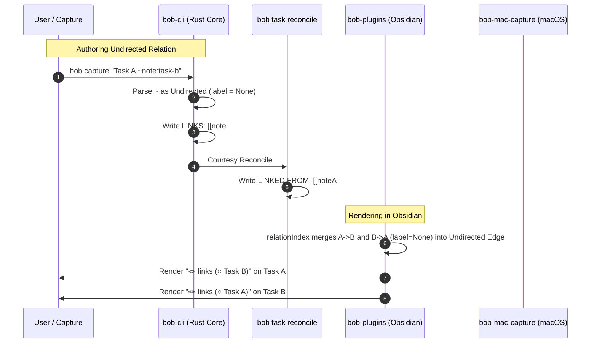

# Research Report: Undirected Task Relations and Directional Symmetry

**Researcher:** `research.29.gem` (Swarm Gem)  
**Date:** October 2026  
**Target Repositories:** `bob-cli`, `bob-plugins`, `bob-mac-capture`  
**Topic:** Transitioning unlabelled task relations from directed to undirected edges, syntax semantics, UI presentation, storage invariants, and system design.

---

## Executive Summary

Task relations were recently introduced to connect tasks without imposing execution constraints (unlike prerequisite dependencies or Pomodoro work links). Currently, all relations are structurally directed: an edge $S \to T$ is authored on $S$'s `- 🪢 **LINKS:**` line and mirrored on $T$'s generated `- 🪢 **LINKED FROM:**` line. In the UI, this displays as `🪢 links to → [Task]` on $S$ and `🪢 linked from [Task]` on $T$, even when no label is provided.

The proposal under evaluation makes **any relation without a description an undirected relation**, presenting it simply as `🪢 links` (omitting directional indicators like `to`, `from`, and arrow glyphs $\to$). Labelled relations remain **directed relations**. Furthermore, draft syntax `~~` (linking incoming) would only be valid when a description is supplied.

### Key Conclusions & Verdict

1. **The Core Proposal is a Significant Ergonomic & Conceptual Win.**  
   In everyday task management, associating two tasks ("Task A touches the same subsystem as Task B") is inherently symmetric. Forcing an arbitrary direction on unlabelled relations imposes cognitive overhead during authoring ("Should I link A to B, or B to A?") and fractures the visual representation into disjoint "links to" and "linked from" rows for what is conceptually a single association.
2. **Critique & Requirement Refinement on `~~` Draft Syntax:**  
   The user's intuition that `~~` without a description is semantically identical to `~` is mathematically correct. However, silent aliasing in the parser is dangerous because `~~` forces mutation of an existing target note rather than the task being captured. We recommend **strict syntactic rejection in the CLI with an instructive teaching error** (`~~ requires a relation label; use ~ for undirected links`), coupled with **smart auto-adaptation in interactive Mac Capture** (auto-opening the label input on `~~` and falling back to `~` if left blank).
3. **Storage Invariant: Preserve Single-Source Disk Representation.**  
   Crucially, "undirected" must remain an **abstracted semantic and presentation model**, rather than dual-authored storage on disk. Having both notes author `- 🪢 **LINKS:**` would create distributed write conflicts, break idempotent reconciliation, and fail on read-only notes (e.g. `done/` archives). Single-source storage on the initiating note's `LINKS:` line with an automated `LINKED FROM:` projection must remain the disk vehicle.
4. **Visual Presentation & "Beauty":**  
   Undirected relations allow combining what were previously two separate rows (`🪢 links to` and `🪢 linked from`) into a single, cohesive, arrow-free row: **`🪢 links (○ Task A)  (○ Task B)`**. This dramatically cleans up task cards and editor chips.

---

## 1. Critique of the Proposal

### 1.1 Is this a good idea?

**Yes.** In graph modeling and personal knowledge management (PKM), relation types fall into two fundamental categories:

| Relation Category | Semantic Nature | Examples | Natural Mental Model |
| :--- | :--- | :--- | :--- |
| **Undirected (Unlabelled)** | Associative, symmetric, reflexive equivalence | "Related to", "Touches same subsystem", "Relevant context" | "Tasks A and B are linked." Neither owns the edge. |
| **Directed (Labelled)** | Asymmetric, causal, hierarchical, or chronological | `follow-up of`, `superseded by`, `split from`, `replaces` | "Task A follows up Task B." Direction is essential to meaning. |

Forcing a direction on unlabelled associations produces three major flaws in the current system:

1. **Decision Paralysis During Capture:** When capturing a quick thought, asking Bryan to decide whether note A links to note B or vice versa introduces friction for zero semantic gain.
2. **Visual Fragmentation:** If Task A authors an unlabelled link to Task B, and Task C authors an unlabelled link to Task A, Task A currently displays two separate lines:
   ```text
   🪢 links to → (○ Task B)
   🪢 linked from (○ Task C)
   ```
   To a user, both B and C are simply "related tasks." Fragmenting them across two lines based solely on which file happened to be written first is visually noisy and logically meaningless.
3. **Redundant Duplicate Edges:** Under the directed model, if Task A links to Task B without a label, and later Task B links to Task A without a label, both edges exist independently (Vector `LR19`). In an unlabelled model, having $A \to B$ and $B \to A$ is absurd clutter.

Transitioning unlabelled relations to undirected relations eliminates all three problems.

### 1.2 Critique of Syntax: `~` vs `~~`

The proposal notes:
> "Linking another note to the current note (using the `~~` syntax, for example) then only makes sense if a relation description is provided (otherwise, it is the same as linking to a task directly using `~`, for example)."

Let us examine what `~` vs `~~` actually does during capture:
- `bob capture 'Task text ~target:id'` creates the new task, mints its ID if needed, and writes `- 🪢 **LINKS:** [[target#^id]]` directly into the newly created task in the inbox note. The existing target note only receives a background, generated `LINKED FROM:` line during reconciliation or courtesy sync.
- `bob capture 'Task text ~~target:id'` in the current directed model mutates the *existing* target note by adding the new task to its `LINKS:` line, while the captured task receives `LINKED FROM:`.

If the relationship is undirected, **both drafts result in the exact same semantic link between the two tasks**. However, `~~` requires modifying an existing file on disk, which:
- Increases the risk of concurrent file modification conflicts.
- Requires finding an anchor and mutating an existing note's authored section.
- Fails or requires special handling if the existing note is read-only or in an archive.

#### Recommended Requirement Adjustment for `~~`:
1. **CLI / Shell (`bob capture`): Refuse unlabelled `~~` with a Teaching Error.**  
   Do not silently convert `~~` to `~` in batch or CLI capture. If a user types `bob capture 'Draft ~~target:id'`, emit:
   ```text
   error: `~~` creates a directed incoming relation and requires a label (e.g. `~~note:id|"label"`).
   For an undirected link, use `~note:id`.
   ```
   This prevents accidental double-typing of `~` from modifying remote notes unexpectedly and reinforces the mental model.
2. **Mac Capture (Interactive UI): Smart Interactive Guidance.**  
   In Bob Mac Capture:
   - When the user types `~`, the task picker opens for an undirected link.
   - If the user types a second `~` to trigger `~~`, the panel immediately opens and focuses the **Relation Label Prompt**.
   - If the user presses `Return` with an empty label or hits `Escape`, Mac Capture automatically converts `~~` back to `~` (undirected link).
   - This provides an intuitive, forgiving, and frictionless authoring experience.

---

## 2. Graph Semantics & Conceptual Model

### 2.1 Formal Graph Definition

Let $T$ be the set of tasks in the vault. We define the relation structure $G = (T, E_u, E_d)$:

1. **Undirected Edges ($E_u$):**  
   $E_u \subseteq \{\{u, v\} \mid u, v \in T, u \neq v\}$.  
   An undirected relation is an unordered pair $\{u, v\}$ representing mutual association. It carries **no label**.
2. **Directed Edges ($E_d$):**  
   $E_d \subseteq \{(u, v, l) \mid u, v \in T, u \neq v, l \in \mathcal{L}\}$, where $\mathcal{L}$ is the set of valid non-empty relation labels (1–40 characters).  
   A directed relation is an ordered triple $(u, v, l)$ representing an asymmetric relationship $u \xrightarrow{l} v$.

### 2.2 Edge Precedence & Deduplication Rules

1. **Self-Relations Prohibited:** $\{u, u\} \notin E_u$ and $(u, u, l) \notin E_d$.
2. **Specific (Directed) Subsumes Generic (Undirected):**  
   If a directed edge $(u, v, l)$ exists between task $u$ and task $v$, any coexisting undirected edge $\{u, v\}$ is redundant and subsumed. The UI and reconcile treat the relationship as directed by $l$.
3. **Mutual Directed Edges:**  
   Two directed edges $(u, v, l_1)$ and $(v, u, l_2)$ between the same pair of tasks can coexist if their labels differ (or if both directions are intentionally labelled, e.g. `blocks` and `blocked by`).
4. **Undirected Uniqueness:**  
   There is at most one undirected edge between any pair of tasks $\{u, v\}$. If both note $u$ and note $v$ contain an unlabelled `[[v]]` and `[[u]]` on their respective `LINKS:` lines (due to legacy data or manual edits), the live index merges them into a single edge $\{u, v\}$, and reconcile emits a deduplication notice.

---

## 3. Storage Architecture & Invariant Preservation

### 3.1 Evaluation of Storage Models

A critical architectural question is: **How should undirected relations be represented on disk in Obsidian Markdown files?**

We evaluated three potential storage models:

```
┌────────────────────────────────────────────────────────────────────────┐
│ Model A: Symmetric Dual-Authored Storage (REJECTED)                    │
│ Both Task A and Task B write `- 🪢 **LINKS:** [[other]]`.             │
├────────────────────────────────────────────────────────────────────────┤
│ ❌ Violates Single Source of Truth (docs/task-relations.md LR11).       │
│ ❌ Distributed consensus failure: deleting on A resurrects from B.      │
│ ❌ Impossible when one task is in done/ or read-only daily files.       │
│ ❌ Reconcile cannot know which side is authored vs outdated.            │
└────────────────────────────────────────────────────────────────────────┘

┌────────────────────────────────────────────────────────────────────────┐
│ Model B: New Markdown Line Marker `🪢 **RELATED:**` (REJECTED)         │
│ Introduce `- 🪢 **RELATED:**` for unlabelled links.                    │
├────────────────────────────────────────────────────────────────────────┤
│ ❌ Breaking change across existing vault files and parsers.            │
│ ❌ Still requires an asymmetric mirror mechanism or suffers Model A.   │
│ ❌ Fragmented file grammar with additional child line slots.           │
└────────────────────────────────────────────────────────────────────────┘

┌────────────────────────────────────────────────────────────────────────┐
│ Model C: Single-Source Authored with Symmetric Projection (RECOMMENDED)│
│ Authored on initiating task's LINKS line; mirrored on LINKED FROM.     │
├────────────────────────────────────────────────────────────────────────┤
│ ✅ 100% backward compatible with existing Markdown vault files.        │
│ ✅ Preserves Single Source of Truth: reconcile remains pure projection.│
│ ✅ Fully supports read-only targets (done/ archives, past daily notes). │
│ ✅ UI abstracts away the storage asymmetry: renders symmetrically.     │
└────────────────────────────────────────────────────────────────────────┘
```

### 3.2 The Single-Source Invariant (Why Model C Wins)

In `docs/task-relations.md`, Guarantee 1 (Single source LR11) states:
> *"Delete every LINKED FROM line and run reconcile once: the lines come back byte-identical, and a second run changes nothing."*

Under Model C:
- When an undirected relation $\{A, B\}$ is created with $A$ as the active/initiating task:
  - Task $A$ gets: `- 🪢 **LINKS:** [[B#^b]]` (no label).
  - Task $B$ gets: `- 🪢 **LINKED FROM:** [[A#^a]]` (no label).
- **On disk**, the line headers stay `LINKS:` and `LINKED FROM:`. This preserves all existing file contracts, regex parsers, and reconcile passes.
- **In memory and on screen**, the parser marks any entry with `label: None` as **undirected**.
- The UI layer (`bob-ledger-tools` and `bob-navigation-hotkeys`) presents both $A$ and $B$ symmetrically under `🪢 links`.
- If the user deletes the relation from either $A$ or $B$ via UI controls (e.g. clicking `×` or Task Card `Ctrl+D`), the engine resolves the underlying edge to $A$'s `LINKS:` line and removes it cleanly.

---

## 4. UI & Visual Design ("Intuitive, Reliable, and Beautiful")

### 4.1 Obsidian Editor Chips (`bob-ledger-tools`)

Currently, chips render in two separate rows with arrows:
- Source task: `🪢 links to → (○ Target Task)`
- Target task: `🪢 linked from (○ Source Task)`

#### The Redesigned Chip Hierarchy

We establish three distinct visual tiers for relations, rendered in priority order:

```mermaid
flowchart TD
    subgraph Task_Rendering ["Task Relation Chip Presentation"]
        direction TB
        R1["<b>🪢 links</b> &nbsp; (○ Task B) &nbsp; (○ Task C)"]
        R2["<b>🪢 links to</b> &nbsp; follow-up of → (○ Task D)"]
        R3["<b>🪢 linked from</b> &nbsp; followed up by (○ Task E)"]
    end
    style R1 fill:#2b2d30,stroke:#6e7681,stroke-width:1px
    style R2 fill:#2b2d30,stroke:#6e7681,stroke-width:1px
    style R3 fill:#2b2d30,stroke:#6e7681,stroke-width:1px
```



1. **Row 1: Undirected Relations (`🪢 links`)**
   - **Header:** `🪢 links` (bold knot glyph `🪢`, followed by lowercase bold `links`).
   - **No Arrow:** Crucially, there is **no arrow glyph** (`→`). The omission of the arrow immediately signals symmetry and equality.
   - **Merged Aggregation:** If Task A authored a link to Task B, and Task C authored a link to Task A (both unlabelled), **both Task B and Task C appear together on Task A's `🪢 links` row!**
   - **Visual Appearance:**
     ```text
     🪢 links  (○ Task B)  (○ Task C)
     ```
2. **Row 2: Outgoing Directed Relations (`🪢 links to`)**
   - **Header:** `🪢 links to`
   - **Format:** `‹label pill› → (○ Target Task)`
   - Used only when the task has authored relations with labels.
3. **Row 3: Incoming Directed Relations (`🪢 linked from`)**
   - **Header:** `🪢 linked from`
   - **Format:** `‹inverse label pill› (○ Source Task)` or `(○ Source Task) · ‹label pill› → this`
   - Used only when other tasks have targeted this task with labels.

#### Before and After Visual Comparison

Suppose Task A links to Task B (unlabelled), and Task C links to Task A (unlabelled):

| Surface | Current (Directed) Presentation | Proposed (Undirected) Presentation |
| :--- | :--- | :--- |
| **Task A (Middle)** | `🪢 links to → (○ Task B)`<br>`🪢 linked from (○ Task C)` | **`🪢 links (○ Task B) (○ Task C)`** *(single unified row!)* |
| **Task B (Target)** | `🪢 linked from (○ Task A)` | **`🪢 links (○ Task A)`** |
| **Task C (Source)** | `🪢 links to → (○ Task A)` | **`🪢 links (○ Task A)`** |

*Aesthetic Impact:* The visual clutter is cut in half. The presentation matches the user's mental model: A, B, and C are connected peers.

### 4.2 Obsidian Task Card (`bob-navigation-hotkeys`)

On the Task Card (`Ctrl+Shift+P`), the current system provides two shortcuts:
- `l`: Links to…
- `⇧L`: Linked from…

#### Redesigned Interaction Model

To maintain muscle memory while adopting undirected semantics:

1. **Shortcut `l` becomes `Links` (The Primary Associative Action):**
   - **Row Header:** `Links… (l)`
   - **Default Action (`Enter`):** Select target $\to$ creates an **undirected relation**. Fast, single keystroke, handles 90% of connections.
   - **Alternative Action (`Shift+Enter`):** Select target $\to$ prompts: `Relation label (directed):` $\to$ entering a label creates a **directed outgoing relation** ($S \xrightarrow{label} T$).
2. **Shortcut `⇧L` becomes `Linked from (directed)`:**
   - **Row Header:** `Linked from… (⇧L)`
   - **Behavior:** This stage is exclusively for creating an incoming directed relation ($T \xrightarrow{label} S$).
   - Because an incoming relation without a label is identical to an undirected link, **a label is required**.
   - If the user presses `Enter` without typing a label, the modal displays an inline notice:
     `Directed relations require a label · press 'l' for an undirected link.`
3. **Task Card Preview & Count:**
   - If the task only has undirected relations: `Links (N)`
   - If the task has directed relations: `Links (N) · Links to (M) · Linked from (K)`
4. **Symmetric Clearing (`Ctrl+D`):**
   - Pressing `Ctrl+D` on the `Links` row removes all undirected relations for the task, regardless of which note physically hosts the `LINKS:` line on disk.

### 4.3 Bob Mac Capture Panel

In Bob Mac Capture (`bob-mac-capture`):

1. **Single Tilde `~` (Undirected Link):**
   - Typing `~` opens the relationship picker.
   - Selection inserts `~note:block-id`.
   - Live Preview foot reads:
     ```text
     🪢 Links with: Fix cache invalidation ^cache-inv
     ```
2. **Double Tilde `~~` (Directed Incoming Link):**
   - Typing `~~` opens the relationship picker and automatically prompts for the required relation label:
     ```text
     Label for incoming relation: [ follow-up of          ]
     ```
   - If a label is provided, it completes as `~~note:block-id|"follow-up of"`.
   - Live Preview foot reads:
     ```text
     🪢 Followed up by: Implement redis store ^redis-store
     ```
   - If the user deletes or omits the label and presses Enter, Mac Capture gracefully coerces the draft back to `~note:block-id` with an informational toast.

---

## 5. Glossary Terms Specification

As requested, here are the formal definitions to update and add to SASE Memory (`sase/memory/glossary/`) and `docs/reference/glossary.md`:

### 5.1 Updated Term: `Task Relation`

```markdown
# Task Relation

aka relation, LINKS line, LINKED FROM line

An inert link between two tasks, either **undirected** (an unlabelled association
asserting mutual relevance) or **directed** (a labelled relationship describing a
specific semantic connection). It is authored on a task's 🪢 **LINKS:** line and
mirrored on the counterpart task's generated 🪢 **LINKED FROM:** line. Add one
with Capture `~` / `~~` or the Task Card `l` / `⇧L` gestures. A relation is
distinct from a Pomodoro [[task-link]]: it never blocks a task, counts as a
Pomodoro Task Link, or changes its status, schedule, priority, or freshness.
```

### 5.2 New Term: `Undirected Relation`

```markdown
# Undirected Relation

aka undirected task relation, unlabelled relation, links

A symmetric, unlabelled [[task-relation]] between two tasks asserting mutual
relevance without hierarchy or direction. It is authored using Capture `~note:id`
or the Task Card `l` gesture without a label. In the UI (chips and task cards), an
undirected relation is displayed symmetrically on both tasks under 🪢 **links**
without directional arrows, unifying all unlabelled connections into a single
row. Deleting or clearing the relation from either task removes the edge.
```

### 5.3 New Term: `Directed Relation`

```markdown
# Directed Relation

aka directed task relation, labelled relation, links to, linked from

An asymmetric [[task-relation]] qualified by an authored label describing the
connection from the source task to the target task (such as `follow-up of`,
`superseded by`, or `split from`). It is authored using Capture `~note:id|"label"`
(outgoing) or `~~note:id|"label"` (incoming), or via Task Card `Shift+Enter`. In
the UI, it is displayed on the source task as 🪢 **links to** (`label → (target)`)
and on the target task as 🪢 **linked from** (`inverse (source)`). A directed
relation requires a non-empty label of 1–40 characters; unlabelled relations are
always [[undirected-relation]]s.
```

---

## 6. Comprehensive Implementation Plan

### 6.1 Changes by Component



#### 1. `bob-cli` (Rust)
- **`src/native/task_relations/`**:
  - `parse.rs`:
    - Add helper `RelationEntry::is_directed(&self) -> bool` (`self.label.is_some()`).
    - Distinguish undirected entries in `display_linked_from` and canonical representations.
  - `src/native/capture/parse.rs`:
    - Update `LP2` / parse rules:
      - If draft contains `~~target` with NO label: emit `ParseError::UndirectedFromRelation` ("`~~` requires a relation label; use `~` for undirected links").
      - If draft contains `~~target|"label"`: accept as `RelationDirection::From`.
  - `src/native/capture/output.rs`:
    - Update human capture output:
      - For unlabelled relations: render `🪢 links [Task]` (omit `to →`).
      - For labelled relations: render `🪢 links to [Task] (label)` or `🪢 linked from [Task] (label)`.
  - `src/native/task_status_hooks/relations.rs` (Reconciliation):
    - When projecting `LINKS:` to `LINKED FROM:`:
      - If Task A has unlabelled `[[B]]` and Task B has unlabelled `[[A]]`, emit a new warning `duplicate_undirected_relation` and suppress redundant mirror generation.

#### 2. `bob-plugins` (Obsidian JS)
- **`bob-ledger-tools` (`146-relation-chip-model.js`)**:
  - Reorganize `buildRelationChipModel`:
    - Partition relations into three categories: `undirected`, `outgoingDirected`, and `incomingDirected`.
    - If `undirected` has entries:
      - Construct a single unified row with label `"🪢 links"`, tooltip `"Related tasks (undirected)"`.
      - Suppress `buildArrow()`.
      - Aggregate both outgoing and incoming unlabelled edges into this single row.
    - If `outgoingDirected` has entries:
      - Construct row `"🪢 links to"` with arrow `→`.
    - If `incomingDirected` has entries:
      - Construct row `"🪢 linked from"` with inverse label phrases.
- **`bob-navigation-hotkeys`**:
  - `312-task-card-relations.js`:
    - Update Task Card stage labels: `Links` for `l`, `Linked from (directed)` for `⇧L`.
    - In `⇧L` picker submission, check for non-empty label; prompt if missing.
    - In `removeLink(S, T)`: support symmetric removal from either endpoint for undirected links.

#### 3. `bob-mac-capture` (Swift)
- **`Sources/BobMacCapture/CapturePanelView.swift`**:
  - On typing `~~`: auto-open relation card with label prompt focused.
  - On submitting `~~` without label: present validation warning or auto-fallback to `~`.
  - Preview card: display `🪢 Links with:` for undirected relations.

---

## 7. Conformance Test Vectors

To validate the implementation, we propose adding the following conformance vectors to `docs/task-relations.md`:

### LP — Capture Parse Vectors

| # | Draft | Expected Reading / Outcome |
| :--- | :--- | :--- |
| **LP19** | `Fix bug ~~work:foo` | **Refused:** `~~ requires a relation label; use ~ for undirected links` |
| **LP20** | `Fix bug ~~work:foo\|"parent task"` | **Accepted:** `direction: from`, `label: "parent task"` (directed) |
| **LP21** | `Fix bug ~work:foo` | **Accepted:** `direction: to`, `label: None` (undirected) |
| **LP22** | `Fix bug ~work:foo\|"related work"` | **Accepted:** `direction: to`, `label: "related work"` (directed) |

### LC — Chip Display Vectors

| # | Situation | Expected Render |
| :--- | :--- | :--- |
| **LC15** | Task A has `[[B]]` (unlabelled); Task B has mirror `[[A]]` | On Task A: `🪢 links (○ B)` (no arrow)<br>On Task B: `🪢 links (○ A)` (no arrow) |
| **LC16** | Task A has `[[B]]` (unlabelled) and `[[C]]` mirror from C (unlabelled) | On Task A: single row `🪢 links (○ B) (○ C)` |
| **LC17** | Task A has `[[B]]` (unlabelled) and `follow-up of [[D]]` (labelled) | Row 1: `🪢 links (○ B)`<br>Row 2: `🪢 links to follow-up of → (○ D)` |

### LR — Reconcile Vectors

| # | Situation | Expected Outcome |
| :--- | :--- | :--- |
| **LR25** | Task A has `[[B]]` on `LINKS:`; Task B has `[[A]]` on `LINKS:` (both unlabelled) | Reconcile deduplicates; emits warning `duplicate_undirected_relation`; mirrors suppressed |
| **LR26** | Task A has `[[B]]` on `LINKS:`; Task A adds `follow-up of [[B]]` | Relabels in place; converts undirected relation to directed relation |

---

## 8. Summary of Recommendations

| Aspect | Recommendation | Rationale |
| :--- | :--- | :--- |
| **Core Concept** | **Adopt undirected relations for all unlabelled relations.** | Matches human PKM mental model; removes arbitrary direction choices. |
| **Presentation** | **Show `🪢 links` without arrows for unlabelled relations.** | Symmetrically unifies related tasks into a single calm, clean row. |
| **Syntax `~~`** | **Require a label for `~~` in CLI; smart guidance in Mac Capture.** | Prevents unnecessary remote note mutation when `~` achieves the same link. |
| **Storage Model** | **Preserve single-source `LINKS:` / `LINKED FROM:` on disk.** | Prevents merge conflicts, preserves idempotent reconciliation, and avoids breaking changes. |
| **Task Card UI** | **`l` creates undirected link by default (`Enter`), directed via `Shift+Enter`. `⇧L` dedicated to directed incoming.** | Preserves muscle memory while eliminating ambiguous unlabelled incoming links. |
| **Glossary** | **Update `Task Relation`; add `Undirected Relation` and `Directed Relation`.** | Establishes precise, durable system terminology. |
