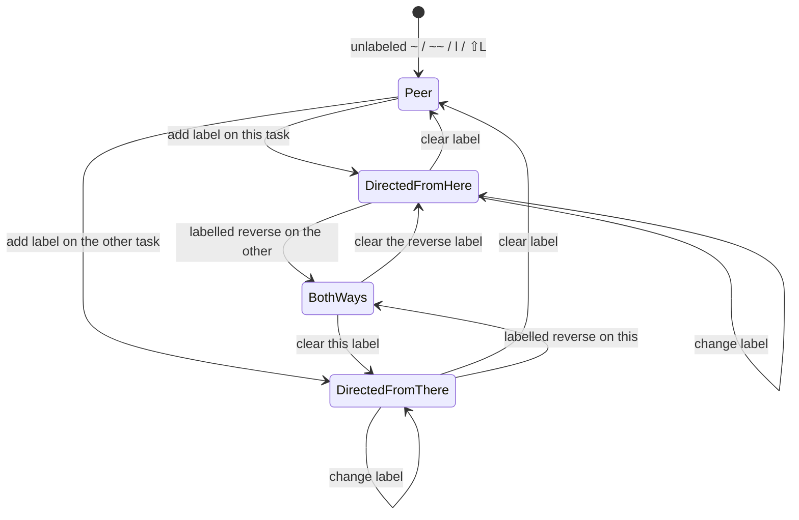

# Undirected task relations: empty label is a peer, a label is an arrow

> **Research query.** Relations are directed today. Make any relation without a
> description undirected instead: show `links` rather than `links to` /
> `links from`; a description makes the edge directed; reverse capture (`~~`,
> Task Card `⇧L`) only differs once a description exists. Critique the plan,
> lead the design, call out justified requirement adjustments, and recommend a
> solution that is intuitive, reliable, and beautiful.

**Researcher.** `grk` (independent swarm report).
**Date.** 2026-10-21.
**Scope.** Research only. No code, vault, config, or memory files were changed.
Prior research consulted: `research:202610/task_relation_links/` (the directed
design that just shipped) and `research:202610/task_relation_labels.md`.

---

## Bottom line

**Yes. Build it. The request is the missing half of the Linear/Jira split that
the first relations swarm stored as "everything is an arrow."**

An empty label is the generic *peer* relation. A label is a *role*, and a role
has a source. That is a good v1 rule. It matches Linear's unlabeled `related`
(one edge, shown on both sides), Jira's `relates to` / `relates to` (same
inward and outward copy), and SASE's own artifact link `related` (inverse is
`related`, `directed: no`).

Do not stop at copy. Raw notes still have to read as English without chips
(`docs/task-relations.md` §10). An unlabeled inbound edge that lives on
`🪢 **LINKED FROM:**` will always sound like an arrow. Split the headings so
the markdown matches the graph:

```markdown
- [ ] #task Which athena/apollo audit findings are worth fixing? ^ref-athena-apollo-audit-triage
  - 🪢 **LINKS:** [[#^ref-athena-apollo-operational-log-audit]]
  - 🪢 **LINKS TO:** follow-up of [[done/bob_done#^capture-star]]
  - 🪢 **LINKED FROM:** [[inbox#^migration]] (migration note for)
```

```text
Fix retries ~sase:retry-design                    # peer (undirected)
Fix retries ~sase:retry-design|"follow-up of"     # this —follow-up of→ that
Write the note ~~sase:retry-design|"next step"    # that —next step→ this
Write the note ~~sase:retry-design                # same peer as ~
```

The live vault today has **one** `🪢 **LINKS:**` line, unlabeled, pairing two
closed audit tasks in `sase.md`. The target already *looks* like a peer. There
is no labelled production edge to migrate. That makes a heading split cheap.

**Do not error on unlabeled `~~`.** Treat it as the same peer as unlabeled `~`.
The request already says they are the same; refusing a synonym is uglier than
accepting it.

---

## 1. Is this a good idea?

**Yes.** Three facts from the system that just shipped make the current
always-directed rule the wrong default.

### 1.1 Unlabelled edges are peers in every analog we already cited

The first relations swarm (`research:202610/task_relation_links/`) built a
second inert graph by copying Depends-On / BLOCKS: one authored line, a
generated inverse, optional source-side labels. That swarm's own comparison
table already knew the industry split:

| System | Blocking (directed) | Related (undirected) |
| --- | --- | --- |
| Linear | `blocks` / `blocked by` (`M then X` / `M then B`) | `related`, `M then R`; shown on both sides from one stored edge |
| Jira | `blocks` / `is blocked by` (inward ≠ outward) | `relates to` / `relates to` (same copy both ways) |
| SASE artifacts | `supersedes`, `implements`, `derives-from`, … | `related` (inverse is `related`, directed no) |
| Bob dependencies | `⛓️ DEPENDS ON` / `🧱 BLOCKS` | (missing, until 🪢) |
| Bob relations today | every 🪢 edge, labelled or not | none |

Linear documents `related` next to `blocked` / `blocking` / `duplicate` as a
separate kind, and `#` mentions become related automatically
([Linear issue properties](https://linear.app/docs/issue-property)). Jira
stores one edge with inward and outward descriptions; `Relates` is the type
whose two descriptions are identical
([Atlassian issue-linking model](https://www.atlassian.com/blog/development/jira-issue-linking-model)).
SASE's closed relation registry in `sase/memory/sase_artifacts.md` is the
in-house version of the same split.

The first swarm stored Linear `related` as if it were `blocks` with an empty
caption, because the request said "directed." The empty-label chip still
renders an arrow (`LC1`: `🪢 links to → (○ T)` in
`bob-ledger-tools` `146-relation-chip-model.js`). That arrow is the smell.

### 1.2 The only live vault edge is already a peer

A read-only walk of `~/bob` on 2026-10-21 found:

| Kind | Count |
| --- | --- |
| `🪢 **LINKS:**` lines | 1 |
| `🪢 **LINKED FROM:**` lines | 1 |
| Unlabelled LINKS entries | 1 |
| Labelled LINKS entries | 0 |
| Unlabelled LINKED FROM entries | 1 |
| Labelled LINKED FROM entries | 0 |

The pair is two closed `#ref` tasks in `sase.md`:

```markdown
- [x] #task #ref [[ref/chat/athena_apollo_operational_log_audit|…]] ^ref-athena-apollo-operational-log-audit
	- 🪢 **LINKED FROM:** [[#^ref-athena-apollo-audit-triage]]
- [x] #task #ref [[ref/chat/athena_apollo_audit_triage|…]] ^ref-athena-apollo-audit-triage
	- 🪢 **LINKS:** [[#^ref-athena-apollo-operational-log-audit]]
```

"Which findings are worth fixing?" and "operational log audit" are peers.
Direction is an accident of who was the capture owner. After this change that
pair becomes two `LINKS` lines and no `LINKED FROM`.

### 1.3 `~~` without a label is a no-op distinction

Today `~` writes this task's LINKS and courtesy-mirrors the other task's
LINKED FROM; `~~` writes the *other* task's LINKS and mirrors here
(`src/native/capture/relations.rs` `apply_links_to` / `apply_linked_from`).
LX15 pins `N ~T ~~T` as **two independent directed edges**. LR19 pins `A → B`
and `B → A` as two listings.

Once unlabeled means undirected, `{this, T}` is one pair. The second sigil has
nothing left to say until a label names a source. That is exactly the
request's observation about `~~`. Keep the sigil; give it meaning only when a
role exists.

### 1.4 What would make it a bad idea

It is a bad idea if we:

- Couple label presence to directedness in the *glossary* as an unbreakable
  law, then later need "sibling of" as a labelled peer.
- Dual-author directed edges (the failure the BLOCKS projection exists to
  prevent).
- Change copy in chips and capture while leaving unlabeled inbound on
  `LINKED FROM` in vim.
- Error on unlabeled `~~` and train people that reverse capture is hostile.
- Let relabelling silently flip topology without a tested state machine.

The design below closes those.

---

## 2. Critique of the plan as stated

### Keep

- **Empty label → undirected.** The generic relation is "these two tasks are
  about each other." That is what unlabeled `~` already means in the guide
  (`docs/guides/link-related-tasks.md` still has to *say* "directed" because
  the contract does).
- **A description → directed.** A label is a sentence from a source: "S
  ‹follow-up of› T" (`docs/task-relations.md` §3.2). Inverse phrases
  (`merged into` → `merged from`, and the other four) only make sense on a
  directed edge.
- **Show `links` for peers.** Chip row label, capture human line, shell
  completion group, Mac picker title, Task Card copy.
- **`~~` / `⇧L` become "pick the source" for a labelled role.** A new task
  still has no id, so a reverse writer remains required for directed edges
  (the first swarm's reason `~~` exists).
- **Glossary grows directed / undirected terms**, and Task Relation stops
  saying "always directed."
- **Inertness stays.** Peers never block, promote, consume, stamp, or route.
  That constraint from `docs/task-relations.md` §2 is untouched.

### Push back

**1. "Show `links`" is not only a chip string.**
Without plugins both lines "still read as English." An unlabeled inbound
entry on `🪢 **LINKED FROM:**` reads as an arrow in git, vim, and agent
edits. Beauty has to include the stored heading.

**2. Do not refuse unlabeled `~~`.**
The request says unlabeled `~~` *is the same as* unlabeled `~`. An error
("reverse linking needs a label") fights muscle memory: Mac Capture's empty
`~` picker inserts a second tilde to flip `relation_to` ↔ `relation_from`
(`CapturePanelModel.flipRelationDirection`). Keep the flip. Both tokens
commit the same peer. Preview both as `🪢 links`. Directional chrome appears
when `|` is typed.

**3. Label presence is a 1-axis encoding of a 2-axis space.**

|  | No label | Label |
| --- | --- | --- |
| Undirected | peer (this proposal) | "sibling of", "see also" |
| Directed | "points at" with no role | "follow-up of" (this proposal) |

V1 should occupy two of the four cells: empty = peer, labelled = role. That
kills unlabeled directed (the thing we want gone) and postpones labelled
peers. Call the postponement; do not pretend the 2×2 vanished.

The shipped guide already uses `|related to` as a labelled example
(`docs/guides/link-related-tasks.md`). Under the new rule that example
becomes a *directed* "related to", which is the wrong cell. Unlabeled *is*
"related to." Change the example.

**4. Identity has to change, not only rendering.**
Today edge identity is the ordered pair `(S, T)` (`docs/task-relations.md`
§5). Unlabeled `A → B` and `B → A` are two edges (LR19, LX15). For peers
identity is the unordered pair `{A, B}`. If we only change copy, a user who
types `~T` then `~~T` still stores two arrows that both render as `links`,
and chips can double-count. Collapse.

**5. Relabel is no longer a local mutation.**
Today LW4 relabels in place on the same directed edge. Adding a label to a
peer *creates a source*. Clearing a label *destroys a source*. That is a
topology change. It needs an explicit state machine (section 6) and new
vectors, not a silent LW4 extension.

**6. Mac Capture keys off `direction == "from"`.**
`CaptureRelationshipPresentation` and `CaptureRelationshipCopy` branch on
the JSON string `"from"` to choose "now links here" / "is linked from".
Unlabeled `~~` currently emits `from`. After this change it must emit
`undirected` (or the Mac will keep saying "linked from" for a peer). Bob
Mac Capture is a thin client (`decisions:mac-capture-is-a-thin-client`);
bob-cli owns the grammar, and both repos ship in one train.

---

## 3. Requirement adjustments

Each row is a change to the request, flagged so a later plan can quote it.

| # | As requested | Adjusted to | Why |
| --- | --- | --- | --- |
| **A1** | Show `links` instead of `links to` / `links from` for unlabeled | Same copy **and** a third stored heading: unlabeled lives on `🪢 **LINKS:**` at **both** ends. Labelled outgoing moves to `🪢 **LINKS TO:**`. `🪢 **LINKED FROM:**` holds labelled incoming only. | Raw notes must match the graph. The reader already accepts `LINKS TO` as an alias of `LINKS` (LK4); this change *splits* that alias. |
| **A2** | Any relation with a description is directed | **V1 rule: empty label ⇔ undirected; non-empty label ⇔ directed.** No symmetric-label exception list in v1. | One axis is learnable. Labelled peers (`sibling of`) are a follow-up, not a v1 registry. |
| **A3 [ADJUSTED]** | `~~` only makes sense with a description | **Accept unlabeled `~~` / unlabeled `⇧L` as a synonym of unlabeled `~` / `l`.** Same unordered pair, same preview `🪢 links`. Do not refuse. | The request already equates them. Errors punish the Mac second-tilde flip and Task Card reverse row. |
| **A4 [ADDED]** | (unstated) edge identity | **Undirected identity is `{A, B}`. Directed identity stays `(S, T, label)`.** A pair may hold at most one undirected edge, plus at most one directed edge each way. | Prevents LX15-style double peers. Two labelled roles in opposite directions remain legal (today's LR19 for labelled). |
| **A5 [ADDED]** | (unstated) occupancy | **A labelled edge occupies the pair in that direction. An unlabeled write on a pair that already has a directed edge either way is `unchanged` (it does not strip the label).** Clearing a label (empty ⇧↵ / relabel-to-empty) is the explicit convert-to-peer. | Stops `~T\|a ~~T` from fighting itself. |
| **A6 [ADDED]** | (unstated) on-disk split | **`LINKS` contains only unlabeled entries and is a symmetric projection of the undirected pair set, canonical-sorted (BK21 / LK20).** `LINKS TO` is authored labelled outgoing, append-only as today's LINKS. `LINKED FROM` is generated labelled incoming. | Mixing authored labelled entries with generated peers on one line makes hand-delete undecidable. Separate headings keep each line's authority obvious. |
| **A7 [ADJUSTED]** | Reverse linking only with a description | **Labelled `~~` / `⇧L` still write the named/other task's `LINKS TO`.** Unlabeled reverse does not need to write the other task as source; both ends receive the same `LINKS` peer. Unlabeled `~~` to an archived / daily named task **succeeds** as a peer stored on the writable end (today labelled `~~` to those paths is refused, and that refusal stays for labelled). | Peers should be creatable from either side even when one end is read-only. Directed reverse still needs a writable source. |
| **A8 [ADDED]** | (unstated) JSON | **Additive `direction: "to" \| "from" \| "undirected"`.** Unlabeled `~` and unlabeled `~~` both emit `"undirected"`. Labelled keep `"to"` / `"from"` from the sigil. `schema_version` stays 1. Mark the behavior change with `!` in the release train. | Mac and completion branch on `"from"`. Changing unlabeled `~~` from `"from"` to `"undirected"` is the whole point of the copy change. |
| **A9 [ADDED]** | (unstated) docs example | **Stop teaching `|related to` as a labelled relation.** Unlabeled *is* related. Keep `|follow-up of`, `|merged into`, `|duplicate of` as directed examples. | The current guide example would become a wrongly directed peer. |
| **A10** | Update the glossary | **Task Relation** becomes the umbrella. Add **Directed relation** and **Undirected relation** (section 5). Implementation goes through `/sase_memory_write` and `docs/reference/glossary.md`. | The bundled glossary currently says "a directed, optionally labelled, inert link." |

---

## 4. Alternatives considered

### 4.1 Copy-only (Neo4j style)

Keep storing unlabeled on one LINKS line and generating LINKED FROM. Change
chips, capture, and completion to say `links`. Index unions `A → B` with
`B → A` when both labels are empty.

**Cheaper.** Matches Neo4j (every relationship is stored directed;
undirected is a query convention). **Fails the English-without-plugin
rule**, and leaves LX15 as two stored arrows. Ship this only as a
same-week preview if the heading split slips; it is not the destination.

### 4.2 Dual-write unlabeled onto both LINKS lines, keep mixed labelled+unlabelled on LINKS

Both ends show `LINKS` for peers without a new heading. Labelled outgoing
stays on the same line.

**Looks simpler, is not.** A task that owns some peers and receives others
mixes authored labelled entries with generated unlabeled ones on one line.
Hand-deleting a generated peer vs an authored labelled entry cannot share a
rule. This is the two-sources-of-truth failure the BLOCKS work removed.

### 4.3 Canonical owner (lexicographic min of `(path, id)`)

Store the unlabeled pair only on the smaller identity; generate `LINKS` on
the other. Reconcile has a single truth.

**Reliable, opaque.** Users cannot know which end is safe to hand-edit.
Reject for a personal vault that is read in vim.

### 4.4 Third sigil (`~=` peers, `~` / `~~` always directed)

Keeps label and direction independent (the full 2×2).

**More grammar, more Mac chrome, more completion groups.** The request's
whole point is that the empty label *is* the peer type. A third sigil is
how you later add labelled peers, not how you ship v1.

### 4.5 Error on unlabeled `~~`

Matches a strict reading of "only makes sense with a description."

**Hostile.** Mac second-tilde and Task Card `⇧L` become traps. The request
already says the two unlabeled forms are the same. Accept the synonym.

### 4.6 Symmetric-label allowlist (`related`, `related to`, `see also`, `see`)

Those labels would stay undirected even with text.

**Tempting, and wrong for v1.** It reintroduces a type registry the first
swarm rejected, and it makes `~~note:id|"related"` a hidden synonym. Teach
unlabeled as the peer; add an allowlist later if Bryan actually types those
words.

---

## 5. Glossary (proposed)

Implementation updates the glossary web through `/sase_memory_write` and the
docs twin `docs/reference/glossary.md`. Proposed wording:

**Task relation** (aka relation, LINKS line, LINKS TO line, LINKED FROM line).
An inert connection between two Obsidian tasks. It never blocks, counts as a
Pomodoro Task Link, or changes status, schedule, priority, or freshness. A
relation is either an **undirected relation** or a **directed relation**.

**Undirected relation** (aka peer, LINKS line). A task relation with no
label. Identity is the unordered pair `{A, B}`. Both tasks list each other
on `🪢 **LINKS:**`. Capture `~` and `~~` without `|label` write the same
peer. Display copy is `links`.

**Directed relation** (aka labelled relation, LINKS TO line). A task
relation with a label. Identity is `(source, target)`; the label is phrased
from the source ("S ‹follow-up of› T"). Stored on the source's
`🪢 **LINKS TO:**` line and mirrored on the target's generated
`🪢 **LINKED FROM:**` line. Capture `~note:id\|label` points this task at
that one; `~~note:id\|label` points that task at this one. Display copy is
`links to` / `linked from`, with the existing inverse-phrase table on the
inbound side.

The Depends-On / BLOCKS pair stays a different graph. A Task Link under a
Pomodoro stays a different graph.

---

## 6. Recommended design

### 6.1 Mental model

```text
empty label  ──►  peer     ──►  🪢 LINKS          (both ends, no arrow)
label        ──►  role     ──►  🪢 LINKS TO       (source)
                           ──►  🪢 LINKED FROM    (target, generated)
```

Typing `|` is the moment an edge grows a source. Clearing the label is the
moment it becomes a peer again.

Live sentence in the relation field / Mac relation card:

| Kind | Sentence |
| --- | --- |
| Peer | `Fix retries  —  Design a retry policy` |
| Directed from here | `Fix retries  — follow-up of →  Design a retry policy` |
| Directed from there | `Design a retry policy  — next step →  Write the note` |

No arrow on peers. The arrow appears with the pill.

### 6.2 On-disk form

Slot order, extending `docs/task-relations.md` §4:

```markdown
- [ ] #task T ^t
  - ❌ **CANCEL LOG**
  - ⛓️ **DEPENDS ON:** …
  - 🧱 **BLOCKS:** …
  - 🧩 **Sub-projects:** …
  - 🪢 **LINKS:** [[#^peer]] • [[note#^other]]     # undirected, canonical order
  - 🪢 **LINKS TO:** follow-up of [[#^old]]        # directed out, authored order
  - 🪢 **LINKED FROM:** [[inbox#^src]] (next step) # directed in, canonical order
  - user children, logs …
```

Rules:

- A line that would hold no entries is deleted.
- `LINKS` is unlabeled entries only. Writers emit BK21 / LK20 sort
  immediately so capture is not followed by a reconcile reorder.
- `LINKS TO` is labelled entries only. New entries append; relabel in place
  (today's LW2–LW4).
- `LINKED FROM` is labelled incoming only. Reconcile is the authority, never
  read back (today's §6–7).
- Cross-parse: Depends-On, BLOCKS, LINKS, LINKS TO, and LINKED FROM each
  return not-a-line for the others (extend LK19).
- Reader tolerance: a mixed legacy `🪢 **LINKS:** follow-up of [[#^a]] • [[#^b]]`
  still *parses*. The next writer or reconcile **splits** it into `LINKS TO`
  + `LINKS`. `LINKS TO` is no longer canonicalised *to* `LINKS` (LK4
  changes). `BACKLINKS` still canonicalises to `LINKED FROM`.
- Glyph, separators, malformed, not-a-line, kill switch for LINKED FROM:
  unchanged. The kill switch does **not** suppress undirected `LINKS`
  projection; that line is the peer itself, not a directed mirror.

### 6.3 Authority and hand-edit

**Directed.** Source of truth is `LINKS TO`, exactly as today's `LINKS`.
Deleting every `LINKED FROM` line and reconciling rebuilds labelled inbound
only.

**Undirected.** Source of truth is the set of unlabeled pairs implied by
`LINKS` lines. Reconcile's job is symmetry:

1. Collect unlabeled `LINKS` entries vault-wide as unordered pairs (skip
   malformed lines, unresolved / non-task / self, duplicate ids — same
   warnings as today).
2. For each pair `{A, B}` whose both ends are writable, both `LINKS` lines
   list each other, canonical-sorted.
3. Drop unlabeled entries from any `LINKED FROM` (migration + heal).
4. Do not invent a pair that is not on at least one `LINKS` line.

Gesture, capture, chip ×, and the nav cursor-leave follower **write both
ends in the same batch / follow-up**, so a normal unlink is gone from both
sides before reconcile. If a follow-up fails, reconcile **heals by union**
(the remaining entry restores the missing one). That is the same honesty as
today's generated mirror: a one-sided hand-delete comes back; × and capture
are the real unlink. Document it on the undirected line the way LINKED FROM
already documents "generated."

Cursor-leave on `LINKS` diffs the unlabeled neighbor set and applies add /
remove to the pair set (both ends). Reorder-only edits canonicalise.
Cursor-leave on `LINKS TO` stays today's labelled mirror into LINKED FROM.
Hand-edit of `LINKED FROM` stays a no-op with the generated-line notice.

### 6.4 Capture grammar

Tokens stay `~note:block-id[|label]` and `~~note:block-id[|label]`. Strike
guards, escapes, leading/trailing runs, and `schema_version: 1` byte-identity
for drafts without `~` stay.

| Draft | Edge | Preview |
| --- | --- | --- |
| `Fix it ~work:foo` | undirected `{new, foo}` | `🪢 links "Foo"   work.md ^foo` |
| `Fix it ~~work:foo` | same pair | same preview |
| `Fix it ~work:foo\|see` | directed new —see→ foo | `🪢 links to "Foo" · see   work.md ^foo` |
| `Fix it ~~work:foo\|"next step"` | directed foo —next step→ new | `🪢 "Foo" now links here · next step   work.md ^foo` |
| `Fix it ~work:foo ~~work:foo` | one peer (`unchanged` on the second) | one `links` line |
| `Fix it ~work:foo\|a ~~work:foo` | directed `a`; unlabeled second is `unchanged` | no peer created |
| `@bob+id ~work:foo` | peer between two existing tasks | `🪢 links "Foo"` |

Parse JSON: `relations[].direction` becomes `"to" | "from" | "undirected"`.
A complete unlabeled token emits `"undirected"` regardless of `~` vs `~~`.
Partial `~` / `~~` still needs `relation_target`. Partial `~note:id|` still
needs `relation_label`. `capture-complete` grows a `relation_undirected`
context (or reuses `relation_to` with `undirected: true` on candidates —
prefer a third context so Mac picker titles do not say "links to"). Shell
groups: unlabeled tokens under `links`; labelled `~` under `links to`;
labelled `~~` under `linked from`; `|` still `relation labels`.

`~~` labelled still refuses daily / `done/` / `_templates` named sources
(LX7). Unlabeled `~~` to those paths stores the peer on the writable end and
reports `mirror_skipped` equivalent (`peer_target_read_only`) so chips on
the archive still come from the live index.

Minting: both ends still need `^id`. Peers mint the capture owner the way
today's source mint exists for LINKED FROM. Labelled `~~` still always mints
the new task (it is the target).

### 6.5 Relabel state machine



Operationally:

| From | Gesture | To |
| --- | --- | --- |
| no edge | unlabeled write | one peer; both `LINKS` |
| peer | ⇧↵ label on this task | this `LINKS TO` gains the labelled entry; both `LINKS` drop the pair; other `LINKED FROM` gains `(label)` |
| peer | ⇧↵ label on the other task (`⇧L` / `~~\|`) | other `LINKS TO`; this `LINKED FROM` |
| directed S→T | empty label | peer; drop LINKED FROM entry for this role |
| directed S→T | unlabeled `~` the other way | `unchanged` (A5) |
| directed S→T | labelled reverse | two directed edges (legal) |
| directed S→T | same label again | `unchanged` (LW3) |
| directed S→T | different label | relabel in place (LW4) |

Capture human copy for convert-to-directed can stay `🪢 relabeled` if the
pair already existed as a peer; add `action: directed` / `undirected` only
if a client needs it. Prefer reusing `relabeled` with `previous_label: null`
and a new `label`, and the reverse, to keep the action enum small.

### 6.6 Chips

Three possible rows, each omitted when empty. Colour still carries status,
never direction (`docs/task-relations.md` §10).

| Row | Heading in the widget | Anatomy |
| --- | --- | --- |
| Undirected | `🪢 links` | chips only, wrap between chips, **no leading `→`** (drop LC1's arrow) |
| Directed out | `🪢 links to` | `‹label› → (chip)`, one visual row per labelled entry |
| Directed in | `🪢 linked from` | inverse pill when known, else `(chip) · ‹label› → this` |

Index API (`api.relationIndex` v1) grows an undirected map, or `outgoing` /
`incoming` gain a `kind: "peer" | "directed"` on each edge. Publish all
three under one generation so counts cannot disagree. Unlabeled `A → B` and
`B → A` in a not-yet-migrated note collapse to one peer in the index
immediately, even before reconcile splits the headings.

Controls: ＋ on `LINKS` opens the Links stage on PEERS ("Link a related
task"). ＋ on `LINKS TO` opens TO. ＋ on `LINKED FROM` opens FROM. × on a
peer chip removes the unordered pair (both `LINKS` lines). × on a directed
chip is today's `removeLink(S, T)`.

`toggle-dependency-chips` covers all three rows.

### 6.7 Task Card and Obsidian gestures

Keep the chords. Change what unlabeled apply means.

- `l` / `Ctrl+Shift+L` opens **🪢 Links · \<task\>** with three CURRENT
  sections: **Peers** (undirected), **To** (labelled outgoing), **From**
  (labelled incoming). Default focus Peers. Subtitle:
  `Peers P · to K · from M · searching N tasks · ⇥ to mark several · does not block`.
- `⇧L` / `Ctrl+Shift+Alt+L` opens the same stage focused on **From**.
- `Ctrl+Shift+P` on `LINKS` / `LINKS TO` / `LINKED FROM` opens that section.
- ↵ on a RESULTS row with an empty relation field commits a **peer**.
- ⇧↵ still opens the relation field; a non-empty commit is directed from
  the section's source (Peers/To: this task; From: the other task).
- CURRENT ↵ unlinks (peer removes both `LINKS` entries; directed removes
  `LINKS TO` + mirror).
- CURRENT ⇧↵ on a peer converts to directed from this section's source.
  CURRENT ⇧↵ on a directed row with an empty field converts to a peer.
- `Ctrl+D` on the card's Links row: today's "clear outgoing" becomes "clear
  peers **and** directed out" with a copy change (`Clear 🪢 links`). From
  still refuses `Ctrl+D` (generated inbound).
- `N Ctrl+Shift+L` applies one chosen target as a peer (or as directed-out
  if a label was set) to N+1 sources. `N Ctrl+Shift+Alt+L` stays refused.

Two Task Card rows (`Links…` / `Linked from…`) can remain as *entry points*
into the same stage so `b` / `⇧B` muscle memory survives. Unlabeled `⇧L`
apply is a peer, not a reverse arrow.

### 6.8 Mac Capture

Thin client. Bob's preview strings and the new `undirected` direction drive
copy.

- Empty `~` picker title: `🪢 “Owner” links…` / `🪢 Choose a related task…`.
- Second tilde with no `|` keeps the token `~~` in the draft and **does not
  change the title** (still `links…`). The live sentence stays `S — T`.
- Typing `|` after `~~` switches the title to `🪢 Choose a task that will
  link to “Owner”` and the sentence to `T — ‹label› → S`.
- Typing `|` after `~` switches to `🪢 “Owner” links to…`.
- Flipping tilde while a label is already present swaps `~` ↔ `~~` and
  rewrites the sentence's source, as today.
- Notification for a single unlabeled update: `🪢 Owner now links “Other”`
  (no "to"). Several updates can keep `🪢 Owner · links N`.

Coordinate the JSON enum in bob-cli and the Swift switch in
`CaptureRelationshipPresentation` / `CaptureRelationshipCopy` /
`CapturePanelModel` in one train. An old Mac that does not know
`"undirected"` will treat it as not-`"from"` and say "links to", which is
closer than "linked from" and is acceptable only as a one-day skew.

### 6.9 Reconcile pass

Extend `reconcile_relation_lines` (still right after BLOCKS):

1. **Split mixed legacy `LINKS` lines** on writable tasks: unlabeled stay
   on `LINKS`, labelled move to a new `LINKS TO` in authored relative
   order. Count as `rewritten` / `inserted`.
2. **Project undirected pairs** (section 6.3). Kinds: `inserted`,
   `rewritten`, `canonicalized`, `removed`, `deduplicated` on `LINKS`.
3. **Project labelled LINKED FROM** from `LINKS TO` edges only. Unlabeled
   inbound entries disappear from LINKED FROM.
4. Mint missing ids for writable endpoints of new peers, same silent
   `mint_block_id` as today, no `[id::]`.
5. Still never edit `LINKS TO` except the one-time split in step 1.
6. Quiet interval, preimage, kill switch (LINKED FROM only), `done/` and
   previous-daily read-only: unchanged.

JSON: add `links_line_updates` (or reuse `linked_from_line_updates` with a
`line_kind` field). Prefer `line_kind: "links" | "links_to" | "linked_from"`
on the existing update shape so Mac decoders stay additive.

Guarantee to add beside LR11: delete every undirected `LINKS` line that is
the *only* listing of a pair, and the pair is gone; delete one side only,
and the next reconcile restores it from the other.

### 6.10 Migration

The live vault has one unlabeled pair and zero labelled edges. Tests and
docs carry the labelled corpus.

One reconcile on a writable vault:

- Unlabeled `LINKS` + unlabeled `LINKED FROM` → two `LINKS` lines, no
  `LINKED FROM`.
- Labelled `LINKS` → `LINKS TO` + labelled `LINKED FROM` (already there).
- Mixed `LINKS` → split.
- `N ~T ~~T` fixtures that expected two directed unlabeled edges become one
  peer (LX15 splits into LX15a unlabeled collapse and LX15b labelled
  two-way).

No `[links::]` field. No vault-wide rewrite besides reconcile. `done/`
keeps historical labelled `LINKS TO` / unlabeled `LINKS` as read-only
sources; we never write mirrors there (LR7).

### 6.11 Contract vectors to add

Cite `docs/task-relations.md` as the file that gains them. Suggested ids:

| Id | Pin |
| --- | --- |
| LK21 | `🪢 **LINKS TO:** follow-up of [[#^a]]` accepts as directed-out, not as `LINKS` |
| LK22 | mixed `🪢 **LINKS:** see [[#^a]] • [[#^b]]` accepts; canonical writer splits |
| LK23 | `LINKS` with a labelled-only body is accepted and becomes `LINKS TO` |
| LW15 | add unlabeled T to S: both `LINKS` lines gain the peer, canonical order |
| LW16 | unlabeled add when the pair already exists either way: `unchanged` |
| LW17 | add labelled T to a peer `{S, T}`: convert (section 6.5) |
| LW18 | clear the only label: convert to peer |
| LR25 | unlabeled S-only listing, T writable: T's `LINKS` inserted |
| LR26 | unlabeled inbound on LINKED FROM: moved onto `LINKS`, dropped from FROM |
| LR27 | labelled A→B and unlabeled {A, B}: labelled wins; unlabeled omitted |
| LX15 | split: unlabeled `~T ~~T` is one peer; labelled `~T\|a ~~T\|b` is two directed |
| LP19 | unlabeled `~~work:foo` parses `direction: "undirected"` |
| LC1 | rewrite: unlabeled row is `🪢 links (○ T)` with **no** leading arrow |
| LC15 | task with peers + labelled out + labelled in renders three rows |
| LG16 | unlabeled ↵ in From section creates a peer, not a reverse labelled edge |
| LG17 | ⇧↵ empty on a directed CURRENT row converts to a peer |

Engine agreement (LW14) includes the new headings. Inertness (LR18, LX13,
LG13) is re-pinned on convert-to-directed and convert-to-peer.

### 6.12 Implementation surface

Single contract change in `docs/task-relations.md`, then the twins.

**bob-cli**

- `src/native/task_relations/` — `LINKS_TO_LABEL` becomes a real kind;
  `format_links_to_line`; parse split; planner for unlabeled pair edits;
  slot after Sub-projects: LINKS, then LINKS TO, then LINKED FROM.
- `src/native/task_status_hooks/relations.rs` — split + peer projection.
- `src/native/capture_language/relations.rs` + `editor_model.rs` —
  `RelationDirection::Undirected`.
- `src/native/capture/relations.rs` + `relations_mirror.rs` + `output.rs` —
  unlabeled writes both `LINKS`; labelled keeps today's path; human copy.
- `src/native/capture_complete/` — third context, shell group `links`.
- `src/native/capture_parse.rs` — help text currently still stale in places
  (see `research:202610/task_relation_labels.md`); fix with this change.
- Tests: LK/LW/LR/LX/LP/LC/LG vectors above.
- Docs: `docs/task-relations.md`, `docs/capture.md`, `docs/completion.md`,
  `docs/guides/link-related-tasks.md`, `docs/reference/capture-syntax.md`,
  `docs/reference/glossary.md`, plugin mount `docs/reference/plugins/task-relations.md`.
- Changelog `!` for JSON `direction` and LX15.

**bob-plugins**

- Grammar twins: `061-relation-line-grammar.js`,
  `144-relation-line-grammar.js`, `051-relation-line-grammar.js`.
- Index + chips: `145-relation-index-model.js`, `146-relation-chip-model.js`,
  `153-relation-widget.js`, `278-plugin-relation-model.js`,
  `282-plugin-relation-render.js`.
- Nav Links / Linked-from stages: merge into one stage with three sections;
  unlabeled apply; convert on ⇧↵.
- Task Card rows and `Ctrl+D` copy.
- `docs/task-relations.md` (plugin), `docs/task-card.md`,
  `docs/bob-navigation-hotkeys.md`.

**bob-mac-capture**

- Decode `undirected`.
- Picker titles, live sentence, preview rows, notifications.
- `flipRelationDirection` keeps working; titles stay on `links…` until `|`.
- Fixtures under `Tests/Fixtures/relation-*.json`.

No new CLI write command (`cli_rules`: capture remains the writer). No
`[links::]` field. Decision record at implementation time: directedness is
derived from label presence, peers are symmetric, inertness unchanged.
There is currently **no** relations decision under `sase/memory/decisions/`
(the first swarm asked for one on inertness and it did not land). This
change is the moment to write both claims together, via `/sase_memory_write`
in an approved plan.

Rollout: contract + Rust parser/planner first (vectors), then reconcile,
then capture, then JS twins, then Mac. Do not ship copy-only chips against
the old headings; the vault has one edge, so the split can travel with the
semantics.

---

## 7. Beauty notes (the part that is easy to under-specify)

- **One glyph, three honest headings.** 🪢 stays. The heading is the
  grammar of the arrow: `LINKS` / `LINKS TO` / `LINKED FROM`. People who
  never enable chips can still read the note.
- **No arrow until there is a role.** Drop the leading `→` on unlabeled
  rows (LC1). The arrow is earned by the pill.
- **Peers wrap like BLOCKS chips; roles wrap one per line.** Already the
  labelled vs unlabeled layout in §10. Keep it, on separate rows.
- **Capture preview is a sentence, not a dump of sigils.** `🪢 links "Foo"`
  is calmer than `🪢 links to "Foo"` for a peer, and it rhymes with the
  chip row.
- **The Mac second-tilde is a preview of directedness**, not a different
  unlabeled edge. Until `|`, the UI does not pretend a direction exists.
- **Three rows appear only when a task actually has three kinds.** Empty
  lines are deleted. The common case after this change is a single
  `🪢 **LINKS:**` of peers — which is what the one live vault edge wants
  to be.

---

## 8. Risks

| Risk | Mitigation |
| --- | --- |
| LK4 meaning change (`LINKS TO` used to canonicalise *to* `LINKS`) | Reader accepts mixed legacy; writers split; pin LK21–LK23 |
| Relabel topology surprises | State machine in §6.5; convert is explicit empty-label / new-label, never a side effect of `~` on an occupied directed pair |
| Hand-delete of one `LINKS` comes back | Document like LINKED FROM; × / capture write both ends; union-heal |
| Mac / JSON skew | `undirected` enum value; both repos in one train; old Mac degrades to "links to" |
| Labelled "related to" in the guide | A9: delete that example |
| Three managed children next to Depends-On / BLOCKS / Sub-projects | Empty omitted; most tasks show one `LINKS` row |
| Recogniser sprawl (fifth managed line, `LINKS TO`) | Same twin-guard rollout as the first relations ship; extend LK19 before any writer |
| Semantic creep (peers that promote) | Inertness contract re-pinned on the new actions |

---

## 9. Recommended solution (checklist)

1. **Do it.** Empty label is a peer; a label is a directed role.
2. **Split headings** so raw notes match: `LINKS` (peers, both ends,
   canonical), `LINKS TO` (labelled out, authored), `LINKED FROM`
   (labelled in, generated).
3. **Accept unlabeled `~~` / `⇧L` as `~` / `l`.** Preview `🪢 links`.
   Reverse syntax keeps its job for labelled roles.
4. **Collapse unlabeled identity to `{A, B}`.** Occupancy: labelled wins
   over a peer write; clearing a label is the convert-to-peer.
5. **Chips drop the unlabeled arrow.** Row copy is `links` / `links to` /
   `linked from`. Index publishes peers under one generation.
6. **One Links stage, three sections.** Task Card `l` / `⇧L` are focuses
   into it. Empty ↵ is a peer; ⇧↵ with text is a role.
7. **JSON `direction` grows `"undirected"`.** Changelog `!`. Mac and
   plugins ship in the same train.
8. **Reconcile splits mixed lines and symmetrises peers.** Migration is
   one pass; the live vault has a single unlabeled pair.
9. **Glossary** as in §5. Guide stops saying `|related to`.
10. **Stay inert.** Peers inherit every "never" in `docs/task-relations.md`
    §2.

That is the design I would implement: the request's rule, with headings
that tell the truth, a synonym instead of an error, and a state machine
for the moment a peer grows a source.

---

## Sources

- `docs/task-relations.md` (shipped contract: always-directed vocabulary,
  LK4 `LINKS TO` alias, LC1 unlabeled arrow, LX15 two-edge `~`+`~~`, LR19)
- `src/native/task_relations/{mod,format,plan}.rs`,
  `src/native/capture/relations.rs`, `src/native/capture/output.rs`,
  `src/native/capture_language/{relations,editor_model}.rs`,
  `src/native/capture_complete/shell.rs`
- bob-plugins `146-relation-chip-model.js` (row label `🪢 links to` /
  `🪢 linked from`, LC1 leading `→`), `145-relation-index-model.js`
- bob-mac-capture `CaptureRelationshipPresentation.swift`,
  `CaptureRelationshipCopy.swift`, `CapturePanelModel.flipRelationDirection`
- `docs/guides/link-related-tasks.md`, `docs/completion.md`
- Glossary strand **Task Relation** (read via `sase memory read`)
- `sase/memory/sase_artifacts.md` relation registry (`related` undirected)
- `research:202610/task_relation_links/` (first swarm; Linear/Jira split;
  rejection of undirected-only because the request said directed)
- `research:202610/task_relation_labels.md` (source-side labels, inverse
  table, `|related to` guide bug)
- Live vault count, 2026-10-21: one unlabeled pair in `sase.md`
- [Linear issue properties — relations](https://linear.app/docs/issue-property)
- [Atlassian: Jira issue linking model](https://www.atlassian.com/blog/development/jira-issue-linking-model)
- [Jira link types: blocks vs relates](https://ones.com/blog/jira-issue-links-a-cheat-sheet-for-blocks-relates-and-clones/)
