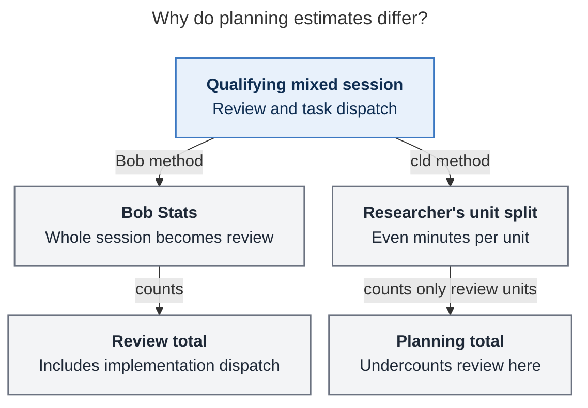

# Diagram proposals: Work-kind Pomodoro themes: what six months of work supports

Proposals for the swarm linker, not a report. Each diagram restates only what the source
report says.

```yaml
source: research:202610/work_kind_pomodoro_theme_set/work_kind_pomodoro_theme_set__final.md
producer: research.2q.image
check: "mmdc 12.0.0 (Puppeteer --no-sandbox) with the PDF-mirroring config rendered 1 of 1 Mermaid diagrams"
```

## planning-estimates

```yaml
anchor: |-
  That happens even when the session also lists the implementation tasks you were
question: |-
  Why does the same morning work produce different planning estimates?
illustrates: |-
  Bob sends a qualifying mixed session wholly to the review bucket, while cld splits its minutes evenly across units, so neither total is pure planning time.
caption: For mixed sessions qualifying as review, Bob counts every minute; even unit splits undercount review. Neither method isolates planning time.
review: "562.922x542 px, fit 100.0%; question and visual checks passed; 1 revision; every node and edge traced to the evidence-base passage; anchor unique"
```


