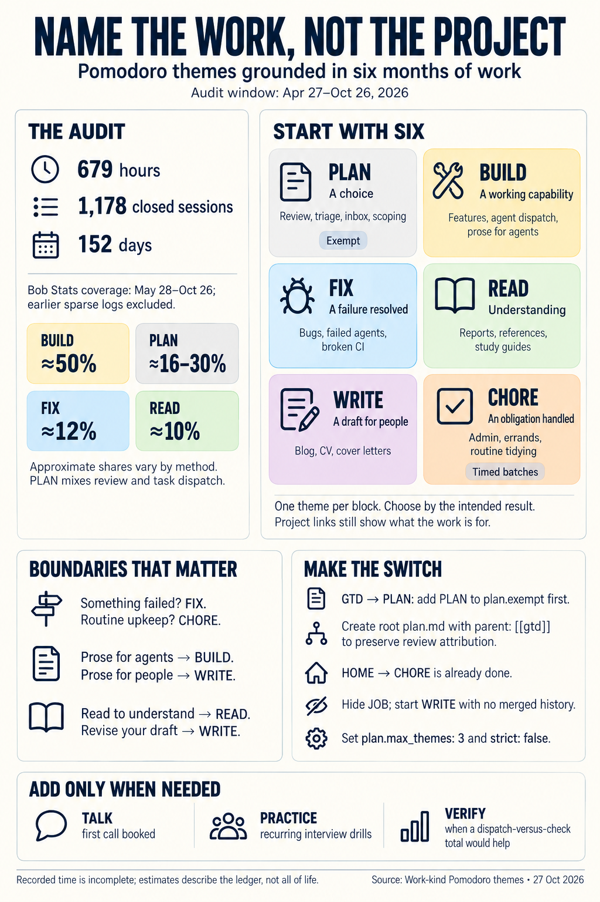
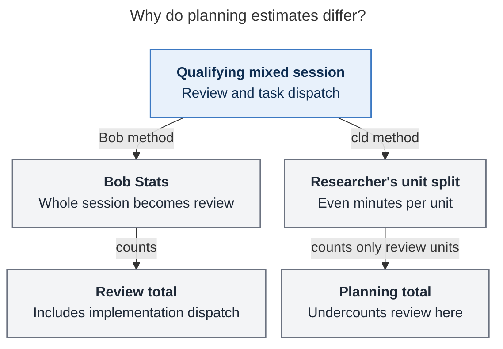
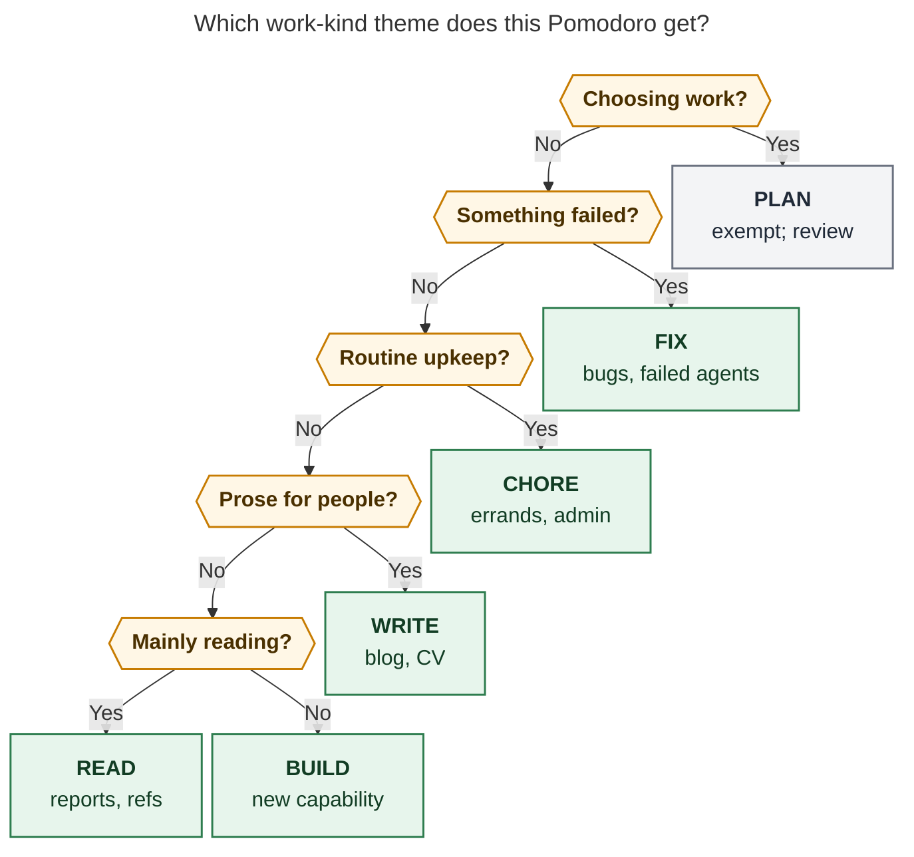

# Work-kind Pomodoro themes: what six months of work supports

> **Research query:** I'd like Pomodoro themes to say what *kind* of work a Pomodoro
> holds (reading, building, fixing) instead of what the work is *for*. I plan to rename
> GTD to PLAN and HOME to CHORE, but I'm not sure what other themes to expect. Audit the
> work I've done over the last six months and recommend a set of themes that fits the
> work I actually do.

## Bottom line

- **From now on, use six themes: PLAN (exempt), BUILD, FIX, READ, WRITE, CHORE.** Three
  researchers chose exactly this set. A fourth (cdx) chose it plus VERIFY. The fifth (cld)
  chose SHOW in place of WRITE. Four kinds of work account for about 94% of your recorded
  time: BUILD about 50%, PLAN 16–27% (it depends on how review sessions are counted), FIX
  about 12%, and READ about 10% (see [The evidence base](#the-evidence-base)).
- **Both of your renames are right.** You already renamed HOME to CHORE at 14:15 today
  (vault commit `4b07dc29`). GTD → PLAN has two prerequisites. First, PLAN has to be in
  `plan.exempt`. Second, your vault needs a root `plan.md`; without one, review time drops
  out of the `gtd` area (see [Switching safely](#switching-safely)).
- **Retire JOB: hide it, don't rename it.** Judged by content, JOB sessions were about 40%
  reading, 37% work for outside readers, and 16% building (cld). Homes already show the
  time you spend on the job hunt: the `job` area, the `job_2026*` projects, and the
  `sase_blog` root parent.
- **JOB leaves a gap, and WRITE should fill it, not SHOW.** SHOW sorts work by who will
  see it, which is the "what is it for" question you are moving away from. The blog data
  shows why prose needs its own name. Of about 12.7 hours linked to the blog, only about
  13% was drafting. Reading took 52%, mostly agent-written outlines and plans, and planning
  took 32% (see [Where the reports disagreed](#where-the-reports-disagreed)).
- **If agent upkeep happened because something failed, it is FIX.** In the ledger, upkeep
  is overwhelmingly relaunching failed agents: about 18.5 hours over 34 days, 13 hours of
  it in September alone. Routine tidying barely appears.
- **Expect to need TALK soon.** Today's `job.md` has a Stripe HackerRank assessment and a
  Stripe industry-screen study guide. Live interviews and calls don't fit any of the six
  themes. Create TALK the day your first call is booked. Add PRACTICE if interview drills
  become a regular block. VERIFY is the best-supported candidate for a seventh theme (see
  [Themes to expect next](#themes-to-expect-next)).
- **Set `plan.max_themes: 3`, so the cap can actually fire.** All five reports agree.

## The evidence base

*Lead consolidation · 2026-10-27 · Window: 2026-04-27 to 2026-10-26 (today is cited
separately). Sources: five independent reports
([cdx](work_kind_pomodoro_theme_set__cdx.md), [cld](work_kind_pomodoro_theme_set__cld.md),
[grk](work_kind_pomodoro_theme_set__grk.md), [mus](work_kind_pomodoro_theme_set__mus.md),
[gem](work_kind_pomodoro_theme_set__gem.md)) plus my own ledger, code, and config checks.
Shared context: the [six-theme review](../pomodoro_six_theme_review/pomodoro_six_theme_review.md).
Nothing in the vault, the config, or the theme journal was changed. The only rename that
ran was a dry run.*

**Coverage.** `bob stats` counts **1,178 closed Pomodoro rows and 679h 15m** on 152 days,
from May 28 through Oct 26. Before May 28 there are zorg-converted `2026MMDD_poms.md`
logs that Bob Stats does not read. cld parsed them anyway. They are thin ("#sase Stuff!"),
and May 10–19 is missing entirely. Including them brings the total to 712 hours.

**Why nobody classified by theme name:**

- Named themes only start on Aug 26.
- 59% of recorded time has no name at all.
- On Oct 26 you renamed BOB and VIBE to BUILD, PYPI to READ, BLOG to WRITE and then to
  JOB, and HACK to HOME, which rewrote the old names.

So every report classified sessions by their content: task titles, links, and child notes.

**Method by report:**

- **cld:** Unit-level content classifier with 16 fine codes. Each session's minutes are
  split evenly across its units. Validated at 88% agreement, then 38 of 40 on a holdout
  set
- **gem:** Every session classified at the session level. No validation reported
- **grk:** Homes, bob-cli commit types, the reference library, and a recode of named
  themes
- **cdx:** Full extraction, a stratified sample of 96 sessions, and keyword screens over
  1,686 completions
- **mus:** Stats, a ledger parse, and the theme catalog
- **Lead:** My own unit parse, run only for the disputed kinds. It covers 1,129 entries
  and 39,090 minutes, within 4% of Bob's total. I also checked the code and the config

**How the kinds of work divide up:**

- **BUILD**
  - *cld (content, units):* 53.2%
  - *gem (sessions):* 48.2%
  - *Independent anchors:* `feat` is 37% of 1,691 bob-cli commits (verified). 397
    completions start with Add, Create, Implement, or Integrate (cdx)
- **PLAN**
  - *cld (content, units):* 15.9%
  - *gem (sessions):* 29.8%
  - *Independent anchors:* Bob's review bucket holds 181h, 27% of the total (grk, cdx)
- **FIX**
  - *cld (content, units):* 12.9%
  - *gem (sessions):* 11.1%
  - *Independent anchors:* `fix` is 10% of commits. 143 completions start with Fix, BUG,
    Debug, or Troubleshoot (cdx)
- **READ**
  - *cld (content, units):* 12.2%
  - *gem (sessions):* 8.6%
  - *Independent anchors:* 255 completed `#ref` tasks (cdx, grk)
- **Prose and outsider work**
  - *cld (content, units):* 1.7%
  - *gem (sessions):* 1.7%
  - *Independent anchors:* Almost all of it in October
- **CHORE**
  - *cld (content, units):* 1.0%
  - *gem (sessions):* 0.6%
  - *Independent anchors:* HOME logged 25 closed minutes, ever
- **Other (drift, meetings, unknown)**
  - *cld (content, units):* about 3%
  - *gem (sessions):* n/a
  - *Independent anchors:* n/a

**Why PLAN ranges from 16% to 30%.** Bob sends a whole session to the review bucket in two
cases (`attribute_session` in `src/native/pomodoro_homes/session.rs`):

- every part of the session's name is exempt, or
- the session is unnamed and links `[[#^gtd]]`.

That happens even when the session also lists the implementation tasks you were
dispatching. cld's even split goes the other way: it undercounts review in those same
morning sessions. So the true planning share is somewhere between the two figures. Neither
one is pure planning time. [The planning-estimates diagram](#figure-planning-estimates)
traces one qualifying mixed session down both counting paths: Bob's whole-session review
total and cld's even split across units.

_For mixed sessions qualifying as review, Bob counts every minute; even unit splits undercount review. Neither method isolates planning time._

**Other figures that disagreed:**

- cdx counted 1,686 non-recurring completions, and that number matches `bob stats`. gem's
  2,798 seems to include recurring rows: cdx found 2,764 dated rows in total, of which 996
  are recurring and 82 are daily-review rows.
- Session counts run from 1,129 to 1,202, depending on the parser. Bob's 1,178 sessions
  and 679 hours are the reproducible figures.

### Six months in three eras

Share of minutes by kind of work. The data is cld's content classification, mapped onto
the recommended set. cld's SHOW column is shown here as WRITE. Rows don't sum to 100%
because drift, meetings, and unclassified units are left out.

- **Apr 27–30:** Hours 19 · PLAN 6% · BUILD 44% · FIX 13% · READ 4% · WRITE 0% · CHORE 0%
- **May:** Hours 38 · PLAN 0% · BUILD 75% · FIX 16% · READ 1% · WRITE 0% · CHORE 4%
- **Jun:** Hours 123 · PLAN 14% · BUILD 63% · FIX 10% · READ 9% · WRITE 3% · CHORE 1%
- **Jul:** Hours 118 · PLAN 17% · BUILD 56% · FIX 14% · READ 12% · WRITE 0% · CHORE 0%
- **Aug:** Hours 152 · PLAN 18% · BUILD 56% · FIX 13% · READ 9% · WRITE 0% · CHORE 1%
- **Sep:** Hours 147 · PLAN 11% · BUILD 45% · FIX 19% · READ 17% · WRITE 0% · CHORE 0%
- **Oct 1–27:** Hours 114 · PLAN 27% · BUILD 40% · FIX 5% · READ 19% · WRITE 7% · CHORE 1%

1. **Google wind-down (late April to May 22).** Team meetings, CL reviews, and returning
   equipment. Meetings were 18% of late April. This is the only stretch with real meeting
   time.
2. **SASE and bob build-out (June to September).** BUILD was 45–63% of every month. In
   September FIX rose to 19% and "drift" to 7%, as overnight agent failures piled up. You
   used SHIT on 12 of its 13 days that month.
3. **Job search and launch (October).** PLAN rose to 27% and READ to 19%. Prose and
   outsider work appeared for the first time: applications, the CV, LinkedIn, and the
   launch post. BUILD fell to 40%.

**Today's ledger already runs on kinds of work:**

- Closed: GTD ×3, BUILD ×5, FIX ×1, READ ×2.
- Open: READ, BUILD, FIX, CHORE.
- The Stripe study guide, which is reading for the job, sits under READ.
- JOB isn't used at all.

## What each theme should mean

Today's themes and what each becomes:

- **GTD**
  - *Becomes:* **PLAN**
  - *Action:* Rename, keep exempt (config changes first)
- **HOME**
  - *Becomes:* **CHORE**
  - *Action:* Already renamed today; pin a color
- **JOB**
  - *Becomes:* READ, WRITE, CHORE, or BUILD, depending on the block
  - *Action:* Hide it. Don't rename or merge it
- **BUILD, FIX, READ**
  - *Becomes:* Same names
  - *Action:* Keep them; tighten the boundaries below
- **(none)**
  - *Becomes:* **WRITE**
  - *Action:* New theme; start with no history

### PLAN: decide what to do and in what order

- **Evidence**
  - Review is a lasting quarter of the ledger, ranging from 7% to 49% by week.
  - Completions include 120 calendar reviews and 116 Keep imports (cdx).
  - Project planning is real but small: about 10 hours over 13 days (cld). On Aug 11, for
    example, four sessions went to the `sase_art` roadmap (cdx).
- **Use for:** the daily walk, inbox, Keep, calendar, weekly prune, triage, and project
  scoping or roadmaps.
- **Not for:**
  - bursts of relaunching agents (FIX)
  - implementation design (BUILD)
  - PRE habits like teeth and pills, which are checklist items, not Pomodoro work
- **Caveat: PLAN sessions about one project still count as review.** A session whose name
  is all exempt goes to the review bucket even if it links that project's tasks, so those
  minutes leave the project's lane. That is about 10 hours in six months. Accepting it is
  cheaper than adding a second planning name.

### BUILD: produce new or changed capability

- **Evidence**
  - BUILD is about half of all time, and more and more of it is dispatching agents. 205 of
    1,140 sessions in Bob's format have agent sub-bullets (cld).
  - 28% of BUILD sessions last 10 minutes or less (six-theme review).
- **Use for:**
  - features, migrations, setup, and releases
  - testing your own feature end to end (until VERIFY earns a slot)
  - **prose written for agents**: plan files, requirements sections, AGENTS.md
    proofreads, and prompts. That prose is how you build now. It came to about 12.2 hours
    over 16 days (my count), more than three times your prose for people.
- **Not for:** restoring broken behavior (FIX) or prose for people (WRITE).

### FIX: something failed, so restore it

- **Evidence**
  - cld found 92 hours of fix and ops work. 34% was product bugs, 26% agent breakage, 19%
    restoring the fleet, and 11% CI or release breakage. The remaining 8% was setup, which
    belongs in BUILD.
  - My own screen found that relaunching or restarting failed agents took about 18.5 hours
    over 34 days. That was 20 days and about 13 hours in September, but only 2 days in
    October.
- **The test is "did something fail?"** A relaunch after an overnight failure is FIX even
  if it involved no investigation. FIX then measures what unreliability costs you, and
  that is the number that should push you toward reliability work (the Google SRE idea of
  toil).
- **Not for:**
  - planned refactors (BUILD)
  - routine tidying that would happen even if nothing had failed (CHORE, or inside PLAN)

### READ: understand material well enough to decide

- **Evidence**
  - 255 `#ref` tasks completed.
  - Of READ time, 68% was agent research reports and your own notes, 20% external
    reading, and 7% commissioning research (cld).
  - 46 of your 50 most recently finished references are agent reports (grk).
  - READ grew to 17–19% of time in September and October.
- **Use for:**
  - reading or listening in order to understand or decide
  - launching a research swarm
  - "read and act on X", up to your first action
  - job-fit references and study guides
- **Not for:**
  - glancing at docs while you build (BUILD)
  - proofreading your own prose (WRITE)

### WRITE: produce prose for people

- **Evidence.** Prose for people is small but real, and most of it is recent.
  - My screen of task titles found drafting and proofing units totalling about 3.7 hours
    over 10 days, 9 of them in October.
  - cdx adds the June dictated brain dump, the July outline and Fable draft, and the Oct 14
    cover letter.
  - gem's session-level count is 11.6 hours.
- **Why it earns a slot anyway**
  - It is the one kind of work JOB was hiding. Without it, the CV, cover letters, and the
    launch post have nowhere to go.
  - You created WRITE yourself on Oct 26, before folding it into JOB.
  - The blog numbers suggest drafting keeps getting pushed aside. Of about 12.7 hours
    linked to the blog, drafting and proofing took about 1.6 hours, while reading took
    about 6.5 hours. Most of that reading was agent-written outlines, the introduction, and
    the writer's-block plan. A WRITE number would make that visible.
  - Cover letters and application answers will keep coming while the job search is on.
- **Use for:** the blog and launch post, the CV, cover letters, application essays,
  LinkedIn, and proofreading or revising any of these.
- **Not for:**
  - prose for agents (BUILD)
  - docs that ship with a feature in a `docs:` commit (BUILD)
  - routine email and form submissions (CHORE)

### CHORE: routine upkeep that would exist even if nothing failed

- **Evidence**
  - About 7 hours over 10 days: bills, enrolling for unemployment, the Google exit packet,
    and purchases (cld).
  - HOME had 11 rows but only 25 closed minutes. Nine untimed placeholders rolled
    `^sell-stocks-now` from day to day.
  - Chores are under-logged, so the ledger understates this work.
- **Use for:**
  - money, benefits, paperwork, errands, and house tech
  - submitting applications you've already prepared
  - routine digital tidying done as its own block, such as dismissing yesterday's agents
    or updating installs
- **The rule: open CHORE only for a timed batch.** Today's open `() — CHORE` row holding
  `love#^clean-ears` and `^sell-stocks-now` repeats the HOME pattern. Book a time for it,
  or leave those tasks in NEXT or the tickler.
- **Not for:**
  - failures (FIX)
  - deciding which obligations to take on (PLAN)
  - drafting application answers (WRITE)

## Codebook

**Decide the theme when you start the block, by the main result you want from it.** Don't
relabel mid-session just because you started doing something else. Use one theme per
session: composite names split minutes evenly and count twice against the cap. If you
can't decide, finish the sentence "At the end of this block I want ___" (cdx):

- **a choice:** PLAN
- **a failure resolved:** FIX
- **an obligation handled:** CHORE
- **a draft:** WRITE
- **understanding:** READ
- **a working capability:** BUILD

_Ask the questions in order and stop at the first yes. Whatever is left over is BUILD.
PLAN is grey because it is exempt from the theme cap._

Rendered size: 868.5 × 1132 px; fit scale: 75.2% (Mermaid CLI 12.0.0, PDF-mirroring
config).

FIX comes before CHORE in [the work-kind routing diagram](#figure-work-kind-routing) so
that relaunching a failed agent counts as FIX, not as upkeep. WRITE comes before READ so
that revising your own draft counts as WRITE.

**One project, many kinds of work.** All of these blocks stay linked to the same job
notes, so Stats can still show job-hunt time by home:

- **Pick the next roles to apply for:** PLAN
- **Read a role brief or the Stripe study guide:** READ
- **Tailor the CV or write a cover letter:** WRITE
- **Submit a prepared application:** CHORE
- **Do a HackerRank assessment:** BUILD (PRACTICE once that theme exists)
- **Recruiter call or interview:** TALK (once that theme exists)
- **Redo the broken gog/Gmail re-auth:** FIX

## Themes to expect next

Create a new name only when the work behind it shows up on three different days in a
month **and** you have a question you want its total to answer.

- **TALK**
  - *Work it would hold:* Live conversations: interviews, recruiter and phone screens,
    networking calls, meetings once employed
  - *Evidence today:* Google-era meetings took 5.8h (18% of late April). `job.md` links
    `[[interview_notes]]` and `[[meet]]`, and the Stripe pipeline has reached its screen
    stage
  - *Create it when:* Your first call is booked. This is the most likely next theme
- **PRACTICE**
  - *Work it would hold:* Deliberate drills: coding problems, mock interviews,
    system-design reps
  - *Evidence today:* None in the past. Today's Stripe preparation
  - *Create it when:* Drills happen on 3 days in a month. Reading a study guide stays
    READ. Until PRACTICE exists, a one-off coding assessment is closest to BUILD, and its
    home records that it was for the job
- **VERIFY**
  - *Work it would hold:* Acceptance work: E2E tests, reviewing agent output or a
    colleague's code, final proofs
  - *Evidence today:* 18–20 days in six months
  - *Create it when:* You want a "dispatch versus check" number, or acceptance becomes its
    own regular block, or you start a job with code review
- **RESEARCH**
  - *Work it would hold:* Hands-on investigation: comparing sources, prototyping
    alternatives
  - *Evidence today:* Mostly short swarm launches and reading the reports that came back
  - *Create it when:* Hands-on investigation blocks keep recurring
- **OPS**
  - *Work it would hold:* Failure-driven fleet restarts, split out of FIX
  - *Evidence today:* About 9% of September, about 0.5% of October
  - *Create it when:* It passes 5% of a month again

**Don't add these:**

- JOB, SHOW, and HOME are purposes or places.
- SASE, BOB, REMOTE, MEMORY, and TOOL are project names, and homes already record them.
- ADMIN means the same as CHORE.
- LEARN would blur READ and PRACTICE.
- LISTEN belongs in READ (2 days, 2.2 hours).
- MEET means the same as TALK.
- DESIGN belongs in BUILD or PLAN.
- AGENT and MANAGE name a tool, not a kind of work.
- DRIFT and SHIT name an outcome.
- LATER, MISC, and NEW FEATURES stay inventory labels.

## Switching safely

I verified these steps against bob-cli source, `~/.config/bob/config.yml`, and a dry run
today.

1. **HOME → CHORE is done** (`4b07dc29`).
   - CHORE now gets its hue from a hash: aqua. That collides with JOB's area aqua on 10
     days, and Bob's hint suggests orange.
   - Pin a color for CHORE.
2. **GTD → PLAN: change the config first.**
   - Right now `bob themes rename GTD PLAN -d` refuses: *"GTD is a plan config reference;
     add PLAN to plan.exempt or plan.inventory_labels first."*
   - In the chezmoi source for `~/.config/bob/config.yml`, set `exempt: [PLAN, GTD]` and
     put PLAN first. Unnamed `[[#^gtd]]` sessions bridge into the bucket named by
     `exempt[0]`.
   - Then run the rename and trim the list to `exempt: [PLAN]`.
   - The key is `plan.exempt`. gem calls it `exempt_themes`, which is wrong.
3. **Create a root `plan.md` with `parent: "[[gtd]]"` before the rename, or together with
   it.**
   - Bob finds the review bucket's area by resolving a note named after the exempt theme
     (`review_home` in `src/native/pomodoro_homes/resolve.rs`).
   - Today `gtd` resolves exactly to the root `gtd.md`, which is an orange area.
   - `plan` would not resolve. There is no root `plan.md`, and two generated tag pages
     (`_generated/tag_pages/topic/plan.md` and `_generated/tag_pages/context/plan.md`)
     make the bare name ambiguous (`resolve_detailed` in `src/native/vault_links.rs`).
     Review minutes, including all of the renamed history, would land in a bare
     `@review:PLAN` area with no hue.
   - An exact root path wins over basename lookup. cld confirmed this fix in a scratch
     vault.
4. **Leave every `gtd` identifier alone.** That means the `#gtd` tags, `gtd.md`,
   `gtd_daily.md`, the `^gtd` block ID, and the PRE and POST rows. The review walk keys on
   `#gtd` plus `#pre` or `#post`, and the unnamed-session bridge keys on the `^gtd` block
   ID, not on the theme name. Change only the wording of the Morning review checklist.
5. **Run `bob themes hide JOB`; don't rename or merge it.** A rename would carry 89 mixed
   JOB tails (dated Oct 7 onward) into the new name. That count comes from cld's dry run.
6. **Start WRITE with no history.** Don't merge BLOG or JOB history into it.
7. **Pin before any merge.**
   - Pin BUILD, FIX, READ, WRITE, and CHORE. Merging into a target with no journal state
     can hide that target; the six-theme review verified this.
   - Keeping BUILD yellow, READ green, and FIX blue saves you relearning colors. Give CHORE
     and WRITE two distinct slots of their own.
   - PLAN stays muted because it is exempt.
8. **Set `plan.max_themes: 3` and keep `strict: false`.**
   - A typical day uses 2–3 non-PLAN kinds: cld's median is 2, and 155 of 160 days had 3
     or fewer.
   - Today's plan has four open non-exempt themes (READ, BUILD, FIX, CHORE), so it would
     warn. That is the intended effect, because the CHORE row is an untimed placeholder.
9. **Check back in two weeks:**
   - Can you pick a theme in seconds?
   - Is FIX absorbing routine tidying?
   - Have TALK or PRACTICE come up?
   - Has WRITE been opened at all?

   Add `bob themes list -a` and a look at `renamed_reappeared` to the Monday prune.

## Where the reports disagreed

- **What replaces JOB?**
  - *Positions:* WRITE: cdx, grk, mus, gem. SHOW: cld (it was also the idea in your
    `bob#^plan-and-show-themes`)
  - *Resolution and deciding evidence:* **WRITE.** SHOW is defined by its audience, a
    "for whom" facet that homes already answer. cld raised two objections to WRITE. Prose
    for agents would leak out of BUILD; a boundary fixes that. Interviews wouldn't fit;
    [TALK](#themes-to-expect-next) covers them. If you want one "career output" number,
    that's a purpose question: read it from Stats by home
- **VERIFY as a standing theme?**
  - *Positions:* Yes: cdx. Fold into BUILD/FIX: the other four
  - *Resolution and deciding evidence:* **Keep it in reserve as the first candidate for a
    seventh theme.** End-to-end and test units took about 8.7 hours over 18 days, with 3–5
    days in each of June, July, August, and October. That passes your three-days rule, but
    it is only about 1–2% of time. Those units sit on the same tasks as the BUILD
    sessions, and with a cap of 3, every build-and-test day would spend two slots. gem
    argued verification "is integrated into CI." The ledger shows manual E2E sessions
- **Where does agent upkeep go?**
  - *Positions:* FIX: cld, grk, mus. CHORE: gem, and cdx for routine restarts
  - *Resolution and deciding evidence:* **Decide by cause.** If something failed, it's
    FIX. Routine upkeep is CHORE, or stays inside PLAN when it's incidental. In the
    ledger, failure-driven upkeep is about 18.5 hours and routine tidying about 1.75 hours
- **DRIFT or SHIT?**
  - *Positions:* An after-the-fact label: cld. Keep it hidden: grk, mus. No: cdx
  - *Resolution and deciding evidence:* **Not in the set.** It describes an outcome, not a
    kind of work: 13.7 hours over 13 days, last used Oct 9. A hidden name still works when
    typed, because hiding only removes it from Recent (decision
    `theme-hide-is-recent-only`). Keep SHIT hidden and type it after the fact if a session
    goes sideways
- **PLAN share: 16% or 27–30%?**
  - *Positions:* cld 16%; grk, cdx 27%; gem 30%
  - *Resolution and deciding evidence:* **Both, as bounds.** Explained under
    [The evidence base](#the-evidence-base)
- **Health routines in CHORE?**
  - *Positions:* gem: yes, in a morning CHORE block
  - *Resolution and deciding evidence:* **No.** Teeth, pills, stretches, and weather are
    PRE checklist habits, not Pomodoro work
- **How should `^theme-on-task` choose?**
  - *Positions:* Default from the task's verb: cld. Default from the project for
    single-kind notes: grk
  - *Resolution and deciding evidence:* **Both, in that order.** First map the leading
    verb to a theme, then let single-kind notes set a default (`sase_pypi_releases` →
    READ, `gtd_daily` → PLAN, `cash` → CHORE). Write the result into the ledger at capture
    or start, because decision `pomodoro-theme-is-one-component` rejects inferring themes
    at read time. Under work-kind themes, a project's most common theme predicts only 75%
    of minutes (`sase.md` splits BUILD 65%, FIX 20%, READ 12%). A verb maps for 86% of
    linked-task minutes (cld)
- **`^delete-themes`**
  - *Positions:* Cancel or narrow it: grk, mus
  - *Resolution and deciding evidence:* **Narrow it.** Hiding already takes names out of
    Recent, and deleting them would rewrite history

## Claims I did not carry forward

- **From gem:**
  - The config key `plan.exempt_themes` is wrong.
  - gem's runbook renames GTD before editing the config, and Bob refuses that.
  - The 2,798 "non-recurring" completions include recurring ones.
  - Routing interviews to PLAN or CHORE.
  - Bundling teeth and vitamins into a morning CHORE block.
  - Using the "about 23 minutes to resume" (Mark et al.) and "20% per project"
    (Weinberg) figures as precise effect sizes. These are lab results or practitioner
    heuristics, not a basis for setting a cap.
  - Calling a single facet "MECE" under Z39.19. That label comes from Minto and McKinsey;
    the defensible point is keeping the activity facet separate from the subject facet.
- **From grk:** "TALK/MEET: no evidence in the ledger." The zorg logs show Google-era
  meetings, and the job search is heading toward interviews.
- **From cdx:** that April 27 to May 27 has no usable timed data. That is true of Bob
  Stats, but thin zorg logs do exist for that period. Also, I keep VERIFY in reserve
  rather than in the standing set.
- **From cld:** SHOW, for the reasons above. The finding behind it still stands: outsider
  work and prose fill the gap JOB leaves.

## Limits

- Recorded time is not your whole life. If CHORE or TALK work is missing from the timer,
  that doesn't mean it didn't happen.
- Historical names are unreliable. Labels assigned by content are about 90% accurate per
  unit (cld's validation), and the totals are sturdier than any single label.
- My own counts are keyword screens of task titles and units. They point in the right
  direction but miss free-text notes such as "wrote draft cover letter."
- Every count that splits minutes splits them evenly across a session's units or name
  parts.
- Homes come from today's note tree, so re-running later can move attribution.
- The forward-looking reserve list rests on today's `job.md`, not on history.

## Sources and reproducibility

**Vault (read-only, 2026-10-27)**

- `bob themes list -f json`
- `bob stats show worked review_time sessions done -r 2026-04-27..2026-10-26`
- `bob themes rename GTD PLAN -d` (dry run)
- Canonical daily notes `2026/20260427.md`–`2026/20261027.md`
- `job.md` (`^stripe-assessment`, `^ref-stripe-industry-screen-prep`)
- `bob.md` (`^plan-and-show-themes`, `^decide-stable-themes`, `^theme-on-task`,
  `^delete-themes`)
- Vault commit `4b07dc29`
- bob-cli `git log --since=2026-04-27 --until=2026-10-27`: 1,691 commits

**Lead probes**

- Parsed `## Pomodoros*` sections: column-0 `- [x] (…) — NAME` rows and their tab-indented
  child units.
- Resolved Task Links to task text through block IDs across the vault.
- Split each session's minutes evenly across its units.
- Screens:
  - Leading E2E, Test, or Verify, for VERIFY.
  - Relaunch, restart, or failed agents or epics, for failure-driven upkeep.
  - Clean up, dismiss, or update sase, for routine tidying.
  - Leading Write, Draft, or Proofread, plus CV, LinkedIn, and cover letters, excluding
    scripts and AGENTS.md, for prose for people.
  - AGENTS.md, requirements sections, and plan files, for prose for agents.
  - `sase_blog`-linked units, for the blog split.

**Code and config**

- `src/native/pomodoro_homes/session.rs`: `attribute_session` (all-exempt review routing,
  the `^gtd` bridge, `exempt[0]`)
- `src/native/pomodoro_homes/resolve.rs`: `review_home`
- `src/native/vault_links.rs`: `resolve_detailed`
- `~/.config/bob/config.yml`: `max_themes: 5`, `exempt: [GTD]`, `inventory_labels`

**Decisions:** `pomodoro-theme-is-one-component`, `theme-hide-is-recent-only`,
`theme-hue-is-pin-exempt-area-hash`.

**External (checked by the researchers)**

- Toggl, [Tags](https://support.toggl.com/en-us/article/tags-2b1rse/) and the
  [categorization guide](https://support.toggl.com/en-us/article/toggl-track-categorization-guide-jr6htu/):
  projects hold deliverables, tags carry the activity.
- David Allen,
  [The Threefold Nature of Work](https://gettingthingsdone.com/wp-content/uploads/2014/10/Threefold.pdf):
  defining work is real work.
- Google SRE, [Eliminating Toil](https://sre.google/sre-book/eliminating-toil/): keep
  operational work visible.
- [Conventional Commits](https://www.conventionalcommits.org/en/v1.0.0/): feat, fix,
  docs, and chore, a kind vocabulary you already type daily.

None of these shows that a specific set of names, or a specific number of them, is
optimal. The set comes from your records.

## Recommended set

**From now on, use six themes** (each one's boundaries are under
[What each theme should mean](#what-each-theme-should-mean)):

- **PLAN**
  - *Status:* Exempt, muted
  - *What it holds:* Review, triage, inbox, scoping
- **BUILD**
  - *Status:* Standing
  - *What it holds:* New capability, agent dispatch, prose for agents
- **FIX**
  - *Status:* Standing
  - *What it holds:* Anything that failed: bugs, failed agents, CI, outages
- **READ**
  - *Status:* Standing
  - *What it holds:* Reports, references, study guides, commissioning research
- **WRITE**
  - *Status:* Standing
  - *What it holds:* Prose for people: blog, CV, cover letters, applications
- **CHORE**
  - *Status:* Standing, timed batches only
  - *What it holds:* Life admin, errands, submissions, routine tidying

For the names outside the set:

- **Retire JOB** by hiding it. Homes keep showing job-hunt time.
- **Create TALK** the day your first interview or recruiter call is on the calendar (see
  [Themes to expect next](#themes-to-expect-next)).
- **Add PRACTICE** if interview drills become a regular block.
- **VERIFY** is the one optional seventh theme worth trialling, if you want to see how
  your time splits between dispatching work and checking it.
