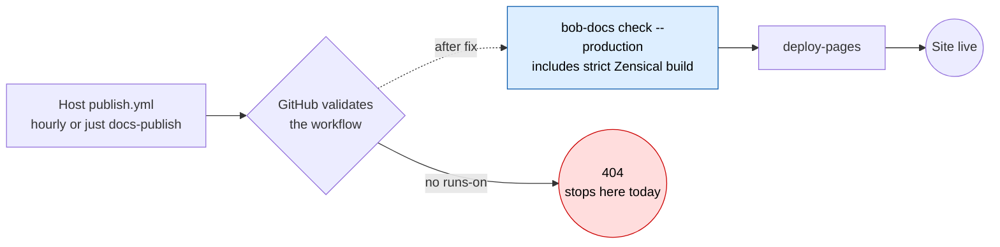

# How Zensical Relates To Bob's New Docs Site

**Date:** 2026-10-20 · **Epic:** `bob-cli-a0` (public docs site) · **Context:**
[`research:202610/bobs_org_docs_site_404.md`](bobs_org_docs_site_404.md)

## TL;DR

- **Zensical is the site generator.** It turns `bob-cli`'s `docs/` folder and
  `mkdocs.yml` into the HTML site that will be served at `https://bobs-org.github.io/`.
  Every docs improvement in epic `bob-cli-a0` is built and checked with it.
- **Zensical did not cause the 404.** GitHub rejects the publish workflow before any job
  starts, because no job has a `runs-on:` runner. Zensical never even runs in CI today.
- **It matters right after the fix.** The first hourly publish will also be Zensical's
  first build on a GitHub runner. If that build fails, nothing deploys and a
  `docs-publish` issue opens. The same files can then be built with Material 9.7.

## What Zensical Is

- A static site generator from the team behind **Material for MkDocs**. It is
  MIT-licensed and reads an existing `mkdocs.yml`.
- Material is in maintenance mode, with critical fixes only through **2027-05-05**.
  Zensical is the team's successor to it.
- It is still **alpha**. We pin **`zensical==0.0.71`** (2026-10-16), which is still the
  newest release on PyPI today. A "dependable" **0.1.0** line is announced for
  **2026-11-05**.

## Why We Chose It

From the docs-site research
(`research:202610/bob_public_docs_site/bob_public_docs_site__final.md`, §6):

| Reason | Detail |
| --- | --- |
| Same dialect as sase.sh | It reads the same `mkdocs.yml` format, and agents already know it. sase's docs already keep to the "Zensical-compatible" subset. |
| No forced migration | Building on Zensical now avoids a move off Material in May 2027. |
| A cheap fallback | The config stays inside what **both** Zensical and Material 9.7 support, so Material can build the same files if Zensical breaks. |
| Runner-up | Astro Starlight. It looks great but needs a second docs dialect and a Node build. |

## Where It Shows Up

| Place | What Zensical does there |
| --- | --- |
| `tools/docs/pyproject.toml` + `uv.lock` | Pins `zensical==0.0.71`. Material 9.7 sits in an optional `material` group. |
| `just docs-build` / `just docs-serve` | `bob-docs` runs `zensical build --strict` / `zensical serve` on the assembled config. |
| `just docs-check` | The "strict Zensical build" is one of its gates, next to lint, URLs, lychee, search smoke, the tutorial, and tests. |
| `docs-publish.yml` (hourly) | The production gates build the site with Zensical. That output is what gets deployed. |
| `docs-weekly.yml` | Builds with **Material** instead, so the fallback is always known to work. |
| Site footer and `/build.json` | Show which builder made the site and the Zensical version. |

## Rules We Follow Because Of Zensical

These guardrails exist mainly because Zensical is young and differs from Material:

- **No `hooks:` in `mkdocs.yml`.** Zensical doesn't support them, and the lint blocks
  them. All generation (CLI reference, plugin inventory, glossary) runs in `tools/docs/`
  before the build, and its output is committed.
- **Only allowlisted plugins** (`search`, `redirects`, `tags`, `llmstxt`). Zensical
  *silently ignores* any other plugin.
- **Our own nav check.** Zensical doesn't report pages that are missing from `nav`
  (Material does), so `bob-docs lint` checks for them.
- **Search-friendly headings.** Zensical's search splits words on punctuation, so syntax
  tokens like `x!` and `@route` get their own named headings. The search smoke tests
  check this.
- **Plain Markdown that works in both builders.** `docs/develop/writing-docs.md`
  requires it.

## What To Watch

1. **The first CI build.** The gates have only run locally so far. Locally,
   `just docs-check` passed with strict Zensical, 111 URLs, and 84 search cases (bead
   `bob-cli-a0.8`). If the GitHub runner build fails, follow step 4 of the 404 report. If
   Zensical itself is the blocker, the plan's escape hatch is to switch the shared
   builder setting to Material and keep every other gate (`docs_toolchain` plan).
2. **Known Zensical accessibility nit.** The a11y audit flagged an
   `aria-prohibited-attr` issue in Zensical's header/search markup. It is recorded in
   the `bob-cli-a0` notes. It cannot block a publish, because `just docs-a11y` is a
   dev-only audit and not one of the publish gates.
3. **Zensical 0.1.0 on 2026-11-05.** The research's decision gate was written for
   "Zensical 0.1.x", but we are launching on the 0.0.71 alpha because 0.1 doesn't exist
   yet. No bead tracks moving the pin to 0.1. When it ships, bump the pin, run
   `just docs-check` and `just docs-build-material`, and re-run the a11y audit.

## Sources

- `bob-cli` `master` `8ba29959`: `tools/docs/pyproject.toml`, `bob_docs/build.py`,
  `bob_docs/lint.py`, `bob_docs/search_smoke.py`, `mkdocs.yml`,
  `.github/workflows/docs-{publish,weekly}.yml`, `docs/develop/*.md`.
- Plans `plan:202610/bob_public_docs_site.md` (verified Zensical facts) and
  `plan:202610/docs_toolchain.md` (fallback rule).
- Beads `bob-cli-a0`, `bob-cli-a0.8`, `bob-cli-a0.2.1.2` (build results and a11y notes).
- PyPI `zensical` JSON API, checked 2026-10-20: latest release is 0.0.71.
