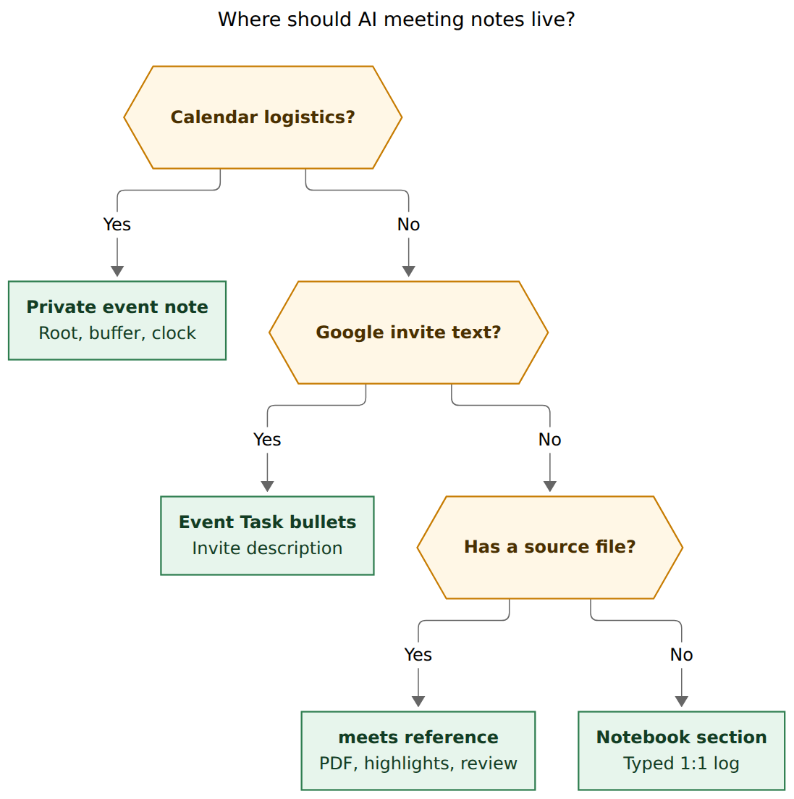
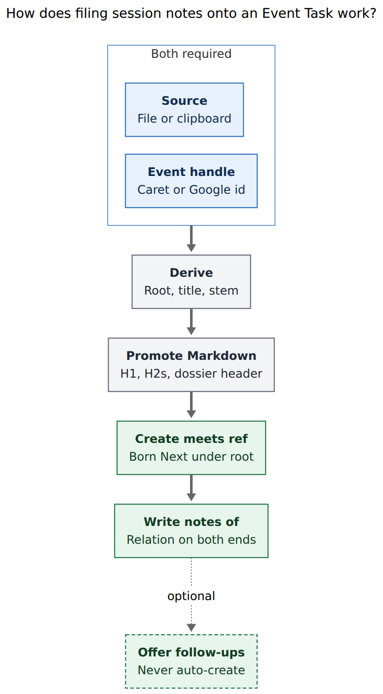

# AI meeting notes should be event-attached `meets` refs, not a Wispr integration

> **Research query.** Integrate AI meeting notes into Event Tasks so it is
> easy to create excellent reference notes for those meetings, associated
> with the correct area or project and linked to the corresponding Event
> Task. First use-case: file `~/tmp/bryan_derrick_meet_notes.txt` (Wispr
> Flow notes) and link it to `^bryan-bugyi-derrick` in
> `~/bob/2026/20261123.md`. Lead the design so the result is intuitive,
> reliable, and beautiful. Critique the plan, call out justified
> requirement adjustments, and end with a recommended solution.

**Researcher.** `grk` (independent swarm report).
**Date.** 2026-11-24.
**Scope.** Research only. No bob-cli, plugin, chezmoi, vault, or memory
files were changed. This file is the deliverable.

**Primary evidence.**
`~/tmp/bryan_derrick_meet_notes.txt`;
`~/bob/2026/20261123.md` (`^bryan-bugyi-derrick`);
`~/bob/job.md` (`^ref-yogi-senior-swe-product-intro-call-prep`,
`^whisperflow-meeting`, `^send-yogi-follow-up`);
`~/bob/bob.md` (`^wispr-flow-meet-notes`, `^event-note-relation`);
`~/bob/ref/chat/yogi_senior_swe_product_intro_call_prep.md`;
`~/bob/meet.md` (notebook under `meet_inbox`);
`~/bob/fscarpel_meet_2026Q1.md` (typed recurring 1:1 log);
`docs/highlights-create.md` (Markdown → `ref_type: chat`, `.md` only);
`docs/ref.md`; `docs/concepts/reference-library.md`;
`docs/gcal.md` (row ownership, description bullets, moved events);
`docs/gcal-notes.md` (private event notes);
`docs/capture.md` (`%` directives, no file-path route);
`docs/task-relations.md` (inert labelled LINKS);
`docs/records.md` (albums are one-entity schemas);
`docs/reference/mac-capture/idle-agenda.md` (calendar band);
`src/native/highlights_ref/create.rs` (`validate_markdown_path`,
`-s/--status`, default `ready`, `-t/--ref-type`);
glossary: Reference Note, Reference Task, Event Task, Capture, Notebook,
Root Parent, Task Relation;
decisions: `references-are-ingested-at-birth`,
`reference-ids-follow-file-stems`,
`private-event-notes-beat-google-per-field`,
`calendar-events-are-daily-note-event-tasks`,
`mac-capture-is-a-thin-client`,
`capture-sigils-say-where-what-how`,
`unblocked-tasks-are-offered`,
`similar-tasks-are-a-settled-heads-up`.

**External evidence.**
[Wispr Flow: sharing meeting notes](https://docs.wisprflow.ai/articles/5073796184-sharing-meeting-notes-from-notetaker-beta)
(Copy as Markdown, Copy summary, Copy transcript; no first-party file
export);
[Wispr REST API](https://api-docs.wisprflow.ai/rest_api_transcribe)
("We currently aren't offering the API service");
[Granola calendar sync](https://docs.granola.ai/help-center/getting-started/syncing-your-calendars)
(notes keyed by calendar event / recurring event id);
[Granola + Google Calendar](https://www.granola.ai/integrations/google-calendar)
(upcoming list, reminder, title and attendees as note context).

**Figures.** Mermaid CLI `@mermaid-js/mermaid-cli@12.0.0`.
Where: 730.79×736 px, fit 89.3%. Filing: 516.859×937 px, fit 95.3%.

---

## Bottom line

**Build it. File AI session notes as a Highlights-ready `meets`
reference attached to the Event Task, with the parent taken from
`[root::]`. Do not build a Wispr Flow API integration, and do not
put the transcript on the Event Task body.**

The need is already encoded in the vault. The 2026-11-23 Derrick
intro has an Event Task rooted at `job`, a prep ref related to that
row, a blocked chore to review WhisperFlow notes, and a follow-up
email waiting on that chore. The missing object is the source note.

The beautiful object is a **meeting dossier**: one `ref/meets/…`
note whose PDF carries the event title, span, Meet link, and root,
then the Wispr summary as numbered sections, then an optional
transcript appendix. The reading task lives on `job.md`, is born
Next (process these notes), and is related to the Event Task with
an inert `notes of` label. Closing that reading task *is* reviewing
the meeting.

Wispr Flow is one producer. Granola, a pasted Markdown file, or a
later dictation app should hit the same planner. The first use-case
is the dogfood of `bob ref create FILE --event 20261123^bryan-bugyi-derrick`,
not a one-off pandoc dance.

---

## The first use-case as it stands

The Wispr file is an AI **summary**, not a transcript. It has a lede,
bare section titles (`Yogi and the Role`, `Next Steps`), and one
next step owned by Derrick. It matches Wispr's **Copy summary**
(plain text that adopts destination styling), not **Copy as
Markdown** (title, Meeting Info, User Notes, Brief, Summary, Chat,
Transcript).

The Event Task already looks like this:

```markdown
- [x] #task **1500-1530** Bryan Bugyi and Derrick Blakely [📅](…) [📹](…)
  [buffer:: -15m] [root:: job] [type:: MEET] [completion:: 2026-11-23]
  ^bryan-bugyi-derrick
  - 🪢 **LINKS:** [[job#^ref-yogi-senior-swe-product-intro-call-prep]]
  - 🪢 **LINKED FROM:** [[job#^whisperflow-meeting]] (💬 mentions)
  - ↤ *15m before* · Final prep for interview!
  - Event Name
  - 30 Minute Intro Call
  - …Calendly boilerplate…
```

Around it, `job.md` already holds:

| Object | Role today |
| --- | --- |
| `ref/chat/yogi_senior_swe_product_intro_call_prep` | Prep packet, `#ref`, status Next, LINKS from the Event Task |
| `^whisperflow-meeting` | CHORE: review Wispr notes on this Event Task; blocked on `bob#^wispr-flow-meet-notes` |
| `^send-yogi-follow-up` | Email Derrick; blocked on the review chore |
| `^event-note-relation` | Separate high-priority task: an `event note of` relation that must **not** create the Event Task |

`bob ref create report.md -P job` would already render Markdown as a
chat ref and file a reading task under `job`. Three gaps block the
use-case:

1. The file is `.txt`. Create refuses anything whose extension is not
   `.md` (`validate_markdown_path`).
2. Create does not accept an Event Task handle, so it cannot derive
   `[root::]`, the identity title, or the relation.
3. Default status is `ready`. A meeting Bryan just attended must not
   land in the unread reading queue.

---

## Critique of the plan

The plan is directionally right and slightly too small.

**What is right.** A reference note is the correct home for
source-backed session notes. The glossary already names a reference
as "a book, article, or **captured conversation**." Markdown create
already defaults to `ref_type: chat`. The Event Task already related
a prep ref through LINKS, so the persistence model exists. Parenting
from the event's `[root:: job]` puts the review task on the job
search, not in `meet.md`.

**What is too small.** "Create a ref from this file and link it"
undersells the product. The hard parts are matching the event,
promoting Wispr's bare headings into a dossier, not confusing
session notes with invite bullets or private event notes, and
treating the reading task as *process this meeting* rather than
*read this PDF*. A Wispr-shaped integration is the wrong first
surface: Wispr's public REST API is closed to new partners, and
Bryan already has a cancelled "figure out meeting notes" task
superseded by this one, plus a lingering idea of dropping Wispr
for Willow Voice. Couple to the Event Task and the file/clipboard,
not to Wispr's cloud.

**What would go wrong if we implemented the request literally.**

- `bob ref create ~/tmp/bryan_derrick_meet_notes.txt -P job` exits 2
  on the extension.
- Renaming to `.md` and creating without `--event` files
  `ref/chat/bryan_derrick_meet_notes.md` into a directory that
  already holds **704** chat notes, mostly SASE agent reports. The
  interview prep ref would have an unnamed sibling with no event
  link and status Ready.
- Pasting the summary onto the Event Task with `%c` writes Google-
  adjacent children. Untouched description bullets follow Google;
  a later Calendly edit can fight vault notes. The daily note
  becomes the transcript. Highlights, listen, and `bob ref show`
  never see it.
- Putting a 📝 badge on the Event Task headline dirties the badges
  hash and can freeze Google title/time/badge updates.
- Auto-creating a task from "Next Steps" would file Derrick's
  action ("Email Bryan") as Bryan's work. The real Bryan task
  (`^send-yogi-follow-up`) already exists.

---

## Requirement adjustments

These change the request. Each is justified by vault evidence.

1. **Name the object "session notes", not "meeting notes".** Invite
   text already lands as Event Task description bullets. Private
   event notes already hold `@route`, buffers, and `#off`. Recurring
   1:1s already live as notebook sections (`fscarpel_meet_2026Q1`).
   The new object is the **source-backed session record** (Wispr
   summary, Copy as Markdown, or a transcript).

2. **New library type `meets`, not `chat`.** Markdown create's
   default `chat` is the SASE research dump. Session notes need
   `bob ref list -t meets`, a dossier template, and stems that sit
   beside prep packets (`yogi_senior_swe_product_intro_call_notes`
   next to `…_prep`).

3. **Parent is `[root::]`, with `-P` only as override.** The Event
   Task already chose `job`. Asking again is how notes land in
   `meet_inbox`. `meet.md` is a notebook catalog of unattributed
   meetings, not this interview's home.

4. **Link with an inert `notes of` relation keyed by Google event
   id, not a child bullet and not a Pomodoro Task Link.** LINKS
   already survived sync on this row. Child bullets in the
   description zone follow Google until edited. A 📝 on the
   headline is a badges edit. Store `gcal_event:` (calendar id +
   eid) on the ref frontmatter so a moved Event Task can be
   re-resolved; the user-facing handle stays
   `20261123^bryan-bugyi-derrick`.

5. **Born Next, not Ready.** `-s next` already exists. Attending a
   meeting is not an unread queue item. The reading task *is* the
   review chore; `^whisperflow-meeting` should be completed or
   superseded once the ref exists, rather than remaining a second
   tracker.

6. **Accept `.txt` and clipboard, and promote headings.** Wispr
   Copy summary is the file we have. Copy as Markdown is the richer
   paste (title, attendees, summary, transcript). Both must produce
   the same dossier. Bare Title-Case lines surrounded by blank
   lines become H2s; an H1 is taken from the Event Task.

7. **Do not auto-create follow-up tasks.** Offer them, matching
   `unblocked-tasks-are-offered`. Owner-aware: Derrick's next step
   is not Bryan's. After filing, a similar-tasks band should
   surface `^send-yogi-follow-up` rather than invent a duplicate.

8. **Do not integrate Wispr's API, folder watch, or share-URL
   scrape in v1.** Copy summary, Copy as Markdown, and a local
   file are the productized exports. A later producer (Granola,
   Willow, a `.md` from an agent) must not need a second command.

9. **Do not reuse Command-E or `bob gcal note`.** Those are
   private event notes (logistics). Session notes are a `ref
   create` concern. The Mac surface is a later thin client of the
   same planner.

10. **One session-notes ref per Google event.** Re-file with
    `-f` replaces, as other refs do. Prep refs stay siblings, not
    versions. Recurring 1:1 notebooks remain for typed logs that
    have no source file; a Wispr recording of a 1:1 still becomes
    a `meets` ref and may *also* be mentioned from the notebook.

11. **Do not add a `bob capture` subcommand and do not add
    `bob meet`.** Capture's free-text TEXT would swallow a nested
    verb (`cli_rules.md`). `meet` is already a notebook stem.
    Extend `bob ref create` with `--event`/`-e` (`-e` is free).

---

## Where the content lives



**Caption.** Calendar logistics stay in the private event note.
Google invite text stays on the Event Task as description bullets.
A source file or paste becomes a `meets` reference. A typed
recurring log with no source stays a notebook section.

| Kind | Home | Why this interview is not that |
| --- | --- | --- |
| `@job`, `-15m`, `#off` | Private event note (`bob gcal note`, Command-E) | Already set; the decision rejected a Markdown file per event for this job |
| Calendly boilerplate | Event Task description bullets | Already on the row; follows Google until edited |
| Dated 1:1 log | Notebook (`fscarpel_meet_*`) | No source PDF, no Highlights, relationship log |
| Company/role CRM | Album record (`^company-album`) | Structured fields for applications; not a transcript |
| Session summary / transcript | `ref/meets/…` + reading task on `[root::]` | Source material Bryan will search, highlight, and listen to |

Albums are the wrong shape: one-entity notes with a schema, no
Highlights PDF, no reading task. Dumping the summary into
`meet.md` would file a job-search interview under the unattributed
meetings notebook. `%c` onto the Event Task would bloat the daily
note and collide with Google-owned description children.

---

## Recommended UX

The everyday gesture is **file these notes onto that event**. Two
inputs, one transaction, a dry-run that shows every derived field.



**Caption.** Source and Event Task handle are both required.
Together they derive parent, title, and stem, promote Markdown
into a meeting dossier, create a `meets` ref born Next, write
`notes of` on both ends, and optionally offer follow-ups.

### Wedge (ship this for the first use-case)

```bash
bob ref create ~/tmp/bryan_derrick_meet_notes.txt \
  -e 20261123^bryan-bugyi-derrick \
  -N yogi_senior_swe_product_intro_call_notes \
  -d
```

`--event`/`-e` resolves a daily-note caret, a `📅` URL / eid, or
today's unique title match. It then fills every other flag:

| Flag | Derived from the Event Task | First use-case |
| --- | --- | --- |
| `-P/--parent` | `[root::]` | `job` |
| `-T/--title` | `{title} — notes ({day}, {HH:MM}–{HH:MM} TZ)` | `Bryan Bugyi and Derrick Blakely — notes (Mon 2026-11-23, 15:00–15:30 ET)` |
| `-t/--ref-type` | `meets` | `meets` |
| `-s/--status` | `next` | `next` |
| `-N/--name` | slug(title) + `_` + `YYYYMMDD` | override to the prep sibling stem |
| relation | `notes of` → the Event Task | written on both LINKS lines |
| frontmatter | `gcal_event:` from the 📅 badge | durable identity |

Dry-run prints the dossier title, parent, stem, status, relation,
and `writes: none`, then the same intake line create already
prints. Confirm by dropping `-d`. Ingest-at-birth still files the
PDF, note, and reading task together.

Passing `-e` without a source reads the clipboard (Wispr Copy
summary or Copy as Markdown). That is the Mac-less everyday path
once the CLI exists.

### Meeting dossier (the beautiful PDF)

Model it on the Spotify **episode dossier**, not on a bare pandoc
of the `.txt`. Promoted Markdown for this meeting:

```markdown
# Bryan Bugyi and Derrick Blakely — notes (Mon 2026-11-23, 15:00–15:30 ET)

- **When.** Mon 2026-11-23, 15:00–15:30 ET
- **Root.** [[job]]
- **Event.** [[20261123#^bryan-bugyi-derrick]]
- **Join.** [Google Meet](https://meet.google.com/kmc-vrng-xce)
- **Source.** Wispr Flow summary

Intro interview for a role at Yogi went well; next stages are a
75-minute AI-enabled coding round and an onsite, with Derrick
Blakely emailing Bryan Bugyi next steps.

## Yogi and the Role
…

## Next Steps

(Derrick Blakely) Email Bryan Bugyi about next steps in the
interview process
```

Copy as Markdown, when present, adds Meeting Info (attendees),
User Notes, and a Transcript appendix as a later H2, omitted when
empty. Headings number from H2 so the PDF bookmarks match Wispr
sections and Highlights annotation sections can join on those
names.

The Event Task after a successful create (Bob-owned LINKS line
only; headline badges untouched):

```markdown
  - 🪢 **LINKS:** [[job#^ref-yogi-senior-swe-product-intro-call-prep]]
    · notes [[job#^ref-yogi-senior-swe-product-intro-call-notes]]
```

The new reading task on `job.md`:

```markdown
- [*] #task #ref [[ref/meets/yogi_senior_swe_product_intro_call_notes|Bryan Bugyi and Derrick Blakely — notes (Mon 2026-11-23, 15:00–15:30 ET)]]
  ^ref-yogi-senior-swe-product-intro-call-notes
  - 🪢 **LINKS:** notes of [[20261123#^bryan-bugyi-derrick]]
```

`notes of` is an **inert** label: it must not join
`cancel_labels`, `complete_labels`, or `successor_labels`. It is
not the pending `event note of` relation (`^event-note-relation`),
which is about linking work to a Google event **before** the daily
row exists and rendering LINKED FROM only once that row is born.

### Matching rules

Resolve `-e` in this order, refuse on ambiguity:

1. Explicit `NOTE^id` or `[[NOTE#^id]]` that is an Event Task.
2. Explicit Google `eid` / 📅 URL.
3. Unique Event Task on the named day whose title matches.
4. If `-e` is omitted and stdin/clipboard is meeting-shaped: the
   single completed MEET on today with no `notes of` ref yet.

Never guess among several. Never target Swings or Watch Bolt
because a transcript is on the clipboard. Personal off-clock
MEETs stay out of implicit match.

### Capture and Mac (phase 2, same planner)

Bob Mac Capture stays a thin client. Do not parse Wispr Markdown
in Swift.

- **CLI remains the semantic implementation.** A later `%m`
  directive (meet) on an item that also names an Event Task, with
  `%c` or a file path, calls the same planner. `%m` is a new
  capture grammar bump; it is not required to ship the wedge.
- **Idle agenda calendar band** already lists today's events,
  hides ended rows behind `+M earlier`, and uses Command-J to
  join the focus event. An ended MEET with no `notes of` ref
  should grow a quiet 📝 action that pins that event as `-e` and
  waits for paste or drop. That reuses the band Bryan already
  looks at after a call.
- **Command-E stays logistics.** A second mode on the event
  picker, or the 📝 action above, is enough. Do not overload
  private event notes.

Paste-to-empty-capture after a meeting can show a settled
heads-up ("File as notes of Bryan Bugyi and Derrick Blakely?")
once typing settles, matching `similar-tasks-are-a-settled-heads-up`.
Return still captures ordinary text if Bryan ignores the band.

---

## First use-case, end to end

After `bob ref create … -e 20261123^bryan-bugyi-derrick -N yogi_senior_swe_product_intro_call_notes`:

1. `lib/meets/yogi_senior_swe_product_intro_call_notes.pdf` and
   `ref/meets/yogi_senior_swe_product_intro_call_notes.md` exist,
   ingested at birth, `parent: "[[job]]"`, `ref_type: meets`.
2. `job.md` has a Next `#ref` reading task with block id
   `^ref-yogi-senior-swe-product-intro-call-notes`.
3. The Event Task LINKS line names both prep and notes.
4. `^whisperflow-meeting` is completable: the artifact it was
   waiting on now exists. Prefer completing it with a note
   pointing at the new ref over keeping two review trackers.
5. `^send-yogi-follow-up` stays blocked until Bryan processes
   the notes (or is re-hung on the reading task). Derrick's
   "email Bryan" next step is **not** captured as a Bob task.
6. Cmd+Enter on the reading task opens the dossier in
   Highlights, same as any other ref.

That is the smallest path that is also the intended product. A
manual `pandoc` plus a hand-typed LINKS line would "work" and
teach the wrong shape.

---

## Phasing

| Phase | What ships | Why it waits |
| --- | --- | --- |
| **0. Wedge** | `--event`/`-e` on `bob ref create`; `.txt` + clipboard; heading promotion; `meets` type; born Next; `notes of` relation; `gcal_event:` frontmatter; dry-run | Unblocks the Derrick notes this week |
| **1. Dossier polish** | Header block, Copy as Markdown sections, transcript appendix, return link to the Event Task | Same planner, prettier PDF |
| **2. Capture / Mac** | `%m`, idle-agenda 📝, paste heads-up | Thin client of phase 0; macOS CI |
| **3. Follow-up offers** | Next Steps preview, similar-tasks against the parent | Needs owner-aware parsing; easy to get wrong |
| **4. Producers** | Optional Wispr share URL, Granola export, folder drop | Only after file/clipboard is boringly reliable |

Do not skip dry-run. Do not start at phase 4.

---

## Risks and limits

- **Moved events.** Daily-note carets move when Google moves the
  meeting. `gcal_event:` on the ref is the durable key; a later
  reconcile should rewrite the wikilink. v1 may leave a stale
  `[[20261123#^id]]` if the row is re-filed to another day; call
  that out in help.
- **Closed Event Tasks.** This row is already `[x]`. Relation
  writes must be legal on completed Event Tasks; they already are
  (the prep LINKS is there).
- **Gcal rewrite.** Only touch the LINKS line. Never inject
  session notes into the description-bullet zone.
- **Reading-task freshness.** A Next `#ref` still walks like any
  other Next row. That is desirable: processing notes is real
  work. It will occupy the Next lane until Bryan closes it.
- **Two refs per meeting.** Prep and notes are siblings. A
  collection/packet is tempting and wrong for v1; they have
  different lifetimes (before vs after).
- **Wispr quality.** Copy summary has no attendees, no
  timestamps, no speaker labels, and no transcript. Copy as
  Markdown is the better paste; the promoter should prefer it
  when both `# Title` and a `Transcript` heading exist.
- **Privacy.** Wispr stores Notetaker transcripts in its cloud
  with no opt-out. Filing into `ref/` copies that text into the
  private vault, which is the point, and is also a reminder not
  to scrape share links that may be public.

---

## Recommended solution

Ship **event-attached session-note filing** as an extension of
`bob ref create`, not as a Wispr product and not as a new vault
type.

For the Derrick intro, the command above with `-N
yogi_senior_swe_product_intro_call_notes` is the whole wedge.
Parent `job`, type `meets`, status Next, relation `notes of`
`^bryan-bugyi-derrick`, dossier title taken from the Event Task,
headings promoted from the Wispr summary. Then complete
`^whisperflow-meeting` against that ref and keep
`^send-yogi-follow-up` as the human follow-up.

That is intuitive (file notes onto the meeting you just had),
reliable (one planner, Google event id, LINKS that already
survive sync, ingest-at-birth), and beautiful (a meeting dossier
beside the prep packet, bookmarks from the Wispr sections, no
Calendly soup in the PDF, no 704th anonymous chat ref).
