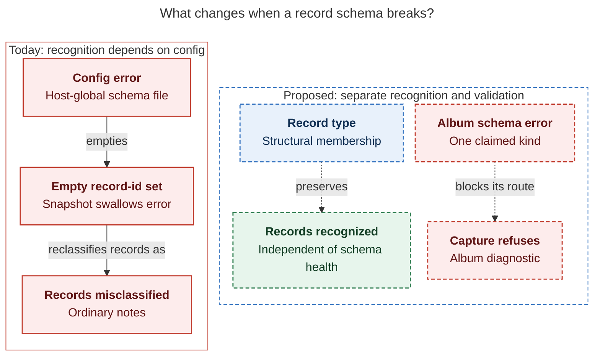
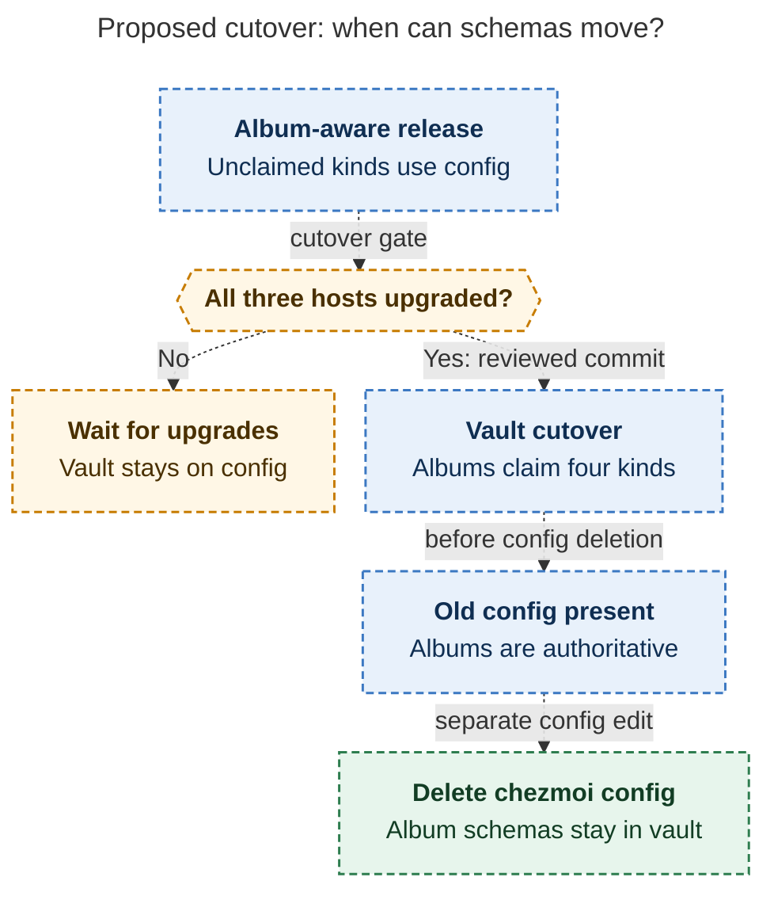

# Diagram proposals: Album notes: give every record collection an owner area

Proposals for the swarm linker, not a report. Each diagram restates only what the source
report says.

```yaml
source: research:202611/album_and_record_notes/album_and_record_notes__final.md
producer: research.43.image
check: "mmdc 12.0.0 with the PDF-mirroring config rendered 2 of 2 Mermaid diagrams; Puppeteer --no-sandbox; broken-input nonzero check passed"
```

## schema-failure

```yaml
anchor: |-
  With `[[record]]`, records are recognized structurally, and a
question: |-
  What changes when a record schema breaks?
illustrates: |-
  Records are recognized structurally with `[[record]]`, so a broken album fails validation without changing record membership.
caption: "With proposed record typing, schema errors block the affected capture route without erasing record membership."
review: "860.422x577 px, fit 75.9%; question, source-trace, labels, arrows, crossings, and visual checks passed; 1 revision"
```



## schema-cutover

```yaml
anchor: |-
  The vault and chezmoi are separate repositories, so this cannot be one atomic
question: |-
  How can the release precede the schema move safely?
illustrates: |-
  The transition rule makes the gap harmless because an album-aware bob ignores any config kind that an album claims.
caption: "After every host upgrades, albums take precedence during the gap between the vault cutover and config deletion."
review: "498.484x868 px, fit 100.0%; question, source-trace, labels, arrows, crossings, and visual checks passed; 1 revision"
```


