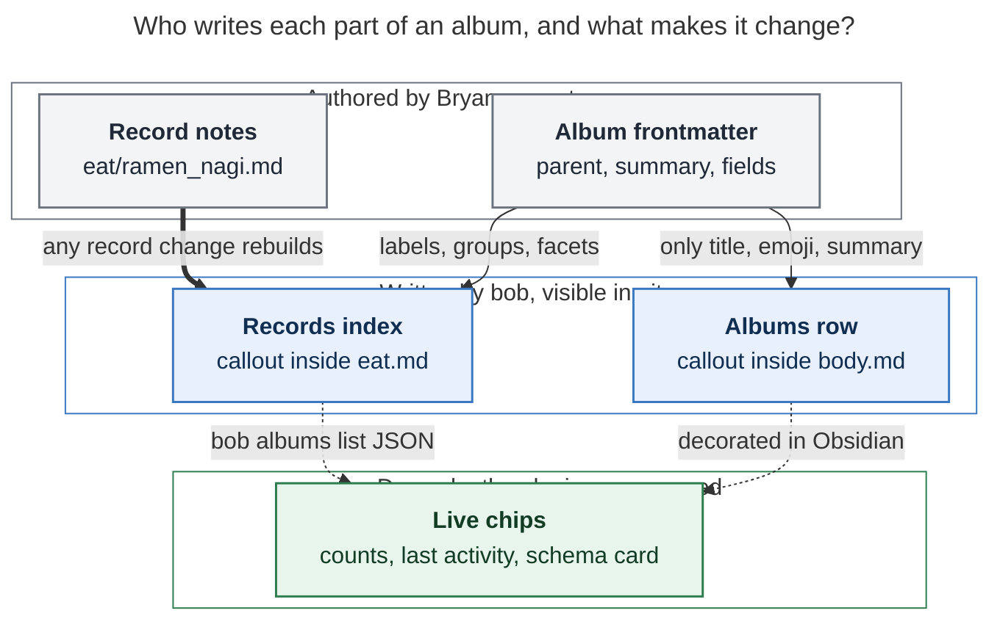

# Album notes: hang every record off an area of responsibility

*Research report · researcher **cld** · 2026-11-10 · for the bob.md task "Render records
(ex: [[eat]]) in area notes as H2 sections!" (`^record-h2-sections`)*

**Request.** Turn record collection notes (`eat.md`, `podcasts.md`, …) into **album notes**
(`type: "[[album]]"`). Each album:

- has an area or project as its `parent`;
- carries its record type's schema in frontmatter instead of `config.yml`;
- renders a summary of its records;
- appears in a new H2 section of its parent note.

Also: de-zorg the albums, add glossary terms, and critique the plan.

---

## Bottom line

- **Build it. It's a good idea, and the vault already shows the problem it fixes.** The
  record schema lives in chezmoi (`~/.config/bob/config.yml`) and the records live in the
  vault, so they drift.
  - On 2026-11-10 you removed the `companions` field in chezmoi (`b6eecd85`, "Remove
    '[[kelly]]' companion").
  - 137 vault records still carry it. `bob records check` reports **143 errors** today:
    137 `unknown field companions`, plus 6 empty required `category` values.
  - No single commit could have changed both the schema and the data. With the schema in
    the album note, one vault commit changes both.
- **The collection note becomes a real node in the area graph.**
  - `eat.md` currently hangs off a zorg note (`parent: [[h2_role]]`), so it is invisible
    from `body.md`.
  - Your own GTD Horizon-2 list already files it as `#body/eat`.
  - Once albums have area parents, every tracked thing is reachable from an area of
    responsibility. That is your stated goal.
- **Recommended shape** (details in [Design](#design)):
  1. **Album note:** a vault-root `<stem>.md` with `type: "[[album]]"`. Its `parent` is
     an area or project. Its stem names its record folder (`eat.md` ↔ `eat/`). Its
     frontmatter holds the schema, plus a singular `record:` noun (`restaurant`) that
     keeps today's type id working in the CLI, JSON, and the Mac app.
  2. **Record note:** `type: "[[record]]"` with `parent: "[[eat]]"`, in `eat/`. This is
     the same "type is the kind, parent is the place" rule that areas, projects, and
     notebooks already follow. The four per-type notes (`restaurant.md`, `podcast.md`,
     `show.md`, `movie.md`) go away.
  3. **Summary inside the album:**
     - a bob-owned `> [!records]` callout listing every record;
     - grouped by status in the order you declared the statuses (actionable first:
       🔖 To try, 🔖 To watch);
     - large groups sub-grouped by a field you choose (`index.by: location` for eat);
     - each row ends with facets such as `— Ramen · Clark`.

     It is a **pure function of the records' frontmatter**: no dates, no relative ages.
     It changes exactly when a record changes.
  4. **H2 section in the parent:**
     - a bob-owned `## Albums` / `> [!albums]` catalog with one **stable** row per album:
       emoji, link, and summary;
     - counts, the "11 to try" backlog, and last-activity age are **drawn by the
       plugin**, never written.

     So capturing a restaurant never rewrites `body.md`. This is the same split the
     `## Notebooks` catalog already uses.
  5. **Engine:** generalize the notebook catalog engine (owned callout regions, one vault
     snapshot, guarded sync, nightly step, plugin decoration) instead of building a
     second one. Your sibling task "Render sub-projects in their own H2 section" can then
     reuse it too.
- **Adjustments I recommend** (each is called out in [§3](#3-requirement-adjustments)):
  - `podcast.md` is not renamed. It merges into the **existing** `podcasts.md`, which is
    already the collection note.
  - `tv.md` and `movies.md` become albums too, so the `records:` config block can be
    deleted.
  - Records switch to `type: "[[record]]"`.
  - Counts stay out of area notes.
  - The schema stays in frontmatter, with three mitigations for Obsidian's Properties UI.
  - `@eat` with no slash teaches the right route instead of writing a task.
- **The migration is small and checkable.**
  - About 50 live anchor links need rewriting:
    - eat: 15, all mappable to records;
    - podcasts: 34, of which 33 are mappable;
    - tv: 1.
  - eat.md's 92 legacy table rows all have records already.
  - 47 of 48 footnotes were carried into records. **Footnote 17**
    (`^z-240619-0a`, Oh' Brian's) was not, and must be carried before the legacy body
    moves.
  - Acceptance gate: `bob records check` clean, `bob albums check` clean, and no new
    broken links.

---

## 1. What exists today (verified)

### The four record types

| Config id | Folder | Records | Status mix | Collection note (`parent`) | Type note | Base |
| --- | --- | ---: | --- | --- | --- | --- |
| `restaurant` | `eat/` | 104 | 86 liked · 11 to try · 7 not liked | `eat.md` (**zorg**, `[[h2_role]]`) | `restaurant.md` | `eat.base` |
| `podcast` | `podcasts/` | 15 | 9 subscribed · 6 unsubscribed | `podcasts.md` (`[[mind]]`) | `podcast.md` | `podcasts.base` |
| `show` | `tv/` | 23 | 23 to watch | `tv.md` (`[[fun.md\|fun]]`, one stray bullet) | `show.md` | `tv.base` |
| `movie` | `movies/` | 10 | 9 to watch · 1 watched | `movies.md` (`[[fun]]`) | `movie.md` | `movies.base` |

Each type is currently spread across **four** artifacts:

- a config block in chezmoi;
- a type note (prose only, `parent: "[[type]]"`);
- a collection note;
- a `.base` file whose formulas repeat the choice labels by hand, e.g.
  `if(status == "to_try", "🔖 To try", …)`.

Records carry `parent: "[[<dir>]]"` and `type: "[[<id>]]"`. Note bodies have `## Notes`,
and migrated rows also have `## Source`. See `docs/records.md` and
`src/native/records/` (12.4k lines: schema, catalog, plan, render, cli, check, init).

### Data health

- `bob records check`: **143 errors, 3 warnings**.
  - 137 × `companions: unknown field`. 135 of those values are the old `[[kelly]]`
    default; 2 are stray zorg dates (`"250703"`, `"250707"`).
  - 6 × required `category` empty: the not-liked rows, which never had a category
    column.
  - 3 × "Location has equivalent spellings": `Cranford` versus
    `[[nj_towns#^z-241117-0b|cranford]]`, and the same for Westfield and Garwood.
- `visited` is set on 2 of 104 restaurants. Prior research already flagged this.

### Precedents this design should follow

- **The `## Notebooks` catalog** (`docs/notebooks.md`, `src/native/notebooks/`,
  bob-plugins `241a`–`241g`):
  - bob owns the callout's content; you own its position;
  - first write goes before `## Tasks`;
  - an empty subtree deletes the callout;
  - duplicate callouts self-heal;
  - `bob notebooks sync` runs nightly and is triggered by the plugin with a debounce;
  - rows are inert `**[[stem|Title]]** — summary`;
  - "No colors, counts, recency … are written; hue, counts, and age are drawn by
    clients."
- **The job.md de-zorg** (`fbab51701` on 2026-11-10, after `85fce7e7c` on 2026-10-12):
  - zorg frontmatter keys are dropped and `theme:` becomes `task_type:`;
  - legacy body content moves to a `legacy_<area>` notebook (`type: [[notebook]]`, with a
    summary like "Zorg-era job notes, moved here from job.md on …");
  - a `Related: … [[legacy_job]]` link is added;
  - inbound block links are rewritten (for example `[[abby#^…]]` →
    `[[legacy_dad#^…]]` in 2024 daily notes).
- **The decision `notebook-routes-write-notes`** rejected a "Dataview-only index" because
  it is "invisible to git, agents, and mobile". That argues for a *written* album index,
  with the Base kept as an optional interactive view.

### Prior research this request partly reverses

`research:202611/record_type_capture` §5 chose `config.yml` over "frontmatter on
`restaurant.md`" for three reasons:

1. Obsidian Properties cannot edit nested objects.
2. A schema typo synced from any device breaks capture.
3. It mixes a machine contract into a prose note.

Its reopen rule: "if … an Obsidian-side writer needs the schema without calling `bob`."
[§2](#2-is-this-a-good-idea) answers each reason. The same report's adjustment A7
("Write only the folder note. The Base is the index. Dual-writing the zorg table creates
two sources of truth") still holds here. A **generated** index is derived, never
hand-edited, so it is not a second source of truth.

---

## 2. Is this a good idea?

**Yes.** In order of weight:

1. **Schema and data move together.**
   - The companions drift is a concrete failure that the config home caused: chezmoi and
     the vault sync on different paths (`chezmoi update` versus vault git), so no single
     commit can change a field *and* backfill or strip it.
   - With the schema in `eat.md`, adding `visited` and backfilling it, or dropping
     `companions` and stripping it, is one vault commit, checked by one
     `bob records check`.
2. **Every tracked thing gets an area.**
   - Today nothing in `body.md` says you keep a restaurant log, and nothing in `fun.md`
     says you keep a watch list.
   - The album's `parent` puts each collection where you plan that part of life. That is
     exactly where the prior research said the "lookup moment" must happen for records
     to pay off.
3. **Failure isolation improves.**
   - Today one malformed `records:` block disables *all* record features.
   - Per-album frontmatter fails one album, with a diagnostic that names the file and
     line.
4. **Three artifacts collapse into one.**
   - Type note + collection note + config block become one album note (plus the optional
     Base).
   - The Metadata Menu `type` picker, which offers children of `type.md`, gets simpler:
     `album` and `record` replace four per-type notes.

**Answering the earlier objections:**

| Objection (2026-11 §5) | Still true? | Mitigation |
| --- | --- | --- |
| Obsidian Properties can't edit nested objects | Yes. Obsidian's editor doesn't support nested YAML, and saving through it re-serializes the frontmatter ([forum](https://forum.obsidian.md/t/properties-bases-support-multi-level-yaml-mapping-of-mappings-nested-attributes/63826?page=2), [plugin note](https://community.obsidian.md/plugins/nested-properties)) | (a) bob writes **canonical block-style YAML with no comments**, the way Obsidian re-serializes, so a UI save is a no-op diff. (b) The plugin **hides** the raw `fields`/`index`/`legacy` rows (it already targets `.metadata-property[data-property-key=…]` for `summary`) and shows a **schema card** instead. (c) You edit the schema in source mode or through bob, which is how you'd edit config today. |
| A typo synced from any device breaks capture | Partly. It now breaks **one album**, not all of them | Per-album isolation. `bob albums check` names the file and line. Capture refuses `@eat/` with that diagnostic and never writes a half-typed record. |
| Mixes a machine contract into a prose note | No longer a meaningful objection | Area notes already carry machine contracts in frontmatter (`task_type`, `offclock_types`, `ready_cap`). Frontmatter is the contract and the body is prose, which is the vault's normal split. |

Prior art that the shape is sound: Metadata Menu, which you have installed, stores field
definitions in "fileClass" notes ([docs](https://mdelobelle.github.io/metadatamenu/fields)).
Its Bases-era successor, *Fileclass*, is frontmatter-only
([listing](https://community.obsidian.md/plugins/fileclass)).

**Costs to accept:**

- 152 record files get a one-line `type:` rewrite.
- Schema discovery now reads vault files instead of only config. This is cheap if done
  right; see [§4.6](#46-discovery-and-performance).
- The plugin needs about three new decorations.
- One more generated H2 appears in area notes.
- The migration must wait until all three hosts run an album-aware bob, the same
  constraint the notebook retype had.

**What I would not do:**

- Make each album its own type (`type: "[[eat]]"` on records).
- Keep the per-type notes.
- Write counts into area notes.
- Hand-maintain lists in album notes. That is what made podcasts.md's 33 inbound block
  links necessary.

---

## 3. Requirement adjustments

| # | As requested | Adjusted to | Why |
| --- | --- | --- | --- |
| **A1** | Rename `podcast.md` → `podcasts.md` | **Merge** `podcast.md` (the *type* note) into the **existing** `podcasts.md` (the collection note, which becomes the album), then delete `podcast.md`. Do the same for `restaurant.md`→`eat.md`, `show.md`→`tv.md`, `movie.md`→`movies.md`. | `podcasts.md` already exists. A literal rename would collide. Your intent, one note that is both the type and the collection, is exactly the merge. |
| **A2** | eat and podcasts as examples | **All four** types become albums: `eat`→`[[body]]`, `podcasts`→`[[dev]]`, `tv`→`[[fun]]`, `movies`→`[[fun]]`. Then delete `records:` from chezmoi. | Two schema homes would be worse than one. |
| **A3** | Album gets `type: album` (records unspecified) | Records get **`type: "[[record]]"`**. Membership is `parent` + folder. | Keeps `type` meaning "kind of note" vault-wide (area, project, notebook, ref, record, album), mirrors the notebook's kind + parent. Records stay pickable under `type.md`. |
| **A4** | Migrate config definitions | Stem **is** the folder (`dir:` disappears). A new **`record:`** singular noun (`restaurant`) preserves today's type id. The config's `parent:` is dropped because records always point at their album. | `bob records new restaurant …`, JSON `"type": "restaurant"`, and the Mac Record Card keep working byte-for-byte. All four types already satisfy stem == folder. |
| **A5** | Schema in frontmatter | **Yes**, with mitigations (a)–(c) from §2. | Answers the earlier objections without moving the schema into a code block. |
| **A6** | (implicit) | Albums and records **hold no tasks**. `Blaze @eat` (no slash) teaches: *"eat is an album — `@eat/` adds a restaurant; tasks go to `@body`."* | Mirrors the notebook teaching refusal. It never silently writes a task into an album. |
| **A7** | "Excellent summary of records" | A **generated** `> [!records]` index that is a pure function of record frontmatter. The Base embed stays as an optional authored view. | Agents, git, and mobile can read it; it is idempotent; and its churn is exactly one edit per record change. |
| **A8** | "Excellent H2 in the parent" | `## Albums` rows are **stable**: emoji, link, summary. Counts, backlog, and age are **plugin-drawn**. | Area notes are the busiest files across three hosts. A record capture must not rewrite `body.md`. This follows the notebook precedent. |
| **A9** | Two glossary terms | **Album Note** and **Record Note**, plus small edits to Notebook, Capture, and Area Note, plus a decision record ("Albums Own Record Schemas"). | The decision reverses a researched choice, so it needs a durable record. |
| **A10** | De-zorg "if necessary" | De-zorg eat.md (full job.md recipe); clean podcasts.md and tv.md; carry footnote 17 first. Acceptance gate is **0** check errors: strip `companions`, and decide the 6 empty categories. | Shipping albums over a red `check` would bury real errors. |
| **A11** | podcasts → `[[dev]]` | Accept. 11 of 15 shows are dev-ish (python, programming, ai, tech); the other 4 are comedy, ideas, and productivity. podcasts.md currently sits under `[[mind]]`, and mind.md links it. | Your call. Dev fits the majority; `[[mind]]` is the alternative. |

---

## 4. Design

### 4.1 Vocabulary

**Album** and **record** form one metaphor: a *record album* was the bound book that held
78-rpm records. An album **holds records of one kind, and the album defines what a record
of that kind looks like.**

The word is also free in Bob: "catalog" already names the notebook catalog, the drawer,
and the code catalogs; "collection" is only prose in the docs. Album notes and notebooks
should look related on screen but remain distinct kinds:

- **Notebook:** free-form notes you write; no schema.
- **Album:** one entity per file, with a schema.

### 4.2 The album note

`eat.md` after migration:

```markdown
---
parent: "[[body]]"
type: "[[album]]"
summary: Restaurants Kelly and I have tried, liked, or want to try.
record: restaurant
emoji: 🍽️
dated_notes: true
index:
  by: location
fields:
  status:
    required: true
    values:
      to_try: 🔖 To try
      liked: 💚 Liked
      not_liked: 🚫 Not liked
  category:
    required: true
    suggest: true
  location:
    required: true
    suggest: true
  visited:
    values: date
  url:
    values: url
legacy:
  - lid
  - source_*
created: 2026-06-11T13:07:00-04:00
---

# Eat

Restaurants Kelly and I like, don't like, or want to try. Add one with `Ramen Nagi @eat/`.
Related: [[drink]] · [[maybe_eat]] · [[legacy_eat]]

![[eat.base]]

## Records

> [!records]
> **104** · 🔖 To try 11 · 💚 Liked 86 · 🚫 Not liked 7
>
> - **🔖 To try** · 11
>   - [[eat/ambeli_greek_taverna|Ambeli Greek Taverna]] — Greek · Cranford
>   - [[eat/ani_ramen_house|Ani Ramen House]] — Ramen · Cranford
>   - [[eat/n_between_bar|N'Between Bar]] — Bar · Chelsea Market in NYC
>   - …
> - **💚 Liked** · 86
>   - **Clark** · 7
>     - [[eat/bubbakoos_burritos|Bubbakoo's Burritos]] — Burritos
>     - …
>   - **Cranford** · 34
>     - [[eat/30_burger|30 Burger]] — Burgers + Dogs
>     - …
> - **🚫 Not liked** · 7
>   - [[eat/1_walnut|1 Walnut]] — Cranford
>   - …
```

**Keys:**

| Key | Rule |
| --- | --- |
| `parent` | Required. Exactly one area note or project note of any status, resolved path-aware (`[[eat]]` resolves root-first in `vault_links.rs`). Not a notebook or another album. |
| `type` | `"[[album]]"` (every form `frontmatter_type_names` accepts). |
| `summary` | One plain line, ≤ 140 characters. Required by `create`; `check` warns when it is missing. Same rule as notebooks. |
| `record` | Singular noun, `[a-z][a-z0-9_]*`, unique across albums, defaults to the stem. Accepted wherever a record TYPE is (`bob records new restaurant`), and emitted as JSON `type` / `record_type`. Labels derive from it ("Restaurant"). |
| `emoji` | Optional; same as today's config `emoji`. |
| `dated_notes`, `fields`, `legacy` | Exactly today's `records.<id>` semantics (`docs/records.md` §Schema). Field rules are unchanged, including the shared-property storage-shape check, which now runs across albums. |
| `index` | Optional `{by: <field>, show: [<fields>]}`. Controls only the generated index (§4.4). |
| `created` | bob's clock. |

**Placement and identity rules:**

- An album lives at the vault root, like notebooks. Capture routes are root stems.
- Identity is the stem, and it names the record folder.
- Renaming an album renames its folder and rewrites records' `parent`. That is a later
  `bob albums rename`, out of scope here.
- Reserved stems: today's reserved type ids plus `album` and `record`.

**YAML that Obsidian won't churn:**

- bob writes block style only, no flow maps, no comments, and a blank line after the
  closing `---`. Your `obsidian-linter` runs `add-blank-line-after-yaml` on save.
- A Properties-panel save of any other key therefore reproduces the same bytes.

### 4.3 The record note

```yaml
---
parent: "[[eat]]"
type: "[[record]]"
title: "Ramen Nagi"
status: liked
category: "Ramen"
location: "Clark"
visited: 2026-11-08
created: 2026-11-08T12:41:07-0500
---
```

- Everything else in `docs/records.md` stays unchanged: filename rule, update semantics,
  `## Notes`, dated notes, and span-preserving YAML edits.
- A record is valid when it lives in an album's folder, its `parent` resolves to that
  album, and its `type` is `record`.
- During the transition, a legacy `type: "[[restaurant]]"` inside `eat/` is accepted
  with the warning `record_type_legacy`.
- **Walks.** Root, clock, and type walks pass through record → album → owner, exactly as
  they pass through notebooks. Neither kind is ever a Pomodoro home, Ready lane, review
  item, or Root Parent.
- **Notebook interaction.** Today `notebook_child_kind` forbids a record from naming a
  notebook as parent. The new rule `album_parent_kind` forbids an album from naming a
  notebook as parent. Notebooks may not name an album either; their owner must be an
  area or project.
- **Non-record children.** Notes whose `parent` is an album but that are not records
  (`drink.md`, `podcast_ref.md`, `lit/podcasts.md`) stay valid: they are ordinary notes
  walking through the album. They are not indexed. `check` may *suggest* reparenting
  them to the owner, but never as an error.

### 4.4 The album's summary: what form should it take?

**Reader questions, in the order they arise when you open an album:**

1. *How big is it, and what shape?* (a tally)
2. *What's actionable?* (to try, to watch, watching)
3. *Find one thing* ("that place in Clark", "the Python podcasts")
4. *What did we think?* (the record itself)

**Options considered:**

| Option | Verdict |
| --- | --- |
| **Base embed only** (today in podcasts.md and movies.md) | Keep it as an *optional authored* view: sortable, with filtered views. But it is invisible to agents, git, and non-Obsidian readers, and its label formulas duplicate the schema. |
| **Hand-maintained lists** (today's podcasts.md, eat.md's zorg tables) | No. They are a second source of truth, they drift, and authored block IDs attract links (33 inbound `[[podcasts#^…]]`). |
| **Generated flat list** | Too long: 104 rows with no shape. |
| **Generated tables per status** | Columns scan well, and you organized eat.md as tables for years. But they duplicate the Base, `\|`-escaped wikilinks are fragile, they're wide on mobile, and the diffs are noisy. |
| **Generated digest with "Recent"** | The written dates would make the index change on every revisit, not just on membership changes. Recency belongs in the plugin layer. |
| **Generated grouped bullets** ✅ | Readable in every renderer, diff-friendly, and the same visual family as the notebook catalog (bold group lines, em-dash facets). Obsidian folds nested list items natively. |

**Index rules** (the contract, kept small):

- **Pure function of record frontmatter.**
  - The catalog already reads only through the closing `---` (`records/catalog.rs`).
  - No dates, mtimes, relative ages, or note bodies are written.
  - Idempotent: a current index produces no edit.
- **Tally line:** `**N** · <choice label> <count> · …` in choice order. Choices with zero
  records are omitted.
- **Groups:** by `status` if it is a choices field, otherwise by the first choices field,
  otherwise one flat list.
  - Groups follow **declared choice order**, so the actionable status you list first
    (`to_try`, `to_watch`) comes first.
  - Group line: `- **<choice label>** · <count>`.
- **Sub-groups:** only when `index.by` is set **and** the group has more than 12 rows
  with at least 2 distinct values.
  - Values fold by case and by link display text (`Cranford` ≡
    `[[nj_towns#…|cranford]]`). The label prefers a capitalized spelling.
  - Records missing the value go last under `**—**`.
  - Small groups such as 🔖 To try (11) stay flat and show the value as a facet instead.
- **Rows:** `- [[<album>/<stem>|<Title>]] — <facet> · <facet>`.
  - Sorted by title, case-insensitively, with the path as tie-breaker.
  - Titles and facets are inert, using the same escaping rule as notebook rows.
  - Link values show their display text and never create new links.
- **Facets:** `index.show` if set. Otherwise every non-group choices field (shown by its
  choice label, e.g. `😍 Loved`) and every `suggest: true` field, in schema order, minus
  the sub-group field. Lists join with `, `.
- **Nothing silently disappears.** A record with a missing or unknown status is listed
  under a final `- **⚠️ Needs a status** · N` group. `check` explains why.
- **Owned region:** the notebook region contract carries over with the name
  `[!records]`:
  - recognition ignores case and accepts a fold sign;
  - writes are canonical;
  - first write goes after the H1 block, or at EOF if the H1 is followed by nothing;
  - later writes touch only callout lines;
  - duplicates self-heal.
  
  The `## Records` heading is written only on first write; after that, the heading and
  its position are yours.

**Plugin layer** (drawn, never saved). The written index stands alone; these are
enhancements:

- **Album header card**, modeled on the notebook header:
  - breadcrumb (`body › Eat`);
  - a **schema card** (fields, kinds, choice chips) replacing the hidden raw YAML rows;
  - a `＋ restaurant` affordance that copies `Title @eat/`;
  - last activity.
- **Row chips:** age of the last dated note or `visited`/`watched_on`, using the
  notebook age-chip helper. Muted facet text after the em dash.
- **Fold defaults:** groups after the first open folded when they exceed 12 rows.

**Other albums with this default:**

- `podcasts`: 🎧 Subscribed 9 / 🚫 Unsubscribed 6, flat, rows `— python`. A sensible
  later setting is `index.by: category`.
- `tv`: one group, 🔖 To watch 23, rows `— Apple TV+ · eric` once fields fill in.
- `movies`: 🔖 To watch 9 / ✅ Watched 1. A sensible later setting is
  `index.show: [year, verdict]`.

### 4.5 The `## Albums` section in area and project notes

**What should an area note tell you about its albums?** Ranked by value per byte:

| Candidate content | Value | Written or drawn |
| --- | --- | --- |
| **Which collections serve this area** (link + one-line scope) | Discovery is the whole point of the request | **Written** (stable) |
| **Emoji identity** | Scanability next to `## Notebooks` | **Written** (from frontmatter) |
| **Size and shape** (`104 · 🔖 11 · 💚 86 · 🚫 7`) | High at a glance | Drawn |
| **Actionable backlog** ("🔖 11 to try", or a peek of the first 3 titles) | High when planning in that area (date night in `fun`, dinner in `body`) | Drawn; hover peek |
| **Freshness** ("last added 2d", "last activity 5 mo") | Quietly signals a lapsed collection, the failure prior research found | Drawn (age chip) |
| Full record lists | Low here; that's the album's job | Neither |

Why the volatile parts are drawn rather than written:

- `body.md`, `fun.md`, and `dev.md` are the most edited files in the vault: tasks, from
  three hosts plus Obsidian.
- Writing them on every restaurant capture would add conflict surface and history noise
  for a fact the album already holds.
- Agents get the same numbers from `bob albums list -f json`.

Rendered in `fun.md`:

```markdown
## Albums

> [!albums]
>
> - 🎬 **[[movies|Movies]]** — Movies Kelly and I want to watch, and what we thought of them.
> - 📺 **[[tv|TV]]** — Shows we're watching, want to watch, or dropped.
```

The plugin adds after each row, for example: `10` · `🔖 9 to watch` · `✅ 1` · `1d`.
Clicking a status chip opens the album at that group.

**Catalog rules** (shared with notebooks):

- **Scope:** a host lists albums whose owner lies in its subtree, stopping at another
  root. Albums under a non-root sub-project appear in that project and in its root under
  a `🧩 [[project]]` group line.
- **Order:** rows sort by title.
- **First write:** directly after an existing `## Notebooks` block, otherwise before
  `## Tasks`, otherwise at EOF.
- **Empty subtree:** deletes the callout, and deletes the heading only if the section is
  then blank.
- **Protection:** `@body#albums` refuses with `albums_section_generated`, as
  `@dev#notebooks` does.
- **When rows change:** only through `bob albums sync`, `create`, nightly, or a reparent.
  **Never** through a record write, because no row depends on records.

Figure 1 shows who writes what.



*Figure 1. Records drive only the album's own index. The area-note row depends only on
the album's identity, so capturing a restaurant never touches `body.md`. Everything live
is drawn by the plugin. Arrows mean "determines the content of"; dashed arrows are
plugin-only decoration.* (Rendered 662 × 997 px, fit 89.6%, Mermaid CLI 12.0.0.)

### 4.6 Discovery and performance

Today, loading the schema never touches the vault. That stops being true, so the hot
paths must stay O(1):

- **Resolving a route** (`@eat/`, `@eat/stem`, every `capture-complete` keystroke in a
  record context) reads only the head of `eat.md`, bounded at 8 KB through the closing
  `---`. The route already names the album.
- **Listing all albums** (`bob records list`, `@` route completion, `bob albums list`,
  catalogs) rides the root-level frontmatter scan that `capture-targets` and the
  notebook snapshot already perform: 675 root notes, frontmatter only.
- **Config fallback:** during the transition, a config `records:` type that no album
  claims still works, with the warning `records_config_deprecated`. An album claiming
  the same `record` noun or stem wins, with the warning `records_config_shadowed`.
- **Call sites that load records config today** and need the vault path:
  - `capture_record.rs`
  - `capture_targets.rs`
  - `capture_complete/candidates.rs`
  - `completion/providers.rs`
  - `notebooks/snapshot.rs`
  - `records/cli.rs`

  These collapse into one `Albums::resolve(bob_dir, stem)` and one
  `Albums::discover(&snapshot)`.

### 4.7 Commands and JSON

Following `cli_rules`: Vault section, alphabetical, short aliases, bare group defaults to
read-only `list`, and no command is removed.

```text
bob albums [list] [-b DIR] [-f human|json] [-r ROOT]
bob albums check  [-b DIR] [-f human|json]
bob albums create PARENT STEM -r RECORD -s SUMMARY [-e EMOJI] [-t TITLE] [-b DIR] [-d] [-f …] [-o]
bob albums sync   [-b DIR] [-d] [-f human|json]
```

- **`bob records *`** stays the record CRUD group (`new`, `update`, `show`, `check`,
  `list`). TYPE accepts an album stem **or** its `record` noun.
- **`bob records init`** becomes a hidden legacy path: it scaffolds an *album* from a
  still-configured type. It does not create type notes.
- **`create`** writes the album with an empty `fields: {status: …}` starter, the
  `.base` (filters `file.inFolder(stem)` and `note.type == link("record")`), and the
  parent's catalog row, in one guarded write and one commit (`albums: create eat.md`).
  It never creates the empty folder (git cannot sync one). The first record write
  creates it, as today.
- **`sync`** repairs every `[!records]` index and every `[!albums]` catalog. It reuses
  the notebook sync transaction: lock, pre-sync, plan from the snapshot, revalidate
  preimages, guarded install, one commit (`albums: sync (N notes)`), post-sync. It runs
  in `bob nightly` right after `notebooks`.
- **Record writers** update the album index **in the same capture or `records new|update`
  transaction**, so `--dry-run` shows the album diff too. Hand edits in Obsidian are
  repaired by the plugin's debounced `bob albums sync`, the same 3 s debounce notebooks
  use, and by nightly.
- **JSON** changes are additive only: record payloads gain `"album": "eat"`, while
  `"type": "restaurant"` keeps its meaning. The Mac app (a thin client) needs no change
  for creates and updates.

`bob albums list -f json` (sketch):

```json
{"ok":true,"schema_version":1,
 "albums":[{"stem":"eat","path":"eat.md","title":"Eat","emoji":"🍽️","record":"restaurant",
   "summary":"Restaurants Kelly and I have tried, liked, or want to try.",
   "parent":"body","owner":"body","root":"body","records":104,
   "groups":[{"key":"to_try","label":"🔖 To try","count":11},{"key":"liked","label":"💚 Liked","count":86},{"key":"not_liked","label":"🚫 Not liked","count":7}],
   "last_activity":"2026-11-08","index":"current","issues":[]}],
 "catalogs":[{"host":"body","path":"body.md","state":"current","albums":1,"issues":[]}],
 "counts":{"albums":4,"records":152,"errors":0,"warnings":0}}
```

**`check` findings:**

- **Errors:**
  - `album_parent_missing`, `album_parent_ambiguous`, `album_parent_kind`
  - `album_not_at_root`
  - `album_schema_invalid` (today's `RecordDiagnostic` codes, plus file and line)
  - `album_record_duplicate` (two albums claim one noun)
  - `album_checkbox`
  - `record_parent_mismatch`
  - `record_outside_album`
  - all of today's record-field errors
- **Warnings:**
  - `album_summary_missing`, `album_summary_long`
  - `album_index_stale`, `album_catalog_stale` (hint: `bob albums sync`)
  - `record_type_legacy`
  - `records_config_deprecated`, `records_config_shadowed`
  - `album_parent_unquoted`

### 4.8 Capture

- `Title @eat/` and `@eat/stem` are unchanged. They now resolve through the album.
- `Title @eat`, without the slash, changes. It used to write a task plus a
  `record_collection_route` warning. It becomes a **teaching refusal**: *"eat.md is an
  album and holds no tasks — `@eat/` adds a restaurant; tasks go to `@body`."*
  The owner route comes from the album's parent.
- **Later, optional:** let `@eat` on an album mean `@eat/`, on the "destination decides"
  principle from `notebook-routes-write-notes`. That needs its own decision record, a
  grammar bump, and Mac-capture coordination. It is not part of v1.

### 4.9 Engine: one catalog engine, three sections

The notebook engine already contains everything albums need:

- `VaultSnapshot`, which already tags `RecordInstance`;
- owner/root resolution;
- the owned-callout region (`region.rs`);
- `HostPlan` / catalog states;
- the guarded sync transaction;
- the nightly step;
- the plugin's report/sync lifecycle and stale-while-revalidate cache.

Refactor it into a `host_catalog` with a per-kind spec: callout name, heading, row
source, and placement. Then:

- `Notebooks` (existing);
- `Albums` (new);
- `Projects` later, which serves `^sub-project-h2-sections` at no extra engine cost.

The `[!records]` index is a second region type in the album note, built from the same
pieces.

---

## 5. Migration and de-zorg

### 5.1 Order across hosts, vault, and config

The order is linear, so a list is enough:

1. **Ship album-aware bob** (one release-train version).
   - Reads albums from the vault, with config fallback.
   - Writes `type: [[record]]` for album-backed types.
   - Accepts legacy record types.
   - Adds the `[!albums]` and `[!records]` regions.
   - The plugin update can lag: the written Markdown reads fine without it.
2. **Wait until athena, apollo, and the Mac all run it.** This is the same constraint the
   notebook retype had ("every host must run a bob with notebook capture before any vault
   retype"). An old bob would otherwise keep writing `type: [[restaurant]]`.
3. **Migrate the vault in one reviewed commit** (§5.2) and run `bob albums sync`.
4. **Delete `records:` from chezmoi** (`home/dot_config/bob/config.yml`). An album-aware
   bob ignores it anyway.
5. **Later:** retire the config reader. A leftover `records:` key then produces one
   warning pointing to albums.

I would **not** add a permanent `bob albums migrate` command for four albums. The CLI
rules make every command permanent. Do it the way the de-zorg was done: an agent-run,
scripted vault change, reviewed as a git diff, gated by bob's checks.

### 5.2 Per-album steps

| Album | Steps |
| --- | --- |
| **eat** | **De-zorg like job.md.**<br>1. Drop the `generated_from_zorg` / `zorg_*` keys, the `#eat \| Notes` header, and the `ALIGN TABLES` vim line.<br>2. `parent: [[h2_role]]` → `"[[body]]"`.<br>3. Add the album keys.<br>4. Copy footnote **17** (`^z-240619-0a`, the Picante Burger / Spinach Salad note) into `eat/oh_brians.md` `## Notes`. It is the one footnote the record migration missed.<br>5. Rewrite the 15 live `[[eat#^z-…]]` links to the record that now owns each anchor (all 15 map).<br>6. Move the tables, footnotes, and `LID::breakfast`/`coffee` definitions to **`legacy_eat.md`** (`type: [[notebook]]`, `parent: "[[body]]"`, summary "Zorg-era restaurant tables, moved here from eat.md on …"). That matches `legacy_job`, and nothing is lost even though the content is now redundant.<br>7. Merge `restaurant.md`'s useful prose (the maybe_eat pointer) into the intro and delete it. |
| **podcasts** | Already clean.<br>1. `parent: [[mind]]` → `"[[dev]]"`.<br>2. Add the album keys.<br>3. Rewrite the **33** live `[[podcasts#^z-…]]` links to `[[podcasts/<stem>\|…]]` via each record's `source_anchors`.<br>4. Replace the hand-written `## Subscribed`/`## Unsubscribed` lists with the generated index.<br>5. Keep `## Notes`, including `^z-241007-09`, which `now_mind.md` links to.<br>6. Merge `podcast.md`'s pointers (podcast_ref, lit/podcasts, the Base) into the intro and delete it. |
| **tv** | 1. Fix the parent's odd `[[fun.md\|fun]]` spelling to `"[[fun]]"`.<br>2. Rewrite `funny.md`'s `[[tv#^studio]]` to `[[tv/the_studio]]`.<br>3. Drop the stray bullet (it is already in `tv/the_studio.md`).<br>4. Add the album keys, an H1, and a summary.<br>5. Delete `show.md`. |
| **movies** | 1. Add the album keys.<br>2. Delete `movie.md`. |
| **all records** | 1. `type: "[[<id>]]"` → `"[[record]]"` (152 files).<br>2. Strip `companions` (135 are the default you removed; print the 2 stray-date rows first).<br>3. For the 6 not-liked rows with `category: null`: either fill them in, or make `category` optional for `not_liked` by setting `required: false` (my pick: fill them in; it takes 6 lookups).<br>4. Optionally fold the location spellings that `check` already warns about. |
| **bases** | `note.type == link("restaurant"\|"podcast"\|"show"\|"movie")` → `note.type == link("record")` in 4 `.base` files. Keep your formulas. |
| **type notes** | Add `album.md` and `record.md` (`parent: "[[type]]"`, two-line descriptions pointing to `docs/records.md`), so the Metadata Menu `type` picker offers them. |

**Acceptance gates:**

- `bob records check` → 0 errors.
- `bob albums check` → 0 errors.
- `bob notebooks check` → unchanged.
- No increase in the vault's broken-link count. Measure before and after with the same
  script as the de-zorg.
- `bob capture --dry-run 'Test @eat/'` shows the record plus the album-index diff.
- `git grep 'type: "\[\[restaurant\]\]"'` → empty.

---

## 6. Risks and how the design handles them

| Risk | Likelihood | Handling |
| --- | --- | --- |
| A Properties-panel save rewrites the schema YAML | Medium | bob writes canonical block YAML, so a UI save changes nothing. The plugin hides the raw rows. `check` validates after any edit. |
| A schema typo from a phone or another host | Low–medium | Isolated to one album. Capture refuses with a file:line diagnostic. Nightly `check` surfaces it. |
| Version skew: an old bob writes old-shape records after migration | Medium without gating | Phase 2 waits for all hosts. The new bob accepts both shapes and `check` flags legacy shapes. |
| Index churn conflicts on album notes | Low | Album notes are written only by record writers, inside the same guarded transaction. Hand edits are synced with a debounce. |
| Area-note conflicts | Avoided by design | Area rows never change on record writes. |
| Broken links after de-zorg | Low | About 50 links, fully mapped. The gate measures the broken-link count. |
| Capture keystroke latency | Low | Route resolution reads one file head. Full discovery shares an existing scan. |
| JSON or Mac contract break | Low | Additive `album` field; `type` keeps the noun. If any field is renamed, mark the commit `!` under the release-train decision. |
| Two catalog engines diverge | Medium if built separately | One `host_catalog` engine (§4.9). |
| "Album" confuses with music albums | Low | Glossary entry plus the record-album metaphor. A future music album would just be `music.md` with `record: album_title`. |

---

## 7. Glossary drafts

These go into `sase/memory/glossary/` through `/sase_memory_write` at implementation time,
not now.

### Album Note

*aka album, album note*

A Bob vault Markdown file at the vault root with frontmatter `type: "[[album]]"` that
defines and indexes one collection of [[record-note]]s: restaurants (`eat`), podcasts,
TV shows, movies. Its stem names the folder its records live in (`eat.md` owns `eat/`).

Its frontmatter is the collection's schema:

- the singular `record` noun (`restaurant`), which capture, `bob records`, and JSON use
  as the record type;
- `emoji` and `dated_notes`;
- the ordered `fields` with their choices and defaults;
- an optional `index` layout;
- `legacy` keys that `check` tolerates.

A one-line `summary:` states the collection's scope. Its single `parent` names the area
or project the collection serves, so everything Bryan tracks hangs off an area of
responsibility. Root, clock, and type walks pass through an album to that owner. It holds
no tasks and is never a Pomodoro home, Ready lane, review item, or [[root-parent]].

bob owns a `> [!records]` index callout that lists every record grouped by status in
declared order, and rebuilds it whenever a record changes. Bryan owns its position and
the rest of the note, including any embedded Base. Every area or project lists the albums
beneath it in a machine-owned `## Albums` catalog that `bob albums sync` maintains.

Capture adds a record with `Title @eat/` and updates one with `@eat/stem`. `@eat` alone
teaches that route. The name pairs with record: a record album is the binder that holds
records.

Not a [[notebook]] (free-form notes, no schema), a [[task-type]], an Obsidian Base, or a
folder. See `docs/records.md`.

### Record Note

*aka record*

A Bob vault Markdown file describing one durable thing Bryan tracks (a restaurant,
podcast, show, or movie), with frontmatter `type: "[[record]]"` and a `parent` naming its
[[album-note]]. It lives in that album's folder (`eat/ramen_nagi.md`).

The album's schema types its properties (`status`, `category`, `visited`, …). bob writes
`parent`, `type`, `title`, the schema fields in order, and `created`. Free-form
observations go under `## Notes` as bullets, dated when the album sets `dated_notes`.

A record keeps outcomes and facts, never work. It holds no tasks; an action about it
("Book Ramen Nagi") is a task in an area or project that links to it.

Create or update one with `Title @eat/`, `@eat/stem`, `bob records new`, or
`bob records update`. `bob records check` lints every record against its album. Walks
pass through record → album → owner, so it is never a [[root-parent]].

Not a [[reference-note]], a [[notebook]], or a [[task-type]].

**Companion edits** (same write, via `/sase_memory_write`):

- **Notebook:** "Not … a record note" becomes "Not … a [[record-note]] or
  [[album-note]]". A notebook's parent may not be an album.
- **Capture:** "record note (a note of a config-declared record type, see
  `docs/records.md`)" becomes "a [[record-note]] in an [[album-note]]".
- **Area Note:** add "lists the albums beneath it in a `## Albums` catalog".

**Decision record** (new, `decisions:albums-own-record-schemas`):

- **Claim:** an album note's frontmatter is the only home of a record type's schema, and
  its parent is the area or project the collection serves.
- **Evidence:** the companions drift; the notebook catalog precedent; this report.
- **Rejected:**
  - config `records:` (cannot change schema and data atomically);
  - `.bob/note-types.yml` (invisible, needs a gitignore rule);
  - per-album types (`type: "[[eat]]"`);
  - schema in a body code block (an unfamiliar spelling, against your stated
    preference).
- **Cost:** the Properties UI cannot edit the schema; the migration is gated on all hosts.
- **Reopens when:** a second vault or a non-bob writer needs schemas, or Obsidian ships
  nested-property editing.

---

## 8. Recommended solution

1. **Adopt albums** as described, with adjustments A1–A11:
   - all four record types become albums under `body`, `dev`, and `fun`;
   - records become `type: "[[record]]"` with the album as `parent`;
   - the four type notes merge into their albums;
   - the schema lives in canonical block-YAML frontmatter, with a `record:` noun that
     preserves every existing CLI and JSON spelling.
2. **Build one `host_catalog` engine** by generalizing the notebook catalog. Give it two
   new owned regions:
   - **`[!records]` in each album:** grouped by status in declared order, sub-grouped by
     `index.by` past 12 rows, faceted rows, a pure function of frontmatter, rebuilt in
     the same transaction as every record write;
   - **`[!albums]` in each area or project:** one stable `emoji **[[album]]** — summary`
     row per album, never touched by record writes.
3. **Add `bob albums list|check|create|sync`.** Keep `bob records *`, with TYPE accepting
   a stem or a noun. Add a nightly step after notebooks. Make JSON changes additive only.
4. **Add plugin decorations** (bob-plugins, lagging is fine):
   - album header and schema card, with the raw schema rows hidden;
   - live chips on `[!albums]` rows: counts, the first-status backlog, age;
   - row age chips and fold defaults in `[!records]`.
5. **Make capture teach `@eat` → `@eat/` or the owner route.** Leave the "destination
   decides" alias for a later decision.
6. **Migrate in order:**
   - ship the bob release;
   - confirm all three hosts run it;
   - land one reviewed vault commit: de-zorg eat.md into `legacy_eat`, carry footnote
     17, rewrite about 50 links, retype 152 records, strip `companions`, fix 6
     categories, update 4 Bases, add `album.md`/`record.md`;
   - delete `records:` from chezmoi.

   Gate on zero check errors and no new broken links.
7. **Record it:** the two glossary terms and three companion edits, plus the
   `albums-own-record-schemas` decision record.

The result is intuitive, reliable, and beautiful:

- **Intuitive:** one note per collection, named after its folder, hanging off the area
  it serves.
- **Reliable:** schema and data version together; failures stay per album; the hot
  files (area notes) are never rewritten by a capture; and every generated byte is a
  pure function of the vault.
- **Beautiful:**
  - the area note gains a quiet row per collection, with live chips;
  - the album opens on a status-ordered index whose first group is what to do next;
  - the raw schema YAML is replaced by a schema card.

---

## Sources

**Vault** (read-only, 2026-11-10):

- notes: `eat.md`, `podcasts.md`, `podcast.md`, `tv.md`, `movies.md`, `restaurant.md`,
  `show.md`, `movie.md`, `type.md`, `area.md`, `body.md`, `dev.md`, `fun.md`, `mind.md`,
  `job.md`, `legacy_job.md`, `drink.md`, `maybe_eat.md`, `podcast_ref.md`,
  `lit/podcasts.md`, `h2_role.md`, `bob.md` (`^record-h2-sections`,
  `^sub-project-h2-sections`);
- the four `.base` files;
- `.obsidian/app.json`, `types.json`, and the linter and metadata-menu settings;
- commits `fbab51701`, `85fce7e7c`;
- `bob records list` / `bob records check` (bob 0.5.0);
- anchor-coverage scripts run against `eat/`, `podcasts/`, and `tv/`.

**bob-cli:**

- docs: `docs/records.md`, `docs/notebooks.md`, `docs/reference/vault-format.md`
  (§Note types), `docs/reference/json-outputs.md`;
- source: `src/native/records/{schema,catalog}.rs`, `src/native/config/records.rs`,
  `src/native/notebooks/{snapshot,scan}.rs`, `src/native/vault_links.rs`;
- memory: `sase/memory/glossary/*`, decision `notebook-routes-write-notes`, `cli_rules`,
  `docs`.

**bob-plugins:** `plugins/bob-ledger-tools/src/241a–241g` (notebook catalog and header),
`styles.css` (`[!notebooks]` hue), `241d` (`data-property-key` targeting).

**chezmoi:** `home/dot_config/bob/config.yml` history (`0d3e43fb`, `08da3667`,
`b6eecd85`).

**Prior research:** `research:202611/record_type_capture/record_type_capture__final.md`
(§5 schema location, A7); `research:202611/record_notes_data_unlock/record_notes_data_unlock__final.md`
(the three loops, 2 of 92 `visited`).

**Web:**

- [Obsidian forum: Properties & Bases nested YAML request](https://forum.obsidian.md/t/properties-bases-support-multi-level-yaml-mapping-of-mappings-nested-attributes/63826?page=2)
- [Nested Properties plugin](https://community.obsidian.md/plugins/nested-properties)
- [Metadata Menu: fields](https://mdelobelle.github.io/metadatamenu/fields)
- [Fileclass plugin](https://community.obsidian.md/plugins/fileclass)
