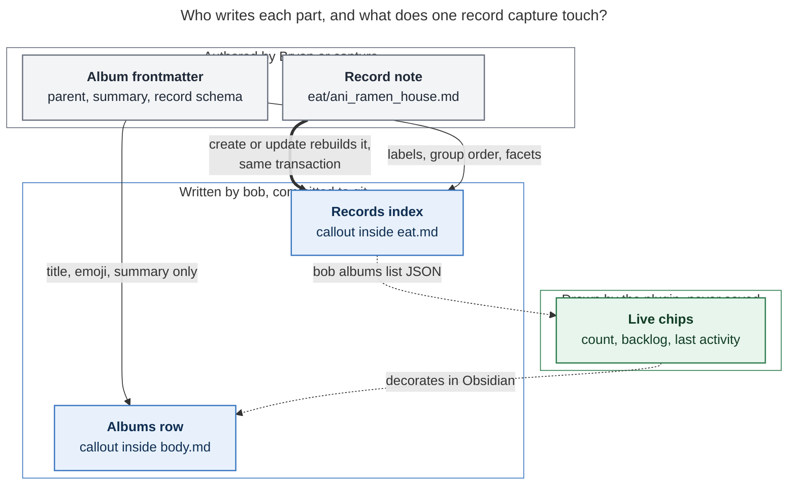

# Album notes: give every record collection an owner area

*Consolidated research · lead researcher · 2026-11-10. Merges five independent reports
(`__cdx`, `__cld`, `__grk`, `__mus`, `__gem`) with the lead's own checks of the vault, the
chezmoi config, bob-cli, and bob-plugins. This is research, not an implementation and not
a vault edit.*

**Request.** Turn record collection notes (`eat.md`, `podcasts.md`, …) into **album
notes** with `type: "[[album]]"`. Each album:

- names an area or project as its `parent`, so every record has a root parent;
- carries its record schema in frontmatter instead of `config.yml`;
- is de-zorged the way `job.md` was;
- renders a summary of its records;
- appears in a new H2 section of its parent note.

The request also asks for glossary terms *album note* and *record note*, a critique, and
a recommended design.

---

## Bottom line

- **Build it.** The vault already shows the problem it fixes.
  - At 12:12 today, chezmoi commit `b6eecd85` removed the `companions` field from three
    record schemas.
  - The 137 vault records that carry the field now fail validation.
    `bob records check` (bob 0.5.0) reports **143 errors and 3 warnings**: 137
    `companions` errors plus 6 empty required categories.
  - Schema and data live in two repositories that sync on different paths, so no single
    commit could change both.
  - Separately, `eat.md` hangs off a retired zorg note (`[[h2_role]]`), so 104
    restaurants reach no area at all.
- **Most of "give each record a root parent" needs no code.** bob's root walk already
  passes through untyped notes by `parent`. Setting `eat.md`'s parent to `[[body]]` roots
  all 104 restaurants immediately.
- **Recommended shape:**
  1. **Album note.** `eat.md` gets `type: "[[album]]"`. Its stem is its record folder
     (`eat/`) and its capture route (`@eat/`). Top-level frontmatter holds the album's
     own facts (parent, summary, emoji). One nested `record:` mapping holds the schema
     moved from `config.yml`.
  2. **Record note.** `type: "[[record]]"`, `parent: "[[eat]]"`, living in `eat/`. The
     four per-kind stubs (`restaurant.md`, `podcast.md`, `show.md`, `movie.md`) merge into
     their albums. This is a **contested adjustment**; §3 gives both sides.
  3. **Inside the album:** a bob-owned `[!records]` index.
     - It lists every record, grouped by status in declared order, so the actionable
       group comes first.
     - Large groups are sub-grouped by a field you choose (`index_by: location`).
     - It is a pure function of the records' frontmatter.
     - The `.base` file stays as the interactive browser.
  4. **In the owner note:** a bob-owned `## Albums` catalog with one stable row per
     album.
     - Live counts, the "11 to try" backlog, and freshness are **drawn by the plugin,
       never written**. So capturing a restaurant never rewrites `body.md`.
     - This is exactly the `## Notebooks` contract.
  5. **One engine.** Generalize the notebook catalog engine instead of building a
     second one. Your own blocked task `^sub-project-h2-sections` then reuses it.
- **Adjustments to the request** (full table in §3):
  - `podcast.md` is *not* renamed: `podcasts.md` already exists and is the collection.
  - TV and movies become albums too, so the `records:` config block can be deleted.
  - The `companions` field is stripped.
  - Bare `@eat` stops creating tasks.
- **Ship order.**
  1. A vault-only cleanup, safe on today's binary.
  2. One album-aware bob release.
  3. A single reviewed cutover commit, once all three hosts run that release.
  4. Then delete `records:` from chezmoi.

---

## 1. What exists today (verified)

Every number below was rechecked by the lead against the vault at `80dc23ecc`, chezmoi at
`c6ae11ba`, bob-cli at `947f24ff`, and bob-plugins as opened today. Where a peer report
disagreed, the verified figure is shown here; §4 lists the corrections.

### The four collections

| Collection note | Record kind (config id) | Records | Status mix | Parent today | Shape today |
| --- | --- | ---: | --- | --- | --- |
| `eat.md` | `restaurant` | 104 | 86 liked · 11 to try · 7 not liked | `[[h2_role]]` (unquoted, zorg) | 190-line zorg export: frontmatter, LID tables, 48 footnotes |
| `podcasts.md` | `podcast` | 15 | 9 subscribed · 6 unsubscribed | `"[[mind]]"` | Clean; hand lists with 15 block IDs; Base embed |
| `tv.md` | `show` | 23 | 23 to watch | `"[[fun.md\|fun]]"` | One stray bullet (`^studio`); no Base embed |
| `movies.md` | `movie` | 10 | 9 to watch · 1 watched | `"[[fun]]"` | Clean scaffold with Base embed |

Each kind is spread across **four** artifacts:

- a `records.<id>` block in chezmoi `home/dot_config/bob/config.yml`;
- a prose-only type stub (`restaurant.md`, `parent: "[[type]]"`);
- the collection note;
- a `.base` file whose filter is `file.inFolder("eat")` plus
  `note.type == link("restaurant")`.

Every record carries `parent: "[[<collection>]]"` and `type: "[[<kind>]]"`. All 152 were
checked, and none disagree.

### Facts that decide the design

1. **The root walk already passes through.** `pomodoro_homes/resolve.rs::resolve_note`
   follows `parent` through any note until it meets an area or project. Albums and
   records are therefore transparent without new code. Every area at any depth is its
   own Root Parent, so an album under `fun` (itself under `love`) roots at `fun`.
2. **The owners.**
   - `body`, `dev`, and `fun` are real areas.
   - **`mind.md` is still a zorg export** (`generated_from_zorg: true`,
     `parent: [[h2_role]]`). It cannot own anything until it is de-zorged.
   - Of the 15 podcasts, 11 are categorized ai, python, programming, or tech. The rest
     are 2 productivity, 1 ideas, and 1 comedy.
3. **Schema loading is host-global.**
   - Eight call sites read `~/.config/bob/config.yml`: capture_record, capture_targets,
     capture_complete/candidates and shell, completion/providers (three uses),
     records/cli, and notebooks/snapshot. They ignore `--bob-dir`.
   - `VaultSnapshot::load` swallows a config error into an empty record-id set. So a
     schema typo silently reclassifies every record as an ordinary note.
4. **Data health** (`bob records check -f json`: 143 errors, 3 warnings).
   - **`companions`:** all 137 values are the deleted default `"[[kelly]]"` (135) or an
     empty list `[]` (2). None records an actual companion. Your commit `b6eecd85`
     deleted the field line from the restaurant, show, and movie schemas, not just its
     default.
   - **Empty categories:** six not-liked restaurants have `category: null`: `1_walnut`,
     `bagel_supreme`, `clark_bagels`, `pardon_my_cheesesteak`, `rustic_mill_diner`, and
     `urban_burger`.
   - **Warnings:** three locations are spelled two ways, for example `Cranford` vs
     `[[nj_towns#^z-241117-0b|cranford]]`.
5. **`eat.md` legacy content.**
   - All 92 table rows already have records.
   - 47 of 48 footnotes were carried into a record's `## Notes`. **Footnote 17** (Oh'
     Brian's Picante Burger, `^z-240619-0a`) appears only inside `eat/oh_brians.md`'s
     `## Source` fence. It must be carried before the body moves.
   - **Two block IDs collide case-insensitively.** `7y`/`7Y` maps to Pancheros and Garlic
     Rose; `7z`/`7Z` maps to Hop Hing and Track 5. A global anchor-to-record rewrite is
     therefore unsafe for those two.
6. **Inbound links.**
   - `eat`: 15 live block links, all inside other restaurant records' carried notes.
   - `podcasts`: 33 block links. All but one map through records' `source_anchors`; the
     exception is the `## Notes` anchor, which stays.
   - `tv`: 1 block link (`[[tv#^studio]]` in `funny.md`).
   - **New finding: a spending ledger.** There are 694 more `[[eat#<lid>]]` links. 657 of
     them are dated `## @BANK` spending lines in 323 daily `_habit.md` notes from
     2024-02 to 2025-12, for example `10.35 ([[eat#cha_cha_matcha]])`. **653 map to a
     record through its `lid`** (80 distinct restaurants).
   - Those links point at headings that do not exist, so today they resolve to `eat.md`
     itself. They keep resolving after the de-zorg, because `eat.md` remains.
   - Meanwhile `visited` is set on only 2 of 104 records. That ledger is real visit
     history that no report used; see Phase 4.
7. **Frontmatter environment.**
   - No vault note has nested-map frontmatter today; albums would be the first.
   - Obsidian's Properties panel cannot edit nested properties and recommends Source mode
     for them.
   - obsidian-linter runs only `add-blank-line-after-yaml`.
   - Metadata Menu has no fileClass configured.
   - The type stubs have no inbound links besides records' `type:` and archived chat
     sources under `.bob/`.
8. **Precedent.**
   - The `## Notebooks` catalog writes inert rows. `docs/notebooks.md` says "No colors,
     counts, recency, widths, dates, or mtimes are written; hue, counts, and age are drawn
     by clients."
   - bob-plugins already draws the count and age chips
     (`241b-plugin-notebook-catalog-model.js`: `notebookCountChip`, `notebookAgeChip`).
   - The `job.md` de-zorg (`85fce7e7c` and `fbab51701`) dropped the zorg keys, moved
     history into a `legacy_<area>` notebook *under the area*, and rewrote inbound block
     links.
9. **Your own backlog.**
   - `bob.md ^record-h2-sections` ("Render records (ex: [[eat]]) in area notes as H2
     sections!") has a child bullet: "Migrate record type configuration to corresponding
     note files (ex: eat.md)!"
   - `^sub-project-h2-sections` depends on it.
   - Prior research (`record_type_capture` §5) chose `config.yml` over note frontmatter.
     Its stated reopen condition was "an Obsidian-side writer needs the schema", which is
     now true. No decision record exists for the config choice, so this one is a new
     decision, not a supersession.

---

## 2. Is this a good idea?

**Yes, and it's overdue.** Here are the reasons, strongest first.

1. **Schema and data must version together.**
   - The `companions` drift is a concrete failure that the config home caused, and it
     happened today.
   - With the schema in `eat.md`, "drop a field and strip it from 104 records" is one
     vault commit checked by one `bob records check`.
   - The fix also repairs `--bob-dir` (schemas follow the vault you point at) and makes
     the vault self-describing on every host.
2. **Every collection gets a place in your life map.**
   - Nothing in `body.md` says you keep a restaurant log, and nothing in `fun.md` says you
     keep a watch list.
   - The prior "record notes data unlock" research found that the *lookup moment* is
     what records still lack. The area note is where you plan that part of life, so it
     is the natural front door.
3. **Failures shrink.**
   - Today one malformed `records:` block disables all record features. It can also
     silently hide records from the notebook snapshot.
   - Per-album declarations fail one album, with a file-and-line diagnostic.
4. **The artifact sprawl collapses.** Today each kind is a config block, a type stub, a
   collection note, and a Base. After this change it is an album and its optional Base.

**Limits to respect** (the design below builds them in):

- **Ownership is one dimension, not a record's whole meaning.** A podcast can concern
  dev, comedy, and relationships. One canonical album owner keeps routing predictable.
  Links, categories, and Task Relations express the rest. Never give a record multiple
  parents or duplicate it.
- **A record is not a task.** "To try" and "to watch" are possibilities, not
  commitments. They must never become Ready lanes, review items, decay candidates, or
  Pomodoro homes. "Book Ani Ramen House" is a Body task that links the record.
- **An album is not a Root Parent.** Root, clock, and type walks pass through it, exactly
  like notebooks. There is no `root: true` on albums and no stored root field.
- **"Everything I track" does not mean "everything becomes a record."**
  - Notebooks hold free-form observations, references hold external material, and
    projects hold outcomes.
  - Records are for schema-backed durable *things*.
  - Event series (meals, listens, spending) would need their own model. The ledger
    finding is the only event data here, and Phase 4 mines it once instead of building
    one.
- **Moving the schema into a note has an editing cost.** The Properties panel cannot
  edit it. The mitigations are in §5.2.

**Approaches rejected:**

| Alternative | Why it loses |
| --- | --- |
| Parent records straight to `body` | 104 children on the area, no schema home, no collection page. |
| Make `eat.md` a sub-area | Drags in the Ready cap, `## Tasks`, Stats roots, and tasks. The notebook decision rejected sub-areas for the same reason. |
| Keep the schema in `config.yml`, add only the album type | Leaves the drift that broke 137 records today. A fine *Phase 0*, not an end state. |
| Albums as notebooks | Notebook members are bullets; album members are schema-validated files. Validation, capture, counts, and presentation all differ. |
| Bases or Dataview as the only summary | The `notebook-routes-write-notes` decision already rejected index-only views as "invisible to git, agents, and mobile". |
| One mixed `## Collections` section | Different row shapes and different sync. Two H2s, side by side. |

---

## 3. Requirement adjustments (called out)

| # | As requested | Adjusted to | Why |
| --- | --- | --- | --- |
| **A1** | Rename `podcast.md` → `podcasts.md` | **Promote the existing `podcasts.md`** to the album; merge `podcast.md`'s three pointers into its intro; delete `podcast.md` at cutover | `podcasts.md` already exists and *is* the collection. `podcast.md` is the type stub. A rename would collide. All five researchers agree. |
| **A2** | eat and podcasts as examples | **All four** become albums: `eat → body`, `podcasts → dev`, `tv → fun`, `movies → fun`. Then delete `records:` from chezmoi | Two schema homes would be worse than one. `fun.md` would otherwise show only half its collections. |
| **A3** | Albums get `type: album`; records unspecified | **Records get `type: "[[record]]"`.** Type stubs merge into albums. `record.noun` keeps `restaurant` as the CLI, JSON, and Mac spelling | **Contested** (one of five researchers proposed it). Argued below. |
| **A4** | "Migrate config definitions" | Album facts are top-level scalars. The record contract is one nested `record:` mapping. **Stem = folder = route** (`dir:` disappears). The config `parent:` key disappears (records always point at their album) | All four already satisfy stem = folder. One nested key keeps generic names (`fields`, `legacy`, `index`) out of Obsidian's vault-wide property-type table. |
| **A5** | "Excellent summary of records" | A **generated, grouped `[!records]` index** with the actionable group first. The Base stays, linked from the intro | See §5.4 for the reader questions and the rejected options. |
| **A6** | "Excellent H2 in the parent" | **`## Albums`** with one stable row per album. Counts, backlog, freshness, and a peek are **drawn by the plugin** | Area notes are the busiest files on three hosts. Same split as `## Notebooks`. |
| **A7** | (implicit) | **Albums and records hold no tasks.** Bare `Blaze @eat` becomes a teaching refusal: *"eat is an album: `@eat/` adds a restaurant; tasks go to `@body`."* | Today it writes a task plus a `record_collection_route` warning: a task stranded in a collection. |
| **A8** | (implicit) | **Strip `companions`** from 137 records instead of re-declaring it. **Ask before doing it** | You deleted the field from all three schemas today. Every value is the deleted default or empty. |
| **A9** | De-zorg "if necessary" | **Full `job.md` recipe for `eat.md`.** History goes to `legacy_eat.md`, a notebook **under `[[body]]`**. Carry footnote 17 first. Clean `podcasts.md` and `tv.md`. Gate on 0 check errors | Notebooks may not sit under an album, and catalogs are planned only on area or project hosts. |
| **A10** | podcasts → `[[dev]]` | **Accept `dev`** | Two researchers argued for `mind`. But `mind.md` is not an area yet. Most shows are dev, and `dev` is your explicit choice. Reparenting later is a one-line edit. |
| **A11** | Two glossary terms | **Album Note** and **Record Note**, plus edits to Notebook, Capture, and Area Note, plus a decision record `albums-own-record-schemas` | The change reverses a researched choice, so it deserves a durable record. |
| **A12** | (new) | **Optional Phase 4: mine the spending ledger.** Rewrite 653 `[[eat#<lid>]]` links to their records, and backfill `visited` | Turns 2 of 104 `visited` dates into roughly 80, from real dated evidence. |

### A3 in detail: why records should become `type: "[[record]]"`

Four researchers would keep `type: "[[restaurant]]"`; one (cld) would retype. The lead
sides with retyping, done once inside the cutover commit, for four reasons:

1. **The current split confuses even its author.** The request itself mixes up
   `podcast.md`, the kind stub, with `podcasts.md`, the collection. Retyping leaves one
   note per collection.
2. **`type` gets one meaning vault-wide: what kind of note this is.** Areas, projects,
   notebooks, refs, articles, albums, and records all follow it. The glossary's *Record
   Note* then has a crisp signature, like *Notebook*.
3. **Membership stops depending on schema health.** Today a record is recognized by
   matching its `type` against config ids. A broken schema therefore makes records
   invisible (fact 3). With `[[record]]`, records are recognized structurally, and a
   broken album only fails validation.
4. **New albums stay one note.** Otherwise every future album (books, games, coffee
   beans) needs a sibling type stub to keep `[[<kind>]]` resolving.

**What it costs.**

- 152 one-line `type:` rewrites, done with bob's span-preserving updater, plus 4 Base
  filter edits (`note.type == link("record")`).
- A transition rule that accepts the legacy kind link with a `record_type_legacy`
  warning.
- The same all-hosts gate the notebook retype needed.
- The CLI, JSON (`"type": "restaurant"`), and the Mac Record Card are unaffected, because
  the noun lives on in `record.noun`.

**Fallback if you prefer zero record churn.** Keep `type: "[[restaurant]]"` and keep the
stubs as one-line pointers ("A restaurant is a record in [[eat]]"). Then require type,
parent, and folder to agree.

Do **not** use Obsidian `aliases:` to make `[[restaurant]]` resolve to `eat.md`. Aliases
feed the link suggester; a bare `[[restaurant]]` with no `restaurant.md` stays unresolved.

---

## 4. How the five reports were reconciled

### Disagreements and verdicts

| Question | Positions | Verdict | Deciding evidence |
| --- | --- | --- | --- |
| Name | *album*: cdx, cld, grk, gem · *collection*: mus | **album**, with "collection note" as an alias | Your term; the record/album pairing; renaming the internal `PieceKind::Collection` is cheap |
| podcasts owner | dev: cdx, cld, gem · mind: grk, mus | **dev** | `mind.md` is not an area (fact 2) |
| Record `type` | keep kind: cdx, mus, gem, grk · `[[record]]`: cld · later `[[eat]]`: grk | **`[[record]]`** | §3 A3 |
| Schema home | nested `record:` frontmatter: cdx, gem · flat frontmatter: cld · body YAML callout: grk · `schema:` frontmatter: mus | **Top-level album scalars + one nested `record:` mapping** | You asked for frontmatter. grk's callout would put *authored* data in a *bob-owned* region, edited with `> ` on every line. Flat keys claim generic vault-wide property names. |
| Folder identity | explicit `dir`: cdx · stem = folder: cld, grk, gem | **stem = folder** | All four comply; one identity for note, folder, and route |
| `companions` | declare optional: cdx · strip: cld · keep the `[[kelly]]` default: gem | **strip (confirm first)** | `b6eecd85`; no observed values (fact 4) |
| Album summary | counts + Base: cdx, gem · full grouped index: cld, grk · Base + curated H2s: mus | **Full grouped index; Base linked** | §5.4 |
| Area section | stable rows, drawn counts: cdx, cld · written counts and next-up: grk, gem, mus | **Stable rows + drawn chips** | Notebook precedent; chips already exist (fact 8) |
| Catalog scope | direct children: cdx · notebook subtree rule: cld, grk | **Notebook rule** | One engine, one rule. Every area is a root, so only albums under sub-projects differ. |
| `legacy_eat` parent | body: cdx, cld, grk · eat: gem | **body** | Notebook parent rules (A9) |
| Config fallback | none: cdx · per kind, album wins: others | **Per kind, album wins; never for a claimed-but-broken album; removed in a later release** | Lets the bob release ship before any vault change |
| Order | schema last: mus, grk · bob then one vault commit: cld | **Vault cleanup → bob → one cutover commit** | The cleanup needs no code and delivers root parents now |
| Migration tool | manifest tool: cdx · scripted, no permanent command: cld | **Scripted agent run, reviewed diff, equivalence gate** | CLI rules make every command permanent; there are only four albums |

### Claims corrected during verification

| Claim | Report | Finding |
| --- | --- | --- |
| Two `companions` values are stray zorg dates | cld | **Wrong.** Both are `[]`; the dates belong to `source_dates`. |
| `aliases: [restaurant]` keeps `[[restaurant]]` resolving | grk | **Wrong.** Obsidian aliases do not resolve bare links. |
| Mockup counts: 105 restaurants, 42 liked, 38 to try, 25 not liked; TV with watching and dropped | gem | **Fabricated.** Real: 104 = 86 / 11 / 7; TV 23 to watch; movies 9 / 1. |
| `legacy_eat` under `[[eat]]`, and a `## Notebooks` catalog inside `eat.md` | gem | **Invalid.** Notebook parents and catalog hosts must be areas or projects. |
| `companions` with default `[[kelly]]` in the album schema | gem | **Stale.** You removed it today. |
| "Obsidian tolerates nested objects" | mus | **Partly true.** It preserves them but cannot edit them. |
| Duplicate block IDs `7y`/`7z` in `eat.md` | cdx | **Confirmed** (case variants). |
| Footnote 17 is the only one not carried | cld | **Confirmed** (47 of 48). |
| 15 / 33 / 1 live block links | cld | **Confirmed**, and the 694 LID ledger links were newly classified. |
| `mind.md` is still zorg | grk | **Confirmed.** |
| The root walk passes through ordinary notes | cdx | **Confirmed** in `resolve_note`. |

---

## 5. Design

### 5.1 Vocabulary

An **album** holds **records** of one kind and defines what a record of that kind looks
like. The pair reads naturally ("a record album held 78-rpm records"), and "album" is
unused in Bob. "Catalog" already names the notebook catalog, drawers, and code catalogs.
Keep the two kinds visibly related but distinct:

- A **notebook** holds free-form bullets you write and has no schema.
- An **album** holds one entity per file, under a schema.

### 5.2 The album note

`eat.md` after cutover:

```markdown
---
parent: "[[body]]"
type: "[[album]]"
summary: Restaurants Kelly and I have tried, liked, or want to try.
emoji: 🍽️
index_by: location
created: 2026-06-11T13:07:00-04:00
record:
  noun: restaurant
  label: Restaurant
  dated_notes: true
  fields:
    status:
      required: true
      values:
        to_try: 🔖 To try
        liked: 💚 Liked
        not_liked: 🚫 Not liked
    category:
      required: true
      suggest: true
    location:
      required: true
      suggest: true
    visited:
      values: date
    url:
      values: url
  legacy:
    - lid
    - source_*
---

# Restaurants

Restaurants Kelly and I like, don't like, or want to try. Add one with `Name @eat/`.
Browse and sort in [[eat.base]] · Related: [[drink]] · [[maybe_eat]] · [[legacy_eat]]

## Records

> [!records]
> … generated, see §5.4 …
```

| Key | Rule |
| --- | --- |
| `parent` | Required. Exactly one area or project note of any status, resolved like every other parent. Not a notebook or another album (no nested albums in v1). The chain must be acyclic and reach an area. |
| `type` | `"[[album]]"`, in every spelling `frontmatter_type_names` accepts. |
| `summary` | One plain line, at most 140 characters, exactly as for notebooks. Required by `create`; `check` warns when it is missing. |
| `emoji` | Optional. Used in rows, capture previews, and the Record Card (today's config `emoji`). |
| `index_by` | Optional field name. Sub-groups large index groups (§5.4). A scalar, so the Properties panel can edit it. |
| `record.noun` | Required, `[a-z][a-z0-9_]*`, unique across albums. It is today's type id: accepted wherever a record TYPE is (`bob records new restaurant`) and emitted as JSON `type`. |
| `record.label`, `record.plural` | Optional display strings. The defaults are the capitalized noun and noun + "s". |
| `record.dated_notes`, `record.fields`, `record.legacy` | **Exactly** today's `records.<id>` semantics: ordered fields, choices, defaults, required, the storage-shape check (now across albums), and legacy keys. |

**Placement and identity.**

- Albums live at the vault root, like notebooks and areas, because capture routes are
  root stems.
- The stem names the record folder. `eat.md` owns `eat/`.
- Reserved stems and nouns: today's reserved ids plus `album` and `record`.
- Renaming an album also renames its folder and rewrites each record's `parent`. That is
  a later `bob albums rename`, out of scope for v1.

**Making nested YAML livable in Obsidian.** The Properties panel shows `record` as one
uneditable row. Three mitigations:

1. bob writes **canonical block-style YAML with no flow maps and no comments**. A
   Properties-panel save that re-serializes the frontmatter is then a byte-for-byte
   no-op. Note that today's config uses flow maps `{ … }`; the migration converts them.
2. The plugin **hides the raw `record` row** and draws a read-only **schema card**:
   fields, kinds, and choice chips. It already targets
   `.metadata-property[data-property-key=…]` for notebook `summary`.
3. **Edit the schema in Source mode.** Every change is validated by `bob albums check`,
   whose findings name the file, the line, and the key path (for example
   `record.fields.location`).

### 5.3 The record note

```yaml
---
parent: "[[eat]]"
type: "[[record]]"
title: "Ani Ramen House"
status: to_try
category: "Ramen"
location: "Cranford"
created: 2026-11-08T19:15:47-0500
---
```

Everything else in `docs/records.md` is unchanged: the filename rule, update semantics,
span-preserving edits, `## Notes`, and dated notes. A record is **valid** when three
things hold:

- it lives in an album's folder;
- its `parent` resolves to that album;
- its `type` is `record`. During the transition, the album's legacy kind link is also
  accepted, with the warning `record_type_legacy`.

**Disagreements are findings, never silent repairs.** These are reported, not fixed:

- a record in the wrong folder;
- a record whose parent is a different album;
- a record with a legacy type.

A record with a missing required field is still a member. It counts, appears in the
index, and is reported. Creation still requires a complete, valid record.

**Non-record children of an album stay legal.** Examples are `drink.md`, `podcast_ref.md`,
and `lit/podcasts.md`. They walk through the album to its owner and are never indexed.
`check` may *suggest* reparenting them to the owner, but never as an error.

### 5.4 The album summary: what form should it take?

**The reader questions, in the order they arise when you open an album:**

1. How big is this, and what shape is it in?
2. What is actionable now (to try, to watch)?
3. Can I find one thing ("that place in Clark")?
4. What did we think of it? That answer is the record itself, one click away.

**Options weighed:**

| Option | Verdict |
| --- | --- |
| Base embed only (today's `podcasts.md`, `movies.md`) | Keep the Base as the *sort and filter* tool. Alone, though, it is invisible to git, agents, and plain readers. It also hand-copies choice labels into formulas, and its "🕐 Recently Tried" view sorts by zorg `source_dates`, not by visits. |
| Hand-maintained lists (today's `podcasts.md`, `eat.md` tables) | No. They are a second source of truth, and their block IDs attract links. That is exactly why 33 podcast links now need rewriting. |
| Counts-only snapshot (cdx, gem) | Answers question 1 only. |
| Generated tables | Duplicate the Base, are fragile with `\|` in wikilinks, are wide on mobile, and diff noisily. |
| Anything with "recent" or relative dates | Would rewrite the note when nothing changed. Recency belongs to the plugin. |
| **Generated grouped bullets** ✅ | Readable in every renderer and diff-friendly. Same visual family as the notebook catalog. Answers questions 1–3, and question 4 is a click. |

**Rendered `eat.md` index** (real rows and counts):

```markdown
## Records

> [!records]
> **104 restaurants** · 🔖 11 to try · 💚 86 liked · 🚫 7 not liked
>
> - **🔖 To try** · 11
>   - [[eat/ambeli_greek_taverna|Ambeli Greek Taverna]] — Greek · Cranford
>   - [[eat/ani_ramen_house|Ani Ramen House]] — Ramen · Cranford
>   - [[eat/bubble_tea|Bubble Tea]] — Bubble Tea · Cranford
>   - [[eat/nbetween_bar|N'Between Bar]] — Bar · Chelsea Market in NYC
>   - …
> - **💚 Liked** · 86
>   - **Clark** · 5
>     - [[eat/bubbakoos_burritos|Bubbakoo's Burritos]] — Burritos
>     - …
>   - **Cranford** · 21
>     - …
>   - **Westfield** · 20
>     - …
> - **🚫 Not liked** · 7
>   - [[eat/1_walnut|1 Walnut]] — Cranford
>   - [[eat/rush_bowl|Rush Bowl]] — Acai bowls / Coffee · Cranford
>   - …
```

**`podcasts.md`** replaces its hand lists with a short, flat index (no `index_by`):

```markdown
> [!records]
> **15 podcasts** · 🎧 9 subscribed · 🚫 6 unsubscribed
>
> - **🎧 Subscribed** · 9
>   - [[podcasts/ai_daily_brief|The AI Daily Brief]] — ai
>   - [[podcasts/practical_ai|Practical AI]] — ai
>   - …
> - **🚫 Unsubscribed** · 6
>   - [[podcasts/corepy|Core.py]] — python
>   - …
```

**Index contract.**

- **Pure function of record frontmatter.**
  - It reads only through each record's closing `---`, as `records/catalog.rs` does
    today.
  - No dates, mtimes, ages, or note bodies are written.
  - A current index produces no edit.
- **Tally line:**
  - The format is `**N <plural>** · <choice label> <count> · …`, in declared choice
    order.
  - Zero-count choices are omitted.
  - An album without a status-like field shows only the total.
- **Groups:**
  - Records are grouped by `status` if it is a choices field, otherwise by the first
    choices field, otherwise not at all.
  - **Groups follow declared choice order.** You control what comes first. Put the
    actionable status first: `to_try`, `to_watch`.
- **Sub-groups:**
  - They appear only when `index_by` is set, the group has more than 12 rows, and there
    are at least two distinct values.
  - Values fold by case and by link display text, so `Cranford` and
    `[[nj_towns#…|cranford]]` match.
  - Records missing the value go last under `**—**`.
  - Small groups stay flat and show the value as a facet instead.
- **Rows:**
  - The format is `- [[<album>/<stem>|<Title>]] — <facet> · <facet>`.
  - Rows are sorted by title, case-insensitively, with the path as tie-breaker.
  - Facets are the album's other choice fields (shown by label, e.g. `😍 Loved`) and its
    `suggest: true` fields, in schema order, minus the group and sub-group fields.
  - Titles and facets are inert: the notebook escaping rule applies, and link values show
    their display text.
- **Nothing silently disappears.**
  - A missing or unknown status lands in a final `**⚠️ Needs a status** · N` group, and
    `check` explains why.
  - An empty album shows "No restaurants yet: add one with `Name @eat/`".
- **Owned region:** the notebook region contract, with the callout name `[!records]`.
  - Recognition ignores case and accepts a fold sign; writes are canonical.
  - The first write goes after the intro block.
  - Later writes touch only callout lines, and duplicates self-heal.
  - `## Records` is written only the first time. After that, the heading and its
    position are yours.

**Plugin layer** (drawn, never saved; the Markdown above stands alone):

- **Header card.** It shows a breadcrumb (`Body › Restaurants`), a `＋ restaurant`
  affordance that copies `Name @eat/`, and the schema card.
- **Default folding.** Groups after the first open folded when they exceed 12 rows. The
  page then opens on the tally and the to-try shelf.
- **Row age chips.** These come from the record's own date fields (`visited`,
  `watched_on`), using the notebook age-chip helper.

### 5.5 The `## Albums` section in area and project notes

**What should an owner note say about its albums?** Ranked by value per byte:

| Content | Value | Written or drawn |
| --- | --- | --- |
| Which collections serve this area: link and one-line scope | The point of the request: discovery | **Written** (stable) |
| Emoji identity | Scans well next to `## Notebooks` | **Written** |
| Size and shape (`104 · 💚 86 · 🔖 11 · 🚫 7`) | High at a glance | Drawn chip |
| Lead group: the first non-empty declared status (`🔖 11 to try`, `🎧 9 subscribed`), with a hover peek of up to 3 titles | High when planning (Friday dinner from `body.md`, movie night from `fun.md`) | Drawn chip + peek; a click opens the album at that group |
| Freshness ("last added 2d") | Quietly flags a lapsed collection | Drawn age chip |
| Full record lists | Low here; that is the album's job | Neither |

**Rendered** (`fun.md`; the summaries are example text you would author):

```markdown
## Albums

> [!albums]
>
> - 🎬 **[[movies|Movies]]** — Movies Kelly and I want to watch, and what we thought.
> - 📺 **[[tv|TV]]** — Shows we're watching, want to watch, or dropped.
```

In Obsidian each row gains right-aligned chips, for example
`10` · `🔖 9 to watch` · `1d`. Use the area's hue as a restrained accent. On narrow
screens the chips stack below the summary.

`body.md` gets one row (`🍽️ **[[eat|Restaurants]]** — …`), and `dev.md` gets one
(`🎙️ **[[podcasts|Podcasts]]** — …`).

**Catalog rules** (shared with `## Notebooks`):

- **Scope.** List the albums whose owner lies in this host's subtree, stopping at the
  next root. Albums under a non-root sub-project appear in that project and in its root,
  under a `🧩 [[project]]` group line.
- **Order.** Rows sort by title. A row is `emoji **[[stem|Title]]** — summary`, with
  inert text.
- **First write.** Directly after an existing `## Notebooks` block, otherwise before
  `## Tasks`, otherwise at the end of the file. Later writes patch only the callout,
  wherever it was moved.
- **Empty subtree.** Delete the callout. Delete the heading only if its section is then
  blank.
- **Protection.** `@body#albums` refuses with `albums_section_generated`, as
  `@dev#notebooks` does.
- **When rows change.** Only on album create, reparent, rename, or a summary or emoji
  edit, through `create`, `sync`, or nightly. **A record write never touches an owner
  note.**



*Figure 1. A record write changes only its own album's index, inside the same
transaction. The owner's row depends only on the album's identity, so capturing a
restaurant never touches `body.md`; everything live is drawn by the plugin. Solid arrows
mean "determines the content of"; dashed arrows are plugin-only decoration. Rendered
704 × 1034 px, fit 86.4%, Mermaid CLI 12.0.0.*

**Today versus proposed, for one restaurant:**

| Link | Today | Proposed |
| --- | --- | --- |
| Record `parent` | `[[eat]]` | `[[eat]]` (unchanged) |
| Record `type` | `[[restaurant]]`, a prose stub | `[[record]]`, one shared kind note |
| `eat.md` `parent` | `[[h2_role]]`, a retired zorg note, unquoted | `"[[body]]"`, an area and therefore the Root Parent |
| Schema home | chezmoi `config.yml`, synced by `chezmoi update` | `eat.md` frontmatter, synced with the records by vault git |
| Visible from `body.md` | No | `## Albums` row |

### 5.6 Registry, performance, and failure isolation

- **One vault-aware registry** replaces the eight config call sites:
  - `Albums::discover(&snapshot)` rides the root-level frontmatter scan that
    capture-targets and the notebook snapshot already perform.
  - `Albums::resolve(bob_dir, stem)` reads only the head of `eat.md` for route-specific
    hot paths (`@eat/`, completion keystrokes).
  - Ordinary task capture keeps its no-record fast path.
- **Per-album isolation.**
  - A malformed album breaks only its own route. `@eat/` then refuses with the album
    diagnostic and never degrades into task capture.
  - Duplicate nouns or folders, and property-shape conflicts across albums, implicate
    every involved album and never pick a winner.
- **Transition source rule.** This is the only place two sources coexist.
  - An album that claims a noun or folder owns that kind entirely.
  - Config `records.<id>` is used only for kinds that no album claims, with the warning
    `records_config_deprecated`.
  - An album with a broken schema **never** falls back to config.
  - Fields are never merged across sources.
  - `bob records list` shows each kind's `source`.
  - The config reader is removed in a later release.
- **Transactions.**
  - A record create or update plans the record bytes and its album's index from one
    overlaid snapshot and installs both atomically.
  - Album declaration bytes are a guarded read dependency.
  - A multi-item capture draft into one album produces one final index.
  - Hand edits are repaired by the plugin's debounced `bob albums sync` (the notebook 3 s
    pattern) and by nightly.
  - Read-only commands never repair, and a no-op sync commits nothing.

### 5.7 Commands, capture, JSON

The commands follow `cli_rules`: Vault section, alphabetical, short aliases, bare group
means read-only `list`, nothing removed.

```text
bob albums [list] [-b DIR] [-f human|json] [-r ROOT]
bob albums check  [-b DIR] [-f human|json]
bob albums create PARENT STEM -n NOUN -s SUMMARY [-e EMOJI] [-t TITLE] [-b DIR] [-d] [-f …]
bob albums sync   [-b DIR] [-d] [-f human|json]
```

- **`bob records new|update|show|check|list` stay as they are.** TYPE accepts the noun
  or the album stem. `records init` becomes a hidden legacy path that scaffolds an album.
- **`albums create`** writes the album, a starter `.base` (filtered on
  `file.inFolder(stem)` and `note.type == link("record")`), and the owner's catalog row,
  in one guarded write and one commit. It never creates the empty folder; the first
  record does.
- **`albums sync`** repairs every `[!records]` index and `[!albums]` catalog through the
  notebook sync transaction. The nightly job runs it right after `notebooks`.
- **Capture.**
  - `Name @eat/` and `@eat/stem` are unchanged.
  - Bare `@eat` becomes the A7 teaching refusal, with the owner route taken from the
    album's parent. This is a contract change, so mark the commit `!`.
  - A future "destination decides" meaning for `@eat` would need its own decision.
- **JSON** changes are additive.
  - Record payloads gain `"album": "eat"`, and `"type": "restaurant"` keeps its meaning.
  - `albums list` reports path, title, emoji, noun, summary, parent, owner, root, record
    count, group counts, last activity, index and catalog state, and issues.
  - Bob Mac Capture stays a thin client and needs no schema parser. Verify that it shows
    the new diagnostics.
- **`check` findings.**
  - Errors: `album_parent_missing|ambiguous|kind|cycle`, `album_not_at_root`,
    `album_schema_invalid` (with file, line, and key path), `album_noun_duplicate`,
    `album_checkbox`, `record_parent_mismatch`, `record_outside_album`, plus every
    existing record-field error.
  - Warnings: `album_summary_missing|long`, `album_index_stale`, `album_catalog_stale`,
    `record_type_legacy`, `records_config_deprecated`, and an info-level hint suggesting a
    reparent for non-record children.

### 5.8 Engine: one catalog engine, three sections

The notebook engine already has every piece albums need:

- the vault snapshot, which already tags `RecordInstance`;
- owner and root resolution;
- owned-callout regions;
- host plans and catalog states;
- the guarded sync transaction;
- the nightly step;
- the plugin's report, sync, and stale-while-revalidate lifecycle.

Refactor it into a `host_catalog` with a per-kind spec: callout name, heading, row
source, and placement. Then `Notebooks` (existing), `Albums` (new), and later `Projects`
for `^sub-project-h2-sections` share one implementation. The `[!records]` index is a
second region type built from the same pieces. Extract only what both kinds use; avoid a
generic graph framework.

---

## 6. Migration and de-zorg

### Phase 0: vault-only cleanup, safe on today's bob

These steps need no new code. The root walk already passes through, so **they alone
deliver the root-parent requirement.**

1. **`eat.md`.**
   - Copy footnote 17 into `eat/oh_brians.md` `## Notes`.
   - Move the tables, footnotes, and `LID::breakfast` / `LID::coffee` lines into
     **`legacy_eat.md`**: `type: "[[notebook]]"`, `parent: "[[body]]"`, summary
     "Zorg-era restaurant tables, moved here from eat.md on …". Keep the block IDs.
   - Rewrite the 15 in-record `[[eat#^z-…]]` links to the record that now owns each
     anchor.
   - For the colliding `7y` and `7z` IDs, never guess. Point those links at
     `legacy_eat` and list them for review.
   - Drop the `generated_from_zorg` / `zorg_*` keys, the `#eat | Notes` header, and the
     `ALIGN TABLES` line.
   - Set `parent: "[[body]]"` and write the new intro.
2. **`podcasts.md`.**
   - Set `parent: "[[dev]]"`.
   - Rewrite the 33 `[[podcasts#^z-…]]` links to their records using `source_anchors`.
   - Keep `## Notes`, including `^z-241007-09`.
3. **`tv.md`.**
   - Set `parent: "[[fun]]"`.
   - Rewrite `funny.md`'s `[[tv#^studio]]` to `[[tv/the_studio]]` and drop the stray
     bullet.
   - Add an H1, an intro line, and a Base link.
4. **Records.**
   - Strip `companions` from 137 notes (after you confirm A8).
   - Fill in the 6 empty categories, or set `category` to not required (recommended:
     fill them in; it is six lookups).
   - Optionally fold the three duplicate location spellings.
5. **Gate.**
   - `bob records check` reports 0 errors.
   - The broken-link count does not increase, measured with the same script before and
     after.
   - `eat.base`'s "🕐 Recently Tried" view is renamed or re-sorted, so it stops presenting
     zorg source codes as visits.

### Phase 1: bob-cli release (album-aware)

- The registry with its transition rule.
- `bob albums list|check|create|sync`.
- The `[!records]` and `[!albums]` regions on the shared host-catalog engine.
- `record_type_legacy` acceptance.
- The bare-`@eat` refusal.
- The nightly step.
- Docs: `docs/records.md` gains an Albums section; update `docs/reference/vault-format.md`
  and `docs/vault-git-sync.md`; run `just docs-check`.
- Glossary strands and the decision record (§7), published through
  `/sase_memory_write`.
- It ships on the daily release train. Agents never hand-edit the version.

### Phase 2: bob-plugins decorations (may lag)

- Row chips and peeks on `[!albums]`.
- The album header and schema card, with the raw `record` property row hidden.
- Default folding and age chips in `[!records]`.

The written Markdown reads fine without any of this.

### Phase 3: cutover, once athena, apollo, and the Mac all run Phase 1 bob

One reviewed vault commit:

1. **Album frontmatter on all four collection notes.**
   - Copy each schema from config into canonical block YAML.
   - **Equivalence gate:** `bob records show <noun> -f json` is identical before and
     after, apart from `source`.
2. **Type notes.** Add `album.md` and `record.md` under `[[type]]`. Merge the prose of
   `restaurant.md`, `podcast.md`, `show.md`, and `movie.md` into their albums' intros,
   then delete the four stubs.
3. **Retype** the 152 records to `type: "[[record]]"` (A3).
4. **Base filters.** Change the four filters to `note.type == link("record")` and keep
   your custom formulas.
5. **Replace the hand lists.** Remove `podcasts.md`'s hand-written subscribed and
   unsubscribed lists. Their links were rewritten in Phase 0.
6. **Run `bob albums sync`.** It writes four indexes and three `## Albums` catalogs, in
   `body`, `dev`, and `fun`.

Then delete `records:` from chezmoi `home/dot_config/bob/config.yml`.

The vault and chezmoi are separate repositories, so this cannot be one atomic
transaction. The transition rule makes the gap harmless, because an album-aware bob
ignores any config kind that an album claims.

**Phase 3 gates:**

- `bob records check` and `bob albums check` both report 0 errors.
- `bob notebooks check` is unchanged.
- The broken-link count does not increase.
- `bob capture --dry-run 'Test @eat/'` shows the record plus the album-index diff, and no
  `body.md` diff.
- `git grep 'type: "\[\[restaurant\]\]"'` returns nothing.
- A capture from a host with no `records:` block works.

### Phase 4 (optional, separately reviewed): mine the spending ledger

Two steps:

- Rewrite the 653 mappable `[[eat#<lid>]]` links in 323 historical `_habit.md` notes to
  `[[eat/<record>|<lid>]]`. Each restaurant's backlinks pane then shows its dated spending
  history.
- Backfill `visited` with each restaurant's latest ledger date.

Read the data honestly: a spending line means "bought there" (dine-in or takeout). Leave
the 4 unmapped LIDs alone. This turns `visited` from 2 of 104 records into roughly 80,
which feeds the row age chips and makes "last visit" a true statement. It touches many
historical notes, so ask before running it.

---

## 7. Glossary drafts and decision record

Publish these through `/sase_memory_write` with Phase 1, not before.

### Album Note

*aka album, collection note*

A Bob vault Markdown file at the vault root with frontmatter `type: "[[album]]"`. It
defines and indexes one collection of [[record-note]]s, such as restaurants (`eat`),
podcasts, TV shows, or movies.

**Folder and route.** Its stem names the folder its records live in and their capture
route: `eat.md` owns `eat/` and `@eat/`.

**Frontmatter.**

- A single `parent` names the [[area-note]] or [[project-note]] the collection serves.
  That is how everything Bryan tracks reaches an area of responsibility.
- A one-line `summary` states the collection's scope.
- A nested `record:` mapping is the collection's schema:
  - the `noun` that `bob records`, capture, and JSON use as the record type (for
    example, `restaurant`);
  - `dated_notes`;
  - the ordered `fields`, with their choices and defaults;
  - the `legacy` keys that `check` tolerates.

**Walks and tasks.** Root, clock, and type walks pass through an album to its owner. It
holds no tasks and is never a Pomodoro home, a Ready lane, a review item, or a
[[root-parent]].

**Generated content.**

- bob owns a `[!records]` index in the album: every record, grouped by status in declared
  order, rebuilt whenever a record changes.
- Each owner lists its albums in a machine-owned `## Albums` catalog that
  `bob albums sync` maintains.

Not a [[notebook]] (free-form notes, no schema), a [[task-type]], an Obsidian Base, or a
folder. See `docs/records.md` and [[decisions:albums-own-record-schemas]].

### Record Note

*aka record*

A Bob vault Markdown file for one durable thing Bryan tracks, such as a restaurant, a
podcast show, a TV show, or a movie.

- **Frontmatter:** `type: "[[record]]"`, plus a `parent` naming its [[album-note]].
- **Location:** the album's folder (`eat/ani_ramen_house.md`).
- **Fields:** the album's schema types its properties (`status`, `category`, …). bob
  writes `parent`, `type`, `title`, the schema fields in order, and `created`.
- **Notes:** observations go under `## Notes` as bullets, dated when the album sets
  `dated_notes`.

A record holds facts and verdicts, never work. A status such as `to_try` describes the
thing; it does not schedule anything. An action about a record ("Book Ani Ramen House")
is a task in an area or project that links to it.

- **Create or update:** `Name @eat/`, `@eat/<stem>`, `bob records new`, or
  `bob records update`.
- **Check:** `bob records check` lints each record against its album.
- **Walks:** they pass through the record and its album to the owner, so a record is
  never a [[root-parent]].

Not a [[reference-note]], a [[notebook]], or a [[task-type]].

### Companion edits

- **Notebook:**
  - "Not … a record note" becomes "Not … a [[record-note]] or [[album-note]]".
  - Add: a notebook may not name an album as its parent, and an album may not name a
    notebook.
- **Capture:** "record note (a note of a config-declared record type, …)" becomes "a
  [[record-note]] in an [[album-note]]".
- **Area Note:** add "lists the albums beneath it in a `## Albums` catalog".
- **Root Parent:** no change. Albums pass through like the existing wrappers.

### Decision record: `decisions:albums-own-record-schemas`

- **Claim.** An album note's frontmatter is the only home of a record kind's schema.
- **Ownership chain.** Every record is `type: "[[record]]"` under its album, and every
  album sits under the area or project it serves.
- **Generated content.** bob owns the album index and the owner's `## Albums` content;
  Bryan owns their positions.
- **Evidence.** The `companions` drift (`b6eecd85` against 137 records), the notebook
  catalog precedent, and this report.
- **Rejected alternatives:**
  - config `records:`, which cannot change schema and data atomically;
  - a body schema callout;
  - flat top-level schema keys;
  - per-kind type stubs;
  - `type: "[[eat]]"`;
  - Bases-only summaries;
  - counts written into area notes.
- **Cost.** The Properties panel cannot edit the schema; the cutover is gated on every
  host; there is a one-time retype of 152 records.
- **Reopens when:** a second vault or a non-bob writer needs schemas; Obsidian ships
  nested-property editing; or Bryan wants records to hold tasks.

---

## 8. Risks

| Risk | Handling |
| --- | --- |
| A Properties-panel save rewrites the schema YAML | Canonical block YAML makes a re-serialize a no-op. The plugin hides the row. `check` validates after any edit. |
| A schema typo synced from a phone | It breaks one album only. Capture refuses with a file:line diagnostic, and nightly `check` surfaces it. It never falls back to stale config. |
| An old bob writes old-shape records after cutover | Phase 3 waits for all three hosts. The new bob accepts the legacy type with a warning. |
| Area-note merge conflicts | Avoided by design: records never write owner notes. |
| Broken links after the de-zorg | The links are fully mapped, collisions are never guessed, and the broken-link count is gated. |
| Capture keystroke latency | Route resolution reads one file head; discovery shares an existing scan. |
| JSON or Mac contract break | All changes are additive. The bare-`@eat` refusal is marked `!` under the release-train rule. |
| Two catalog engines diverge | One `host_catalog` engine. |

---

## 9. Questions for you

1. **A3 retype.** Is `type: "[[record]]"` (recommended) OK, or do you want the zero-churn
   fallback that keeps `[[restaurant]]` plus pointer stubs?
2. **A8 `companions`.** Did today's commit mean "stop tracking companions" (strip the
   field, recommended) or only "stop defaulting to Kelly" (re-declare it with no
   default)?
3. **Six empty categories.** Fill them in (recommended), or make `category` optional?
4. **Phase 4.** Should the 2024–2025 spending ledger be linked to records and used to
   backfill `visited`?
5. **podcasts owner.** Keep `dev`? `mind` becomes possible only after `mind.md` is
   de-zorged into an area.

---

## Recommended solution

1. **Adopt album notes** (`type: "[[album]]"`) for all four collections: `eat → body`,
   `podcasts → dev`, `tv → fun`, `movies → fun`.
   - The stem is the folder and the capture route.
   - Album facts are top-level scalars; the schema moves from `config.yml` into one
     canonical, block-style `record:` mapping.
   - `record.noun` preserves every existing CLI, JSON, and Mac spelling.
   - Keep the existing `podcasts.md` as the podcasts album; do not rename `podcast.md`.
2. **Make records `type: "[[record]]"` children of their album.** Merge the four type
   stubs into their albums. Albums and records hold no tasks and are transparent to root,
   clock, and type walks. Bare `@eat` teaches `@eat/` or the owner route.
3. **Render two sections on one generalized notebook-catalog engine:**
   - **`[!records]` inside each album:** a tally line, then groups in declared status
     order with the actionable group first, sub-grouped by `index_by` past 12 rows, with
     faceted rows. It is a pure function of frontmatter, rebuilt in the same transaction
     as every record write. The Base stays as the linked sort and filter tool.
   - **`## Albums` / `[!albums]` in each owner:** one stable
     `emoji **[[album|Title]]** — summary` row per album, never touched by record writes.
     Counts, the lead-status backlog with peek, and freshness are drawn by the plugin.
4. **Add `bob albums list|check|create|sync`** and a nightly step. Keep `bob records *`.
   JSON changes are additive. Use the per-kind transition rule: the album wins, and a
   broken album never falls back.
5. **Ship in four phases.**
   1. The vault-only cleanup: parents, the `eat.md` de-zorg into `legacy_eat` under body
      with footnote 17 carried, 49 link rewrites, `companions` stripped, 6 categories
      filled. It delivers root parents with no code.
   2. The album-aware bob release.
   3. The plugin decorations.
   4. One gated cutover commit after all hosts upgrade, then delete `records:` from
      chezmoi.

   Optionally, mine the 653-entry spending ledger for real `visited` dates.
6. **Record it.** Add the Album Note and Record Note glossary strands, the three
   companion edits, and `decisions:albums-own-record-schemas`.

This design is:

- **Intuitive:** one note per collection, named after its folder, hanging off the area
  it serves.
- **Reliable:** schema and data version together, failures stay per album, membership
  never depends on schema health, and capture never rewrites an area note.
- **Beautiful:** each area gains a quiet row with live chips, and each album opens on a
  tally and the shelf of things to do next.

---

## Sources

**Swarm reports** (moved into this directory): `album_and_record_notes__cdx.md`,
`__cld.md`, `__grk.md` (figures in `album_notes_in_area_graph_assets/`), `__mus.md`, and
`__gem.md`.

**Lead verification (2026-11-10):**

- **Vault (`bobs-org/bob` at `80dc23ecc`):**
  - notes: `eat.md`, `podcasts.md`, `podcast.md`, `tv.md`, `movies.md`, `restaurant.md`,
    `show.md`, `movie.md`, `mind.md`, `body.md`, `dev.md`, `fun.md`, `h2_role.md`, and
    `bob.md` (`^record-h2-sections`, `^sub-project-h2-sections`);
  - all 152 record frontmatters;
  - `eat.base` and `podcasts.base`;
  - `.obsidian/app.json`, `types.json`, and the linter and Metadata Menu settings;
  - anchor, footnote, and link scans, including the `_habit.md` `@BANK` ledger and its
    `lid` mapping;
  - `bob records check -f json` (bob 0.5.0): 143 errors, 3 warnings.
- **chezmoi (`c6ae11ba`):** `home/dot_config/bob/config.yml` `records:` and commit
  `b6eecd85`.
- **bob-cli (`947f24ff`):**
  - `src/native/pomodoro_homes/resolve.rs` (`resolve_note`);
  - `src/native/notebooks/snapshot.rs` (`classify_kind`, `VaultSnapshot::load`);
  - the eight `load_records_config` call sites;
  - `src/native/records/{schema,init}.rs`;
  - the `capture_parse.rs` `record_collection_route` warning;
  - `docs/notebooks.md` (catalog rules).
- **bob-plugins:** `plugins/bob-ledger-tools/src/241b-plugin-notebook-catalog-model.js`
  (count and age chips).
- **Memory (audited reads):** `glossary:notebook`, `glossary:root-parent`,
  `glossary:area-note`, and `decisions:notebook-routes-write-notes`.
- **Prior research:**
  - `research:202611/record_type_capture` §5, cited via cld and grk;
  - `research:202611/record_notes_data_unlock`, cited via cld and grk;
  - `plan:202611/record_notes.md`, cited via grk.
- **External:**
  - [Obsidian Help: Properties](https://obsidian.md/help/properties) (nested properties
    unsupported; Source mode), cited by cdx and grk;
  - [Obsidian Help: Bases](https://obsidian.md/help/bases) (named views and embeds),
    cited by cdx;
  - Metadata Menu and Fileclass as precedent for schemas in notes, cited by cld.
