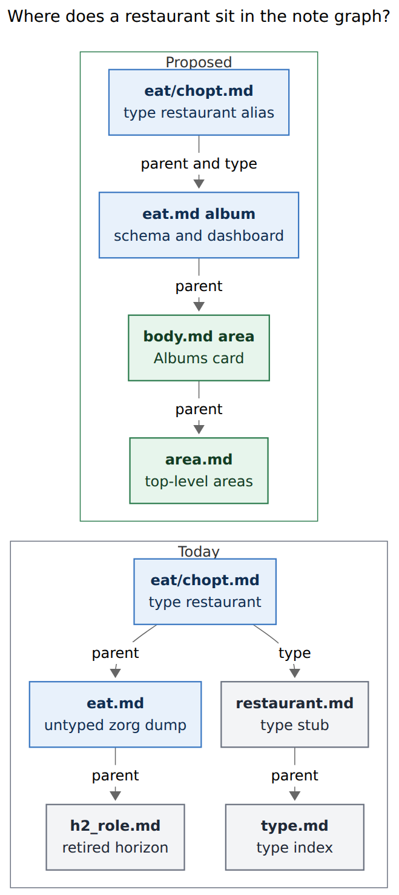
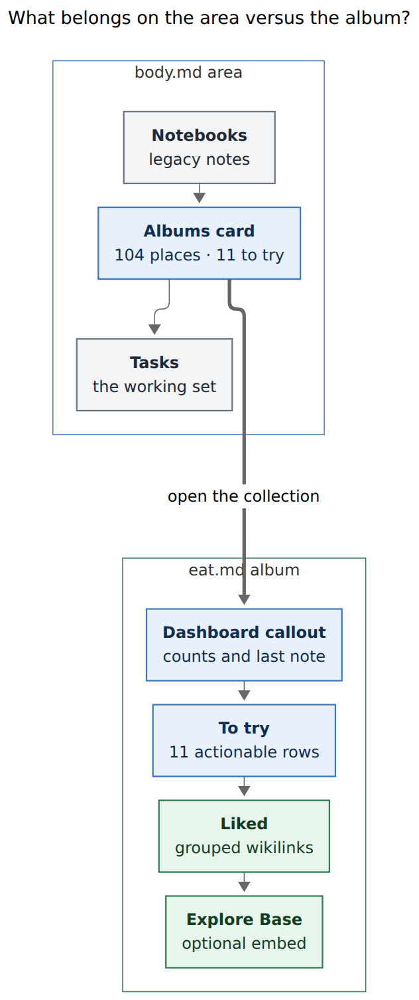
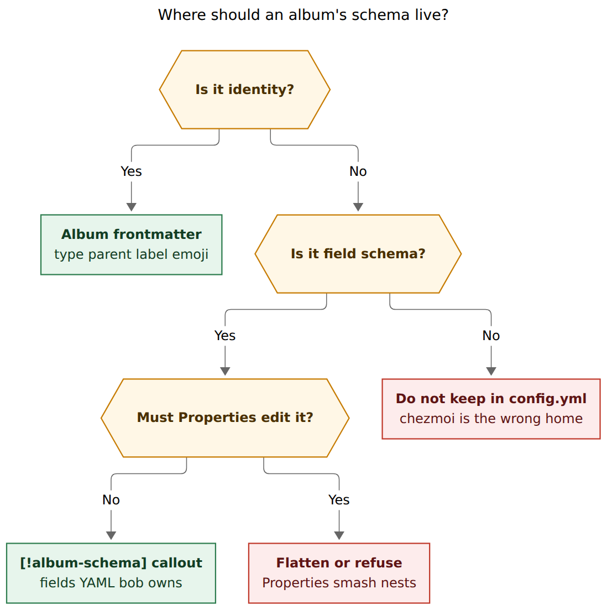

# Album notes in the area graph

> **Research query:** Should record notes (the one-note-per-thing files under
> `eat/`, `podcasts/`, `movies/`, and `tv/`) join Bob's area/project parent
> graph through a new **album note** kind, with schema migrating out of
> `config.yml` onto those album files, generated summaries on the album and
> on its owner area, and new glossary terms for album note and record note?
> Critique the request, adjust requirements that need adjusting, and
> recommend a design that is intuitive, reliable, and beautiful.

## Bottom line

**Build it.** The request is the right next step for Record Notes, and it
closes a hole the record-notes epic left open on purpose.

Records already have a parent (`[[eat]]`, `[[podcasts]]`, `[[movies]]`,
`[[tv]]`). Those collection notes sit *beside* the area graph instead of
*in* it. `eat.md` is still a zorg dump whose parent is `[[h2_role]]`.
`podcasts.md` parents to `[[mind]]`, and `mind.md` is still a zorg dump
rather than an area. Movies and TV already parent to the `fun` area, which
is the working pattern. The missing piece is a real note kind for those
collection files, a parent that is an area or project, and a generated
surface you will actually open when choosing where to eat or what to watch.

That surface is the lookup loop from
`research:202611/record_notes_data_unlock/record_notes_data_unlock.md`.
Capture and schema exist. Verdicts are a habit. Lookup needs a named front
door. The area's `## Albums` card is that door. The album page is the room
behind it.

**Recommended shape, in one sentence:** an album is to records what a
notebook is to free-form notes — a task-free collection that hangs under an
area or project, with bob-owned summaries, identity in frontmatter, and
schema in a bob-owned callout on the album itself.

## Recommended solution

1. **Add `type: "[[album]]"`** as a vault-root note kind. Stem = folder =
   capture route. `eat.md` owns `eat/` and `@eat/`. `podcasts.md` owns
   `podcasts/` and `@podcasts/`. Same for `movies.md` and `tv.md`.
2. **Parent every album to an area or project** (or to another album, the
   way notebooks nest). Walks for root, clock, and task type pass through
   the album. Albums never hold a `#task` and never become a Root Parent,
   a Pomodoro home, or a Ready lane.
3. **Parent every record to its album.** Keep today's type strings
   (`[[restaurant]]`, `[[podcast]]`, `[[show]]`, `[[movie]]`) as
   `aliases:` / `legacy_ids` on the album so 152 existing notes stay valid
   and `[[restaurant]]` opens `eat.md`.
4. **Migrate schema out of chezmoi `config.yml`.** Put identity keys in
   album frontmatter. Put the field schema in a bob-owned
   `> [!album-schema]` callout. Obsidian Properties cannot edit nested
   YAML; a nested `fields:` map in frontmatter would show as a JSON blob
   and is the wrong store.
5. **Generate two summaries.** The album page gets a dashboard plus
   status-grouped record lists. The owner area or project gets a compact
   `## Albums` callout with counts and two or three "next up" links. Bob
   owns those regions the way it owns `## Notebooks`.
6. **Dezorg the collection files** the way `job.md`, `body.md`, and
   `fun.md` were dezorged on 2026-10-12 and 2026-11-10: strip
   `generated_from_zorg`, move leftover zorg prose into a `legacy_*`
   notebook, leave the album as identity + generated body + authored
   notes.
7. **Ship movies and TV in the same change.** They already parent to
   `fun`. Leaving them as untyped collection notes would split the kind.
8. **Keep capture as `@dir/`.** Keep `bob records` as the writer. Add
   `bob albums sync` / `check` / `create`, modeled on `bob notebooks`.
   Nightly already runs `bob notebooks sync`; add `bob albums sync`
   next to it.

## Is this a good idea?

Yes. Four independent lines of evidence point the same way.

**The vault already has the files.** Four record folders exist, with 152
notes, all parented to a collection note, all typed to a schema id:

| Album stem | Folder | Record type id today | Count | Status mix | Collection parent today |
| --- | --- | --- | --- | --- | --- |
| `eat` | `eat/` | `restaurant` | 104 | 86 liked · 11 to try · 7 not liked | `[[h2_role]]` (zorg) |
| `podcasts` | `podcasts/` | `podcast` | 15 | 9 subscribed · 6 unsubscribed | `[[mind]]` (zorg) |
| `movies` | `movies/` | `movie` | 10 | 9 to watch · 1 watched | `[[fun]]` (area) |
| `tv` | `tv/` | `show` | 23 | 23 to watch | `[[fun]]` (area) |

The engine, capture spelling, CLI, and Bases already treat these as
collections. The graph does not.

**Notebooks proved the catalog pattern.** A notebook is a task-free
collection under an area or project. Bob owns `## Notebooks`; Bryan owns
its position. Record collections need the same treatment, with richer
rows because records have status counts. The notebooks research rejected
sub-areas, folders-as-routes, and Dataview-only indexes for this job. Those
rejections still hold.

**PARA says these belong under areas.** Forte's test is responsibility
versus interest: areas are hats you wear; resources are topics you follow
([Forte, *P.A.R.A. Part 2*](https://every.to/forte-labs/para-part-2-just-in-time-organization-850888)).
Restaurant verdicts, show watch-lists, and "places Kelly and I eat" are
personally relevant to Body and Fun. They are supporting material for an
area of responsibility, which is why they should hang *under* `body` and
`fun` rather than live as a parallel "resources" tree. Capacities uses the
same split at the object-type layer: a distinct group with distinct
properties earns a type; the type then lives in a graph
([Capacities, *When to create a new object type*](https://docs.capacities.io/tutorials/when-to-create-new-object-type)).

**Lookup is the unpaid bill.** `visited` is still set on 2 of 104
restaurant notes. `category: null` remains on 6. The Bases look rich;
recency data is missing. Prior record-notes research called this an
organized graveyard. An area card that says "11 to try · next: Ani Ramen
House" is a named moment. A Base buried behind `![[eat.base]]` on an
untyped zorg file is not.

The request would be a bad idea if it turned albums into areas (Ready
caps, `## Tasks`, Stats roots) or dumped 86 liked restaurants into
`body.md`. The design below does neither.

## Justified requirement adjustments

Call these out as changes to the prompt. The rest of the request stands.

1. **Parent `podcasts` to `mind`, after dezorging `mind.md` into an area.**
   The prompt names `[[dev]]`. Dev is software engineering. The live
   collection includes TED Radio Hour, GTD, and comedy recommendations.
   `h2_role.md` already maps `[[eat]]` to `#body/eat` and lists `#mind` as
   its own role. `podcasts.md` already parents to `[[mind]]`. `mind.md` is
   still `generated_from_zorg: true` with parent `[[h2_role]]`, so it is
   not yet a legal album owner. Dezorg `mind.md` the same way `body.md`
   was dezorged (commit `fbab51701`, 2026-11-10), then hang the album
   there. If mind must wait, parent to `fun` (already an area). Do not
   overload `dev`.
2. **Treat `movies.md` and `tv.md` as albums in the same change.** The
   prompt names eat and podcasts. Four record types are configured. Two
   of them already parent to `fun`. A kind that covers only half the
   collections would leave `fun.md` with an Albums section for nothing
   and two untyped collection notes beside it.
3. **Merge `podcast.md` into the existing `podcasts.md`.** Do not rename
   `podcast.md` on top of `podcasts.md`. `podcasts.md` is already the
   collection index (parent `[[mind]]`, Subscribed / Unsubscribed lists,
   `![[podcasts.base]]`). `podcast.md` is the type stub (`parent:
   "[[type]]"`). The album is the collection file, with
   `aliases: [podcast]` so `[[podcast]]` keeps resolving. Same merge for
   `restaurant.md` → `eat.md`, `movie.md` → `movies.md`, `show.md` →
   `tv.md`.
4. **Put field schema in a bob-owned body callout, not nested
   frontmatter.** Identity belongs in frontmatter (`type`, `parent`,
   `label`, `emoji`, `summary`, `dated_notes`, `legacy_ids`). Field
   definitions are a nested mapping. Obsidian's own Properties docs say
   nested properties are unsupported; the panel renders them as JSON
   ([Obsidian help, Properties](https://help.obsidian.md/properties)).
   Community workarounds exist because the panel will not edit a tree
   ([mnaoumov/obsidian-nested-properties](https://github.com/mnaoumov/obsidian-nested-properties)).
   A `> [!album-schema]` callout is visible, git-friendly, and owned by
   bob the way `> [!notebooks]` is. That is the migration the prompt
   wants, with a store Properties cannot smash.
5. **Do not list every record on the area note.** 104 restaurants in
   `body.md` would bury Tasks. The area row is a card: emoji, title,
   counts, two or three next-up links. The album page holds the lists.
6. **Keep today's record `type:` strings on day one.** Rewriting 152
   `type: "[[restaurant]]"` values is optional later. Album `aliases:`
   plus `legacy_ids:` make `[[restaurant]]` open `eat.md` and keep
   `bob records check` satisfied. Capture stays `@eat/`.
7. **Do not create a `drink` album.** `drink.md` has two liquor-store
   rows and parents to `[[eat]]`. The accepted record-notes plan already
   declined a drink type (`plan:202611/record_notes.md`). Dezorg it into
   a notebook under `body`, or leave it as authored prose after eat is
   an album whose children must be records or nested albums.
8. **Keep Bases.** They are the explore layer (filter, group, gallery).
   Bob-generated Markdown is the git/agent/mobile layer. Both. The
   original epic put dashboards out of scope beyond Base edits; this
   feature adds the Markdown layer and leaves the Bases in place.
9. **Reopen `record-types-are-config-declared-folders`.** That decision
   (planned in `plan:202611/record_notes.md`) puts schema in chezmoi
   `config.yml` and lists "an Obsidian-side writer needs the schema" as
   a reopen condition. Album notes *are* that Obsidian-side writer.
   Write a new decision; mark the old one superseded. Do not silently
   edit the old strand.

## What exists today

### Three files per collection

`bob records init` scaffolds a **type note** (`restaurant.md`, parent
`[[type]]`), a **collection note** (`eat.md`, parent from `-p/--parent`),
and a **Base** (`eat.base`). Records then carry both `type: "[[restaurant]]"`
and `parent: "[[eat]]"`. The type note is a stub that says "see
`bob records show restaurant`". The collection note embeds the Base.

That split is the confusion this feature removes. After the change, the
album *is* the type note and the collection note.

### Dezorg pattern (job, body, fun)

On 2026-10-12, `job.md` grew a `legacy_job.md` sibling. On 2026-11-10,
`fbab51701` stripped `generated_from_zorg` from area notes and moved
zorg-era bullets into `legacy_body.md`, `legacy_fun.md`, and friends —
notebooks with `type: "[[notebook]]"` and `parent` the area. The area
file became frontmatter + related links + `## Notebooks` + `## Tasks`.

`eat.md` still has the old shape: `generated_from_zorg: true`, parent
`[[h2_role]]`, ALIGN TABLES, liked / not-liked zorg tables. The 104
files under `eat/` already hold those rows as records (`source_note:
"[[eat]]"`, `source_anchors`). The dump is historical. Dezorg it the
same way: `legacy_eat.md` notebook under `body`, album `eat.md` in its
place.

`maybe_eat.md` already says it moved to 🔖 To try records on 2026-11-08.

### Schema lives in chezmoi

`~/.config/bob/config.yml` is
`chezmoi source-path` → `home/dot_config/bob/config.yml`. The `records:`
block is the live schema. Loading it does not scan the vault. A malformed
block disables *all* record features. Album-local schema can isolate a
bad album without killing movies.

### Generated catalogs already have a contract

From `docs/notebooks.md` and `decisions:notebook-routes-write-notes`:

- Bob owns the callout bytes; Bryan owns heading position.
- First write sits before `## Tasks`.
- Later writes patch the callout wherever it moved.
- Empty subtree deletes the callout; authored prose under the heading
  stays.
- Damage (malformed markers) skips the host.
- Nightly runs `bob notebooks sync`.

Copy this contract. Change the row shape.

## The graph change



*Figure 1. Today a restaurant parents to an untyped `eat.md` under a
retired zorg horizon, and its type points at a stub. Proposed, parent and
type both resolve to the eat album, which parents to the body area.
Rendered 438 × 985 px, fit 90.6%, Mermaid CLI 12.0.0.*

Records are already in a tree. The tree does not reach an area. Root
Parent, clock defaults, and capture-target scans therefore ignore them,
which is correct for *tasks* and wrong for *discovery*. After this
change, opening `body.md` shows that Body owns Restaurants. Opening a
restaurant shows `parent: "[[eat]]"` and `type: "[[restaurant]]"`, both
landing on the album.

Albums stay transparent on the task walks. A `#task` still cannot live
on `eat.md` or `eat/chopt.md`. "Make a reservation at Ninja Sushi" stays
a Body task that wikilinks the record. That matches the record-notes
plan: the action is a task; the thing is a record.

## What to render



*Figure 2. The area shows one compact album card above Tasks. The album
shows the dashboard, the actionable status list, grouped history, and an
optional Base. Rendered 421 × 1004 px, fit 88.9%, Mermaid CLI 12.0.0.*

### Album page (`eat.md`)

This is the home of the collection. Open it when choosing a place, or
when adding a verdict.

```markdown
---
parent: "[[body]]"
type: "[[album]]"
label: Restaurant
emoji: 🍽️
summary: Places Kelly and I eat, with a liked / to-try / not-liked verdict.
dated_notes: true
aliases: [restaurant]
legacy_ids: [restaurant]
created: 2026-11-10T12:00:00-05:00
---

# Restaurants

Places Kelly and I eat, with a liked / to-try / not-liked verdict.

> [!album] 🍽️ 104 restaurants
>
> `💚 86 liked` · `🔖 11 to try` · `🚫 7 not liked`
>
> Last note: 2026-11-08 · [[eat/burger_bistro|Burger Bistro]]

## To try

- **[[eat/ani_ramen_house|Ani Ramen House]]** — Cranford · Ramen
- **[[eat/bubble_tea|Bubble Tea]]** — …

## Liked

> [!album-status]- 💚 86 liked
>
> ### Coffee and bagels
> - **[[eat/ahrres|Ahrres]]** — Westfield
> - **[[eat/small_world_coffee|Small World Coffee]]** — Princeton
>
> ### Sushi
> - **[[eat/ninja_sushi|Ninja Sushi]]** — Clark

## Not liked

- **[[eat/rush_bowl|Rush Bowl]]** — …

## Explore

![[eat.base]]

## Notes

- **Taking a fleeting restaurant note:** …

> [!album-schema]
>
> ```yaml
> fields:
>   status:
>     required: true
>     values: { to_try: 🔖 To try, liked: 💚 Liked, not_liked: 🚫 Not liked }
>   category: { required: true, suggest: true }
>   location: { required: true, suggest: true }
>   visited: { values: date }
>   url: { values: url }
> legacy: [lid, source_*]
> ```
```

Ownership, copied from notebooks:

| Region | Owner |
| --- | --- |
| Frontmatter identity | Bryan edits; bob canonicalizes on sync |
| `> [!album]` dashboard | bob |
| Status `##` sections whose names match schema choices | bob |
| `> [!album-schema]` | bob |
| `## Explore`, `## Notes`, heading order | Bryan |
| `![[eat.base]]` | Bryan (init can seed it once) |

**Why this shape is beautiful.** Podcasts already do the right small-n
thing by hand: Subscribed (9) and Unsubscribed (6) as wikilink lists.
Restaurants need grouping because 86 liked rows as a flat list is the
zorg table all over again. Group liked by `category` (the same cuisine
buckets `eat.base` already computes, or the raw category string if you
want bob to stay dumb). Keep **To try** fully expanded: 11 rows is the
working set. Fold large terminal groups with `> [!album-status]-` so the
page opens on the dashboard and the to-try list.

**Size cap.** If a status group has 20 or fewer rows, expand it as a
real `##` list. If it has more, use a folded callout grouped by the
first `suggest: true` field (`category` for eat, `service` for shows).
That rule makes podcasts, movies, and the to-try list feel like a
curated page, and makes 86 liked restaurants browsable without becoming
another dump.

**Do not generate tables.** Wikilink lists survive git, mobile, and
agent reads. Bases already provide tables and a gallery.

### Area / project section (`body.md`)

```markdown
## Albums

> [!albums]
>
> - **🍽️ [[eat|Restaurants]]** — 104 places · `🔖 11 to try`
>   Next: [[eat/ani_ramen_house|Ani Ramen House]] · [[eat/bubble_tea|Bubble Tea]]
```

On `fun.md`, two rows:

```markdown
## Albums

> [!albums]
>
> - **🎬 [[movies|Movies]]** — 10 · `🔖 9 to watch`
>   Next: [[movies/f1|F1]] · [[movies/thunderbolts|Thunderbolts]]
> - **📺 [[tv|TV shows]]** — 23 · `🔖 23 to watch`
>   Next: [[tv/silo|Silo]] · [[tv/the_studio|The Studio]]
```

Rules:

- One row per album whose owner lies in this host's subtree, stopping at
  the next root parent (same scope as `## Notebooks`).
- Counts use the album emoji and the choice labels from schema.
- Highlight the *active* status (to try, to watch, watching,
  subscribed), not the terminal bulk (liked, watched, unsubscribed).
- "Next" is at most three records from that active status, sorted by
  title, linking to the record file.
- No colors, dates, or mtimes in the written bytes; clients may tint
  the callout.
- First write: after `## Notebooks` if present, otherwise immediately
  before `## Tasks`, otherwise at EOF.
- Later writes patch only the `> [!albums]` callout.
- Empty subtree removes the callout; authored prose under `## Albums`
  stays.
- `## Albums` is not a capture section target, matching
  `notebooks_section_generated`.

This is the lookup loop. Friday dinner starts on `body.md`. Saturday
movie night starts on `fun.md`. The card answers "do I have a list?" in
one glance and "what's next?" in one click.

## Where the schema lives



*Figure 3. Identity keys go in album frontmatter. Field schema goes in a
bob-owned callout because Obsidian Properties cannot edit nested YAML.
Chezmoi `config.yml` stops being the source of truth. Rendered 732 × 736
px, fit 89.2%, Mermaid CLI 12.0.0.*

### Frontmatter (identity)

```yaml
parent: "[[body]]"
type: "[[album]]"
label: Restaurant
emoji: 🍽️
summary: Places Kelly and I eat, with a liked / to-try / not-liked verdict.
dated_notes: true
aliases: [restaurant]
legacy_ids: [restaurant]
```

These are scalars and short lists. Properties can display them. `summary`
mirrors notebooks (one line, 140 characters, required at create, warning
if missing). `legacy_ids` is the checker's accepted `type:` strings.
`aliases` is Obsidian's resolver so `[[restaurant]]` opens `eat.md`.

Stem = directory. No `dir:` key. That removes the current split where
the type id is `restaurant` and the folder is `eat`. Capture remains
`@eat/` because the folder is the spelling today and the album stem
matches it.

Reserved album stems: the current reserved record ids plus `album` and
`record` (`project`, `area`, `ref`, `day`, `done`, `mail`, `article`,
`type`, `notebook`, `album`, `record`).

### Body callout (fields)

The YAML inside `> [!album-schema]` is the current per-type config body
(`fields`, `legacy`), minus `dir` / `label` / `emoji` / `parent` which
moved to frontmatter. `bob albums sync` canonicalizes it. Humans and
agents edit it in source mode. A malformed callout disables *that*
album and reports `album_schema_invalid`; other albums keep working.
That is stricter isolation than today's all-or-nothing `records:` block.

### Cutover

Keep loading `config.yml` `records:` until every album has a valid
schema callout and `bob albums check` is clean. Then delete the
`records:` block from chezmoi. During the overlap, the album wins when
both exist. `bob records list` grows an `source: album|config` column
so the cutover is visible.

This sequencing is a reliability adjustment: the graph and the
summaries can ship while schema still loads from config, then the store
moves once the album files are dezorged.

## Capture, CLI, and walks

- **Capture stays `@eat/`.** Creating an album is rare (four now, maybe
  one or two a year). Use `bob albums create STEM -p PARENT -s SUMMARY`
  rather than a new `%a` capture glyph. Notebooks earned `%n` because
  they are created in the moment; albums are not.
- **`bob records new restaurant`** remains a hidden alias of
  `bob records new eat` once the album stem is the id. CLI rules:
  never hard-rename; old spelling becomes a permanent hidden alias
  (`cli_rules.md`).
- **`bob albums sync|check|list|create`** nest under the Vault section,
  alphabetical with `notebooks`. Bare `bob albums` defaults to read-only
  `list`.
- **Nightly:** after `bob notebooks sync`, run `bob albums sync` with
  the same lock-free core and one scoped commit
  `albums: sync catalogs (N albums)`.
- **Guards:** no checkboxes on albums or records (`album_checkbox`,
  already `record` check's job for records). Album parent must resolve
  to an area, project, or album (`album_parent_kind`). Record parent
  must be its album (`record_parent_kind`). Areas, projects, refs, and
  notebooks must not parent to an album (`album_child_kind`). Notebooks
  already refuse record instances as children; extend that to albums.
- **NoteKind:** recognize Album as transparent, like notebooks, in the
  root/clock/type walks. Records stay `Other` for those walks; they are
  never task homes.

## Glossary drafts

These are ready for `sase/memory/glossary/` once a plan's memory
decision is accepted. Keep each under 160 words.

### Album note

aka album, record album, collection note

A Bob vault Markdown file at the vault root with frontmatter
`type: "[[album]]"` that owns one typed collection of [[record-note]]s.
Its stem is the collection's folder and capture route: `eat.md` owns
`eat/` and `@eat/`. `parent` names an [[area-note]], a [[project-note]],
or another album, and the chain always reaches an area or project.
Identity keys (`label`, `emoji`, `summary`, `dated_notes`, `legacy_ids`)
live in frontmatter; the field schema lives in a bob-owned
`> [!album-schema]` callout. Bob owns the dashboard and the status
lists; Bryan owns their position. An album never holds a `#task`, is
never a [[root-parent]], and root, clock, and type walks pass through
it to its owner. Every owner lists the albums beneath it in a
machine-owned `## Albums` section that `bob albums sync` maintains.
Not a [[notebook]], a [[reference-note]], a record note, or an Obsidian
Base. See `docs/records.md`.

### Record note

aka record, record type note

A Bob vault Markdown file for one durable thing in an [[album-note]]'s
folder, such as `eat/chopt.md`. Frontmatter `parent` is that album.
`type` is a `legacy_ids` value of the album (`"[[restaurant]]"`) or,
after an optional rewrite, the album stem (`"[[eat]]"`). Remaining keys
follow the album's schema. Capture creates one with `<title> @<dir>/`
and updates with `@<dir>/<stem>`. Ordinary bullets live under
`## Notes`, dated when the album sets `dated_notes`. A record never
holds a `#task`, is never a task's residence, a Pomodoro home, or a
[[root-parent]], and is not a [[reference-note]], a [[notebook]], or a
Task Type (`#fix`, `bob types`). See `docs/records.md`.

## Migration

Do this as one vault transaction per wave, with `--dry-run` first.

**Wave 0 — recognize.** Teach bob `type: "[[album]]"`, parent rules,
and `bob albums check` against the live collection notes without
rewriting them.

**Wave 1 — dezorg owners.** Dezorg `mind.md` into an area (required for
the podcasts parent). Confirm `body` and `fun` are already areas.

**Wave 2 — promote collections.** For `eat`, `podcasts`, `movies`,
`tv`:

- Write album frontmatter onto the collection file.
- Merge the type stub into it (`aliases`, one-line description).
- Move leftover zorg body to `legacy_eat.md` (notebook under `body`).
- Seed `> [!album-schema]` from `config.yml`.
- Delete `restaurant.md`, `podcast.md`, `movie.md`, `show.md` once
  aliases resolve.
- Run `bob albums sync` to write dashboards, status lists, and owner
  `## Albums` cards.

**Wave 3 — cut over schema.** Point the records engine at album
callouts. Remove `records:` from chezmoi once `bob albums check` and
`bob records check` agree. Hidden CLI aliases keep `restaurant` /
`podcast` / `show` / `movie`.

**Wave 4 — drink and maybe_eat.** Notebook-ize `drink.md` under `body`.
Leave `maybe_eat.md` as historical (it already points at to-try
records).

Do not rewrite 152 record `type:` fields in these waves. Optionally
later, rewrite `type: "[[restaurant]]"` to `type: "[[eat]]"` and drop
`legacy_ids`. Aliases already make the type link open the album.

## Alternatives rejected

| Alternative | Why it loses |
| --- | --- |
| Make `eat.md` an area | Ready cap, `## Tasks`, Stats root, offclock walk. A restaurant list is not a sphere of responsibility. Notebooks already rejected sub-areas for this reason. |
| Parent records straight to `body` | 104 children on the area, no schema home, no collection page. The album *is* the typed collection. |
| Schema stays in `config.yml` forever | Works, and it is today's decision. The reopen condition is now true: the album is an Obsidian-side schema writer, and the definition should sit on the note you open. |
| Nested `fields:` in frontmatter | Properties will render JSON and may rewrite it. Officially unsupported. |
| Dataview / Bases as the only index | Invisible to git, agents, and `bob query` consumers who read Markdown. Notebooks rejected this. Keep Bases as the *explore* view. |
| Dual-write the zorg tables in `eat.md` | The record-notes plan put this out of scope, correctly. The records *are* the source. Dezorg the dump. |
| One `## Collections` section mixing notebooks and albums | Different row shapes, different sync commands, different ownership. Two H2s. |
| `type: "[[record]]"` on every instance | Kind-pure, but `[[restaurant]]` would stop opening the album and every Base filter would change on day one. Aliases plus `legacy_ids` get the graph without the rewrite. |
| Nested albums in v1 | `drink.md` is the only candidate and it is two rows. Allow the parent kind so the door stays open; do not create one now. |
| New capture glyph `%a` | Albums are rare. CLI create is enough. |

## Implementation sketch

For a later plan, not this report:

1. Glossary strands and a new decision
   `albums-are-vault-declared-record-collections`, superseding
   `record-types-are-config-declared-folders`.
2. `NoteKind` / snapshot recognition, parent guards, section protection.
3. `bob albums check|list|sync|create` (Vault section, alphabetical).
4. Dashboard and `## Albums` renderers, byte-span region handling cloned
   from `src/native/notebooks/region.rs`.
5. Schema loader: album callout first, config fallback, per-album
   failure isolation.
6. Vault waves above, including `mind.md` dezorg.
7. Docs: `docs/records.md` gains an Albums section; `docs/notebooks.md`
   stays the pattern reference; `docs/reference/vault-format.md` lists
   the kind; `just docs-check`.
8. Nightly and `docs/vault-git-sync.md` step list.
9. Mac Capture unchanged for `@eat/`; no new card. Album create is CLI.

## Open questions for you

- **Confirm `mind` as the podcasts owner.** The prompt says `dev`. This
  report says `mind`, with `fun` as the fallback if mind is not dezorged
  in the same epic.
- **Cuisine grouping on Liked.** Dumb (raw `category` string) is
  reliable. Pretty (the 22-branch `eat.base` formula) is beautiful and
  belongs in the Base, not in bob. Recommend raw category, sorted, with
  a "Uncategorized" bucket for nulls.
- **Should `bob albums sync` run nightly on day one?** Yes, matching
  notebooks, once check is clean on a dry run against the four albums.
- **Kelly.** Shared dinner and movie choices still want a lookup she
  will open. The area card is closer to that than a Base. Worth asking
  her whether `body.md` / `fun.md` cards are enough.

## How this report was made

Independent research for the 2026-11 album-notes swarm (`grk`). Vault
reads of `eat.md`, `podcast.md`, `podcasts.md`, `movies.md`, `tv.md`,
`job.md`, `body.md`, `fun.md`, `mind.md`, `h2_role.md`, type stubs, Bases,
and 152 record files. Engine and docs: `docs/records.md`,
`docs/notebooks.md`, `src/native/records/{schema,init,check,plan}.rs`,
`src/native/notebooks/{region,catalog,sync}.rs`. Binding plan
`plan:202611/record_notes.md`. Prior research
`research:202611/record_notes_data_unlock/record_notes_data_unlock.md`,
`research:202611/record_type_capture/record_type_capture.md`,
`research:202611/bob_notebooks/bob_notebooks.md`. Chezmoi path of
`config.yml`. Git history of the 2026-10-12 and 2026-11-10 dezorg
commits. External: Forte PARA, Capacities object types, Obsidian
Properties nested-YAML limits, Zhang et al. 2014 and Sellen & Whittaker
2010 as cited in the data-unlock report.

## Sources

**Vault and bob-cli (read 2026-11-10)**

- `~/bob/eat.md`, `eat/*.md` (104), `eat.base`
- `~/bob/podcast.md`, `podcasts.md`, `podcasts/*.md` (15), `podcasts.base`
- `~/bob/movies.md`, `movies/*.md` (10), `movies.base`
- `~/bob/tv.md`, `tv/*.md` (23), `tv.base`
- `~/bob/{job,body,fun,mind,h2_role,restaurant,movie,show,drink,maybe_eat}.md`
- `~/.config/bob/config.yml` `records:` (chezmoi `home/dot_config/bob/config.yml`)
- `docs/records.md`, `docs/notebooks.md`, `docs/reference/vault-format.md`,
  `docs/vault-git-sync.md`
- `plan:202611/record_notes.md`
- `research:202611/record_notes_data_unlock/record_notes_data_unlock.md`
- `research:202611/record_type_capture/record_type_capture.md`
- `research:202611/bob_notebooks/bob_notebooks.md`
- Vault commits `85fce7e7c` (2026-10-12, `legacy_job.md`) and
  `fbab51701` (2026-11-10, de-zorg area notes)

**External**

- Forte, T. *P.A.R.A. An Introduction* and *Part 2 — Areas vs Resources*.
  [every.to](https://every.to/forte-labs/para-an-introduction-827085)
- Capacities. *When to create a new object type*.
  [docs](https://docs.capacities.io/tutorials/when-to-create-new-object-type)
- Obsidian help. *Properties* ("Nested properties" unsupported).
  [help.obsidian.md/properties](https://help.obsidian.md/properties)
- mnaoumov. *Nested Properties* (Obsidian plugin README).
  [GitHub](https://github.com/mnaoumov/obsidian-nested-properties)
- Sellen, A. & Whittaker, S. (2010). *Beyond Total Capture.* CACM 53(5).
- Zhang, T. et al. (2014). *A "Present" for the Future.* Psychological
  Science 25(10).
- Tietze, C. (2014). *The Collector's Fallacy.*
  [zettelkasten.de](https://zettelkasten.de/posts/collectors-fallacy/)
