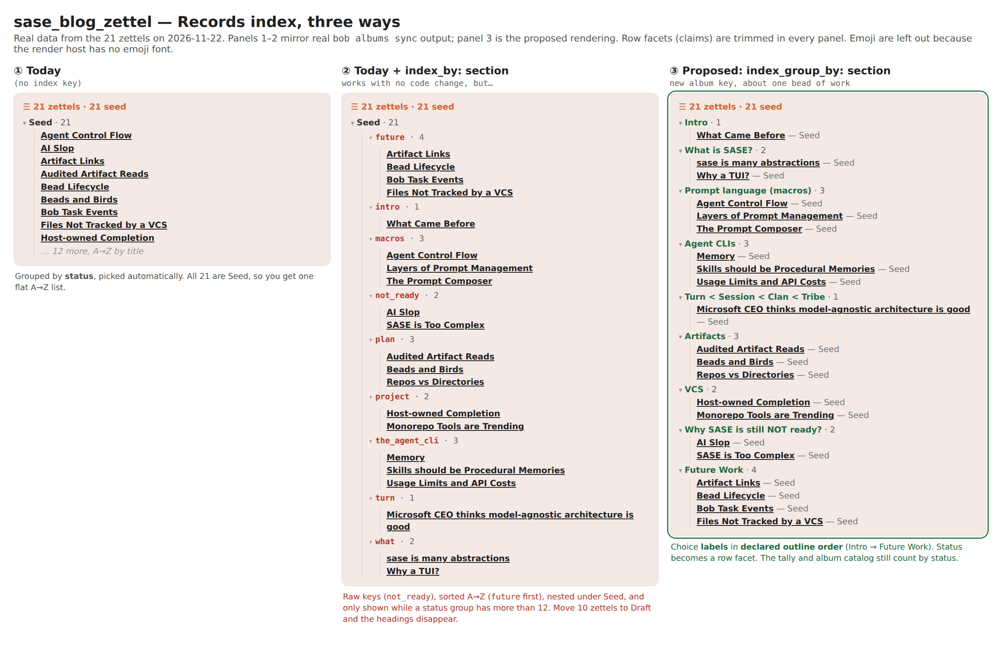
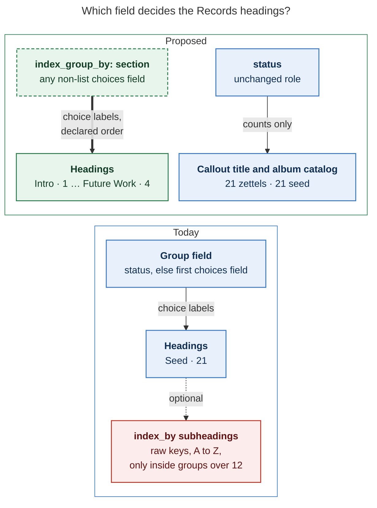

# Group the `sase_blog_zettel` Records index by `section`

*2026-11-22 · bob-cli 0.5.0 · question: can the `## Records` callout in
`~/bob/sase_blog_zettel.md` group zettels by their `section` field, and if not, how
should we add it?*

## Answer

**No, not in a usable way.** The `[!records]` index always groups by `status`. It
picks `status` automatically and no album key changes that. The closest built-in knob,
`index_by: section`, only adds *sub*headings inside a status group, and it renders them
badly for an outline (panel ② below).

**Recommendation:** add one top-level album key, **`index_group_by: <choices field>`**.
It is index-only and works like `walk_by`. It is about one bead of bob-cli work and
needs no plugin change. Then the album declares:

```yaml
walk_by: section          # already there: ]n walks in outline order
index_group_by: section   # new: Records headings follow the outline too
index_facets: [status, claim]   # swap section → status; the heading already says it
```



*Panels ① and ② use the real 21 zettels. ② is the actual `bob albums sync --dry-run`
diff from a throwaway vault copy with `index_by: section` added; your vault was not
touched. ③ is the proposed output, computed from the same frontmatter.*

## Why `index_by: section` is not enough

| Problem (panel ②) | Cause in code |
| --- | --- |
| Headings are raw keys (`not_ready`, `the_agent_cli`), not labels | subgroups read the stored value (`field_text`, `grouping.rs:467`) |
| Sorted A→Z (`future` first, `intro` second), not outline order | `subgroups.sort_by(display)` (`grouping.rs:396`) |
| Nested under 🌱 Seed; one section splits across Seed/Draft/Ready | top level is fixed by `group_field()`: `status`, else the first choices field (`grouping.rs:178`) |
| Disappears once no status group has more than 12 zettels | `LARGE_GROUP = 12` gate (`grouping.rs:24`, `uses_subgroups` `:352`) |

The Base file already has a `🧭 By section` view. It has the same raw-key, A→Z problem,
and it lives in a different file.

## Proposed rule

- **Eligible field:** a declared, non-list `Choices` field, which is the same test as
  `walk_by`. An invalid or ineligible value gives a warning, and the index falls back
  to today's status grouping.
- **Headings:** choice **labels** in **declared order**, so the YAML order *is* the
  outline order. Empty choices are omitted, as today. Missing or unknown values go last
  under `⚠️ Needs section`, reusing `needs_group_label`.
- **Status keeps its other jobs:** the callout title (`21 zettels · 🌱 21 seed`), the
  `## Albums` catalog row, and the report's `groups` JSON all stay status-based.
- **`index_by` still nests:** a section group with more than 12 zettels can still
  subgroup by `index_by`.
- **Facets:** the default facet rule leaves out the index group field. An explicit
  `index_facets` list is honored as written.



*The proposal moves only the headings. Status still drives every count.*

## Where the change lands (bob-cli only)

| File | Change |
| --- | --- |
| `src/native/albums/mod.rs` | Parse and validate top-level `index_group_by`, mirroring `walk_by` (warn, then fall back) |
| `src/native/albums/grouping.rs` | `group_records` takes the optional index field and builds `index_groups` with `bucket_choice_members` + `finish_group`; `groups` stays on status |
| `src/native/albums/index.rs` | `render_callout` (`:75`) iterates `index_groups` when set; `tally_text` (`:344`) unchanged |
| `src/native/albums/update/ops.rs` | Refuse removing or renaming a field named by `index_group_by`, as `:1341` already does for `index_by` |
| `report.rs` + JSON docs | Additive effective `index_group_by` in `bob albums -f json` |
| `docs/records.md`, `docs/reference/vault-format.md` | Document the key, and change the line *"the `[!records]` index keeps its independent group field"* (`records.md:512`) |
| Tests | grouping unit test, index render test, `tests/cli/albums_sync.rs` case |

**bob-plugins needs nothing.** The records fold reads any `**label** · N` heading by
shape and falls back to the label for fold identity
(`241r-plugin-album-records-model.js:33`). The catalog chip reads the status `groups`
(`241o…:59`), and those don't change. Two optional polish items: a schema-card chip for
the field, and an `index_groups` JSON block for steadier fold keys.

## Alternatives considered

| Option | Verdict |
| --- | --- |
| **A.** Use `index_by: section` today | ✗ Raw keys, A→Z order, nested under status, disappears at 12 or fewer (panel ②) |
| **B.** Make the index follow `walk_by` automatically | ~ No new key, and the index would always match `]n` order. But it reverses the documented contract that the index groups independently, and it ties navigation to display for every future album. Take this if you'd rather have fewer knobs. |
| **C.** New `index_group_by` key | ✓ **Recommended.** Explicit, opt-in, and changes nothing for `eat`, `subscriptions`, `movies`, `tv`, or `podcasts` |
| **D.** Base view `🧭 By section` | ✗ Already exists, but shows raw keys A→Z, in a separate file |

## Worth knowing

- **6 of your 15 sections have no zettels yet:** Gates, Plugins, Services, How I use
  SASE, The Demos, Conclusion. A later opt-in such as `index_show_empty: true` could
  list them as `· 0` and turn the index into an outline-coverage map. It is out of
  scope for v1.
- The 2026-11-12 drafting report advised against a `section` field. You have since
  added it, along with `walk_by: section`, so the Records index is the last surface
  still ordered by status first.
- Figure note: the host disk filled up during this session, so the Mermaid block above
  was not render-checked. The PNG mockup was checked visually.
