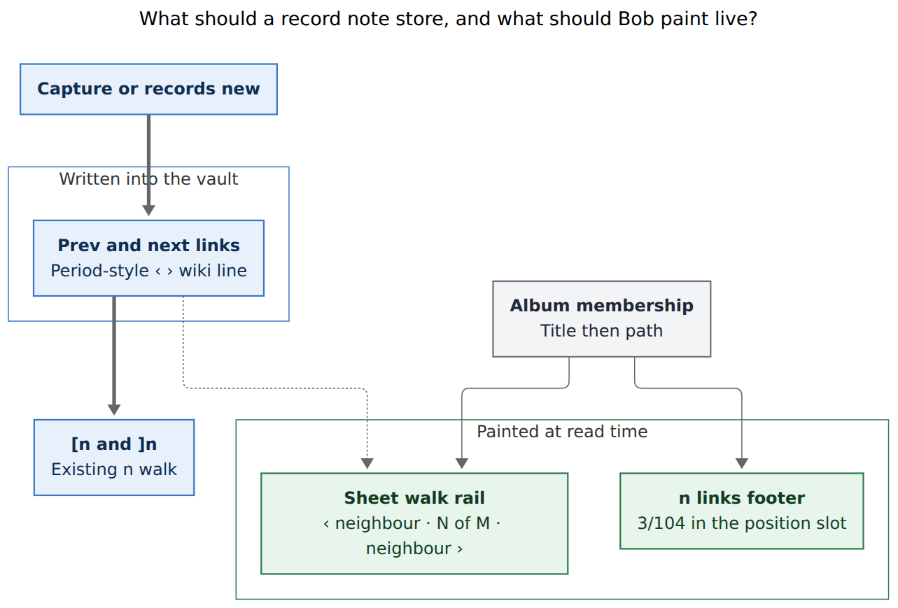
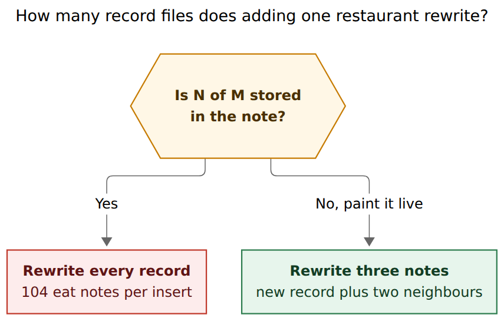

# Album record notes should grow a period-style ‹ › walk, with N of M painted live

> **Research query:** How should Bob automatically add previous/next links on every record note in an album, so `[n` / `]n` walk the collection alphabetically and cycle, with `N of M` shown near those links? Critique the idea, adjust the requirements where justified, and recommend a design that is intuitive, reliable, and beautiful.

## Bottom line

**Yes — build this.** It is the missing compass on a surface that already has a catalog, a sheet, and a walk family that does nothing on record notes today. Do not invent a fifth bracket walk. Do not store `N of M` in the Markdown.

Recommended shape:

1. **Write one bob-owned first-body line** in each record note, in the same grammar period notes already use for `[n` / `]n`:
   `[[eat/pho_house|‹ Pho House]] · [[eat/ramen_nagi|Ramen Nagi ›]]`
2. **Cycle the ring.** Two records point at each other in both directions. One record omits the line. Membership is the album folder, sorted by the existing `title_order` (lowercase title, then path).
3. **Paint `N of M` live** on the record-sheet walk rail and in the `n` links footer (`3/104`), the way the `w` footer already shows `Lanes 3/12`. Never write the count into the note.
4. **Keep `[n` / `]n` unchanged.** Those keys already follow the first body wiki link whose label is `prev` / `next`, or an arrow that starts with `‹`/`<` (previous) or starts/ends with `›`/`>` (next). The new line is that grammar. The first `]n` on a record both selects family `n` and opens the neighbour.

That is a good idea. Writing `3 of 104` into every restaurant note is not.

## Verdict

This is the right feature, on the right object, at the right time.

Record notes are a collection. Bryan already browses them from the album `[!records]` index, then lands on a sheet of facts and a `## Notes` body. There is no in-note way to step to the next restaurant. The `n` walk's empty state on these notes is currently `no ‹ / › links in this note`. Period notes solved the same job with a one-line compass. Copy that kinship.

The original request is directionally right and slightly too literal in three places: ASCII `<`/`>` labels, storing `N of M` next to those labels, and treating "alphabetical" as an unstated sort. The adjustments below keep the walk, the cycle, and the position text, and they make the bytes match machinery Bob already has.

## What already exists

These are the pieces the design must reuse.

### The `n` walk is a document compass, not a vault queue

`[n` / `]n` (commands `open-prev-link` / `open-next-link`) scan the current note's body, skip YAML frontmatter and fenced code, and open the **first** wiki or Markdown link whose rendered label matches:

| Wanted | Match |
| --- | --- |
| previous | exact `prev`, or the label starts with `‹` or `<` |
| next | exact `next`, or the label starts **or** ends with `›` or `>` |

That contract lives in `docs/reference/plugins/bob-navigation-hotkeys.md` and in `bob-navigation-hotkeys/src/680-plugin-link-parse.js` (`renderedLinkMatchesNavLabel`). Counts are ignored. `]]` / `[[` repeat family `n`. There is no uppercase link jump.

The links footer (`bob-ledger-tools/src/124-links-walker-footer.js`) is a read-only preview of those same two links via `walkMode.links()` v2. For a label of `prev`/`next` it derives a name from the path stem. For an arrow label it strips `‹<>›` and shows the rest. A label that is only `<` or `>` therefore paints as an empty name: `‹ ` / ` ›`. Titled arrows paint `‹ Pho House` / `Ramen Nagi ›`.

`bob walks` never reports family `n`. Attention stays on `s` / `w` / `b`. The nav line does not need a walks JSON change.

### Period notes are the visual and grammatical precedent

Week, quarter, and year notes already carry:

```markdown
[[2026/2026-W44|‹ W44]] · [[2026/2026-Q4|↑ 2026-Q4]] · [[2026/2026-W46|W46 ›]]
```

Bob writes that line once. Calendar neighbours do not reshuffle when a new daily appears. Record neighbours **do** reshuffle when a restaurant is added, deleted, or retitled. That is the one place this feature must not copy period notes blindly.

### Albums already know a title sort, and they already rewrite an index

`src/native/albums/grouping.rs` sorts members with `title_order`: lowercase title, then path. The generated `[!records]` callout uses that order inside each status group. Capture, `bob records new`, and `bob albums update` already rebuild the album index in the same transaction as the record write. `bob albums sync` repairs indexes and owner catalogs; it does not currently rewrite record bodies. Nightly runs `albums` then `records` (empty-Notes / redundant-H1 tidy).

### Record notes are sparse by contract

`docs/records.md` and `render_record` in `src/native/records/render.rs`: no H1 (the sheet is the title), `## Notes` only when there are bullets, and an empty note ends at the closing `---`. The record sheet mounts under the first heading, or just after frontmatter when there is none (`recordSheetAnchor`). Live Preview and Reading hide Properties and the inline title on these notes.

### The vault is large enough that rewrite radius matters

`bob albums list` on 2026-11-18:

| Album | Noun | Records |
| --- | --- | ---: |
| eat | restaurant | 104 |
| subscriptions | subscription | 28 |
| tv | show | 23 |
| podcasts | podcast | 15 |
| movies | movie | 12 |
| sase_blog_zettel | zettel | 10 |
| **total** | | **192** |

Adding one restaurant while every note stores `N of M` rewrites all 104 eat files. Adding one restaurant while every note stores only prev/next rewrites three files (the new note and two neighbours; five when a title change moves a record between two slots). Vault-sync, editor reloads, and undo all feel that difference.



**Caption:** Bob writes the ‹ › wiki line so `[n` / `]n` can follow it. Position text is a live projection from album membership, on the sheet rail and in the `n` footer.

## Critique of the request

The request wants three things glued together: (1) automatic `<` / `>` links, (2) a cycling alphabetical walk that `[n` / `]n` can follow, (3) `N of M` near those links. (2) is the product. (1) and (3) are implementation guesses.

**The walk belongs on the notes, as real links.** A plugin-only overlay that taught `[n` a special record path would walk beautifully in Live Preview and go silent in Source, on mobile, in git, and in any editor that is not Ledger Tools. Period notes already proved the honest version: the bytes in the note *are* the walk. Keep that.

**The walk already exists as family `n`.** A new `]r` record walk would copy bank/review machinery for a job the link compass already does. It would also leave `[n` empty on the one note type that now has prev/next links. Teach the notes to speak `n`'s language.

**Bare `<` / `>` labels are a poor fit for that language.** They match the matcher, and they fail the footer and the reading view. `[[eat/pho_house|<]]` strips to an empty name in `linksWalkerFooterLabel`. ASCII `<` inside a wiki alias is also an HTML open-tag in some renderers; period notes chose `‹` / `›` (U+2039 / U+203A) for that reason. The matcher treats both families as arrows. Use the house arrows, with the neighbour's title in the label, so the footer, the click, and the markdown all name the destination.

**`N of M` is a position, and positions in Bob are painted.** The walker-footer glossary is explicit: positions are queue membership, the panel is a read-only projection, and it never writes the vault. The `w` footer already shows `Lanes 3/12`. Storing `3 of 104` on the nav line makes that position a write. Every insert then updates every later index and every `M`. That is the album index's job on *one* album note, not a reason to touch 104 record files.



**Caption:** Store `N of M` and one new restaurant rewrites the whole eat folder. Paint it live and the same insert rewrites the new note plus two neighbours.

**"Alphabetical" needs a contract.** Filename stems (`ramen_nagi`) are stable and ugly. Album index order is grouped by status, then title: walking it would hop from the last 🔖 to-try to the first 💚 liked, which is a catalog walk, not an A–Z walk. The request asked for alphabetical. The sort Bob already uses for ungrouped records is lowercase title, then path. Use that across the whole album, ignoring status groups. Status remains the index's folding job.

**A one-record album should stay quiet.** Self-links would make `[n` and `]n` reopen the same note. Omit the nav line and paint `1 of 1` only on the sheet, if at all.

**Machine ownership has to be stated.** Record bodies are currently Bryan's, aside from tidy removing empty `## Notes` and redundant H1s. A generated first line that capture and nightly will rewrite is a new bob-owned region. Treat a well-formed nav line as replaceable, a missing line as insertable after frontmatter, and a damaged first line (prose that is not the canonical form) as a check finding that still inserts the canonical line *above* that prose so `[n` keeps a known first match.

## Justified adjustments

Call-outs against the original wording:

1. **Labels are `‹ Title` / `Title ›`, not bare `<` / `>`.** Same matcher, same keys, readable footer, HTML-safe, identical to period notes. ASCII `<` / `>` remain accepted if someone types them; Bob never writes them.
2. **`N of M` is live chrome, not vault bytes.** Show it on the sheet rail, between the two arrows, and as `3/104` in the `n` footer's position slot. Source mode and mobile see the titled arrows without a count.
3. **Sort is `title_order` (lowercase title, then path), not stem order and not `[!records]` group order.** Cycle inside one album only.
4. **A singleton album has no nav line.** A pair is a two-cycle: both arrows on A point at B, both arrows on B point at A, as requested.
5. **No new bracket family, no `bob walks` change, no Mac Capture work.** Family `n` already selects, repeats, and paints a compass. Mac Capture is a thin client of `bob` and does not open record notes.
6. **Repair lives in the records body rewriter, not in `bob albums sync`.** Albums sync's contract is indexes and owner catalogs. Extending it to 192 record files smears that boundary. Capture / `records new` / title-changing `records update` patch neighbours in the same transaction as today's album-index edit. Nightly's existing `records` step (today: tidy) also ensures nav. `bob records check` reports `record_nav_stale` / `record_nav_damaged` and hints `bob records tidy`.
7. **Optional, cheap kinship: an `↑ Album` hub in the middle of the line**, the way period notes put `↑ 2026-Q4` between ‹ and ›. `↑` does not match `[n` / `]n`. Skip it in v1 if the line should stay two links; add it in v1 if the period-note rhyme is worth the extra target. Recommendation: **include it.** The sheet breadcrumb already goes up; Source and mobile deserve the same hop.

## Recommended solution

### The bytes

After frontmatter, every record that shares its album with at least one other record begins:

```markdown
---
parent: "[[eat]]"
type: "[[record]]"
title: "Ramen Nagi"
status: liked
category: "Ramen"
location: "Clark"
created: 2026-11-08T12:41:07-0500
---

[[eat/pho_house|‹ Pho House]] · [[eat|↑ Eat]] · [[eat/ramen_nagi_next|Next Title ›]]

## Notes

- Spicy tuna was great.
```

Canonical grammar (one line, period-note separators):

```text
[[<album>/<prev-stem>|‹ <prev-title>]] · [[<album>|↑ <album-title>]] · [[<album>/<next-stem>|<next-title> ›]]
```

Rules:

- Targets are album-qualified, matching index rows `[[<album>/<stem>|<title>]]`.
- Titles in aliases use the same sanitizer the index already uses (drop `|[]#^`, collapse whitespace). An empty alias falls back to `humanize_stem`.
- The line is the first non-blank body line. A blank line follows the closing `---`, then the nav line, then a blank line, then `## Notes` or other body. `findFirstRenderedLink` therefore always hits this line first.
- Empty notes (today: end at `---`) gain this body. That is a documented contract change in `docs/records.md` and `render_record`.
- `## Notes` insertion, which currently creates the section at the top of the body, must land **after** the nav line.
- Tidy still strips a redundant H1. Nav ensure runs after that strip so a leftover `# Title` does not sit above the compass and steal "first non-blank" from tidy, and so a leftover H1 is not preserved just because the nav line became first.

Two-record album (`A`, `B`):

```markdown
[[eat/b|‹ B]] · [[eat|↑ Eat]] · [[eat/b|B ›]]
```

on A, and the mirror on B. `[n` and `]n` both open the other note. The footer shows the same title on both arms; that is correct.

### The live rail

In Live Preview and Reading, restyle that one line as a quiet walk rail, using the record sheet's root-area hue:

```text
‹ Pho House      3 of 104      Next Title ›
```

`3 of 104` is a painted middle, never source text. The two sides are the real wiki links (click, hover preview, Ctrl/Cmd for a tab). A wrap from last to first may add a faint `↻` on the wrapping arm, matching the bank walk's wrap cue.

Place the rail **under the record sheet, above `## Notes`**. That is "close to these links" and close to the identity of the record. When the sheet is collapsed, keep a compact `‹ 3/104 ›` on the summary row so the compass survives.

Do not duplicate the arrows inside the sheet header. One painted compass. The sheet stays the facts card; the rail is the collection compass.

Source mode shows the canonical markdown line. Mobile without Ledger Tools shows the same line and can follow the wikilinks.

### The `n` footer

When family `n` is selected on a record that has a healthy nav line, fill the empty position slot the way lanes already do:

```text
⇄ 3/104   ‹ Pho House · Next Title ›
```

`dueText` becomes `3/104` (or `Eat 3/104` when several albums are in flight and the stem helps). Arms stay the existing destination compass. Period notes and daily notes keep today's footer; they have no album `M`.

Computing `N` / `M`: the plugin already has the vault's metadata cache. Sort immediate children of `<album>/` whose type is `[[record]]` (or the album's legacy noun) by lowercase frontmatter title, then path, using `humanize_stem` when title is empty — the same rule as `title_order`. Do not wait on a new CLI report for the paint. `bob records check` is the authority that the **written** links match that order.

Additive JSON, schema version 1, still helps `bob records show <type> <stem>` and tests:

```json
"nav": {
  "index": 3,
  "total": 104,
  "prev": {"stem": "pho_house", "title": "Pho House", "path": "eat/pho_house.md"},
  "next": {"stem": "ramen_next", "title": "Next Title", "path": "eat/ramen_next.md"}
}
```

Optional later: an ordered `walk[]` on `bob albums list` so other clients can project the ring without scanning. Not required to ship the rail.

### Membership and cycle

- **In the ring:** immediate Markdown children of the album folder that the index already counts, including readable-but-invalid records. The walk and the catalog stay the same set.
- **Out of the ring:** nested files (`record_outside_album`), non-Markdown, unreadable I/O errors, the album note itself.
- **Order:** `title_order` over that set. Status, `index_by`, created date, and stem are not keys.
- **Cycle:** `prev(first) = last`, `next(last) = first`.
- **Album boundary:** eat never walks into movies.

### Who writes, and when

| Event | Files touched | Why |
| --- | --- | --- |
| `bob records new` / capture `@eat/` | new record + 2 neighbours + album index (already) | Live compass the moment the note exists |
| `records update` that changes title (and therefore order) | the record + up to 4 neighbours (old slot and new slot) | Title sort moved it |
| `records update` of fields or notes only | none for nav | Order unchanged; preserve body bytes |
| File deleted in Obsidian | neighbours repaired at next tidy / nightly | There is no `records delete` today |
| `bob records tidy` / nightly `records` step | every stale or missing nav line | Backfill and drift repair |
| `bob records check` | zero | `record_nav_stale`, `record_nav_damaged` |
| `bob albums sync` | zero record bodies | Indexes and catalogs only |

Initial backfill is one nightly (or one `bob records tidy`) commit across ~192 notes. After that, capture stays O(1) in the album size.

Preimage guards already cover record files in capture and tidy. Nav edits are span replacements of one canonical line, preserving BOM, CRLF, and every other byte — the same discipline as host-catalog patches and `records tidy`.

### What not to build

- **A fifth bracket family `r`.** Family `n` is the compass.
- **Plugin-only prev/next with no vault bytes.** Source, mobile, and git would lose the walk.
- **`N of M` in the markdown.** 104-file inserts.
- **Frontmatter `prev` / `next` fields.** `[n` does not read YAML.
- **An HTML comment hiding the links.** Period notes are visible; comments are a second grammar.
- **A `[!record-nav]` callout.** Host-catalog regions are right for catalogs; this is a period-style nav line.
- **Walking the `[!records]` group order.** That is a status tour. The request is A–Z.
- **Self-links on a singleton.** Empty nav, sheet may show `1 of 1`.
- **Auto-selecting family `n` when a record opens.** That would steal `s` / `w` / `b`. The sheet rail is always visible; `[n` is opt-in. The first `]n` both selects `n` and steps.

## Alternatives considered

| Approach | Why it loses |
| --- | --- |
| Plugin computes next file and patches `[n` on records only | Walk vanishes without Ledger Tools; two meanings for one key |
| New `]r` vault-wide record walk | Duplicates `n`; leaves record notes without the links the request asked for |
| Store `‹ 3 of 104 ›` on the line | Every insert rewrites the album; git and undo noise |
| Bare `<` / `>` aliases | Empty footer names; HTML-tag risk |
| Stem sort | `the_ivy` instead of `The Ivy` |
| Index/group sort | Crosses 🔖 → 💚 instead of A → Z |
| `albums sync` rewrites every record body | Breaks that command's stated blast radius |
| Callout or HTML comment | Heavier or uglier than the period-note line `[n` already documents |

## Implementation sketch

### bob-cli

- Shared helper: album membership → `title_order` → ring of `(path, stem, title)`. Same function for render, check, tidy, and capture.
- `render_record`: emit the nav line when `total >= 2`; omit when `total < 2`.
- Capture / `records new` / title-changing update: stage neighbour nav edits beside today's `album_files` index edit. Dry-run prints those diffs.
- `records tidy`: after empty-Notes and redundant-H1, ensure the canonical first-body nav line. Dry-run includes nav diffs. Nightly keeps one `records` step.
- `records check`: `record_nav_stale` (wrong neighbour or missing line on a 2+ album), `record_nav_damaged` (first line looks like a nav but does not parse), `record_nav_unexpected` (nav present on a singleton). Hint `bob records tidy`.
- `records show <type> <stem> -f json`: additive `nav` object.
- Docs: `docs/records.md` (the note Bob writes, tidy, check codes), plugin references for the rail and footer, a decision record for machine-owned nav + live `N of M` + `title_order`.
- Tests: two-record cycle, singleton omit, three-record insert (only three files change), title rename (five files), Notes insertion below nav, first-link-wins against a later `[[x|< oops]]` in Notes, alias sanitizer, Unicode titles (`Crème` sorts on the stored title), CRLF/BOM preserved, dry-run goldens.

No new public subcommand. No `bob walks` schema bump. CLI help for tidy grows one sentence; `just docs-gen` picks it up.

### bob-plugins

- Navigation hotkeys: **no matcher change** if Bob writes `‹` / `›` titled aliases. Add fixtures that a record nav line resolves prev/next independently on one line.
- Ledger Tools record sheet: line widget (or post-processor) restyles the canonical nav line into the rail and splices live `N of M`. Collapsed summary gets `‹ 3/104 ›`.
- Links footer: when the active file is a canonical record with a ring, set `dueText` to `3/104`. Keep destination arms.
- Hide nothing in Source. Do not add `cssclasses` to 192 files.

### Contract and docs

This is a behaviour change plus a design decision:

- **Reference:** `docs/records.md`, `docs/reference/plugins/record-card.md`, `docs/reference/plugins/bob-navigation-hotkeys.md` (example line), `docs/reference/plugins/bob-ledger-tools.md` (footer position on records).
- **Decision record:** machine-owned first-body nav; live `N of M`; `title_order` ring; records tidy as repair; albums sync stays off record bodies.
- **Guide:** one short "Walk an album with `]n`" paragraph on the albums/records page is enough. No new goal page.

## Risks

- **Title/plugin sort drift.** Two implementations of `title_order` can disagree on Unicode casefolding. Pin the contract to "Unicode lowercase of the frontmatter title, empty → `humanize_stem`, then path bytes." Check goldens in Rust; plugin tests copy the same vectors.
- **First-link-wins.** Any earlier body line with a `<` / `‹` label steals `[n`. Owning the first line, and inserting above damaged prose, is the mitigation. Teach `record_nav_damaged` rather than clobbering a paragraph in place.
- **Tidy vs nav order.** If nav is inserted before redundant-H1 stripping, tidy stops seeing the H1 as first and leaves it. Always strip H1, then ensure nav.
- **Two-record footer.** Both arms name the same note. Acceptable; a later polish can say `‹ › B` as copy without changing the bytes.
- **One-time 192-file commit.** Real, then done. Scoped subject: `records: add album walk nav`.
- **Vault-sync neighbour conflicts.** Two hosts adding different restaurants can both rewrite the same former last-record's next link. Same class of conflict as the album index; the index already survives this.
- **Sheet anchor vs nav line.** Today, heading-less records place the sheet at the first body line. Once that line is the nav, the widget and the rail must not double-paint. The rail *is* the restyle of that line; the sheet continues to sit above it (heading path) or just after frontmatter (no-heading path) without also drawing arrows.

## Open questions for the lead (narrow)

These are preference calls, not blockers:

1. **Include `↑ Album` in v1?** Recommended yes; the line then matches period notes exactly in shape.
2. **Footer copy `3/104` vs `Eat 3/104`?** Recommended `3/104` while one album is obvious from the open note; add the album title only if the arms already needed path-context disambiguation (the footer already does that when prev and next share a name).
3. **Should `bob records tidy`'s help text grow, or should repair stay a silent extra in the same binary path?** Recommended: mention it in tidy help. Check needs a named fixer.

## Recommendation

Ship a **period-style, bob-owned, cycling ‹ › nav line** on every record that is not alone in its album, ordered by **title then path**, written by **capture / records new / title updates** and repaired by **`bob records tidy`**, with **`N of M` painted** on the restyled rail and in the `n` footer.

That is intuitive (the same compass as weeks), reliable (`[n` does not change; membership matches the index; rewrite radius stays three files), and beautiful (titled arrows, live position, sheet + footer, no 104-file churn).
