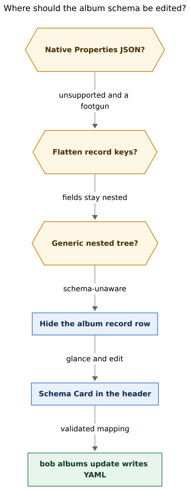
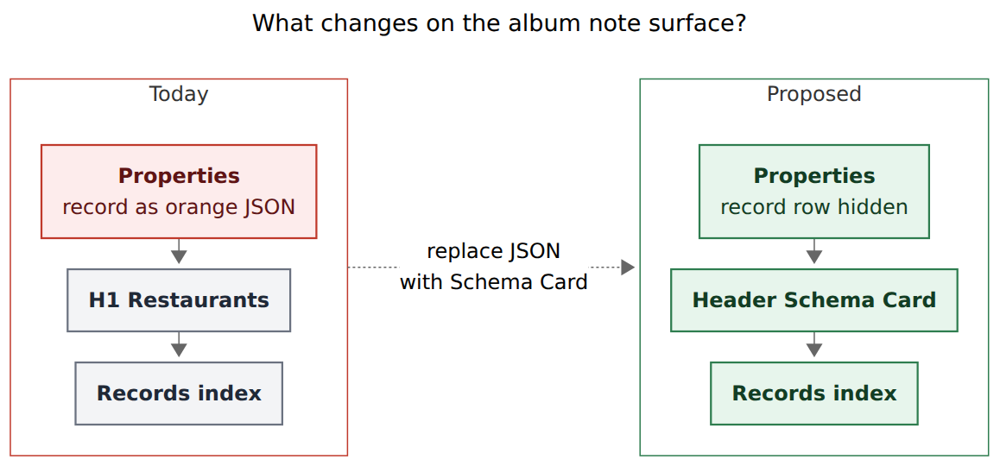
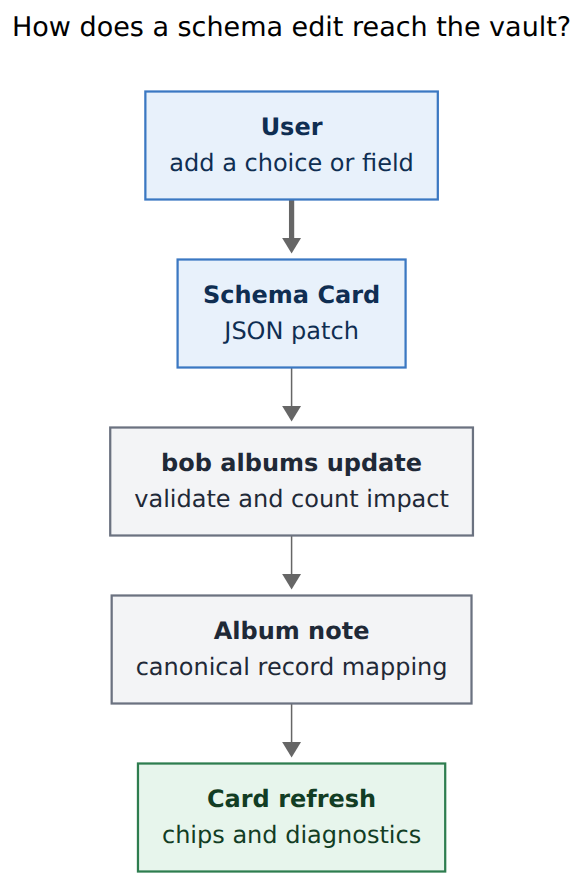

# Album `record` schema: render and edit it in Obsidian

> **Research query:** The album `record` frontmatter field currently renders as a truncated JSON blob in Obsidian Properties. How should it render, and what is the best UX for modifying it? Critique the current albums plan, adjust requirements where justified, and recommend an intuitive, reliable, and beautiful design.

## Bottom line

- **Keep the nested `record:` mapping.** It is the right storage shape. The screenshot is a presentation failure, and it is also a loaded footgun.
- **Do not try to make native Properties edit this field.** Obsidian still does not support nested properties. The orange JSON is the stock "unsupported type" rendering. Clicking it can turn a YAML mapping into a string, which bob then rejects (`record must be a mapping`).
- **Hide the `record` row on album notes only**, as `plan:202611/album_plugin_ui.md` already specified for phase `album-header` (`bob-cli-k3.7.1.4`). That slice is still in progress, which is why `eat.md` still shows the blob.
- **Promote the planned read-only schema card into an editable Schema Card.** Source-mode YAML and a paste-ready `fields:` example after `bob albums create` are how a developer ships a schema. They are not how a person should add `😍 Loved` to movies.
- **Write every schema mutation through `bob albums update`.** The plugin paints report JSON. Bob owns canonical block-style YAML, validation, impact counts, and the index rebuild. The plugin never parses schema YAML.

This is a good idea once "render properly" is read as "a schema-aware surface", and "easy to modify" is read as "a Schema Card", not "nested JSON in Properties".

## What the screenshot actually shows

The 2026-11-12 `eat` Reading-view capture (`~/tmp/screenshots/20261112_054646.png`) is the album contract working in the file and failing in the chrome.

**Properties (in-document)** already renders the album's own facts well:

| Key | Widget | Why it works |
| --- | --- | --- |
| `parent` | wikilink | scalar |
| `type` | `album` link | scalar |
| `summary` | text | scalar, ≤140 chars |
| `emoji` | text | scalar |
| `index_by` | text | scalar field name |
| `created` | timestamp text | scalar |
| **`record`** | **orange truncated JSON** | **nested mapping** |

The JSON preview starts `{"noun":"restaurant","label":"Restaurant","dated_notes":true,"fields":{"status":{…` and is cut off. That is the entire restaurant contract — noun, labels, required fields, choice emojis, `visited`/`url` kinds, legacy keys — collapsed to one unreadable row.

The **body** already shows the schema's *effect*: the `[!records]` tally `104 restaurants · 🔖 11 to try · 💚 86 liked · 🚫 7 not liked`. The definition of those chips is the blob above the H1.

The file itself is canonical block YAML (verified on disk today):

```yaml
record:
  noun: restaurant
  label: Restaurant
  dated_notes: true
  fields:
    status:
      required: true
      values:
        to_try: 🔖 To try
        liked: 💚 Liked
        not_liked: 🚫 Not liked
    category:
      required: true
      suggest: true
    location:
      required: true
      suggest: true
    visited:
      values: date
    url:
      values: url
  legacy:
  - lid
  - source_*
```

`.obsidian/types.json` has no `record` type. Obsidian therefore treats the value as an unsupported object and paints JSON. The same shape is on `podcasts.md`, `tv.md`, and `movies.md`.

The records *inside* `eat/` are a useful contrast: `status`, `category`, `location`, `visited` are flat scalars, so Properties, Bases, capture, and the Record Card all handle them. The album schema is the *form definition* for those flats. It does not belong in the same widget family.

## Critique of the current plan

The albums epic is still the right architecture. This research does not reopen A4 (top-level album scalars + one nested `record:` mapping), A5 (generated `[!records]` index), or "bob owns catalog bytes, the plugin paints".

What the screenshot exposes is a **known, accepted cost that has not been paid yet**, plus a **UX hole the original research left on purpose**.

### What already landed, and what has not

| Promise | Status today |
| --- | --- |
| Schema lives in `eat.md` as `record:` | Landed. Four albums on disk. |
| Canonical block YAML, no flow maps | Landed for the restaurant album. |
| Hide `.metadata-property[data-property-key="record"]` on album notes | **Not shipped.** `bob-cli-k3.7.1.4` is in progress. Ledger Tools has the album *report* service (`241l`/`241m`); no header fragment yet. |
| Read-only schema card in the album header | Specified, not shipped. |
| Easy schema editing | Explicitly declined. Decision draft cost: "the Properties panel cannot edit the schema". Reopen condition: "Obsidian ships nested-property editing". Edit path: Source mode + `bob albums check`. Create path: paste-ready YAML after `bob albums create`. |

The hide-the-row work would already remove the orange scar. It would not make adding a field easy. After `bob albums create`, the CLI still prints:

```text
Add fields under `record:` when the first values settle, for example:

  record:
    noun: restaurant
    fields:
      status:
        values: {to_try: To try, liked: Liked}
```

That is a developer paste. It is the current modify UX. It is why this request exists.

### The original "edit in Source mode" compromise is too timid

Schema edits are **rare and high-stakes**. There are four albums. A bad `record:` mapping isolates one route (`album_schema_invalid` with file, line, and key path). A good editor can be slower than a text field and still win, because the cost of a typo is 104 restaurants failing capture.

Source mode remains a valid *escape hatch* for Bryan-as-Vim-user. It is a poor *primary* path:

- Nested indentation is easy to break on a phone, in Live Preview, or after a Properties save of `summary` re-serializes the whole frontmatter.
- There is no in-view validation until the next `bob albums check` / capture / 3-second sync.
- Choice labels already carry the emojis the index uses. A chip UI is the natural editor for those values.
- `bob-cli-k3.7.1.4` already draws a schema card from report JSON. Leaving that card read-only wastes the surface that should own this field.

Obsidian has **not** shipped nested-property editing. Help still says nested properties are unsupported and points at Source mode. The long-running forum request ([Properties & Bases: Support multi-level YAML](https://forum.obsidian.md/t/properties-bases-support-multi-level-yaml-mapping-of-mappings-nested-attributes-nested-properties/63826)) was still being answered with community plugins in late 2025 and 2026. Waiting on core Obsidian is not a plan.

### Reliability: the JSON row can break the album

`parse_album_record_schema` requires a YAML **mapping**. Any other kind becomes `InvalidRecordType`: `record must be a mapping; got {kind}`. There is already a `recover_album_noun` helper that peels `noun` out of a **string** that looks like `{noun: restaurant, …}`. That helper exists because the orange JSON display is a shape that can leak into storage.

If Properties saves the object as a string, the album's route breaks until someone restores a mapping. Hiding the row is a safety feature, not only a visual one.

A Properties edit of a *different* key (`summary`, `emoji`) still runs Obsidian's whole-frontmatter serializer. Canonical block YAML is supposed to make that a no-op. That claim needs a fixture: edit `summary` in Properties on a scratch album and diff `record:`. If Obsidian's dump diverges (flow maps, key reorder, quoting), `bob albums sync` should rewrite `record:` back to canonical form, or the plugin should route album frontmatter writes through bob. Hide-the-row does not by itself protect YAML.

## Requirement adjustments

These change the request or the in-flight plugin plan. Each is a justified tightening, not a new product.

1. **"Render properly" means a schema-aware card, not a prettier Properties JSON widget.** Native Properties cannot represent this contract. Fighting it with CSS, a JSON textarea, or an undocumented `PropertyWidget` keeps the wrong surface.
2. **The schema card is editable.** `plan:202611/album_plugin_ui.md` currently says "read-only schema card" and "Source mode must still allow editing raw frontmatter". Keep Source mode. Make the card the editor.
3. **Keep the nested `record:` mapping.** Do not flatten `noun` / `label` / `dated_notes` to top-level keys. Those names are vault-wide in All Properties and in `types.json`. `fields` would remain an object anyway, so flattening does not remove the JSON row.
4. **Do not put the schema in a body callout.** Authored contract data in a bob-owned region (`> [!album-schema]`) was already rejected. The header card is drawn chrome, like notebook headers and bank cards.
5. **Do not adopt Nested Properties, Metadata Menu FileClass, or Meta Bind as the schema home.** Bryan has Metadata Menu installed; it is used as a `type` File preset, not as a FileClass catalog. Community nested-property plugins patch undocumented `metadataTypeManager.registeredTypeWidgets`. They are generic trees: they will happily rename `status` to `Status` across the vault. Bob's schema is typed (`choices` vs `date` vs `suggest`) and has side effects on capture, Bases, and the index.
6. **Extend `bob albums list -f json` additively** so the card can paint the whole contract. Today's album row has `fields[].{key,label,kind,required,list,choices}` plus `noun`/`label`/`plural`. It omits `dated_notes`, `legacy`, `suggest`, `default`, and numeric `min`/`max`. `bob records show restaurant -f json` already has `dated_notes` and `suggest`-like `top_values`. The plugin plan said "no YAML schema parser" — that stays true if the report grows.
7. **All schema writes go through a new `bob albums update`.** CLI rules: nest under the `albums` noun, alphabetical options, every public long option gets a short alias, JSON additive, never remove a command. This is the missing pair of `bob albums create`.
8. **Hide is album-scoped.** An unrelated note may legally have a `record` property. The land plan already asks for an "unrelated `record` property" fixture. Keep that. Cleanup restores visibility on type change, file switch, and unload.
9. **Dangerous mutations confirm with impact.** Adding an optional field or a choice is cheap. Renaming a field key, deleting a field, changing `noun`, or adding a required field against 104 existing notes needs a count (`N records would fail check`) and an explicit confirm. The card offers the safe edits in one click and parks the rest behind a stage.
10. **k3.7.1.4 can still ship the hide + glance card.** Do not overload that in-flight medium phase with the writer. Schedule the editor as the next album-plugin slice (`album-schema-editor`) so the screenshot can go away without waiting on the CLI verb.

## Options considered



**Caption:** Native Properties, flattening, and a generic nested tree all lose. Hide the album `record` row and edit the contract on a Schema Card that writes through `bob albums update`.

Rendered size: 414 × 1064 px; fit scale: 83.9%. Mermaid CLI 12.0.0, PDF-mirroring config.

| Option | What it would feel like | Why it loses |
| --- | --- | --- |
| Native Properties JSON | Click the orange blob, edit JSON | Unsupported type; truncation; mapping→string footgun; no validation; no choice chips |
| Flatten `noun`/`label`/`dated_notes` | Extra scalar rows in Properties | Vault-wide property names; `fields` still JSON; splits one contract across two UIs |
| Store `record` as a YAML string (`\|` block) | Multiline text area | Parser must re-YAML a string; easy to break; All Properties shows a wall of text |
| Community Nested Properties tree | Collapsible YAML tree in Properties | Schema-unaware; undocumented widget API; vault-wide rename/delete; no impact counts |
| Metadata Menu FileClass | Third-party schema notes | Second schema home; fights "albums own record schemas"; unused in this vault |
| Body `> [!album-schema]` callout | YAML in the note body | Authored data in a bob-owned region; every line prefixed `> `; rejected in the albums research |
| Custom `PropertyWidget` for `record` | Pretty row *inside* Properties | Same undocumented API; cramped; mixes contract with `parent`/`summary`; still the wrong metaphor |
| Source mode YAML only | Vim the mapping | Fine as an escape hatch; fails "very easy"; fails mobile; fails empty-album onboarding |
| Read-only header card (current plugin plan) | Glance without edit | Fixes the screenshot; leaves create's paste-YAML as the editor |

The winning shape is the last row **plus a writer**.



**Caption:** Today the Properties panel shows a truncated JSON `record` blob above the H1. The proposal hides that row and draws a schema-aware header card whose chips match the records index.

Rendered size: 771 × 361 px; fit scale: 84.7%.

## Recommended solution

### 1. The album page, after

Keep Properties for the scalars that already work: `parent`, `type`, `summary`, `emoji`, `index_by`, `created`. Hide only `record`, and only on `type: [[album]]` surfaces (Reading and Live Preview, in-document and sidebar). Source mode still shows the raw mapping.

Directly under that chrome, reuse the notebook-header language already in Ledger Tools (`8px` radius, `2px` area-hue start border, interface font, `0.9em`):

```text
Body › Restaurants                                   ＋ restaurant

🍽️ Restaurant · dated notes

  Status *     🔖 To try    💚 Liked    🚫 Not liked     +
  Category *   text · suggest
  Location *   text · suggest
  Visited      date
  Url          url
  Legacy       lid · source_*
```

Beauty rules, copied from chips that already exist:

- **The schema card and the `[!records]` tally share one visual vocabulary.** `🔖 To try` on the card is the same token as `🔖 11 to try` on the index. If those ever diverge, the card is wrong.
- **Required is a quiet `*`,** not the word REQUIRED.
- **Kind is muted suffix text** (`date`, `url`, `text · suggest`, `number 1888–2100`).
- **Human labels lead; keys trail.** Show `Status`, with `status` in a tooltip or as the muted identifier on the edit stage.
- **Empty schema is a teaching line**, matching the empty index: `No fields yet — add one so Name @eat/ can collect facts.` This is the `bob albums create` album, which deliberately omits `fields`.
- **Invalid schema stays on screen.** Issues from the report (`album_schema_invalid`, key path, line) paint on the card. The card never impersonates a healthy empty schema. The `＋ restaurant` copy control disables with the same reason the plugin plan already specified.
- **Light/dark and ~375 px wrap** the way owner chips already must. Field rows stack; choice chips wrap.
- **One header per source surface.** Embeds, extra panes, and unload follow the notebook-header lifecycle.

`＋ restaurant` stays a clipboard copy of `Name @eat/`. It does not open capture and does not write the vault.

### 2. The easy edits (the actual UX)

Schema work is occasional. Optimize the three gestures that will happen, and make the rest a staged confirm.

**Add a choice (most common).** Click `+` on the Status row, or click an existing chip to retitle it. A small stage asks for the stored key (`loved`) and the label (`😍 Loved`). Enter writes. The index groups and capture capsules pick up the new token on the next report.

**Add a field (onboarding after `albums create`).** A `+ Field` control at the bottom of the card. Stage: key, kind (`text` / `choices` / `date` / `link` / `url` / `number`), required, suggest, list. Defaults from `docs/records.md`: label is title-case of the key; `status` cannot have a default; reserved keys `parent`/`type`/`title`/`created` are refused. New fields insert in schema order.

**Toggle dated notes.** A single chip on the card header, because it is a boolean people will look for and it is missing from today's albums-list JSON.

**Parked behind confirm, with an impact line from bob:**

- rename field key
- delete field
- delete choice that records still use
- add a *required* field while N records lack it
- change `noun` (CLI/JSON/Mac spelling)
- change field kind / storage shape (cross-album `IncompatiblePropertyStorage`)

The glance card never inline-edits those. The stage names the count (`86 liked restaurants still have status: liked`) and offers Cancel as the default.

Clicking a field row opens the Task-Card-like Schema Card modal: reorder fields, edit kinds, manage choices. Esc / `q` / `Ctrl+[` discard. `Ctrl+Enter` commits. This is the same gesture family as `Ctrl+Shift+P` for tasks and the Mac Record Card for record *values*. Do not steal `Ctrl+Shift+P` on album notes. Expose a command-palette command (`Edit album schema`) and make the glance card clickable. Command Mode can list the same command when the active file is an album.

### 3. The write path



**Caption:** The Schema Card sends a JSON patch to `bob albums update`, which validates, writes canonical YAML, and returns the report the card paints.

Rendered size: 389 × 590 px; fit scale: 100%.

The plugin already consumes `bob albums list -f json` (schema version 1) and debounces `bob albums sync`. It must not grow a YAML parser. The writer is new:

```text
bob albums update STEM
  [-d] [-f human|json]
  [--dated-notes true|false]
  [--label LABEL]
  [--plural PLURAL]
  [--add-field KEY]
  [--kind text|choices|date|link|url|number]
  [--required] [--suggest] [--list]
  [--add-choice FIELD=VALUE --choice-label LABEL]
  [--remove-field KEY]
  [--remove-choice FIELD=VALUE]
  [--rename-field OLD=NEW]
  [--patch-json FILE|-]
```

Human flags cover the chip gestures. `--patch-json` is the plugin's one-shot commit (dry-run first, then apply), so a multi-field reorder is one transaction. Refuse incomplete required-field adds the way `bob records new` already prints a copyable draft.

Writer duties, all on bob's side:

- Span-preserving edit of the `record:` mapping in declared key order (`noun`, `label`, `plural`, `dated_notes`, `fields`, `legacy`).
- Canonical block YAML, quoted with the same `yaml_string_scalar` create already uses, so a later Properties save of `summary` stays a no-op if Obsidian dumps the same shape.
- Reuse `parse_album_record_schema` before commit; exit 2 with file/line/key-path diagnostics.
- Count existing records that would fail `bob records check` after the mutation; JSON includes `impact.errors` / `impact.warnings` so the card can confirm.
- Rebuild that album's `[!records]` index in the same transaction when group field, choice set, or `index_by` identity changes. Do not touch owner `## Albums` bytes (counts stay drawn).
- Take the maintenance lock. One scoped commit, same family as `albums: create` / `albums: sync`.

After a successful write, the existing 3-second album report revalidation repaints the card. A dry-run paints a preview on the card (`would add 😍 Loved`) without touching the file.

### 4. Glance data the report still owes the plugin

Additive JSON on each `albums[]` entry, schema version still 1:

```json
"dated_notes": true,
"legacy": ["lid", "source_*"],
"fields": [
  {
    "key": "category",
    "label": "Category",
    "kind": "text",
    "required": true,
    "list": false,
    "suggest": true,
    "default": null,
    "min": null,
    "max": null,
    "choices": []
  }
]
```

Until those keys exist, a "read-only" card cannot show dated notes, suggest, movie year bounds, or legacy, and an editor cannot round-trip them. `bob records show` already has most of this for one noun; prefer growing the shared album report so owner cards, index cards, and the Schema Card share one fetch.

### 5. What stays out

- **No second schema file** (`eat.schema.md`). The epic collapsed four artifacts into an album; do not split it again.
- **No Bases-as-schema-editor.** `eat.base` remains the interactive table of records.
- **No capture grammar for schema.** `%schema` tokens would be clever once a year and hostile every other day.
- **No plugin YAML rewrite** of `record:` on a Properties save of some other key, unless the Obsidian-dump fixture fails. Prefer matching dump shape, then canonicalize in `albums sync` if needed.
- **No Task Card overload.** Album schema is not a task property.

## Implementation slices

**Slice A — unblocks the screenshot (in-flight `album-header`).** View-scoped hide of the album `record` property. Glance card from today's report fields, plus the additive JSON above as soon as it lands. Breadcrumb and `＋ restaurant` as already specified. Tests already listed in the plugin plan: Properties isolation, type change, unrelated `record` property, empty schema, ordered choices, unload.

**Slice B — makes it easy (`album-schema-editor`, new).** `bob albums update` + Schema Card stages + command palette. Fixture the Properties-`summary` re-serialize. Impact JSON for dangerous ops. Replace the create command's paste-ready YAML with "open the album and add a field on the schema card" (keep the YAML example in `--help` and docs).

Slice A without a scheduled Slice B would repeat the original compromise. Slice B without A would edit a field the user still sees as broken JSON.

Docs: `docs/records.md` already describes the mapping. Add the card, the hide, and `albums update` there; the album plugin page (from k3.7.1) carries the chrome. CLI help follows `cli_rules.md`. No glossary edit in this work; wrap-up still owns `glossary:album-note`.

## Why this is intuitive, reliable, and beautiful

- **Intuitive.** Properties keeps the album's own facts. The schema sits in the header as the legend for the index the user already reads. Adding `Loved` is clicking `+` on the chips that already mean Loved in the list.
- **Reliable.** The mapping stays a mapping. Writes go through the same parser that capture uses. Failures stay per album. Hide is scoped. Dangerous edits say how many records would break. Source mode remains for Vim.
- **Beautiful.** The orange blob goes away. The card speaks in the same chips as the tally. The header matches notebooks and bank cards: quiet border, area hue, no settings-dump aesthetic.

## Is the broader plan a good idea?

Yes. Moving schemas into album notes was the right call (companions drift, per-album failure isolation, every collection hanging off an area). The screenshot is the cost that research predicted, arriving a phase early. Paying it with a Schema Card is cheaper than flattening the mapping or waiting for Obsidian to grow nested widgets.

The only plan change this research insists on: **treat "Properties cannot edit the schema" as a problem to solve with Bob chrome, not as a permanent cost.** Nested-property support in core Obsidian would still not replace a schema-aware card, because a generic tree does not know that `status` is a grouped choice field whose labels feed the index.

## Sources

**Vault, 2026-11-12**

- Screenshot `~/tmp/screenshots/20261112_054646.png` (eat, Reading view, in-document Properties).
- `eat.md`, `podcasts.md`, `tv.md`, `movies.md` frontmatter.
- `.obsidian/types.json` (no `record` type; `visited`/`watched_on` are dates; `summary` is text).
- `.obsidian/community-plugins.json` (Metadata Menu present; no Nested Properties plugin).
- Metadata Menu `data.json`: one preset field on `type`, `classFilesPath: null`.
- CSS snippet `dataview-properties.css` already hides selected `.metadata-property[data-property-key=…]` rows (`h`), a local precedent for album-scoped hide.

**bob-cli / plans / beads**

- `plan:202611/album_and_record_notes.md` — A4 nested mapping; hide-the-row; Source-mode edit; decision cost.
- `plan:202611/album_plugin_ui.md` — `album-header`: read-only schema card, album-only property hide, report-driven fields, no YAML parser in the plugin.
- `bob-cli-k3`, `bob-cli-k3.7`, `bob-cli-k3.7.1.4` (in progress, assignee on the header phase).
- `src/native/records/schema.rs` — `record` must be a mapping; `recover_album_noun` for string values; `ALBUM_RECORD_KEYS`; `FIELD_KEYS`.
- `src/native/albums/create.rs` — create omits `fields`; canonical `record.noun` / `record.label`.
- `src/native/albums/create_run.rs` — paste-ready `fields:` teaching.
- `src/native/albums/report.rs` — list JSON field shape (no `dated_notes` / `suggest` / `legacy`).
- `docs/records.md` — schema contract, field kinds, span-preserving record updates.
- `bob records show restaurant -f json` and `bob albums list -f json` against the live vault.
- Linked `bob-plugins`: album data fragments present; no album-header fragment; notebook header CSS at `.bob-notebook-header`; Task Card as the property-editing precedent.

**External**

- [Obsidian Help: Properties](https://obsidian.md/help/properties) — nested properties unsupported; Source mode recommended.
- [Forum: nested / multi-level YAML](https://forum.obsidian.md/t/properties-bases-support-multi-level-yaml-mapping-of-mappings-nested-attributes-nested-properties/63826) — still a plugin-shaped request through 2025–2026.
- [mnaoumov/obsidian-nested-properties](https://github.com/mnaoumov/obsidian-nested-properties) — generic tree; patches `PropertyWidget` / `MetadataTypeManager`.
- [copperbox/obsidian-nested-frontmatter-properties](https://github.com/copperbox/obsidian-nested-frontmatter-properties) — "Obsidian has no public API for custom property widgets".
- [MetaEdit: native property widgets](https://metaedit.obsidian.guide/guides/edit-properties/) — nested parent containers cannot be edited as a value (published 2026-11-09).

## About this report

Independent swarm report (`__grk`) for the 2026-11-12 request to make album `record` frontmatter render and edit well in Obsidian. Does not consult sibling swarm reports. Figures rendered with `@mermaid-js/mermaid-cli@12.0.0` and the research PDF-mirroring config.
