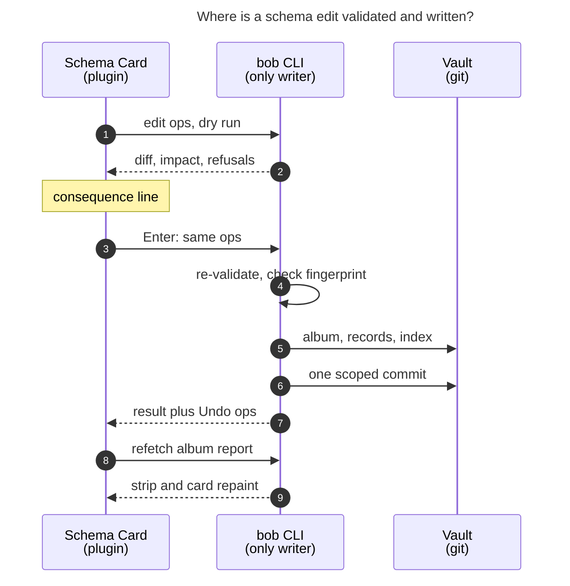

# The album `record` property: show it as a schema, edit it through bob

_Snapshot: bob 0.5.0 (bob-cli master `4835680d`), bob-plugins `564f3c1`, and the vault
as of 2026-11-12. Epic `bob-cli-k3` is in progress. Of its plugin phase (`bob-cli-k3.7`,
child epic `k3.7.1`), only the shared album data service has landed (`9c79123`). The
album header phase `bob-cli-k3.7.1.4` plans to hide the `record` row and add a read-only
schema card. It waits on `k3.7.1.3`, and no header code exists yet, so it can still be
reshaped cheaply. Researcher: cld._

## TL;DR

- **The problem is real, and it's more than looks.** Obsidian still can't show or edit
  nested frontmatter. The latest community plugin listings target Obsidian 1.14.5+ and
  still say "YAML frontmatter nests, but Obsidian's Properties editor does not." So
  `record` shows up as an "unknown type" row (the `?` icon) full of orange JSON.
  - That row is a hazard. In Obsidian 1.9.2, clicking a nested object turned it into
    `[Object object]` in the file.
  - Any Properties-panel edit re-serializes the whole frontmatter, including `record:`.
- **Adjust the framing.** `record` isn't a property of `eat.md`. It is _the list of
  properties every restaurant has_. Render it that way:
  - In the Properties row, a one-line **schema strip**: field pills styled like
    Obsidian's own property types, with required marks.
  - Behind the strip, a **Schema Card**: a keyboard-first modal that shows the whole
    schema with live usage counts.
- **"Easy to modify" has to mean "easy to modify correctly".** The edits you'll actually
  make break things when done by hand:
  - Renaming a choice key strands every record that uses it.
  - A typo in `values: date` breaks the `@eat/` route.
  - Making a field required silently invalidates older records.

  So every structured edit goes through a new **`bob albums edit`**. It does a dry run
  that previews impact, validates, migrates records on renames and merges, rebuilds the
  index, and makes one commit. The plugin only draws and collects intent. That is the
  rule the album plugin contract already set ("No UI code … parses record schemas from
  YAML").
- **Keep YAML first-class.** `y` in the card opens Source mode on the exact line, and
  bob's findings appear as lint marks on the offending YAML line while you type. This
  piece needs no new bob code.
- **Order of work:**
  1. **Now:** amend `k3.7.1.4`, plugin only, using data bob already reports. It ships
     the strip, a read-only Schema Card, the YAML jump, and lint marks, and drops the
     in-body read-only schema table.
  2. **Then:** a follow-up epic for the bob writer and the editing gestures.

---

## 1. What you're seeing, and why

### 1.1 The screenshot

In `eat.md`, the Properties panel shows six normal rows. The seventh is
`record {"noun":"restaurant","label":"Restaurant","dated_notes":true,"fields":{"status":{"r…`,
orange, with the "unknown type" icon. The frontmatter behind it is the album schema that
`bob-cli-k3` moved out of `config.yml`:

```yaml
record:
  noun: restaurant
  label: Restaurant
  dated_notes: true
  fields:
    status:
      required: true
      values:
        to_try: 🔖 To try
        liked: 💚 Liked
        not_liked: 🚫 Not liked
    category:
      required: true
      suggest: true
    location:
      required: true
      suggest: true
    visited:
      values: date
    url:
      values: url
  legacy:
  - lid
  - source_*
```

`podcasts.md`, `tv.md`, and `movies.md` have the same shape. `movies` has seven fields
and number bounds, so its row is even longer.

### 1.2 What Obsidian does with nested properties (external evidence)

| Fact | Source |
| --- | --- |
| The native Properties editor still doesn't edit nested YAML. Community plugins listing "Compatible with Obsidian 1.14.5+" say: "YAML frontmatter nests, but Obsidian's Properties editor does not." | [Nested Properties plugin](https://community.obsidian.md/plugins/nested-properties) |
| There is no public API for custom property widgets. Plugins that render nested values register "a widget in `metadataTypeManager.registeredTypeWidgets` and wrap `getTypeInfo`". | [Nested Frontmatter Properties plugin](https://community.obsidian.md/plugins/nested-frontmatter-properties) |
| Nested values show as "unknown type" properties with long JSON strings. The feature request is years old and still open. | [Forum: multi-level YAML request](https://forum.obsidian.md/t/properties-bases-support-multi-level-yaml-mapping-of-mappings-nested-attributes-nested-properties/63826) |
| In 1.9.2, clicking a nested object in Properties wrote `[Object object]` into the file. It was acknowledged as a 1.9 regression, with "we will fix this for the next release". The thread names no fixed version. | [Forum: Object object](https://forum.obsidian.md/t/clicking-on-object-in-metadata-overwrites-it-to-object-object/102223) |
| "If you use the Properties UI at all, the YAML will be reformatted." Every Properties-panel save re-serializes the whole frontmatter. | same thread |

### 1.3 A correction to the k3 plan's risk table

The k3 plan says: "A Properties-panel save re-serializes the schema YAML → Canonical
block YAML makes a re-serialize a no-op." That claim is only nearly true:

- In `eat.md`, `legacy:` is written as an **unindented** block sequence (`  legacy:` then
  `  - lid`). That is serde_yaml's style. It arrived in vault commit `d7577a21a`.
- I sampled 396 notes that have a `tags:` or `aliases:` list. In every one, the first
  item is **indented** two spaces. That fits Obsidian writing indented sequences.
- So a `summary` edit in the Properties panel would probably rewrite the bytes of the
  `record:` block, though not its meaning. bob parses semantics, and the album data
  service fingerprints content, so nothing breaks today.

Even so, the claim should be corrected. bob's future schema emitter should also write
the style Obsidian writes, so a re-serialize really is a no-op. The real-Obsidian e2e
should check this round-trip (§5.8).

### 1.4 What the plan in flight would do

`k3.7.1.4` (from `plan:202611/album_plugin_ui.md`):

- hide `.metadata-property[data-property-key="record"]` on album notes;
- add a read-only schema card to the album header in the note body;
- leave Source mode as the only way to edit.

That fixes "ugly", but not "easy to modify", and it gives no protection on the edits
that matter (§2).

---

## 2. Critique: is this a good idea?

**Yes. Do it, and do it before `k3.7.1.4` builds the hide-only version.** Three points
shape the design.

### 2.1 Rendering it "as a property" is the wrong goal

The Properties panel is a flat list of key/value rows. A schema is a list of _property
declarations_: five to seven fields, each with a kind, flags, and choices. If you cram
the whole thing into one row, you get a cramped widget. If you hide it, you remove the
only place someone would look for it, and the status bar still says "7 properties"
while the panel shows six.

The useful framing: **the `record` row should read like a preview of a record's
Properties panel.** Each field appears as a property-type pill, using Obsidian's own
type icons where they exist (text, number, date).

### 2.2 The full schema doesn't belong in the album's body

A read-only schema table in the header pushes the `[!records]` index down by about eight
lines every time you open `eat.md`. That is the page's main job, and you need the schema
a few times a year. The schema should take one line until you ask for more. Then it
should open as a focused surface, not as more page.

### 2.3 "Easy to modify" must mean "easy to modify correctly"

These are the edits that actually happen, and what hand-editing the YAML does to each:

| Edit | Records touched? | Result when hand-edited in YAML today |
| --- | --- | --- |
| Add a choice (`⏸️ Paused` for tv) | No | Fine, if the indentation is right. |
| Change a choice's label or emoji | No | Fine. The index and catalog relabel on the next sync. |
| Reorder choices | No | Fine. Index groups follow declared order. |
| Add a field | No | Fine, unless its storage shape conflicts with the same key in another album (`year` is a number in movies). Then capture refuses for the whole album. |
| Make a field required | No, but it validates them | The 12 restaurants without a value quietly fail `bob records check`. |
| **Rename a choice key** (`liked` → `loved`) | **Yes: 86 records** | **Every record using it drops into "⚠️ need a status".** |
| **Rename a field key** (`category` → `cuisine`) | **Yes: 104 records** | The old values become unknown keys, the field is "missing" everywhere, and the data is effectively orphaned. |
| **Remove a used choice or field** | Yes | The same stranding, or silent data loss. |
| Typo (`values: dat`) | No | `@eat/` refuses with a file:line diagnostic. You learn about it at capture time, not while editing. |

A generic nested-YAML tree editor makes the bottom half of this table **easier to get
wrong**. The value in "easy to modify" is intent-level gestures (rename this choice;
merge these two) with a stated consequence before Enter.

---

## 3. Requirement adjustments (called out)

| # | Your requirement | Adjustment | Why |
| --- | --- | --- | --- |
| **R1** | "Make the `record` field render properly" | Render it **as a schema**. A one-line strip of field pills sits in the Properties row, and the full view lives in a Schema Card. The schema is not drawn as nested data in the panel. | §2.1, §2.2 |
| **R2** | "Very easy to modify" | Easy **and safe**. Structured edits go through bob (validated, impact-previewed, records migrated, one commit). The plugin never writes YAML. | §2.3. This matches the album plugin contract and the thin-client precedent (`decisions:mac-capture-is-a-thin-client`). |
| **R3** | (implicit) | **YAML stays a first-class path.** `y` jumps to the exact line in Source mode, and bob's findings appear on the offending line. Kind changes and other rare edits live here. | You're fastest in vim. A form should never be the only way in. |
| **R4** | (in flight, `k3.7.1.4`) | **Drop the read-only schema table from the album body.** The header gets a quiet **Schema** button next to `＋ restaurant`. | The page is for records (§2.2). |
| **R5** | (k3 plan claim) | **Correct the "re-serialize is a no-op" claim.** bob's schema emitter writes Obsidian's YAML style (indented sequences). | §1.3 |
| **R6** | (scope) | Out of scope: renaming an album or its noun (that's a future `bob albums rename`), and changing a field's kind (YAML only in v1). | Both move folders or rewrite values. Each deserves its own design. |
| **R7** | (adjacent, not requested) | Noted as a follow-up only: record notes show raw choice keys (`status: to_try`) in their own Properties panel. The same schema could later drive a record-property editor. | This is the higher-frequency edit. It should not grow this task. |

---

## 4. Options considered

| Option | Render | Edit | Verdict |
| --- | --- | --- | --- |
| **O1. Hide the row, read-only header card, edit in Source mode** (current `k3.7.1.4`) | Hidden row plus a body table | Hand YAML, feedback only from `bob albums check` or a capture refusal | **Not enough.** Fixes the ugliness, but not ease or correctness (§2). |
| **O2. Install a generic nested-property plugin** (Nested Properties, Nested Frontmatter Properties, or Metadata Menu's Object fields; Metadata Menu is already installed) | A generic tree in the panel | Generic in-place edits through `processFrontMatter` | **Reject.** It makes renames and removals easy to do wrong, with no validation, impact preview, or migration. It hooks undocumented internals for every note, and it looks nothing like Bob. Your own plugins avoid `processFrontMatter` because it re-serializes (`211-parent-frontmatter-plan.js`). |
| **O3. A custom property widget through Obsidian's internal type registry** | Native-feeling widget inside the row | Through our card | **Not now.** The registry is undocumented. Property types are vault-wide per key (`types.json`), so the widget would claim every note's `record` key, and other plugins already monkeypatch the same lookup. Revisit if Obsidian publishes a property-widget API. |
| **O4. Flatten the schema into top-level properties** | Native rows | Native rows | **Reject.** Already rejected in the k3 research: it pollutes the vault-wide property-type table with generic names, cannot express labelled choices, and adds 10+ rows. |
| **O5. Move the schema into a body code block** (```` ```bob-schema ````, drawn by a code-block processor) | A beautiful native block; click to edit raw | YAML in place, with vim | **Reject.** It reverses an accepted, already-migrated decision. Capture's one-file-head route read gets slower. `metadataCache`, Bases, and Dataview lose sight of the schema. The authored schema would also sit next to the bob-owned index. |
| **O6. Schema strip, Schema Card, bob writer, YAML jump with lint marks** | One-line strip in the row; full card on demand | Intent gestures through `bob albums edit`, plus YAML | **Recommend.** |
| **O7. O6 without the bob writer** (strip, read-only card, YAML jump, lint marks) | Same as O6 | YAML with live findings | **Ship first**, as the amended `k3.7.1.4`. It needs no bob change and is the foundation O6 builds on. |

---

## 5. The design

### 5.1 The schema strip (the `record` row, album notes only)

```text
 ⊞ record    Restaurant ·  ▾ Status ●   Aa Category ●   Aa Location ●   ◷ Visited   ↗ Url      ✎
```

- **What changes:**
  - On an album note, the row's native value cell is hidden by a view-scoped CSS class.
    The "unknown type" widget therefore can't be clicked, and the `[Object object]`
    hazard is gone.
  - A strip element is painted in its place.
  - The key icon changes from `?` to a schema glyph (Lucide `table-properties`).
  - The key name stays `record`, so the panel stays honest about the frontmatter.
- **Pills:**
  - One pill per field, in declared order, styled like Obsidian's own multi-select
    pills, so the row reads as native.
  - Kind icons reuse Obsidian's property-type icons where one exists: text, number
    (`binary`), and date (`calendar`). Choices get a select glyph, URL a globe, and link
    the note-link glyph.
  - Terminal parity: `bob records show` prints `▾ Aa ◷ ↗ #`. Its single `↗` for both link
    and URL should split, so the two surfaces can agree.
- **Required** is a small filled dot plus the word "required" in the tooltip, so color is
  never the only signal.
- **Hover** shows a tooltip on any pill: the kind, flags, and choices (for Status:
  `🔖 To try · 💚 Liked · 🚫 Not liked`).
- **Click:**
  - Clicking a pill opens the Schema Card with that field selected.
  - Clicking `✎` or empty strip space opens it with the first field selected.
- **Data:**
  - The strip draws from the existing album report (`bob albums list -f json` `fields[]`:
    key, label, kind, required, list, choices) through the shared album data service.
  - It never parses YAML.
  - While a report is loading, it paints the last-good report. With no report at all, it
    shows a neutral `Schema · loading` pill, never the raw JSON.
- **Invalid schema:** the strip turns into one red line,
  `Schema invalid · line 24 · record.fields.location.values`, with a **Fix** action that
  jumps to that line (§5.4). The data is the report's `issues[]`, which already carry
  `line`, `key_path`, `message`, and `suggestions`.
- **Scope rules:**
  - Only notes the report identifies as albums get the strip. A non-album note with an
    unrelated `record` key keeps Obsidian's native row; the `k3.7.1` e2e already plans
    that fixture.
  - Live Preview and Reading view both get it.
  - Source mode shows raw YAML as usual.
  - Teardown restores the native cell on type change, file switch, and unload.
- **Robustness:**
  - The plugin already targets `.metadata-property[data-property-key=…]` (the notebook
    `summary` focus in `241d-plugin-notebook-catalog.js`).
  - The Properties panel re-renders rows on every metadata change. So the strip
    re-applies itself from a scoped `MutationObserver` on the metadata container, plus
    the existing layout and metadata events.
  - If decoration fails, the CSS still hides the native value. The failure mode is "row
    shows only its key", never corruption.
- **Mobile:** the plugin isn't desktop-only, but bob subprocesses are. Without a report,
  the strip draws field-name pills from `metadataCache`'s already-parsed frontmatter.
  These are read-only, with **Edit YAML** as the only action. If you never use Obsidian
  mobile, skip this.

### 5.2 The album header

`Body › Restaurants      ＋ restaurant   ⊞ Schema`

These are the two verbs of an album: _add a record_ and _change what a record is_. The
**Schema** button opens the same card as the strip, so there is still a way in when the
Properties panel is hidden by setting. There is no schema table in the body (R4).

### 5.3 The Schema Card

The card is a modal in the Task Card idiom: keyboard-first, with a consequence line
before Enter. It opens three ways: from the strip, from the header button, and from a
command, **Edit album schema** (also in Command Mode). The command works on an album
_and_ on a record note, where it resolves to the record's album. That covers the
moment you most often want a new choice: while looking at a restaurant.

```text
╭─ 🍽️  Restaurant properties ─────────────────────────────── Body › Restaurants ─╮
│  104 restaurants · dated notes · grouped by Status, sub-grouped by Location      │
├──────────────────────────────────────────────────────────────────────────────────┤
│ ▸ ▾ Status       required · groups the index                                     │
│       🔖 To try 11    💚 Liked 86    🚫 Not liked 7    ＋                         │
│   Aa Category    required · suggests      Breakfast 21 · Coffee 11 · Misc 5 …    │
│   Aa Location    required · suggests · sub-groups the index                      │
│   ◷ Visited      date · set on 2 of 104                                          │
│   ↗ Url          url · set on 31 of 104                                          │
│   ＋ Add property                                                                 │
├──────────────────────────────────────────────────────────────────────────────────┤
│  adds 🔁 Regular after 💚 Liked · no record changes · empty until used            │  ← consequence line
├──────────────────────────────────────────────────────────────────────────────────┤
│  Legacy keys kept: lid · source_*                                                │
│  ⏎ edit  a add  c choice  r rename  ! required  s suggest  ⌥J/⌥K move            │
│  m merge  ⌃D remove  y YAML  u undo  esc close                                    │
╰──────────────────────────────────────────────────────────────────────────────────╯
```

**Look.**

- The accent is the owner root's hue, the same resolver the `[!albums]` card uses.
- Choice pills show live counts in tabular numerals. Keys appear dim in monospace only
  where they matter (rename, add).
- Rows read "kind · flags · what it does to the index", so `index_by` and grouping are
  visible where you edit them.
- It works in light and dark. On narrow panes, pills wrap below the field name.

**Gestures** (Task Card conventions where they overlap):

| Key | Action |
| --- | --- |
| `↑/↓`, `j/k`, `Ctrl+N/P` | Move between fields, and into a field's choices once expanded |
| `Enter` | Field: open its stage (label, required, suggest, list, default, min/max). Choice: edit its label and emoji inline |
| `a` | Add property after the selection: label (bob previews the derived key), kind by digit (`1` text, `2` choices, `3` date, `4` number, `5` link, `6` url), flags, and choices one per line |
| `c` | Add a choice to the selected choices field (`🔁 Regular`; bob derives `regular`) |
| `r` | Rename the selected field or choice **key**. The consequence line counts the records it rewrites |
| `!` / `s` | Toggle required / suggest |
| `Alt+J` / `Alt+K` | Move the field or choice down or up. For the group field this reorders the index groups |
| `m` | Merge the selected choice into another (a picker). It rewrites those records and removes the choice |
| `Ctrl+D` | Remove. Unused means it is removed at once. Used means it is refused with a merge or "keep as legacy" offer (below) |
| `y` | Open Source mode at this row's YAML line (§5.4) |
| `u` | Undo the last schema edit (bob's inverse ops) |
| `Esc`, `q`, `Ctrl+[` | Close. Backspace on an empty input goes back a stage |

**Consequence lines** (computed by bob's dry run, shown before Enter):

| Gesture | Line |
| --- | --- |
| Add choice | `adds 🔁 Regular after 💚 Liked · no record changes · empty until used` |
| Relabel | `💚 Liked → ❤️ Liked · 86 records keep liked · index and catalog repaint` |
| Rename choice key | `liked → loved in 86 records · one commit · u undoes` |
| Required on | `12 restaurants have no category · they'll show in bob records check` |
| Remove used field | `keeps 31 url values: url joins legacy · ⌃D again also deletes the values` |
| Remove used choice | refused: `7 restaurants are 🚫 Not liked · m merges them into another choice` |
| Storage-shape clash | refused: `year is a number in movies · shared keys must store the same way` |

**Two deliberate breaks from Task Card behavior:**

1. **The card stays open after a write** and repaints from the new report. Schema edits
   come in short bursts (add two choices, reorder). The Task Card's "every write closes
   the card" rule fits one-shot task edits and would be friction here.
2. **One gesture is one commit.** There is no staging tray. Each edit gets an Undo toast
   (`Added 🔁 Regular · Undo`), and `git revert` works on any of them.

### 5.4 Edit YAML: the escape hatch

- `y` (or **Fix** on an invalid strip) switches the pane to Source mode and puts the
  cursor on the selected field's key line.
  - Key lines come from a new `line` on each report field and choice (§5.6).
  - Until that lands, the jump uses the `record:` line.
  - The plugin already drives `leaf.setViewState` in other features.
- **Lint marks:**
  - When the album data service refetches after an edit (it already debounces frontmatter
    changes by 3 seconds), each `issues[]` entry with a `line` becomes a CodeMirror
    underline on that line.
  - The tooltip carries bob's message and suggestions (`unknown kind dat; did you mean
    date?`).
  - This uses data bob ships today.
- **Return:** a small banner offers **Done**, which returns the pane to Live Preview.
  Done is disabled with a reason while the schema has errors, so you can't walk away from
  a broken album without seeing it.
- Kind changes (text to choices), field options the card doesn't model, and anything
  else unusual are edited here.

### 5.5 bob: the writer (`bob albums edit`)

```text
bob albums edit STEM [-b DIR] [-d] [-f human|json] [-i FILE]
```

- **Input:** a JSON edit request from `-i FILE` (`-` for stdin). Clients use stdin, and
  humans can pipe a heredoc. The options follow the CLI rules: alphabetical, each with a
  short alias, under the Vault section with the other `albums` verbs.

```json
{
  "schema_version": 1,
  "expect": "sha256:…",
  "ops": [
    { "op": "choice.add", "field": "status", "label": "🔁 Regular", "after": "liked" },
    { "op": "choice.rename", "field": "status", "value": "liked", "to": "loved" }
  ]
}
```

| Op | Records rewritten | Notes |
| --- | --- | --- |
| `field.add {label, key?, kind, required?, suggest?, list?, choices?, after?}` | no | bob derives `key` from `label` and checks storage shape across albums |
| `field.set {key, label?, required?, suggest?, list?, default?, min?, max?}` | no | `list` toggles are refused when existing values disagree |
| `field.move {key, after\|before}` | no | |
| `field.rename {key, to}` | **yes** | Renames the key in every member record, span-preserving |
| `field.remove {key, values: "legacy"\|"delete"}` | `delete` only | The default `legacy` adds the key to `legacy:` so records stay valid and keep their data |
| `choice.add {field, label, value?, after?}` | no | bob derives `value` from the label with the emoji dropped |
| `choice.set {field, value, label}` | no | Relabel or re-emoji |
| `choice.move {field, value, after\|before}` | no | |
| `choice.rename {field, value, to}` | **yes** | |
| `choice.merge {field, value, into}` | **yes** | Rewrites then removes `value` |
| `choice.remove {field, value}` | no | Refused while any record uses it (teaches `merge`) |
| `album.set {label?, plural?, dated_notes?, index_by?, index_facets?}` | no | `noun` is read-only (R6) |

**Guarantees.** These reuse what `albums sync` and `records update` already do.

1. **Validation:**
   - It validates the **post-image** with the same album schema validator, and refuses
     rather than write an invalid schema.
   - Dependent references are updated or refused, never left dangling: `index_by`,
     `index_facets`, and the group field.
2. **Concurrency:** `expect` is a fingerprint of the album's `record` block from the
   report the card rendered. A mismatch refuses with the existing stale-note error, so an
   edit from another host or from Source mode is never overwritten.
3. **Writes:**
   - The album frontmatter is edited **span-preserving**: only the `record:` block (and
     `index_by`/`index_facets` when changed) is re-emitted, in Obsidian's YAML style
     (R5), and every other byte stays.
   - Record migrations use the existing span-preserving record update planner.
4. **One transaction:** the album, migrated records, and rebuilt `[!records]` index form
   one guarded multi-file write, with preimage guards like `albums sync`. It takes the
   maintenance lock, runs a pre-sync, makes **one scoped commit**
   (`albums: edit eat.md (status +regular)`), then runs a post-sync.
5. **Dry run:** `-d` returns:
   - the album diff;
   - `records: {rewritten, paths}`;
   - warnings, such as newly invalid records when a field becomes required;
   - the derived keys;
   - the consequence text.

   It takes no locks and makes no writes.
6. **Undo:** a committed result includes `inverse_ops`. The card's `u` replays them as
   a normal edit, which keeps the git history linear and honest.
7. **Exit codes:** 0 on success, 2 on refusals and usage errors, and 1 on runtime
   failures. The JSON envelope uses `schema_version: 1`, like the other album commands.

### 5.6 bob: the read model (additive JSON)

The card needs a little more than today's report. All additions are additive; no
contract break.

- **`bob albums list -f json`:** each `fields[]` entry gains `line`, `suggest`,
  `default`, `min`, `max`, `filled` (records with a value), and per-choice `count`. Each
  album gains `dated_notes`, `legacy`, and `schema_fingerprint`.
- **`bob records show -f json`** already has `default`, `top_values`, `dated_notes`, and
  `count`. Mirror the same additions there so the two surfaces stay one model.
- **Latency:** `bob albums list -f json` takes 0.36–0.47 s on apollo (three runs, full
  vault), and `bob records show restaurant -f json` takes about 0.33 s. That is fine for
  opening a card from a cached report and for one dry run per gesture after a typing
  pause. It is too slow for every keystroke, so the card debounces.

### 5.7 How one edit flows



_The plugin only draws and collects intent. bob validates, previews impact, and writes
the album block, the migrated records, and the index in one guarded commit, so the
editor can never write a broken schema or strand records. Everything here is proposed
except `bob albums list`._

### 5.8 Reliability checklist (for the plan's acceptance)

- [ ] In the real-Obsidian e2e: edit `summary` through the Properties panel on an album,
      then assert that the `record` block is semantically unchanged and (after R5)
      byte-identical.
- [ ] Clicking or tabbing through the strip never focuses Obsidian's unknown widget, and
      no write happens.
- [ ] The strip survives Properties re-renders, type changes, file switches, multiple
      panes, and unload. A non-album `record` key stays native.
- [ ] Every card gesture runs a dry run first. Refusals render inline and write nothing.
- [ ] A stale `expect` refuses. An edit made in Source mode between opening and Enter is
      never lost.
- [ ] A rename or merge rewrites exactly the counted records in one commit. `u` restores
      them.
- [ ] An invalid schema shows a red strip and lint marks at bob's line, and **Done**
      won't leave Source mode while errors stand.
- [ ] Records index and owner catalog are current after every edit, with no extra sync.
      The album data service treats the writer's own commit as already synced.

---

## 6. How to land it

1. **Amend `bob-cli-k3.7.1.4` now** (plugin only, medium). Replace "hide the record row
   plus read-only header schema card" with:
   - the schema strip (§5.1);
   - the header's **Schema** button (§5.2);
   - a **read-only** Schema Card (§5.3 layout, no gestures; it uses only today's report
     fields);
   - **Edit YAML** with lint marks and Done (§5.4).

   The card becomes editable later without being rebuilt. This needs no bob change and
   doesn't disturb the rest of `k3`.
2. **Follow-up epic: "Album schema editing"**, after `k3` lands:
   - **bob read model** (§5.6) and an emitter that writes Obsidian's YAML style (R5).
     Small to medium.
   - **`bob albums edit`** (§5.5): ops, dry run, impact, validation, migrations, one
     transaction, inverse ops. Large. Its docs go in `docs/records.md`, the CLI
     reference, and `json-outputs.md`.
   - **Editable Schema Card**: gestures, consequence lines, Undo, the record-note entry
     point, and the Command Mode entry. Medium to large.
   - **End-to-end proof** in real Obsidian: the §5.8 checklist, light/dark, a 375 px
     pane, and docs.
3. **Decision record (candidate; needs your approval and the memory-write flow).**
   "Album schemas are edited through bob." The plugin presents, bob writes, and YAML
   stays first-class. It **reopens when** Obsidian ships a public property-widget API or
   native nested-property editing (then O3 replaces the DOM strip), or when a second
   non-bob writer appears.

## 7. Risks and open questions

| Risk | Handling |
| --- | --- |
| The DOM strip depends on Properties-panel class names | These names are what themes and CSS snippets target, and the plugin already relies on them. It is feature-detected, and failure degrades to a hidden value cell, never to corruption. |
| Obsidian adds nested editing natively | Good news: keep the card for intent edits and migrations, and reconsider the strip. |
| Commit noise from one-gesture-one-commit | A burst of five edits is five small, revertable commits. The vault already takes many. A "batch" mode can come later if it ever bothers you. |
| Field-key renames collide with `legacy` patterns or with keys in other albums | Refused in the dry run, with the clash named. |
| Old bob on another host | All hosts are album-aware since the k3 cutover. Ops only produce schema shapes the current bob already reads. |

**Questions for you:**

1. Do you use Obsidian on mobile? If not, the §5.1 mobile fallback can go.
2. Should `Ctrl+Shift+P` (the Task Card chord) open the Schema Card on album notes?
   Albums hold no tasks, so the chord is otherwise idle there, and "Ctrl+Shift+P edits
   the properties of what I'm on" is a nice rule. I'd only add it if you want the chord
   overloaded.

## 8. Recommended solution

**Render `record` as a schema, and edit it through bob.**

1. **Render:**
   - On album notes, replace the raw `record` value with a **one-line schema strip**:
     native-looking field pills with kind icons and required marks, a schema icon, and
     a red invalid state that points at bob's line.
   - Put a **Schema** button next to `＋ restaurant` in the album header.
   - Show no schema table in the body.
   - Non-album notes stay native.
2. **View in depth:** a keyboard-first **Schema Card** with live usage counts. It opens
   from the strip, the header, or an **Edit album schema** command that also works from
   any record note.
3. **Edit:**
   - Intent gestures in the card (add or relabel or reorder a choice, add a field,
     required or suggest, rename or merge with record migration, remove-as-legacy). Each
     shows a consequence line, and Undo is available.
   - Every gesture applies through a new **`bob albums edit`** that validates the
     post-image, guards against stale edits, migrates records, rebuilds the index, and
     makes **one** commit.
   - **YAML stays first-class:** `y` jumps to the exact Source-mode line, bob's findings
     appear inline, and Done refuses to leave a broken schema.
4. **Sequence:**
   - **Now:** amend `k3.7.1.4` to ship the strip, the read-only card, and YAML with lint
     marks. No bob changes are needed.
   - **Next:** a follow-up epic for the bob writer and the editable card.
   - **Also:** correct the plan's "re-serialize is a no-op" claim, and have bob emit
     Obsidian's YAML style.

This is the intuitive path (the field reads like the properties it declares), the
reliable path (one writer, dry-run impact, guarded transactions, nothing stranded), and
the beautiful one (one quiet line on the page, and a hue-accented card when you want
it).

---

### Sources

- Screenshot `~/tmp/screenshots/20261112_054646.png`. Vault `eat.md`, `podcasts.md`,
  `tv.md`, and `movies.md` frontmatter, and vault commit `d7577a21a`.
- `plan:202611/album_and_record_notes.md` (contract, plugins-albums section, risk
  table), `plan:202611/album_plugin_ui.md` (album-header phase), and beads
  `bob-cli-k3`, `k3.7`, `k3.7.1`, and `k3.7.1.4`.
- `research:202611/album_and_record_notes/album_and_record_notes.md` ("Making nested YAML
  livable in Obsidian").
- bob-cli `docs/records.md`, `src/native/albums/report.rs` (`AlbumField`,
  `AlbumIssue`), `src/native/records/cli.rs` (kind glyphs), and live
  `bob records show restaurant` and `bob albums check -f json`.
- bob-plugins `241d-plugin-notebook-catalog.js` (Properties-row targeting),
  `211-parent-frontmatter-plan.js` (why the plugins avoid `processFrontMatter`),
  `241f-plugin-notebook-header.js`, `docs/task-card.md`, and the manifests.
- The vault's `.obsidian/types.json` and `community-plugins.json`, and the
  obsidian-linter settings (only `add-blank-line-after-yaml`).
- [Nested Properties plugin](https://community.obsidian.md/plugins/nested-properties)
- [Nested Frontmatter Properties plugin](https://community.obsidian.md/plugins/nested-frontmatter-properties)
- [Better Properties plugin](https://community.obsidian.md/plugins/better-properties)
- [Forum: Clicking on object in metadata overwrites it to Object object](https://forum.obsidian.md/t/clicking-on-object-in-metadata-overwrites-it-to-object-object/102223)
- [Forum: Properties & Bases: support multi-level YAML](https://forum.obsidian.md/t/properties-bases-support-multi-level-yaml-mapping-of-mappings-nested-attributes-nested-properties/63826)
- [Forum: Support for YAML dictionaries as nested properties](https://forum.obsidian.md/t/support-for-yaml-dictionaries-as-nested-properties/112440)
