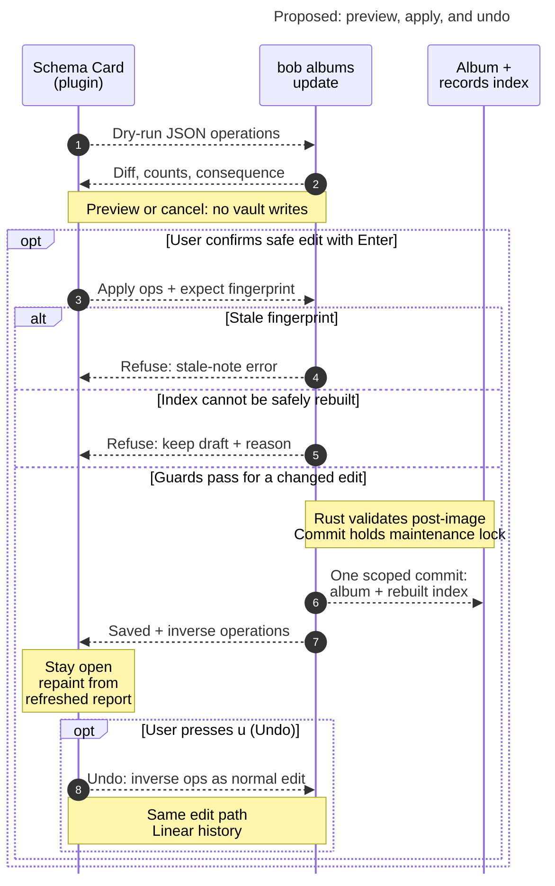

# Diagram proposals: The album `record` property: hide the row, read it in the header, edit it through bob

Proposals for the swarm linker, not a report. Each diagram restates only what the source
report says.

```yaml
source: research:202611/album_record_schema_ux/album_record_schema_ux__final.md
producer: research.4b.image
check: "mmdc 12.0.0 with Puppeteer --no-sandbox and the PDF-mirroring config rendered 1 of 1 Mermaid diagrams; broken-input check exited nonzero"
```

## reversible-schema-edit

```yaml
anchor: |-
  Safe ops commit on Enter, one gesture = one scoped commit, with an Undo toast backed
question: |-
  How does a schema edit become a preview, a guarded commit, and a reversible change?
illustrates: |-
  For schema edits requiring an index rebuild, the Schema Card shows dry-run consequences before Enter, bob guards the scoped commit, and inverse ops keep Undo on the normal edit path.
caption: "When an edit needs an index rebuild, bob guards the commit and Undo uses the same edit path."
review: "691x974 px, fit 91.7%; question, source trace, labels, arrowheads, reading direction, and visual checks passed; 1 visual revision, 1 syntax fix; 2 look rounds"
```


