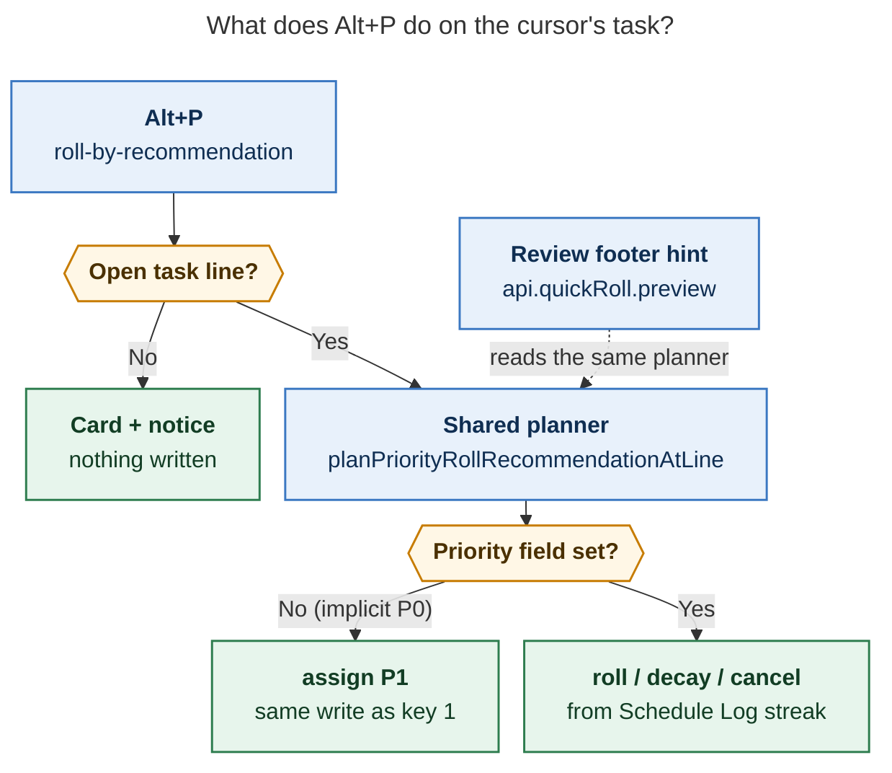
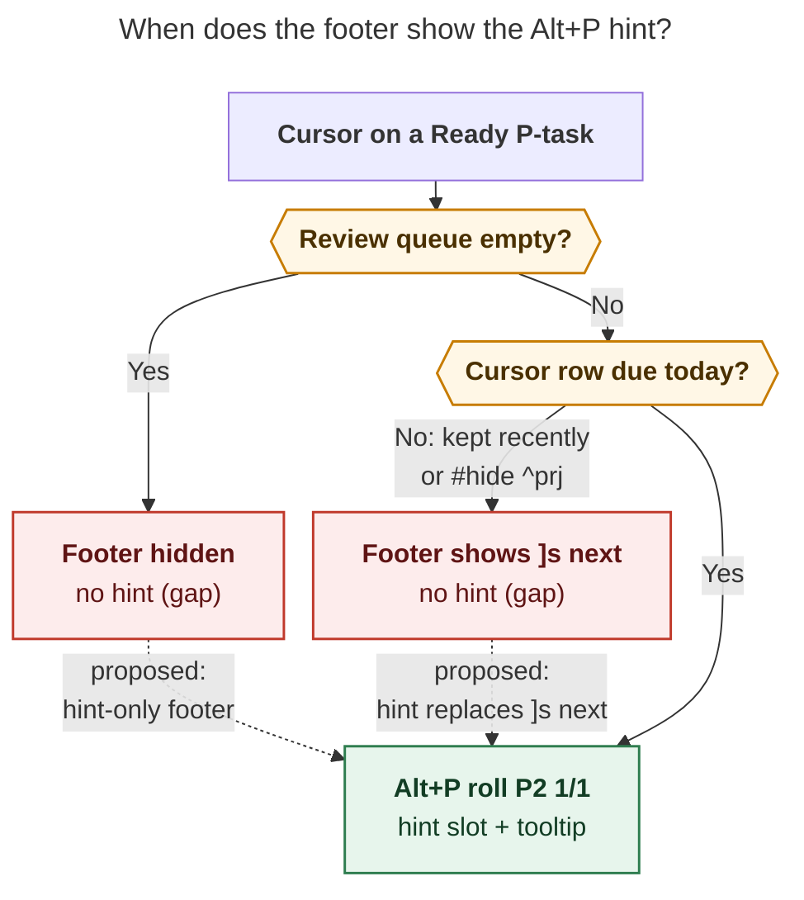

# Alt+P: "press `1`, or take the footer's recommendation"

> **Research query:** The `<alt+p>` keymap in Obsidian should behave as if `1` were
> pressed on the Task Card when the selected task has no priority. When the task does
> have a priority, it should use the recommendation shown in Obsidian's footer, and the
> footer should always show that recommendation for Ready tasks with a `priority` field.
> Do these constraints hold today? If not, why not? Can we fix it, and should we?

## Bottom line

| # | Constraint | Holds today? | Why |
| --- | --- | --- | --- |
| 1 | No priority → same as pressing `1` | ✅ **Yes**, for every Ready task | Since `14dc9d9` (Oct 30) the shared planner returns an `assign` recommendation for the level bound to key `1`. A probe shows byte-identical writes. |
| 2 | Has a priority → do what the footer recommends | ✅ **Yes** | The footer and Alt+P call the same planner on the same cursor line. |
| 3 | The footer *always* shows the recommendation for Ready P-tasks | ❌ **No** | This is by design: the hint shows only while the cursor is on a row that is **due in today's review queue**, and the whole footer hides once the queue is empty. |

**Recommendation:** fix #3 with a small change in bob-ledger-tools only. The nav API
already previews any line, so bob-navigation-hotkeys needs no change. Leave #1's two
edge cases alone, because neither can happen on a Ready task. Add one test that pins
Alt+P against key `1` itself.

## How Alt+P decides

*Figure 1. Alt+P and the footer read one planner. That is why constraints 1 and 2
hold: the no-priority branch is the key-`1` write, and the prioritized branch is exactly
what the footer previews.*

## Constraint 1: no priority → key `1` ✅

- **Mechanism.** When the priority field is empty,
  `planPriorityRollRecommendation` (`bob-navigation-hotkeys/src/040-priority-roll.js:42`)
  returns `kind: "assign"` with `levels[0]`, the level bound to card key `1`. Alt+P
  writes it through `applyRecommendedAssignWrite` → `setBulletPriorityValue`, the same
  writer key `1` uses. With your config that sets `[priority:: high]` and rolls a date
  3–8 days out.
- **Probe.** I drove the real plugin harness twice per row, once with Alt+P and once
  with the card opened and `1` pressed, using the same base date and random source:

  | Row | Alt+P vs `1` |
  | --- | --- |
  | Ready task, scheduled date in the past | identical |
  | Ready task, no `scheduled` field | identical |
  | Task whose scheduled date already lies *inside* P1's window (so it is Blocked, not Ready) | **differs.** Alt+P never re-picks the current date, so it writes a new date and logs it. Key `1` can land on the same date (1 chance in 6 with 3–8d) and log nothing. |
  | Plain bullet, not a task | **differs.** Alt+P opens the card with "No priority to roll — pick a level (1–4)", while `1` writes P1. |

- **Verdict.** Both differences fall outside "the selected **Ready task**". A Ready
  task's scheduled date is today or earlier, so it can never sit inside a window that
  starts 3+ days out. Leave both alone: a roll key that always moves the date is the
  better behavior. If you want strict parity anyway, it is a one-line change: swap
  `rollPriorityRecommendationDate` for `rollPriorityScheduledDateWithOffset` at
  `040-priority-roll.js:52`.
- **Test gap.** `scripts/test-navigation-quick-roll.cjs:363` pins Alt+P against the
  card's **Ctrl+Enter**, not against key **`1`**. The contract you care about is
  therefore only tested indirectly. Add one test that compares Alt+P with key `1` on a
  Ready row.

## Constraint 2: has priority → the footer's recommendation ✅

- Both surfaces call `planPriorityRollRecommendationAtLine`
  (`src/396-quick-roll-preview.js`) on the editor's cursor line. Alt+P calls it through
  `computePriorityRollRecommendation`, and the footer through nav `api.quickRoll.preview`
  → `quickRollPreviewForLine`. `scripts/test-navigation-quick-roll-preview.cjs` pins
  that the two agree.
- The footer plans with a constant random source and shows the **window**
  (`Alt+P roll P2 1/1 · 9–31d`), never a date. Alt+P rolls the actual date inside that
  window. This was a deliberate choice: the original plan rejected exact dates in
  previews.

## Constraint 3: the footer always shows it ❌

*Figure 2. Today only the solid "Yes" path shows the hint. The two red boxes are the
gaps, and the dashed edges are the proposed fix.*

**Why it fails.** The footer is the *Morning GTD Review Footer*, a read-only projection
of the `]s` review queue. Its Alt+P hint was scoped to queue rows on purpose:

1. `bob-ledger-tools/src/240-plugin-freshness-status.js:288` asks nav for a preview
   only when `current`, the cursor's row, matched a **queue** entry.
2. `src/120-freshness-footer.js:590` puts the hint in place of `]s next` only on that
   row. `src/120-freshness-footer.js:487` hides the whole footer when the queue is
   empty.
3. Plan `202610/quick_roll_alt_p.md` (phase `footer-preview`) says "Off-row hints
   (`]s next`) are unchanged". The test at
   `scripts/test-ledger-tools-freshness-footer.cjs:1452` pins that rule.

A Ready task enters the queue only while it is NEW, TICKLER (its scheduled date has
arrived), or ROTTEN. A keep stamps it fresh, which drops it off the queue for its whole
interval (7 days by default). `#hide` `^prj` lines never walk.

**In today's vault** (before the morning review): there are 21 real Ready rows with a
`priority`. 18 are on the queue (14 TICKLER, 2 NEW, 1 ROTTEN, 1 RECURRING) and show the
hint. 3 are `#hide` `^prj` lines and do not. Each row you answer during the review
leaves the queue: Alt+P makes it Blocked, and Alt+F stamps it fresh. Once the review is
finished, the queue is empty and the footer is hidden. So for the rest of the day,
**no** Ready P-task shows a hint, and that is exactly when you are most likely to press
Alt+P off the walk.

## Can we fix it? Yes, in one plugin

All of the changes are in **bob-ledger-tools**. Nav's `api.quickRoll.preview` already
plans any line, and its `kind` field tells the cases apart: `assign` means no priority,
and `roll`, `decay`, or `cancel` means a priority is set.

1. **Preview off-queue rows.** Remove the `current &&` guard at
   `240-plugin-freshness-status.js:288`, so the footer previews the cursor's row
   whenever that row is a task line.
2. **Show the hint off-queue.** In `freshnessFooterView`, when there is no current
   queue row and the preview is `ok` with `kind !== "assign"`, put `compact` in the hint
   slot in place of `]s next`, and put `detail` in the tooltip. Clicking the footer
   still jumps to the next due row, the same as `]s`.
3. **Handle the empty queue.** At `120-freshness-footer.js:487`, when the queue is
   empty but the cursor row has a priority preview, render a minimal footer that shows
   only the hint, instead of hiding the footer.
4. **Tests and docs.** Flip the off-row test (`:1452`) and add an empty-queue case.
   Update `docs/bob-ledger-tools.md:183`. Update the glossary strand
   `morning-gtd-review-footer` through `/sase_memory_write`, because the change alters
   the rules "off a queue row it reads … `]s next`" and "hides when nothing is due".

**Scope rule:** show the hint for every open task with a configured priority, not
only for Ready tasks. That covers your requirement and gives a truthful preview on
Next, Pending, and Blocked P-tasks without extra code. Adding a Ready-only check would
mean more code that hides a correct preview. Rows with no priority keep `]s next`,
because Alt+P is predictable there (always P1).

## Should we? Yes

- **For.** Alt+P writes without showing the card. Whether it rolls again, **decays**
  (P2 → P3), or asks to cancel depends on how many rolls are in the Schedule Log, and
  the log sits in a collapsed child bullet you cannot see. The footer hint is the only
  signal you get before the write, and today it disappears for most of the day.
- **Cost.** The footer stops being a pure projection of the review queue. Off the walk,
  it also describes the cursor's task, so its documented contract and glossary strand
  change. The runtime cost is one planner call per cursor move on a task line, which
  queue rows already pay today.
- **Rejected alternatives.**
  - *Restrict Alt+P to queue rows.* This would remove a key that works.
  - *Add a separate nav status-bar item.* This would show the hint twice on queue rows
    and have two plugins competing for one slot.
  - *Rely on Ctrl+Shift+P.* This brings back the card that Alt+P exists to skip.

## Evidence

- **Code:** bob-plugins `master` at `b9f47f3`. The deployed vault copies of both
  plugins match on every path cited here; the only differences are unsynced
  image-zoom and attachments-report changes.
- **History:** `92d5809` added Alt+P. `391277f` added the landing preview and `api.quickRoll`, and
  `060395d` (ledger-tools) put that preview in the footer.
  `14dc9d9` made Alt+P assign P1 on tasks with no priority (plan
  `202610/alt_p_assigns_p1.md`, "The write is exactly what card key `1` writes").
- **Tests run:** `test-navigation-quick-roll` (18/18),
  `test-navigation-quick-roll-preview` (7/7), and `test-ledger-tools-freshness-footer`
  (30/30) all pass. The probe used `scripts/navigation-hotkeys-harness.cjs` and did not
  modify the repo.
- **Vault snapshot:** `bob freshness list -f json` (66 queue rows), cross-checked
  against `- [ ]` lines that carry a configured `[priority::]`, on 2026-11-04. Two
  extra matches under `.bob/ref-sources/` are archived chat copies and were excluded.
- **Config:** in `~/.config/bob/config.yml`, P1 is `high` with a 3–8d window, and the
  decay rule is `rolls: 1`.
