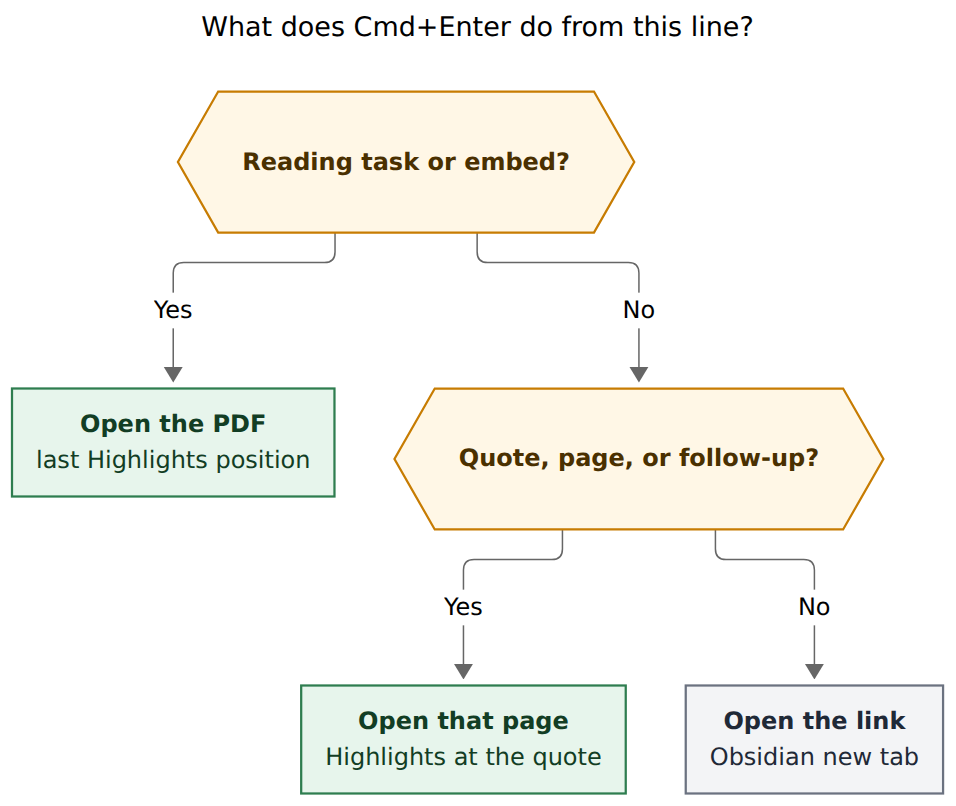
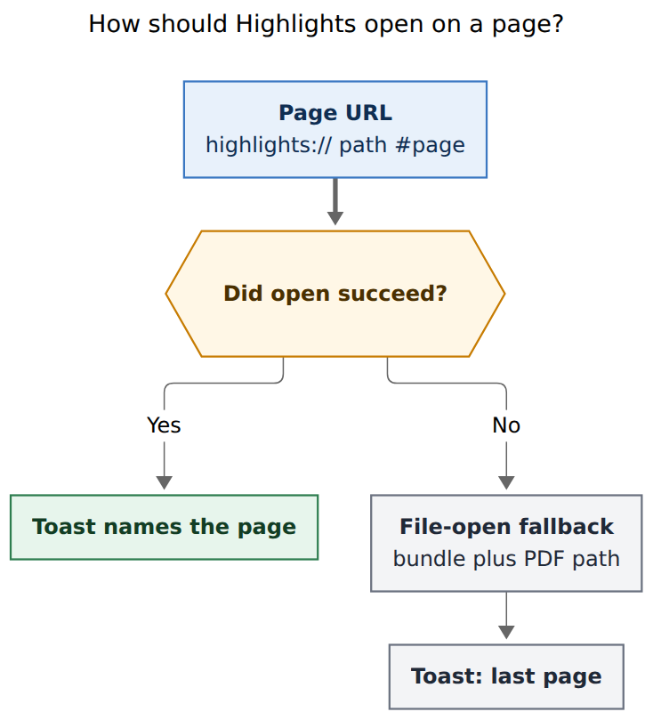

# Cmd+Enter from a quote should open that Highlights page

> **Research query:** How should Obsidian's existing `Cmd+Enter` Highlights
> hand-off grow from reading tasks to a selected quote or annotation in a
> reference note, including a page jump, a clear "this key is live" signal
> (shared with reading tasks), and a toast that names what just happened? Is
> the request a good idea, what should change, and what should we implement?
>
> Independent report from researcher `grk`. I did not read peer swarm reports.

**Figures:** Mermaid CLI `@mermaid-js/mermaid-cli@12.0.0`. Routing SVG
636.7 × 538 px, fit 100.0%. Opener SVG 488.9 × 540 px, fit 100.0%.

## Bottom line

**Build it. It is a good idea, and the missing piece is the page, not a new
key.** `Cmd+Enter` already means "open this reading in Highlights" on a
`#task #ref` line, a Task Link, or a managed embed. A quote in the managed
Highlights region is the same reading, pinned to a page. Use the same command,
the same vault binding, and a resolver that adds two contexts: the annotation
block under the cursor, and a follow-up task whose `🔖` points at a `^h-`
block.

Do **not** rewrite generated reference notes with `highlights://` links. The
page is already in the heading (`### Page 12`, `### Pages 11–12`,
`> [!quote|Page 12]`). The plugin can parse that contract. A mass rewrite
would churn every annotated note for a URL scheme Obsidian does not handle
anyway.

Do **not** treat today's file-open as enough. `open -b net.highlightsapp.universal
<path.pdf>` focuses the document and restores Highlights' last scroll. That is
correct for a reading task. It is wrong for a quote on page 247. The page jump
has to go through Highlights' documented URL scheme, gated by a Mac acceptance
test, with the current file-open as fallback.

The availability signal does not exist for reading tasks today either. Add one
shared cursor chip in the status bar, next to `[[ s w n ]]`, and extend the
open-book tooltip. One chrome, two contexts.

## Is this a good idea

**Yes.** The loop Bryan already lives in is:

1. Highlight a passage in Highlights, optionally with a `#task` comment.
2. Sync files a follow-up in the parent note with `[[ref/…#^h-…|🔖]]`.
3. Review that follow-up, click `🔖`, land on the markdown quote.
4. Want the original PDF page, not a second Obsidian tab of the same block.

Step 4 is missing. `🔖` already means "jump to this highlight" in the note
(`docs/task-tag-marks.md`). The open-book glyph already means "this is the
reading task." `Cmd+Enter` is the remaining verb: leave Obsidian for Highlights
at the passage.

It is also a small, coherent extension of code that already exists:

- `bob-navigation-hotkeys` command
  `open-reference-pdf-in-highlights`, bound in the vault to `Meta+Enter`,
  never registered as `Mod+Enter` (`plugins/bob-navigation-hotkeys/src/490-plugin-lifecycle.js`,
  `docs/reference/plugins/highlights.md`).
- Resolver in `src/677-plugin-ref-pdf-open.js`: cursor line → reading task /
  Task Link / embed → `source_pdf` → `/usr/bin/open -b net.highlightsapp.universal`.
- Tests in `scripts/test-navigation-hotkeys-ref-pdf.cjs`: no vault writes, toast
  `Opened x.pdf in Highlights`, ordinary lines delegate to
  `editor:open-link-in-new-leaf`.
- Generated annotation contract in `docs/highlights-ref-sync.md`: page headings,
  `[!quote]` / `[!note]` callouts, trailing `^h-` IDs, continuation
  `|Page N` pieces, `🔖` backlinks.

The request as written is slightly underspecified ("selected") and slightly
too narrow (quotes in the ref note only). The adjustments below keep the
spirit and make the gesture reliable.

## Critique of the request

The request is the right product. Four gaps would make a literal reading of it
worse than a designed one.

**"Selected" is the wrong primitive.** The current command keys off the cursor
line in source / Live Preview (`getCursor().line` in
`resolveReferencePdfAtCursor`). Visual selection, Reading-view click, and
"the callout looks focused" are different events. Keep the cursor line. A
multi-line visual selection uses the head line. That matches every other Bob
editor gesture and the existing tests.

**There is no availability signal for reading tasks today.** The command
palette name, the Reading Board `PDF` button, and a post-hoc toast do not
tell you the key is live *before* you press it. "Do the same thing when a
ref task is selected" therefore means *add* a shared signal, not copy one.

**Today's opener cannot jump to a page.** Bob Mac Capture's
`WorkspaceRefsOpener.openInHighlights` also opens the file with Highlights as
the application and no fragment
(`Sources/BobMacCapture/Refs/RefsPanelModel.swift`). Reusing that path from a
quote would open the PDF on whatever page Highlights last showed. Users would
blame the feature.

**A quote-only scope leaves a worse default on the follow-up line.** Follow-up
tasks are ordinary `#task` lines, so `Cmd+Enter` currently delegates to "open
link under cursor in new tab." That opens the `🔖` target in a new leaf: the
same markdown quote, one hop short of Highlights. Once the quote path exists,
that delegation is the wrong remaining behavior.

## Requirement adjustments

Call these out as changes to the request. Defaults below are the ones I would
ship.

| # | Adjustment | Why |
| --- | --- | --- |
| 1 | Cursor line, not a highlighted range | Matches the current resolver and Vim. |
| 2 | One command, two new contexts: annotation block **and** `🔖` follow-up | Same hop from GTD and from the quote. |
| 3 | Eligible annotations are every generated block: quote, image, standalone note, continuation piece, page heading, tombstone | "Quote" in speech is the Highlights region, not only `[!quote]`. |
| 4 | Annotation-section cards and non-page headings stay ineligible | `### Memory` and `[!summary\|section]` are groups, not pages. |
| 5 | Do not rewrite the generated region with `highlights://` links | Byte-stable managed region; Obsidian does not honor that scheme. |
| 6 | Reading-task `Cmd+Enter` keeps last Highlights position | Passing `page=1` would regress the existing gesture. |
| 7 | Page jump uses `highlights://…#page=N`, Mac-gated | File-open does not change page on an already-open document. |
| 8 | Shared status-bar chip for reading tasks and quotes; extend the 📖 tooltip | One chrome, no third glyph. `🔖` and 📖 already have meanings. |
| 9 | Toast names the page when a page was requested | `Opened x.pdf in Highlights` is silent about the jump. |
| 10 | No Accessibility, no AppleScript, no new `bob ref open` in v1 | Plugin already opens PDFs; AX is a Mac Capture grant. |
| 11 | Keep the custom `Meta+Enter` vault binding; never register `Mod+Enter` | `Ctrl+Enter` stays Task Card / close. |
| 12 | Source and Live Preview in v1; Reading-view click is a follow-up | Today's editor context already refuses Reading view. |

## Current system

### The keymap

Vault `.obsidian/hotkeys.json` binds
`bob-navigation-hotkeys:open-reference-pdf-in-highlights` to `Meta+Enter`.
The plugin registers the command with no `hotkeys` field. A registered
`Mod+Enter` would lose to Obsidian's built-in "Open link under cursor in new
tab" and, if re-recorded in Settings on a Mac, would claim `Ctrl+Enter` on
Linux (`docs/reference/plugins/highlights.md`).

On macOS, `Cmd+Enter` and `Ctrl+Enter` are different keys. Task Card's
`Cmd+Enter` alias is an in-card handler
(`docs/reference/plugins/task-card.md`). The Highlights command runs when the
card is closed. Keep it that way.

The command already toasts:

- success: `Opened x.pdf in Highlights`
- missing PDF, unsafe `source_pdf`, legacy note without `source_pdf`,
  macOS-only, launch failure

It never writes the vault. Tests assert `replaceRange` / `vault.modify` throw
if touched.

### What the cursor resolver sees today

`resolveReferencePdfAtCursor` (`src/677-plugin-ref-pdf-open.js`):

1. Refuse unless the active Markdown view is source-mode (Live Preview
   counts), focus is in that editor, and the cursor line exists.
2. If the line is a `#task #ref` task, resolve PDFs from its wikilinks or
   the enclosing note's `source_pdf`.
3. Else if the line is a dedicated Task Link or managed embed pointing at a
   `#task #ref` line, resolve that target.
4. Else `{ kind: "none" }` → delegate to `editor:open-link-in-new-leaf`.

A quote callout, a `^h-` line, a `### Page 12` heading, and a `🔖`
follow-up all fall through to (4).

### What a generated annotation looks like

From `docs/highlights-ref-sync.md` and the region parser tests:

```md
### Page 12

> [!quote] Latency is not throughput.
>
> > [!note] Comment Compare this with SLO notes.

^h-2b91f0a4c7de
```

Continuation groups carry per-piece pages:

```md
### Pages 11–12

> [!quote|Page 11] PR Sheriff Standing Orders. On every
>
> > [!quote|Page 12] session startup, the sheriff checks open PRs

^h-ba93bec527bb
```

Follow-ups, created when a comment contains a `#task` token:

```md
- [ ] #task Compare this claim with the appendix. [[#^h-2b91f0a4c7de|🔖]] [h:: 4c0a13d2…] [created::2026-06-07]
```

Routed follow-ups use `[[ref/books/example#^h-…|🔖]]`. Same-note v1 tasks
use `[[#^h-…|🔖]]`. The managed region keeps the annotation-level `^h-`
ID; there is no per-task `^ht-` on new tasks.

Sidecar exports already contain `#### [Page 12](highlights://stem#page=12)`.
The **generated note** uses a plain `### Page 12` heading. The plugin must
parse the generated form, not the sidecar.

### Glyphs already taken

- **📖** (teal open-book): `#task #ref` identity. Tooltip today:
  `#task #ref · reference reading task`.
- **🔖**: "jump to this highlight" on annotation follow-ups. Same task
  lists, on purpose, so the book is not reused
  (`docs/task-tag-marks.md`).

A third in-line glyph for "Highlights is one key away" would collide with
both. Put the keymap in chrome, not on the task line.

### Closest cousin: Bob Refs footer

Bob Refs paints contextual keycaps in a 30 pt footer:
`↵ Open in Highlights`, `⌘↵ Note`, `⌥↵ Reveal`
(`Sources/BobMacCapture/Refs/RefsFooter.swift`). The Obsidian analog is the
status bar cluster that already hosts `[[ s w n ]]`
(`src/547-bracket-mode-indicator.js`). Teach `Cmd+Enter` there.

## How Highlights actually jumps to a page

Highlights documented a URL scheme in version 1.2 (3 Jan 2015,
[changelog](https://highlightsapp.net/changelog/mac/)):

- Open file: `highlights://Users/test.pdf`
- Open file on a page: `highlights://Users/test.pdf#page=3`

Version 2023.2 notes "Improved handling of `highlights://` links." Sidecar
page headings still emit `highlights://<document-id>#page=N`, where the id is
a Highlights document token (often a stem), not a POSIX path.

The plugin today never uses that scheme. It launches:

```
/usr/bin/open -b net.highlightsapp.universal /abs/lib/books/x.pdf
/usr/bin/open -a Highlights /abs/lib/books/x.pdf   # retry
```

macOS document semantics: if `x.pdf` is already a Highlights tab, this
focuses that tab and leaves the scroll where it was. That is why reading
tasks feel fine and quotes would not.

**Runtime chain I would ship**, after a Mac acceptance test picks the URL
shape that actually jumps:

1. Build `highlights://` + POSIX path with the leading slash stripped and
   each segment percent-encoded + `#page=N` (the 2015 form).
2. `open -b net.highlightsapp.universal <url>`.
3. If that exits nonzero, retry `open <url>` (Launch Services for the
   scheme).
4. If that fails, today's file-open. Toast then says the page jump did not
   run.

The plugin cannot observe Highlights' current page without Accessibility.
Do not add AX to bob-navigation-hotkeys. Success of `open` is the runtime
signal; the Mac acceptance test is the proof the URL actually scrolls.

Candidate URL shapes for that test, in order:

1. `highlights://Users/…/x.pdf#page=12` (documented)
2. `highlights:///Users/…/x.pdf#page=12` (empty host, absolute path)
3. `file:///Users/…/x.pdf#page=12` opened with Highlights as the app

Lock the first shape that lands on page 12 of an already-open PDF *and* of a
closed PDF. If none do, stop before shipping the quote path; a quote that
opens the wrong page is worse than no gesture.



**Caption:** One command routes by cursor context. Reading tasks keep last
position. Quotes, page headings, and `🔖` follow-ups open that page.
Everything else still delegates to Obsidian's new-tab link.



**Caption:** Try the documented `highlights://` page URL first. If `open`
fails, fall back to today's bundle-plus-path launch and toast that Highlights
stayed on its last page.

## Resolver design

Extend `resolveReferencePdfAtCursor` so it returns `{ kind: "pdf", path, page? }`
instead of path-only. `page` is a 1-based integer or omitted.

### Context 1 — reading task (unchanged)

Existing `#task #ref` / Task Link / embed path. `page` omitted.

### Context 2 — annotation block in a managed Highlights region

When the current file has a `<!-- highlights:begin -->` … `<!-- highlights:end -->`
region and the cursor is inside it:

1. Walk *down* from the cursor to the next `^h-<id>` line. That is the
   enclosing annotation (callout lines sit above their block ID).
2. If the cursor is already on `^h-<id>`, use that block.
3. If the cursor is on a page heading (`### Page 12`, `#### Page 4`,
   `### Pages 11–12`, `pp.` forms) with no annotation between it and the
   next heading, use that heading's first numeric page and the note's
   `source_pdf`.
4. Page number, most specific first:
   - Innermost callout type suffix containing the cursor:
     `[!quote|Page 12]`, `[!note|Page 7]`.
   - Else the nearest preceding page heading. For `Pages 11–12` take **11**
     unless a piece suffix won.
5. PDF path: current note `source_pdf` (the annotation lives in the
   reference note).

Refuse (delegate) on:

- `## Highlights`, `### Removed highlights`, `### Other highlights` with no
  page heading under the cursor
- Annotation-section titles (`### Memory`) and `[!summary|section]` cards
- Fence interiors, as today
- Cursor outside the managed region

Non-numeric labels (`p. xii`): open the PDF with no page and toast without
claiming a page. Bob Mac Capture's `RefsPageLabel.pages(in:)` already
returns `[]` for roman numerals; copy that rule.

### Context 3 — `🔖` follow-up (justified expansion)

If the cursor line contains a wikilink whose alias is `🔖` and whose target
block id matches `^h-…` (legacy `^ht-…` still counts):

1. Resolve the target note (same-file `#^h-` or `ref/…#^h-`).
2. Find that `^h-` block.
3. Apply the annotation page rules in (2).
4. PDF path: the *target* note's `source_pdf`, not the follow-up's home
   note.

A follow-up in `sase.md` or `done/` therefore still opens the library PDF.
That is the GTD-side of the same hop: review the task, `Cmd+Enter`, land on
the passage, skip the `🔖` detour.

Clicking `🔖` itself still jumps in-note. `gf` / follow-link still jumps
in-note. Only `Cmd+Enter` leaves for Highlights.

### Shared helpers

Keep parsing in the plugin, with fixtures copied from
`docs/highlights-ref-sync.md` and `src/native/highlights_ref/tests/region.rs`.
Do not spawn `bob` on cursor movement. Mac Capture is a thin client of bob
because it has no editor; this plugin is already sitting on the markdown.

Page-label parsing should match `RefsPageLabel` / `is_sidecar_page_label` /
`label_page_number`: `Page N`, `Pages A–B`, `p. N`, `pp. A–B`, hyphen and
en-dash, comma lists. First number is the jump target.

`openReferencePdfPath(path, { page })` already accepts an `options` bag
(exists, execFile, isMacOS, basePath). Add `page`. The additive API member
becomes `openReferencePdf(path, { page }?)` without bumping root `api.version`
(same pattern as the original additive member in
`docs/develop/plugin-apis.md`).

## Availability: make the key visible

### Primary: cursor chip

A desktop, macOS-only status-bar item, immediately left of `[[ s w n ]]`.

| Cursor | Chip | Tooltip |
| --- | --- | --- |
| Ineligible, or off macOS | Hidden | — |
| Reading task / Task Link / embed | `⌘↩ Highlights` | `Open x.pdf in Highlights` |
| Annotation or `🔖` follow-up with a page | `⌘↩ p.12` | `Open x.pdf at page 12 in Highlights` |
| Annotation whose label is not numeric | `⌘↩ Highlights` | `Open x.pdf in Highlights` |

Details that make it feel like Bob rather than a debug HUD:

- Hidden, not empty, when idle. No reserved ghost pill.
- Same 1.35 em height and `var(--font-ui-smaller)` as the bracket-mode
  indicator.
- Open-book mask in the chip, using `--bob-ref-task-glyph` and the teal
  identity ink, so the chip is cousin to the 📖 mark.
- Tabular lining for the page number.
- 120 ms opacity fade; Reduce Motion skips it.
- Click runs the same command as `Cmd+Enter`.
- Recompute on cursor activity, active-leaf change, and editor changes,
  debounced ~50 ms. Pure view-model, never throws, same contract as
  `buildBracketModeView`.

This is the "do the same thing when a ref task is selected" signal. Quotes
and reading tasks share it.

### Secondary: 📖 tooltip

Change `#task #ref · reference reading task` to
`#task #ref · ⌘↩ Highlights`. Accessible label can stay "Reference reading
task." The glyph's meaning does not change; the tooltip teaches the key.

Do **not** put `⌘↩` on `🔖`. That alias already means in-note jump.

### Deliberately not in v1

- Live Preview callout corner badge (`⌘↩ p.12` on the callout title).
  Beautiful, and a good v1.1 once the chip is trusted. Fragile around
  callout post-processors; source mode would still need the chip.
- Current-line gutter widget. Competes with fold and line-number gutters.
- Reading-view clickable `### Page 12` headings. Worth a follow-up: a
  markdown post-processor, no source rewrite, click = same opener.
- Bob Refs inspector quote click. Same verb, different app; file as its
  own work. Mac Capture already has AX and the footer pattern.

## Toast

Keep `Notice` / `showBulletPropertyNotice`. Command Mode toast cards are for
`bob` runs and would look like a command launched. Duration **3200 ms**
(long enough to read, short enough to get out of the way). Optional book
glyph via the same fragment path priority notices use, if it stays one
line.

Copy:

| Outcome | Notice |
| --- | --- |
| Reading task opened | `Opened x.pdf in Highlights` (today) |
| Quote / follow-up, page URL succeeded | `Opened x.pdf · page 12 in Highlights` |
| Opened, page requested, fell back to file-open | `Opened x.pdf in Highlights · last page` |
| Non-numeric page label | `Opened x.pdf in Highlights` |
| Existing failures | Unchanged (`Reference PDF not found`, `Highlights is macOS-only`, …) |

The page number in the success toast is the proof the resolver understood
the quote. Without it, a wrong-page landing is silent.

Do not toast on chip appearance. Availability is the chip; confirmation is
the notice.

## What not to build

- A second command id. Same `open-reference-pdf-in-highlights`, same
  `Meta+Enter`.
- A plugin-default `Mod+Enter`.
- Generated `### [Page 12](highlights://…)` headings. Mass rewrite, and
  Obsidian still would not open them.
- `bob ref open --page`. No CLI consumer in v1; Mac Capture can grow a
  page argument on `openInHighlights` later.
- AppleScript `tell application "Highlights"` (no public dictionary we
  should depend on; App Store sandbox).
- Accessibility-driven tab switching from the plugin.
- Spawning `bob` on every cursor move.
- Jumping reading tasks to page 1.
- A new in-line glyph.
- Claiming a page in the toast when the URL launch failed.

## Recommended solution

**One Highlights jump, three contexts, one chip, honest toasts, Mac-gated
page URLs.**

### Implementation home

`bob-plugins` / `bob-navigation-hotkeys`:

- Extend `src/677-plugin-ref-pdf-open.js` (resolver + opener).
- Add `src/677a-plugin-ref-pdf-context.js` if the fragment would pass 1000
  lines: pure parse of page labels, annotation bounds, `🔖` links.
- Add `src/677b-plugin-ref-pdf-chip.js`: status-bar view-model and painter,
  modeled on `547-bracket-mode-indicator.js`.
- `src/138-task-tag-marks.js` in ledger-tools: tooltip string only.
- `styles.css`: `.bob-highlights-jump` chip, teal book, tabular page.
- Tests: extend `scripts/test-navigation-hotkeys-ref-pdf.cjs`; add a chip
  view-model test file in the same harness style.

`bob-cli` docs only, no runtime:

- `docs/reference/plugins/highlights.md` (source: bob-plugins).
- `docs/ref.md` one-line behavior.
- `docs/highlights-ref-sync.md` a short "Jump back to the PDF" pointer.
- `docs/task-tag-marks.md` tooltip.
- Optional short decision: *Cmd+Enter opens Highlights at the quote's page;
  generated notes stay unlinked; availability is a cursor chip.*

### Phasing

1. **Parser + tests.** Cursor → `{ path, page? }` for every fixture in
   `highlights-ref-sync` (single page, continuation pieces, images,
   standalone notes, tombstones, `🔖` same-note and routed, section cards
   ineligible, fences). No launches yet.
2. **Opener + toasts.** `page` option on `openReferencePdfPath`. URL
   attempt chain. Notices as in the table. Reading-task path byte-identical
   when `page` is omitted (existing tests stay green).
3. **Chip + 📖 tooltip.** Hidden when idle. Same command on click.
4. **Mac acceptance.** A 3-PDF script on the Mac: closed PDF to page 12;
   already-open PDF from page 1 to page 12; quote with no numeric label
   stays last page. Record the winning URL shape in the plugin comment and
   the decision. **Do not ship the quote path until this is green.** The
   chip may ship on reading tasks earlier if needed.
5. **Docs.** Plugin reference, `docs/ref.md`, tooltip contract.

### Test matrix (plugin harness)

- v2 reading task, v1 tracker, Task Link, managed embed: unchanged launches
  and `Opened x.pdf in Highlights`.
- Cursor on `> [!quote]`, on `^h-`, on `### Page 12`, on
  `> [!quote|Page 12]` inside `### Pages 11–12`: URL contains `#page=12`
  (or 11 for the group heading).
- Cursor on `🔖` follow-up in a parent note: opens the *reference* PDF at
  the annotation page.
- Cursor on `### Memory` section card: delegates.
- Cursor in a fence: delegates.
- Off macOS: existing macOS-only notice, no launch.
- Unsafe path: existing notice.
- Chip view-model: hidden / `⌘↩ Highlights` / `⌘↩ p.12`.
- Command registration still has no `hotkeys:` field.

### Risks

- **URL scheme drift.** 2015 docs, 2023 "improved handling," sidecar ids
  that are not paths. Acceptance test is the mitigation; fallback toast is
  the honesty.
- **Generated-region drift.** If bob changes page headings, the parser
  lags. Mitigation: fixtures shared with bob-cli region tests, and a
  comment pointing at `docs/highlights-ref-sync.md`.
- **False eligibility.** A user-authored `### Page 12` outside the managed
  region must not fire. Gate on `highlights:begin` / `end`.
- **Follow-up steal.** `Cmd+Enter` on a `🔖` line today opens a new tab of
  the quote. After this, it opens Highlights. That is the intended steal;
  click and follow-link still jump in-note.
- **Chip noise.** A 400-highlight note will show `⌘↩ p.N` for as long as
  the cursor sits in the region. That is the feature. Hide it the moment
  the cursor leaves.

## Follow-ups (not this change)

- Reading-view post-processor: clickable page headings, same opener.
- Live Preview callout corner `⌘↩ p.12`.
- Bob Refs inspector: click a quote → Highlights at that page (needs a
  page argument on `WorkspaceRefsOpener.openInHighlights`).
- `openReferencePdf` callers (Reading Board PDF button) stay page-less
  unless a later board context knows a page.

## Open questions for Bryan

1. **Follow-up `Cmd+Enter`:** ship the justified expansion (recommended),
   or keep `🔖` lines as "open link in new tab" until the quote-in-ref-note
   path is habit?
2. **Chip vs tooltip-only for reading tasks:** I would ship both. Tooltip
   alone is easy to miss; chip alone does not teach the 📖 mark.
3. **If the Mac test shows no URL shape jumps an already-open PDF:** ship
   quotes as "open PDF last page" with a toast that says so (weak), or hold
   the quote path (recommended)?

## Confidence and limits

**High confidence:**

- Extending the existing command is the right shape (code, tests, docs,
  vault binding).
- Generated notes already carry page labels; a plugin parser is enough.
- File-open will not jump an already-open document.
- `🔖` and 📖 must not gain a third in-line meaning.
- `Mod+Enter` must stay unregistered.

**Medium confidence:**

- Which `highlights://` URL shape still jumps in Highlights 2025.x. The
  2015 form is documented; 2023.2 claims improvement; I did not run it on
  the Mac.
- Chip placement next to bracket-mode: status-bar item order is
  insertion-order and can drift if another plugin loads later. Accept and
  set a CSS order if needed.

**Not verified by me:**

- Live Highlights URL handling on the Mac.
- Whether `open -b bundle <highlights-url>` vs `open <highlights-url>`
  differs when Highlights is already frontmost.
- Reading-view callout DOM for a later click target.

## Inputs and sources

- bob-plugins: `plugins/bob-navigation-hotkeys/src/677-plugin-ref-pdf-open.js`,
  `490-plugin-lifecycle.js`, `480-review-jump-and-nav-api.js`,
  `547-bracket-mode-indicator.js`, `010-requires-and-config.js`
  (`showBulletPropertyNotice`), `styles.css` (bracket-mode chip),
  `scripts/test-navigation-hotkeys-ref-pdf.cjs`,
  `docs/highlights.md`, `docs/bob-navigation-hotkeys.md`,
  `docs/develop/plugin-apis.md`,
  `plugins/bob-ledger-tools/src/138-task-tag-marks.js`,
  `src/243-plugin-reading-board-render.js`, `styles.css` (`--bob-ref-task-glyph`).
- bob-cli: `docs/highlights-ref-sync.md` (generated callouts, `#task`
  follow-ups, continuation `|Page N`, `🔖` backlinks),
  `docs/ref.md`, `docs/task-tag-marks.md`,
  `docs/reference/plugins/highlights.md`,
  `src/native/highlights_ref/sidecar_render.rs`
  (`is_sidecar_page_label`, `label_page_number`, `destination_page_index`),
  `src/native/highlights_ref/tests/region.rs`.
- bob-mac-capture: `Sources/BobMacCapture/Refs/RefsPanelModel.swift`
  (`WorkspaceRefsOpener`), `RefsFooter.swift`,
  `Sources/RefsCore/RefsInspector.swift` (`RefsPageLabel`).
- Decisions: `open-pdf-writes-are-coordinated` (no keystroke/AX writes from
  bob; holds, not scripted UI), `code-copy-reads-render-time-catalog`
  (Highlights integration stays on bob's recorded facts),
  `reference-ids-follow-file-stems` / `reference-sources-are-preserved-write-once`
  (generated notes and PDFs are a contract, not a place to invent new
  locators).
- Glossary: Annotation Section, Reference Note, Reference Task.
- External: Highlights Mac changelog, version 1.2 page-link URL scheme and
  2023.2 `highlights://` handling, <https://highlightsapp.net/changelog/mac/>.
