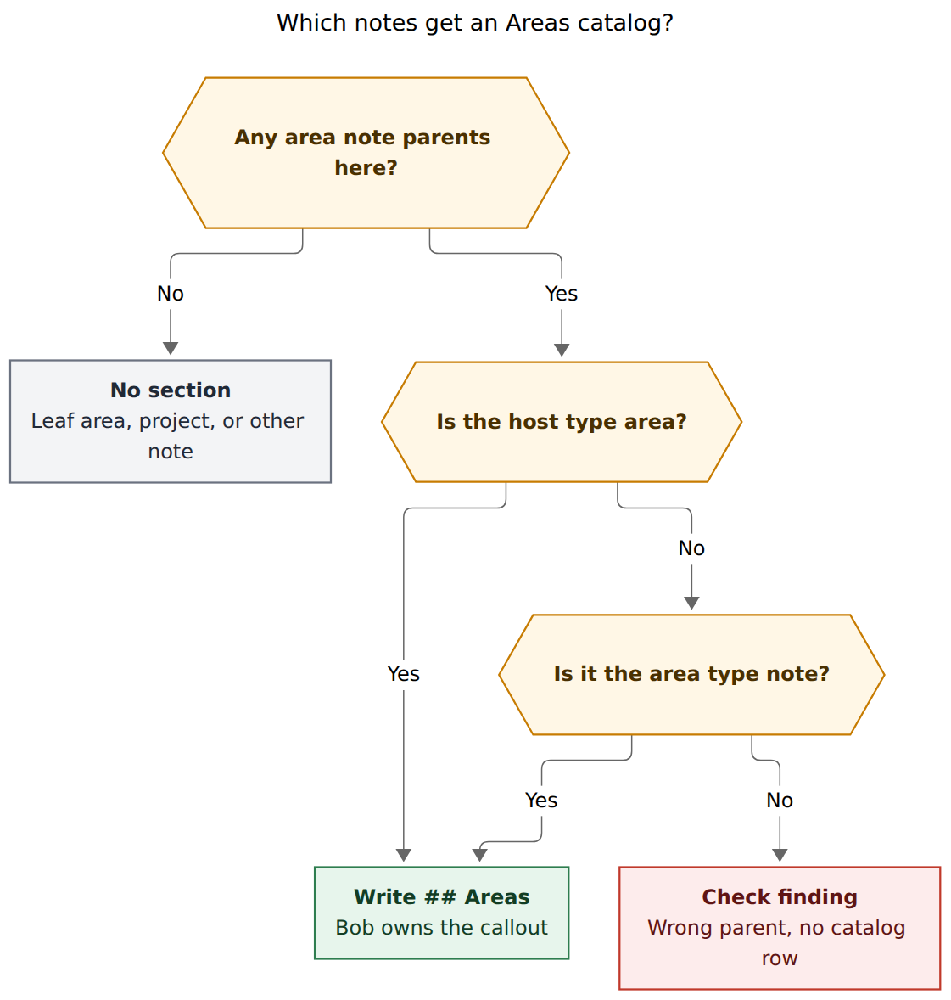
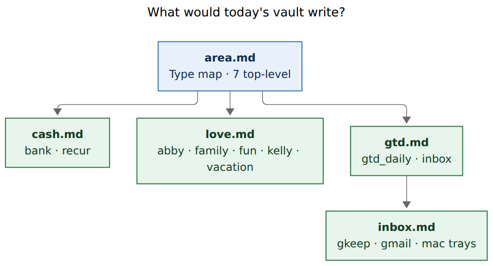
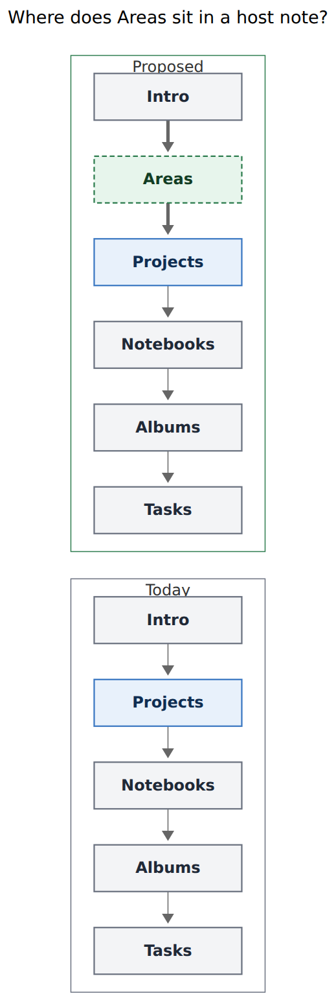

# Areas catalog section

- **Researcher:** grk
- **Date:** 2026-11-14
- **Question:** Bob already renders a generated H2 `## Projects` catalog on area and project notes that parent one or more project notes. Should it render a sibling `## Areas` catalog for child area notes, and if so, how should that catalog be hosted, owned, placed, and painted so it is intuitive, reliable, and beautiful?
- **Verdict:** Build it. It is a good idea, and the live vault already suffers the exact gap Projects catalogs closed: child areas exist only as `parent:` frontmatter, plus a few stale `Related:` wikilinks. **Do not** clone the Projects catalog. Areas have no lifecycle, `area.md` is a type-definition note rather than an area note, and the tree is small enough to nest. Recommended shape: a fourth host-catalog member (`> [!areas]`), hosted on area notes that have child areas **and** on the area type-definition note, listing the host's area subtree as a nested forest, stacked above `## Projects`.

---

## 1. In one breath

Bob already has a shared host-catalog engine. Notebooks, albums, and projects each own one callout; Bryan owns the heading and its position; bob rewrites only the `> [!…]` bytes. Child area notes should join that family as `## Areas` / `[!areas]`.

The requested plan is sound on the two constraints that matter:

1. Area notes parent only to other area notes or to `~/bob/area.md`.
2. The new section should appear only in those parents.

Three adjustments make the feature match how Bob actually files areas, instead of how Projects files finite outcomes:

| Request as written | Adjustment | Why |
| --- | --- | --- |
| “Something similar” to Projects | Same **engine and ownership**, different **row grammar** | Areas never go done or canceled. A `**Closed**` group and 🗓️/⛓️/✅ glyphs would lie. |
| Hosts are area notes (and `area.md`) | Host = any note that at least one area note parents to, **if** that note is `type: [[area]]` **or** the note `type: [[area]]` resolves to | Live `area.md` has `parent: "[[type]]"` and **no** `type:` field. A `frontmatter_is_area` host scan would skip the map of content. |
| Direct children, Projects-style | Nested **descendant forest** on each host | 19 area notes, max depth 3. Notebooks already nest; Projects stays flat because of lifecycle grouping and 60-child hosts. |
| First-write like Projects (`BeforeFirstH2`) | Insert Areas **before** Projects / Notebooks / Albums / Tasks; teach Projects to land **after** an existing `## Areas` | Two `BeforeFirstH2` specs fight. Whichever sync runs second steals the top slot. |

Do not implement a Dataview or Bases query, a plugin-only overlay, a `🧩` group inside `## Projects`, or an Areas section on project notes.



**Figure 1.** A note gets `## Areas` when area notes parent to it and the host is an area note or the `area.md` type definition. A wrong parent is a check finding, never a catalog on a project or notebook. Rendered with mermaid-cli 12.0.0; 747 × 786 px, fit 87.4%.

---

## 2. Is this a good idea?

Yes. The tree is already there, and nothing in the note body tells you so.

### 2.1 The live vault already has a nested area tree

A Dataview scan of notes whose `type` string contains `area`, excluding daily folders, found **19 area notes**. Every one parents to another area note or to `area.md`. None parents to a project.

```text
area.md          type definition (not type: area)
├── body         color: green
├── cash         color: magenta
│   ├── bank     H1 “🏦 Bank”
│   └── recur
├── dev          color: blue
├── gtd          color: grey
│   ├── gtd_daily
│   └── inbox    H1 “Inbox”
│       ├── gkeep_inbox
│       ├── gmail_inbox   H1 “Gmail inbox”
│       └── mac_inbox     H1 “Mac Inbox”
├── job          color: aqua
├── love         color: yellow
│   ├── abby
│   ├── family   parent: "[[love.md|love]]"
│   ├── fun
│   ├── kelly
│   └── vacation parent: "[[love.md|love]]"
└── meet         color: violet
```

Five notes would host a catalog: `area.md`, `cash.md`, `love.md`, `gtd.md`, `inbox.md`. Fifteen leaf areas would get no section. That is a small, bounded blast radius.



**Figure 2.** Five hosts would gain a catalog: `area.md` as the type map, plus the four area notes that actually have children. Fifteen leaf areas stay without a section. Rendered with mermaid-cli 12.0.0; 720 × 390 px, fit 90.7%.

### 2.2 The tree is currently invisible, and the hand-written substitutes are already stale

Opening the parents shows the gap:

- `area.md` is nine lines of type-definition prose. It names `[[job]]` as an example and lists no children.
- `love.md` opens with two intro paragraphs, then `## Notebooks`, then `## Tasks`. Its five child areas never appear.
- `cash.md` says `Related: [[bank]] [[old_recur]] [[legacy_cash]]`. `old_recur` is leftover; `recur` is missing. The generated catalog would have caught that.
- `gtd.md` has `## Projects` (`needs_attn_tasks`) and `## Notebooks`. `inbox` and `gtd_daily` are absent from the body.
- `inbox.md` is the one parent that already names its children in prose (“Root of the inbox files: [[mac_inbox]], [[gkeep_inbox]], and [[gmail_inbox]]”). A catalog still earns its keep: prose can drift, the callout cannot.

This is the same pain Projects catalogs solved when they retired `🧩 **Sub-projects:**` off the `^prj` line, except areas never had even that one-line cache.

### 2.3 PARA wants this map, and Bob's daily surface already protects Forte's warning

Tiago Forte's PARA test is the finish line: a project has a goal and an end; an area has a standard and no end ([Forte, *PARA — An Introduction*](https://every.to/forte-labs/para-an-introduction-827085)). Bryan's vault already encodes that split (`type: [[area]]` vs `type: [[project]]` plus `^prj`). Forte also argued against making areas the *only* top-level hierarchy, because actionable projects get buried under non-actionable area files ([Forte, *PARA Part 2*](https://every.to/forte-labs/para-part-2-just-in-time-organization-850888)).

Bob does not have that problem. The daily work surface is `dash.md`, the ledger, and `## Projects` catalogs. An Areas catalog is a **map of content**, in Nick Milo's sense: a note that lists the notes beneath it. Putting that map on `area.md` and on each parent area does not replace Projects, Ready, or Today. It makes the sphere tree visible beside them.

Forte's examples even match the live stems: Health/`body`, Finances/`cash`, Parenting/`abby`, Spouse/`kelly`, Travel/`vacation`, Career/`job`. Nested sub-areas (`cash/bank`, `love/abby`) are a PKM extension Bryan already chose. The catalog should follow that choice rather than flatten it.

### 2.4 The engine to do it well already exists

Verified in this checkout:

| Piece | Where | What Areas reuses |
| --- | --- | --- |
| Byte-span owned region | `src/native/host_catalog/region.rs` | `RegionSpec`, `plan_host`, missing/stale/current/damaged, duplicate self-heal, heading drop on empty |
| Guarded install | `src/native/host_catalog/txn.rs` | Preimage-checked staged writes, one scoped commit |
| Projects catalog | `src/native/projects/catalog.rs` | Membership from scalar `parent:` through `NoteIndex` (exact path, then unique basename) |
| Nested forest rows | `src/native/notebooks/catalog.rs` `push_forest` | Indent by parent, title + optional summary, inert text |
| Capture protection | `src/native/capture/sections.rs` `GENERATED_CATALOGS` | `@body#areas` refuses with `areas_section_generated` once `AREAS` joins the table |
| Drawer guard | `src/native/capture_drawers.rs` `is_structural_h2_key` | Follows `GENERATED_CATALOGS` automatically |
| Nightly | `src/native/nightly.rs` | One new step; `docs/vault-git-sync.md` already documents the sequence |
| Plugin cards | bob-ledger-tools `styles.css` + `241ae-plugin-projects-catalog.js` / `241d-plugin-notebook-catalog.js` | Hued callout, hidden title, nested list rail, live chips that never write Markdown |
| Highlights | `tests/fixtures/note_snapshot/bob-projects-catalog-only.projected.md` | `::: {.callout kind="areas"}` beside `kind="projects"` |

A fourth `RegionSpec` is the reliable path. A new writer, a new marker syntax, or a Dataview fence would throw away that contract.

---

## 3. Critique of the requested plan

### 3.1 “Similar to Projects” is the right family and the wrong template

Projects catalogs (`docs/projects.md` § Projects catalogs, `docs/reference/vault-format.md`) are:

- Hosted on **area or project** notes with at least one direct child **project**.
- Rows with lifecycle glyphs and a derived `**Closed**` group.
- Direct children only; `root: true` still lists.
- First-written with `Placement::BeforeFirstH2`.
- Load-bearing for `#hide` / SUBOPEN. Readers in bob-cli and bob-plugins had to understand the new format before the writer changed a vault byte.

Areas share membership-from-`parent:`, bob-owned callout, Bryan-owned heading, empty-host removal, damage-don't-guess, and capture protection. They share **none** of the lifecycle, Closed group, or SUBOPEN-cache jobs. Copying those would paint every area as “open ready” forever and invent a Closed ledger that cannot exist. Glossary Area Note: an area “has no `^prj` task and no done/canceled lifecycle, so Bob always treats it as open.”

Row grammar should follow **Notebooks / Albums**, which list living collections:

```markdown
## Areas

> [!areas]
>
> - **[[cash]]**
>   - **[[bank|🏦 Bank]]**
>   - **[[recur]]**
> - **[[love]]**
>   - **[[abby]]**
>   - **[[family]]**
```

Optional ` — summary` when `summary:` is present. No glyphs, no counts, no dates, no colors in the Markdown. The plugin paints hue, and later chips, from a `bob areas list` report.

### 3.2 `area.md` is the type note, not an area note

Live `~/bob/area.md`:

```yaml
---
parent: "[[type]]"
created: 2026-06-11 17:04
---
```

Body: “Area notes link to this note as their `type`.” Top-level areas set `parent: "[[area]]"` **and** `type: "[[area]]"`. Dataview renders those parents as `[[area.md|area]]`. Vault-format already documents `"[[area]]"` as the top-level parent spelling.

The current Projects/Notebooks/Albums planners skip any host that is not `frontmatter_is_area` or `frontmatter_is_project` (`projects/catalog.rs` `plan_catalogs`, notebooks “only host-graph notes”). If Areas used that predicate, **the one note the user named as a host would never get a section.**

**Adjustment (required):** a catalog host is a note that at least one area note parents to, and that is either `type: [[area]]` or the unique resolution of the `area` type wikilink (today `area.md`). Do not special-case the filename. If the type note were renamed, every `type: "[[area]]"` field would move with it.

`type.md` itself already embeds Bases (`![[projects.base]]`, `![[refs.base]]`, `![[articles.base]]`). That is a vault-wide query surface, not a parent catalog. Do not put `## Areas` on `type.md`.

### 3.3 Direct-only is wrong for a 19-note tree

Projects stay flat because `sase.md` can list on the order of sixty children and because Closed rows need a second group. Areas have 19 notes and depth 3 (`area → gtd → inbox → mac_inbox`).

Notebooks already nest by parent notebook and stop at the next root parent. Areas should nest by parent area and stop at the host's subtree:

- `area.md` shows the full map, grandchildren indented.
- `love.md` shows five flat children (no grandchildren today).
- `gtd.md` shows `gtd_daily` and `inbox`, with the three trays nested under `inbox`.
- `inbox.md` shows the three trays as direct children.

Duplication across hosts is the point of a local map: `mac_inbox` belongs on `inbox.md`, nested under `gtd.md`, and nested under `area.md`. Each note answers “what hangs from here?”

**Adjustment (recommended):** descendant forest per host, not Projects' direct-only rule. Direct-only remains a coherent fallback if the tree ever grows past a few dozen notes; it is the worse default today.

### 3.4 Two `BeforeFirstH2` specs will invert the outline

Live reading order on notes that already have catalogs:

| Note | First H2 today |
| --- | --- |
| `job.md`, `gtd.md`, `dev.md`, `vacation.md`, `mac_inbox.md` | `## Projects` |
| `love.md`, `cash.md`, `meet.md`, `fun.md`, `inbox.md`, `abby.md`, `kelly.md` | `## Notebooks` |
| `area.md`, `family.md` | none (EOF insert) |
| `gtd_daily.md` | `## Tasks` |
| `bank.md` | none; H1 then prose |
| `recur.md` | authored `## Bank` (leaf; no Areas catalog) |

Projects use `Placement::BeforeFirstH2`. Notebooks use `BeforeFirstTasks`. Albums use `AfterSectionThenTasks("Notebooks")`.

If Areas also uses `BeforeFirstH2`:

- Nightly currently runs **projects, then notebooks, then albums**. Areas-after-projects inserts Areas *before* an existing `## Projects`. Good for the first paint.
- Later, creating the first child project under a parent that already has `## Areas` runs Projects' first-write, which also targets `BeforeFirstH2`, and **hoists Projects above Areas**.

That inversion is a reliability bug, not a taste issue. The outline should read **spheres → outcomes → collections → standing work**.



**Figure 3.** Areas sits after authored intro and before Projects, so the outline reads spheres, then outcomes, then collections, then standing work. Projects keeps its place ahead of Notebooks. Rendered with mermaid-cli 12.0.0; 346 × 1029 px, fit 86.8%.

**Adjustment (required):**

- Areas first-write: before the first of `{Projects, Notebooks, Albums, Tasks}`, else first H2, else EOF. Authored intro and H1 stay above. Authored sections after Tasks (`## Notes` on `body.md`, `## Future Work` on `vacation.md`) stay below.
- Projects first-write: **after** an existing `## Areas` section, else today's `BeforeFirstH2`. That is a one-spec change in `host_catalog::region` plus Projects tests. Without it, the stack is not stable.

A new `Placement::AfterSectionElse("Areas", BeforeFirstH2)` (or equivalent) is enough. Do not change Notebooks or Albums.

### 3.5 Inbox trays are area notes; do not invent a second type

`inbox.md`, `mac_inbox.md`, `gkeep_inbox.md`, and `gmail_inbox.md` are area notes whose parent chain reaches `inbox.md` (glossary Inbox File). They will appear in `inbox.md`, nested under `gtd.md`, and nested under `area.md`.

That is slightly noisy on the type map. It is also honest. A special-case “omit inbox-parented notes from `area.md`” rule would make the type note lie about the tree.

**Adjustment (optional, later):** if the type-map feels crowded, fold inbox descendants behind a plugin fold, the way Projects folds `**Closed**`. Do not drop them from the bytes in v1.

### 3.6 Bases and Dataview are the wrong writer

`type.md` already uses Bases embeds for vault-wide project and reading lists. That pattern is attractive for `area.md` and is still the wrong owner:

- Catalogs are git history, agent context, mobile Markdown, and Highlights input. Bases and Dataview are none of those.
- The Projects research already rejected a query-only view because close-gesture readers needed a local cache. Areas have no such cache job, and they still need a git-visible map.
- A live query on `area.md` would also miss the type note's own job: it is the class, and the class should *write down* its instances.

Plugin painting on top of a bob-owned callout is the beauty layer. The callout is the source of truth.

### 3.7 Do not wait on `summary:` or a create command

None of the 19 area notes have `title:` or `summary:` frontmatter. Titles that exist come from H1 (`# Inbox`, `# 🏦 Bank`, `# Mac Inbox`, `# Gmail inbox`). Notebooks already resolve title as H1, then first alias, then humanized stem (`notebooks/scan.rs` `derive_title`). Reuse that. Omit the ` — summary` tail when `summary:` is absent. A catalog of bold links is already more useful than today's nothing.

**Adjustment (optional, not a v1 gate):** document `summary:` as the row tail, same as notebooks. Do not scrape the first prose paragraph (`Money Money Mooooney!` is not a catalog line).

There is no `bob areas create` and no capture spelling that mints an area note (Gmail may create a missing inbox area; that is a special case). Hand-authored area notes are rare. v1 repairs catalogs on sync; it does not need a create verb. When capture later grows an area-create form, it should update the parent catalog in the same transaction, the way `@route^id@` already updates `## Projects`.

### 3.8 Plugin CSS is part of “beautiful,” not a polish pass

A raw `[!areas]` callout in Obsidian looks like a generic note. The ledger-tools stylesheet already defines a family:

- `[!notebooks]`: `lucide-notebook-tabs`, host hue wash, nested left rail, title clipped, chips from the report.
- `[!albums]`: `lucide-album`, same wash and rail.
- `[!projects]`: `lucide-puzzle`, title hidden, ring markers, Closed fold, live chips.

**Adjustment (required for beauty):** ship a `[!areas]` card in the same plugin, same wash, `lucide-layers` (nested spheres), host hue on the card chrome, **per-row hue pip** from the child's resolved area color. `area.md` has no `color:`; its chrome stays muted, and the seven top-level rows carry blue / aqua / yellow / magenta / green / violet / grey. Counts stay out of the Markdown. A first card can ship without chips; chips want `bob areas list -f json`.

Highlights should project `kind="areas"` the way it already projects `kind="projects"`.

---

## 4. Alternatives considered

| Approach | Verdict |
| --- | --- |
| Fourth host-catalog member, nested forest, stacked above Projects | **Recommended.** |
| Clone Projects 1:1 (direct children, glyphs, Closed, `BeforeFirstH2`) | Wrong grammar, skips `area.md`, unstable stack. |
| Dataview / Bases embed on `area.md` only | Invisible to git, agents, mobile, Highlights. |
| Plugin overlay with no Markdown | Breaks the “bob owns the bytes” contract; dies when the plugin is unloaded. |
| Fold child areas into `## Projects` as a 🧩 group | Mixes finite outcomes with ongoing spheres. Forte's whole test is that split. |
| `## Areas` only on `area.md` | Leaves `love.md` / `cash.md` / `gtd.md` / `inbox.md` blind. Local maps are the feature. |
| Render on every area note, empty callout when leafless | Noise. Follow empty-host removal. |
| Host any note a child parents to, including a mistaken project parent | User constraint: only area notes and `area.md`. Wrong parents are check findings. |
| New `bob catalogs sync` megacommand | Over-scope. The family is one engine, several nouns. |

---

## 5. Recommended contract

### 5.1 Membership and hosts

- **Children:** Markdown notes outside `done/` and excluded directories whose frontmatter `type` is area (`frontmatter_is_area`).
- **Parent:** the child's scalar `parent:` wikilink, resolved with the same exact-path / unique-basename rules Projects use (`resolve_project_parent` / `NoteIndex`). Aliased forms such as `parent: "[[love.md|love]]"` on `family.md` and `vacation.md` must resolve. List-form, ambiguous, unresolved, self, and cyclic parents produce no row and a check finding.
- **Host eligibility:** the resolved parent is `type: [[area]]`, or it is the note the `area` type wikilink resolves to.
- **Expected content:** a host with one or more eligible descendants in its subtree. Empty hosts drop the callout; the heading goes too when the section is then blank. A leftover `[!areas]` on a newly leaf host is `stale` and is removed.

### 5.2 Region

```text
callout:   areas
heading:   Areas
placement: before first of Projects, Notebooks, Albums, Tasks;
           else first H2; else EOF
legacy:    none
strict_bare: true
```

Bob owns exactly the `> [!areas]` callout lines. Bryan owns `## Areas`, its position after first write, and every other byte. Recognition matches the notebooks/projects rules: after frontmatter, outside fences, `> [!areas]` with optional fold sign, canonical write `> [!areas]`. Malformed `> [!areas` is `areas_catalog_damaged`; leave the host untouched. Duplicates self-heal as `stale`.

Add `AREAS` to `GENERATED_CATALOGS`. Capture refuses `@route#areas` with `areas_section_generated`. Drawer code follows the table.

### 5.3 Rows

Reuse notebook inert-text and title derivation.

```markdown
> [!areas]
>
> - **[[stem|Title]]** — summary
>   - **[[child]]**
```

- Title: first H1 before a bullet or `##`, else first `aliases:` entry, else humanized stem. Always alias when the title differs from the stem (`[[bank|🏦 Bank]]`). Path-qualify the link when the stem is ambiguous.
- Summary tail only when `summary:` is non-blank, inert-escaped, one line.
- Nest by resolved parent. Sort each level A–Z by title, case-insensitive, path tie-break.
- No lifecycle glyphs, no Closed group, no counts, no dates, no hue names, no emoji field (unlike albums). Inbox trays are ordinary rows.
- Plugin may add a left pip from the child's resolved R8 hue (`docs/pomodoro-homes.md` R8). `area.md` is skipped on hue walks today; row pips still use each child's own walk.

### 5.4 CLI and nightly

New noun `bob areas`, Vault section of `bob --help`, beside `albums` and `notebooks` (areas have no task lifecycle, so they do not sit under Tasks and projects). Per `cli_rules.md`:

```text
bob areas [list] [-b DIR] [-f human|json]
bob areas check [-b DIR] [-f human|json]
bob areas sync  [-b DIR] [-d] [-f human|json]
```

Bare `bob areas` is read-only `list`. Every long option has a short alias; options stay alphabetical. Human `list` is a colored tree grouped by host, with issue markers. JSON is `schema_version: 1` with `ok`, `command`, `areas`, `catalogs`, `findings`, `counts`. Catalog states: `current`, `missing`, `stale`, `damaged`. Missing/stale warn; damaged errors and exits 1.

`sync` takes the shared vault lock, pre-syncs, plans from one snapshot, installs through `host_catalog::txn`, commits `areas: sync catalogs (N notes)` only when bytes change, post-syncs. `--dry-run` prints diffs and writes nothing. Damaged hosts are skipped; healthy hosts still apply.

Nightly: insert **after projects, before notebooks**, and teach Projects' first-write to follow `## Areas` so the same run cannot invert the stack. Update `docs/vault-git-sync.md` and `nightly.rs` help. Commit subject stays scoped; a no-op writes nothing.

No `create` in v1.

### 5.5 Plugin and snapshots

bob-ledger-tools: `[!areas]` card parallel to notebooks (postprocessor ~50–53, Live Preview decoration, subscribe to `bob areas list`). CSS:

```css
.callout[data-callout="areas"] {
  --callout-icon: lucide-layers;
  --bob-areas-hue: var(--text-muted);
  /* same 9% wash / 28% border / nested rail as notebooks */
}
```

Hide or clip the callout title; paint a short header (“Areas”) plus optional health. Nested `ul` gets the hue rail. Per-row pip from `data-area-hue`. Do not mutate the note.

Highlights: project `[!areas]` as `kind="areas"`, retain rows, same as Projects catalogs in area snapshots.

### 5.6 Docs and glossary

- `docs/reference/vault-format.md` Area notes: add the catalog, and state that `area.md` is the type-definition host.
- New `docs/areas.md` (or a section under a note-types guide): membership, ownership, placement, CLI. Guides stay goal-oriented; the contract lives in reference.
- Glossary Area Note: one sentence that each parent area, and the area type note, lists child areas in a machine-owned `## Areas` catalog.
- Capture reference: `areas_section_generated`.
- Decision record only if we accept a trade-off that would reopen (nesting vs direct-only, or hosting the type note). The rest is contract, not a new architecture decision.

### 5.7 What a first sync would write on today's vault

`area.md` (EOF after the type prose):

```markdown
## Areas

> [!areas]
>
> - **[[body]]**
> - **[[cash]]**
>   - **[[bank|🏦 Bank]]**
>   - **[[recur]]**
> - **[[dev]]**
> - **[[gtd]]**
>   - **[[gtd_daily]]**
>   - **[[inbox|Inbox]]**
>     - **[[gkeep_inbox]]**
>     - **[[gmail_inbox|Gmail inbox]]**
>     - **[[mac_inbox|Mac Inbox]]**
> - **[[job]]**
> - **[[love]]**
>   - **[[abby]]**
>   - **[[family]]**
>   - **[[fun]]**
>   - **[[kelly]]**
>   - **[[vacation]]**
> - **[[meet]]**
```

`love.md` (before `## Notebooks`): five flat children. Intro paragraphs stay.

`gtd.md` (before `## Projects`): `gtd_daily`, then `inbox` with three nested trays.

`cash.md` (before `## Notebooks`): `bank`, `recur`. The stale `Related: [[old_recur]]` line stays authored until Bryan edits it.

`inbox.md` (after `# Inbox` / intro, before `## Notebooks`): the three trays.

Leaf notes unchanged.

---

## 6. Reliability work the feature requires

Areas catalogs are **not** a SUBOPEN cache. No `#hide` reader, no close-gesture pull-in, no plugin successor path depends on them. That makes the rollout easier than Projects catalogs were. The remaining reliability list is the host-catalog standard:

1. **Placement patch for Projects** before the first Areas first-write lands in a vault that already has Projects, and before the first new project is created under an Areas host.
2. **Type-note host path** in the planner, with tests that `area.md` without `type: [[area]]` still hosts, and that `type.md` does not.
3. **Aliased parents** (`[[love.md|love]]`) round-trip to the same host as `[[love]]`.
4. **Wrong-parent finding** when an area parents to a project, notebook, album, or daily note: no row on that note, `areas_parent_invalid` (or similar) on the child.
5. **Cycle / depth cap** matching the existing 16-note parent walk.
6. **Capture and drawer protection** via `GENERATED_CATALOGS` on the same commit as the writer.
7. **Highlights kind** so PDF snapshots do not drop the callout.
8. **Plugin card in the same wave as the writer**, or the first vault paint will look like an unstyled note callout. A card without live chips is acceptable; a writer without CSS is not “beautiful.”
9. **Nightly step** so hand-created areas converge without a dedicated create command.

Readers do not need a flag day. Nothing else consumes the bytes in v1.

---

## 7. Recommended solution

Build a fourth host-catalog member, `## Areas` / `[!areas]`.

**Do it this way:**

1. Reuse `host_catalog` ownership, damage, empty-host removal, txn, nightly, capture protection, and the ledger-tools card family.
2. Host on area notes with child areas, and on the area type-definition note even though it is not itself an area.
3. List each host's descendant area forest, nested, titles from H1 / alias / stem, optional `summary:` tail.
4. Stack the section above Projects by giving Areas a “before catalog/Tasks” placement and teaching Projects to follow `## Areas`.
5. Add `bob areas list|check|sync` under Vault; nightly after projects.
6. Paint `[!areas]` with `lucide-layers`, host wash, nested rail, per-row hue pips. Keep counts out of the Markdown.

**Do not:** clone Projects' Closed group and glyphs; skip `area.md`; use Dataview/Bases as the writer; put Areas on project notes; ship the writer without the card CSS; add `bob areas create` in v1.

The request is a good idea. The adjustments above are what make it intuitive (local maps on the notes you already open), reliable (one engine, stable stack, type-note host), and beautiful (nested forest, hued card, `area.md` as a real map of content).

---

## Sources

| Claim | Evidence |
| --- | --- |
| 19 area notes, parent-only-to-areas-or-`area.md` | `bob query` over `type` containing `area`; live files under `~/bob` |
| `area.md` is a type note with no `type:` | `~/bob/area.md` bytes; Dataview `parent: [[type.md\|type]]` |
| Five hosts, fifteen leaves | Parent graph in §2.1 |
| `cash.md` Related line stale | `Related: [[bank]] [[old_recur]] [[legacy_cash]]`; child is `recur.md` |
| Aliased love parents | `family.md`, `vacation.md` `parent: "[[love.md\|love]]"` |
| Projects / Notebooks / Albums contracts | `docs/projects.md`, `docs/notebooks.md`, `docs/records.md`, `docs/reference/vault-format.md` |
| Host-catalog placements | `src/native/host_catalog/region.rs` `NOTEBOOKS` / `ALBUMS` / `PROJECTS` |
| Projects host predicate skips non-area/project | `src/native/projects/catalog.rs` `plan_catalogs` |
| Title derivation | `src/native/notebooks/scan.rs` `derive_title` |
| Nested forest renderer | `src/native/notebooks/catalog.rs` `push_forest` |
| Capture / drawer protection | `src/native/capture/sections.rs`, `src/native/capture_drawers.rs` |
| Nightly order | `src/native/nightly.rs`, `docs/vault-git-sync.md` |
| Plugin card family | bob-ledger-tools `styles.css` `[data-callout="notebooks"|"albums"|"projects"]`; `241ae-plugin-projects-catalog.js` |
| Area hues, `area.md` skipped on hue walks | `docs/pomodoro-homes.md` R8 |
| PARA project vs area | Forte, [PARA — An Introduction](https://every.to/forte-labs/para-an-introduction-827085); [PARA Part 2](https://every.to/forte-labs/para-part-2-just-in-time-organization-850888) |
| CLI rules | `sase/memory/cli_rules.md` |
| Glossary Area Note / Inbox File / Project Note | `sase memory read glossary:…` |
