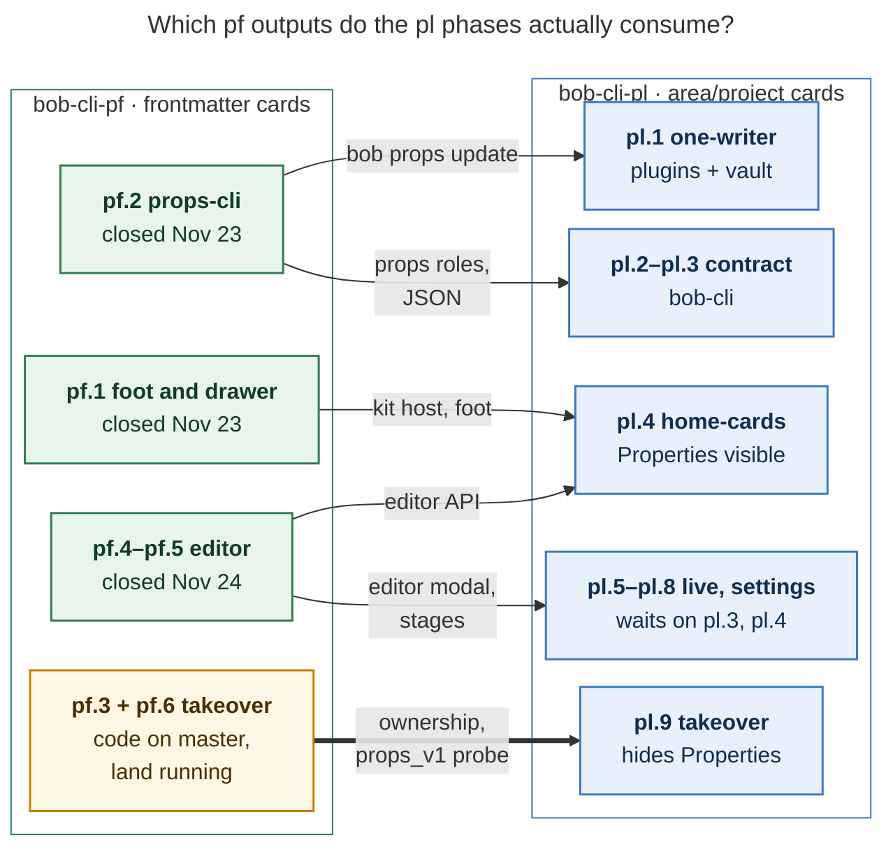

# Does the area/project cards epic really wait on the property-card epic?

_As of 2026-11-24 14:05 UTC (09:05 EST). Covers `bob-cli-pl` (area and project cards
with a bob-validated settings editor), which is waiting on `bob-cli-pf` (property cards
own the frontmatter)._

## Short answer

- **Eight of nine phases do not need to wait. Only one does.** Phases `pl.1`–`pl.8`
  use only work from `pf.1`, `pf.2`, `pf.4`, and `pf.5`. All four of those phases are
  closed and on master. Only `pl.9` (takeover) uses the work that is still landing,
  which is `pf.6` (takeover).
- **The gate was right when it was written. It is now out of date.** The plan was
  written on Nov 22 at about 21:00 EST. At that time `pf.1`, `pf.2`, `pf.4`, `pf.5`, and
  `pf.6` were all still in progress, and `pl.2` and `pl.4` really did need `pf.1`,
  `pf.2`, and `pf.4`. Those phases closed between Nov 23 02:37 UTC and Nov 24 01:30 UTC.
  But the gate waits for the _whole_ epic to close, not for the phases each pl phase
  needs, so it never let go.
- **The edges are on the wrong phases.** `pl.1`, `pl.2`, and `pl.4` each have a
  dependency on `bob-cli-pf`. `pl.9` is the one phase that needs `pf.6`, and it has no
  edge to pf at all. Only the plan's text holds it back. So if you only delete the three
  edges, `pl.9` is left with no gate in the bead graph.
- **pf is close to closing anyway.** All five `pf.6.1` phases are closed. The last one
  closed at 13:58 UTC today. `bob-cli-pf.6.1.land` started at about 14:05 UTC, and
  `bob-cli-pf.land` runs after it. The three pl monitors check every five minutes, so
  doing nothing will likely free them within hours. That holds only if both land agents
  succeed.
- **Recommendation: change the gate, not the epic.** The nine phases, their order, and
  their content are fine. Move the pf dependency from `pl.1`, `pl.2`, and `pl.4` onto
  `pl.9`. Write the change down where the agents will read it. Then release the three
  waiting monitors. The steps are in [Unblocking today](#unblocking-today-not-done-needs-bryans-go-ahead).

## What each pl phase actually uses from pf



_Figure 1. Everything that `pl.1`–`pl.8` use from pf is already closed and on master.
The only pf work still landing (amber) feeds `pl.9` alone, which sits at the very end of
the pl chain._

| pl phase                     | What it uses from pf                                                                                                                                                         | From         | Is it on master?                                       |
| ---------------------------- | ---------------------------------------------------------------------------------------------------------------------------------------------------------------------------- | ------------ | ------------------------------------------------------ |
| `pl.1` one-writer            | `bob props update` with `prop.unset` and a fingerprint, used by the retired-key sweep                                                                                        | `pf.2`       | Yes. The installed `bob 0.6.0` has `bob props`        |
| `pl.2` contract-writes       | `src/native/props/{roles,protocol,plan,show,…}.rs`, the goldens, and `docs/props.md`                                                                                          | `pf.2`       | Yes. `roles.rs` already has `Area`, `Project`, `Bank` |
| `pl.3` contract-reads        | `show.rs` and the capability list (`props_v1`)                                                                                                                               | `pf.2`       | Yes, plus `pl.2`                                       |
| `pl.4` home-cards            | `createPropertyCardHost` (`240c`), title-block DOM (`240g`), title adopt (`240k`), foot (`240o`/`240p`/`240r`), created (`240m`), species table (`240f`), `openPropertyEditor` | `pf.1`, `pf.4` | Yes                                                    |
| `pl.5` card-live             | kit lint chip, `propertyCardAdoptPatch`, editor API                                                                                                                          | `pf.1`, `pf.4` | Yes                                                    |
| `pl.6`–`pl.8` editor phases  | the editor modal, session, grammar, Link and List stages (`298*`)                                                                                                            | `pf.4`, `pf.5` | Yes                                                    |
| `pl.9` takeover              | the ownership coordinator (`240q`), pf eligibility rules, cached `props_v1` probe and Mod+; wrapper (`298v`), `scripts/obsidian-frontmatter-takeover-e2e.cjs`               | `pf.3`, `pf.6` | Code yes (`3824ce55`). The land agents are still verifying it |

## Timeline: what the gate was waiting for

| pf phase                         | Closed (UTC)     | What pl needed from it                       |
| -------------------------------- | ---------------- | -------------------------------------------- |
| `pf.3` ownership primitive       | Nov 22 20:02     | `pl.9` only                                  |
| _pl phases launch and park_      | _Nov 23 ~02:00_  | _the plan's gate says "pf must be closed"_   |
| `pf.1` foot and drawer           | Nov 23 02:37     | `pl.4`, `pl.5`                               |
| `pf.2` props-cli                 | Nov 23 03:53     | `pl.1`, `pl.2`, `pl.3`                       |
| `pf.4` editor core               | Nov 23 17:29     | `pl.4`–`pl.8`                                |
| `pf.5` editor parity             | Nov 24 01:30     | `pl.6`–`pl.8`                                |
| `pf.6.1.1`–`pf.6.1.5` (takeover) | Nov 24 02:20–13:58 | `pl.9` only                                |
| `pf.6.1.land`, then `pf.land`    | _running / waiting_ | nothing pl needs, apart from `pl.9`       |

`pl.1` and `pl.2` could have started on Nov 23 at 03:53 UTC, about 34 hours ago. `pl.4`
could have started on Nov 23 at 17:29 UTC, after `pf.4` closed. The rest of the pl chain
is queued behind those three phases.

## Why the agents are still waiting

1. **The plan gates on the whole epic.** Under "Launch precondition and as-landed APIs"
   it says: "That epic must be **closed** before any phase starts. ... If it is not
   closed, stop: record a note on your own phase bead and change no files." The same
   section also tells each phase to read the as-landed docs and to follow the code where
   it differs. That second rule already covers drift, so the closed-epic rule adds
   nothing for phases whose inputs have landed.
2. **Three phase agents followed the plan and parked.** `pl.1`, `pl.2`, and `pl.4` each
   wrote a "blocked by launch precondition" note. Each one added its own edge to
   `bob-cli-pf` (that is why only these three have edges) and handed off to a monitor:

   | Monitor  | Phase  | Workspace    | Waited so far |
   | -------- | ------ | ------------ | ------------- |
   | `qj95fc` | `pl.1` | `bob-cli_16` | about 36 h    |
   | `5mckwq` | `pl.2` | `bob-cli_18` | about 35 h    |
   | `g066cv` | `pl.4` | `bob-cli_20` | about 36 h    |

   Each monitor runs
   `until [ "$(sase bead read bob-cli-pf … | jq -r .issue.status)" = closed ]; do sleep 300; done`
   with a 168-hour timeout. The monitor polls pf's status directly. It does not look at
   the bead edges, so removing the edges alone frees nothing.
3. **The saved follow-up prompt repeats the gate.** Each monitor's "Next action" starts
   with: "Its successful closure is the explicit launch precondition in
   plan:202611/area_project_cards.md." A follow-up that resumes before pf closes would
   read that line and park again, unless it also sees a newer, written override.
4. **The rest of the chain waits only on pl phases.** `pl.3` waits on `pl.2`. `pl.5` and
   `pl.6` wait on `pl.3` and `pl.4`. `pl.7` and `pl.8` wait on `pl.6`. `pl.9` waits on
   `pl.1`, `pl.5`, `pl.7`, and `pl.8`. `bob-cli-pl.land` waits on all nine. Each of these
   waits on both an agent name and a bead (for example `%w(bob-cli-pl.2, for_epic=false)`
   and `%w(bead=bob-cli-pl.2)`). None of them waits on pf. So freeing the three head
   phases frees the whole chain. It also means `pl.9`'s scheduled agent will **not**
   wait for pf unless the plan text or a note tells it to.

This is a cousin of the pattern in `research:202611/criterion_diamond_drawer_wait.md`:
a written gate turns into a monitor that polls a bead. The difference here is that this
gate was justified when it was written. Its faults are that it names the whole epic
instead of the phase each pl phase needs, and that its edges sit on the wrong phases.

## Is it safe to start now?

Yes. Each risk below is small, and each one has an existing guard.

1. **Shared plugin files (`pl.4` vs. pf's land agents).** Both touch `bob-ledger-tools`.
   All of pf.6's code is committed (`3824ce55`). The land agents mostly verify and close.
   The plan already says that shared touch points (`src/fragments.json`, `package.json`
   `test:unit`, `styles.css`, lifecycle teardown) stay additive and get rebased.
2. **Plugin deploys.** At 07:28 EST, a pf note said `bob plugins sync` was held back
   because the vault had a dirty deploy from `bob-cli_10`. Now, `bob plugins list -n`
   reports `bob-ledger-tools` as **synced** with master. It is still stamped "deployed
   from uncommitted build … `da688dd`", but sync may overwrite a dirty deploy without
   `--force` when one commit holds the same bundle byte for byte. So that hazard is
   effectively gone. Agents should still never pass `-F`.
3. **Two real-Obsidian e2e runs at once.** The runners start their own Obsidian profile
   on a free CDP port, with an isolated seeded vault, under their own Xvfb display
   (`docs/develop/validation.md`). A `pl.4` e2e run and a pf land check share no state.
4. **Memory.** `pf.6.1.5` rewrote `glossary:property-card` in commit `e3e437ba`. `pl.9`
   rewrites it again under its own approved decision. `pl.9` runs last, so it starts from
   the strand as it landed.
5. **Keymap drift.** The `ft` work (`da688dd`) moved `=+`/`=-` to bare `+`/`-`. `==` did
   not change. The pl plan still says `=+`. Note #2 on the epic records this, and the
   plan's "follow the code" rule covers it.
6. **pf's land agents could still change something.** If a land agent finds a defect,
   the fix will be on the takeover surface (`240q`, `298v`, the adapters). Only `pl.9`
   uses that surface. The kit pieces `pl.4` uses (host, title, foot) have been stable
   since `pf.1` closed on Nov 23.
7. **Old workspaces.** The parked sessions were captured at bob-cli `29d7fec7` and
   bob-plugins `c8deb534` on Nov 22. Any resumed or relaunched agent must refresh to
   master first. Each phase's existing "read the as-landed APIs" step already does this.

## Options

| Option                         | What you do                                                           | Cost                                                                                                                                                                               |
| ------------------------------ | --------------------------------------------------------------------- | ---------------------------------------------------------------------------------------------------------------------------------------------------------------------------------- |
| **A. Wait**                    | Nothing                                                               | Probably hours more, but that is a guess. If either land agent fails or stalls, the whole pl epic stays parked behind it. `pl.9` still has no pf edge.                          |
| **B. Move the gate (recommended)** | Move the edge, write the override in notes, release three monitors | About ten commands. `pl.1`, `pl.2`, and `pl.4` start now, and `pl.9` gets the right gate.                                                                                          |
| C. Replan the epic             | A new plan                                                            | Not worth it. The phase content is still right, and the plan already handles API drift with its "follow the code" rule.                                                           |

## Unblocking today (not done; needs Bryan's go-ahead)

**First, check whether pf has already closed.** If
`sase bead read bob-cli-pf -r "<why>"` shows `CLOSED`, do nothing. The monitors will
free themselves within five minutes, and every gate is then met.

Otherwise, do these steps in this order.

**1. Write the override where the agents will read it.** Put one note on the epic and
one on each affected phase. Each phase agent reads its own bead's notes, and its newest
note will then outrank the older "blocked" notes.

```sh
MSG='LAUNCH PRECONDITION AMENDED (Bryan, 2026-11-24): only takeover (bob-cli-pl.9) still requires bob-cli-pf to be closed. one-writer, contract-writes, contract-reads, home-cards, card-live, editor-settings, editor-policy-stages, and editor-parent may start now: the pf.1, pf.2, pf.4, and pf.5 outputs they use are closed and on master. Every phase still reads the as-landed docs (bob-cli docs/props.md; bob-plugins docs/property-editor.md and docs/develop/architecture.md; glossary:property-card) and follows the code where it differs (for example, bare + and - instead of =+ and =-). home-cards must not bind the frontmatter ownership coordinator; native Properties stays visible until takeover.'
sase bead note bob-cli-pl "$MSG"
for b in bob-cli-pl.1 bob-cli-pl.2 bob-cli-pl.4; do sase bead note "$b" "$MSG"; done
sase bead note bob-cli-pl.9 'GATE (Bryan, 2026-11-24): before changing files, read bob-cli-pf; if it is not closed, stop with a note on this bead. This replaces the epic-wide launch precondition, which now applies to this phase only.'
```

**2. Move the edge to the phase that needs it.**

```sh
sase bead dep rm bob-cli-pl.1 bob-cli-pf
sase bead dep rm bob-cli-pl.2 bob-cli-pf
sase bead dep rm bob-cli-pl.4 bob-cli-pf
sase bead dep add bob-cli-pl.9 bob-cli-pf
```

Gate `pl.9` on the epic, not on `pf.6`. Takeover's acceptance is pf's acceptance, and
waiting a little longer costs nothing, because `pl.9` already sits behind four pl
phases. The new edge records the need in the graph. It does **not** change the
already-scheduled `pl.9` agent's wait list, which was fixed at launch. That is why the
note from step 1 is needed.

**3. Release the three monitors.**

```sh
sase monitor stop qj95fc   # pl.1
sase monitor stop 5mckwq   # pl.2
sase monitor stop g066cv   # pl.4
```

`stop` launches no follow-up. Then restart each phase in one of two ways:

- **Preferred: `sase monitor resume <id>`.** This keeps the follow-up inside the same
  `bob-cli-pl.N` session, which is the session name the downstream waits use. Its saved
  prompt already says to check what landed, write a plan with `/sase_plan`, implement,
  and close only that phase. Its first sentence still asks for pf to be closed, so step
  1 must come first. **Not verified:** the help text describes `resume` for a "terminal
  monitor". I did not test whether a monitor ended with `stop` counts as terminal.
- **Fallback: relaunch the phase** with its original prompt plus one override line. For
  example, for `pl.1`:

  ```text
  %id(1, clan=bob-cli-pl, bead=bob-cli-pl.1)
  +bob-cli
  %m:gpt-6-astra
  %auto
  #bd/work_phase_bead:bob-cli-pl.1
  The bob-cli-pf launch precondition is amended for this phase; see the newest note on bob-cli-pl.1.
  ```

  The downstream agents wait on a bead closing as well as on an agent name, so a
  relaunched phase that closes its bead frees them. **Not verified:** how SASE treats a
  reused `%id` name after the old session ends. Check this before using the fallback.

## Preventing the next stale gate

`criterion_diamond_drawer_wait.md` already proposes the structural fix: a per-phase
`waits_on:` field that `sase bead work` turns into real edges. This case adds one more
rule. **When a plan gates on an epic that is still in progress, it should name the
narrowest phase each pl phase uses, not the whole epic.** For this epic, that would
have been `pf.2` for the contract phases, `pf.1` plus `pf.4` for the card phases, and
`pf.6` for takeover. Gates written that way release themselves as each pf phase closes.
Gating on the whole epic forces every phase to wait for the slowest phase, and here the
slowest phase is the only one that just one pl phase needs.

## Sources

- Plans: `plan:202611/area_project_cards.md` ("Launch precondition and as-landed
  APIs", the phase sections, and "Cross-cutting rules") and
  `plan:202611/card_owned_frontmatter.md` (§6 takeover, the phases `owns-frontmatter`
  and `takeover`).
- Beads: `bob-cli-pl` and `.1`–`.9` (dependencies and notes); `bob-cli-pf`, `.1`–`.6`,
  and `bob-cli-pf.6.1` with `.1`–`.5` (status and `closed_at`).
- Agents and monitors: `sase agent list -a -j` (wait lists, and the `pf.6.1.land` and
  `pf.land` status); `sase monitor list`; `sase monitor show g066cv` (command, saved
  next action, timeout); `staged_monitor_launch.json` for `pl.1--mon`.
- Code at bob-cli `e3e437ba`: `src/native/props/roles.rs`, `show.rs` (`props_v1`), and
  `docs/props.md`.
- Code at bob-plugins `3824ce55`: `plugins/bob-ledger-tools/src/240c`, `240f`, `240g`,
  `240k`, `240q`, `240r`, `298*` (including `298v` capability routing), `374*`, and
  `379-exports-property-editor.js`; `scripts/obsidian-frontmatter-takeover-e2e.cjs`; and
  `docs/develop/validation.md` (the isolated e2e runners).
- Vault deploy state: `bob plugins list -n` at 14:01 UTC.
- Related: `research:202611/criterion_diamond_drawer_wait.md`.
