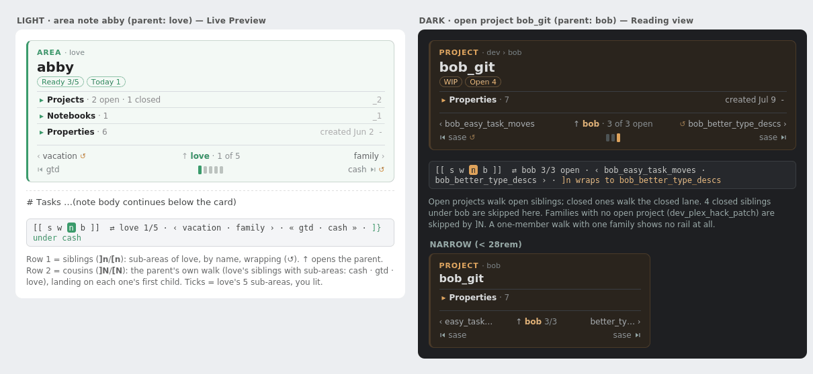

# Link walks for area, project, notebook, and prose notes (cld)

> **Research query:** Add `]n` link-walk support to area notes, project notes, notebooks,
> and prose notes. Paint a link-walk widget at the bottom of the property card, as the
> other walkable notes do, and make sure that widget always sits at the very bottom,
> below every cabinet. Each walk includes only notes of the same type that share the
> same parent, and its members are grouped by parent. Add a glossary term for "link
> walk". Support `]N` if there is an intuitive grouping. Build this in parallel with the
> in-progress bob-cli-qq epic (Property Card Cabinets) and decide whether that needs
> coordination. Lead the design: intuitive, reliable, beautiful. Critique the plan and
> end with a recommended solution.

Researcher `cld`, one of five independent reports. Evidence comes from bob-plugins
`master` at `4dd95d52` (bob-ledger-tools 1.172.8, bob-navigation-hotkeys 2.107.13),
bob-cli `master` at `eff5d986`, a read-only census of the live vault (`~/bob`, 7,541
Markdown files), the bob-cli-qq / qq.10 beads and plans, and earlier finished research
(`bracket_n_group_jumps`, `record_nav_ring`, `property_card_cabinets`).

---

## 1. Bottom line

**Build it.** One sentence makes it intuitive, and that sentence is a rule Bryan's hands
already know:

> **`]n` steps to your next sibling. `]N` steps your parent to *its* next sibling and
> lands on that parent's first child of your type.**

This is not a new idea bolted onto `]N`. It is exactly what `]N` already does on the
calendar. A week's parent is its quarter, and `]N` from `2026-W30` opens W40, the first
child of the quarter's next sibling. The day → week → quarter → year chain is a tree.
The area/project/notebook tree is another tree. The same uppercase rule works on both.
Siblings form a **family**: the children of one parent. The families next to yours are
your **cousins**. So the grouping question ("group by parent") answers itself: the
groups are families, and they are ordered by the parent's own walk.

The design in brief:

1. **Derive everything and write nothing.** A new `tree` route in Bob Ledger Tools'
   existing `api.navGroups` provider answers from Obsidian's metadata cache (`type`,
   `parent`, and the `^prj` checkbox). Navigation Hotkeys already falls back to that
   provider for `[n` `]n` `[N` `]N` `[[` `]]` `[{` `]}`
   (`483-nav-group-links.js:76-115`, verified). **All eight keys light up with no change
   to the key code.**
2. **`]n` wraps within the family** (↺, like the record ring) and never leaves the
   parent. **`]N` / `[N`** go to the first member of the next / previous non-empty
   cousin family, also wrapping.
3. **Order follows the parent's cabinet:** areas and projects by file name, notebooks by
   title, case-insensitive. That is "alphabetical" made precise. Then `]n` visits
   exactly the rows the parent's Areas / Projects / Notebooks cabinet lists.
4. **Projects walk in lifecycle lanes.** 57 of 102 live projects are closed, including
   37 of the 61 under `sase`. An open project walks its open siblings, and a closed
   project walks the closed lane. (Adjustment A3; vetoable.)
5. **The rail is the card's floor.** A kit-owned dock is the card's last child, below
   the cabinet stack and Properties, on *every* rail-bearing card. That includes record
   and day/period cards, which today put their rail **above** Properties (documented as
   "The foot follows the rail"). The rail reuses the existing kit rail: a step row
   `‹ prev · ↑ parent · n of m · next ›` plus the quiet group row
   `⏮ cousin  ▮■▮▮  cousin ⏭`.
6. **Fix a live hazard first.** The authored-link scanner ignores inline code, so
   `` `[[<person>]]` `` in `bob.md` already answers **both** `[n` and `]n` today
   (verified). That would shadow the new walk on a top project with seven children.
7. **Parallel with qq: develop everything now and land in four waves.** Bead dependency
   edges gate the waves; no human coordination is needed. Only three of the six code
   phases touch files that qq is still changing, and those wait on a specific qq phase.



*Mockup (rendered HTML using real vault data). The link-walk rail sits below the cabinet
stack on both cards, and the walker footer shows the same answer.*

---

## 2. What exists today (verified)

| Fact | Where |
| --- | --- |
| `[n`/`]n` call `openLabeledBodyLink`, which calls `resolveNavLinks`. Per role, an **authored** link wins; otherwise the stop comes from Ledger Tools `api.navGroups.resolve({path, content}).step.{prev,next}`. Group stops work the same way, but authored `«`/`»` count only on link-only "nav lines". | nav `670-plugin-project-files.js:155-164`, `483-nav-group-links.js:76-115` |
| The step matcher accepts exact `prev`/`next`, a label starting with `‹` or `<(?!<)`, or one starting or ending with `›`/`>`. It scans **every body line**, including task lines and **inline code**. | nav `680-plugin-link-parse.js:5-14`, `:18-40`; `670:790-830` |
| `api.navGroups` v1 has two derived routes: records (`296g`, by `walk_by` group) and calendar (`296e`). Its answer shape is `{ok, route, kind, step{prev,next,parent}, group{noun,label,position,size,index,count,members,atStart,atEnd,enteringNext,enteringPrev}, prevGroup, nextGroup, none}`. It is synchronous, never throws, never writes, and never spawns bob. | ledger `296f:129-148`, `296e:251-283` |
| Family `n` already routes `[{`/`]}` to `[N`/`]N`, `]]`/`[[` to `]n`/`[n`, and ignores counts. | nav `546-plugin-bracket-repeat.js:31`, docs `bob-navigation-hotkeys.md` §Bracket repeat |
| Card rail kit: `propertyCardBuildRail` builds a prev/↑ parent/next step row, optional child chips, and the optional group row from `propertyCardBuildGroupRow`. The group row has skip-mark arms, a tick track (one tick per member; a bar over 21), ghost and creatable states, and onNavigate/onActivate injection. | ledger `240g:290`, `240l:239` |
| Day/period cards append **rail, then foot**. The record sheet appends **rail, then foot** ("The foot follows the nav rail"). Both contracts are documented: "The foot follows the rail." | `296b:369-372`; `242k:671-681`; `docs/intention-card.md:103`; `docs/record-card.md:154` |
| Under the cabinets gate, `propertyCardFootAdapterAppend` synchronously appends the foot, then the whole cabinet stack, via `card.appendChild` at the end of the card. Lazy cabinet bodies later mount **inside** their panels. | `240r:310-338`; `240wl:240-309` |
| Each species appends its foot through its own hook: home `249e:218`, notebook `249j:158`, prose `249o:123`, intention `296da:100`, record `242kc:191`. | grep of `propertyCardFootAdapterAppend` |
| Area, project, notebook, and prose cards have **no rail** today. | `249c/249h/249m` |
| Parent resolution, ancestry walking, and exclusions already exist for cards. Excluded: `done/`, `_templates/`, `_conflicts/`, `area.md`, `project.md`, `bank.md`. | ledger `249b:41-57`, `:196-285` |
| Catalog order in bob: **areas** by stem (case-folded), then path. **Projects**: open rows by stem, then closed rows newest-closed first under `**Closed**`. **Notebooks** by title (case-folded), nested. | bob-cli `areas/graph.rs:464`, `projects/catalog.rs:801-828`, `notebooks/catalog.rs:237-243` |
| The links footer hint noun maps `day→week`, `week→quarter`, `quarter→year`, otherwise `group`. | ledger `124-links-walker-footer.js:260-272` |

Earlier decisions carried forward from the `bracket_n_group_jumps` consolidation:
**derive group stops on Bob's own species and never write them**; authored links on nav
lines override; uppercase opens the **first** member of the adjacent group, including
`[N`; counts are ignored.

---

## 3. Vault census (what the walk will actually meet)

Read-only scan of `~/bob` (excluding `_conflicts/`, `_templates/`, and `done/`), with
`parent` links resolved the way Obsidian does, so `[[love.md|love]]` counts as `love`:

| Type | Notes | Families (distinct parents) | Singleton families | Largest families |
| --- | --- | --- | --- | --- |
| project | 102 (45 open / 57 closed) | 21 | 11 | `sase` 61 (24 open / 37 closed), `bob` 7 (3/4), `sase_memory` 4 |
| notebook | 39 | 20 | 12 | `dev` 9, `lang` 5, `cash` 3 |
| area | 18 | 5 | 1 | root `area` 6, `love` 5, `inbox` 4, `gtd` 2 |
| prose | 1 (`_templates/new_prose.md` excluded) | 1 | 1 | `sase_blog` 1 |

What this means for the design:

- **Closed projects dominate the biggest family.** A naive `]n` from an open `sase`
  project would spend 37 of every 61 presses on finished work. This motivates lanes (A3).
- **Most families are tiny.** 11 of 21 project families and 12 of 20 notebook families
  have one member. For those notes `]n` has nowhere to go, and **`]N` is the only useful
  key**. For example, `recur` is cash's only sub-area, yet `]N` takes it to gtd's
  sub-areas and then love's. That is why `]N` matters here and is not a nicety.
- **Prose barely exists yet** (1 live note, a singleton). A derived walk adds almost
  nothing for prose today. Its real value will be **authored series nav lines**
  (`‹ Part 2 · Part 4 ›`), which already work. Include prose for uniformity and keep the
  expectations modest.
- **Titles mostly equal stems.** Only 46 of 160 notes have an H1, so ordering by the
  cabinet key and displaying the card title rarely disagree.
- **Authored-link shadowing:** one hit across all 160 notes. `bob.md` contains
  `` `[[<person>]]` `` inside inline code. Its rendered text `<person>` matches **prev**
  (`^<(?!<)`) and **next** (`(?<!>)>$`). Today `[n`/`]n` on `bob.md` target a note named
  `<person>`, and after this feature they would hide the derived walk.

---

## 4. Critique: is this a good idea?

**Yes, with five changes.**

Why it is worth doing:

- **It finishes a grammar.** `n` is the "neighbor note" walk. Days, periods, and records
  have neighbors, and so do the notes Bryan spends the most deliberate time in.
  Reviewing 24 open `sase` projects becomes `]n ]n ]n` instead of ↑, open the Projects
  cabinet, click, and repeat.
- **It is cheap and passive.** The resolver, precedence, commands, repeat keys, footer,
  and rail kit all exist. The work is one provider, one rail adapter per card, one dock,
  and copy.
- **It turns cabinets into a loop.** Cabinets show a parent's children, and the walk
  moves through them without going back up.

What I would change (each is called out in §9):

1. **Make "only same parent" and "grouped by parent" agree.** Read literally, these two
   requirements conflict: if every member shares one parent, there is only one group.
   The way to reconcile them: `]n` walks siblings (one parent), and `]N` walks cousins,
   which are grouped by parent. (§5.1)
2. **Split projects by lifecycle**, or `]n` mostly lands on dead projects. (§5.3)
3. **Define "alphabetical" as "the parent cabinet's order"**, so the walk and the
   cabinet never disagree. (§5.3)
4. **Treat "bottom of the card" as a family-wide contract and accept the cost.** It
   reverses the documented rail-above-Properties order on records and day/period cards.
   Opening Properties pushes the rail down. I think that is right, because it is the
   docs-site pattern of "‹ Previous · Next ›" at the end of the page. (§5.6)
5. **Harden the authored-link matcher before shipping**, or the walk is silently wrong
   on `bob.md`. (§5.5)

Alternatives I considered and would not take:

| Alternative | Why not |
| --- | --- |
| **bob writes `‹ prev · next ›` walk lines into the notes**, as the record ring does | It puts bob-owned bytes into author-owned notes (prose is explicitly owned prose, `decisions:prose-notes-are-owned-prose`). Every create, rename, or retitle rewrites neighbors, which means vault-sync merge noise and churn across 160 notes. The `]N` research already rejected writing for this reason. Records need bytes because albums are bob-curated folders; tree notes are not. |
| **A `bob tree walk --json` CLI as the source** | Spawning bob on a keypress or paint breaks the property-card passivity rule. It also adds a release-train dependency (`decisions:bob-cli-releases-ride-a-daily-train`) for data Obsidian's metadata cache already holds. |
| **`]N` as "go up / go down"** (parent / first child) | It breaks the family-wide rule (uppercase = first member of the adjacent group), makes `]}`/`[{` mean something different only here, and is asymmetric. ↑ is already on the rail, and children already live in cabinets. |
| **`]N` over a global tree order** (every project in the vault, grouped by parent, in depth-first order) | Nobody can predict the next group after the last child of `job`. The cousin rule is bounded by the grandparent, so it can be explained in one sentence. |
| **A quick-switcher of siblings instead of a walk** | It is complementary but not a replacement. Cabinets already list the children, and the walk is for flow. |

---

## 5. The design

### 5.1 The one rule: siblings and cousins

```text
                         dev (area)                       ← grandparent
          ┌───────────────────┼──────────────────────┐
        bob (project)   dev_plex_hack_patch      sase (project)   ← the parent's own walk
     ┌────┼─────┬─────┐        (no children)     ┌────┼──── … 24 open
   b_better  b_easy  b_git*                    s_agent_recovery …
   └──────── family of bob ───────┘           └── family of sase ──┘

   ]n / [n : bob_git → bob_better_type_descs (↺) / bob_easy_task_moves
   ]N / [N : bob_git → sase_agent_recovery (first open child of sase)
             (dev_plex_hack_patch has no open child → skipped)
```

| Key | Meaning | Wraps? |
| --- | --- | --- |
| `]n` / `[n` | next / previous **sibling**: same type, same resolved `parent`, same lane (projects), in cabinet order | yes, `↺` |
| `]N` / `[N` | **first** member of the next / previous non-empty **cousin family**. Families are the parent's siblings, in the parent's cabinet order, keeping only those with a member of your type (and lane). | yes, `↺` |
| `]]` `[[` / `]}` `[{` | repeat the step / the leap (existing family-`n` repeat) | — |
| ↑ (rail only) | open the parent | — |

**Why `]n` wraps instead of continuing into the next family.** Days cross into the next
week because time is a line. A family is a set: the children of one parent. Records
already behave this way, because the record ring is one album's children and never
leaves the album. The `walk_by` groups inside it are facets, not parents. So the rule
across species is: **`]n` never leaves the parent, except on the calendar.** This also
matches the request literally: the walk includes only notes that share the parent.

**Why `[N` lands on the previous family's *first* member.** This is parity with
`[S`/`[W`/`[B` and with `[N` on days, periods, and records (the settled `]N` rule). Group
jumps are not mutual inverses, and `<C-o>` gets you back.

**Why families are ordered by the parent's walk.** This makes `]N` literally "`]n` on
your parent, then down". It is recursive, predictable, bounded by the grandparent, and
it is what the calendar does.

**Family ring details:**

- The family ring is **all** of the parent's same-type siblings, in name order, in both
  lifecycle lanes. Lanes filter the *members* only, not the families.
- A family with no member of your type and lane is skipped (an "occupied groups only"
  rule, like `]S` and records).
- With fewer than two occupied families, `]N` shows a notice and the rail has no group
  row.

### 5.2 Membership

A note is in the tree walk when all of the following hold:

- Its frontmatter `type` is `[[area]]`, `[[project]]`, `[[notebook]]`, or `[[prose]]`
  (legacy `[[article]]` counts as prose).
- Its path is not excluded by `homeCardPathExcluded`: `done/`, `_templates/`,
  `_conflicts/`, `area.md`, `project.md`, `bank.md` (per
  `decisions:bank-hub-is-path-canonical-never-area`), or the note-ready exclusions.
- Its `parent` is **one** link that resolves with
  `metadataCache.getFirstLinkpathDest(link, path)`, so `[[love.md|love]]` resolves
  correctly.

Siblings are the notes with the same type and the same resolved parent path. These
cases produce no walk and an honest notice instead:

| Case | Notice and rail behavior |
| --- | --- |
| Unresolved `parent`, list `parent`, or missing `parent` | `No parent — Ctrl+Shift+- sets one`; no rail |
| Parent cycle | Answered as `none: cycle` |

Top-level areas are siblings under the root `area.md`, which is the only untyped parent
allowed. They form one family, so they have no `]N`.

### 5.3 Order and lanes

| Type | Sibling order (= parent cabinet) | Lanes |
| --- | --- | --- |
| area | stem, case-folded, then path | — |
| project | stem, case-folded, then path | **open** (WIP/scheduled/blocked/no `^prj`) and **closed** (`^prj` is `[x]` or `[-]`) |
| notebook | card title (H1 → first alias → humanized stem), case-folded, then path | — |
| prose | card title (`title:` → alias → stem), case-folded, then path | — |

- **Mirror the comparators; don't reuse the bob reports.** The JS comparators mirror the
  Rust ones and cite them in comments (`areas/graph.rs:464`,
  `projects/catalog.rs:801`, `notebooks/catalog.rs:237`). Ordering never depends on a
  cached `bob … list` report. Reports can be absent or stale, and using them would make
  the order change when a report arrives. That would make the walk unreliable.
- **Lane comes from the metadata cache.** It is the list item whose block `id` is `prj`,
  and its `task` checkbox character. That is synchronous and needs no file read.
- **The closed lane is alphabetical**, not newest-closed-first like the cabinet's
  `▸ Closed` fold. Close dates live in line text that the metadata cache doesn't carry,
  and alphabetical is what was asked. This is a known, documented difference (open
  question Q3).

### 5.4 Worked examples (real vault, computed)

| From | `[n` | `]n` | `[N` | `]N` | Rail center |
| --- | --- | --- | --- | --- | --- |
| `bob_git` (open project under `bob`) | `bob_easy_task_moves` | ↺ `bob_better_type_descs` | ↺ first open child of `sase` | first open child of `sase` (`sase_agent_recovery`) | `↑ bob · 3 of 3 open` |
| `sase_actstat` (closed, under `sase`) | ↺ `sase_update` | `sase_agent_history` | first closed child of `bob` | ↺ `bob_command_mode_improvements` | `↑ sase · 1 of 37 closed` |
| `abby` (area under `love`) | ↺ `vacation` | `family` | `gtd_daily` (gtd's first) | ↺ `recur` (cash's only) | `↑ love · 1 of 5` |
| `recur` (only sub-area of `cash`) | — notice | — notice | ↺ `abby` | `gtd_daily` | `↑ cash` (group row only) |
| `java` (notebook under notebook `lang`) | ↺ `shell` | `lua` | `git` (dev_tools) | `athena` (linux) | `↑ lang · 1 of 5` |
| `mac_inbox` (area under `inbox`) | `gmail_inbox` | `meet_inbox` | — one family | — one family | `↑ inbox · 3 of 4` |
| `sase_blog_contents` (prose) | — | — | — | — | **no rail** (lone child, one family) |

### 5.5 Precedence and the authored-link hazard

The precedence stays **authored nav line → derived**. That is what lets a prose series
or a hand-curated reading order override the alphabetical walk, the same way an explicit
`[root::]` beats the derived root. Two fixes come first:

1. **Inline code never counts.** `findFirstRenderedLinkInLine` skips spans inside
   backticks. This fixes `bob.md` today and protects every note type.
2. **On a derived route, authored *step* links count only on nav lines.** A nav line is
   a body line holding only links, which is the rule group links already follow. When
   the provider answers `route: tree` (and also `calendar`/`record`, whose written lines
   are already nav lines), a `Read more ›` in prose or a `> X` inside a task line can't
   hijack `]n`. Notes with no provider answer keep today's anywhere-in-body behavior, so
   nothing else regresses.

Today's step-none notice is the generic `No next link found`. Add an additive
`none`/`stepNone` message from the provider so `]n` on a lone child says something
useful, for example `bob_git is bob's only open project — ]N visits sase's` or
`recur is cash's only area — ]N visits gtd's`. The group-none notice path already
exists.

### 5.6 The rail: the card's floor

**Anatomy.** The rail reuses the kit unchanged: `propertyCardBuildRail` with the step
row and a group-row spec.

```text
  ▸ Projects     2 open · 1 closed                                   _2
  ▸ Notebooks    1                                                   _1
  ▸ Properties   6                                 created Jun 2      -
  ─────────────────────────────────────────────────────────────────────
  ‹ vacation ↺               ↑ love · 1 of 5                    family ›
  ⏮ gtd                        ■ ▮ ▮ ▮ ▮                     cash ⏭ ↺
```

- **Step row** (primary): `‹ prev` · `↑ parent · n of m` · `next ›`. The center combines
  the period rail's `↑ W47` with the record rail's `Album · 3 of 104`. For projects the
  count names the lane: `3 of 3 open`, `5 of 37 closed`. `↺` marks the wrapping arm.
- **Group row** (quieter, only with two or more occupied families): the arms name the
  **neighboring parent** (`⏮ gtd`, `cash ⏭`), and the landing note goes in the tooltip
  and accessible name (`]N · next: cash's areas → recur`). This matches the
  kit's period and record convention of the group name on the arm and the landing in
  the tooltip. The center track shows one tick per member of *your* family, with you
  lit. Its tooltip reads `Area 1 of 5 under love`. With two families, both arms name the
  same cousin and one carries `↺`, as on records.
- **The visual grammar holds on every card.** Row-2 arms are the neighbors of the row-1
  `↑`. On a week card the arms are Q3 and 2027-Q1, the neighbors of `↑ 2026-Q4`, and on
  `abby` they are gtd and cash, the neighbors of `↑ love`. Learn it once and it reads the
  same everywhere.
- **Absence, not placeholders.** If there is no sibling and fewer than two families,
  there is **no rail**: the kicker crumb already says where ↑ goes. If there is no
  sibling but there are cousins, the card shows the group row plus `↑ parent`.
- **States.** Every stop points at an existing note, so the tree route has no
  creatable or ghost stops. A race, such as a deleted target, re-resolves on click
  (`The stop changed — try again`, the existing `242va`/intention pattern).
- **Activation** works like the intention and record rails. A plain click re-validates
  the stop, then runs the same nav command as the key (`open-next-link`,
  `open-next-group-link`), so jump history and `]]` match. Mod-click and middle-click
  open a tab.
- **Narrow** (container below 28rem): the kit's short labels and a `3/5` count; the
  group row keeps only the arms.
- **Color and accessibility.** The rail inherits the card accent (root hue), keeps the
  kit's 28px targets and focus rings, and uses CanvasText in forced colors. It adds no
  new palette values.

**"Always at the very bottom", made reliable.**

- **Contract (family-wide):** *The link-walk rail is the card's last element. It sits
  below the cabinet stack, including Properties, on every card that has one.* This
  reverses `docs/intention-card.md:103` and `docs/record-card.md:154` and must be
  documented as such.
- **Mechanism:**
  1. A new kit fragment, for example `240x-plugin-property-card-dock.js`, provides
     `propertyCardDockAppend(card, railEl)`. It wraps the rail in
     `.bob-property-card-dock` and appends it last. `propertyCardDockSettle(card)` is
     idempotent and re-appends the dock if anything displaced it.
  2. Each species hook (`*AppendFoot`) docks the rail immediately after
     `propertyCardFootAdapterAppend` returns. That is correct with the cabinets gate
     open or closed, because the adapter appends foot and stack synchronously.
  3. After qq closes, `propertyCardFootAdapterAppend` and `propertyCardCabinetsAssemble`
     learn to `insertBefore(dock)`, so the order no longer depends on call order.
- **The record rail's out-of-card form is unchanged.** When the record walk line is not
  the first body line, the rail replaces the written line in place. Only the **in-card**
  rail moves to the floor.
- **One test invariant for every species fixture, in both Live Preview and Reading:**
  `card.lastElementChild` is the dock whenever a rail exists.

**Accepted costs.** Opening Properties or a long cabinet pushes the rail down. Keys and
the footer remain the primary interface, so I think this cost is right. The rail also
duplicates the kicker's parent crumb, with the period-card precedent.

### 5.7 Walker footer (`n` panel)

The panel needs only copy changes in `124-links-walker-footer.js`. It already renders
step arms, group arms, context, boundary hints, and none-messages from the same answer.

| State | Footer |
| --- | --- |
| Area `abby` | `⇄ love 1/5 · ‹ vacation · family › · « gtd · cash » · ]} under cash` |
| Last open sibling | `⇄ bob 3/3 open · ‹ … · … › · ]n wraps to bob_better_type_descs` |
| Lone child with cousins | `⇄ cash · « love · gtd » · ]} under gtd` |
| Lone child, no cousins | `⇄ Links · recur is cash's only area` (tooltip has the full sentence) |

**The hint names the destination parent** (`]} under cash`). The calendar's
`]} next quarter` works because the parent's noun ("quarter") is unambiguous. Here
`]} next project` would be read as `]n`. The word **family** stays reserved for the
`s`/`w`/`n`/`b` walk families in docs, so the user-facing words are **siblings** and
**cousins**.

### 5.8 Reliability

- **One resolver.** Keys, repeats, footer, and rail all consume
  `navGroups.resolve({path, content})` through `resolveNavLinks`. A rail or footer click
  re-checks the stop before acting, so a preview can never disagree with the
  destination.
- **Index.** A lazily built `{path → {type, parentPath, lane, title}}` map plus
  `parentPath → children` lists, built from `getMarkdownFiles()` and `getFileCache()`.
  Scanning ~7.5k files is cheap, and it only rebuilds after invalidation.
  - A **generation counter** is bumped on `metadataCache` `changed` (only when a note's
    type, parent, lane, or title moved, or it is tree-typed), and on vault `create`,
    `delete`, or `rename`. Cards re-render their rail on a generation change, debounced,
    as calendar cards do on calendar-note create, delete, or rename.
  - **Off the paint path.** The index warms on `onLayoutReady` or idle. Until it is
    warm, the provider answers `{ok:true, route:"tree", none:{reason:"indexing"}}` and
    the card paints no rail, then repaints once. This matters because qq's perf runner
    measures card paint (see §6).
- **Passive.** The provider never writes the vault, never spawns bob, and never throws.
  A failure answers `unavailable`, and nav falls back to authored links only.
- **Tests.**
  - Pure model with golden fixtures that mirror the census shapes: `[[x.md|y]]`
    parents, cycles, list and unresolved parents, excluded directories, the root
    sentinel, singletons, two-family wrap, lanes, mixed types under one parent, and
    comparator parity vectors copied from the Rust tests.
  - Matcher vectors: inline code, task-line `>` labels, nav-line-only on derived routes.
  - Dock invariant for every species.
  - A scratch-vault real-Obsidian runner covering the eight keys on all four types, the
    rail in Live Preview and Reading, footer agreement, narrow, light and dark, a
    passive spy (zero writes and spawns), and failure on any `console.error`. The
    `console.error` check is the lesson from qq note #2, where an `atomicRanges` error
    slipped past a runner that counted only exceptions.

---

## 6. Running in parallel with bob-cli-qq

**Short answer.** Coordination is barely needed, and none of it has to be human. Develop
everything now. Land in four waves, each gated by a bead dependency edge on the qq phase
whose files or measurements it would disturb.

**qq's live surface** (from `finish_property_card_cabinets.md` and the beads, all
in progress today):

| qq phase | Touches |
| --- | --- |
| qq.10.1 perf | `240c`, `240wj`, `240wl`, `240wh`; Reading paint timing |
| qq.10.4 acceptance | the cabinets runner; measures card paint (cabinet ≤ 2× inline, no new long task over 100 ms) |
| qq.10.5 switch-on | removes the gate at 26 call sites in `240o`, `240r`, `240s`, `240wd`, `240we`, `240wl`, `240wm`, `241q`, `241tb`, `241v`, **`242kc`**, `248m`, `374k` |
| qq.10.6 docs-memory | `docs/cabinets.md`, the family pages, and **`glossary:property-card`, `area-card`, `project-card`** |

**This work's surface, and its overlap with qq:**

| Wave | Phase | Files | Overlap with qq | Gate |
| --- | --- | --- | --- | --- |
| **A** (now) | `tree-provider` | new `296h` model and `296i` index, one hook line in `296f`, new `378a` exports, new test script | none | none |
| **A** (now) | `nav-hardening` | bob-navigation-hotkeys `680`, `483`, `670` (inline code, nav-line-only on derived routes, step-none notice) | none (different plugin) | none |
| **A** (now) | `footer-copy` | `124-links-walker-footer.js` | none | after `tree-provider` |
| **B** | `tree-rails` | new dock `240x`, new `296j` tree rail, hooks in `249e`/`249d` (area/project), `249j`/`249i` (notebook), `249o`/`249n` (prose), small CSS region | **no file overlap**, but it adds DOM and paint work to area/project cards that qq.10.4 is measuring | **after qq.10.4 records GO** |
| **C** | `floor-everywhere` | record `242k` and **`242kc`**, intention `296b`/`296da`; kit `insertBefore(dock)` in **`240r`**/**`240wl`** | **direct**: `242kc`, `240r`, and `240wl` are qq.10.5 gate sites or perf files | **after qq.10.5 lands** |
| **D** | `docs-memory` + `acceptance` | plugin docs, bob-cli docs mount, glossary strands, optional decision record; real-Obsidian runner | **direct**: the same three glossary strands and family pages | **after qq.10.6 lands** |

Notes:

- **Generated-file conflicts are routine.** `main.js`, `styles.css`, `fragments.json`,
  manifest versions, and the docs inventory follow qq's own rule: take upstream,
  re-apply your additive lines, rebuild, and re-bump. Never hand-merge a bundle.
- **Deploys serialize themselves.** `bob plugins sync` refuses to overwrite an unlanded
  build from another checkout, and the bob-plugins AGENTS.md protocol (wait, never `-F`)
  handles it.
- **Wave A ships the feature's whole keyboard value.** All eight keys and the footer work
  before any card changes. Only the visible rail waits, and probably only by hours,
  because every qq.10 phase is already in progress.
- **The rest of the in-flight work doesn't collide.**
  - bob-cli-ms.8 (Record Card) has all phases closed and only landing left.
  - bob-cli-qj.5.1.7 edits bob-articles, not the prose card host.
  - bob-cli-r5 (species lists from `240f`) waits on qq and touches `240m`/`240q`/`240f`,
    which this work leaves alone.
- **No bob-cli code changes.** Nothing rides the release train, and Bob Mac Capture is
  untouched (`decisions:mac-capture-is-a-thin-client`).

---

## 7. Glossary: a new term "Link Walk"

Proposed `glossary:link-walk` strand. Write it through `/sase_memory_write` with Bryan's
approval, **after qq.10.6 lands**:

> # Link Walk
>
> aka `n` walk, links walk, sibling walk
>
> The `n` [[walker-footer]] family's walk between neighboring notes. `]n` / `[n` step to
> the next / previous note, `]N` / `[N` open the first note of the next / previous
> group, and `]]` / `[[` and `]}` / `[{` repeat them. One resolver answers every
> surface. A link on the note's nav line, a body line holding only links, wins: `‹` / `›`
> or `prev` / `next` steps, and `«` / `»` groups. Otherwise Bob Ledger Tools derives the
> stop from the note's identity and writes nothing:
>
> - daily and [[period-note]]s walk the calendar line and group by their parent period;
> - [[record-note]]s walk their album's ring, grouped by `walk_by`;
> - [[area-note]]s, [[project-note]]s, [[notebook]]s, and [[prose-note]]s walk their
>   **siblings**: same type, same resolved `parent`, in the parent catalog's order,
>   wrapping.
>
> Their groups are **cousins**: `]N` steps the parent to its next sibling and lands on
> that one's first child of the same type. Open and closed projects walk separate lanes.
> The walk paints as the rail on the floor of the note's [[property-card]], below every
> cabinet, and as the links panel of the walker footer. Positions are places in a ring or
> line, never progress, and nothing about a derived stop is stored. Not the `]s` review
> walk, the `]w` lane walk, the `]b` bank walk, a [[task-link]], or a [[task-relation]].
> See `docs/reference/plugins/bob-navigation-hotkeys.md`.

Strand updates in the same approved batch:

- `walker-footer`: the links footer covers tree notes, and `]} under <parent>`.
- `property-card`: "the link-walk rail is the card's floor, below the cabinet stack".
- `area-card`, `project-card`, `notebook-card`, `prose-card`: each gains the rail
  sentence.
- `day-and-period-card`: the rail now sits below Properties.
- `record-note`: its walk sentence links `[[link-walk]]`.

Also consider a decision record for this choice, which has real alternatives and a cost:

- **Proposed decision record:** `decisions:sibling-walks-are-derived-and-wrap`. *Tree
  notes walk derived siblings that wrap within the parent. `]N` walks cousins. No walk
  bytes are written. Authored nav lines override.*
- **Rejected:** written walk lines, a global depth-first ring, and up/down `]N`.
- **Would reopen it:** a need for walk order visible in Source mode or git.

---

## 8. Risks and the proof each needs

| Risk | Proof |
| --- | --- |
| Inline-code or prose links hijack the derived walk | Matcher vectors; `bob.md` fixture walks its `bob` siblings |
| Walk order disagrees with the parent cabinet | Comparator parity vectors from `catalog.rs`/`graph.rs` tests; e2e compares `]n` order with the cabinet's row order on a fixture host |
| Parent resolution differs from bob's (`[[x.md\|y]]`, paths, aliases) | Golden fixtures using Obsidian link resolution; unresolved parents → `none`, never a guessed family |
| Rail not last after a lazy cabinet mount or repaint | Dock invariant asserted after open, close, and repaint, in both views, with the gate open and closed until qq.10.5 |
| The index slows card paint (and qq's perf gate) | Index warms off the paint path; Wave B lands after qq.10.4 GO; a perf check that rail paint adds no long task over 100 ms |
| Stale rail after a sibling rename or lifecycle flip | Generation bump on `changed`/`rename`/`delete`/`create`; e2e renames a sibling and closes a `^prj`, and the rail updates once |
| Preview ≠ destination | Click re-validation (existing pattern), with a "stop changed" notice |

---

## 9. Requirement adjustments (explicit and individually vetoable)

- **A1. `]n` wraps within the family (↺) and never crosses into the next one.** This
  differs from days and grouped records, where `]n` continues into the next group. The
  request says the walk only includes notes with the same parent, and wrapping keeps
  that literally true.
- **A2. `]N` / `[N` walk cousins:** the parent's siblings, in the parent's order,
  skipping empty families. `[N` lands on the previous family's **first** member, for
  parity with every other group jump.
- **A3. Projects walk in lifecycle lanes.** Open projects walk with open, closed with
  closed. *Was:* every project sibling. *Fallback if vetoed:* one ring, open first and
  then closed, in cabinet order.
- **A4. "Alphabetically" means the parent cabinet's order.** Areas and projects by file
  name, notebooks and prose by title, all case-insensitive. The closed lane is
  alphabetical, not newest-first.
- **A5. No rail when there is nothing to walk.** A lone child with no cousin families
  gets no rail, and its keys explain why. *Was:* implied always-on.
- **A6. Hardening.** Authored step links on derived-walk notes count only on nav lines,
  and inline code never counts anywhere. *Added scope, required.*
- **A7. "Very bottom" applies to every rail-bearing card**, including records and
  day/period cards. This reverses two documented "foot follows the rail" contracts.
- **A8. Wave the rollout with bead edges** (§6) rather than strict parallel landing.
  Wave B waits for qq.10.4 GO, Wave C for qq.10.5, and Wave D for qq.10.6.
- **A9. Glossary scope.** Add `glossary:link-walk` (with "siblings" and "cousins" defined
  inside it) and update six card and footer strands after qq.10.6. The word "family"
  stays reserved for walk families in user-facing copy.

---

## 10. Open questions for Bryan

1. **Lanes for projects (A3):** yes (default), or one ring with open projects first?
2. **Lone child:** should `]n` on an only child fall through to `]N`'s target? Default:
   **no**, show a notice. A step key that sometimes leaps is the kind of surprise this
   design avoids.
3. **Closed-lane order:** alphabetical (default, stable) or the cabinet's newest-closed
   first? The latter needs close dates from line text or the projects report.
4. **Album notes** under an area or project would fit the same provider with one line.
   Add them later? Default: not in this epic.
5. **Decision record** `sibling-walks-are-derived-and-wrap`: write it? Default: yes,
   with the glossary batch.

---

## 11. Recommended solution

Ship **tree link walks** as one bob-plugins epic in four waves, with no bob-cli code:

1. **Wave A (start now, no gate):**
   - **Provider.** Add a `tree` route to Ledger Tools `api.navGroups` with a
     metadata-cache index, invalidated by a generation counter and warmed off the paint
     path.
   - **Walk rules.** Siblings are same type and same resolved parent, in parent-cabinet
     order, wrapping. Projects split into open and closed lanes. Groups are cousin
     families: the parent's siblings, empty ones skipped, `[N`/`]N` to the first member.
   - **Nav hardening.** In Navigation Hotkeys, skip inline code, make authored steps
     nav-line-only on derived routes, and show a useful step-none notice.
   - **Footer copy.** Context `love 1/5`, hint `]} under cash`, and the wrap hint.
   - **Result.** `[n` `]n` `[N` `]N` `[[` `]]` `[{` `]}` and the footer work on all four
     note types at once.
2. **Wave B (after qq.10.4 GO):**
   - **Kit dock.** Add a kit-owned `.bob-property-card-dock` and a tree rail built
     entirely from the existing kit rail: step row `‹ prev · ↑ parent · n of m · next ›`
     and group row `⏮ cousin ▮■▮ cousin ⏭`.
   - **Placement.** Dock the rail as the last child of area, project, notebook, and
     prose cards, below the cabinet stack.
   - **When it appears.** No rail when there is nothing to walk.
3. **Wave C (after qq.10.5):**
   - **Move the existing rails.** The in-card record and day/period rails move to the
     same floor.
   - **Make the order structural.** The foot adapter and cabinet stack insert before the
     dock, and a family-wide test asserts the rail is the card's last element.
4. **Wave D (after qq.10.6):**
   - **Plugin docs.** Navigation Hotkeys `n` family, the card pages, and the reversal of
     the two "foot follows the rail" sentences.
   - **Memory.** The approved `glossary:link-walk` strand, the six strand updates, and
     the optional decision record.
   - **Proof.** A scratch-vault real-Obsidian acceptance covering keys, rails, footer
     agreement, and passivity, failing on `console.error`.

The outcome is one rule across every walkable note. **Lowercase steps to a sibling;
uppercase steps the parent and lands on its first child.** It is the same rule days and
weeks already follow, painted as a calm two-row compass on the floor of the card.

---

## Sources

- **bob-plugins `4dd95d52`.**
  - Navigation Hotkeys: `src/483-nav-group-links.js`, `src/680-plugin-link-parse.js`,
    `src/670-plugin-project-files.js`, `src/546-plugin-bracket-repeat.js`.
  - Ledger Tools: `src/296e/296f/296g` (navGroups), `src/240g`/`240l` (rail kit),
    `src/240r`/`240wl` (foot adapter and cabinet stack), `src/242k`/`242kc`/`242v`/`242va`
    (record rail), `src/296b`/`296da` (intention rail), `src/249b`/`249e`/`249j`/`249o`
    (home, notebook, and prose card hooks), `src/124-links-walker-footer.js`,
    `styles.css` (rail and cabinet regions).
  - Docs: `docs/bob-navigation-hotkeys.md` (Bracket repeat), `docs/intention-card.md`
    (Docked rail), `docs/record-card.md`.
- **bob-cli `eff5d986`.** `src/native/projects/catalog.rs:801-828`,
  `src/native/areas/graph.rs:464-474`, `src/native/notebooks/catalog.rs:237-243`.
- **Plans and beads.**
  - Beads: `bob-cli-qq`, `bob-cli-qq.8`, `bob-cli-qq.9`, `bob-cli-qq.10` (and phases
    .1/.4/.5/.6), `bob-cli-r5`, `bob-cli-ms.8`, `bob-cli-qj.5.1.7`.
  - `plan:202611/property_card_cabinets.md` and
    `plan:202611/finish_property_card_cabinets.md` (Rules, the switch-on gate-site list,
    and docs-memory).
- **Prior research.** `research:202611/bracket_n_group_jumps/bracket_n_group_jumps__final.md`
  (derive, don't write; the one rule; rail rows; footer hints).
- **Memory.**
  - Glossary: Area Note, Project Note, Notebook, Prose Note, Area Card, Project Card,
    Notebook Card, Prose Card, Property Card, Walker Footer, Root Parent, Leaf Project,
    Top-Level Project, Record Note, Period Note, Day and Period Card.
  - Reference notes: `obsidian.md`, `docs.md`.
  - Decisions roster, citing `prose-notes-are-owned-prose`,
    `bank-hub-is-path-canonical-never-area`, `notebook-routes-write-notes`,
    `mac-capture-is-a-thin-client`, `bob-cli-releases-ride-a-daily-train`, and
    `decision-rules-are-read-at-planning-time`.
- **Vault census** (read-only, 2026-11-27): 160 typed tree notes after exclusions, the
  family-size distribution, `^prj` lanes, H1 coverage, and the authored-link shadow scan.
- **Mockup:** `area_project_notebook_prose_link_walks_mockup__cld.png`, rendered with
  `wkhtmltoimage` from real vault data.
