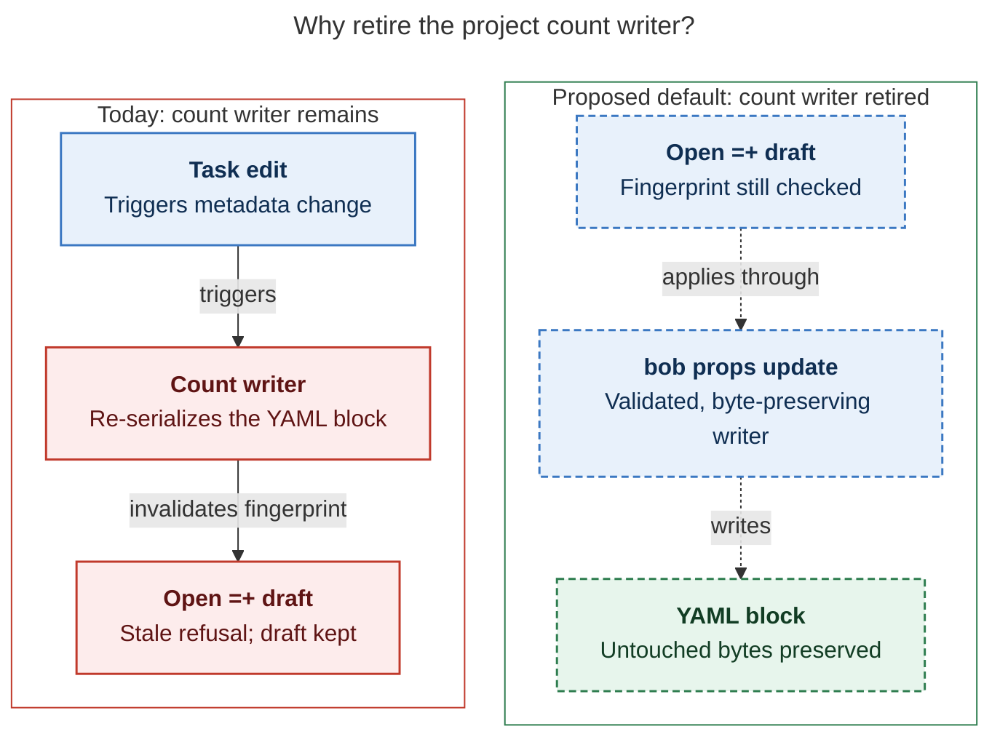
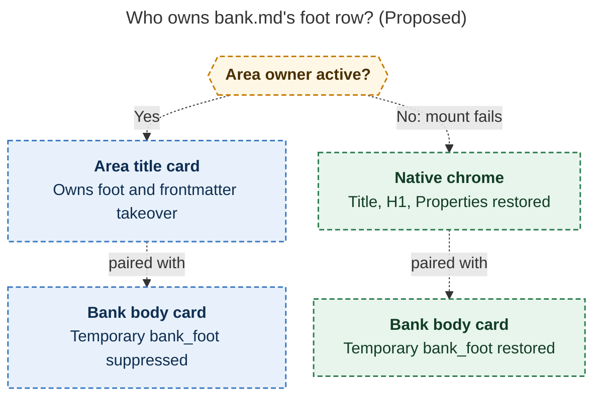

# Diagram proposals: Area and project property cards: consolidated research

Proposals for the swarm linker, not a report. Each diagram restates only what the source
report says.

```yaml
source: research:202611/area_project_property_cards/area_project_property_cards__final.md
producer: research.5y.image
check: "mmdc 12.0.0 with --no-sandbox and the PDF-mirroring config rendered 2 of 2 Mermaid diagrams"
```

## count-writer-retirement

```yaml
anchor: |-
  every task edit, race `bob props` fingerprints
question: |-
  Why can task-count updates invalidate an open property draft, and what does retiring that writer remove?
illustrates: |-
  Retiring the bob-project-tasks count writer removes count-triggered staleness refusals from open =+ drafts while retaining bob props fingerprint checks and byte-preserving updates.
caption: Retiring the count writer removes count-triggered draft invalidation; ordinary fingerprint checks still protect edits.
review: 664.656 × 553 px, fit 98.2%; reader-question, source, arrow, label and visual checks passed; 1 visual revision
```



## bank-foot-ownership

```yaml
anchor: |-
  (restoring it if the Area mount fails); `==` keeps opening the bank editor
question: |-
  Who owns bank.md's title and foot row when the Area mount works or fails?
illustrates: |-
  While the Area owner is active it owns the single foot row and frontmatter takeover; if mounting fails, native chrome and bank_foot return.
caption: The Area card owns the foot row only while active; mount failure restores native chrome and the bank card’s temporary foot.
review: 560 × 564 px, fit 100.0%; reader-question, source, arrow, label and visual checks passed; 0 revisions
```


