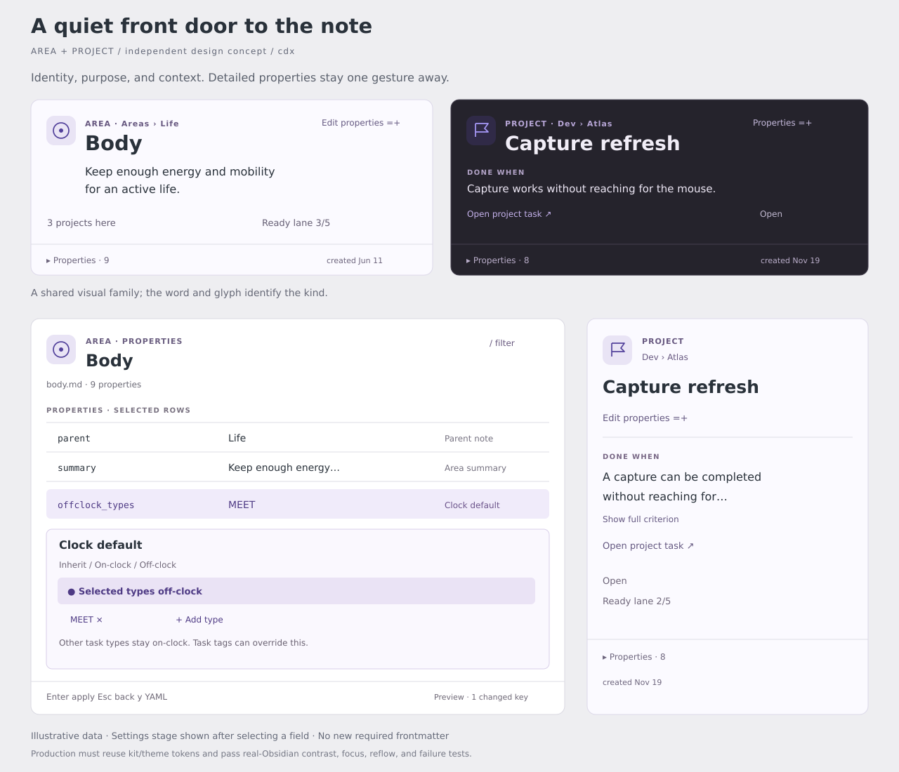

# Area and project property cards: a quiet, trustworthy front door

Independent design research by **cdx** · 2026-11-22

**Recommendation:** extend the shared property-card kit with **Area** and **Project** title cards, and extend the existing `=+` Property Editor with typed controls for their existing fields. Give areas a short statement of responsibility and projects their existing completion criterion. Keep task lifecycle on `^prj`, keep detailed work in the note, and make inherited settings explain where their values come from. This is a good idea if it makes the note easier to understand without asking Bryan to maintain a second project-management system.

This report is a design proposal, not an approved implementation plan. All sample note names, numbers, dates, and visuals below are illustrative. I did not inspect the live vault or any other report or transcript from this research swarm. I independently read the foundation epic, its approved plan, local source and contracts, and external primary sources. I inspected one existing album-editor screenshot for context; I did not run or test the proposed UI in Obsidian.

## 1. What the implementation must build on

At inspection, **bob-cli-pf was in progress**, not complete. Its whole-container ownership primitive phase was closed; other phases remained in progress. The design below assumes its approved contract ultimately lands. It does not assume that the installed `bob` binary already supports it. The inspected snapshots were bob-cli `e98c7fe96c24e3c3b243eb05c6cd5bf4ce07b024` and bob-plugins `15d82db75a1ac8a2a0920acaecbb73e8b75775e9`. The latter already contains foot/drawer and ownership primitives, but these are partial implementation evidence, not completion evidence. [I1–I3]

The foundation supplies:

- One shared title, mount lifecycle, chrome, and ownership system.
- A quiet foot row, a truthful `created` stamp, and the complete `=-` property drawer.
- A universal `=+` editor on any Markdown note, with per-key editing, undo, YAML recovery, and guarded writes through `bob props`.
- Existing species editors on `==`; card-owned fields route to their owning editor.
- Native Properties restored when the card, capability, mode, or YAML cannot support ownership. The sidebar remains available.

**A terminology correction:** `=+` edits a note's property values; it does not define a user-authored schema in the album sense. Area and project “schemas” should be built-in field descriptors: validation, labels, help, scope, completion, and writer routing. Do not create an `area_schema:` or `project_schema:` mapping in every note, or a second modal that duplicates the foundation's editor. This preserves its keyboard grammar and one-writer rule. [I1]

The domain distinction matters. An area is ongoing and has no completed state. A project is finite and already has a `^prj` task for its outcome, requirements, schedule, dependencies, and lifecycle. Terminal project frontmatter is synchronized from that task. An arbitrary existing `status: waiting` is not sufficient evidence that a project is blocked. [I4, I5, I8]

## 2. Is the idea worthwhile? What I would change

Yes. These are the notes where context, routing, and defaults matter most. A recognizable header can explain where a note belongs, what it means, and how to edit it, while replacing a visually noisy YAML table. The main value is orientation and safer editing, not more analytics.

There are three credible approaches:

| Approach | Benefit | Cost | Judgment |
| --- | --- | --- | --- |
| Keep native Properties; add better templates | Small maintenance burden; familiar fallback | Weak orientation; exposes storage syntax and mixed scopes | Sensible fallback, but underuses the completed foundation |
| Two compact kit cards plus typed `=+` controls | Consistent identity; fewer duplicate controls; existing writer safety | Requires accurate field contracts, mount arbitration, and inherited-value explanations | **Recommended** |
| A full configurable project/area dashboard | Highly flexible; room for charts and custom modules | More state, more layout settings, duplicate lifecycle, slower rendering, and false progress signals | Defer unless actual use demonstrates a missing decision |

External design evidence supports selective presentation, not an enormous card. Obsidian describes properties as small structured values and does not render Markdown in them; property types are shared across the vault by name. That favors retaining prose and criteria in the body and avoiding local schema controls that silently change global property types. [Obsidian Properties](https://obsidian.md/help/properties)

Notion's layouts separate headings, selected properties, and the remaining detail. Borrow that hierarchy, but not its layout builder or horizontally scrolling pinned properties: Bob already has a note body and a complete property drawer. [Notion layouts](https://www.notion.com/help/layouts)

Progressive disclosure is useful only when frequent information stays visible and the path to details is obvious. The proposed title card, explicit Properties disclosure, and shared editor apply that principle; which fields deserve prominence still needs testing with Bryan. [NN/g: Progressive Disclosure](https://www.nngroup.com/articles/progressive-disclosure/)

**Explicit adjustments to the request:**

1. Interpret “schema editors” as two profiles within the shared `=+` editor, not independent schema systems.
2. Introduce **no required metadata** and no bulk migration. Render existing valid notes immediately.
3. Do not add project `goal`, `outcome`, `progress`, `health`, `deadline`, `depends_on`, or a second writable `status`. Use the existing task where it already expresses the fact.
4. Keep area purpose in optional existing `summary:`. Do not require an area health score, review ritual, or completion percentage.
5. Keep note settings in `=+` and project task actions in the existing Task Card. A visible action connects them without creating two writers.
6. Ship identity and safe settings before optional counts. Card rendering must not create a new vault scan or subprocess per open note.
7. Resolve the bank/area overlap explicitly before enabling whole-frontmatter ownership on that note.

These are scope and interaction recommendations. They do not authorize changes to accepted decision records or memory.

## 3. What the cards should look like

The card should feel like the first paragraph of the note, not an application dashboard. Use the shared paper, title slot, species tile, typography, border radius, and footer. The visually strongest element is the note title. The next is the sentence explaining its purpose. Metadata is third.

### Area

```text
┌──────────────────────────────────────────────────────────────────┐
│  ◉   AREA · Areas › Life                         Edit properties  │
│      Body                                                  =+    │
│      Keep enough energy and mobility for an active life.         │
│                                                                  │
│      3 projects here                 Ready lane 3/5               │
│──────────────────────────────────────────────────────────────────│
│  ▸ Properties · 9                                  created Jun 11│
└──────────────────────────────────────────────────────────────────┘
```

The ring/compass-like glyph suggests an ongoing domain. The word **AREA** makes the identity explicit even if the glyph or color is unfamiliar. The breadcrumb identifies the actual parent; it never changes merely because a task has a reporting-root override. `summary:` is optional. Without it, remove the line and its spacing; do not leave “Add a purpose” permanently above the work.

“3 projects here” means the area's existing report-defined direct project scope: non-terminal projects whose nearest area is this one, including through project ancestry, but excluding descendant areas. It does **not** mean exactly three immediate child files. If this nuance is too difficult to explain in the click target, omit the count in the first release. It opens the existing Projects section. [I4]

Ready means the existing **whole Ready lane by residence**, not the freshness-gated READY dashboard. Use `Ready lane 3/5`, `Ready lane 5/5 · full`, `Ready lane 7/5 · 2 over`, or `Ready lane 3 · no cap`. Full stays neutral; only crowded gets its established red treatment. The count links to the resident tasks, not a new dashboard. [I6]

### Project

```text
┌──────────────────────────────────────────────────────────────────┐
│  ⚑   PROJECT · Dev › Atlas                      Edit properties  │
│      Capture refresh                                       =+    │
│                                                                  │
│      DONE WHEN                                                   │
│      A capture can be completed without reaching for the mouse.  │
│      Open project task ↗                                         │
│                                                                  │
│      Open                            Ready lane 2/5               │
│──────────────────────────────────────────────────────────────────│
│  ▸ Properties · 8                                  created Nov 19│
└──────────────────────────────────────────────────────────────────┘
```

The flag/milestone-like glyph indicates a finite outcome. **DONE WHEN** renders the cleaned criterion from the existing `^prj` report. It is not a new field. Preserve a stable block link to the source; do not copy child requirement checklists into the header. Long criteria wrap to two lines with an explicit expansion control and source link, not a tooltip as the only full-text access.

The state is derived through the existing project model: Open, Scheduled, Blocked, Done, Canceled, or an honest unavailable/problem state. A blocked or scheduled project replaces the quiet state line with its most useful explanation: `Scheduled · starts Dec 2` or `Blocked · waiting for Permit approval`. Ordinary blocking is a workflow state, not an amber data-integrity alert. Inherited blocking must identify the ancestor when known. Do not guess a cause from `[?]` or `status: waiting`. [I5, I8]

**Do not hide the `^prj` row.** Hiding a duplicated H1 is presentation ownership; hiding the project task would affect targeting, task gestures, drawers, and review. In v1 the card is a concise projection and navigation aid. The canonical row and its requirements remain where Bob already expects them.

### Shared visual rules

- Normal density target: approximately 140–190 px for an area and 180–240 px for a project at a normal desktop note width, including the foot. These are design budgets, not fixed heights; wrapping and accessibility win.
- Start from the kit's subtle 4% tint for these prose-oriented cards. Use an inherited home accent on the tile and small accents; do not flood the card with hue.
- Hue identifies the note's home according to the current `color:` resolver. Species uses form **and a word**. Status never recolors the whole card. Muted/grey is deliberate, not an error. [I3, I7]
- Title around 1.4–1.6 em, descriptive text at body size, kicker around 0.75–0.8 em. Keep normal theme text colors for readable copy. The mockup's exact pixels are illustrative; reuse actual kit/theme tokens in production.
- One visible `Edit properties` button with a `=+` hint. The project also has `Open project task`. No icon-only toolbar, row of five edit buttons, or always-visible action key legend.
- Keep the complete shared foot and drawer. Opening it is an inspection action and never creates data or starts a writer.
- Keep any existing recognized navigation rail above the foot. Do not invent a sibling carousel for areas/projects in v1.
- Missing `created` is quiet: omit the stamp for these legacy-heavy note types. This is a proposed species-specific addition to the foundation's missing-date policy. Never derive creation from filesystem times or the date of rollout.
- Show no percentage ring, completion bar, task pie chart, or streak. Task counts are not a meaningful fraction of an ongoing area, and adding project tasks can make a percentage go backward without actual regression.

At narrow widths, stack parent context, title, and actions; wrap counts and settings labels. Never horizontally scroll the card. Reflow at 320 CSS px is a useful acceptance target, including when zoom creates that effective width. [W3C: Reflow](https://www.w3.org/WAI/WCAG22/Understanding/reflow.html)

Use a single clear heading only while title ownership is held. If the adapter cannot take ownership, restore the native title and demote the card heading. Raw Markdown remains accessible in Source and when the existing Live Preview title-range rules reveal it. A display title should follow the existing early H1 → first alias → humanized stem convention; do not silently introduce `title:` as a new competing naming source. [I3, I4]

The companion [concept sheet](area_project_property_cards__cdx.svg) illustrates the hierarchy, a narrow project card, and a settings stage. It is a design mockup, not a screenshot of a shipped implementation.



## 4. The `=+` editor: fields, controls, and ownership

Keep the foundation's row browsing, source ordering, role groups, search, add/delete, undo, copy/paste, YAML excursion, and close ladder. Known keys gain friendly explanations and suitable controls. All unknown/custom keys remain available. Adding an area/project profile must never hide a field because it is not in the preferred schema.

Do not render missing optional fields as empty saved rows. Offer relevant known keys first in **Add property**, with `Not set — uses …` explanations. Inherited/effective values shown in a stage are computed explanations, never extra YAML keys. Raw keys stay discoverable beside friendly labels and in search.

A field can be shown on the card and still use the generic property writer. **Display placement is not write ownership.** Keep `where`/presentation metadata separate from the foundation's `role`/writer metadata; otherwise merely displaying `summary` would accidentally redirect it to a nonexistent area `==` editor.

| Field / label | Scope | Control and validation | Storage and write policy |
| --- | --- | --- | --- |
| `parent` · Parent note | Both | Single resolved wikilink picker with path disambiguation and consequence preview | Exactly one scalar quoted wikilink; semantic validation and coordinated hierarchy update required |
| `summary` · Area summary | Area | One-line text; recommend ≤140 characters; show long/multiline existing values without truncating their stored bytes | Existing optional key; user-owned; blank can be explicitly cleared |
| `color` · Home color | Both | Inherit, eight named palette hues, Grey; show effective swatch **and source** | Existing `color:`; Inherit removes override; Grey writes `grey`; no hex input |
| `task_type` · Default task type | Both | Type picker, Inherit, Stop parent defaults; allow valid unconfigured types with the existing warning | Canonical scalar; integrate legacy `theme:` behavior; not a list or composite |
| `offclock`, `offclock_types` · Clock default | Both | One coordinated policy stage: Inherit / On-clock / Off-clock / Selected types off-clock | Atomic edit of the two existing keys; details below |
| `task_refresh` · Ready review interval | Both | Use Bob setting or integer 1–365 days; explain residence scope and precedence | Integer override; never `0`, `off`, or a new project-review schedule |
| `ready_cap` · Ready lane limit | Both | Use Bob setting / integer 1–999 / No cap; show current count and effect when available | Existing integer or canonical `off` spelling; read legacy YAML `false` as No cap |
| `root` · Separate time reporting | Project only | Automatic / Report separately; explicit consequence stage | `true` creates a reporting root; Automatic removes override; explain broader effect below |
| `aliases` · Obsidian aliases | Both | Existing ordered list editor | Preserve order; first alias can affect fallback title when no eligible H1 exists |
| `project_name_aliases` · External route names | Both | String list with duplicate, ambiguity, and stem-shadow diagnostics | Separate from Obsidian aliases; keep exact-stem-wins behavior |
| `tags` | Both | Existing tag picker/list | Ordinary note tags; do not turn them into task status |
| `created` | Both | Existing date/date-time control preserving precision and offset style | Editable metadata; no automatic backfill and no conversion on open |
| `cssclasses` and custom properties | Both | Generic editor in normal inventory | Keep complete access; do not elevate technical styling fields onto the card |
| `type` · Note kind | Both | Read-only identity row with explanation/YAML escape | No one-click area↔project conversion; conversion needs a separate lifecycle operation |
| `status` and applicable machine-owned fields | Project | Read-only with named writer; offer project-task navigation | Preserve raw values; lifecycle comes from `^prj` and synchronization |
| Display title / file name | Both | Source/rename navigation, outside the property-value form | Existing H1/alias/stem rules; rename is not `prop.set` |
| Criterion, requirements, scheduled date, dependencies, priority, freshness | Project | `Open project task` action | Existing task and Task Card writers; not new frontmatter fields |

Existing project `summary` or `title` keys remain accessible as custom properties, but v1 does not promise to render them as project outcome or title. Do not delete legacy/custom data during adoption.

### Four controls that need more than a type picker

**A. Clock policy must be a single operation.**

| Selection | Intended canonical postimage |
| --- | --- |
| Inherit | Remove both `offclock` and `offclock_types` |
| On-clock | `offclock: false`; remove `offclock_types` |
| Off-clock | `offclock: true`; remove `offclock_types` |
| Selected types off-clock | Nonempty canonical `offclock_types` list; remove `offclock` |

Selecting a policy previews both key changes, applies them in one guarded batch, and undoes them together. Opening the stage never cleans up a dual-key note. Display the current effective list and explain the shadowed boolean. An empty list is not “all on-clock”: current parsers treat it as no list policy, so a same-note boolean or ancestor policy can apply. Require at least one type in the Selected-types stage; use the explicit On-clock choice to stop inheritance for all types. Explicit task clock tags retain precedence. Changes affect subsequent effective clock decisions, not closed recorded time. [I7, I8]

**B. Inherit and explicit Off are not interchangeable.**

For task type, Inherit removes the local default. `task_type: off` stops the parent-default search; it does not necessarily make every task untyped, because a task's own field, reading rule, or global default can still decide. Label this choice **Stop parent defaults**, with that explanation. When `theme:` exists, a reset must account for it; simply deleting `task_type` can expose the legacy value. Preview removing both only when the user explicitly chooses to reset the local default. Preserve untouched legacy bytes otherwise. [I7]

For color, Grey stops the color inheritance and intentionally mutes the home; Inherit does not. For `ready_cap` and `task_refresh`, say **Use Bob setting**, not **Inherit from parent**. Those two apply by residence. Review help must also say that task-level overrides and special lane/project cadence can win. [I6, I7]

**C. Parent changes need an explanation before apply.**

Show the new resolved breadcrumb, reporting root, inherited type/clock/color changes, and blocking consequences when known. Area parents must match the area's existing root/area contract. Project pickers should prefer area/project parents; preserve other existing resolver-supported cases and explain their limitations instead of silently rewriting them. Refuse self-parenting, cycles, ambiguous targets, duplicate/list parent keys, and invalid new relationships under the authoritative validators. Do not materialize inherited values on descendants.

Changing parent can regroup **past time reports** because current note-tree attribution is used; it does not change the recorded minutes. It can also alter live blocking and generated catalogs. A plain `prop.set` plus a success toast would conceal those consequences. [I4, I5, I7, I8]

**D. Separate reporting is not just a cosmetic checkbox.**

`root: true` makes a sub-project its own reporting root. Under current behavior it also makes that project non-leaf, which changes eligibility for keep-moving successor offers. Label its purpose plainly, but disclose both effects before apply. Top-level projects are already roots; say that instead of suggesting a redundant override. Areas do not need this control. [I5, I7]

### Interaction details

From a card, `=+` or Edit properties opens the universal editor; clicking a drawer key focuses that exact key. Editing a known policy row opens its typed stage. A source label such as `From Body` is a link to the declaring note. A conflict label is text, not only a colored dot.

Keep the foundation's 250 ms preview/latch model for text. Ordinary loose booleans can retain immediate flips. **Exception proposed:** `root` and clock policy use explicit stages because their effects are broader than one flag. Key renaming, raw YAML, paste, and kind conversion must enforce the same managed-key and domain validation as direct editing; otherwise typed controls provide only cosmetic safety.

Do not introduce a card-wide Save/Cancel fiction when individual fields already save. Show `Saved · u undo` only after a confirmed write. Preserve the draft on stale refusal; refresh the source and require an explicit retry against the new preview. Do not silently overwrite a changed value during rebase.

Esc, `q`, and Ctrl+[ follow the shared close ladder; `q` types inside text controls. Respect IME and the existing Vim chord gate; Reading and non-Vim users get visible buttons and palette commands. Do not repurpose `==` for projects merely to create symmetry: `==` remains existing species behavior, and the project-task button uses the existing Task Card opener. A future alias needs its own evidence, not assumption. [I1, I8]

The modal must contain keyboard focus, have a useful accessible name and visible close control, and return focus to its invoker or logical replacement. [W3C: Modal dialog pattern](https://www.w3.org/WAI/ARIA/apg/patterns/dialog-modal/)

Use a 32 px desktop target as a design aim, never below the applicable 24 CSS px minimum without a valid spacing/other exception. The tiny visible pencil can sit inside a larger labeled button. [W3C: Target size minimum](https://www.w3.org/WAI/WCAG22/Understanding/target-size-minimum.html)

## 5. Reliability and implementation shape

### Reuse the foundation; add explicit domain semantics

Add `area` and `project` descriptors to the species kit and thin host adapters using the existing title-slot/adoption, foot, and ownership helpers. Reuse the area title resolver for consistent H1/alias/stem handling; avoid a second project-specific title algorithm. Do not copy the album or record editor wholesale.

Extend the `bob props` field metadata/validation authority with the known area/project constraints. This is **proposed follow-on work**, not something guaranteed by `props_v1`: that capability establishes a safe generic writer, not a hierarchy-aware parent transaction. Structured metadata should communicate editor kind, value constraint, writer, local/effective value, source, and impact class without storing these explanations in the note.

Keep presentation facts separate from domain facts:

- Local title, breadcrumb candidates, area summary, and raw property inventory can paint from confirmed bytes/cache without spawning `bob`.
- Project lifecycle and cleaned criterion should use the existing project report or a shared model with parity tests; raw `[?]` and YAML `status` are insufficient substitutes.
- Ready pressure comes from the established `api.noteReady` snapshot, never a new ad hoc checkbox counter.
- Area/project counts come from their existing report services. A missing snapshot is unavailable, not zero. In particular, the current area report maps a missing daily note to zero Today counts; it is insufficient by itself to prove an “empty Today” state. **Omit Today from these cards in v1.** [I4–I7]

The report/cache service may refresh outside painting, coalescing requests by vault and invalidating on relevant changes. A render, drawer toggle, hover, or pane resize must issue zero writer calls and zero new `bob` subprocesses. Two panes should share report work; do not fetch one whole-vault report per card.

### Parent mutation is a release gate

The generic writer's frontmatter fingerprint is deliberately unaffected by body-only edits. That is correct for an unrelated loose property. It is not sufficient evidence that a parent-change preview's graph, blocking reasons, or catalog effects still hold.

A hierarchy editor must use an authoritative planned mutation that revalidates relevant note/ancestor/graph inputs under the shared lock. Preview context needs its own semantic/preimage guard where impacts depend on body data or other notes. Reuse current parent, catalog, and reconcile planners; commit the affected changes through the established guarded transaction rather than a UI loop of independent writes. Check ownership/lock composition to avoid nesting commands that reacquire the same lock.

Until that operation exists, the `parent` row should **route to the existing supported parent action or YAML recovery**, with its limitation stated. Do not advertise a new safe picker while letting generic paste/set bypass the missing guard. A constrained launch with this one field routed away is better than shipping a new deceptively simple hierarchy writer.

Likewise, `root` needs a correct consequence preview. Simple policy edits such as `task_refresh` can remain single-note generic operations after validation. Avoid expanding every property save into full vault reconciliation.

### One title and one complete drawer per note

`bank.md` is the crucial collision. The foundation deliberately retains a bank card and native Properties until areas have title cards. Adding an Area card without arbitration would produce duplicate complete drawers and ambiguous `=-` selection. The existing foot registry permits multiple mounts for one path; do not assume “first registered” means “correct owner.” [I1, I3]

Recommended behavior:

1. The Area card owns the note title and complete foot/drawer when eligible.
2. The embedded Bank card keeps its banking content, setup action, and identity badge, but suppresses its duplicate whole-note foot while the Area owner is active.
3. `=-` resolves the active view's designated document owner. Existing bank `==` routing keeps priority; `=+` remains universal and its `bank` field still delegates to the bank editor.
4. If the Area owner fails or unloads, restore native Properties and the bank's previous foot behavior. Ownership handles must release independently without an old handle clearing a newer mount.

Do not classify the untyped `area.md` root sentinel as an Area merely because of its filename. Do not mount on templates, generated examples, archived `done/` task files, or incidental links to `[[area]]`. Use the existing note classifiers. Preserve terminal project identity even when its `^prj` has been archived; show its known terminal state and omit an unavailable criterion rather than manufacturing a missing-task error. [I4, I5]

### Honest failure states

| Condition | Required behavior |
| --- | --- |
| Metadata not ready | Stable identity shell where safe; pending detail; do not take unsupported ownership |
| No fresh task/report snapshot | Omit optional count or show an unavailable state; never claim zero |
| Missing `^prj` on an active project | Explain that the project task is missing; source/repair action; do not create one while rendering |
| Multiple/malformed `^prj` tasks | Show a diagnostic and avoid picking an arbitrary lifecycle source |
| Archived terminal tracker | Preserve project identity and terminal state; no automatic resurrection |
| YAML invalid, duplicate, or unclosed | Preserve source and recovery access; refuse writes under the foundation contract |
| Old `bob` or unsupported semantic editor | Read-only appropriate rows or route to supported editor; no invented capability |
| Stale preview, lock busy, or write failure | Keep draft and source intact; report actual refusal; no success overlay |
| Mount loss, unload, Source switch, unsupported surface | Release ownership promptly; native title/Properties remain usable |
| File renamed/deleted or pane changed | Bind responses to path plus generation; discard stale responses |

## 6. Sequence, testing, and what would change my mind

This is a suggested implementation sequence, not new beads or a staged executable plan.

1. **Verify the settled foundation.** Confirm all pf phases land and the runtime has the needed capability. Recheck its final field roles and extension APIs; the plan and snapshots may differ at completion.
2. **Ship read-only Area and Project identities.** Title, breadcrumb, area summary/project criterion, shared foot, native fallback, and bank arbitration. Existing `=+` remains usable even before domain controls arrive.
3. **Add field descriptors and safe stages.** Start with summary, color, type defaults, Ready interval/cap, aliases, and atomic clock policy. Gate parent/root on truthful consequence previews; route unsupported operations explicitly.
4. **Add the smallest useful optional facts.** Ready pressure first if its snapshot is warm; area project counts only if their scope is clear. Keep all charts and customizable property pinning out of v1.
5. **Try representative notes with Bryan.** Use an ordinary area, nested area, active project, scheduled/blocked project, terminal project, inbox, and bank hub. Tune the defaults from actual hesitation and screen use, not preference speculation alone.

Acceptance should test meaning and recovery, not merely screenshots:

- Opening every card, folding its drawer, moving focus, and changing pane width leaves vault bytes unchanged and starts no render-driven process.
- All original properties, including unknown, null, false, empty-list, map, and legacy values, are reachable after native Properties hides.
- Field actions, paste, rename, delete, YAML fragments, and undo enforce the same authority. A blocked field cannot be bypassed by another entry point.
- Clock choices produce exactly the two-key postimages above; undo restores original bytes, including a dual-key legacy note.
- Inheritance vectors cover task overrides, reading type, global default, `task_type: off`, blank/empty clock lists, grey vs inherit, and non-inherited cap/refresh.
- Parent validation covers unique basename vs exact path, self/cycle, ambiguous target, ancestor edits after preview, blocked ancestor changes, and historical reporting-group changes.
- Counts match their authoritative APIs; full is neutral, crowded is red plus text, unavailable is not zero, and terminal projects do not receive misleading active-lane pressure.
- Exactly one visible title and document drawer on bank/area overlap, with correct `==`, `=-`, `=+` and failure restoration.
- Exercise two panes, rapid file switching, dirty editors, external sync edits, old CLI, plugin disable, malformed YAML, and stale asynchronous reports.
- Real Obsidian checks: Reading/Live Preview/Source, light/dark, 320/375/720 px containers, zoom, long titles/criteria, text selection, keyboard-only editing, screen-reader labels/focus, and reduced motion. Mobile keeps the established native fallback unless separately validated.

Useful usability tasks: find why a project is blocked; change an area's Ready limit; make only MEET off-clock; reset an inherited default; edit the project outcome; find an unfamiliar custom key; recover from a stale edit. Success means Bryan can predict the writer and effect before committing, not just complete the gesture.

I would reconsider the compact design if Bryan repeatedly needs the same custom field outside the drawer, or a measured workflow repeatedly requires a cross-project decision unavailable in the note body. That could justify **a few explicitly pinned properties** later. It would not, by itself, justify a schema builder, health scores, or stored progress.

## 7. Evidence and confidence

**High confidence:** reuse of the foundation, separate area/project semantics, no duplicate `^prj` state, sparse properties, per-field authority, inherited-value provenance, bank arbitration, and fail-open behavior. These follow directly from inspected contracts and code.

**Moderate confidence:** the exact density, glyphs, two-line criterion treatment, optional counts, and whether `root` belongs prominently in suggested additions. These are design judgments requiring real-Obsidian and user validation.

**Unresolved implementation detail:** the final pf API, semantic-role audit, parent-operation coordination, and available cached project facts after pf completes. The report identifies these as gates, not already-shipped APIs. No runtime performance or usability result is claimed.

Internal evidence was read locally or with audited SASE commands; the links below identify the inspected sources for future readers:

- **I1 — Foundation:** audited `sase bead read bob-cli-pf`, and `sase artifact read plan:202611/card_owned_frontmatter.md`. Approved branches: bank foot yes, per-note session drawer memory, limited glossary edits, no new decision record.
- **I2 — Existing host architecture:** [bob-cli architecture at inspected revision](https://github.com/bobs-org/bob-cli/blob/e98c7fe96c24e3c3b243eb05c6cd5bf4ce07b024/docs/develop/plugins/architecture.md). This document precedes the completed pf takeover; do not mistake its earlier row-ownership description for the final target.
- **I3 — Kit source:** [species registry](https://github.com/bobs-org/bob-plugins/blob/15d82db75a1ac8a2a0920acaecbb73e8b75775e9/plugins/bob-ledger-tools/src/240f-plugin-property-card-species.js), [property inventory](https://github.com/bobs-org/bob-plugins/blob/15d82db75a1ac8a2a0920acaecbb73e8b75775e9/plugins/bob-ledger-tools/src/240n-plugin-property-card-inventory.js), [foot state and mount registry](https://github.com/bobs-org/bob-plugins/blob/15d82db75a1ac8a2a0920acaecbb73e8b75775e9/plugins/bob-ledger-tools/src/240p-plugin-property-card-foot-state.js), and the adjacent foot/ownership/dispatcher fragments.
- **I4 — Areas and titles:** [area contract](https://github.com/bobs-org/bob-cli/blob/e98c7fe96c24e3c3b243eb05c6cd5bf4ce07b024/docs/areas.md), [area report](https://github.com/bobs-org/bob-cli/blob/e98c7fe96c24e3c3b243eb05c6cd5bf4ce07b024/src/native/areas/report.rs), [title derivation](https://github.com/bobs-org/bob-cli/blob/e98c7fe96c24e3c3b243eb05c6cd5bf4ce07b024/src/native/notebooks/scan.rs).
- **I5 — Projects:** [project contract](https://github.com/bobs-org/bob-cli/blob/e98c7fe96c24e3c3b243eb05c6cd5bf4ce07b024/docs/projects.md), plus `src/native/projects/model.rs`, `scan.rs`, and `catalog.rs` at the same revision.
- **I6 — Pressure and review:** [Ready cap contract](https://github.com/bobs-org/bob-cli/blob/e98c7fe96c24e3c3b243eb05c6cd5bf4ce07b024/docs/plan.md), [freshness contract](https://github.com/bobs-org/bob-cli/blob/e98c7fe96c24e3c3b243eb05c6cd5bf4ce07b024/docs/freshness.md).
- **I7 — Defaults and reporting:** [home, root, color and current-tree attribution](https://github.com/bobs-org/bob-cli/blob/e98c7fe96c24e3c3b243eb05c6cd5bf4ce07b024/docs/pomodoro-homes.md), [task type PT13](https://github.com/bobs-org/bob-cli/blob/e98c7fe96c24e3c3b243eb05c6cd5bf4ce07b024/docs/task-types.md), [clock property shapes](https://github.com/bobs-org/bob-cli/blob/e98c7fe96c24e3c3b243eb05c6cd5bf4ce07b024/docs/reference/vault-format.md). Cross-checked `pomodoro_homes/facts.rs`, `clock.rs`, `palette.rs`, and `pomodoro_themes/suggest.rs`.
- **I8 — Audited memory:** `glossary:property-card`, `glossary:area-note`, `glossary:project-note`, `glossary:album-card`, `glossary:record-card`; `decisions:note-ready-cap-counts-the-lane`, `decisions:off-clock-note-defaults-filter-by-task-type`, `decisions:projects-block-from-prj-line`, `decisions:subprojects-inherit-project-blocking`, `decisions:q-and-ctrl-bracket-mirror-esc`; and the project's Obsidian/reference-artifact guidance. Current implementation contracts resolve nuances absent from short memory summaries, such as empty clock lists and task-type `off`.

External sources are linked beside the claims they support. All were consulted on 2026-11-22. They inform the interaction design; none establishes that Bob's proposed implementation is already correct.

## 8. Recommended solution

**Build two compact document headers on the completed property-card kit and one typed extension of the existing `=+` Property Editor.** An Area card says what responsibility the note holds; a Project card says what completion means and what currently blocks it. Both show parent context, preserve the complete shared drawer, and leave the note's working content prominent.

Use the existing schema keys, with strong controls for inheritance, clock policy, Ready pressure, and reporting. Route project lifecycle through `^prj`. Treat parent mutation and bank/area ownership as required engineering decisions. Ship no new mandatory fields, no inferred health or completion score, no per-note schema language, and no render-time mutation. This yields a beautiful extension of Bob's current model whose simplicity is supported by accurate semantics and recoverable writes.
