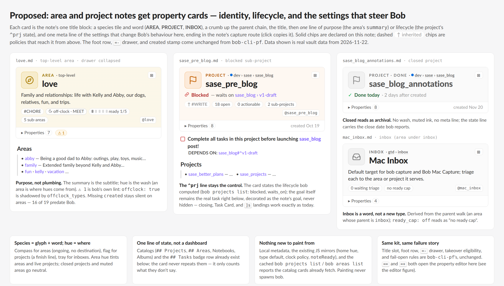
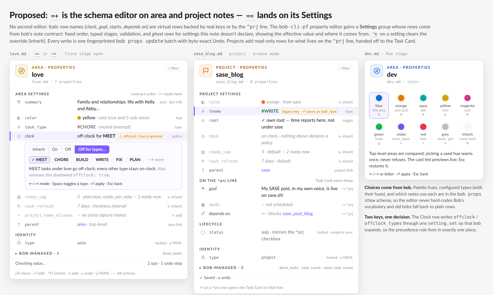
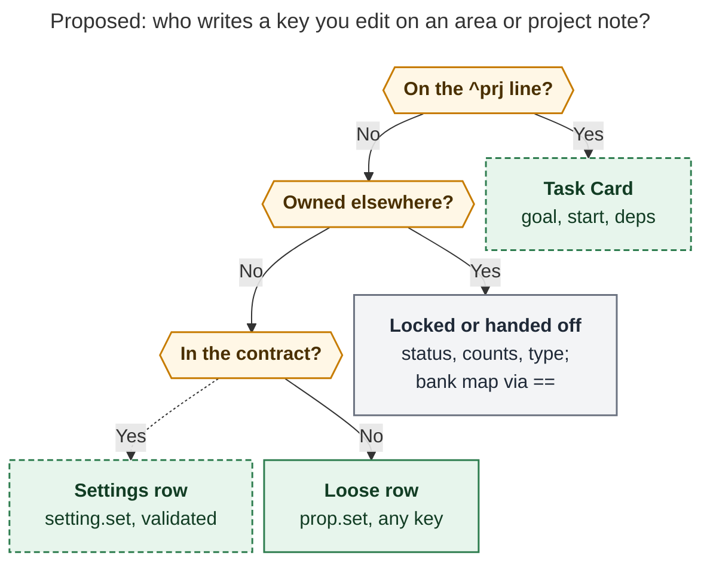

# Area and project property cards: what they show, and the schema-aware `=+` editor behind them

> **Research query:** Once the `bob-cli-pf` epic is complete, start using property cards
> in area notes and project notes. What should these cards look like, and what fields
> should the corresponding schema editors (opened with `=+`) support — so the feature is
> intuitive, reliable, and beautiful? Is this a good idea, would a different approach be
> better, which requirement adjustments are justified (called out clearly), and what is
> the recommended solution?

*Researcher: cld · 2026-11-22 · bob-cli @ `e98c7fe9`, bob-plugins @ `15d82db7`, live
vault. Every number below was measured today against the live vault or the code at those
commits.*

## Bottom line

**Yes — do it, but with one editor, not two, and fix two prerequisites first.**

Area and project notes are where Bob keeps its per-note *configuration*: hue, default
task type, clock policy, Ready cap, review interval, capture aliases, root-parent
reporting. Those settings are inherited down the note tree and change how Bob behaves.
Today they are edited by hand in Obsidian's native Properties. That editor cannot
validate them (`color: purple` silently inherits and lints only in the CLI), cannot show
inheritance ("off-clock for MEET, from `love`"), and shows Bob's bookkeeping keys
(`task_count`, `open_task_count`, `template`, `done_tasks`) in the most valuable spot on
the page. A card plus a schema-aware editor fixes all three problems. It also lets the
`bob-cli-pf` takeover finally reach the 121 area and project notes, `bank.md` among
them.

Three changes to the request, explained in [§3](#3-adjusted-requirements-called-out):

1. **One editor.** `=+` becomes the schema editor on these notes. It gains a
   **Settings** group driven by a bob-owned *note contract*: typed stages, validation,
   and ghost rows that show inherited values and where they come from. `==` is
   registered for area and project notes and opens the same editor on Settings. No
   separate "area card editor" is built.
2. **A calm card, not a dashboard.** The card has a species tile and word (AREA,
   PROJECT, INBOX), a crumb up the parent chain, and the title. Below that sit *one*
   line of purpose (the area's `summary`) or lifecycle (the project's `^prj` state), and
   *one* meta line of behavior-changing settings. It paints entirely from data the
   plugin already holds. It never repeats the `## Projects`/`## Areas` catalogs or the
   `## Tasks` badge row. It **never hides or docks the `^prj` line**: that line stays
   the project's control.
3. **Two prerequisites the epic does not cover.**
   - **Unclassified bookkeeping keys.** `bob props`' role table (`src/native/props/roles.rs`)
     classifies every area/project bookkeeping key as `loose`. That covers `done_tasks`,
     `task_count`, `open_task_count`, `template`, and project `status`, so `=+` would
     let you hand-edit all of them.
   - **A second frontmatter writer.** The `bob-project-tasks` plugin rewrites project
     frontmatter with `processFrontMatter` on every metadata change. That is a second,
     re-serializing writer on exactly the notes being taken over. Its `open_task_count`
     disagrees with bob's own count on **all 43 live projects** (for example `bob`: 18
     in YAML vs 86 from `bob projects list`; `sase_pre_blog`: 0 vs 18).

**Recommended:** a five-phase follow-on epic: bob contract → retire the second writer →
editor Settings → cards → takeover. See [§9](#9-recommended-solution).



*Figure 1: The proposed cards, using real frontmatter and live `bob projects list` /
`bob areas list` / `bob ready` data from 2026-11-22. Each card has one line of purpose or
lifecycle and one meta line, and ends in the `bob-cli-pf` foot row unchanged. Solid
chips are declared on the note; dashed `↑` chips are policies inherited from above.*



*Figure 2: The `bob-cli-pf` `=+` editor, extended with a Settings group (contract order,
typed stages, and ghost rows that show effective values and their sources), plus
read-only `^prj`-line rows that hand off to the Task Card. `==` opens the same modal on
Settings.*

## 1. What exists today (verified)

### 1.1 The notes and their keys

Vault census (root-level Markdown, excluding `done/`, `_templates/`, `_conflicts/`):

| Kind | Notes | Lifecycle | Keys present (count of notes) |
| --- | --- | --- | --- |
| Area (`type: "[[area]]"`) | 19 | always open | `type`, `parent`, `summary` 19 · `done_tasks` 11 · `color` 7 · `task_type` 6 · `ready_cap` 5 (all `off`) · `created` 3 · `offclock` 2 · `offclock_types` 2 · `project_name_aliases` 1 · `bank` 1 |
| Project (`type: "[[project]]"`) | 102 | 37 open, 6 blocked, 51 done, 8 canceled | `type`, `parent`, `task_count`, `open_task_count` 102 · `status` 101 · `created` 99 · `template` 97 · `done_tasks` 42 · `scheduled` 4 (all terminal) · `theme` 2 (legacy) · `root`, `color`, `project_name_aliases` 1 each · one-offs (`source`, `converted`, `id`, `aliases`, `tags`) |

What stands out:

- **No one uses `priority` or `status: waiting`.** Both are documented in `project.md`
  and used by `projects.base`, but they appear in zero notes. `waiting` is display-only
  in bob (`capture_targets.rs:841`).
- **Shadowed clock settings.** Both notes that set `offclock_types: [MEET]` (`love`,
  `body`) also set `offclock: true`. bob documents that combination as shadowed
  (`note_offclock_shadowed`), so the boolean does nothing there.
- **Titles fall back to the stem.** Only 5 of 19 areas and 3 of 102 projects have an
  H1 or alias title. Bob's `derive_title` stops at the first bullet, so the
  conventional "`^prj` first, H1 after" project layout never yields an H1 title.
- **`created` is missing on most areas** (16 of 19) and present on nearly every project
  (99 of 102).

### 1.2 The contract bob already reads

These keys already have meaning, inheritance, and lint codes in bob. The editor should
present them as a fixed vocabulary, not as free-form YAML.

| Key | Notes | Meaning and inheritance | Valid values / lint | Source |
| --- | --- | --- | --- | --- |
| `summary` | area | One-line scope; shown in the parent's `## Areas` catalog | one line; `area_summary_long` over 140 characters, `area_summary_multiline` | `docs/areas.md` |
| `color` | area, project | Hue slot. The nearest valid slot on the walk wins. A top-level area without one falls back to a name hash | 8 palette hues, `grey`/`gray`; otherwise `area_color_invalid` (inherits) | `docs/pomodoro-homes.md` §R8 |
| `task_type` (legacy `theme`) | area, project | Default task type. Absent inherits; `off` stops the walk | a scalar type name or `off`; `theme_default_invalid`, `type_default_conflict` | `docs/task-types.md` §Note defaults |
| `offclock`, `offclock_types` | area, project | Clock default on the root walk. A non-empty types list beats the same note's boolean | bool; block list of types; `note_offclock_invalid`, `note_offclock_shadowed` | `docs/reference/vault-format.md` |
| `ready_cap` | area, project | Per-note Ready-lane cap; default `plan.max_ready_per_note` (5) | `1–999` or `off`; `note_ready_cap_invalid` | `docs/plan.md` |
| `task_refresh` | area, project | Ready freshness interval for tasks living in the note. Applies by residence only, not through parents | integer days `1–365`; `task_refresh_invalid` | `docs/freshness.md` |
| `project_name_aliases` | area, project | Extra capture/ref names for the stem | string list; duplicate and shadow warnings | `docs/projects.md` |
| `root` | project | Makes the project its own root parent for Stats | `true` / absent | `docs/pomodoro-homes.md` §R2 |
| `parent` | area, project | Tree placement; drives catalogs, hue, root, and clock walks | areas: the root `area` or an area; projects: an area or a project | `docs/areas.md`, `docs/projects.md` |
| `status` | project | `projects sync` mirrors the `^prj` checkbox: checked → `done`, canceled → `canceled`, reopened → `wip` | — | `docs/projects.md` §Sync Rules |
| `done_tasks` | area, project | Link to the `done/` archive; written by `bob task archive` | — | `docs/reference/vault-format.md` §Task archives |
| `scheduled` | project | Legacy key; `projects sync` hoists it onto `^prj` (open projects only) | `YYYY-MM-DD` | `docs/projects.md` |
| `task_count`, `open_task_count` | project | Materialized by the `bob-project-tasks` plugin, **not bob** | — | `plugins/bob-project-tasks/main.js:5-6,561-576` |
| `template` | project | Provenance marker; written at creation, never read | — | `capture_project_note.rs:562` |

### 1.3 What already paints on these notes, and what the plugin already knows

There is no title block yet. Native Properties shows every key. In the body, live
display-only cards already render the `[!projects]`, `[!areas]`, `[!notebooks]`, and
`[!albums]` catalogs. The `## Tasks` heading carries a badge row (`⚪ open · 🔵
next/wip · 🔴 blocked · 🟢 done/canceled`) written by `task_status_groups`.

The plugin already has every input a card needs, without spawning bob on paint:

- **Local mirrors.** `pomodoroHomeResolve` (`142-pomodoro-home-chips.js:464`, hue),
  `pomodoroHomeResolveTaskThemeFacts` (`279-…`, type default), the clock resolver
  (`036-pomodoro-clock.js`, reads `offclock_types`), and the `noteReady` v1 API
  (`190-plugin-note-ready.js`: per-note Ready count, cap, and state).
- **Cached reports.** The catalog cards' data services already fetch
  `bob projects list -f json` (`241aa`) and `bob areas list -f json` (`241af`).
  - The projects report gives, per project: `state`, `blocked` (`dependency` +
    `waits_on`, `scheduled`, `inherited`), `criterion`, `prj.{hidden, mark,
    scheduled}`, `tasks.{open, shown, today}`, `closed_on`, and `children`.
  - The areas report gives `title`/`titled`, `hue`/`hue_source`, `children`,
    `projects`, `today`, and `issues`.
  - Measured cost: 0.71 s and 0.52 s (`bob ready -f json`: 0.86 s).

### 1.4 What `bob-cli-pf` gives these notes, and what it leaves out

- **`=+` reaches them** (D4, "any Markdown note"), but only as generic loose rows.
- **`=-` and the takeover do not.** Both need a mounted card, and area/project notes
  have none.
- **`bank.md` is excluded from the takeover** (D5) "until areas get a title-block card".
  D5's reason: its contract keys "have no typed stages yet".
- **The epic names the gap.** Its out-of-scope list includes "Title-block 'note cards'
  for area, project, notebook, and reference notes, which are the long-term end state".
- **The role table is incomplete for these notes.** `roles.rs` classifies `type` as
  identity, temporal `parent` as derived, and `*_digest`/`*_drafted`/`review_*`/`zorg_*`
  as derived. *Everything* on an area or project note is `loose`. The plan told the
  props-cli phase to "audit bob's frontmatter writers to complete this list". The
  current code has not yet added `done_tasks`, the counts, `template`, or project
  `status`.

### 1.5 Two problems this research found

**(a) The role-table gap.** Without the audit, `=+` on any project would offer:

- free-text editing of `done_tasks`, breaking the archive pairing;
- `status: done` on an open project, which `projects sync` would silently revert.

**(b) `bob-project-tasks` is a second, re-serializing writer.** It listens to
`metadataCache.on("changed")` for *every* note and debounces 250 ms. When the recounted
values differ, it calls `processFrontMatter`, the API `bob-plugins` bans elsewhere
(`211-parent-frontmatter-plan.js`) because it "re-serializes the whole YAML block". On
project notes this means:

- **Byte preservation breaks.** Any task added or closed re-serializes the whole block,
  undoing the byte-preserving writes that `bob props update` promises.
- **`=+` goes stale.** A count change alters the parsed mapping, so the editor's
  fingerprint expectation goes stale whenever counts move.
- **The numbers are wrong for Bob.** The plugin counts only `[ ]`/`[/]`/`[*]` rows
  under `## Tasks`; bob counts every open `#task` line, blocked `[?]` included. They
  disagree on 43 of 43 live projects. `projects.base` therefore shows `sase_pre_blog` as
  "✅ 0 open / 17" while it has 18 open blocked tasks.

## 2. Is this a good idea?

**Yes, for different reasons than for records and days.** Records and days are
*documents*: their cards present content. Area and project notes are *work surfaces and
configuration hubs*: their cards should present identity, state, and the policies in
force. Then they should get out of the way of the tasks and catalogs below.

What it buys:

- **The only validated, inheritance-aware editor for Bob's per-note settings.** These
  settings have real consequences: clock accounting, hue on every surface, the Ready
  cap, review cadence, and Stats attribution. Today you learn the keys from docs, type
  them blind, and discover mistakes through CLI lints.
- **A project's lifecycle at its own top.** Today "Blocked — waits on
  `sase_blog#^v1-draft`" is visible only as a ⛓️ glyph in the *parent's* catalog.
- **Takeover reaches 121 more notes** and finally hides the bookkeeping keys. That
  includes `bank.md`, whose ~60-line `bank:` map currently fills the top of the note.
- **One kit grammar everywhere.** Every typed Bob note opens with a tile, a word, and a
  title.

What it costs, and the guards:

- **Vertical space on work notes.** The card must stay at five lines or fewer, collapse
  to title + state + foot, and never become a dashboard
  ([§4.3](#43-what-the-meta-line-may-and-may-not-show)).
- **Duplication risk.** Catalogs, the `## Tasks` badge row, and the `^prj` line
  already say a lot. The card states only what none of them says.
- **New bob contract surface.** This is worth it: the contract is the thing users
  actually need, and bob already owns every rule in it ([§6](#6-bob-cli-changes)).

**Would I take a different approach?** Only in shape, not in direction:

- no second editor;
- no docking of `^prj`;
- no new JS inheritance resolver;
- the schema (contract) ships in bob *before* the card, because it is useful on its own
  even without a card.

Rejected alternatives are listed in [§7](#7-alternatives-considered).

## 3. Adjusted requirements (called out)

| # | As asked | Adjustment | Why |
| --- | --- | --- | --- |
| **A1** | "schema editors (triggered via the `=+` keymap)" | **`=+` *is* the schema editor on these notes.** There is no separate species editor. `==` is registered for `area`/`project` and opens the same modal focused on Settings. On `bank.md`, `==` keeps opening the bank editor (registry order bank → …). | In the epic, `==` opens species editors and `=+` opens the property editor. Area and project settings are flat scalars and short lists, and `=+` already has the stages, guarded writes, and undo. A second editor for the same keys would break "one writer per key" in the UI. |
| **A2** | Property cards on area and project notes | **Two species (`area`, `project`) plus an `inbox` word variant of `area`.** An inbox is an area whose parent walk hits `inbox`. | Inboxes behave differently (triage, `ready_cap: off`); a word and tile say so for free. |
| **A3** | — | **Add:** a bob-owned *note contract* for area/project keys, exposed by `bob props show` and enforced by `bob props update`, with `setting.set` / `setting.clear` ops. | Validation, choices, and inherited/effective values must come from the authority that already computes them. |
| **A4** | — | **Add:** complete the role table for these notes (`done_tasks`, the counts, `template`, project `status`, leftover `scheduled` → derived). | Today all of them are editable `loose` keys ([§1.5a](#15-two-problems-this-research-found)). |
| **A5** | — | **Add:** retire (or move into bob) `bob-project-tasks`' `processFrontMatter` count writer before taking over project notes. | Second writer; wrong counts; stale fingerprints ([§1.5b](#15-two-problems-this-research-found)). |
| **A6** | (implicit) show the project's goal on its card | **Decorate, don't dock.** The card shows the *lifecycle state*. The `^prj` task stays a visible body line, optionally styled as the note's goal. | `^prj` is an active control: you close it, run the Task Card on it, land `]s` on it, and edit its requirements and Depends-On children. Hiding it behind cursor-reveal would cause layout jumps exactly where you act. |
| **A7** | (implicit) projects have status | **Lock project `status` as derived (`projects sync`) and retire `waiting`** (zero uses). | `^prj` (checkbox + schedule + Depends-On) is already the single source of project state (`decisions:projects-block-from-prj-line`). A free `status` contradicts it. |
| **A8** | — | **Lift D5:** `bank.md` gets the area card in the title slot and becomes eligible for takeover. Its `bank` map stays card-owned (`==`). | D5's stated blocker ("no typed stages yet") is exactly what A3 delivers. |
| **A9** | — | **Untitled notes show the stem verbatim** (as Obsidian's inline title, every catalog link, and the `@route` do), not bob's humanized `gtd daily`. | One spelling of a note's name across all surfaces; add an alias or H1 for a prettier title. |

## 4. The cards

### 4.1 Anatomy

The card uses `bob-cli-pf`'s title-block kit and changes nothing in it:

```text
[tile]  WORD · crumb › crumb ›                                        ⊞     ← kicker row
        Title                                                               ← kit heading (owns the title)
Purpose or lifecycle — one line                                             ← subtitle / state line
#TYPE · off-clock · MEET · ▮▯▯▯▯ ready 1/5 · 5 sub-areas · ● 2 today   @route  ← meta line
──────────────────────────────────────────────────────────────────────────
▸ Properties · 7          ⚠ 1                                    created …  ← kit foot row (unchanged)
```

- **Tile and word.** Lucide `compass` for **AREA** (direction, no destination); `flag`
  for **PROJECT** (a finish line); `inbox` for **INBOX**. Following the title-block
  research's A6, the species is word + glyph, and hue means *where*.
- **Crumb.** Built from the local `parent:` chain (as notebook headers do: at most 5
  crumbs, ellipsis in the middle). The top-level area carries its hue pip. A top-level
  area reads `AREA · top-level`, never `AREA · area`. Crumbs navigate, with Mod-click
  opening a new tab.
- **Title.** Uses kit title adoption (`propertyCardAdoptTitle`). Source order:
  - a recognized first-body H1 (before any bullet or H2, which is bob's rule), owned and
    hidden at render time; then
  - the first `aliases` entry; then
  - the stem verbatim (A9).
- **⊞ collapse.** Per note and per session, like every kit fold. Collapsed, the card
  keeps the kicker, title, project state line, and foot row. It drops the summary and
  meta line.

### 4.2 Variant rules

| Variant | Subtitle / state line | Material |
| --- | --- | --- |
| Area | the `summary` (two-line clamp; full text in tooltip). Missing: nothing, no nagging | area-hue wash at ~8% (the album "cover" weight: an area is where hues come from) |
| Inbox | the `summary` | neutral (inboxes are muted) |
| Project · open | `◯ Open`, plus `· on dash — no next actions` when bob un-hid `^prj` (`prj.hidden: false`) | area-hue wash at ~5% |
| Project · scheduled | `🗓 Starts Dec 2 · in 10 days` (from `blocked.kind = scheduled` / `prj.scheduled`) | as open, muted state ink |
| Project · blocked | `⛓ Blocked — waits on sase_blog › v1-draft` (`waits_on` links, at most 2, then `+N`), or `— parent project sase is blocked` (`inherited`) | as open; blocked-mark ink on the word only |
| Project · warning | `⚠ No valid ^prj task — add one as the first line` | amber lint ink |
| Project · done / canceled | `✓ Done Nov 22 · 2 days after created` / `✕ Canceled Oct 9` | **no wash, muted ink, no meta line**: reads as archival |
| `root: true` | adds a `ROOT` badge after the crumb; tooltip "Pomodoro time here reports under this project" | — |

Glyphs are Lucide icons followed by a word, never emoji alone, so state never depends
on color or a platform emoji font. The `[!projects]` catalog keeps its emoji, which are
stored text.

### 4.3 What the meta line may (and may not) show

The meta line holds at most six chips, in this order. Each appears only when it carries
information:

1. **Default type** `#BUILD` in the type's hue ink. Inherited: a dashed `↑ #WRITE`.
2. **Clock**, only when something is off-clock: `off-clock` or `off-clock · MEET`.
   Inherited policies show dashed `↑`. On-clock, the default, shows nothing.
3. **Ready meter** from `noteReady`: `▮▮▯▯▯ ready 2/5` in the room, full, or over ink
   the plan block already uses. `ready_cap: off` shows `no ready cap`.
4. **Structure**: `5 sub-areas` / `3 projects` (areas report) or `2 sub-projects`
   (projects report). The chip scrolls to the catalog heading.
5. **Today**: `● 2 today` in the area hue, from `today.direct` / `tasks.today`.
6. **Projects only**: `18 open · 0 actionable` (`tasks.open`, `tasks.shown`).

Right-aligned at the end sits the **capture route** `@love`. Clicking it copies `@love `
(the same clipboard idiom as the catalog's "＋ project" starter); its tooltip lists
`project_name_aliases`. At narrow widths the route drops first, then chips wrap.

**The card never shows:**

- **catalog contents**, which are already rendered below;
- **per-status lane counts**, which the `## Tasks` badge row owns;
- **a progress bar.** Task lists grow, so done/total misleads. Bob's own walker footer
  rule is "positions are queue membership, never completion progress".
- **inherited hue**, because the wash already shows it;
- **default values.**

### 4.4 Data sources (painting never spawns bob)

| Element | Source |
| --- | --- |
| kicker, crumb, title, summary, own settings | metadata cache + confirmed source bytes (kit rule) |
| inherited type / clock / hue | the existing JS mirrors, the same code that already paints type marks, off-clock chips, and home chips on this screen, so the card never disagrees with what sits next to it |
| Ready meter | `noteReady` v1 |
| project state, waits_on, counts, close date | cached `bob projects list` (already fetched for `[!projects]`) |
| sub-area / project / today counts, area issues | cached `bob areas list` (already fetched for `[!areas]`) |
| foot-row lint count | the kit's frontmatter lints + (optional, [§6](#6-bob-cli-changes)) bob `contract_issues` from those same reports |

The card paints from local data first. The report-backed lines join in place
(`propertyCardAdoptPatch`), exactly as the album card does. A failed or old report hides
only those lines. Nothing errors.

### 4.5 Drawer where-marks (for the `=-` drawer)

- **Area:** `type`→tile, `parent`→kicker, `summary`→subtitle, `color`→tint,
  `task_type`/`theme`→meta, `offclock`/`offclock_types`→meta, `ready_cap`→meta,
  `task_refresh`→meta, `project_name_aliases`→route, `created`→foot; on `bank.md`,
  `bank`→card (`==`, nested summary row).
- **Project:** the same, plus `root`→kicker and `status`→state.
- **Managed fold:** `done_tasks` (rendered as a working link to the archive), plus
  `task_count`, `open_task_count`, and `template` while they exist.

### 4.6 The `^prj` line: decorate, don't dock

The project card states the lifecycle; the goal text stays where it is authored. As
optional polish, add a CodeMirror line decoration (and a Reading-view class on the
`li`) for the `^prj` line. It applies only when that line is the first task line before
any H2:

- slightly larger, medium-weight text;
- nothing hidden, nothing moved.

If the recognizer fails, the line renders normally. That keeps every existing gesture
byte-for-byte the same: close, Task Card, `]s` PROJECTS landings, requirement and
Depends-On editing, and `#hide` surfacing.

### 4.7 `bank.md`

`bank.md` is an area note whose `# 🏦 Bank` H1 is its first body line, followed by the
`bob-bank` queue fence. The area card mounts in the title slot; the bank card stays in
the body.

**Spike before shipping:** confirm that the bank card's anchoring survives title
ownership of that H1. If it does not, mount the area card on `bank.md` *without* title
ownership (the kit's fallback) and keep the H1. `==` still opens the bank editor; `=+`
opens Settings plus the `bank` summary row.

### 4.8 Visual rules

All `bob-cli-pf` §7 rules apply unchanged: no new colors, amber only for lint, accent
only on the selected editor row, tabular numerals, `prefers-reduced-motion` honored,
container-query stacking below about 420 px, and verified light/dark × narrow/wide
real-Obsidian screenshots.

Card-specific: chips are hairline-bordered pills in the meta ink. A dashed border marks
"inherited", carried in words too (`↑`, and the tooltip names the source note).

## 5. The editor: which fields `=+` should support

### 5.1 Groups and order

```text
AREA SETTINGS / PROJECT SETTINGS   ← contract order (not file order); ghosts for undeclared settings; == lands here
ON THE ^prj LINE                   ← projects only; read-only virtual rows; Enter → Task Card
LOOSE                              ← every other key, file order (created, priority, anything new)
LIFECYCLE · IDENTITY               ← locked: status (projects), type
▸ BOB-MANAGED · N                  ← closed fold: done_tasks, task_count, open_task_count, template
```

Settings use **contract order**, so every area looks the same and `==` always lands on
the same first row. Alt+J/K reorder applies to loose rows only, so the YAML order of
setting keys is left alone.

**Ghost rows** are faint and italic. They show the effective value and its source:
"5 · plan.max_ready_per_note", "orange · from sase", "on-clock · nothing above declares a
policy".

- **Enter** on a ghost row sets an override.
- **Ctrl+D** on a declared setting means *clear override (inherit)*. It is the same key
  as delete, with a teaching line naming what will be inherited.

### 5.2 Area settings

| Row | Key(s) | Stage | Validation (from bob) | Ghost when absent |
| --- | --- | --- | --- | --- |
| summary | `summary` | Text, single line, live `86/140` meter | over 140 characters or multi-line → warning (never refused) | "no summary — catalogs show the link only" |
| hue | `color` | **Hue** swatches: 8 hues + grey + inherit; letter accelerators; each swatch labeled with the top-level areas already using it; card tint previews live | hue, `grey`/`gray`; anything else refused with the allowed list | "inherits `<hue>` from `<note>`" / "name hash" (top-level) |
| default type | `task_type` (reads legacy `theme`) | **Type** picker over configured types (hue ink, exempt muted) + `off` | scalar type or `off`. If legacy `theme` is present, Enter saves as `task_type` (rename + set in one batch) | "inherits `#X` from `<note>`" / "none" |
| clock | `offclock` + `offclock_types` (one virtual row) | **Clock policy**: Inherit · On · Off · Off for types… (Space toggles types); preview sentence | bob expands the mode into the two keys and lists any shadowed key it removes | "inherits off-clock · MEET from love" / "on-clock" |
| ready cap | `ready_cap` | **Count-or-off**: 1–999 stepper, `o` toggles off; shows "N ready now" | `1–999` or `off` | "5 · plan.max_ready_per_note — N ready now" |
| review interval | `task_refresh` | **Days**: 1–365, preview "Ready tasks here come up for review every N days" | `1–365` | "7 days · freshness.interval" |
| capture aliases | `project_name_aliases` | List (existing stage) | strings; bob reports duplicate, shadowed, and ambiguous aliases | "no extra capture names" |
| parent | `parent` | **Restricted link**: completes only the root `area` and area notes, never self or descendants | `area_parent_*` rules; a cycle is refused | — (required) |

### 5.3 Project settings

| Row | Key(s) | Stage | Notes |
| --- | --- | --- | --- |
| hue | `color` | Hue | a sub-project's own hue colors its part; the root chip keeps the root's hue (stated in the preview) |
| default type | `task_type` / `theme` | Type | two projects carry legacy `theme` and migrate on first edit |
| root parent | `root` | Toggle (no stage) | disabled on top-level projects ("already a root"); preview "time reports here, not under `<root>`" |
| clock | `offclock` + `offclock_types` | Clock policy | as for areas |
| ready cap | `ready_cap` | Count-or-off | as for areas |
| review interval | `task_refresh` | Days | as for areas |
| capture aliases | `project_name_aliases` | List | as for areas |
| parent | `parent` | Restricted link: an area or a non-terminal project, never self or descendants | see re-homing below |

**Re-homing (`parent`) is a real edit,** so the dry-run preview names its consequences:

- the hue change;
- the root-parent change for Stats (root parents are derived from the *current* tree,
  so past time re-attributes);
- which catalogs gain or lose a row.

After apply, the status line says the catalogs refresh on the next `bob areas sync` /
`bob projects sync`, and offers both from `⋯ All actions`. The catalog cards already
show their own `↻ sync` while stale, so nothing is ever silently wrong.

### 5.4 Rows on the `^prj` line (projects; read-only, hand-off)

| Row | Shows | Enter |
| --- | --- | --- |
| goal | the cleaned `^prj` criterion | Task Card on the `^prj` line (or place the cursor there if the API is unavailable) |
| starts | inline `[scheduled::]` on `^prj`, or "not scheduled" | Task Card (it already writes schedules and reconciles Blocked in one transaction) |
| depends on | Depends-On targets, plus a read-only "blocks …" list | Task Card / the existing dependency gestures |

These rows teach where project dates and dependencies live, which
`decisions:projects-block-from-prj-line` requires. The editor never writes a frontmatter
`scheduled` and never offers a `deadline` or `start` key.

### 5.5 Locked and managed rows

| Key | Role | Teaching line |
| --- | --- | --- |
| `type` | identity | "Defines the note's kind; change it in YAML (`y`)." |
| `status` (project) | derived · projects sync | "Mirrors the `^prj` checkbox: close, cancel, or reopen `^prj`." |
| `done_tasks` | derived · task archive | "Pairs this note with its `done/` archive; managed by `bob task archive` / `restore`." |
| `task_count`, `open_task_count` | derived · bob-project-tasks (until retired) | "Counted by a plugin; the card shows Bob's live counts." |
| `template` | derived · project creation | "Records the template that created this note." |
| `scheduled` (frontmatter) | derived · legacy | "Belongs on `^prj`; `bob projects sync` moves it (open projects only)." |
| `bank` (`bank.md`) | card · bank | Enter hands off to the bank card editor (`==`). |

### 5.6 Deliberately *not* in the contract

| Candidate | Why not |
| --- | --- |
| `title:` | not read by bob for areas or projects; titles come from H1 → alias → stem (A9) |
| `emoji` / `icon` | decoration that would have to ship on every surface (Mac capture, Stats, chips); species identity is already glyph + word |
| project `summary` | the `^prj` criterion is the project's one-liner (catalogs already use it); a second one would drift |
| `priority` (project) | read only by `projects.base`; zero uses. It stays a loose key until Bob reads it |
| `status: waiting` | zero uses; superseded by `^prj` blocking and scheduling (A7) |
| `due` / `deadline` / `start` | dates live on `^prj` |

### 5.7 Write model

Discrete ops (Root toggle, clear-to-inherit) apply immediately. Typed values use the
250 ms debounced dry-run and latch on Enter, exactly as `bob-cli-pf` §5 specifies.

Settings write through two new ops:

- `setting.set {setting, value}`
- `setting.clear {setting}`

**bob** expands each into ordinary `prop.*` span ops. That keeps the clock precedence
rule, the legacy-`theme` rename, and shadow cleanup in exactly one place. Each batch:

- is one fingerprinted, byte-preserving write;
- returns `inverse_ops` as `prop.restore`, so Undo is byte-exact.

A plain `prop.set` on a contract key passes through the same validator, so the YAML
stage cannot bypass it. The `y` YAML excursion remains the escape hatch.



*Figure 3: Every row in the editor has exactly one writer, checked in this order. Dashed
outcomes are new. "Owned elsewhere" covers bob-derived keys, identity keys, and the
`bank.md` map owned by the bank card. Rendered 677 × 738 px; fit 96.4%
([SVG](area_project_property_cards__cld_routing.svg)).*

## 6. bob-cli changes

All changes are additive (`feat(props):` and similar). Releases ride the daily train,
so the plugins feature-detect.

1. **Role-table audit** (`src/native/props/roles.rs`), the A4 rows in
   [§5.5](#55-locked-and-managed-rows), with tests on real-shaped fixtures. This
   belongs in the in-flight `bob-cli-pf.2` if it has not landed, because `=+` reaches
   these notes either way.
2. **Note contract module** (for example `src/native/props/contract.rs`). It reuses
   bob's existing parsers and resolvers (`NoteColor`, `NoteTheme`, `NoteOffClock*`,
   `note_ready` cap, freshness chain) rather than re-implementing them.
   - `bob props show -f json` gains `contract: { kind, settings[], line_backed[] }`.
   - Each setting carries `id`, `keys`, `stage`, `declared`, `value`, `effective {value,
     source: self|inherited|config|default, from}`, `choices` (hues with `used_by`;
     configured types with hue), `issues[]` (existing lint codes), and `help`.
   - `line_backed[]` carries the `^prj` line number, criterion, schedule, and
     Depends-On targets.
   - New capability `props_contract_v1`.
3. **`bob props update`** gains `setting.set` / `setting.clear` with typed refusals
   (`prop_bad_value` plus a hint naming the allowed values; `prop_parent_kind`;
   `prop_parent_cycle`). Contract validation also applies to `prop.set` /
   `prop.set_yaml` on contract keys. Optional v2: `effects[]` in dry-run for `parent`
   (hue, root, catalogs).
4. **Optional:** a per-note `contract_issues[]` in `bob areas list` and
   `bob projects list`, so the card's foot lint count can include bob's own findings
   (`note_offclock_shadowed`, `area_color_invalid`, …) without a spawn.
5. **Docs:** `docs/props.md` (contract section), `docs/areas.md` and
   `docs/projects.md` cross-links, and catalog and completion updates per
   `sase/memory/cli_rules.md`.

## 7. Alternatives considered

| Alternative | Verdict |
| --- | --- |
| Make `=+` schema-aware, no card | **Good first step, not the end state.** It is phases A + C below, but it leaves native Properties, the bookkeeping keys, no lifecycle header, and no takeover. |
| A dedicated `==` area/project editor (like bank or album) | **Rejected.** The keys are flat; two editors for one key confuses "where do I edit this"; it duplicates stages `=+` already has. |
| Nest settings under one map (`bob:` / `settings:`) | **Rejected.** It breaks every bob reader, Dataview, `projects.base`, and the ~45 existing setting declarations, for no user benefit. |
| Dock the `^prj` block into the card (hide plus cursor-reveal) | **Rejected for now.** `^prj` is an active control; reveal-on-cursor would jump layout during `]s` landings and Task Card use. Decorate it instead ([§4.6](#46-the-prj-line-decorate-dont-dock)). |
| Dashboard card (progress bar, lane counts, inline catalogs) | **Rejected.** It duplicates the body; progress bars on growing lists mislead. |
| Plugin-side contract (adapter declarations with choices and validation) | **Rejected.** It forks Bob's vocabulary and lint rules; bob already owns them. |
| Keep `task_count`/`open_task_count` and just lock them | **Insufficient.** Locking fixes the editor, not the re-serializing writer or the wrong numbers. |

## 8. Decisions for Bryan (with defaults)

1. **`==` on area/project opens `=+` on Settings** — *default yes* (A1). The
   alternative is a separate species editor.
2. **`bob-project-tasks` counts** — *default: retire.* That means:
   - drop the writer;
   - remove the two keys once through bob's byte-preserving writer;
   - replace `projects.base`'s Tasks column (the card and the `[!projects]` catalog
     carry live counts).

   Alternative: have `bob projects sync` write bob's definition of the counts, which
   keeps the Bases column but updates only on sync.
3. **Project `status` is locked and `waiting` is retired** — *default yes* (A7).
   Alternative: allow `wip ↔ waiting` only while `^prj` is open.
4. **`^prj`: decorate (default), leave plain, or dock** (A6).
5. **Untitled title: stem verbatim (default) or humanized** (A9).
6. **Missing `created` on areas: silent (default) or faint "no created date".**
   Projects show the faint line, matching the album/record rule.
7. **Parent edits in `=+`: allowed with restricted completion, a consequence preview,
   and a catalog-sync offer (default)**, or locked as identity like record/album
   `parent`.
8. **`inbox` word variant** — *default yes* (A2).
9. **Notebooks next?** — *default: later, on the same adapter.* The notebook header
   (`241e`–`241g`) already has crumbs and child chips. Reference notes stay out of
   scope.

## 9. Recommended solution

A follow-on epic, **"Home cards: area and project notes"**, started after `bob-cli-pf`
lands (phase A may start earlier):

| Phase | Repo | Content | Depends on | Size |
| --- | --- | --- | --- | --- |
| **A. Contract** | bob-cli | role-table audit (fold into `pf.2` if still open); contract module; `contract` in `props show`; `setting.set/clear` + validation; `props_contract_v1`; optional `contract_issues` in `areas list` / `projects list`; golden byte-preservation tests (clock expansion, `theme`→`task_type` rename, shadow cleanup, inverse ops); `docs/props.md` | `pf.2` | M |
| **B. One writer** | bob-plugins (+ vault) | retire the `bob-project-tasks` count writer (or move it into bob per decision 2); one-time byte-preserving key removal; `projects.base` update; plugin docs | — | S |
| **C. Editor Settings** | bob-plugins | Settings group, ghost rows, virtual rows (clock, `^prj` rows); new stages (Hue, Type, Clock policy, Count-or-off, Days, Restricted link); Task Card hand-off; `==` registration for `area`/`project`; degraded mode without `props_contract_v1` (settings render as loose rows); unit tests + real-Obsidian e2e; `docs/property-editor.md` | A, `pf.4`/`pf.5` | L |
| **D. Cards** | bob-plugins | `area`/`project` species + `inbox` word in `propertyCardSpecies`; one shared host adapter; title adopt; state/meta lines from the JS mirrors + cached reports; foot row + where-marks + managed patterns; collapse; optional `^prj` goal decoration; `bank.md` spike; light/dark × narrow/wide previews; docs | `pf.1` | L |
| **E. Takeover** | bob-plugins (+ memory) | wire `propertyCardOwnFrontmatter` into the new adapter under `pf.6` eligibility (`props_v1` probe); lift D5 for `bank.md`; extend the fail-open e2e matrix (embed, popover, Source, bad YAML, mount failure, unload, path change) to area, project, inbox, and `bank.md`; `Mod+;` reroute check; glossary strands `Area Note`, `Project Note`, `Property Card` via `/sase_memory_write` | B, C, D, `pf.6` | M |

**Acceptance for the whole epic:**

- Every area and project note opens with a card of at most five lines.
- `=+` and `==` edit every contract setting with a fitting stage, show the effective
  value and its source for every undeclared setting, and refuse invalid values with
  bob's message.
- Every write is one byte-preserving `bob props update`, with byte-exact undo.
- The `^prj` line behaves exactly as today.
- Native Properties is gone on eligible area, project, and `bank.md` notes, and every
  failure path brings it back.
- No frontmatter writer other than bob touches these notes.

## Sources

- **bob-cli** (`e98c7fe9`):
  - `src/native/props/roles.rs` (role table, `is_derived_key`);
  - `src/native/pomodoro_homes/facts.rs` (`NoteColor`, `NoteTheme`, `NoteOffClock*`)
    and `palette.rs`;
  - `src/native/projects/scan.rs:120-200` (open counts);
  - `src/native/notebooks/scan.rs:787-835` (`derive_title`, humanized fallback);
  - `src/native/capture_targets.rs:841` (`waiting`);
  - `src/native/capture_project_note.rs:562` (`template`);
  - `src/native/note_ready/cli.rs`;
  - docs: `docs/areas.md`, `docs/projects.md`, `docs/reference/vault-format.md`
    (§Area notes, §Project notes, §Task clock tags, §Task archives),
    `docs/pomodoro-homes.md` (R2, R8), `docs/task-types.md` (§Note defaults),
    `docs/plan.md` (Ready cap), `docs/freshness.md`.
- **bob-plugins** (`15d82db7`):
  - `docs/develop/architecture.md` (property-card API, title block kit, frontmatter
    ownership, title slot, adoption);
  - `docs/bob-ledger-tools.md` (Projects catalog card, Areas, noteReady);
  - `docs/bob-project-tasks.md`;
  - `plugins/bob-project-tasks/main.js` (lines 5-6, 216-240, 548-581);
  - `plugins/bob-ledger-tools/src/`: `142-pomodoro-home-chips.js`,
    `279-plugin-task-theme-home-facts.js`, `036-pomodoro-clock.js`,
    `190-plugin-note-ready.js`, `241aa`/`241af` data services, `241e`–`241g` notebook
    header, `241d` (`notebookFocusSummaryProperty`).
- **Plan and research:**
  - `plan:202611/card_owned_frontmatter.md` (bead `bob-cli-pf` and phases `.1`–`.6`,
    including D4, D5, the role table, and out-of-scope items);
  - `research:202611/card_owned_frontmatter/card_owned_frontmatter.md`;
  - `research:202611/property_card_title_block/property_card_title_block.md` (A2 scope,
    A6 species identity, A7 dock-and-reveal).
- **Live vault (2026-11-22):**
  - the frontmatter census script over the root-level area and project notes;
  - `bob projects list -f json`, `bob areas list -f json`, and `bob ready -f json`
    (outputs and timings);
  - the `open_task_count` vs `tasks.open` comparison over 43 live projects;
  - `_templates/new_project.md`, `project.md`, `projects.base`, `area.md`, `bank.md`.
- **Decisions:** `decisions:projects-block-from-prj-line`,
  `decisions:theme-hue-is-config-pin-exempt-area-hash`,
  `decisions:off-clock-note-defaults-filter-by-task-type`,
  `decisions:note-ready-cap-counts-the-lane`, `decisions:q-and-ctrl-bracket-mirror-esc`
  (via the vault and roster summaries).
- **Figures:** Figures 1–2 are HTML mocks rendered with headless Chromium from real vault
  data. Figure 3 was rendered with `@mermaid-js/mermaid-cli` 12.0.0 using the research
  PDF configuration (677 × 738 px, fit 96.4%).
