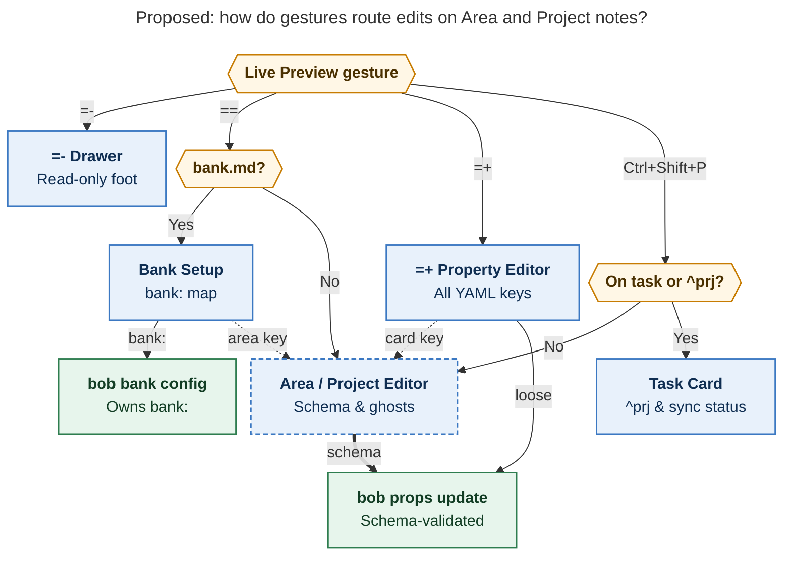
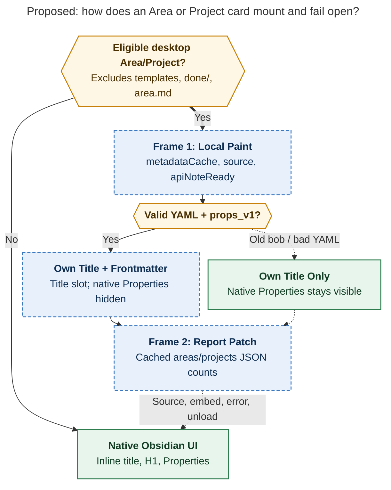

# Property Cards and Schema Editors for Area Notes and Project Notes

> **Research question:** Once the `bob-cli-pf` epic bead is complete, how should Bob bring
> property cards and schema editors to area notes and project notes so the result is
> intuitive, reliable, and beautiful? Critique the plan, call out justified requirement
> adjustments, and recommend the best implementation.

## Executive Summary

**Yes — build Area and Project Property Cards directly on the post-`bob-cli-pf` Property
Card kit, with six concrete adjustments to the initial framing.**

After `bob-cli-pf` completes, Day, Week, Quarter, Year, Album, and Record notes will all
wear a calm, title-slot Property Card that hides Obsidian's native Properties behind a
hairline foot row (`▸ Properties · N` + `created`) and exposes the `=` chord triad (`==`
card editor, `=-` properties drawer, `=+` full property editor). Meanwhile, the **121
area notes (19) and project notes (102)** that run Bryan's entire GTD system remain stuck
in raw Obsidian chrome: bare lowercase `snake_case` inline titles (`dev_plex_hack_patch`,
`sase_pre_blog`), 6–10 lines of noisy native Properties (`template: "[[new_project]]"`,
`task_count`, `open_task_count`, `done_tasks`) stacked above line 1 of the note, and zero
typed UI for Bob's nine operational knobs (`color`, `task_type`, `ready_cap`, `offclock`,
`offclock_types`, `task_refresh`, `root`, `project_name_aliases`, `summary`). Extending
the Property Card family to Areas and Projects also cleanly closes `bob-cli-pf`'s one
deliberate deferral: `bank.md` (`type: "[[area]]"`), which stayed out of native-Properties
takeover specifically until Areas gained a title-block card.

**Recommended solution in one paragraph:** Add two new species to the Property Card
identity kit (`240f`–`240q`) — **`area`** (circular `disc` tile with Lucide `layers`,
`8%` area wash, `3px` accent stripe) and **`project`** (left-spined `spine` tile with
Lucide `target` matching `#task #prj`, `5%` active wash dimming to `2%` when closed).
Mount both in Obsidian's title slot above native Properties using zero-spawn two-frame
painting (`metadataCache` + `sourceText` + `apiNoteReady` immediately, then patched in
place from the already-cached `bob areas list` / `bob projects list` / `bob types`
subscriptions). Keep the `^prj` task line completely live and visible right below the
Project card, never duplicated as card prose. Preserve `bob-cli-pf`'s exact `=` chord
triad by binding **`==`** (not `=+`) to the new curated **Area / Project Card Editor**
(showing ghost rows with live inherited defaults, a 10-swatch R8 Color picker, a
configured Task Type picker that atomically migrates legacy `theme:`, and a unified
4-mode Clock Policy picker that eliminates `note_offclock_shadowed`), while **`=+`** stays
the universal all-properties editor that hands card keys off to `==`. Back both editors
with **one** byte-preserving writer — schema-validated `bob props update` (fixing current
`roles.rs` derived-key gaps for `done_tasks`, `task_count`, `open_task_count`, and
`status`) — and eliminate `bob-project-tasks`'s legacy `processFrontMatter` calls before
project-card takeover lands.

---

## 1. Ground-Truth Vault and Codebase Census

Every design decision below is grounded in an audit of Bryan's live vault (`~/bob`,
inspected 2026-11-22 via `bob areas list`, `bob projects list`, `bob capture-targets`,
`bob types list`, and frontmatter/header inspection of all 19 areas and 102 projects) plus
the current `bob-cli` (`e98c7fe9`) and `bob-plugins` (`15d82db7`) source trees.

### 1.1 Area Notes (`type: "[[area]]"`, n = 19)

| Metric / Key | Frequency | Real Vault Examples & Notes |
| --- | ---: | --- |
| `parent` | 19 / 19 | `"[[area]]"` (6 top-level: `body`, `cash`, `dev`, `gtd`, `job`, `love`), `"[[cash]]"`, `"[[gtd]]"`, `"[[inbox]]"`, `"[[love]]"` |
| `type` | 19 / 19 | `"[[area]]"` |
| `summary` | 19 / 19 | 100% populated; one-line scope description (e.g., `"My software projects (bob, SASE), dev tooling..."`) |
| `done_tasks` | 11 / 19 | `"[[done/body_done]]"`, `"[[done/cash_done]]"` — **written by `bob task archive`** |
| `color` | 7 / 19 | `green`, `magenta`, `blue`, `grey`, `violet`, `aqua`, `yellow` |
| `task_type` | 6 / 19 | `BUILD`, `PLAN`, `MEET`, `WRITE`, `CHORE` |
| `ready_cap` | 5 / 19 | `off` on all 5 inbox areas (`inbox`, `gkeep_inbox`, `gmail_inbox`, `mac_inbox`, `meet_inbox`) |
| `created` | 3 / 19 | Only `bank.md`, `family.md`, `vacation.md`; **16 / 19 areas have no `created`** |
| `offclock` | 2 / 19 | `true` on `body.md` and `love.md` |
| `offclock_types` | 2 / 19 | `[MEET]` on `body.md` and `love.md` — **both currently shadow `offclock: true` (`note_offclock_shadowed`)!** |
| `bank` | 1 / 19 | Nested config map on `bank.md` only (lines 6–64 of `bank.md`) |
| `project_name_aliases` | 1 / 19 | `[tailnet]` on `dev.md` |
| `task_refresh` | 0 / 19 | Supported by `src/native/freshness/scan.rs:724`, currently unused |
| First-body H1 | 5 / 19 | `# 🏦 Bank`, `# Inbox`, `# Gmail inbox`, `# Mac Inbox`, `# Meet Inbox`; **14 / 19 have no H1** |

Note also the root sentinel **`area.md`**: untyped (`parent: "[[type]]"`, no `type: "[[area]]"`),
hosts the top-level `## Areas` catalog, and is explicitly excluded from being an area row
(`docs/areas.md:9-26`).

### 1.2 Project Notes (`type: "[[project]]"`, n = 102)

Status distribution: **42 `wip`**, **51 `done`**, **8 `canceled`**, **1 missing `status`**
(`needs_attn_tasks.md`), **0 `waiting`**.

| Metric / Key | Frequency | Real Vault Examples & Notes |
| --- | ---: | --- |
| `parent` | 102 / 102 | `"[[dev]]"`, `"[[bob]]"`, `"[[sase]]"`, `"[[sase_blog]]"`, `"[[vacation]]"`, `"[[mac_inbox]]"`, `"[[job]]"` |
| `type` | 102 / 102 | `"[[project]]"` |
| `task_count` | 102 / 102 | Integer — **machine-written by `bob-project-tasks` via `processFrontMatter`** |
| `open_task_count` | 102 / 102 | Integer — **machine-written by `bob-project-tasks` via `processFrontMatter`** |
| `status` | 101 / 102 | `wip` (42), `done` (51), `canceled` (8) — reconciled from `^prj` by `bob projects sync` |
| `created` | 99 / 102 | Mixed offset styles (`-04:00`, `-0500`, `-05:00`) |
| `template` | 97 / 102 | `"[[new_project]]"` — creation provenance clutter |
| `done_tasks` | 42 / 102 | `"[[done/bob_done]]"`, `"[[done/sase_done]]"` — **written by `bob task archive`** |
| `scheduled` | 4 / 102 | Leftover YAML dates on 4 closed projects (`sase_clean`, `sase_gate_shells`, `sase_research`, `sase_sites`) |
| `theme` | 2 / 102 | **Legacy key** (`CHORE` on `dev_plex_hack_patch.md`, `WRITE` on `sase_blog.md`) |
| `project_name_aliases` | 1 / 102 | `[bob-cli]` on `bob.md` |
| `color` | 1 / 102 | `orange` on `sase.md` |
| `root` | 1 / 102 | `true` on `sase_blog.md` |
| Loose/legacy keys | 1 each | `source`, `converted` (`gkeep_gdocs_inbox_dump.md`); `aliases`, `id`, `tags` (`needs_attn_tasks.md`) |
| Body starts with `^prj` | **100 / 102** | Nearly universal; `^prj` carries `[scheduled::]`, `[priority::]`, `[fresh::]`, `DEPENDS ON`, `BLOCKS`, `WORK LOG`, `SCHEDULE LOG` |
| Has H1 anywhere | **3 / 102** | `bob.md`, `gkeep_gdocs_inbox_dump.md`, `needs_attn_tasks.md` — **0 / 102 have H1 first** (all 3 sit *below* `^prj`!) |

Special files that must stay excluded:
- `_templates/new_project.md` carries `type: "[[project]]"` with Templater `<% ... %>`
  syntax in `parent:` and `created:`.
- `done/*_done.md` (55 files) all carry `type: "[[done]]"`, never `[[project]]`.

### 1.3 What `bob-cli-pf` Gives Us for Free — and What Gaps Remain

By the time `bob-cli-pf` lands, the kit already provides:
- `createPropertyCardHost` (`240c`), title-slot mounting (`240e`), title adoption (`240k`),
  title ownership (`240i`), and whole-container frontmatter ownership (`240q`,
  `propertyCardOwnFrontmatter` + `inert` + `aria-hidden` + `focusin` guard).
- The shared foot row, `created` formatter, source-ordered inventory, and `=-` drawer
  (`240m`–`240p`, already merged in `bob-plugins` `15d82db7`).
- The generalized `=` second-key gate (`248m`) supporting `==`, `=-`, and `=+`.
- Generic byte-preserving `bob props show|update` (`src/native/props/`, inventory and roles
  already landed in `bob-cli` `e98c7fe9`), plus the `=+` modal built on the Record Card
  editor chassis.
- Existing stale-while-revalidate report services in `bob-ledger-tools` for areas
  (`241ag`), projects (`241ab`), task types (`279`), and synchronous per-note Ready caps
  (`190` / `330`).

**Four concrete gaps** discovered in the current code that our design must fix:
1. **`src/native/props/roles.rs` classifies `done_tasks`, `task_count`, `open_task_count`,
   and project `status` as `Role::Loose`.** Nothing in `roles.rs:111-190` yet recognizes
   those machine-maintained Area/Project keys.
2. **`plugins/bob-project-tasks/main.js:561,574` still calls
   `app.fileManager.processFrontMatter`.** Every task edit on any of the 102 project notes
   re-serializes the entire YAML block 250 ms later — violating Bob's `processFrontMatter`
   ban (`211-parent-frontmatter-plan.js`, `bob-cli-pf` D1) and racing with `bob props`
   fingerprints.
3. **`bank.md` is classified as `NoteKind::Bank` before `frontmatter_is_area`**
   (`roles.rs:212-218`) and mounts the Bank Setup card in the body under `# 🏦 Bank`
   (`248c:372,593`), with a temporary `bank_foot` row approved in `bob-cli-pf` specifically
   "until areas get a title-block card."
4. **`241aj-plugin-areas-catalog.js:98` (`add summary`) calls `apiNotebookOpenSummary` →
   `notebookFocusSummaryProperty`**, which attempts to focus Obsidian's native Properties
   `summary` input and will dead-end unless rerouted when the Area card owns frontmatter.

---

## 2. Critique and Justified Requirement Adjustments

The core idea is strong: Area and Project notes are the notes Bryan opens most frequently
after daily notes, and leaving them with raw Obsidian Properties after `bob-cli-pf` would
create a jarring split personality across the vault. However, **six requirements need
explicit adjustment** before implementation.

| # | Prompt / Implicit Assumption | Adjusted Requirement | Why This Adjustment Is Necessary |
| --- | --- | --- | --- |
| **A1** | "the corresponding schema editors (triggered via the `=+` keymap)" | **Bind `==` to the Area/Project Card Editor; keep `=+` as the generic all-properties editor** (with `Enter` on card keys handing off to `==`, and `+`/`=` switching between modals). | `bob-cli-pf` just standardized the `=` triad vault-wide: `==` = species card/schema editor, `=-` = read-only Properties drawer, `=+` = generic frontmatter editor on *any* note. Binding Area/Project schema editors to `=+` would invert muscle memory across 9 card species, collide with `=+`'s raw-key management (add arbitrary keys, rename, reorder, paste YAML), and break `bank.md` where `==` owns `bank:` while `=+` edits all keys. *(Alternative B — hosting schema rows inside `=+` directly — is critiqued in §2.1 below.)* |
| **A2** | Property card owns the top of a Project note (like Album/Record/Day) | **Never hide, swallow, or duplicate the `^prj` task line** in the Project card. | 100/102 projects begin with `- [ ] #task #prj ... ^prj` on line 1. `^prj` is an interactive task carrying `[scheduled::]`, `[priority::]`, `[fresh::]`, `DEPENDS ON`, `BLOCKS`, `WORK LOG`, `SCHEDULE LOG`, `REQUIREMENTS`, `Ctrl+Shift+P` Task Card, `Ctrl+Enter`, `Ctrl+Shift+Alt+N`, and `]s` review landings. Rendering `^prj` prose as a card subtitle 12 px above the exact same line would create blatant duplication. |
| **A3** | Only build cards + schema editors on top of `bob-cli-pf` | **Fix `roles.rs` derived-key gaps and replace `processFrontMatter` in `bob-project-tasks`** as part of this work. | Without fixing `roles.rs`, `task_count`, `open_task_count`, `done_tasks`, and terminal `status` appear editable in `=+` and get silently overwritten. Without fixing `bob-project-tasks`, every task edit re-serializes project YAML and invalidates `bob props` fingerprints. |
| **A4** | Treat every `type: [[area]]` and `type: [[project]]` identically | **Handle 5 special vault cases explicitly:** `bank.md` (Area title block + body Bank Setup card, retiring duplicate `bank_foot`), `area.md` (excluded root sentinel), `_templates/`/`done/`/`_conflicts/` (excluded), inboxes (`ready_cap: off`), and closed projects (59/102 calmed visual state). | Ignoring `bank.md` creates two foot rows or breaks `==` Bank Setup; ignoring `_templates/new_project.md` breaks Templater; styling 59 finished projects like active work creates visual noise. |
| **A5** | Mirror every existing card band (nav rail, mandatory `created`, title migration) | **Omit any docked prev/next nav rail; keep H1 hiding render-time only; leave untitled stems un-mangled; keep missing `created` silent on Areas.** | Areas and Projects form a tree (navigated via kicker breadcrumbs, `Ctrl+-`, `Ctrl+=`, and catalogs), not a linear `[n`/`]n` ring. 16/19 areas have no `created` date — nagging `no created date` on 84% of areas adds clutter. Humanizing `sase_pre_blog` or `gtd_daily` corrupts acronyms and `@route` identity. |
| **A6** | Create dedicated per-species writers (`bob areas update`, `bob projects update`) | **Extend `bob props show\|update` with Area/Project schema validation (`area_project_schema_v1`)** as the single writer. | Unlike `album` (`record:`), `bank` (`bank:`), `record` (index + walk lines), and `period` (SHA-256 summary digests), Area/Project settings are flat top-level YAML keys. Extending `bob props` gives one byte-preserving writer, one Undo protocol, and consistent validation across `==`, `=+`, and terminal use. |

### 2.1 Deep Critique: Should Area/Project Notes Even Have a Dedicated `==` Editor, or Should `=+` Do Everything?

This is the sharpest strategic question in the prompt, because Bryan specifically wrote
`=+` when naming the schema editor. Let's compare the two serious options honestly:

- **Option 1 — Preserve the `bob-cli-pf` Triad (`==` Area/Project Card Editor + `=+` All Properties) [Recommended]:**
  - **`==`** opens a focused, 2-section settings editor showing all ~9 Bob knobs for that
    Area or Project — **including unset ghost rows displaying live inherited defaults**
    (e.g., *"Default task type · inherits `BUILD` from `dev`"*, *"Color · inherits `blue`
    from `dev`"*, *"Clock · off-clock `MEET` from `love`"*). You never have to recall key
    names (`offclock_types` vs `offclock`, `task_refresh`, `project_name_aliases`) or press
    `o` to add them; you just jump straight to row `5` and pick a swatch or toggle a mode.
  - **`=+`** stays cleanly focused on **document frontmatter** (every key actually present
    in file order, plus `o` Add, `r` Rename, `Alt+J/K` Reorder, `Space`/`V` multi-select,
    `Mod+C/V` YAML copy/paste, `t` kind change, YAML stage). Hitting `Enter` on a card key
    in `=+` hands off straight to `==` on that exact field; hitting `+` inside `==` jumps
    to `=+`.
  - **Every Property Card species obeys the exact same mental model:** `==` edits *what this
    card means*, `=-` peeks *all YAML*, `=+` edits *any YAML*.
  - On `bank.md`, `==` keeps opening Bank Setup (preserving muscle memory), `=+` edits all
    YAML, and `⊞ Area` (or `=` from Bank Setup / `Enter` on an area key in `=+`) opens
    Area settings.

- **Option 2 — Make `=+` Schema-Aware on Areas/Projects and Skip a Separate `==` Modal:**
  - *Best case for Option 2:* Area/Project settings are edited much less often than daily
    intentions or record ratings, and every key is flat YAML. Embedding a "Bob settings"
    group with ghost rows inside `=+` avoids adding a 5th modal class.
  - *Why Option 2 loses:*
    1. **What happens when you press `==` on an Area or Project note?** Either `==` falls
       through to Vim reindent (a jarring inconsistency once Area/Project cards look
       identical to Album/Record/Day cards), or `==` becomes a weird alias for `=+`.
    2. **Modal overload:** `=+` already carries 16 browse/parity bindings (`o`, `O`, `r`,
       `t`, `Space`, `V`, `Alt+J/K`, `Mod+C/V`, `/`, `Ctrl+D`, `u`, `y`). Grafting ghost
       rows (which cannot be reordered, renamed, copied, or multi-selected because they
       don't exist in YAML yet!), a 10-swatch palette grid, a 4-mode Clock Policy merger
       over *two* YAML keys (`offclock` + `offclock_types`), and legacy `theme:` migration
       onto `=+`'s file-ordered key list creates awkward special cases across every `=+`
       parity feature.
    3. **Two-key unity breaks:** Clock Policy spans two keys (`offclock` and
       `offclock_types`). In `=+`, rows map 1-to-1 to YAML lines in file order; in `==`,
       Clock Policy is one clean conceptual row.

**Conclusion:** Keep the `==` / `=-` / `=+` triad intact. Both modals share the exact same
chassis (`albumSchemaCardModalBase`), guarded session (`242aa`), and `bob props update`
writer — so the code footprint of `==` is small while the user experience is vastly
clearer.

---

## 3. Visual Design: What Area and Project Property Cards Should Look Like

Following Bob's settled identity principle (*"Hue says where, form says what, words say
both"*, `240f-plugin-property-card-species.js` and `property_card_title_block`), Area and
Project cards extend the existing kit with **zero new colors** and **two unmistakable new
tile silhouettes**.

### 3.1 Species Identity Across the Full 9-Member Property Card Family

| Species | `word` | `tile` Form | Default Lucide Icon | Card Wash & Border | Accent Source |
| --- | --- | --- | --- | --- | --- |
| `album` | `Album` | `stack` (2 offset card edges) | `library` | `8%` wash + header divider | Root area hue |
| `record` | `Record` | `sheet` (folded top-right corner) | `file-text` | `4%` wash, neutral border, `2px` stripe | Root area hue |
| `day`/`week`/`quarter`/`year` | `Day`…`Year` | `leaf` (top accent band + value) | `calendar` / `calendar-range` | `6%`–`12%` wash | Temporal cyan |
| `bank` | `Bank` | `plain` (bordered square) | `landmark` | `8%` wash (body card) | `cash` magenta |
| **`area`** *(new)* | **`Area`** | **`disc`** (circular medallion, `border-radius: 50%`, soft tint fill) | **`layers`** *(already used by `## Areas` at `241ai:53`!)* | **`8%` wash, `3px` accent left stripe** (grounded ongoing home) | Own/inherited R8 hue; `grey` uses calm neutral ink |
| **`project`** *(new)* | **`Project`** | **`spine`** (rounded square with solid `4px` inline-start accent spine) | **`target`** *(matches `#task #prj` target mark!)* | **`5%` wash, `2px` stripe** active; **`2%` wash, muted ink** when `done`/`canceled` | Own/inherited R8 hue; desaturates when closed |

Why `disc` + `layers` and `spine` + `target` work:
- **Semantic fit:** An Area is an ongoing *sphere* of responsibility with no end state
  (`disc` circle + `layers`). A Project is a bounded dossier aimed at a completion
  criterion (`spine` dossier tile + `target`, matching `#task #prj`'s exact glyph).
- **Zero silhouette collision:** None of the existing forms is circular (`disc`) or
  left-spined (`spine`). Both stay crisp at `2.4em` (wide), `1.8em` (≤ 375 px narrow),
  grey-muted areas (`gtd`, `inbox`), and Windows `forced-colors: active`.
- **Optional `emoji:` override:** Just like Album and Record tiles, if an Area or Project
  sets `emoji:` in frontmatter (e.g., `emoji: 🏦` on `bank.md`), the emoji renders inside
  the `disc` or `spine` tile; otherwise the species Lucide icon renders.

### 3.2 Card Anatomy and Restraint Rules

Every Area and Project card has **three bands** (never a fourth nav rail):

1. **Title Block** (`propertyCardBuildTitleBlock`):
   - **Tile** (`disc` / `spine`) + **Kicker**:
     - Area: `AREA · Areas` (top-level, linking to `area.md`) or `AREA · Cash` /
       `AREA · Gtd · Inbox` (sub-area ancestry links; Mod-click opens new tab).
     - Project: `PROJECT · Dev` (top-level project) or `PROJECT · Dev · Bob` /
       `PROJECT · Dev · Sase · Sase Blog` (sub-project chain up to top-level area,
       collapsed with `…` past 4 ancestors).
   - **Actions** (right of kicker): one quiet `⊞ Edit` button (on `bank.md`: `⊞ Area` so it
     is distinct from Bank Setup's `⊞ Edit`), tooltip `Edit area settings (==)` /
     `Edit project settings (==)`.
   - **Title Row:**
     - Title (`role="heading"`, `aria-level="1"`, `--inline-title-*` typography): explicit
       frontmatter `title:` → recognized first-body H1 (before any `##` or bullet) → first
       `aliases:` entry → raw note `stem` (preserving brand/route casing like `bob`, `sase`,
       `gtd`, `dev_plex_hack_patch`). Whenever the rendered title differs from the stem, a
       faint monospace `@stem` tag sits unobtrusively beside it (or in tooltip) so the
       capture route stays visible.
     - **Lifecycle Pill (Project only, `.bob-property-card-pill`):**
       - `WIP` (quiet outline pill, or `WAITING` if non-terminal `waiting` is set)
       - `ON DASH` (accent solid pill when open `^prj` lacks `#hide` — immediately signals
         *"empty project: add tasks or close `^prj`"*)
       - `BLOCKED` (amber outline pill when dependency- or inherited-blocked)
       - `SCHEDULED` (muted outline pill when `^prj` has a future `[scheduled::]`)
       - `DONE` / `CANCELED` (muted neutral pill with short closure date, e.g.,
         `DONE · Jun 14`, paired with desaturated `2%` card wash)
       - `⚠ NO ^PRJ` (amber solid/outline pill when `state === "warning"`)
   - **Subtitle:**
     - **Area:** frontmatter `summary:` in `--text-muted`. If absent, a quiet clickable
       `＋ Add summary` ghost (opens `==` directly on the `summary` stage).
     - **Project:** **intentionally omitted** when `^prj` exists, because `^prj` sits
       directly below the card as body line 1! Only rendered if a project explicitly authors
       a separate `summary:` key, or as a one-line amber warning if `^prj` is missing/broken.

2. **Compact Policy & Pulse Strip** (content-gated single wrapping line below the title
   block — hides completely if empty, so simple notes stay whisper-quiet):
   - **Left — Authored Policy Chips** (only shown when explicitly set on *this* note;
     clicking any chip opens `==` directly on that field):
     - Task type chip: `● BUILD` (dot in `BUILD`'s configured type hue; if stored via legacy
       `theme:`, shows a subtle amber `legacy` dot with tooltip *"Stored as legacy `theme:` —
       click to migrate to `task_type:`"*).
     - Clock policy chip: `⏱ off-clock` (`offclock: true`), `⏱ on-clock` (`offclock: false`),
       or `⏱ off-clock: MEET` (`offclock_types: [MEET]`). If both `offclock` and
       `offclock_types` are set (`body.md`, `love.md`), appends `⚠ shadowed` in amber!
     - Ready cap override: `cap: off` or `cap: 8` (omitted when using global default 5).
     - Refresh override: `refresh: 14d` (omitted when using global default).
     - Root split (Project sub-project with `root: true`): `◆ own root`.
     - External aliases: `aka bob-cli` (or `aka tailnet`; `+N` past 2).
     - Blocking detail (Project when blocked): clickable `⛓ waits on sase_blog`,
       `◷ Nov 30 · in 8d`, or `⛓ parent blocked`.
   - **Right — Quiet Live Pulse** (tabular numerals, read-only, never duplicating whole
     catalogs below):
     - Area: `3/5 ready` (red ink if crowded; `12 ready` if `ready_cap: off`, omitted at 0),
       `3 projects` (from cached `bob areas list`, tooltip distinguishes direct vs subtree),
       `● 5 today` (when > 0).
     - Active Project: `4/5 ready` (from synchronous `apiNoteReady`), `18 open` (from cached
       `bob projects list`), `● 5 today` (when > 0), `3 sub-projects` (when > 0).
     - Closed Project: omitted (unless `note_ready_in_terminal_project` fires, which surfaces
       as an amber lint chip `⚠ 2 ready tasks in done project`).

3. **Shared Foot Row & `=-` Properties Drawer** (`240m`–`240p`, identical to every other
   Property Card):
   - Left: `▸ Properties · N` disclosure (`=-`).
   - Middle (only if lints exist): amber `⚠ M` chip (covers invalid `created`, invalid/unclosed
     YAML, duplicate keys, `area_color_invalid`, `note_ready_cap_invalid`,
     `task_refresh_invalid`, `note_offclock_invalid`, `note_offclock_shadowed`,
     `area_summary_long`, leftover open-project `scheduled`, legacy `theme`).
   - Right: concise `created` stamp — **silent when absent on Areas** (16/19 areas have no
     `created` and are timeless); shows `created Jun 14` (or faint `no created date`) on
     Projects (99/102 have `created`).

### 3.3 Concrete Visual Mockups (Real Vault Notes)

#### Top-Level Area (`dev.md` — `color: blue`, `task_type: BUILD`, `project_name_aliases: [tailnet]`)

```text
╭─┃ ╭────╮  AREA · Areas                                              ⊞ Edit
│ ┃ │ 🗂 │  dev
│ ┃ ╰────╯  My software projects (bob, SASE), dev tooling, and upkeep of
│ ┃         athena, my Mac, and the home network.
│ ┃
│ ┃  ● BUILD   aka tailnet                    2/5 ready · 3 projects · ● 5 today
│ ┃ ────────────────────────────────────────────────────────────────────────────
│ ┃  ▸ Properties · 7
╰─┃
```

#### Area + Bank Dual Hub (`bank.md` — Area card in title slot, Bank Setup card below)

```text
╭─┃ ╭────╮  AREA · Cash                                               ⊞ Area
│ ┃ │ 🏦 │  Bank  @bank
│ ┃ ╰────╯  Every transaction and deposit, categorized in monthly notes,
│ ┃         plus disputes and cancellations.
│ ┃ ────────────────────────────────────────────────────────────────────────────
│ ┃  ▸ Properties · 5                                           created Nov 11
╰─┃
  ┌─┃ [🏛] BANK  1 account · 18 categories · 12 rules · 0 findings      ⊞ Edit ─┐
  │ ┃  (existing collapsible Bank Setup card; duplicate bank_foot retired)      │
  └─┃───────────────────────────────────────────────────────────────────────────┘
```

#### Active Top-Level Project (`bob.md` — inherits `dev` blue, `^prj` stays live right below!)

```text
╭─┃ ┌───┐   PROJECT · Dev                                             ⊞ Edit
│ ┃ ┃ ◎ │   bob  [ WIP ]
│ ┃ └───┘
│ ┃  aka bob-cli                4/5 ready · 18 open · ● 5 today · 3 sub-projects
│ ┃ ────────────────────────────────────────────────────────────────────────────
│ ┃  ▸ Properties · 10                                          created Jun 14
╰─┃
- [ ] #task #prj Finish MVP of `bob` and bob-plugins repo (no new commits for 30d)! #hide ^prj
```

#### Blocked Sub-Project (`sase_post_blog.md` — inherits `sase` orange)

```text
╭─┃ ┌───┐   PROJECT · Dev · Sase                                      ⊞ Edit
│ ┃ ┃ ◎ │   sase_post_blog  [ BLOCKED ]
│ ┃ └───┘
│ ┃  ⛓ waits on sase_blog                                         2 sub-projects
│ ┃ ────────────────────────────────────────────────────────────────────────────
│ ┃  ▸ Properties · 8                                           created Oct 13
╰─┃
- [?] #task #prj Plan features to launch after [[sase_blog]] post! #hide … ^prj
	- ⛓️ **DEPENDS ON:** [[sase_blog#^prj]]
```

#### Closed Project (`bob_projects.md` — desaturated `2%` wash, quiet history)

```text
╭─┃ ┌───┐   PROJECT · Dev · Bob                                       ⊞ Edit
│ ┃ ┃ ◎ │   bob_projects  [ DONE · Jun 14 ]
│ ┃ └───┘
│ ┃ ────────────────────────────────────────────────────────────────────────────
│ ┃  ▸ Properties · 7                                           created Jun 11
╰─┃
- [x] #task #prj Design and configure “projects” in Obsidian! [completion:: 2026-06-14] ^prj
```

### 3.4 `=-` Drawer Grouping & Where-Marks

| Group | Area Note Keys | Project Note Keys |
| --- | --- | --- |
| **Loose** *(unlabelled)* | `tags`, `aliases`, custom user keys | `template`, `tags`, `aliases`, `source`, `converted`, `id`, custom user keys |
| **On this card** | `type` (`tile`), `parent` (`kicker`), `title` (`title`), `emoji` (`tile`), `summary` (`subtitle`), `color` (`accent`), `task_type` / `theme` (`defaults`), `ready_cap` (`defaults`), `offclock` / `offclock_types` (`defaults`), `task_refresh` (`defaults`), `project_name_aliases` (`defaults`), `created` (`foot`), `bank` (`bank ==` on `bank.md`) | `type` (`tile`), `parent` (`kicker`), `title` (`title`), `emoji` (`tile`), `summary` (`subtitle`), `status` (`pill`), `root` (`defaults`), `color` (`accent`), `task_type` / `theme` (`defaults`), `ready_cap` (`defaults`), `offclock` / `offclock_types` (`defaults`), `task_refresh` (`defaults`), `project_name_aliases` (`defaults`), `created` (`foot`), leftover `scheduled` (`legacy`) |
| **▸ Managed · N** *(folded)* | `done_tasks`, `*_digest`, `*_drafted`, `zorg_*`, `generated_from_zorg*` | `done_tasks`, `task_count`, `open_task_count`, `*_digest`, `*_drafted`, `zorg_*`, `generated_from_zorg*` |

*(Clickable wikilinks inside `Managed` — especially `done_tasks: "[[done/bob_done]]"` —
keep normal Obsidian click-to-open and hover preview!)*

---

## 4. Schema Editor Design: Fields, Stages, and Keyboard Ergonomics

The **Area Card Editor** and **Project Card Editor** reuse the Record Card / Album Schema
editor modal chassis (`albumSchemaCardModalBase`, `242aa-plugin-guarded-update-session.js`,
`241xc-plugin-card-close-keys.js`) and wear the note's species badge (`disc` **AREA** or
`spine` **PROJECT**) and area accent so the card, `=-` drawer, `==` editor, and `=+`
editor read as one unified object.

### 4.1 Complete Field Matrix

Every optional field renders as a **first-class selectable row even when unset**, showing
its **live effective value and inheritance source** in muted ghost ink (e.g.,
`inherits blue from dev`, `default 5`, `on-clock (default)`). Unsetting a field (`Ctrl+D`)
removes the YAML key cleanly so inheritance resumes.

#### Section 1 — Identity & Placement

| Keycap | Field | YAML Key(s) | Scope | Stage & Ergonomics | Validation & Consequence Preview |
| :---: | --- | --- | --- | --- | --- |
| `1` | **Parent** | `parent` | Area & Project | Fuzzy note picker filtered by legal parent rules (`208-parent-note-picker-model`): Areas accept `[[area]]` or any non-descendant Area; Projects accept any Area or non-descendant Project (never notebooks/albums/records). Always writes canonical quoted `"[[stem]]"`. | Cycle check + kind check in Rust. Preview shows inherited changes (*"Hue changes yellow → blue; `## Projects` catalogs will refresh"*). Triggers debounced catalog sync after apply. |
| `2` | **Summary** | `summary` | **Area** *(omitted on Project — see §4.2)* | Single-line text input (newlines collapse to spaces) with live `N / 140` counter turning amber past 140 chars. | Matches `areas/graph.rs:518-538` (`area_summary_multiline` refusal, `area_summary_long` warning). Triggers `## Areas` catalog refresh after apply. |
| `3` *(Proj: `2`)* | **Root parent** | `root` | **Project only** | **Instant toggle (`Space` / `Enter`, no sub-stage)** writing `root: true` or unsetting `root` (never writes noisy `root: false`). | On a **sub-project**, explains: *"Rolls up under `sase` (leaf · keep-moving on)"* ↔ *"Own root `sase_blog` (own Stats lane · keep-moving off)"*. On a **top-level project** (parent is an Area), row displays read-only muted info: *"Already its own root under `dev`"*. |
| `4` *(Proj: `3`)* | **Title & Emoji** *(optional)* | `title`, `emoji` | Area & Project | Two quiet optional rows (or compact combined **Display** rows): `title` single-line literal text (unset falls back to H1 / alias / stem); `emoji` uses the shared **Emoji Slot** (`242g`, Bob Emoji v1 search/recents/ZWJ-safe). | Pure display metadata; never alters `@stem` capture route or wikilinks. |

#### Section 2 — Task Defaults & Policies

| Keycap | Field | YAML Key(s) | Scope | Stage & Ergonomics | Validation, Migration & Consequence Preview |
| :---: | --- | --- | --- | --- | --- |
| `5` | **Color** | `color` | Area & Project | **10-slot visual swatch picker:** digits `1`–`8` pick the R8 palette hues (`blue`, `orange`, `aqua`, `yellow`, `magenta`, `green`, `violet`, `red`), `9` picks `grey` (deliberate mute), `0` / `Ctrl+D` sets **Inherit** (unset). | Strictly validates against R8 (`docs/pomodoro-homes.md#r8-area-hues`). On top-level areas, badges any hue already claimed by another top-level area (`used by dev` → prevents `area_hue_collision`). |
| `6` | **Default task type** | `task_type` *(migrates `theme:`)* | Area & Project | **Choice picker** seeded from `bob types list -f json` (`BUILD`, `CHORE`, `FIX`, `MEET`, `PLAN`, `READ`, `WRITE`) with real type hue dots, `1`–`7` instant digit pick, free entry for custom ALL-CAPS types, and `Ctrl+D` **Inherit**. | **Atomic legacy migration:** on notes carrying legacy `theme:` (`dev_plex_hack_patch.md`, `sase_blog.md`), saving writes `task_type:` and unsets `theme:` in one undoable envelope! Ghost shows inherited source (*"inherits `BUILD` from `dev`"* or *"config default `PLAN`"*). |
| `7` | **Clock policy** *(unified!)* | `offclock`, `offclock_types` | Area & Project | **4-mode segmented picker:**<br/>`1` **Inherit** (unsets both keys; shows inherited policy from parent walk)<br/>`2` **All off-clock** (`offclock: true`, unsets `offclock_types`)<br/>`3` **All on-clock** (`offclock: false`, stops inheritance, unsets `offclock_types`)<br/>`4` **Off-clock by type** (multi-select chips over configured task types; writes block-list `offclock_types:` and **atomically unsets `offclock`**) | **Fixes a real bug in Bryan's vault today:** both `body.md` and `love.md` carry `offclock: true` alongside `offclock_types: [MEET]`, triggering `note_offclock_shadowed`. The editor flags shadowed dual keys with a one-Enter cleanup preview and guarantees new saves can never create the conflict. |
| `8` | **Ready cap** | `ready_cap` | Area & Project | **Preset + number stage:** instant chips **`Default (5)`** (unset) and **`Off (exempt)`** (`ready_cap: off`), plus integer input `1–999`. | Live simulation against `apiNoteReady`: *"Currently 6 ready · cap 8 → room (2 left)"*. On closed projects (`done`/`canceled`), shows muted info: *"Not capped while project is done"*. Clarifies residence-only scope (never inherits). |
| `9` | **Review interval** | `task_refresh` | Area & Project | **Preset + integer stage:** quick chips `3d`, `7d` (default/unset), `14d`, `30d`, `90d`, plus `1–365` input. | Validates `1–365` (`docs/freshness.md`). Explicitly notes: *"Applies to Ready tasks living in this note only (does not inherit)"*. |
| `0` / `a` | **External aliases** | `project_name_aliases` | Area & Project | **Chip list stage** (reusing Record Card's List stage: Enter adds chip, empty Backspace removes last chip, `Ctrl+D` clears). | Trims entries, refuses blanks, and dry-run checks `capture-targets` rules for stem shadowing and duplicate-alias collisions (`docs/projects.md:146-150`). |

### 4.2 Explicitly Excluded Keys (and Why)

| Key | Role in `bob props` | Why Excluded From `==` Schema Editor | How the User Touches It |
| --- | --- | --- | --- |
| `type` | `Identity` (locked) | Retyping area↔project breaks `^prj`, catalogs, and residence invariants. | `Ctrl+Shift+Alt+N` (promote/demote) or `y` YAML excursion. |
| `status` *(Project)* | `Derived` (locked)* | Reconciled by `bob projects sync` from the `^prj` checkbox (`[x]` → `done`, `[-]` → `canceled`, `[ ]` → `wip`). 0/102 vault projects use `waiting`. Allowing YAML edits creates sync drift. | Shown as a **read-only lifecycle banner** at the top of the Project editor (`Status: wip · managed by ^prj`). Edit `^prj` via `Ctrl+Enter` / `Ctrl+Shift+P`. *(See Open Decision #2 for optional `wip`/`waiting` toggle.)* |
| `scheduled` *(Project YAML)* | `Derived` / deprecated | Project scheduling moved onto inline `^prj [scheduled::]` (`docs/projects.md:152-165`); `bob projects sync` hoists & deletes YAML `scheduled`. | `Ctrl+Shift+P` on `^prj`. Leftover YAML `scheduled` shows a `legacy` badge in the drawer. |
| `task_count`, `open_task_count` | `Derived` (locked) | Machine-computed counts (`bob-project-tasks`). | Read-only under `Managed` in `=-` drawer. |
| `done_tasks` | `Derived` (locked) | Maintained reciprocally by `bob task archive` (`docs/task-archive.md`). | Clickable archive link under `Managed` in `=-` drawer. |
| `summary` *(Project)* | Loose (not in Project `==`) | On projects, the `^prj` criterion already describes the project and feeds `## Projects` catalogs. Adding a second required blurb invites divergence. | Still freely addable via `=+` if ever wanted (and rendered as subtitle if present). |
| `bank:` *(on `bank.md`)* | `Card` (`bank` → `==`) | Deep nested config map with its own bespoke Bank Setup editor. | `==` on `bank.md` (Bank Setup takes precedence over Area). |
| `created`, `template`, `tags`, `aliases`, custom keys | `Loose` (`=+`) | Standard document frontmatter, not Area/Project operational schema. | Press `+` from inside `==` (or `=+` from the note). |

### 4.3 Editor Modal Visual Mockup (`==` on `sase_blog.md`)

```text
╭──────────────────────────────────────────────────────────────────────────╮
│  ┌──┐ PROJECT  sase_blog                                                 │
│  ┃◎ │ Dev › Sase · sase_blog.md · Status: wip (via ^prj)                 │
│  └──┘                                                                    │
│  IDENTITY & PLACEMENT                                                    │
│  [1] Parent            [[sase]]                                          │
│  [2] Root parent       ✓ Own root (separate Stats lane; not a leaf)      │
│  [3] Title             —  uses stem sase_blog                            │
│  [4] Emoji             —  uses target icon                               │
│                                                                          │
│  TASK DEFAULTS & POLICIES                                                │
│  [5] Color             —  inherits ● orange from sase                    │
│  [6] Task type         ● WRITE  ⚠ legacy theme: (↵ migrates)             │
│  [7] Clock policy      —  inherits on-clock                              │
│  [8] Ready cap         —  default 5 (currently 2/5 ready)                │
│  [9] Review interval   —  default 7d (this note only)                    │
│  [0] External aliases  —  none                                           │
│  ──────────────────────────────────────────────────────────────────────  │
│  j/k move · 1–9 jump · ↵ edit · ⌃D inherit · u undo · + all props · y    │
╰──────────────────────────────────────────────────────────────────────────╯
```

### 4.4 Keyboard Grammar and Gesture Routing

All close paths honor `decisions:q-and-ctrl-bracket-mirror-esc` via `bobCardWireCloseKeys`
(`Esc` / `q` / `Ctrl+[` peel open link band → `⋯` All actions menu → active stage →
close; `q` types inside text controls, `Ctrl+[` always backs out).

Inside the `==` Area/Project Card Editor:
- `j`/`k`, arrows, `Ctrl+N`/`P`, `Tab`/`Shift+Tab`: move row selection
- `1`–`9` (and `0`): jump straight to that row (inside the Color or Task Type stage, digits
  pick the swatch/type directly, mirroring Record Card's choice codes)
- `Enter` / `l`: open the selected field's stage (or toggle `root` immediately)
- `Space`: instant toggle on `root`
- `Ctrl+D`: unset the selected field back to inherited/default (undoable)
- `u` / `Ctrl+Z`: guarded per-path Undo from `inverse_ops` (survives modal reopen)
- `+`: hand off directly to `=+` (All Properties) on this note
- `y` / `Ctrl+E`: YAML excursion to that key's line in Source mode, with floating **Done**
  return
- `Esc` / `q` / `Ctrl+[`: close ladder



*Figure 1: Every gesture on Area and Project notes — including `bank.md` and `^prj` —
routes cleanly to one surface and one byte-preserving writer. Dashed borders mark the new
Area/Project Card Editor; dashed arrows mark modal hand-offs. Verified at 870 × 702 px
(75.0% fit) under `mmdc 12.0.0`.*

---

## 5. Architecture, Reliability, and Failure-Mode Engineering

### 5.1 Zero-Spawn Two-Frame Mount and Fail-Open Lifecycle

Area and Project cards reuse `createPropertyCardHost` (`240c`), `propertyCardAdoptTitle`
(`240k`), `propertyCardFootBuildEl` (`240o`), and `propertyCardOwnFrontmatter` (`240q`)
without inventing a parallel lifecycle:

1. **Eligibility gate:** Desktop Live Preview or Reading view; frontmatter `type` resolves
   to `area` or `project` (area wins ties, matching `330-note-ready-model.js:149`); path is
   NOT `area.md` (resolved root sentinel), NOT under `_templates/`, `_conflicts/`,
   `_generated/`, or `done/`; NOT an embed, hover popover, canvas node, or print view.
2. **Frame 1 (synchronous, 0 ms, zero subprocesses):** Reads `metadataCache`, confirmed
   `sourceText`, `pomodoroHomeResolve` (parent chain + R8 hue), `apiNoteReadyForNote`
   (synchronous Ready count & cap), and local `^prj` scan (`projectsLifecycleFingerprint`,
   `241aa:406`). Mounts the title block, policy chips, local Ready pulse, and foot row in
   the title slot immediately.
3. **Whole-container takeover gate:** Acquires `propertyCardOwnFrontmatter` *only* when the
   card mounted in the title slot, frontmatter parses with a closed `---` fence, and the
   session's cached capability probe confirmed `props_v1`. If `props_v1` is absent (old
   `bob` binary) or YAML is broken, the card stays visible (or demotes) while **native
   Properties stays visible** so editing is never stranded.
4. **Frame 2 (async enrichment, zero new background services):** Subscribes to the
   existing `apiAreasSubscribe` (`241ag`), `apiProjectsSubscribe` (`241ab`), and cached
   type-hue table (`279`). Patches live `projects`, `today`, `open`, `blocked` reasons, and
   `closed_on` into the mounted DOM via `propertyCardAdoptPatch` (no remount, no scroll
   jump).
5. **Same-frame fail-open restoration:** Source mode toggle, path change, embed/popover
   rendering, malformed YAML, mount exception, or plugin disable/unload immediately drops
   both title and frontmatter ownership handles (`240i`, `240q`), restoring native inline
   title, H1, and Properties in the same frame.



*Figure 2: Area and Project cards paint synchronously from local data on Frame 1, hide
native Properties only when YAML parses and `props_v1` is confirmed, enrich from existing
cached reports on Frame 2, and restore native Obsidian chrome in the same frame on any
failure or mode change. Verified at 605 × 852 px (100.0% fit) under `mmdc 12.0.0`.*

### 5.2 Single Write Path: Extending `bob props` vs. New CLI Commands

| Criterion | **Option A: Schema-aware `bob props`** *(Recommended)* | Option B: New `bob areas update` + `bob projects update` | Option C: Untouched `bob props` + JS-only validation |
| --- | --- | --- | --- |
| Byte preservation & Undo | Reuses `yaml_spans.rs` + `inverse_ops` + vault lock + fingerprint unchanged | Duplicates protocol, locking, fingerprinting, CLI wiring twice | Reuses `bob props` |
| Rust owns domain rules | **Yes** — validates `color`, `task_type`, `ready_cap`, `offclock`/`offclock_types`, `task_refresh`, `root`, `summary`, `parent` cycles/kinds, `project_name_aliases` | Yes | **No** — terminal `bob props` and `=+` paste can write invalid values (`color: purple`, `ready_cap: 0`, cycles) |
| Atomic cross-key edits | **Yes** — `ops: [prop.set(offclock_types), prop.unset(offclock)]` and `ops: [prop.set(task_type), prop.unset(theme)]` in one transaction | Yes | Only if caller remembers to emit both ops |
| CLI & plugin surface area | **Zero new CLI subcommands**, one `area_project_schema_v1` capability flag | +2 CLI subcommands, +2 JSON schemas, +2 `bobSpawnJson` services | Zero CLI changes, but leaves `roles.rs` bugs unfixed |

**How `bob props` handles ownership cleanly under Option A:**
- `src/native/props/roles.rs` updates:
  - Add `done_tasks` (Area & Project), `task_count` (Project), `open_task_count` (Project),
    and `status` (Project) to `Role::Derived` with exact teaching lines naming their writers
    (`bob task archive`, `bob-project-tasks`, `bob projects sync` / `^prj`).
  - Classify Area card keys (`parent`, `summary`, `title`, `emoji`, `color`, `task_type`,
    `ready_cap`, `offclock`, `offclock_types`, `task_refresh`, `project_name_aliases`) as
    `Role::Card { owner: "area", editor: "==" }`, and Project card keys (same minus
    `summary`, plus `root`) as `Role::Card { owner: "project", editor: "==" }`.
  - On `bank.md`, keep `bank:` owned by `owner: "bank", editor: "=="` while allowing
    `bank.md`'s area keys to carry `owner: "area"` validation!
- `bob props update` refuses `prop_owned` **only** for external-writer owners (`record`,
  `album`, `intentions`, `bank`). For `area` and `project` card keys, `bob props` **is**
  the single authoritative writer, so it validates every edit against Rust's existing
  domain parsers (`NoteColor::from_frontmatter`, `parse_ready_cap`, `parse_offclock_types`,
  `areas/graph.rs` summary & cycle checks, `projects/scan.rs` alias checks) and returns
  typed errors (`prop_bad_value`, `prop_parent_cycle`, `prop_parent_kind`) plus non-fatal
  warnings (`area_summary_long`, `area_hue_collision`, `alias_shadowed`) in dry-run
  previews!
- `bob props show -f json` appends `"area_project_schema_v1"` to `capabilities` and can
  optionally include an `inherited` map (`{ color, task_type, clock, ready_cap,
  task_refresh, root_parent }`) computed in Rust from the vault tree — guaranteeing the
  editor's ghost rows never drift from Rust's precedence rules!

### 5.3 Resolving Three Subtle Integration Hazards

1. **`bob-project-tasks`'s `processFrontMatter` hazard (CRITICAL):**
   - Today, `plugins/bob-project-tasks/main.js:561,574` calls
     `app.fileManager.processFrontMatter` 250 ms after any task edit on a project note.
   - That re-serializes the entire YAML block (stripping comments, altering wikilink quotes,
     potentially corrupting `created` timestamps) and changes the frontmatter SHA-256
     fingerprint while the user has `==` or `=+` open!
   - **Recommended fix (Phase 0):** Either replace those two `processFrontMatter` calls
     with a ~40-line byte-preserving integer-line updater modeled on
     `211-parent-frontmatter-plan.js` (zero behavior change for `projects.base:10`), **or**
     retire `task_count`/`open_task_count` entirely if Bryan no longer relies on
     `projects.base` (since `bob projects list` and the Project Property Card already
     display accurate live counts without writing to YAML).

2. **`bank.md` Dual-Card Coordination:**
   - `bank.md` is both `type: "[[area]]"` and the Bank hub (`bank:` map + `# 🏦 Bank` +
     Bank Setup card).
   - Once Area Property Cards mount on `bank.md`:
     - The **Area Card** mounts in the title slot, adopts `# 🏦 Bank` (render-time hide),
       renders the note's single `▸ Properties · 5` foot row + `created Nov 11`, and owns
       `propertyCardOwnFrontmatter` (finally closing `bob-cli-pf` D5!).
     - The **Bank Setup Card** stays docked immediately below the hidden H1 in the body
       (`248c`) and suppresses its temporary `bank_foot` row whenever the Area Card is
       mounted in the same view (retaining `bank_foot` only as fallback if the Area Card
       fails to mount).
     - **Explicit real-Obsidian verification item:** Confirm in CDP e2e that hiding
       `# 🏦 Bank` via `240i` Live Preview replacement does not disturb `248c:593`'s
       `notebookHeaderLiveAnchor` widget placement for the Bank Setup card!

3. **Native Entry-Point Rerouting:**
   - `241aj-plugin-areas-catalog.js:98` (`add summary` button in `## Areas`) calls
     `apiNotebookOpenSummary` → `notebookFocusSummaryProperty(view)`. Once Area cards
     hide native Properties, update `notebookFocusSummaryProperty` so that on an
     Area-card-owned view it opens the **Area Card Editor directly on the `summary` stage**
     (falling back to `=+` on `summary` on notebooks/other owned notes).
   - `551-plugin-album-schema-fallback.js` (`Ctrl+Shift+P` non-task fallback): add Area and
     Project after task/Task Link/dependency/relation checks — guaranteeing `^prj` and
     every `#task` line keep 100% Task Card priority, while pressing `Ctrl+Shift+P` on a
     heading or blank line opens the Area/Project Card Editor.
   - `Ctrl+Shift+-` (`682-plugin-parent-change.js`): stays intact as the instant 1-chord
     reparent picker; ensure both `Ctrl+Shift+-` and the `==` Parent stage trigger the same
     `bob areas` / `bob projects` refresh so kicker breadcrumbs update immediately.

---

## 6. Recommended Solution and Phased Ship Plan

Ship in **five small, independently verifiable phases** after `bob-cli-pf` lands —
following `bob-cli-pf`'s golden rule of *never hiding native Properties before the editing
path is live and proven*:

| Phase | Repo | Scope & Acceptance Gate | Est. Size |
| --- | --- | --- | :---: |
| **Phase 0: `project-tasks-safe`** | `bob-plugins` | Replace `processFrontMatter` in `plugins/bob-project-tasks/main.js` with a byte-preserving two-key span writer (or retire `task_count`/`open_task_count` if Bryan approves dropping them from `projects.base`). Unit test comment/quote/CRLF preservation. | **S** |
| **Phase 1: `props-area-project`** | `bob-cli` | Update `src/native/props/roles.rs` (`done_tasks`, `task_count`, `open_task_count`, `status` → `Derived`; Area/Project schema keys → `Card` validated by `bob props`). Add Rust domain validators (`color`, `task_type`, `ready_cap`, `offclock`/`offclock_types`, `task_refresh`, `root`, `summary`, `parent` cycle/kind, `project_name_aliases`), optional `inherited` resolution in `bob props show`, and `"area_project_schema_v1"` capability. Rides the daily release train (`decisions:bob-cli-releases-ride-a-daily-train`). | **M** |
| **Phase 2: `area-project-cards`** | `bob-plugins` | Add `area` (`disc`, `layers`) and `project` (`spine`, `target`) species to `240f`/`240g`/`styles.css`. Build pure models + DOM + host adapter (`createPropertyCardHost` + `propertyCardAdoptTitle` + shared foot row/`=-` drawer) using Frame 1 local data + Frame 2 cached `areas`/`projects`/`types` enrichment. **Native Properties stays visible in this phase** (safe half-state). Unit tests + light/dark × narrow/wide screenshots on `dev.md`, `bank.md`, `bob.md`, `sase_post_blog.md`, `bob_projects.md`. | **M** |
| **Phase 3: `area-project-editor`** | `bob-plugins` | Build the `==` Area / Project Card Editor on `albumSchemaCardModalBase` + `createGuardedUpdateSession` (`bob props update`): ghost rows with inherited defaults, 10-swatch Color picker with collision badges, configured Task Type picker with atomic `theme:` migration, unified 4-mode Clock Policy picker fixing `note_offclock_shadowed`, live Ready Cap simulator, `task_refresh`, `project_name_aliases`, Parent picker, instant `root` toggle, optional `title`/`emoji`. Wire `==` registry (after `bank`), `=+` card-key hand-off, `Ctrl+Shift+P` non-task fallback, Command Mode rows, and `notebookFocusSummaryProperty` rerouting. | **L** *(heavy reuse)* |
| **Phase 4: `takeover-and-bank`** | `bob-plugins` (+ docs/memory) | Enable `propertyCardOwnFrontmatter` on Area and Project cards gated by `props_v1` + `area_project_schema_v1` (and valid closed YAML). Enable Area title-block takeover on `bank.md` and retire duplicate `bank_foot` when Area card mounts. Run real-Obsidian CDP fail-open e2e matrix (Live Preview, Reading, Source toggle, embed, popover, mobile, bad YAML, `_templates/new_project.md`, `area.md`, `bank.md` Bank Setup anchor beneath hidden H1, `^prj` cursor & Task Card integrity, unload). Update plugin docs and `glossary:Property Card` (with `/sase_memory_write` if approved). | **M** |

*(Natural follow-on epic once this settles: **Notebook** and **Reference** Property Cards —
completing title-block Property Cards for every structured note kind in the vault!)*

---

## 7. Open Decisions for Bryan

Before writing the implementation plan, confirm these five defaults:

1. **Chord split (`==` vs `=+`) — Default: keep `bob-cli-pf`'s triad (`==` Area/Project Card
   Editor, `=-` Properties drawer, `=+` All Properties).** Do you want `==` to open the
   curated Area/Project Card Editor (matching Album/Record/Day/Bank), or did you
   intentionally want Area/Project schema fields folded into `=+` instead?
2. **Project `status` in the editor — Default: derived/read-only (driven by `^prj`).** Zero
   of your 102 projects use `status: waiting` today (`42 wip`, `51 done`, `8 canceled`).
   Should `status` stay locked as derived from `^prj`, or should open projects allow a
   `wip ↔ waiting` toggle while keeping `done`/`canceled` locked?
3. **Optional `summary` on Project notes — Default: omit from Project `==` editor.** `^prj`
   already states the project's outcome right below the card and in `## Projects` catalogs.
   Should Projects stay `^prj`-only (while rendering `summary:` if manually added via `=+`),
   or should `summary` appear as a ghost row in the Project editor too?
4. **`bob-project-tasks` (`task_count` / `open_task_count`) — Default: replace
   `processFrontMatter` with a byte-preserving line writer.** Or, if `projects.base` no
   longer needs those two YAML keys, would you rather retire `task_count`/`open_task_count`
   from frontmatter altogether?
5. **Optional `title` and `emoji` ghost rows in `==` — Default: include as quiet optional
   rows.** They let you give an area or project a clean display title (like `Bank` or
   `SASE Blog`) and tile emoji without ever renaming the `@stem` capture route or writing
   body H1s.

---

## Sources and Verification Notes

- **Bob epics and prior research:** `bob-cli-pf` (`plan:202611/card_owned_frontmatter.md`,
  `research:202611/card_owned_frontmatter/card_owned_frontmatter.md`) and
  `research:202611/property_card_title_block/property_card_title_block.md`.
- **`bob-cli` (`e98c7fe9`):** `src/native/props/roles.rs`, `src/native/areas/graph.rs`,
  `src/native/projects/{model,scan,sync}.rs`, `src/native/freshness/scan.rs`,
  `src/native/pomodoro_homes/facts.rs`, `src/native/pomodoro_themes/scan.rs`,
  `docs/{areas,projects,pomodoro-homes,plan,freshness,task-types,task-archive}.md`,
  `docs/reference/vault-format.md`.
- **`bob-plugins` (`15d82db7`):** `plugins/bob-ledger-tools/src/` (`240b`–`240q` Property
  Card kit, `241aa`–`241aj` Projects & Areas catalogs, `241u`/`241v`/`241x` Album card,
  `248c` Bank Setup hosts, `248m` `==` gate, `190`/`330` Note Ready cap, `142a` R8 colors),
  `plugins/bob-ledger-tools/styles.css` (lines 8657–12750),
  `plugins/bob-navigation-hotkeys/src/` (`208`, `211`, `551`, `682`),
  `plugins/bob-project-tasks/main.js`, `docs/{albums,record-card,intention-card}.md`,
  `docs/develop/architecture.md`.
- **Architecture decisions & glossary:** `decisions:note-ready-cap-counts-the-lane`,
  `decisions:off-clock-follows-tag-then-note-default`,
  `decisions:off-clock-note-defaults-filter-by-task-type`,
  `decisions:projects-block-from-prj-line`, `decisions:subprojects-inherit-project-blocking`,
  `decisions:q-and-ctrl-bracket-mirror-esc`, `decisions:bob-cli-releases-ride-a-daily-train`,
  `glossary:{Property Card,Area Note,Project Note,Project Task,Record Card,Album Card,Day and Period Card,Root Parent,Task Type}`.
- **Live vault census (`~/bob`, 2026-11-22):** `bob areas list -f json` (19 areas),
  `bob projects list -f json` (102 projects), `bob types list -f json` (7 configured types),
  `bob capture-targets -f json` (107 targets), plus read-only header inspection of those
  121 notes, `area.md`, `_templates/new_project.md`, `projects.base`, and `done/`.
