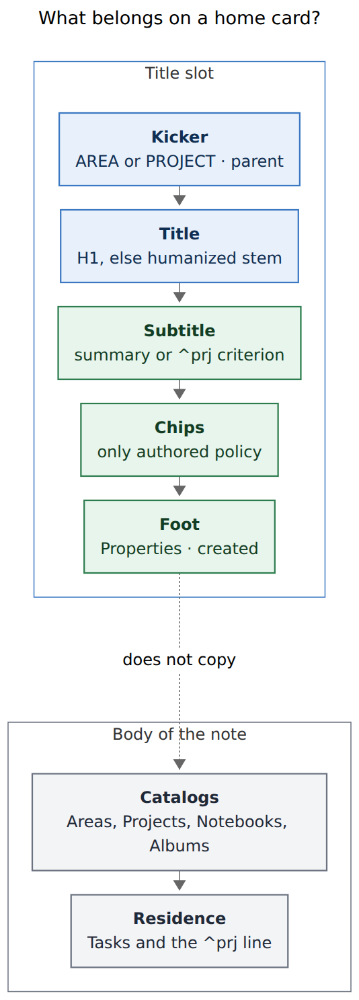
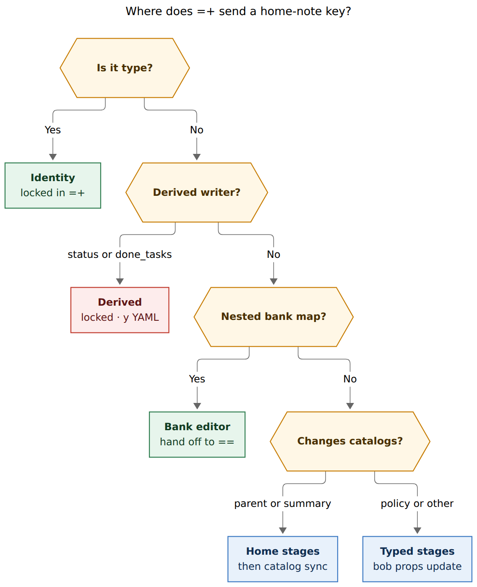
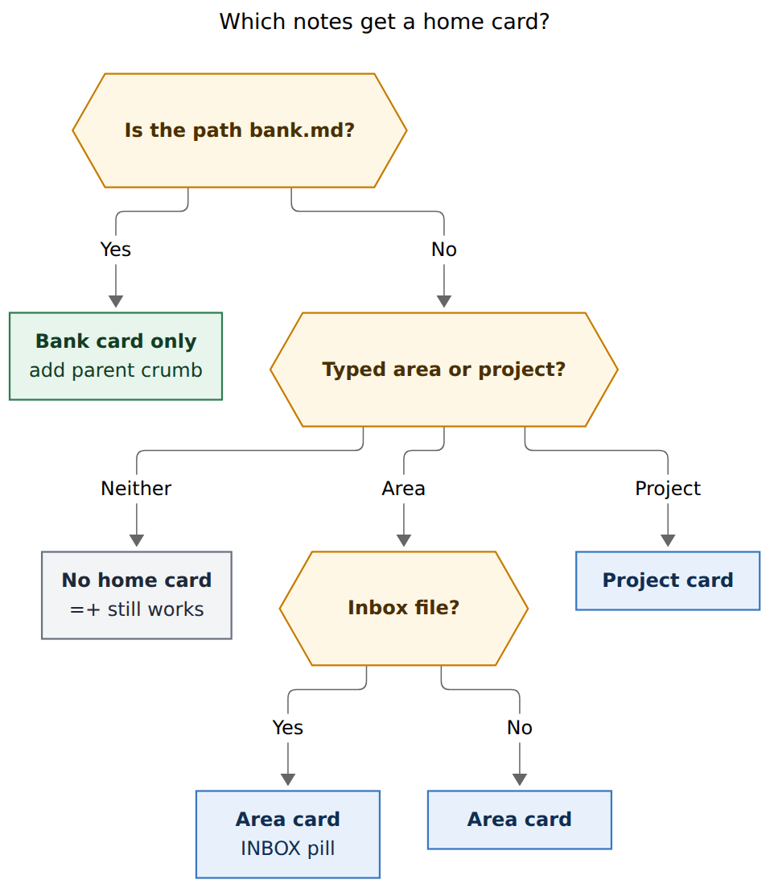

# Home cards: area and project property cards after `bob-cli-pf`

> **Research query:** Once the `bob-cli-pf` epic is complete, how should property cards
> look on area notes and project notes, and which fields should the `=+` schema editors
> support, so the feature is intuitive, reliable, and beautiful? Is mounting cards on
> these notes a good idea, would a different approach be better, which requirement
> adjustments are justified, and what is the recommended solution?

## Bottom line

**Do it, as the next property-card epic after `bob-cli-pf` lands — with a tighter
product than the request's wording suggests.**

Area and project notes are the vault's work homes: 19 areas and 102 projects in the live
vault, versus a handful of albums. They still open as a stacked identity (inline title,
H1, YAML Properties) while album, record, day, and period notes already speak one
grammar: a species tile, a kicker word, one heading, a foot row, `=-`, and `=+`.
`plan:202611/card_owned_frontmatter.md` already names Area and Project as `=+` kinds and
pauses bank.md's native-Properties hide "until areas get a title-block card." The
title-block research (`research:202611/property_card_title_block/property_card_title_block.md`
A2) correctly left homes out of that epic. This is the deferred half.

The recommended product in one paragraph: **one Home adapter, two species (`area` and
`project`)**. Each typed home mounts a compact title-block card — glyph, `AREA` /
`PROJECT` kicker, parent crumb, title, one subtitle, sparse policy chips, pf foot row —
painted from the metadata cache and confirmed source bytes. Catalogs and `## Tasks` stay
in the body. The `=+` editor *is* the schema editor: kind-specific stages on the pf.4
chassis, with `==` on these notes opening that same modal. Extend `bob props` roles so
`status` and `done_tasks` lock as derived, validate home values, and refresh catalogs
after `parent` or `summary` writes. Skip a second `==` form, skip an album-style nested
schema, skip dashboards, skip `bank.md` and the untyped `area.md` root.

## Critique of the plan

The plan is a good idea. I would still take it, with the adjustments below. The
alternative I would refuse is "wait until homes grow a record-like schema, then reuse
the album Schema Card." Areas and projects already have a small, stable property
vocabulary. They need identity chrome and a typed editor, not a field builder.

Three instincts in the request would make the feature worse if taken literally.

**1. "Schema editor" is the wrong name for the surface, and the right name for the
job.** In the settled kit vocabulary, the in-note panel is a **property card**; `==`
opens a **card editor**; `=+` opens the **property editor**. Album notes earned a Schema
Card because they own a nested `record:` map that generic YAML cannot stage. Home notes
have no nested schema. Their "schema" is a closed set of scalars and short lists
(`parent`, `summary`, `color`, `offclock`, `offclock_types`, `ready_cap`, `task_type`,
`project_name_aliases`, `root`). After pf, `=+` is already the keyboard-first editor on
every Markdown note. **Specialize that editor.** Do not build a third modal.

**2. A home card that duplicates `## Areas` / `## Projects` / lane counts will fight
the note.** These notes are task residences. The first screenful has to leave room for
`## Tasks`. The catalogs already answer "what lives under me," with glyphs, summaries,
and closed groups. The card should answer "what *is* this home?" in about five lines.

**3. `=+` on projects is unsafe until `status` is derived.** `src/native/props/roles.rs`
already locks `type` as identity. Area/project `parent`, `summary`, `status`,
`ready_cap`, and `offclock` are still **loose**. `bob projects sync` owns `status` from
the `^prj` checkbox. A generic property editor that can set `status: done` while `^prj`
is open will desync the vault on day one.

The rest of the family is already the right shape: fail-open title ownership, one writer
per key, painting that never spawns bob, hue meaning *where*, words and form meaning
*what*. Homes should join that family, not invent a parallel one.

## Adjusted requirements

Each row changes or sharpens the request. Defaults are what I would ship.

| # | Request as written | Adjustment | Default |
|---|---|---|---|
| A1 | Property cards on area and project notes | Yes. One **Home adapter**, two species in `propertyCardSpecies`. | yes |
| A2 | "Schema editors" via `=+` | `=+` *is* the editor. Kind-specific stages, validation, and grouping. `==` on a home note opens `=+`, so the `=` chord family is complete. No separate `==` policy form in v1. | yes |
| A3 | Album-like nested schema | Homes keep the existing closed vocabulary. No `record:`-style field builder. | yes |
| A4 | Show everything useful on the card | Compact identity plus **sparse** chips for authored policy. Catalogs, Tasks, and `^prj` stay in the body. No live Ready 3/5, no today counts, no child trees. | yes |
| A5 | Every area note | Skip **`bank.md`** (props classifies it as `NoteKind::Bank` before area) and the untyped **`area.md` root**. Inbox files are area cards with an `INBOX` pill, not a third species. | yes |
| A6 | Edit `status` / close a project from the card | `status` and `done_tasks` become **derived**. Closing a project remains the `^prj` Task Card. Kind change (`area` ↔ `project`) stays identity-locked; it needs a `^prj` line and catalog rewrite. | yes |
| A7 | `parent` as a normal YAML key | Parent and summary writes go through `=+` home stages, then **`bob areas sync` / `bob projects sync`** so catalogs stay current. Validate parent kind, cycles, and quoting. | yes |
| A8 | New CLI (`bob areas update`) | v1 extends `bob props` validation and reuses existing catalog sync. A `bob homes update` writer is a later compression if the two-step write feels laggy. | yes |
| A9 | Start as soon as pf is "done enough" | Wait for **pf.1 + pf.4 + pf.6** (foot row, `=+`, takeover). pf.5 (rename/reorder/filter) can land in parallel. | yes |
| A10 | Notebooks and references too | Out of v1. Notebooks are the same skeleton (parent + summary) and should copy this adapter later. | yes |

## Evidence from the live vault and the current code

Census, 2026-11-22, via `bob areas list -f json`, `bob projects list -f json`, and a
Dataview pass over `file.frontmatter` (122 area/project notes including templates).

**Areas (19).** Six top-level homes (`body`, `cash`, `dev`, `gtd`, `job`, `love`) plus
sub-areas (cash → `bank`/`recur`; love → five children; gtd → `gtd_daily`/`inbox` and
four inbox files). Every area has a one-line `summary:` (the catalog already renders
it). Frontmatter `title:` is unused; a few H1s differ from the stem (`🏦 Bank`,
`Inbox`, `Mac Inbox`, `Meet Inbox`, `Gmail inbox`). Hue comes from `color:` on the
top-level areas (`green`/`magenta`/`blue`/`grey`/`aqua`/`yellow`) plus `sase` orange
and `meet_inbox` violet. `gtd` is muted grey.

**Projects (102).** 43 `wip`, 51 `done`, 8 `canceled`, 6 blocked, 16 with children, 476
open tasks on wip projects. Criterion from `^prj` is the real subtitle (median 45
characters, max 137). One project sets `root: true` (`sase_blog`). Almost every project
still carries `template: "[[new_project]]"` from capture — leftover, not card content.
Two aliases: `bob` → `bob-cli`, `dev` → `tailnet`.

**Policy keys actually used.**

| Key | Live uses | Card? | Editor? |
|---|---|---|---|
| `summary` | 19 / 19 areas | subtitle | text, 140-char soft cap |
| `color` | 8 | tile wash | 8-hue + grey picker |
| `ready_cap: off` | 5 inbox files | `READY OFF` chip | number / `off` / unset |
| `offclock: true` + `offclock_types: [MEET]` | `body`, `love` | `OFF · MEET` chip | tri-state clock + type list |
| `task_type` | 6 (`PLAN`/`BUILD`/`WRITE`/`CHORE`/`MEET`) | type chip | type completion, including `off` |
| `project_name_aliases` | 2 | no | list stage |
| `root: true` | 1 | `ROOT` chip | checkbox + teaching |
| `task_refresh` | 0 | chip only if set | number / unset |
| `status` | every project | kicker pill | **locked** |
| `template` | ~98 projects | no | loose, grouped under "Created by" |
| `created` | some | foot stamp | loose, already in pf |

**Kit and roles.**

- `propertyCardSpecies` today names seven kinds: album, record, day, week, quarter,
  year, bank (`bob-plugins` `240f-plugin-property-card-species.js`). Area and project
  are missing.
- `RoleContext` in `src/native/props/roles.rs` classifies `bank.md` as `Bank` **before**
  it looks at `type: "[[area]]"`. Dual-mounting an area card there would put Area chrome
  on a Bank-kind `=+` header.
- pf.4's `=+` header already lists Area and Project as `note_kind` words. The chassis
  is waiting; the stages and where-marks are not.

## What the card should look like

Reuse the title-block skeleton (kicker + title + subtitle + foot) and the pf foot row.
Homes get **album-cover material for areas** (~8% hue wash, richer) and **record-sheet
material for projects** (~4% wash, quieter). That is the same form split album/record
already use, and it matches how people read the tree: an area is a collection, a
project is one outcome. Hue keeps meaning *where* (`decisions:theme-hue-is-config-pin-exempt-area-hash`
via the note's `color:` slot, else inherited, else hash). The kicker word names the
species. Glyphs are Lucide, `aria-hidden`, with the species word as the accessible
prefix (`Area: Abby`, `Project: sase blog`).

New species tokens:

| Kind | Word | Tile form | Icon | Accent |
|---|---|---|---|---|
| `area` | AREA | `ground` (rounded square) | `map` | area hue, 8% wash |
| `project` | PROJECT | `flag` (pennant) | `flag` | area hue, 4% wash |

```
┌──────────────────────────────────────────────────────────┐
│ [map]  AREA · love                                       │
│                                                          │
│ Abby                                                     │
│ Being a good dad to Abby: outings, play, toys,           │
│ music, and safety.                                       │
├──────────────────────────────────────────────────────────┤
│ ▸ Properties · 5                          created Jun 29 │
└──────────────────────────────────────────────────────────┘

┌──────────────────────────────────────────────────────────┐
│ [flag]  PROJECT · sase                          WIP      │
│                                                          │
│ sase blog                                                │
│ Publish the SASE blog as a durable public trail.         │
│ ROOT                                                     │
├──────────────────────────────────────────────────────────┤
│ ▸ Properties · 8                          created Oct 20 │
└──────────────────────────────────────────────────────────┘
```

**Kicker.** `AREA` or `PROJECT`, then `· [[parent-stem]]` when the parent is a real
home. Top-level areas whose parent is the `area.md` root omit the crumb (showing
`AREA · area` teaches the wrong thing). Inbox files add a quiet `INBOX` pill.
Projects add a status pill from frontmatter `status`: `WIP`, `DONE`, `CANCELED`. The
parent stem is a real link (Mod-click opens a tab, same as day-card kicker links).

**Title.** One `role="heading"` `aria-level="1"` node. Source, in order: a recognized
first-body H1 that the areas reporter already treats as `titled`, else the humanized
stem. Do not parse a new `title:` key in v1 — the live vault does not use one, and
albums had to add `title:` only because they were about to delete H1 bytes. Hide the
inline title and that recognized H1 at render time, with Live Preview reveal-on-touch,
exactly as albums and days do. Bytes stay.

**Subtitle.** Areas: `summary:` when present (all 19 have one). Projects: the cleaned
`^prj` criterion, parsed locally the way the Projects catalog already does. Empty
subtitle collapses; there is no "＋ Set summary" nag on a past or sparse home.

**Chips, authored-only.** Paint a chip only when the key is present and meaningful:

- `ready_cap: off` → `READY OFF`; `ready_cap: N` → `READY CAP N`
- `offclock_types` → `OFF · MEET, …` (list wins, per
  `decisions:off-clock-note-defaults-filter-by-task-type`)
- `offclock: true` with no list → `OFF-CLOCK`; `offclock: false` → `ON-CLOCK`
- `task_type` → a type chip in that type's hue (PT13 note default)
- `root: true` → `ROOT`

Absent keys inherit and stay visually quiet. The tile wash already carries `color:`.
Do not show `template`, `done_tasks`, aliases, or live lane math.

**No rail in v1.** Homes have no prev/next nav line. A parent crumb is enough
orientation; sibling walking can wait for a cached `bob areas list` if it ever earns a
rail. `[n` / `]n` keep reading the body.

**Foot row.** Adopt pf's kit foot: `▸ Properties · N` plus the non-temporal created
stamp (`created today, 7:55 AM` / `created Jun 11`). Where-marks:

| Key | Where |
|---|---|
| `type` | tile |
| `color` | tile |
| `parent` | kicker |
| `status` | kicker |
| `summary` | subtitle |
| `ready_cap`, `offclock`, `offclock_types`, `task_type`, `root` | chip |
| `created` | foot |



*The title slot holds a five-line identity stack. Catalogs and the task residence stay
in the body, so the card never becomes a second Projects tree. Rendered 356 × 992 px;
fit 90.0%.*

### Beauty rules that keep it a Bob card

- Proportions from the title-block bar: ~16px padding, 18–20px glyph, 12–13px tracked
  kicker, `--inline-title-*` title, tabular numerals on the foot.
- Long titles wrap. At ≤420px container width the chip row wraps; the species word
  never disappears.
- Closed projects keep the same chrome with a quieter wash and the `DONE` / `CANCELED`
  pill. They remain valid homes.
- Distinguishable in light, dark, grayscale, and `forced-colors` with identical titles.
  4.5:1 text contrast. Visible keyboard focus. No shadows, gradients, or nested cards.
- Collapsed cards (if a later fold is added) keep kicker + title + one subtitle. The
  foot stays, per pf.

## What `=+` should support

Header, from pf.4: species tile, kicker `AREA · PROPERTIES` or `PROJECT · PROPERTIES`,
note title, `path · N properties`, `/ filter`. Groups in file order, with home-aware
labels: **On this card**, **Policy**, **Identity**, **Bob-managed**, **Loose**.



*`type` stays identity-locked. `status` and `done_tasks` lock as derived. A nested
`bank` map still hands off to the bank editor. Parent and summary take home stages and
then catalog sync. Remaining keys use typed `bob props` stages. Rendered 758 × 934 px;
fit 86.1%.*

### Field table

| Key | Kind | Role after this epic | Stage | Notes |
|---|---|---|---|---|
| `type` | area, project | identity | locked | Kind change is a capture / projects flow, not `t` |
| `parent` | both | card / home | link completion | Areas: area or area root. Projects: area or project. Quote `[[wikilink]]`. Refuse self, cycles, unresolved, list-form |
| `summary` | both | card / home | text | Soft cap 140; `area_summary_long` / multiline stay warnings, never hard refuses |
| `color` | both | loose, typed | hue picker | Eight palette slots + `grey`. Invalid values inherit and lint |
| `offclock` | both | loose, typed | tri-state | Inherit (unset) / On (`false`) / Off (`true`). Teaching: list beats boolean |
| `offclock_types` | both | loose, typed | type list | Completes from `bob types`. Empty list unsets. Invalid shape lints as today |
| `ready_cap` | both | loose, typed | number \| `off` \| unset | Inbox files already use `off` |
| `task_refresh` | both | loose, typed | number \| unset | Unused today; keep the stage so the contract is complete |
| `task_type` | both | loose, typed | type \| `off` | PT13 note default; `theme:` is a legacy alias still read |
| `project_name_aliases` | both | loose, typed | list | Capture / `bob ref create -P` names |
| `root` | project | loose, typed | checkbox | Teaching: Stats root parent, not catalog membership |
| `status` | project | **derived** | locked | Owner `projects`; "close the `^prj` task" |
| `done_tasks` | both | **derived** | locked | Owner `task archive` |
| `created` | both | loose | datetime | pf already |
| `template` | project | loose | link | Hidden from the default filter; capture leftover |
| `bank` | bank.md only | card | `==` hand-off | Unchanged |
| other keys | both | loose | generic pf stages | `cssclasses`, tags, unknown |

`==` on a home note: register the species so the second `=` opens `=+` on the current
field when one is focused in the drawer, otherwise on the first On-this-card key. The
chord must not fall through to Vim on a mounted home card.

### Stages that make this feel like a schema editor

These are the stages generic `=+` does not yet have, and the ones that earn the
"schema" word:

1. **Parent link.** Completes over eligible homes (`bob capture-targets` / note index),
   shows each candidate's kind and hue pip, writes quoted `"[[stem]]"`. Preview names
   the catalog hosts that will refresh.
2. **Hue picker.** Eight named swatches plus grey mute, matching `Hue::ALL` and
   `is_grey` in `src/native/pomodoro_homes/palette.rs`. Free text is refused.
3. **Clock pair.** One row with the boolean tri-state and the types list. When the list
   is nonempty, the boolean shows as shadowed (`note_offclock_shadowed`) instead of
   fighting.
4. **Ready cap.** Segmented Inherit / Off / Number. Number defaults to
   `plan.max_ready_per_note` (5) when turning on.
5. **Type default.** Completes configured types; `off` is an explicit "stop the walk"
   token, never a missing value.
6. **Root flag.** Checkbox with one teaching line: "Group this project's time under
   itself in Stats. Sub-projects stay in the parent's Projects catalog."

Write discipline is pf's record session: 250 ms dry-run, fingerprint, inverse-op undo,
stale keeps the draft. After a successful `parent` or `summary` apply, the plugin runs
the matching catalog sync (`bob areas sync` and/or `bob projects sync`) in the same
guarded session so the `## Areas` / `## Projects` callout on the old and new hosts
update before the modal closes. Other keys do not sync.

**Validation belongs in `bob props` for these kinds**, even while the values stay
loose: `color` must be a palette slot or grey; `ready_cap` must be a positive int or
`off`; `offclock` must be boolean; `offclock_types` and `task_type` must be valid type
tokens or `off`; `root` is ASCII-case-insensitive `true` on projects and ignored
elsewhere; `parent` must resolve. A refusal uses the existing typed error shape
(`prop_bad_value`) with bob's finding codes in the message when they already exist
(`area_parent_kind`, `note_offclock_invalid`).

## Which notes mount, and which do not



*`bank.md` keeps the Bank card and gains a parent crumb. The untyped area root and
non-home notes get no card (`=+` still works). Inbox files are area cards with an
INBOX pill. Rendered 637 × 736 px; fit 100%.*

**`bank.md`.** It is a cash sub-area *and* the bank hub. Props and the `==` dispatcher
already treat it as Bank. Mounting an area title-block on top would give the note two
species at once and fight pf's D5 (bank.md keeps native Properties until a title-block
exists — the title-block that exists there is Bank, not Area). **Enhance the bank
card's identity badge** with `AREA · cash` and the area summary as a muted subtitle.
That is the "until areas get a title-block card" follow-through without a second card.

**Inbox files.** `api.inboxRoute.isInboxNote` already knows them (`parent` resolves to
`inbox.md`, plus `inbox.md` itself). Same area chrome, `INBOX` pill, `READY OFF` chip.
`inbox.md` is an area under `gtd` and should mount; it is a host catalog, not the
untyped root.

**`area.md`.** Untyped sentinel. No card. `=+` still edits whatever YAML it has.

**Templates, `done/`, excluded directories.** Same skip rules as `bob projects` /
`bob areas`. `_templates/new_project.md` must never mount.

**Fail-open.** Source mode, embeds, popovers, canvas, print, mobile, invalid YAML,
failed slot, missing kit, and plugin unload restore the native title, H1, and
Properties. A fallback body placement (after the H1) is allowed when the title slot is
lost, and it must not own the title.

**Takeover.** Once pf.6's `propertyCardOwnFrontmatter` is live, a successfully mounted
home card hides native Properties under the same eligibility rules as album/record/day.
Until `props_v1` is confirmed, keep today's per-row hiding.

## Sequencing

**Now:** finish `bob-cli-pf`. Do not widen it with home cards.

**Then, one epic (bob-plugins first, bob-cli roles/validation in the same epic):**

1. **Species + paint (plugins).** Add `area` / `project` to the identity kit. Home
   adapter: detect typed homes, build the compact card from cache/source, adopt the
   title slot, hide the recognized H1, append the pf foot with where-marks. Real
   Obsidian screenshots: top-level area, sub-area, inbox, open project, `root: true`
   project, done project, narrow pane, light/dark.
2. **Roles and stages (cli + plugins).** Mark `status` and `done_tasks` derived.
   Validate home values in `bob props`. Register `==` → `=+`. Ship the typed stages
   (parent, hue, clock pair, ready cap, type default, root). Docs: extend
   `docs/reference/plugins/` with a home-card page; mention in `docs/areas.md` and
   `docs/projects.md`.
3. **Catalog refresh.** After parent/summary apply, run the existing sync commands in
   the guarded session. Prove a refile updates both hosts in one gesture.
4. **Bank crumb + glossary.** Parent crumb and summary on the bank card header.
   Glossary: extend `glossary:property-card` to include area and project; add Area Card
   / Project Card aliases. Memory edits only through an authorized decision at plan
   time.

**Later, separately accepted:** notebook cards (copy the area skeleton, drop Tasks
chips); sibling rails from a cached areas report; a `bob homes update` writer if
props-plus-sync stays awkward; `title:` + H1 tidy if Source mode honesty starts to
matter the way it did for albums.

## Alternatives considered

**A dedicated `==` policy form, with `=+` as kitchen sink.** Matches day/period cards.
Homes do not have a structured list like intentions or a nested map like `record:`.
Two modals for five scalars would teach the wrong lesson (`==` is "the real editor").
Rejected for v1; revisit only if parent-refile grows a preview that `=+` cannot hold.

**Dashboard card (Ready 3/5, today counts, child chips).** Useful, and `bob areas list`
already has the numbers. Painting would have to wait on a report or spawn bob, which
breaks A9 from the title-block research (title row from local data only). The walker
footer and `## Tasks` grouping already show lane pressure. Rejected for v1.

**Custom per-home fields, album-style.** Would turn every area into a schema authoring
surface. Nothing in the vault or the capture grammar asks for this. Rejected.

**Mount on every Markdown note that `=+` can edit.** pf already gives every note `=+`.
Cards are for species that have a visual identity. Ordinary notes keep native title +
`=+`. Correct.

**One species, `HOME`, with a mode bit.** Saves a kicker word at the cost of the whole
point of the title-block work (species is a word you can read). Two species, one
adapter.

## Recommended solution

Ship **Home cards** as the first epic after `bob-cli-pf`:

1. Compact `AREA` / `PROJECT` title-block cards on typed homes, kit chrome, pf foot,
   fail-open, local paint only.
2. `=+` as the schema editor: typed stages for the closed home vocabulary, `==`
   aliased to `=+`, `status`/`done_tasks` derived, parent/summary followed by catalog
   sync.
3. Exceptions: bank.md stays Bank (plus a parent crumb); `area.md` stays untyped;
   inboxes are area cards with a pill; notebooks wait.

That is intuitive (same card family, same `=` chords), reliable (one writer per key,
validation, fail-open, catalogs kept current), and beautiful (species in words and
tile form, hue for *where*, five quiet lines above the work).

### Decisions for Bryan

1. Skip an area card on `bank.md`; add a parent crumb to the bank card instead —
   **default yes**.
2. `==` opens `=+` on homes; no second modal in v1 — **default yes**.
3. Authored-only chips; no live counts — **default yes**.
4. Lock `status` and `done_tasks` as derived before enabling home `=+` writes —
   **default yes**.
5. Inbox is a pill on the area card — **default yes**.
6. Notebooks in a later epic — **default yes**.

## How this report was built

Independent research as swarm member `grk`, 2026-11-22. Audited reads:
`plan:202611/card_owned_frontmatter.md`, `plan:202611/props_cli.md`,
`research:202611/property_card_title_block/property_card_title_block.md`,
`research:202611/card_owned_frontmatter/card_owned_frontmatter.md` (lead
consolidation), bead `bob-cli-pf` and phases `.1` / `.4`. Code:
`src/native/props/roles.rs`, `240f-plugin-property-card-species.js`,
`docs/areas.md`, `docs/projects.md`, `docs/reference/vault-format.md`,
`docs/task-types.md` PT13, `docs/pomodoro-homes.md` R2/R8. Live vault via
`bob areas list`, `bob projects list`, and `bob query`. Glossary:
Property Card, Area Note, Project Note, Project Task, Day and Period Card,
Record Card, Album Card, Bank Card, Inbox File. Peer swarm reports from this
invocation were not read.
