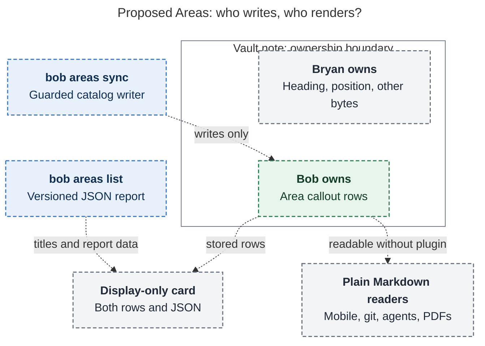
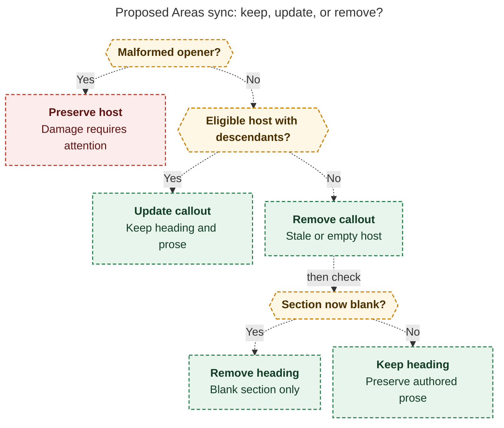

# Diagram proposals: A generated `## Areas` catalog: consolidated design

Proposals for the swarm linker, not a report. Each diagram restates only what the source
report says.

```yaml
source: research:202611/areas_catalog_design/areas_catalog_design__final.md
producer: research.4o.image
check: "mmdc 12.0.0 with the PDF-mirroring config rendered 2 of 2 Mermaid diagrams; Puppeteer --no-sandbox; SVG and PNG reviewed"
```

## catalog-ownership

```yaml
anchor: |-
  It is display-only: it styles the stored rows, reads
question: |-
  Who writes the proposed Areas catalog, and who supplies its visual polish?
illustrates: |-
  Bob owns exactly the callout bytes, while the display-only card combines the stored rows and JSON report and ordinary Markdown remains readable without the plugin.
caption: Bob writes the callout; the display-only card combines rows and JSON, while plain Markdown remains readable without the plugin.
review: "606.287x817 px, fit 100.0%; question, source, and visual checks passed; 1 revision, 2 visual rounds"
```



## damage-and-cleanup

```yaml
anchor: |-
  An empty host loses the callout; the heading goes only when its section is
question: |-
  When does proposed sync update, remove, or preserve an existing Areas region?
illustrates: |-
  For existing regions on non-excluded notes, malformed openers leave the host untouched, eligible hosts with eligible descendants keep their callout, and cleanup removes the heading only when its section is blank.
caption: Malformed regions stay untouched; eligible hosts keep updated callouts, and cleanup removes headings only when their sections become blank.
review: "727.847x1032 px, fit 86.5%; question, source, and visual checks passed; 1 revision, 2 visual rounds"
```


