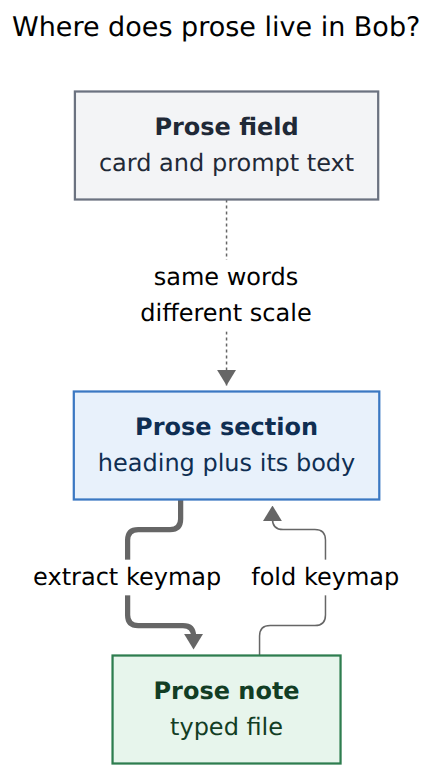
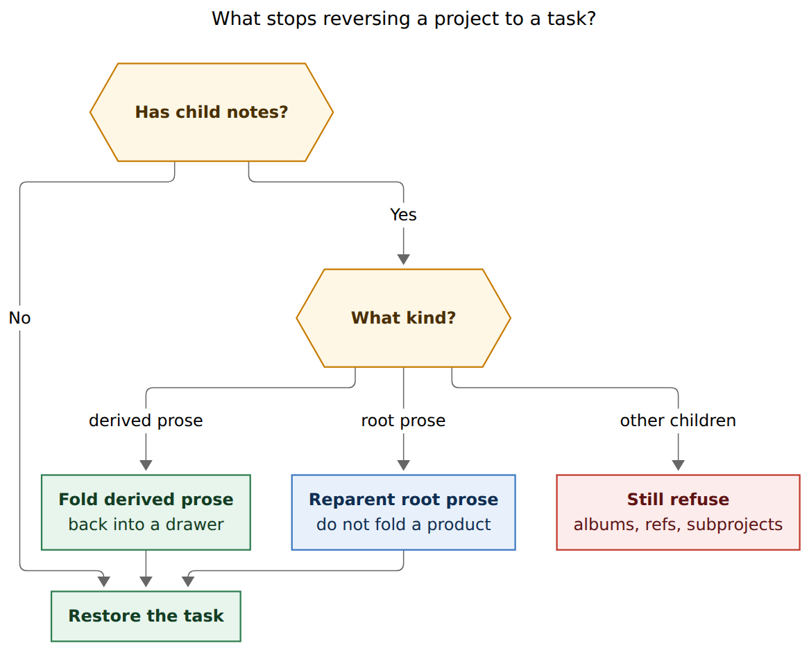

# Rename `article` to a generic prose note type, and treat sections as the same capability

> **Research query:** Rename the Obsidian note type `article` to something more generic, because it should cover any file that needs to contain prose. `prose` is a candidate. Think hard about other names. Soon, sections should implicitly use this type so a keymap can convert a section into a full note. That extract is useful on its own and is required later so tasks and projects can reverse with little loss (projects can have article notes as children). Critique the plan, adjust requirements when justified, and end with a recommended solution.

## Bottom line

**Rename the file type to `prose`. Treat prose as one capability at three scales — field, section, and note — and ship extract/fold as a bob-owned planner before touching project reversal.**

`prose` is the right name. I tried to beat it (`page`, `doc`, `essay`, `writeup`, `note`, keeping `article`) and did not find a better one. It names the writing mode the type actually enforces, it already lives in Bob's vocabulary ("never changes prose", "Bob-owned prose field"), and it composes as *prose field / prose section / prose note*. `article` was a first-use-case name for a blog draft. The original article-notes research already said one type should cover "blog posts, design docs, and essays" and offered `doc` as an alternative; `doc` collides with the documentation site.

The rest of the ask is the real design. Implicit typing must **not** run the article formatter on project or area notes. A "prose section" is an eligible heading-plus-body that can be extracted, not a note that gets house-style numbers on save. Project reversal currently refuses *any* child file (`Project has N child notes; move them before converting`). Folding derived prose children is necessary for lossless reverse and is not sufficient: albums, refs, and subprojects still block. Distinguish derived prose (extracted from a drawer or section, foldable) from root prose (a product such as `sase_blog_contents.md`, reparented, never stuffed into a task).

## Is this a good idea

**Yes, with a narrower framing than "rename article and implicit-type every section."**

The vault already splits *work* from *writing*. `sase_blog.md` is a project (`^prj`, tasks, catalogs). `sase_blog_contents.md` is the one live `type: "[[article]]"` note in the vault, parented to that project. Notebooks cannot hold the same payload: `notebook_shape` warns on stray top-level paragraphs and tells you to keep prose in the preamble or nested under a bullet (`docs/notebooks.md`, `src/native/notebooks/rules.rs`). Records in `sase_blog_zettel` are schema-shaped zettels, a different explosion. So a document type is load-bearing. The current name undersells that role and collides with web-clip `kind: "article"` / `route_hint: "article"`. Even the plugin docs call Bob Articles a formatter of "reading notes" that "belong to" the reference workflow. That mix-up is the name talking.

Extract-section is a known, good gesture. Obsidian's core Note Composer extracts a selection and leaves a link. Community plugins such as Heading to Note move a heading subtree and rewrite `[[Source#Section]]` links. Org-roam has `org-roam-extract-subtree` and people immediately ask for the reverse. Bob should own this the way it owns format, capture, and task split: one Rust planner, a thin keymap, preimage writes, heading-identity repair. Note Composer will not write `type` / `parent`, will not refresh numbered heading links, and will not round-trip a task drawer.

The original article research's safety property still holds: **scoping is what makes automatic formatting safe** (`research:202610/article_notes_formatting_and_section_numbering/article_notes_formatting_and_section_numbering.md`). Project notes depend on tight layouts (`## Tasks`, status groups, Pomodoros, BLOCKS). Applying F1–F11 or N1–N9 to a project because one of its H2s is "implicitly an article" would damage the work note. Implicit type therefore means extract eligibility and heading identity, never parent-note formatting.

Reversibility is the right long-term consumer and the wrong first ship target. Promotion already maps drawers to H2s and back (`docs/projects.md`, `glossary:task-drawer`, `decisions:drawers-keep-their-names`). Child *files* are the gap. Closing that gap for prose is real work. Closing it for every child kind is a different epic.

## Naming

### What the name has to do

It has to work as `type: "[[NAME]]"`, as a CLI noun (`bob NAME …`), as "NAME section" / "NAME note", and as a convert-section command. It has to sit beside `project`, `area`, `notebook`, `album`, `record`, `ref`, `day`, `mail`. It has to stay distinct from web-clip `kind: "article"`. CLI rules require a noun with a stated membership rule; mass nouns already work (`bob mail`, `bob bank`).

### Candidates

| Name | CLI | Section phrase | Strength | Cost |
| --- | --- | --- | --- | --- |
| **prose** | `bob prose` (mass noun) | prose section | Names the writing mode; already Bob's word for "the words, as opposed to layout"; three-scale story | Slightly literary; "a prose" is ungrammatical, so the file is always "a prose note" |
| **article** (keep) | `bob articles` | article section | Already shipped; countable CLI; original research treated it as generic | Sounds like a published post; collides with web-clip kind; "convert section to article" reads as publish |
| **page** | `bob pages` | page section | Wiki-familiar extract phrase | A project note is also a page; "page section" fights pagination; says nothing about bullets vs paragraphs |
| **doc** | `bob docs` | doc section | Short; offered in the 202610 open questions | Collides with `docs/`, `just docs-check`, the published site, `docs.md` memory |
| **note** | `bob notes` | note section | Naive generic | Collides with vault note, notebook, note bullet, child note, `## Notes` |
| **essay** | `bob essays` | essay section | Continuous writing | Academic, argument-shaped; excludes runbooks and design docs |
| **writeup** | `bob writeups` | writeup section | Informal document | Ugly as a type wikilink; still implies a report |
| **draft** | `bob drafts` | draft section | Blog-draft flavour | Capture already has a draft; implies unfinished |
| **text** | `bob texts` | text section | Neutral form word | Too generic; `bob texts` is clumsy |
| **leaf** | `bob leaves` | leaf section | Tree position | `glossary:leaf-project` already owns "leaf" |
| **section** | `bob sections` | section section | Matches the extract unit | The file/section collision is the feature's whole point |
| **zettel** | `bob zettels` | zettel section | Atomic-note culture | This vault already uses album records for SASE-blog zettels |

### Why `prose` wins

Bob's type names are role nouns (`project`, `notebook`, `album`, `ref`). `article` tried to be a publication role. The behavior the type actually owns is **continuous writing with headings, no `#task`, bob-owned layout when the whole file opts in**. That is a form, and the form-word already in the codebase is *prose*:

- `docs/articles.md`: "Formatting changes layout and heading numbers; it never changes prose."
- Navigation hotkeys: "Typing `[[` in a Bob-owned prose field"
- Notebooks: "keep prose in the preamble or nested under a note"

Using the same word at three scales is a feature. A prose field, a prose section, and a prose note are the same kind of payload. Extract is a scale change.

`page` is the serious runner-up if `prose` feels too writerly. `doc` is the name the 202610 research offered Bryan, and I would reject it now because the documentation tree has grown into a first-class agent surface. Keeping `article` is the conservative option if the rename cost feels higher than the confusion cost; I would still do the capability work under that name, and I would still regret the web-clip collision.

I did not find a better name than `prose`. That is the recommendation, not a failure to look.

## What exists today

### The file type

An article is a vault-root Markdown file with `type: "[[article]]"`. bob owns numbering (N1–N9), layout (F1–F11), heading-identity links, and a word-invariant write. The note may not mix types, hold `#task`, or hold `^prj` / `^ref`. Optional `title:` and `section_numbers: true|false`. The plugin `bob-articles` is a thin caller: format on save/leave/command, convert-to-article preview, serif reading look, `.bob-article` injected at runtime and never written to YAML (`docs/articles.md`, `plugins/bob-articles`).

Capture into an article already uses heading identity: de-number, case-fold, strip markup, then slug (`docs/capture.md` § Section bullets). That is the seed of "sections implicitly use this type" *inside an article file*. Other notes keep raw-title then slug.

JSON `ArticlePlan` is schema 1, growth-only. `summary.articles` is a count key. Nightly runs `format -a -c`. Catalog slots include `article-note`. Record ids reserve `article` so an album cannot steal the name (`src/native/records/schema.rs`). `docs/reference/vault-format.md` documents area, project, notebook, album, record, bank, ref, day, mail — and omits article. There is still no glossary term **Article Note**, though the 202610 research asked for one.

### Live vault

`bob articles list` returns **one** note: `sase_blog_contents.md`, parent `[[sase_blog]]`. The type note `article.md` hangs off `type.md`. `sase_blog` also parents an album of records, subprojects, refs, done archive, and untyped files such as `why_sase.md`. Rename cost in the vault is one typed file plus the type note.

### Drawers, sections, and reverse

On a task, a whole-bold child is a drawer. Promotion turns each drawer into a `##` section with the authored title byte for byte; reversal writes `- **Title**` (`docs/projects.md`, `docs/task-drawers.md`, `glossary:task-drawer`). On `^prj`, eligible `##` sections *are* the drawers (`decisions:drawers-keep-their-names`, `decisions:capture-bullets-mirror-the-task-block`). Reserved headings (`Tasks`, `Projects`, `Notebooks`, albums, …) stay structural.

That round-trip is lossless for in-note structure. It does not touch child files.

### The child-file refusal

`convertProjectNoteToTask` collects every Markdown file whose `parent:` points at the project and, if the list is nonempty, notices `Project has ${children.length} child notes; move them before converting` and returns (`bob-navigation-hotkeys` `665-plugin-project-conversion.js`, `collectChildNotes` in `640-plugin-notes-and-task-move.js`). Membership is `parent:`, the same rule as catalogs. `sase_blog` cannot reverse today even if every in-note section is well-formed.

### Two different "article" words

| Sense | Where | Keep |
| --- | --- | --- |
| Vault file type `[[article]]` | `bob articles`, `bob-articles`, frontmatter | Rename to `prose` |
| Web-clip / ref ingest `kind: "article"` | `bob ref create`, `route_hint`, Highlights | Keep. It means "this URL is a web article," which is true |

The rename *helps* this collision. Do not retag web-clip as `prose`.

## Critique of the plan

### 1. The rename is justified and cheap; it is not the product

One live note, a type note, a plugin, a CLI group, and a JSON count key. CLI rules already require a permanent hidden alias (`cli_rules.md`): `bob articles` stays byte-identical and silent, help prints `bob prose`. The product is the capability plus extract/fold.

### 2. "Sections implicitly use this type" is easy to over-read

If it means "eligible sections are extractable and share heading identity," it is right. If it means "bob formats any note that contains such a section," it fights the 202610 safety property and will mangle `## Tasks`. Formatting stays whole-file and opt-in via `type: "[[prose]]"` (and the `[[article]]` alias).

Eligible prose sections:

- In a prose note: every counted heading, as today.
- In a project or area: a non-reserved `##` (or deeper) whose body has no `#task` and is not a generated catalog. `## API Design` yes; `## Tasks` never; `## Notebooks` never; `## Notes` stays the notes-drawer home and is not extracted as a whole.
- On a task: a drawer is the pre-promotion form of the same section (`glossary:task-drawer`). The keymap should work there too.
- In a notebook: no. Notebooks are bullet collections (`decisions:notebook-routes-write-notes`). Extracting a notebook section should remain a notebook problem, or become a new notebook, not a prose note.

### 3. Extract is the dual of fold; ship both

Org-roam users asked for extract-in-reverse within a year of `org-roam-extract-subtree`. Note Composer merge is the community's fold. Bob already has the pattern in Task Split / Task Merge, and in drawer ↔ H2. A one-way keymap will trap writing in files that then block project reverse. Fold needs provenance (below).

### 4. Project reverse is a consumer, not the first customer

Folding derived prose children unblocks *that class*. `sase_blog` still has an album, refs, and subprojects. Adjustment: say so in the requirements. Do not promise lossless project↔task from this work alone.

### 5. Do not fold a product into a task

`sase_blog_contents.md` is a document that happens to be parented to a project. Stuffing it into a restored task drawer would be "lossless" only in the byte sense. Derived vs root prose is the cut.

### 6. Numbering defaults should follow origin

House-style numbers are why agents can say "tighten §1.3" in a blog draft. A project H2 named `API Design` should not become `## 1. API Design` because it was extracted. Default `section_numbers: true` on root prose notes (today's article default). Default `section_numbers: false` on notes extracted from a project, area, or drawer. The author can turn numbers on.

### 7. Articles have no parent catalog

Notebooks, albums, and projects each get a generated catalog on the owner. Article children are invisible in the parent body except as authored links. `Ctrl+=` still finds them via `parent:`. A `## Prose` catalog, same host-catalog engine, would make conversion and discovery honest. Call this a justified extra, not a rename requirement.

### 8. Keep the formatter's refusals at note scale

`holds-tasks` / `holds-anchor` / `mixed-type` stay correct for a prose *file*. A project that contains both `## Tasks` and a prose section is healthy. The implicit section is the region that would pass those refusals if it were a file.

## Adjustments to the requirements

Each item names the original ask, the change, and why.

**A1 — Name**

- *Ask:* maybe `prose`
- *Change:* canonical type `[[prose]]`, CLI group `bob prose`
- *Why:* form-accurate; three-scale vocabulary; web-clip stays `article`

**A2 — Implicit type**

- *Ask:* sections implicitly use this type
- *Change:* eligibility for extract, fold, and heading identity. No parent-note format/numbering
- *Why:* 202610 safety property; project layouts

**A3 — Keymap is a bob planner**

- *Ask:* a keymap converts a section into a note
- *Change:* `bob prose extract` / `bob prose fold` plan the edits; the plugin applies one undoable transaction, same as format. Not Note Composer
- *Why:* type, parent, inbound heading repair, preimage, capture identity, catalogs

**A4 — Provenance**

- *Ask:* (implied by reverse)
- *Change:* derived notes record origin (parent wikilink + heading identity). Fold matches that identity. Missing origin ⇒ root prose
- *Why:* lossless fold; distinguish product notes

**A5 — Derived vs root**

- *Ask:* projects can have article children, so reverse needs this
- *Change:* derived prose folds into the restored drawer/section. Root prose reparents to the project's parent (or refuses with a named choice). Never inline `sase_blog_contents` into a task
- *Why:* byte-lossless can still be the wrong shape

**A6 — Reversal scope**

- *Ask:* required for lossless task/project reverse
- *Change:* this work unblocks the prose-child class. Albums, refs, subprojects, untyped files remain blockers until their own rules exist
- *Why:* the current refusal is kind-blind (`collectChildNotes`)

**A7 — Numbering policy**

- *Ask:* (unspecified for extracted notes)
- *Change:* root prose numbers on; extracted-from-work numbers off; both reversible via `section_numbers`
- *Why:* house style is for documents; work headings are titles

**A8 — Alias policy**

- *Ask:* rename
- *Change:* matcher accepts `[[article]]` and `[[prose]]` forever; new writes use `[[prose]]`. `bob articles` is a hidden alias of `bob prose` (`cli_rules.md`). JSON schema 1 keeps `summary.articles` (growth-only contract). Plugin id stays `bob-articles` (Obsidian identity, hotkeys); display name and command titles become Prose; old command ids remain aliases
- *Why:* one live note is not an excuse to break bindings; JSON already forbids silent key drops

**A9 — Web clip**

- *Ask:* (unmentioned)
- *Change:* `kind: "article"` / `route_hint: "article"` unchanged
- *Why:* different domain; the rename exists partly to separate them

**A10 — Catalog (optional in the same epic, recommended)**

- *Ask:* (unmentioned)
- *Change:* owner `## Prose` catalog, bob-owned callout, same engine as Notebooks/Albums
- *Why:* children that block reverse should be visible on the project

**A11 — Memory**

- *Ask:* (unmentioned; leftover from 202610)
- *Change:* glossary **Prose Note** / **Prose Section**; decision record for the name, implicit-type-as-eligibility, and derived-vs-root fold rule
- *Why:* article never got a glossary term; this feature will be cited from capture, projects, and plugins

**A12 — Vault-format**

- *Ask:* (unmentioned)
- *Change:* add the type to `docs/reference/vault-format.md`
- *Why:* it is the only first-class type missing from that catalog today

## Approaches I would not take

**Keep `article` and add a second type for generic prose.** The 202610 research already refused a split until behavior differs (`A2` there). Extracted sections and blog drafts share refusals, heading identity, and layout ownership. `section_numbers` is the behavior knob that already exists.

**Put continuous prose in notebooks.** Notebooks refuse that shape. They are bullet collections under an owner (`decisions:notebook-routes-write-notes`).

**Explode sections into album records.** `sase_blog_zettel` already does atomic ideas as records. A prose section is a stretch of writing, often with subsections, code fences, and inbound heading links. Records have schema fields and a walk line. Different tool.

**Let Note Composer / Heading to Note do extract.** They leave a link, which is right, and they know nothing about Bob types, numbering tokens, or drawer round-trip.

**Format implicit sections in place.** Quietly numbers `## Tasks` adjacent headings, fights undo, and breaks the word-invariant's assumption that the whole note is in scope.

**Fold every child file into the restored task.** Lossless in git, wrong in GTD. An album is not a drawer.

## Recommended solution

### Capability

Prose is one payload at three scales.

*Prose fields, sections, and notes are the same capability. Extract and fold move between section and note. Rendered 288×518 px, fit 100%.*

- **Prose field** — already exists: Work summary, reasons, notebook summary, record stages.
- **Prose section** — a heading (or task drawer) plus its body, no `#task`, not a reserved catalog. Shares heading identity with article capture.
- **Prose note** — `type: "[[prose]]"`, parented to an area, a project, or another prose note. Whole-file formatter and numbering, same engine as today.

### Rename (train 1, small)

1. Canonical type `[[prose]]`. Matcher accepts `[[article]]` forever. `bob articles adopt -w` on the one live note, or a dedicated migrator that only rewrites the type line.
2. Type note `prose.md` under `type.md`. `article.md` becomes a pointer ("alias of prose") so old wikilinks resolve; hide it from the type picker if Metadata Menu would list both.
3. CLI group `bob prose` with hidden alias `bob articles`. Subcommands `list`, `outline`, `format`, `adopt` unchanged in behavior.
4. Reserved record ids: add `prose`, keep `article`.
5. Plugin display name "Bob Prose"; id `bob-articles`; command aliases for `format-article` / `convert-to-article`.
6. JSON schema stays 1; `summary.articles` stays. User-facing notices say "prose".
7. Docs, catalog titles, command-mode "FOR THIS NOTE" rows, nightly blurb.
8. Mark a `!` only if a JSON key or observable CLI path is removed. Under this plan, none is.

### Extract / fold (train 2, the feature)

`bob prose extract NOTE --section IDENTITY` (and stdin/plugin buffer):

- Resolves the section by the same heading identity capture already uses.
- Refuses reserved headings, `#task` in the subtree, unclosed fences, conflict markers.
- Creates `<stem>.md` at the vault root (or a collision-suffixed stem), `parent: "[[source]]"`, `type: "[[prose]]"`, origin fields, `section_numbers: false` when the source is a project/area/drawer.
- Replaces the subtree with a wikilink (default) or embed, configurable the way Note Composer is, defaulting to a wikilink so the parent stays a work note.
- Rewrites inbound `[[source#heading]]` links onto the new note, reusing article inbound repair.
- Word-invariant plus preimage, same as format.
- Leaves a stub that capture and outline still understand.

`bob prose fold NOTE`:

- Requires origin. Rebuilds the heading (or drawer) in the origin parent, restores inbound links, trashes the derived note.
- Refuses if the origin heading still exists as a full section (would duplicate) or if the parent drifted (`preimage-changed`).

Plugin keymap: one chord on a heading or drawer title runs extract with a preview; on a derived prose note's `^` or a dedicated command, fold. Preview-first, like adopt.

This is the sibling of Task Split (`Ctrl+Shift+T` promotes bullets to tasks). Split creates task identities; extract creates prose identities.

### Project conversion (train 3, after extract/fold)

*Any child note currently refuses conversion. Folding derived prose, and reparenting root prose, removes that class. Albums, refs, and subprojects still refuse. Rendered 776×626 px, fit 84.1%.*

On reverse:

1. Derived prose children fold in document order into drawers named from their origin identity (or title).
2. Root prose children reparent to the project's parent, same `parent:` rewrite Change Parent already knows, and the restored task keeps a wikilink to them under a drawer or `## Notes`.
3. Any remaining child (album, ref, subproject, untyped) still refuses, with a notice that *names the files*.

On forward (task → project): drawers become H2s as today. A later extract is how a fat H2 becomes a child file. Do not auto-extract on promotion.

### What I would ship first

The rename is cheap enough to land on the same train as extract's CLI surface, so the keymap never teaches `article`. I would **not** hold the rename until project conversion is lossless. I would **not** ship extract without fold. I would **not** auto-format implicit sections.

Open questions for Bryan, if any of these disagree with taste:

1. Is `prose` acceptable as a mass-noun CLI (`bob prose list`) given `bob mail` / `bob bank`?
2. Default left-behind mark: wikilink, embed, or a labeled "continued in [[note]]" line?
3. Plugin id: keep `bob-articles` (recommended) or rename the folder in a coordinated plugins-sync?

## Sources

### Decisions and memory

- `decisions:notebook-routes-write-notes` — notebooks are bullet collections; a notebook route writes notes
- `decisions:drawers-keep-their-names` — drawer titles stay verbatim; project `##` sections are those drawers
- `decisions:capture-bullets-mirror-the-task-block` — first-level capture bullets are the task's children
- `cli_rules.md` — never hard-rename a command; old spelling is a permanent hidden alias
- `glossary:task-drawer`, `glossary:task-split`, `glossary:notebook`, `glossary:project-note`, `glossary:album-note`, `glossary:record-note`

### Bob contracts and code

- `docs/articles.md` — marker, N1–N9, F1–F11, JSON schema 1 growth-only, plugin thinness
- `docs/projects.md` — drawer ↔ H2 promotion/reversal; reverse trashes the project note
- `docs/task-drawers.md` — reserved titles, `## Notes` as notes home on `^prj`
- `docs/notebooks.md` / `src/native/notebooks/rules.rs` — `notebook_shape` stray paragraphs
- `docs/capture.md` — article heading identity for `#section` selectors
- `docs/reference/vault-format.md` — article type omitted from the note-type catalog
- `src/native/articles/marker.rs` — mixed-type, holds-tasks, holds-anchor
- `src/native/records/schema.rs` — reserved id `article`
- `src/native/catalog/table.rs` — `article-note` slot, `articles-list` / `articles-outline`
- bob-plugins `bob-articles` — format/adopt, `.bob-article` look
- bob-plugins `665-plugin-project-conversion.js` — child-note refusal
- bob-plugins `640-plugin-notes-and-task-move.js` — `collectChildNotes` via `parent:`

### Prior research

- `research:202610/article_notes_formatting_and_section_numbering/article_notes_formatting_and_section_numbering.md` — one type for article/design-doc/sectioned content; safety via explicit type; open question 5 offered `doc`

### Vault

- `bob articles list` — one note, `sase_blog_contents.md`
- Dataview — `article.md` type note under `type.md`; `sase_blog` children include the article, an album, refs, subprojects, untyped files

### External patterns

- [Obsidian Note Composer](https://obsidian.md/help/plugins/note-composer) — extract selection, leave link or embed
- [Heading to Note](https://www.obsidianstats.com/plugins/heading-to-note) — heading subtree to file, rewrite heading links
- [org-roam extract-subtree reverse](https://org-roam.discourse.group/t/org-roam-extract-subtree-but-in-reverse/3537) — fold is asked for as soon as extract exists
