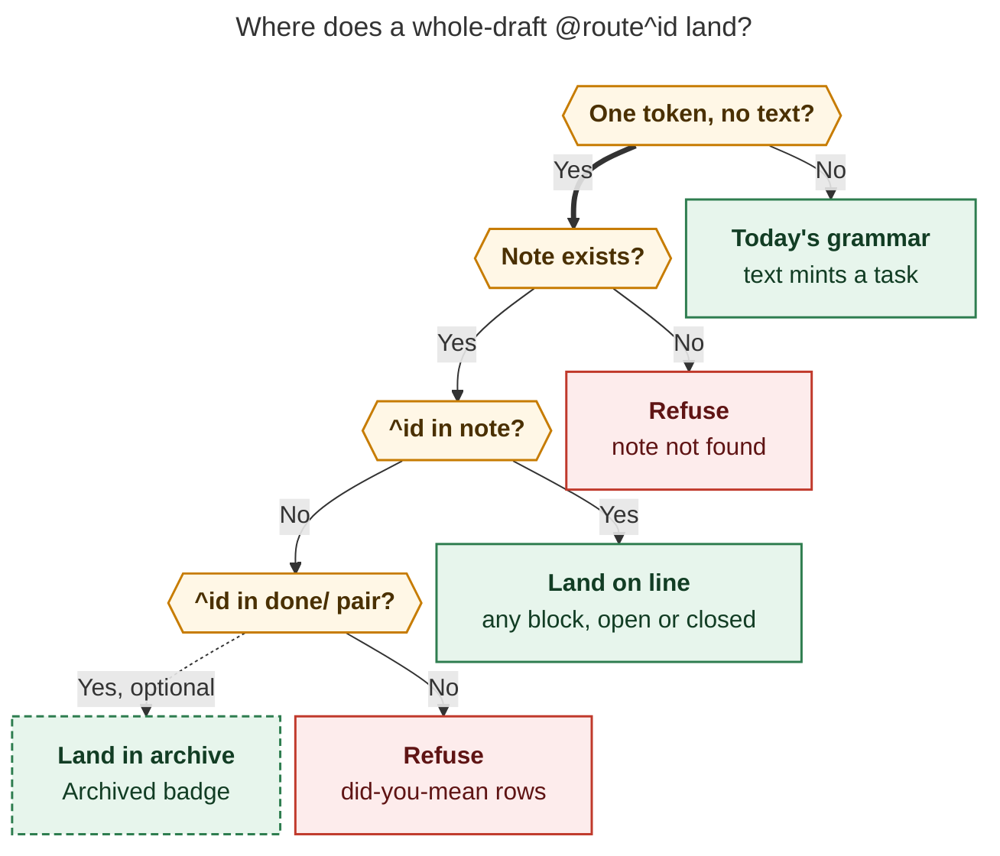

# `@foo^bar` as a Go To capture: design, critique, and recommendation

*Researcher: cld · 2026-11-25 · repos read: bob-cli, bob-mac-capture, bob-plugins, the
live vault on apollo (read-only probes only)*

## 1. Verdict

**Build it, with five adjustments.** A draft that is exactly one `@route^id` token is
the best Go To spelling Bob could have: it is the same address you typed when you minted
the ID (`Some task @bob^intention-rollovers`), and every variant of it is an error
today, so the change removes no existing behavior. The `/` picker searches; `@route^id`
names an address. They complement each other, as you said.

Recommendation in one paragraph: **bob executes a whole-draft `@route^id` as a
read-only `block_goto` capture kind.** `bob capture` and `--dry-run` resolve it to
`{path, line, ref, block_id}` and write nothing. The Mac renders that dry run as a Go To
card, relabels the primary button **Go To ↗**, and on Return opens the landing through
the same `obsidian://bob-goto-task` URI and the same "discard the draft and hide the
panel" path the `/` picker uses. The `^` block-ID card becomes goto-aware. When the
draft has no text, the note's existing IDs are selectable **Go** rows instead of red
"already used" rows, so `@bob^int` and then Return lands in one motion. Misses are calm
and fixable (did-you-mean rows), not a red "Preview failed".

Adjustments to your requirements (each explained in §4):

1. **Whole draft only**, like `/`. It is not per item, so it never mixes with captures
   in a batch.
2. **Any block, not just tasks.** Closed tasks, plain bullets with IDs, and notebook
   notes (`@taxes^z-250414-15`) all land.
3. **An archive fallback.** If `^id` left `foo.md` for `done/foo_done.md`, land there
   with an *Archived* badge in the preview. Nothing redirects silently.
4. **`bob capture` succeeds read-only** instead of refusing as `/` does. The form is
   complete and exact, and execution is what lets the terminal, the live preview, and
   Control-Return all work.
5. **Name it `block_goto`, not "jump".** `jump` is already the Ctrl+J successor-pin
   contract (`CaptureJumpJson`, `--jump-offer`).

## 2. What exists today (verified)

| Fact | Evidence |
| --- | --- |
| `@bob^intention-rollovers` alone fails with `task text is required` | Your screenshot; `bob capture --dry-run -f json -- '@bob^intention-rollovers'` on apollo; pinned by `src/native/capture/tests/grammar.rs:948` (`("@cash^id", "task text is required")`) |
| `capture-parse` does not flag it: mode `task`, `needs: []`, no diagnostics. The error appears only at dry run, which is why the panel shows *Preview failed* | Live `bob capture-parse` output |
| The other neighbours fail too: notebook `@taxes^foo` gives `notebook_note_required`; `@bob^foo` plus a `- note` bullet gives `task text is required`; `@bob^x@` gives `task text is required` | Live probes |
| With text, `@route^id` mints a new task with that ID and refuses an ID already used in the note | `docs/capture.md` §Task with a requested block ID |
| `/query` is a whole-draft picker claim. Accepting a row opens `obsidian://bob-goto-task?path&line&ref&block`. `bob capture` refuses `/x` with the T3 teaching error ("it never captures") | `docs/capture.md` §Going to a task with '/'; `src/native/capture_language/item.rs:2262-2275` |
| The Mac's `/` accept builds `ObsidianOpenURL.taskGotoURL(path:line:ref:blockID:)`. On success it calls `discardDraft()` (no stash) and `panelDismisser()`; an in-flight flag swallows a double Return | `Sources/BobMacCapture/CapturePanelModel.swift` `acceptTaskGotoRow` |
| bob already computes exactly that landing for existing-task captures: `@bob+intention-rollovers!` dry run reports `open_notes[0] = {path, relative_path: "bob.md", line: 82, ref: "82:68984d78", block_id: "intention-rollovers"}` | Live dry run; `src/native/capture/open_notes.rs` `landed_note` |
| Typing `@bob^` opens the `task_block_id` card with intent `new` and the note's **98 used IDs**, each with its line, status, and text | Live `bob capture-complete --cursor 5 -- '@bob^'` |
| In that card, an exact used ID renders as a *non-selectable* "`^id` is already used — … · line N" row followed by a *selectable* "Next free" variant (`^id-2`). Picker Return accepts `selectedRowID ?? first selectable row` | `Sources/CaptureCore/BlockIDPickerIndex.swift` ~L414-420; `CapturePanelModel.swift` `acceptSelectedPickerRow` |
| The URI handler re-finds a line in this order: planned line plus digest, then **task line** carrying `^block`, then a unique digest, then a clamped line | `docs/reference/plugins/goto-task-uri.md`; `bob-plugins/.../180-editor-transactions.js:760` (`findTaskLineByBlockId` requires `isObsidianTaskAtLine`) |
| `/bob:intention-rollovers` already finds the task (1 row), but `/bob^intention-rollovers` finds **0** | Live `capture-complete` |
| Thin-client rule: bob owns the grammar, preview, and resolution; a draft is submitted as one `bob capture`; the panel hides only after bob reports success | `decisions:mac-capture-is-a-thin-client` |
| Archives are paired: `bob.md` carries `done_tasks: "[[done/bob_done]]"`, and `^use-list-for-reflections` now lives only at `done/bob_done.md:2165` | Vault (read-only grep) |
| Cost of a bob round trip on apollo: `capture --dry-run`, `capture-parse`, and `capture-complete` each take 10–20 ms | `/usr/bin/time` probes |

Preview kinds already change the Mac's primary button: *Link*, *Start*, *Ensure Next*,
*Merge*, *Reset*, and *Record* each come from a pure `…Presentation` type in
`CaptureCore`. A Go To kind fits that pattern without new UI machinery.

## 3. Critique: is this a good idea?

### Why it is good

- **The address is symmetric.** You mint with `@bob^x`, Obsidian links it as
  `[[bob#^x]]`, and dataview stores `[id:: bob__x]`. A goto that uses the same spelling
  needs no new vocabulary. This is the strongest argument for the feature, and the
  screenshot is the evidence: you reached for the spelling first.
- **No behavior is lost.** Every lexical neighbour of the bare token is an error today
  (§2). In grammar terms this fills a hole rather than repurposing a form.
- **It follows the house pattern for marker-only forms.** A marker alone acts on the
  *existing* thing: `@route:id` alone links it and `@route+id` alone makes it Next.
  `@route^id` alone going to it is the read-only member of that family.
- **It reaches what `/` cannot.** `/` is fuzzy and scoped to *open* tasks in routable
  notes. An exact address can reach closed tasks, archived tasks, non-task blocks, and
  notebook notes without widening the `/` catalog.

### Risks, and how the design answers them

| Risk | Why it matters | Answer |
| --- | --- | --- |
| **A one-character slip turns a read into a write.** `@bob:x` links into today's ledger, `@bob+x` runs Ensure Next, `^bob:x` links, and `@bob^x Text` mints | This would be the only read-only form in a family of writers | The preview card and button must make "nothing is written" obvious: button **Go To ↗** versus *Link*/*Ensure Next*, a status line ending "· nothing is written", and a ↗ glyph. These labels already exist for the writers, so the contrast comes for free |
| **The `^` card currently thinks in minting terms.** An exact used ID shows red "already used", and the first selectable row is the "Next free" `^id-2` | If that card is open, Return could accept `^id-2` and turn a goto draft into a broken mint | In goto-eligible state the exact match becomes the selected **Go** row, and "Next free" is hidden because a new ID only matters once there is text |
| **Two ways to go somewhere** (`/` and `@^`) | Possible confusion | They have different jobs (search versus address) and land through the same URI. Also teach `/` the `^` spelling (§6.4) so muscle memory works in both |
| **Version skew** (new bob with an old app) | The old app would show a "Captured" toast for a no-op and not navigate, though Control-Return would navigate | Nothing is written, so the cost is one misleading toast. Ship the Mac half on the same release train; see §8 |
| **A silent redirect to the wrong note** | Navigation feels unreliable | Never redirect across notes. The only fallback is the note's own `done/` pair, and the preview shows it before you press Return |
| **Duplicate `^id` in one note** (hand edits, merges) | The landing is ambiguous | Land on the first occurrence and say "`^x` appears 2× in bob.md — landed on line N" |

### Alternatives I rejected

- **Keep `@route^id` an error and point people to `/bob:id`.** That already works for
  open tasks, but it ignores the spelling you reach for, and it cannot reach closed,
  archived, or non-task blocks.
- **Have `@foo^bar` open the `/` picker pre-filtered.** That adds a keystroke for an
  exact address. Pickers are for search.
- **Resolve on the Mac from the completion card's `used` rows.** It violates the
  thin-client decision (the Mac would decide what a draft means), and the terminal gets
  nothing.
- **Make `bob capture` refuse with a teaching error, as `/` does.** `/x` is an
  incomplete query, while `@bob^x` is a complete, exact instruction. Refusing it would
  break the panel's single submit path and the CLI for no gain.
- **Treat a pasted whole-draft `[[foo#^bar]]` as a goto.** Capturing a link as an inbox
  task is a legitimate use today. That is a separate decision; see the follow-ups.
- **Allow goto per item inside a batch.** It is unclear which happens first and whether
  the panel closes. Whole-draft matches `/` and `//`.

## 4. Requirement adjustments (called out)

| # | Your requirement | Adjusted to | Why |
| --- | --- | --- | --- |
| A1 | "if this capture is submitted, jump…" | The claim applies only when the **whole draft** is one `@route^id` token, ignoring surrounding whitespace. A bare `@route^id` item inside a batch, or one with bullets, gets a teaching refusal | Same claim shape as `/` and `//`, so the result is deterministic |
| A2 | "jump to the `^bar` **task**" | Jump to the line carrying `^bar`, whatever it is: a task of any status, a bullet with an ID, a notebook note, or a Pomodoro entry | Block IDs are note-unique and Obsidian treats them uniformly. Notebook `@nb^id` alone is an error today, so it fits the same hole |
| A3 | (unstated) | If `^bar` is absent from `foo.md` but present in its `done_tasks` archive pair, land there and show an **Archived** badge in the preview | The task archive moves closed tasks away nightly, so links you remember go stale (for example `@bob^use-list-for-reflections` → `done/bob_done.md:2165`) |
| A4 | "just as if the user used `/`" | The landing is identical (`bob-goto-task`, discard without stash, hide the panel). The difference is that `bob capture` *executes* the form read-only and returns kind `block_goto`. Return, Command-Return, and Control-Return all go | Required by the thin-client rule. It also gives the live preview and terminal use for free |
| A5 | (unstated) | A miss refuses without writing, shows did-you-mean rows (near IDs in the note, then the same ID in other notes), and teaches the mint spelling | "Reliable" means you are never dropped at the top of a note while thinking you landed |
| A6 | (unstated) | **No side effects**: no freshness stamps, lanes, ledger edits, walk moves, block-ID minting, or Task Card | Same promise as `/` ("Go To never writes") |

## 5. Semantics (bob-cli)



*Figure 1. A whole-draft `@route^id` either lands on a real line (in the note, or in its
paired `done/` archive) or refuses with a concrete fix. It never writes, and it never
lands somewhere the preview did not show. Rendered with mermaid-cli 12.0.0 at
795×936 px, which fits the PDF page at 82%.*

### 5.1 Claim

A draft is a **Block Go To** exactly when, after trimming surrounding whitespace, it is
one token `@<route>^<block-id>`:

- the route uses today's charset (`A-Z a-z 0-9 _ -`, lower-cased) and resolves as it
  does for minting;
- the block ID passes the Bob validator (`[A-Za-z0-9-]+`);
- there is no body text, child line, second token, `@` seal, `#`, `=`, `!`, `s:`, or
  `$`.

| Draft | Reading |
| --- | --- |
| `@bob^intention-rollovers` | Go To |
| `  @bob^intention-rollovers\n` | Go To |
| `@taxes^z-250414-15` (notebook) | Go To (lands on the note) |
| `@bob^x Fix it` / `Fix it @bob^x` | Mint, unchanged |
| `@bob^x@` | Project note, unchanged |
| `@bob^x` + `- note` | Refusal: "`@bob^x` with bullets needs task text; to file notes under the existing task use `@bob+x`" |
| `Buy milk`, blank line, `@bob^x` | Refusal: "`@bob^x` goes to that block and must be the whole draft" |
| `@a^x @b^y` | Refusal, unchanged ("task text is required") |

The claim runs where the `/` and `//` claims do, so forced flags (`-r`, `-s`) never
change it, and it runs before the missing-text error. The tests at
`capture/tests/grammar.rs:948` and the CLI tests in `tests/cli/capture/{parse,routing}.rs`
that assert `task text is required` for the bare token need updating.

### 5.2 Resolution

1. Resolve the route note exactly as minting does. A missing note gives code
   `goto_note_not_found`.
2. Read the note (a read with no lock). Collect every line whose trailing block ID
   equals `id`. Prefer task lines; otherwise accept any line. Compute
   `ref = <line>:<digest>` with the digest function `open_notes` already uses.
3. On a miss, read the `done_tasks` frontmatter link and repeat step 2 on that file. A
   hit sets `archived: true`.
4. On a miss there too, refuse with `goto_block_not_found` and up to three
   `did_you_mean` rows:
   - IDs in the same note within edit distance 2, case-insensitive matches, or prefix
     matches;
   - then the same ID in other living notes, using the vault-wide block index behind
     `[[^^block` completion.

   Each row carries an exact `replacement` draft (`@route^id`). The Mac applies it as an
   explicit draft edit, never automatically.

Like the mint form, Go To never reads or validates today's daily note, so a bad
`BOB_DAY_FILE` cannot break it.

### 5.3 Contract (additive)

- **`capture-parse`**: new mode `block_goto`, keeping the existing span kinds
  `task_block_id_route` and `task_block_id`. Grammar goes from **29 to 30**.
  (`/` reports `needs: [task_goto]`. A complete address reports `mode: block_goto`.)
- **`bob capture` / `--dry-run`, JSON**: `kind: "block_goto"` with the usual
  `route`, `route_label`, `relative_target`, `target`, `block_id`, `status_symbol`,
  `status_name`, and `task_line` fields, already decoded for `task_toggle`. Also an
  additive `goto` object `{line, ref, block_kind: task|bullet|notebook_note|other,
  section, archived, archive_path?, duplicates}`, and `open_notes` holding exactly one
  entry, the landing. Old apps therefore still navigate on Control-Return.
- **Refusals** reuse the capture failure envelope (`ok:false`, `code`, `error`,
  `span`) and add `did_you_mean`. Error copy follows today's existing-task wording:
  `` no ^intention-rolovers in bob.md; to create a task with this ID, add text: `@bob^intention-rolovers <text>` ``.
- **Human output** (terminal):

  ```text
  $ bob capture '@bob^intention-rollovers'
  go to  bob.md:82  ^intention-rollovers
    [*] Add support for "intention rollovers"!
    Next & In Progress · nothing written
  ```

  `--dry-run` prefixes `[dry-run] ok would go to`. The exit status is 0 and nothing is
  written. On apollo, `bob.md:82` is a usable `$EDITOR +82` handle.
- **`capture-complete` `task_block_id`**: when the item is goto-eligible (single-item
  draft, empty body), add `block_id.goto: {eligible: true}` and give each `used` row its
  `ref` and `section`. Keep `intent: "new"`, so an older app that switches on `intent`
  sees no change.
- **Mint-collision copy, a small bonus.** When `@bob^x Text` is refused because `^x` is
  used, append "— remove the text to go to it". The refusal then teaches the new form.

## 6. The Mac: intuitive and beautiful

The panel should answer "what will Return do?" before you press it, using bob's words.
Everything below is presentation over bob's JSON; the Mac decides no grammar.

### 6.1 Typing `@bob^int`: the `^` card in Go mode

```text
┌─ @bob^int▌ ─────────────────────────────────────────────────────────┐
│  GO TO IN bob.md                                          2 matches │
│ ▸ ↗ ^intention-rollovers    [*] Add support for "intention rollov…  82│
│   ↗ ^intention-task-or-prj  [?] Intentions should always be linke… 218│
│ ─────────────────────────────────────────────────────────────────── │
│   + New ID ^int · available — add task text to create a task        │
│                                       ↩ go   ⇥ complete ID   esc    │
└─────────────────────────────────────────────────────────────────────┘
```

- Rows reuse the `/` picker's row content (status glyph and colour, text, line), so the
  two Go To surfaces look like one feature.
- **Return** on a Go row inserts the ID and submits with the existing `submitAfterInsert`
  follow-up, so it lands in one motion like `/`. **Tab** only completes the ID.
- An exact match is the selected row. "Next free `^id-2`" is hidden in this state.
- As soon as the draft gains text (either edge), the card returns to today's mint
  composer and used IDs are "taken" again.

### 6.2 A resolved address: the preview card

```text
┌─────────────────────────────────────────────────────────────────────┐
│  @bob^intention-rollovers          ← token drawn as a link (accent)  │
├─────────────────────────────────────────────────────────────────────┤
│  ↗ GO TO                                                            │
│  [*]  Add support for "intention rollovers"!                         │
│       bob.md · line 82 · Next & In Progress                          │
│                                                                     │
│  Opens in Obsidian · nothing is written                              │
├─────────────────────────────────────────────────────────────────────┤
│  Templates 2   Stash 1   Discard                      [  Go To ↗  ] │
└─────────────────────────────────────────────────────────────────────┘
```

- A new `CaptureBlockGotoPresentation` in `CaptureCore`, shaped like
  `CaptureTogglePresentation`, sets `primaryActionTitle = "Go To"`, the status line,
  VoiceOver copy ("Go to ^intention-rollovers in bob.md, line 82, Next task"), and the
  badges (`Archived`, `Cancelled 2026-11-23`, `Notebook`, `2× in note`).
- The **Open ↗ / Control-Return chip** and the **Preview** button are hidden, because
  Return already opens and the live dry run is the whole preview.
- **Archived** variant: the header reads `↗ GO TO · ARCHIVED` and the locator reads
  `done/bob_done.md · line 2165 — moved from bob.md`.

### 6.3 A miss is a state, not a red error

```text
│  No ^intention-rolovers in bob.md                                    │
│  Did you mean                                                       │
│    ↗ ^intention-rollovers  [*] Add support for "intention rollo…  ⇥  │
│  Add task text after the marker to create a task with this ID.       │
```

Use secondary text colour on a single surface, not the duplicated red banner, red
preview box, and "Preview failed" in your screenshot. The Mac keys this styling off
`code ∈ {goto_block_not_found, goto_note_not_found}`. Return re-announces the miss and
does not hide the panel.

### 6.4 Keys and lifecycle (same as `/`)

| Key | Go To draft |
| --- | --- |
| Return / Command-Return / Control-Return | Submit → `bob capture` → `block_goto` → open the `bob-goto-task` URL → `discardDraft()` (no stash) → hide the panel. The status reads "Opening in Obsidian…", and the in-flight flag swallows a double Return |
| Open fails | Keep the panel and draft and announce "Couldn't open Obsidian" |
| Control-C | Discard without stashing, like `/` and `//` (navigation drafts are not work) |
| Success notification | None. No "Captured" toast for a read |

Small extra change: let the `/` matcher read `route^id` as an alias of `route:id`, so
`/bob^intention` also finds the task (it finds 0 rows today).

## 7. bob-plugins: one small hardening

`findTaskLineByBlockId` only matches *task* lines. When bob lands on a non-task block
(a notebook note or a bullet with an ID) and the note changed after the preview, the
handler skips step 2 and clamps. Fall back to "any line whose trailing block ID matches"
when no task line does. Behavior for tasks is unchanged, and the URI contract stays v1.

## 8. Compatibility

| Pairing | Behavior |
| --- | --- |
| New bob, new app | As designed |
| Old bob, new app | Today's `task text is required`. The app reacts only to `kind == block_goto`, so nothing changes |
| New bob, old app | The preview is a generic row. Return gets a read-only success; the old app shows a "Captured bob.md" toast and closes **without navigating**, but nothing is written. Control-Return navigates through `open_notes`. Mitigation: land both halves on the same daily train. The release is additive, so no `!` |

## 9. Risks and acceptance checks

- `@bob^intention-rollovers` + Return lands on `bob.md:82` with the caret at column 0,
  centred, with a `<C-o>` jump recorded, and leaves `git status` clean in the vault.
- `--dry-run` and the real run return byte-identical JSON apart from `dry_run`.
- `@bob^use-list-for-reflections` lands on `done/bob_done.md:2165` with `archived: true`.
- `@taxes^z-250414-15` lands on the notebook note.
- `@bob^intention-rolovers` refuses with one did-you-mean row whose replacement is
  `@bob^intention-rollovers`.
- `@bob^x Text` is a byte-identical mint to today's, and `@bob^x@` is unchanged.
- Batch, bullet, and two-token drafts get the teaching refusals.
- Mac: in the `^` card with an empty body, the exact match is the selected Go row,
  "Next free" is absent, and Return navigates once even on a double press.
- Plugin: a non-task `^block` is re-found after lines are inserted above it.

## 10. Recommended solution

**Ship `@route^id`-as-the-whole-draft as a read-only `block_goto` capture kind.** Build
it in three phases, bob first, following the thin-client rule:

1. **bob-cli (medium).**
   - Add the whole-draft claim (§5.1), placed beside the `/` and `//` claims.
   - Add the resolver: the note, then its `done_tasks` pair, then did-you-mean (§5.2).
   - Add JSON kind `block_goto` with a `goto` object and a single-entry `open_notes`,
     human output, refusal codes `goto_block_not_found` and `goto_note_not_found`,
     parse mode `block_goto`, and grammar 30.
   - Add `block_id.goto.eligible` plus `ref` and `section` on `used` rows in
     `task_block_id` completion.
   - Add the `^` alias in the `/` matcher.
   - Docs: a grammar-table row and a "Going to a block with `@route^id`" section in
     `docs/capture.md` (§Task with a requested block ID should cross-link it), plus
     `bob capture --help`.
   - Update the tests that pin `task text is required` for the bare token, and add
     claim-table vectors.
2. **Bob Mac Capture (medium, gated by macOS CI).**
   - Add `CaptureBlockGotoPresentation`.
   - Branch the submit success path into the `/` landing path, using `taskGotoURL`,
     no stash, no toast, and the in-flight guard.
   - Add the goto-aware `^` card (Go rows, Return submits, Tab completes, Next-free
     hidden), the calm miss state with did-you-mean edits, the hidden Open chip and
     Preview button, and link styling for a resolved token.
3. **bob-plugins (small).** Add the non-task block fallback in the `bob-goto-task`
   handler (§7).

**Optionally, once you approve**, write a decision record: "A whole-draft `@route^id` is
a read-only Go To: exact address, any block, archive pair fallback, never writes".
Writing memory goes through `/sase_memory_write`.

### Open questions for Bryan

1. Should Return on a Go row in the `^` card **land immediately** (my recommendation,
   matching `/`) or only insert the ID?
2. Should the **archive fallback** be in v1 (recommended, since the preview shows it) or
   should v1 stay strict to the named note?
3. Should a terminal `bob capture '@bob^x'` run on the Mac also *open* Obsidian? I would
   leave that to a later `bob open` command and keep `bob capture` free of UI side
   effects.

### Follow-ups (not v1)

- A whole-draft `[[foo#^bar]]` paste as a goto. It needs its own decision because it
  changes what a link-only capture means today.
- `@album/^stem` alone opening a Record Note. `//` covers it for now.
- An Obsidian command, "Copy Bob address", that yields `@route^id` for the task under
  the cursor, which makes addresses easy to share with agents and with the panel.
